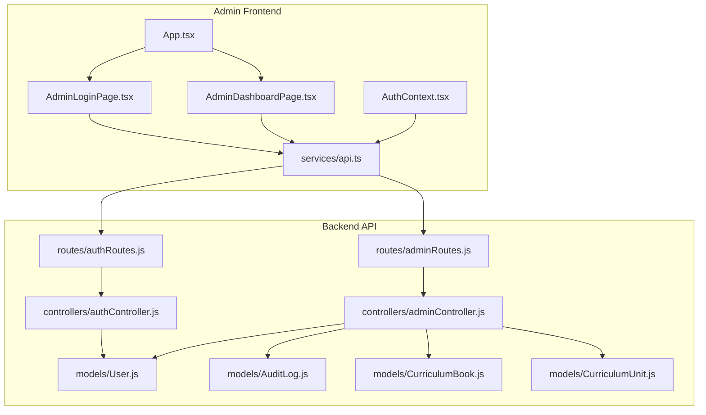
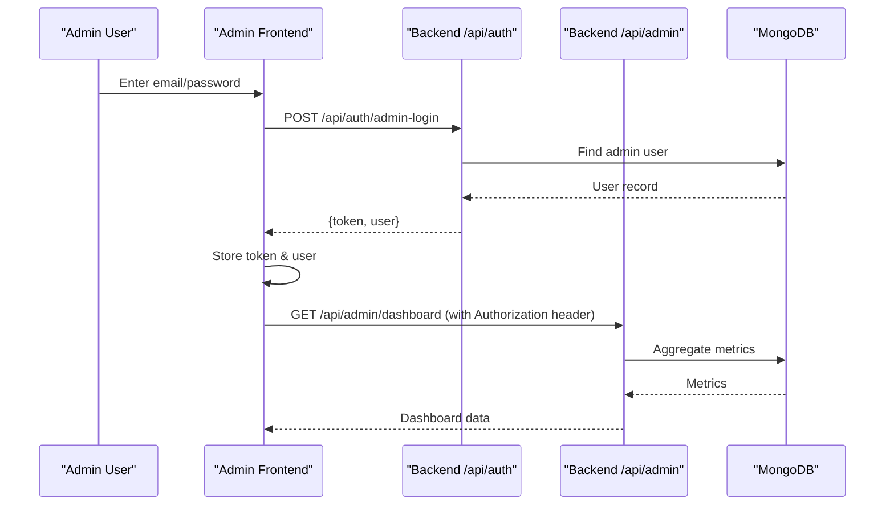
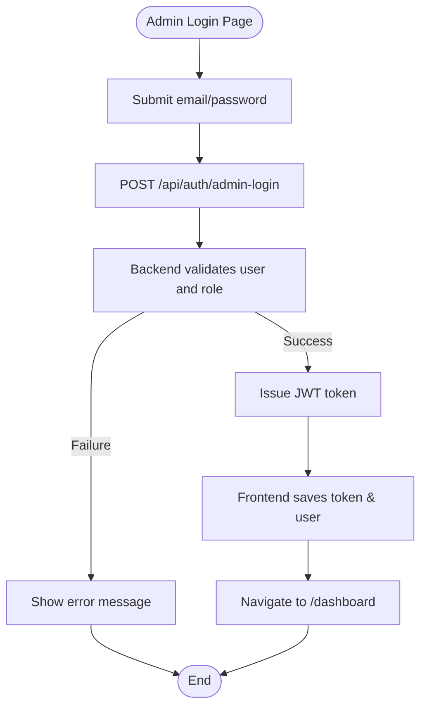
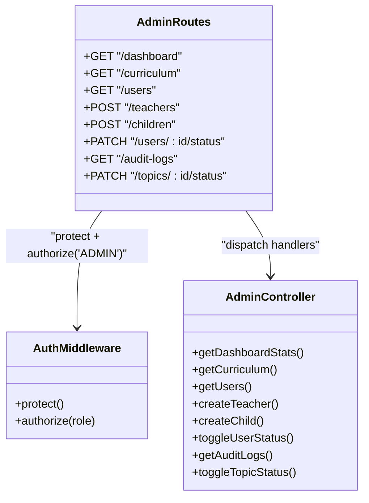
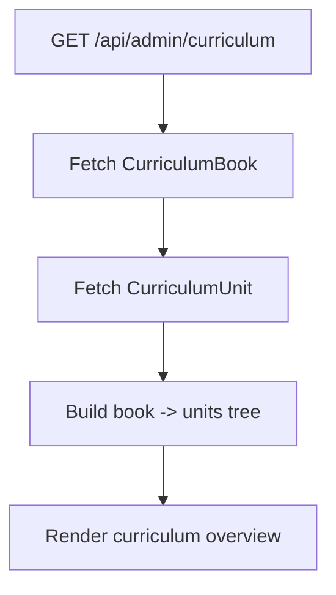
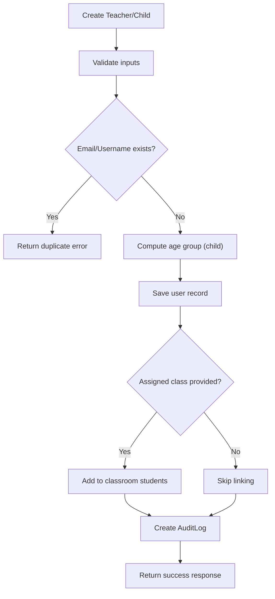
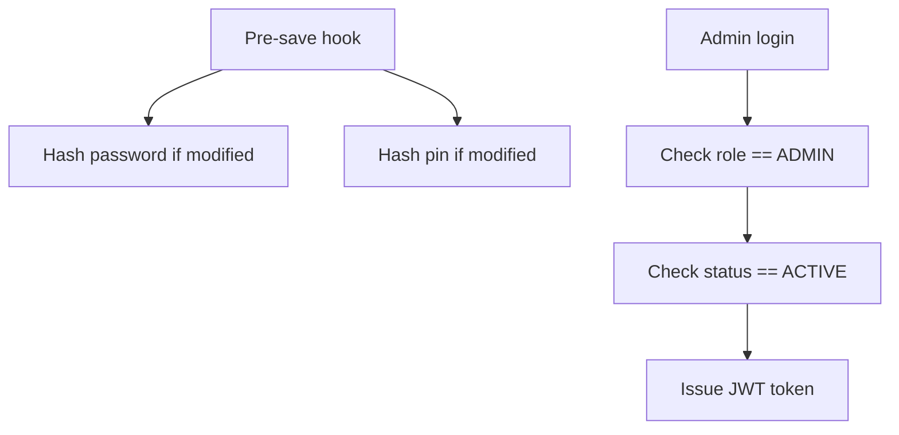
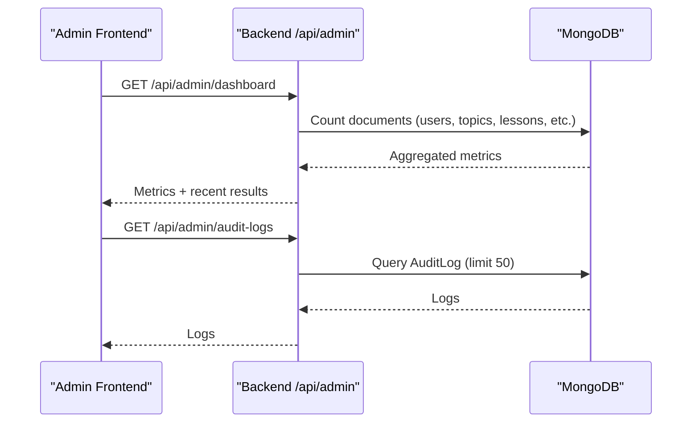
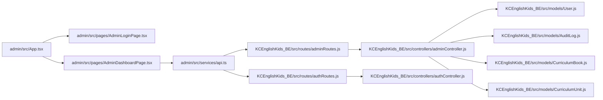

# Admin Portal

<cite>
**Referenced Files in This Document**
- [README.md](file://README.md)
- [App.tsx](file://admin/src/App.tsx)
- [AuthContext.tsx](file://admin/src/context/AuthContext.tsx)
- [AdminLoginPage.tsx](file://admin/src/pages/AdminLoginPage.tsx)
- [AdminDashboardPage.tsx](file://admin/src/pages/AdminDashboardPage.tsx)
- [api.ts](file://admin/src/services/api.ts)
- [index.ts](file://admin/src/types/index.ts)
- [adminController.js](file://KCEnglishKids_BE/src/controllers/adminController.js)
- [authController.js](file://KCEnglishKids_BE/src/controllers/authController.js)
- [adminRoutes.js](file://KCEnglishKids_BE/src/routes/adminRoutes.js)
- [authRoutes.js](file://KCEnglishKids_BE/src/routes/authRoutes.js)
- [User.js](file://KCEnglishKids_BE/src/models/User.js)
- [AuditLog.js](file://KCEnglishKids_BE/src/models/AuditLog.js)
- [CurriculumBook.js](file://KCEnglishKids_BE/src/models/CurriculumBook.js)
- [CurriculumUnit.js](file://KCEnglishKids_BE/src/models/CurriculumUnit.js)
</cite>

## Table of Contents
1. [Introduction](#introduction)
2. [Project Structure](#project-structure)
3. [Core Components](#core-components)
4. [Architecture Overview](#architecture-overview)
5. [Detailed Component Analysis](#detailed-component-analysis)
6. [Dependency Analysis](#dependency-analysis)
7. [Performance Considerations](#performance-considerations)
8. [Troubleshooting Guide](#troubleshooting-guide)
9. [Conclusion](#conclusion)

## Introduction
This document describes the Admin Portal application for KCEnglishKids, an interactive English learning platform for children ages 3–6. The Admin Portal provides:
- Administrative authentication and role-based access control (RBAC)
- Curriculum administration overview (books, units, official curriculum structure)
- User management for teachers and children (create, modify, lock/unlock)
- System monitoring via dashboard metrics and audit logs
- Integration with the main backend API for authentication and data operations

The Admin Portal is a separate React + TypeScript frontend deployed independently from the student/teacher client and the Node.js backend. It communicates with the backend over REST APIs secured by JWT and protected routes.

## Project Structure
The repository contains three major parts relevant to the Admin Portal:
- Backend (Node.js/Express): Authentication, admin endpoints, models, and routes
- Admin Frontend (React/TypeScript/Vite): Login, protected dashboard, user management, audit log viewer
- Documentation and seeds: README and seed data for curriculum and users

**Diagram sources**
- [App.tsx:1-45](file://admin/src/App.tsx#L1-L45)
- [AdminLoginPage.tsx:1-140](file://admin/src/pages/AdminLoginPage.tsx#L1-L140)
- [AdminDashboardPage.tsx:1-884](file://admin/src/pages/AdminDashboardPage.tsx#L1-L884)
- [AuthContext.tsx:1-82](file://admin/src/context/AuthContext.tsx#L1-L82)
- [api.ts:1-90](file://admin/src/services/api.ts#L1-L90)
- [adminRoutes.js:1-34](file://KCEnglishKids_BE/src/routes/adminRoutes.js#L1-L34)
- [authRoutes.js:1-25](file://KCEnglishKids_BE/src/routes/authRoutes.js#L1-L25)
- [adminController.js:1-396](file://KCEnglishKids_BE/src/controllers/adminController.js#L1-L396)
- [authController.js:1-488](file://KCEnglishKids_BE/src/controllers/authController.js#L1-L488)
- [User.js:1-109](file://KCEnglishKids_BE/src/models/User.js#L1-L109)
- [AuditLog.js:1-34](file://KCEnglishKids_BE/src/models/AuditLog.js#L1-L34)
- [CurriculumBook.js:1-41](file://KCEnglishKids_BE/src/models/CurriculumBook.js#L1-L41)
- [CurriculumUnit.js:1-88](file://KCEnglishKids_BE/src/models/CurriculumUnit.js#L1-L88)

**Section sources**
- [README.md:31-79](file://README.md#L31-L79)

## Core Components
- Admin Authentication Flow
  - Admin login endpoint returns a JWT token and user profile.
  - Frontend stores token and user in localStorage and verifies session on app load.
  - Protected routes enforce ADMIN role both at the UI level and server-side middleware.

- Admin Dashboard
  - Displays KPI metrics (children count, active topics, curriculum units, completion rate).
  - Shows the official curriculum tree (3 books, 27 units).
  - Recent activity results table from MongoDB.

- User Management
  - Create teacher accounts with validation and uniqueness checks.
  - Create child accounts with DOB-based age group assignment and PIN handling.
  - Toggle user status (ACTIVE/LOCKED), preventing locking of the primary admin account.

- Audit Logging
  - Records administrative actions (create user, lock/unlock user, toggle topic).
  - Provides an audit log viewer in the portal.

- Curriculum Administration
  - Read-only view of curriculum books and units.
  - Topic status toggling endpoint available for content publishing workflows.

**Section sources**
- [AuthContext.tsx:15-54](file://admin/src/context/AuthContext.tsx#L15-L54)
- [AdminLoginPage.tsx:16-29](file://admin/src/pages/AdminLoginPage.tsx#L16-L29)
- [AdminDashboardPage.tsx:75-117](file://admin/src/pages/AdminDashboardPage.tsx#L75-L117)
- [adminController.js:28-106](file://KCEnglishKids_BE/src/controllers/adminController.js#L28-L106)
- [adminController.js:147-329](file://KCEnglishKids_BE/src/controllers/adminController.js#L147-L329)
- [adminController.js:331-384](file://KCEnglishKids_BE/src/controllers/adminController.js#L331-L384)

## Architecture Overview
The Admin Portal uses a two-layer architecture:
- Frontend layer: React SPA with route protection and context-managed auth state.
- Backend layer: Express REST API with JWT-based authentication and RBAC middleware protecting admin endpoints.

**Diagram sources**
- [AdminLoginPage.tsx:16-29](file://admin/src/pages/AdminLoginPage.tsx#L16-L29)
- [AuthContext.tsx:47-54](file://admin/src/context/AuthContext.tsx#L47-L54)
- [authRoutes.js:18-20](file://KCEnglishKids_BE/src/routes/authRoutes.js#L18-L20)
- [authController.js:166-212](file://KCEnglishKids_BE/src/controllers/authController.js#L166-L212)
- [adminRoutes.js:15-16](file://KCEnglishKids_BE/src/routes/adminRoutes.js#L15-L16)
- [adminController.js:28-84](file://KCEnglishKids_BE/src/controllers/adminController.js#L28-L84)

## Detailed Component Analysis

### Admin Authentication and Session Management
- Admin login flow validates credentials against the database and issues a JWT token.
- Frontend persists token and user profile in localStorage and refreshes session on app start.
- Route guards ensure only ADMIN users can access protected pages.

**Diagram sources**
- [AdminLoginPage.tsx:16-29](file://admin/src/pages/AdminLoginPage.tsx#L16-L29)
- [authController.js:166-212](file://KCEnglishKids_BE/src/controllers/authController.js#L166-L212)
- [AuthContext.tsx:47-54](file://admin/src/context/AuthContext.tsx#L47-L54)

**Section sources**
- [AuthContext.tsx:15-54](file://admin/src/context/AuthContext.tsx#L15-L54)
- [AuthContext.tsx:56-60](file://admin/src/context/AuthContext.tsx#L56-L60)
- [AuthContext.tsx:22-45](file://admin/src/context/AuthContext.tsx#L22-L45)
- [AdminLoginPage.tsx:16-29](file://admin/src/pages/AdminLoginPage.tsx#L16-L29)
- [authController.js:166-212](file://KCEnglishKids_BE/src/controllers/authController.js#L166-L212)

### Role-Based Access Control (RBAC)
- Server-side: Routes under /api/admin are protected by middleware requiring valid JWT and ADMIN role.
- Client-side: App-level route guard redirects non-admin users to login.

**Diagram sources**
- [adminRoutes.js:15-28](file://KCEnglishKids_BE/src/routes/adminRoutes.js#L15-L28)
- [adminController.js:28-384](file://KCEnglishKids_BE/src/controllers/adminController.js#L28-L384)

**Section sources**
- [adminRoutes.js:15-28](file://KCEnglishKids_BE/src/routes/adminRoutes.js#L15-L28)
- [App.tsx:7-20](file://admin/src/App.tsx#L7-L20)

### Curriculum Administration
- Reads curriculum books and units, aggregates into a tree structure for display.
- Official curriculum structure includes 3 books and 27 units across age groups.
- Topic status toggling supports publishing workflows.

**Diagram sources**
- [adminController.js:86-106](file://KCEnglishKids_BE/src/controllers/adminController.js#L86-L106)
- [CurriculumBook.js:1-41](file://KCEnglishKids_BE/src/models/CurriculumBook.js#L1-L41)
- [CurriculumUnit.js:1-88](file://KCEnglishKids_BE/src/models/CurriculumUnit.js#L1-L88)

**Section sources**
- [adminController.js:86-106](file://KCEnglishKids_BE/src/controllers/adminController.js#L86-L106)
- [CurriculumBook.js:1-41](file://KCEnglishKids_BE/src/models/CurriculumBook.js#L1-L41)
- [CurriculumUnit.js:1-88](file://KCEnglishKids_BE/src/models/CurriculumUnit.js#L1-L88)

### User Management Capabilities
- Create Teacher: Validates required fields, ensures uniqueness, creates user with TEACHER role, logs action.
- Create Child: Validates PIN length, computes age group from DOB, links to class if provided, logs action.
- Toggle Status: Locks/unlocks users except the primary admin; logs action.

**Diagram sources**
- [adminController.js:147-288](file://KCEnglishKids_BE/src/controllers/adminController.js#L147-L288)
- [AuditLog.js:1-34](file://KCEnglishKids_BE/src/models/AuditLog.js#L1-L34)

**Section sources**
- [adminController.js:147-288](file://KCEnglishKids_BE/src/controllers/adminController.js#L147-L288)
- [adminController.js:290-329](file://KCEnglishKids_BE/src/controllers/adminController.js#L290-L329)

### Security Measures
- Passwords and PINs are hashed using bcrypt before persistence.
- Admin login requires role check and ACTIVE status.
- Sensitive fields (password, pin) are excluded from queries where appropriate.
- JWT tokens are used for authenticated requests; stored securely in localStorage for the session.

**Diagram sources**
- [User.js:84-106](file://KCEnglishKids_BE/src/models/User.js#L84-L106)
- [authController.js:166-212](file://KCEnglishKids_BE/src/controllers/authController.js#L166-L212)

**Section sources**
- [User.js:84-106](file://KCEnglishKids_BE/src/models/User.js#L84-L106)
- [authController.js:166-212](file://KCEnglishKids_BE/src/controllers/authController.js#L166-L212)

### System Monitoring and Audit Logs
- Dashboard metrics aggregate counts across users, topics, lessons, activities, vocabulary, sessions, and curriculum units.
- Audit logs capture administrative actions with actor, target, and details.

**Diagram sources**
- [adminController.js:28-84](file://KCEnglishKids_BE/src/controllers/adminController.js#L28-L84)
- [adminController.js:331-349](file://KCEnglishKids_BE/src/controllers/adminController.js#L331-L349)

**Section sources**
- [adminController.js:28-84](file://KCEnglishKids_BE/src/controllers/adminController.js#L28-L84)
- [adminController.js:331-349](file://KCEnglishKids_BE/src/controllers/adminController.js#L331-L349)

## Dependency Analysis
The Admin Portal depends on:
- Frontend components for routing, authentication context, and API clients
- Backend routes for authentication and admin operations
- Controllers implementing business logic and data aggregation
- Models defining schema and pre-save hooks for security

**Diagram sources**
- [App.tsx:1-45](file://admin/src/App.tsx#L1-L45)
- [AdminLoginPage.tsx:1-140](file://admin/src/pages/AdminLoginPage.tsx#L1-L140)
- [AdminDashboardPage.tsx:1-884](file://admin/src/pages/AdminDashboardPage.tsx#L1-L884)
- [api.ts:1-90](file://admin/src/services/api.ts#L1-L90)
- [adminRoutes.js:1-34](file://KCEnglishKids_BE/src/routes/adminRoutes.js#L1-L34)
- [authRoutes.js:1-25](file://KCEnglishKids_BE/src/routes/authRoutes.js#L1-L25)
- [adminController.js:1-396](file://KCEnglishKids_BE/src/controllers/adminController.js#L1-L396)
- [authController.js:1-488](file://KCEnglishKids_BE/src/controllers/authController.js#L1-L488)
- [User.js:1-109](file://KCEnglishKids_BE/src/models/User.js#L1-L109)
- [AuditLog.js:1-34](file://KCEnglishKids_BE/src/models/AuditLog.js#L1-L34)
- [CurriculumBook.js:1-41](file://KCEnglishKids_BE/src/models/CurriculumBook.js#L1-L41)
- [CurriculumUnit.js:1-88](file://KCEnglishKids_BE/src/models/CurriculumUnit.js#L1-L88)

**Section sources**
- [adminRoutes.js:15-28](file://KCEnglishKids_BE/src/routes/adminRoutes.js#L15-L28)
- [authRoutes.js:18-20](file://KCEnglishKids_BE/src/routes/authRoutes.js#L18-L20)

## Performance Considerations
- Use parallel fetching for dashboard metrics and curriculum data to reduce latency.
- Limit audit log retrieval to recent entries to avoid heavy queries.
- Exclude sensitive fields from query projections to minimize payload size.
- Leverage indexes on frequently queried fields (e.g., createdAt, role, status).

[No sources needed since this section provides general guidance]

## Troubleshooting Guide
- Admin login fails:
  - Verify email and password match an ACTIVE ADMIN user.
  - Ensure JWT secret is configured correctly on the backend.
- Unauthorized access to admin routes:
  - Confirm Authorization header includes a valid JWT token.
  - Check that the user’s role is ADMIN.
- User creation errors:
  - Ensure unique email/username and valid PIN format.
  - Validate DOB for correct age group assignment.
- Audit logs not appearing:
  - Confirm administrative actions are performed through protected endpoints.
  - Verify AuditLog model and indexing configuration.

**Section sources**
- [authController.js:166-212](file://KCEnglishKids_BE/src/controllers/authController.js#L166-L212)
- [adminController.js:147-288](file://KCEnglishKids_BE/src/controllers/adminController.js#L147-L288)
- [adminController.js:331-349](file://KCEnglishKids_BE/src/controllers/adminController.js#L331-L349)

## Conclusion
The Admin Portal provides a secure, role-gated interface for managing curriculum content, user accounts, and system configuration. It integrates tightly with the backend’s authentication and authorization mechanisms, ensuring sensitive administrative functions are protected. The dashboard offers performance metrics and recent activity insights, while audit logging maintains accountability for administrative actions. The separate deployment of the Admin Portal allows independent scaling and maintenance alongside the main application.

[No sources needed since this section summarizes without analyzing specific files]