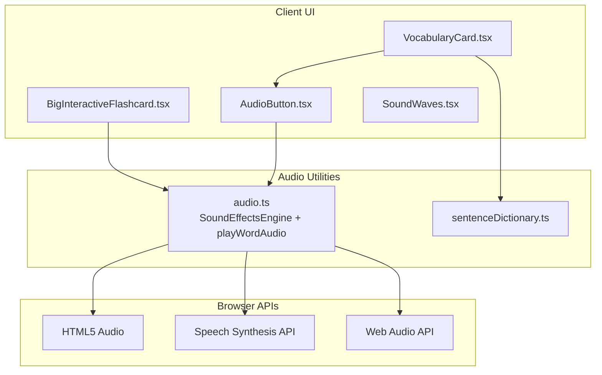
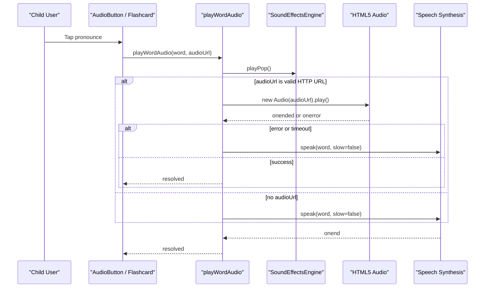
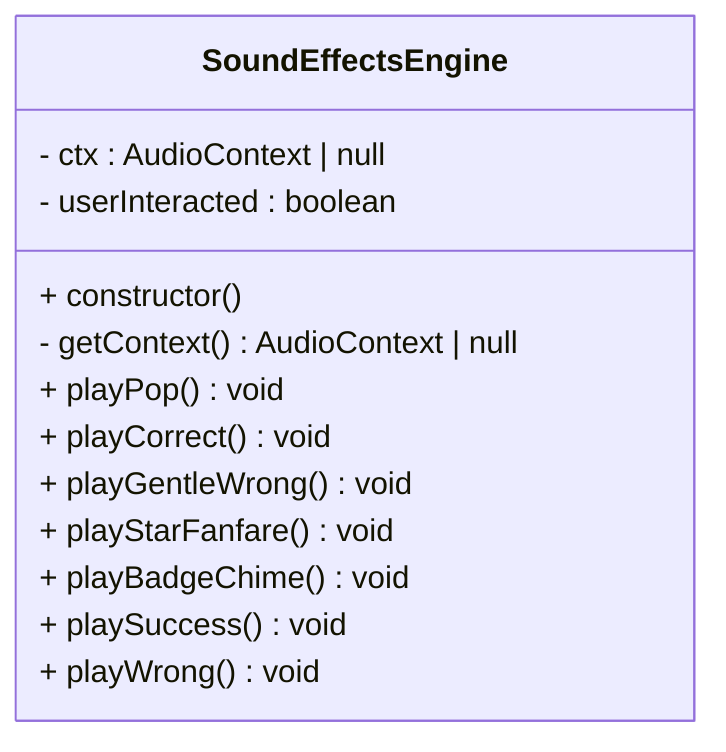
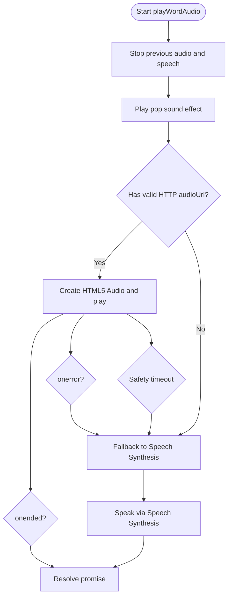
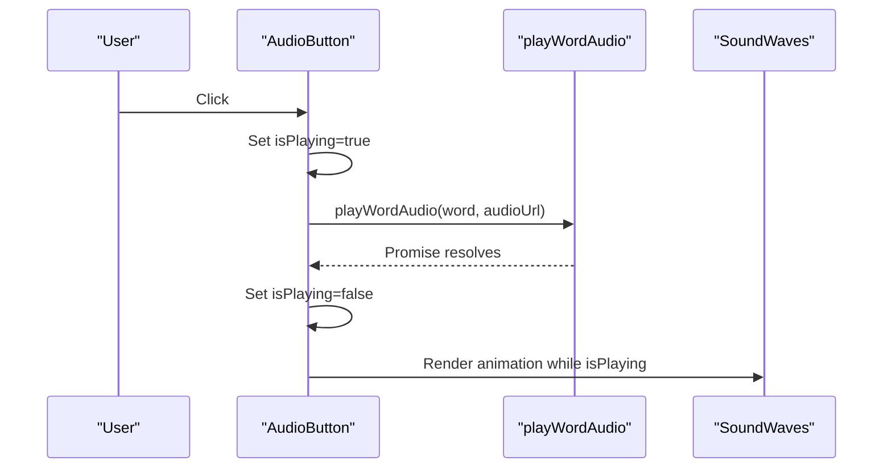
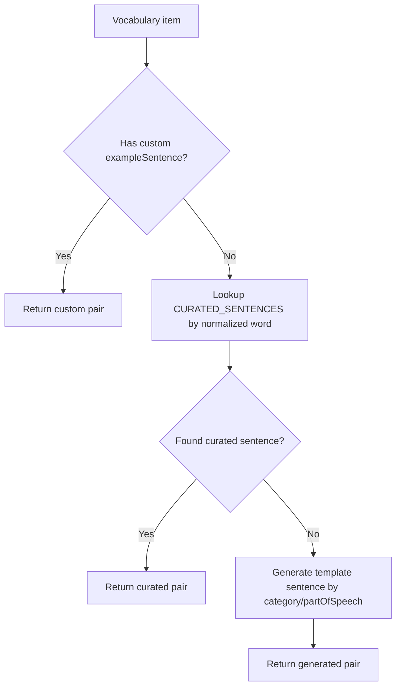
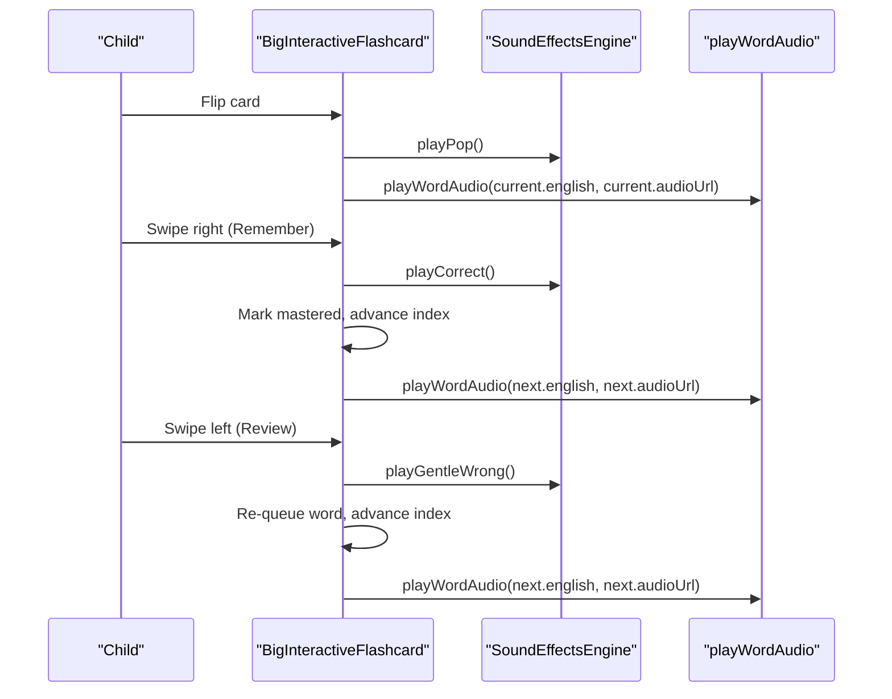
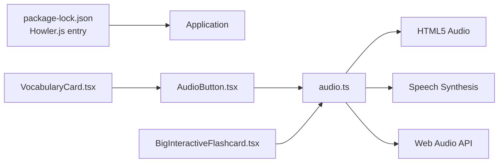

# Audio System Architecture

<cite>
**Referenced Files in This Document**
- [audio.ts](file://client/src/utils/audio.ts)
- [sentenceDictionary.ts](file://client/src/utils/sentenceDictionary.ts)
- [AudioButton.tsx](file://client/src/components/child/AudioButton.tsx)
- [SoundWaves.tsx](file://client/src/components/child/SoundWaves.tsx)
- [VocabularyCard.tsx](file://client/src/components/child/VocabularyCard.tsx)
- [BigInteractiveFlashcard.tsx](file://client/src/components/child/BigInteractiveFlashcard.tsx)
- [package-lock.json](file://client/package-lock.json)
</cite>

## Table of Contents
1. [Introduction](#introduction)
2. [Project Structure](#project-structure)
3. [Core Components](#core-components)
4. [Architecture Overview](#architecture-overview)
5. [Detailed Component Analysis](#detailed-component-analysis)
6. [Dependency Analysis](#dependency-analysis)
7. [Performance Considerations](#performance-considerations)
8. [Troubleshooting Guide](#troubleshooting-guide)
9. [Conclusion](#conclusion)

## Introduction
This document explains the KCEnglishKids audio system architecture. The system uses a dual-audio approach:
- Pre-recorded audio files are played through HTML5 audio with a safety fallback to browser speech synthesis for text-to-speech.
- Real-time sound effects are generated using the Web Audio API for game interactions, success celebrations, and user feedback.
- A reusable audio button component provides consistent playback behavior across child-facing screens.
- A sentence dictionary maps vocabulary words to curated example sentences used for instructional feedback and reading practice.

The design prioritizes reliability, accessibility for young learners, and graceful degradation when network or browser constraints prevent pre-recorded audio from playing.

## Project Structure
The audio-related code lives primarily under the client application:
- Core audio utilities and sound effects engine: `client/src/utils/audio.ts`
- Sentence dictionary helper: `client/src/utils/sentenceDictionary.ts`
- Reusable audio button component: `client/src/components/child/AudioButton.tsx`
- Visual sound wave indicator: `client/src/components/child/SoundWaves.tsx`
- Vocabulary card that integrates pronunciation and example sentences: `client/src/components/child/VocabularyCard.tsx`
- Interactive flashcard flow that orchestrates study sessions, mastery tracking, and audio cues: `client/src/components/child/BigInteractiveFlashcard.tsx`
- Dependency manifest showing Howler.js availability: `client/package-lock.json`

**Diagram sources**
- [VocabularyCard.tsx:1-72](file://client/src/components/child/VocabularyCard.tsx#L1-L72)
- [BigInteractiveFlashcard.tsx:1-628](file://client/src/components/child/BigInteractiveFlashcard.tsx#L1-L628)
- [AudioButton.tsx:1-74](file://client/src/components/child/AudioButton.tsx#L1-L74)
- [audio.ts:1-360](file://client/src/utils/audio.ts#L1-L360)
- [sentenceDictionary.ts:1-281](file://client/src/utils/sentenceDictionary.ts#L1-L281)

**Section sources**
- [audio.ts:1-360](file://client/src/utils/audio.ts#L1-L360)
- [sentenceDictionary.ts:1-281](file://client/src/utils/sentenceDictionary.ts#L1-L281)
- [AudioButton.tsx:1-74](file://client/src/components/child/AudioButton.tsx#L1-L74)
- [SoundWaves.tsx:1-43](file://client/src/components/child/SoundWaves.tsx#L1-L43)
- [VocabularyCard.tsx:1-72](file://client/src/components/child/VocabularyCard.tsx#L1-L72)
- [BigInteractiveFlashcard.tsx:1-628](file://client/src/components/child/BigInteractiveFlashcard.tsx#L1-L628)

## Core Components
- Sound Effects Engine: Generates short interactive sounds (pop, correct, gentle wrong, star fanfare, badge chime) using oscillators and gain nodes. It also manages the Web Audio context lifecycle and user gesture unlocking.
- Word Pronunciation Pipeline: Attempts to play an HTTP audio file; if unavailable or blocked, falls back to Speech Synthesis with child-friendly rate and pitch. It stops any previously playing audio and prevents overlapping playback.
- Audio Button Component: Provides a consistent, accessible UI for triggering word pronunciation with visual feedback and size variants.
- Sentence Dictionary: Supplies age-appropriate example sentences for vocabulary items, including curated mappings and template-based generation based on category and part of speech.
- Integration Points: Vocabulary cards and flashcards use the audio utilities and sentence dictionary to deliver pronunciation, reading, and instructional feedback.

**Section sources**
- [audio.ts:1-360](file://client/src/utils/audio.ts#L1-L360)
- [AudioButton.tsx:1-74](file://client/src/components/child/AudioButton.tsx#L1-L74)
- [sentenceDictionary.ts:1-281](file://client/src/utils/sentenceDictionary.ts#L1-L281)
- [VocabularyCard.tsx:1-72](file://client/src/components/child/VocabularyCard.tsx#L1-L72)
- [BigInteractiveFlashcard.tsx:1-628](file://client/src/components/child/BigInteractiveFlashcard.tsx#L1-L628)

## Architecture Overview
The audio system combines two complementary technologies:
- HTML5 Audio for pre-recorded pronunciation files.
- Speech Synthesis API as a reliable fallback for text-to-speech.
- Web Audio API for real-time sound effects without external assets.

**Diagram sources**
- [audio.ts:217-318](file://client/src/utils/audio.ts#L217-L318)
- [AudioButton.tsx:21-31](file://client/src/components/child/AudioButton.tsx#L21-L31)
- [BigInteractiveFlashcard.tsx:164-170](file://client/src/components/child/BigInteractiveFlashcard.tsx#L164-L170)

## Detailed Component Analysis

### Sound Effects Engine
Responsibilities:
- Manage Web Audio context creation and resume after user interaction.
- Generate short synthesized sounds for UI feedback and game events.
- Provide aliases for common actions like success and wrong answers.

Key behaviors:
- Context unlock via click, keydown, touchstart, pointerdown.
- Oscillator-based tones with controlled frequency ramps and gain envelopes.
- Graceful handling of suspended contexts and unsupported environments.

**Diagram sources**
- [audio.ts:1-182](file://client/src/utils/audio.ts#L1-L182)

**Section sources**
- [audio.ts:1-182](file://client/src/utils/audio.ts#L1-L182)

### Word Pronunciation Pipeline
Responsibilities:
- Stop any currently playing audio or speech synthesis before starting new playback.
- Attempt HTML5 audio playback for provided HTTP URLs.
- Fallback to Speech Synthesis with child-friendly parameters when audio fails or is not available.
- Provide a slow pronunciation mode for phonics practice.

Flow highlights:
- Immediate cleanup of previous playback state.
- Safety timer to detect stalled or hanging remote audio.
- Distinct handling for autoplay policy errors and abort scenarios.
- Consistent finalization to avoid memory leaks and repeated utterances.

**Diagram sources**
- [audio.ts:184-318](file://client/src/utils/audio.ts#L184-L318)

**Section sources**
- [audio.ts:184-358](file://client/src/utils/audio.ts#L184-L358)

### Audio Button Component
Responsibilities:
- Provide a consistent, accessible button for word pronunciation.
- Prevent duplicate playback while an utterance is active.
- Show animated sound waves during playback.

Integration:
- Calls `playWordAudio` with the target word and optional audio URL.
- Uses `SoundWaves` for visual feedback.

**Diagram sources**
- [AudioButton.tsx:21-31](file://client/src/components/child/AudioButton.tsx#L21-L31)
- [AudioButton.tsx:46-70](file://client/src/components/child/AudioButton.tsx#L46-L70)
- [SoundWaves.tsx:9-40](file://client/src/components/child/SoundWaves.tsx#L9-L40)

**Section sources**
- [AudioButton.tsx:1-74](file://client/src/components/child/AudioButton.tsx#L1-L74)
- [SoundWaves.tsx:1-43](file://client/src/components/child/SoundWaves.tsx#L1-L43)

### Sentence Dictionary System
Responsibilities:
- Provide curated English-Vietnamese example sentences for vocabulary words.
- Fall back to template-generated sentences based on category and part of speech.
- Respect custom example sentences when present.

Usage:
- Vocabulary cards display the generated sentence alongside the word and meaning.
- Sentences can be read aloud via the pronunciation pipeline to reinforce learning.

**Diagram sources**
- [sentenceDictionary.ts:10-167](file://client/src/utils/sentenceDictionary.ts#L10-L167)
- [sentenceDictionary.ts:169-281](file://client/src/utils/sentenceDictionary.ts#L169-L281)

**Section sources**
- [sentenceDictionary.ts:1-281](file://client/src/utils/sentenceDictionary.ts#L1-L281)
- [VocabularyCard.tsx:11-13](file://client/src/components/child/VocabularyCard.tsx#L11-L13)

### Flashcard Study Flow and Audio Cues
Responsibilities:
- Orchestrate study sessions with swipe gestures for remembering or reviewing words.
- Trigger appropriate sound effects for user actions (pop, correct, gentle wrong, success).
- Auto-play pronunciation when flipping cards or navigating between items.
- Integrate mastery tracking and session completion flows.

Key integration points:
- Uses `sfx` for sound effects and `playWordAudio` for pronunciation.
- Plays encouragement and celebration sounds at milestones.

**Diagram sources**
- [BigInteractiveFlashcard.tsx:164-218](file://client/src/components/child/BigInteractiveFlashcard.tsx#L164-L218)
- [BigInteractiveFlashcard.tsx:50-61](file://client/src/components/child/BigInteractiveFlashcard.tsx#L50-L61)

**Section sources**
- [BigInteractiveFlashcard.tsx:1-628](file://client/src/components/child/BigInteractiveFlashcard.tsx#L1-L628)

## Dependency Analysis
- Client dependencies include Howler.js in the dependency manifest, indicating potential usage elsewhere in the app, but the core audio utilities in this repository rely on native browser APIs rather than Howler.js directly.
- The audio utilities depend on:
  - HTML5 Audio for pre-recorded files.
  - Speech Synthesis API for fallback text-to-speech.
  - Web Audio API for synthesized sound effects.
- UI components depend on the audio utilities and each other for consistent behavior.

**Diagram sources**
- [package-lock.json:1389-1394](file://client/package-lock.json#L1389-L1394)
- [audio.ts:1-360](file://client/src/utils/audio.ts#L1-L360)
- [AudioButton.tsx:1-74](file://client/src/components/child/AudioButton.tsx#L1-L74)
- [VocabularyCard.tsx:1-72](file://client/src/components/child/VocabularyCard.tsx#L1-L72)
- [BigInteractiveFlashcard.tsx:1-628](file://client/src/components/child/BigInteractiveFlashcard.tsx#L1-L628)

**Section sources**
- [package-lock.json:1389-1394](file://client/package-lock.json#L1389-L1394)
- [audio.ts:1-360](file://client/src/utils/audio.ts#L1-L360)

## Performance Considerations
- Avoid overlapping audio: The pronunciation pipeline stops previous playback before starting new audio or speech synthesis.
- Safety timeouts: Remote audio playback includes a timeout to prevent hanging resources and trigger fallback speech synthesis.
- Lightweight sound effects: Oscillators and gain nodes are created per event and stopped promptly to minimize resource usage.
- Slow pronunciation mode: Uses lower rate values for clearer syllable articulation suitable for young learners.
- Minimal DOM overhead: Sound effects do not require heavy assets; visual feedback is handled with lightweight CSS animations.

[No sources needed since this section provides general guidance]

## Troubleshooting Guide
Common issues and resolutions:
- Autoplay blocked: If the browser blocks audio due to missing user gestures, the system handles `NotAllowedError` gracefully and avoids infinite fallback loops. Encourage users to interact with the page first.
- Network failures: If remote audio fails to load or stalls, the safety timeout triggers speech synthesis fallback.
- Suspended audio context: The engine resumes the Web Audio context upon user interaction and guards against unsupported environments.
- No speech synthesis support: If the browser lacks speech synthesis, the system degrades silently without errors.

Operational tips:
- Ensure user gestures occur before expecting audio (click, tap, keydown).
- Verify that audio URLs are valid HTTP(S) links.
- Use the slow pronunciation mode for phonics-focused activities.

**Section sources**
- [audio.ts:257-282](file://client/src/utils/audio.ts#L257-L282)
- [audio.ts:286-318](file://client/src/utils/audio.ts#L286-L318)
- [audio.ts:323-358](file://client/src/utils/audio.ts#L323-L358)

## Conclusion
KCEnglishKids’ audio system delivers a robust, child-friendly experience by combining pre-recorded audio with speech synthesis fallback and real-time synthesized sound effects. The architecture emphasizes reliability, accessibility, and clear feedback for young learners. Components are modular and well-integrated, enabling consistent pronunciation and engaging interactions across vocabulary cards and flashcard study sessions. When audio resources are unavailable or browsers restrict playback, the system gracefully falls back to synthesized speech, ensuring continuity of the learning experience.

[No sources needed since this section summarizes without analyzing specific files]