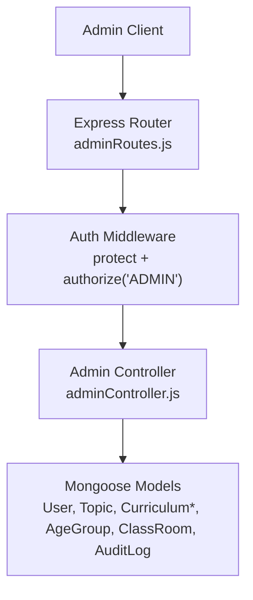
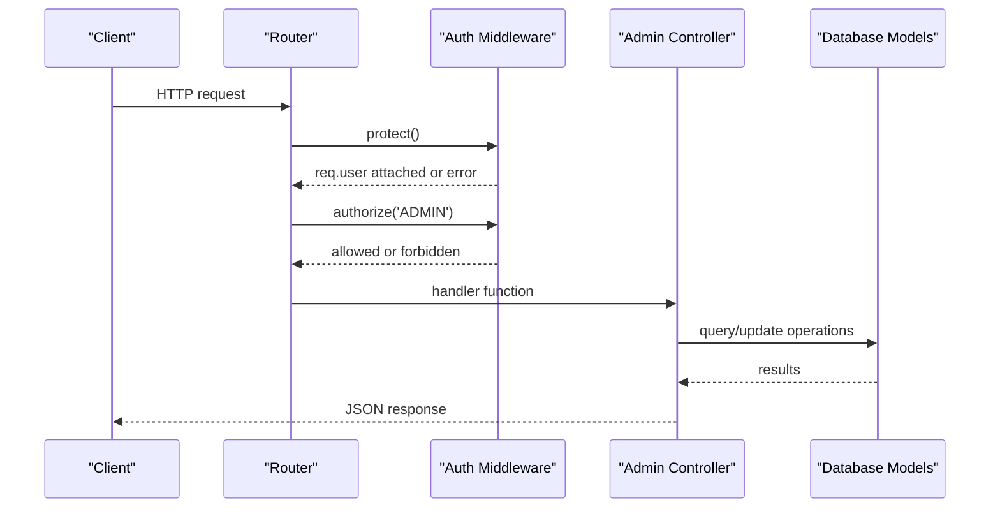
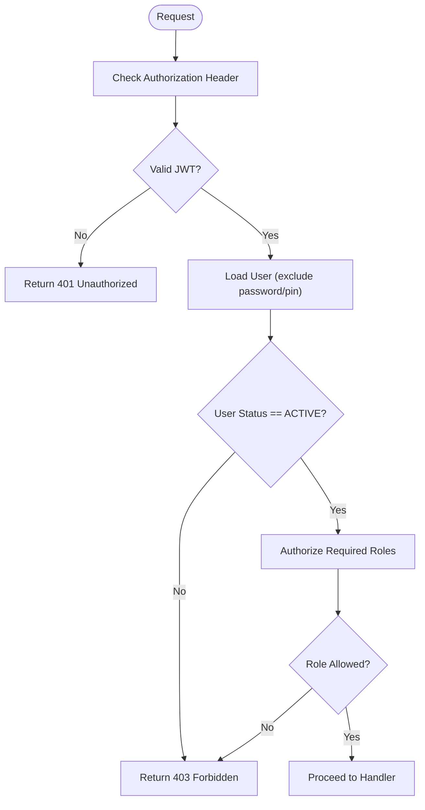
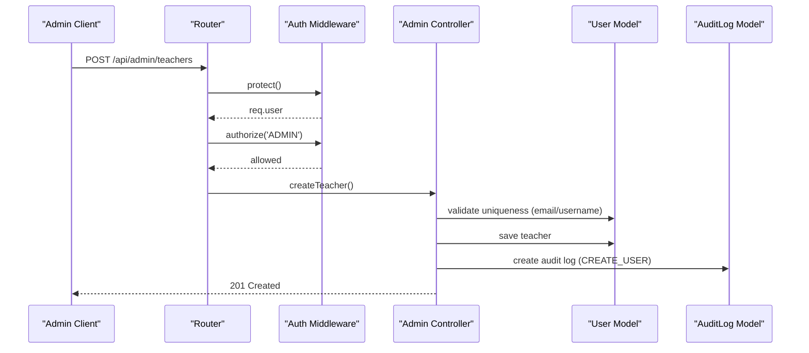
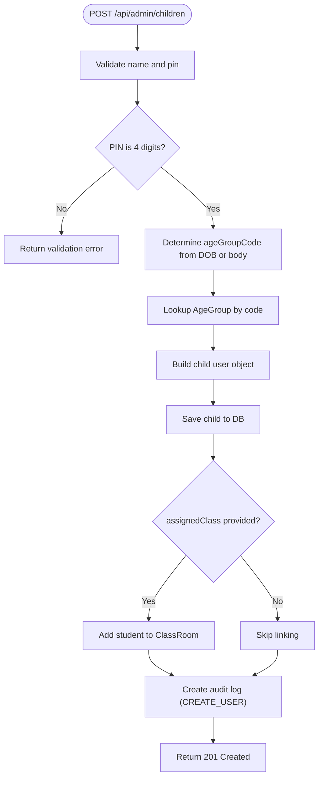
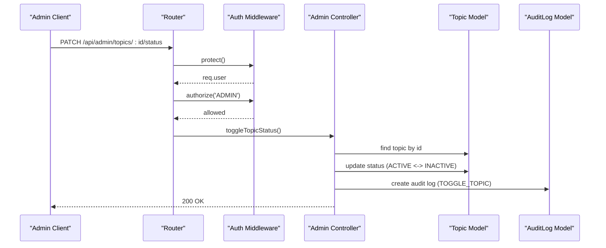
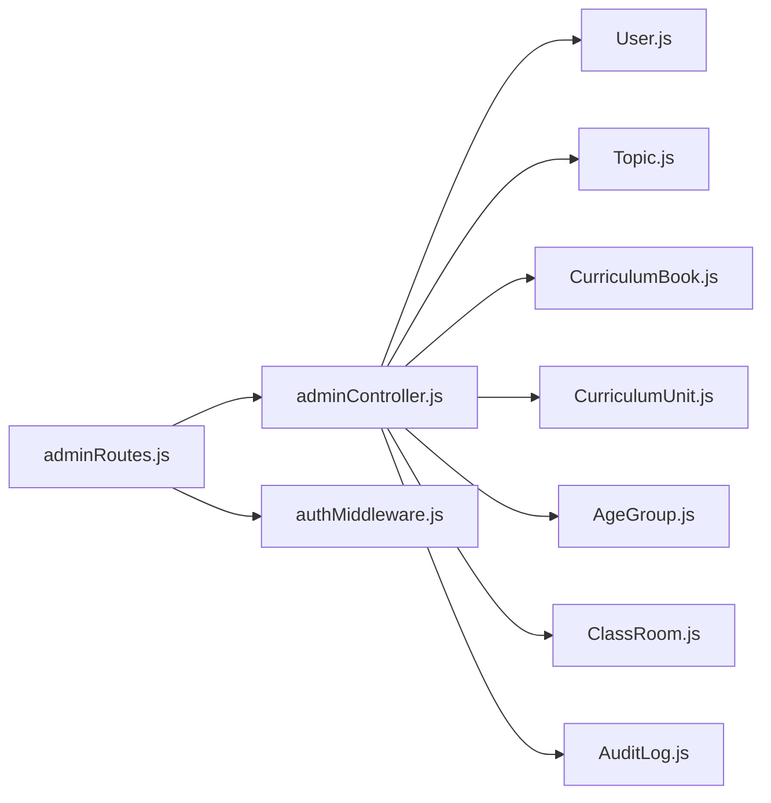

# Admin Operations API

<cite>
**Referenced Files in This Document**
- [adminController.js](file://KCEnglishKids_BE/src/controllers/adminController.js)
- [adminRoutes.js](file://KCEnglishKids_BE/src/routes/adminRoutes.js)
- [authMiddleware.js](file://KCEnglishKids_BE/src/middlewares/authMiddleware.js)
- [AuditLog.js](file://KCEnglishKids_BE/src/models/AuditLog.js)
- [User.js](file://KCEnglishKids_BE/src/models/User.js)
- [Topic.js](file://KCEnglishKids_BE/src/models/Topic.js)
- [CurriculumBook.js](file://KCEnglishKids_BE/src/models/CurriculumBook.js)
- [CurriculumUnit.js](file://KCEnglishKids_BE/src/models/CurriculumUnit.js)
- [AgeGroup.js](file://KCEnglishKids_BE/src/models/AgeGroup.js)
- [ClassRoom.js](file://KCEnglishKids_BE/src/models/ClassRoom.js)
</cite>

## Table of Contents
1. [Introduction](#introduction)
2. [Project Structure](#project-structure)
3. [Core Components](#core-components)
4. [Architecture Overview](#architecture-overview)
5. [Detailed Component Analysis](#detailed-component-analysis)
6. [Dependency Analysis](#dependency-analysis)
7. [Performance Considerations](#performance-considerations)
8. [Troubleshooting Guide](#troubleshooting-guide)
9. [Conclusion](#conclusion)

## Introduction
This document provides detailed API documentation for Administrative Operations endpoints. It covers user management, system administration, content administration, and audit logging. The administrative APIs are protected by role-based authorization and log significant actions to an audit trail.

Key areas covered:
- User account management (teachers and children)
- System monitoring via dashboard metrics
- Content administration (curriculum overview and topic status toggling)
- Audit trail access and action logging

Administrative privileges:
- All admin endpoints require a valid JWT token and the ADMIN role.
- A public endpoint exposes limited dashboard statistics without authentication.

## Project Structure
The administrative functionality is implemented as follows:
- Routes define URL paths and apply middleware for authentication and authorization.
- Controllers implement business logic for each endpoint.
- Models define data schemas and constraints.
- Middleware enforces authentication and role checks.

**Diagram sources**
- [adminRoutes.js:1-34](file://KCEnglishKids_BE/src/routes/adminRoutes.js#L1-L34)
- [authMiddleware.js:1-59](file://KCEnglishKids_BE/src/middlewares/authMiddleware.js#L1-L59)
- [adminController.js:1-396](file://KCEnglishKids_BE/src/controllers/adminController.js#L1-L396)

**Section sources**
- [adminRoutes.js:1-34](file://KCEnglishKids_BE/src/routes/adminRoutes.js#L1-L34)
- [authMiddleware.js:1-59](file://KCEnglishKids_BE/src/middlewares/authMiddleware.js#L1-L59)

## Core Components
- Authentication and Authorization:
  - protect: validates JWT and attaches user to request; rejects inactive or locked accounts.
  - authorize(...roles): ensures the authenticated user has one of the required roles.
- Admin Controller:
  - Provides endpoints for dashboard stats, curriculum listing, user management, audit logs, and topic status control.
- Data Models:
  - User: defines roles, statuses, and credential fields.
  - AuditLog: records administrative actions with timestamps.
  - Topic, CurriculumBook, CurriculumUnit, AgeGroup, ClassRoom: support content and classroom administration.

**Section sources**
- [authMiddleware.js:1-59](file://KCEnglishKids_BE/src/middlewares/authMiddleware.js#L1-L59)
- [adminController.js:1-396](file://KCEnglishKids_BE/src/controllers/adminController.js#L1-L396)
- [User.js:1-109](file://KCEnglishKids_BE/src/models/User.js#L1-L109)
- [AuditLog.js:1-34](file://KCEnglishKids_BE/src/models/AuditLog.js#L1-L34)

## Architecture Overview
The admin API follows a standard Express pattern:
- Request enters through routes.
- Middleware authenticates and authorizes the request.
- Controller executes business logic and interacts with models.
- Responses include success flags, messages, and data payloads.

**Diagram sources**
- [adminRoutes.js:15-28](file://KCEnglishKids_BE/src/routes/adminRoutes.js#L15-L28)
- [authMiddleware.js:4-43](file://KCEnglishKids_BE/src/middlewares/authMiddleware.js#L4-L43)
- [adminController.js:25-395](file://KCEnglishKids_BE/src/controllers/adminController.js#L25-L395)

## Detailed Component Analysis

### Authentication and Authorization
- protect:
  - Validates Bearer token using JWT secret.
  - Loads user without sensitive fields.
  - Rejects requests if user not found or status is not ACTIVE.
- authorize:
  - Ensures the user’s role matches at least one of the provided roles.

**Diagram sources**
- [authMiddleware.js:4-43](file://KCEnglishKids_BE/src/middlewares/authMiddleware.js#L4-L43)

**Section sources**
- [authMiddleware.js:1-59](file://KCEnglishKids_BE/src/middlewares/authMiddleware.js#L1-L59)

### Endpoints Reference

#### GET /api/admin/dashboard
- Purpose: Retrieve administrative dashboard KPI metrics and recent activity results.
- Access: Private / Admin
- Query Parameters: None
- Response Schema:
  - success: boolean
  - data.metrics: object containing counts and rates such as totalChildren, totalTeachers, activeTopics, activeLessons, totalActivities, totalVocabulary, totalCurriculumUnits, totalSessions, completedSessions, completionRate
  - data.recentResults: array of recent activity result entries with populated child, activity, and lesson details
- Notes:
  - Metrics are computed via parallel database queries.
  - Recent results are sorted by creation time and limited to a fixed number.

**Section sources**
- [adminController.js:25-84](file://KCEnglishKids_BE/src/controllers/adminController.js#L25-L84)
- [adminRoutes.js:15-15](file://KCEnglishKids_BE/src/routes/adminRoutes.js#L15-L15)

#### GET /api/admin/curriculum
- Purpose: Retrieve full curriculum structure including books and units.
- Access: Private / Admin
- Query Parameters: None
- Response Schema:
  - success: boolean
  - data: array of book objects, each with nested units filtered by bookNumber
- Notes:
  - Books and units are fetched and combined into a tree-like structure.

**Section sources**
- [adminController.js:86-106](file://KCEnglishKids_BE/src/controllers/adminController.js#L86-L106)
- [adminRoutes.js:16-16](file://KCEnglishKids_BE/src/routes/adminRoutes.js#L16-L16)
- [CurriculumBook.js:1-41](file://KCEnglishKids_BE/src/models/CurriculumBook.js#L1-L41)
- [CurriculumUnit.js:1-88](file://KCEnglishKids_BE/src/models/CurriculumUnit.js#L1-L88)

#### GET /api/admin/users
- Purpose: List users with optional filtering by role and search across name, email, username.
- Access: Private / Admin
- Query Parameters:
  - role: string (optional; filter by role; 'ALL' means no filter)
  - search: string (optional; case-insensitive regex on name/email/username)
- Response Schema:
  - success: boolean
  - count: number
  - data: array of user objects excluding password and pin, with populated assignedClass and ageGroup references
- Notes:
  - Sensitive fields are excluded from responses.

**Section sources**
- [adminController.js:108-142](file://KCEnglishKids_BE/src/controllers/adminController.js#L108-L142)
- [adminRoutes.js:19-19](file://KCEnglishKids_BE/src/routes/adminRoutes.js#L19-L19)
- [User.js:1-109](file://KCEnglishKids_BE/src/models/User.js#L1-L109)

#### POST /api/admin/teachers
- Purpose: Create a new teacher account.
- Access: Private / Admin
- Request Body:
  - name: string (required)
  - username: string (required)
  - email: string (required)
  - password: string (required)
  - avatar: string (optional; default avatar key)
  - contact: string (optional)
- Validation:
  - Missing required fields return a validation error.
  - Duplicate email or username returns a conflict error.
- Response Schema:
  - success: boolean
  - message: string
  - data: created teacher user object
- Side Effects:
  - Creates an audit log entry for user creation.

**Section sources**
- [adminController.js:144-199](file://KCEnglishKids_BE/src/controllers/adminController.js#L144-L199)
- [adminRoutes.js:20-20](file://KCEnglishKids_BE/src/routes/adminRoutes.js#L20-L20)
- [User.js:1-109](file://KCEnglishKids_BE/src/models/User.js#L1-L109)
- [AuditLog.js:1-34](file://KCEnglishKids_BE/src/models/AuditLog.js#L1-L34)

#### POST /api/admin/children
- Purpose: Create a new child account with automatic age group assignment based on DOB or explicit code.
- Access: Private / Admin
- Request Body:
  - name: string (required)
  - dob: date string (optional; used to compute age group)
  - avatar: string (optional; avatar key)
  - pin: string (required; must be exactly 4 digits)
  - assignedClass: ObjectId (optional; links student to class)
  - email: string (optional)
  - contact: string (optional)
  - password: string (optional; defaults to pin if not provided)
- Validation:
  - Missing name or pin returns a validation error.
  - Invalid PIN format returns a validation error.
  - Age group determined from DOB or body parameter; linked to AgeGroup model.
- Response Schema:
  - success: boolean
  - message: string
  - data: created child user object
- Side Effects:
  - Links student to classroom if provided.
  - Creates an audit log entry for user creation.

**Section sources**
- [adminController.js:201-288](file://KCEnglishKids_BE/src/controllers/adminController.js#L201-L288)
- [adminRoutes.js:21-21](file://KCEnglishKids_BE/src/routes/adminRoutes.js#L21-L21)
- [User.js:1-109](file://KCEnglishKids_BE/src/models/User.js#L1-L109)
- [AgeGroup.js:1-48](file://KCEnglishKids_BE/src/models/AgeGroup.js#L1-L48)
- [ClassRoom.js:1-49](file://KCEnglishKids_BE/src/models/ClassRoom.js#L1-L49)
- [AuditLog.js:1-34](file://KCEnglishKids_BE/src/models/AuditLog.js#L1-L34)

#### PATCH /api/admin/users/:id/status
- Purpose: Toggle user account status between ACTIVE and LOCKED.
- Access: Private / Admin
- Path Parameters:
  - id: string (user ID)
- Response Schema:
  - success: boolean
  - message: string
  - data: { id, status }
- Rules:
  - Returns 404 if user not found.
  - Prevents locking primary admin accounts.
- Side Effects:
  - Creates an audit log entry for lock/unlock action.

**Section sources**
- [adminController.js:290-329](file://KCEnglishKids_BE/src/controllers/adminController.js#L290-L329)
- [adminRoutes.js:22-22](file://KCEnglishKids_BE/src/routes/adminRoutes.js#L22-L22)
- [User.js:1-109](file://KCEnglishKids_BE/src/models/User.js#L1-L109)
- [AuditLog.js:1-34](file://KCEnglishKids_BE/src/models/AuditLog.js#L1-L34)

#### GET /api/admin/audit-logs
- Purpose: Retrieve recent audit logs with user details.
- Access: Private / Admin
- Query Parameters: None
- Response Schema:
  - success: boolean
  - count: number
  - data: array of audit log entries with populated user fields
- Notes:
  - Logs are sorted by creation time descending and limited to a fixed number.

**Section sources**
- [adminController.js:331-349](file://KCEnglishKids_BE/src/controllers/adminController.js#L331-L349)
- [adminRoutes.js:25-25](file://KCEnglishKids_BE/src/routes/adminRoutes.js#L25-L25)
- [AuditLog.js:1-34](file://KCEnglishKids_BE/src/models/AuditLog.js#L1-L34)

#### PATCH /api/admin/topics/:id/status
- Purpose: Toggle topic status between ACTIVE and INACTIVE.
- Access: Private / Admin
- Path Parameters:
  - id: string (topic ID)
- Response Schema:
  - success: boolean
  - message: string
  - data: updated topic object
- Side Effects:
  - Creates an audit log entry for topic toggle.

**Section sources**
- [adminController.js:351-384](file://KCEnglishKids_BE/src/controllers/adminController.js#L351-L384)
- [adminRoutes.js:28-28](file://KCEnglishKids_BE/src/routes/adminRoutes.js#L28-L28)
- [Topic.js:1-78](file://KCEnglishKids_BE/src/models/Topic.js#L1-L78)
- [AuditLog.js:1-34](file://KCEnglishKids_BE/src/models/AuditLog.js#L1-L34)

#### GET /api/admin/public-stats
- Purpose: Public preview of dashboard statistics without authentication.
- Access: Public
- Query Parameters: None
- Response Schema: Same as /api/admin/dashboard but accessible without auth.

**Section sources**
- [adminController.js:25-84](file://KCEnglishKids_BE/src/controllers/adminController.js#L25-L84)
- [adminRoutes.js:31-31](file://KCEnglishKids_BE/src/routes/adminRoutes.js#L31-L31)

### Data Models Reference

#### User Model
- Fields:
  - role: enum ['ADMIN', 'TEACHER', 'CHILD', 'PARENT']
  - username: unique, sparse
  - email: unique, lowercase, sparse
  - password: hashed for ADMIN/TEACHER
  - pin: hashed for CHILD
  - name: required
  - dob: optional date
  - contact: optional string
  - phone: optional, sparse
  - avatar: default 'lion'
  - avatarUrl: optional
  - ageGroup: reference to AgeGroup
  - ageGroupCode: enum ['3-4', '4-5', '5-6']
  - assignedClass: reference to ClassRoom
  - parentContact: optional
  - status: enum ['ACTIVE', 'INACTIVE', 'LOCKED'], default 'ACTIVE'
  - lastLogin: optional date
- Hooks:
  - Pre-save hashing for password and pin.
  - Methods to match password and pin.

**Section sources**
- [User.js:1-109](file://KCEnglishKids_BE/src/models/User.js#L1-L109)

#### AuditLog Model
- Fields:
  - user: reference to User (required)
  - action: enum ['CREATE_USER', 'UPDATE_USER', 'LOCK_USER', 'UNLOCK_USER', 'TOGGLE_TOPIC', 'TOGGLE_LESSON']
  - targetType: enum ['User', 'Topic', 'Lesson', 'System'], default 'User'
  - targetId: optional ObjectId
  - details: mixed object
- Indexes:
  - createdAt descending index for efficient sorting.

**Section sources**
- [AuditLog.js:1-34](file://KCEnglishKids_BE/src/models/AuditLog.js#L1-L34)

#### Topic Model
- Fields:
  - englishName, vietnameseName: required strings
  - slug: unique, lowercase
  - description: optional
  - icon: optional emoji/icon name
  - imageMedia: reference to Media
  - imageUrl: optional
  - colorCode: default accent color
  - ageGroups: array of references to AgeGroup
  - ageGroupCodes: array of enums ['3-4', '4-5', '5-6']
  - relatedUnits: array of references to CurriculumUnit
  - displayOrder: default 0
  - status: enum ['ACTIVE', 'INACTIVE', 'HIDDEN', 'DRAFT'], default 'ACTIVE'
  - featured: boolean default false

**Section sources**
- [Topic.js:1-78](file://KCEnglishKids_BE/src/models/Topic.js#L1-L78)

#### CurriculumBook Model
- Fields:
  - bookNumber: enum [1, 2, 3], unique
  - title: required
  - ageGroup: reference to AgeGroup
  - ageGroupCode: enum ['3-4', '4-5', '5-6']
  - description: optional
  - totalUnits: default 9
  - active: boolean default true

**Section sources**
- [CurriculumBook.js:1-41](file://KCEnglishKids_BE/src/models/CurriculumBook.js#L1-L41)

#### CurriculumUnit Model
- Fields:
  - book: reference to CurriculumBook
  - bookNumber: enum [1, 2, 3]
  - ageGroup: reference to AgeGroup
  - ageGroupCode: enum ['3-4', '4-5', '5-6']
  - unitNumber: min 1, max 9
  - bigQuestion: required
  - storyTitle: optional
  - vocabularyReferences: array of strings
  - languagePatterns: array of strings
  - values, concept, oracy, crossCurricular, numeracy, project: optional strings
  - sourceType: enum ['OFFICIAL_CURRICULUM', 'SYSTEM_DESIGN', 'GENERATED_CONTENT'], default 'OFFICIAL_CURRICULUM'
  - displayOrder: default 0
  - status: enum ['ACTIVE', 'INACTIVE', 'HIDDEN', 'DRAFT'], default 'ACTIVE'

**Section sources**
- [CurriculumUnit.js:1-88](file://KCEnglishKids_BE/src/models/CurriculumUnit.js#L1-L88)

#### AgeGroup Model
- Fields:
  - code: enum ['3-4', '4-5', '5-6'], unique
  - name: required
  - vietnameseName: default value
  - description: optional
  - targetAgeMin, targetAgeMax: required numbers
  - maxChoicesPerQuestion: default 3
  - defaultQuestionCount: default 4
  - active: boolean default true

**Section sources**
- [AgeGroup.js:1-48](file://KCEnglishKids_BE/src/models/AgeGroup.js#L1-L48)

#### ClassRoom Model
- Fields:
  - name: required
  - description: optional
  - teacher: reference to User (required)
  - ageGroup: reference to AgeGroup
  - ageGroupCode: enum ['3-4', '4-5', '5-6']
  - academicYear: default '2026-2027'
  - students: array of references to User
  - status: enum ['ACTIVE', 'INACTIVE'], default 'ACTIVE'

**Section sources**
- [ClassRoom.js:1-49](file://KCEnglishKids_BE/src/models/ClassRoom.js#L1-L49)

### Administrative Workflows

#### User Account Creation Workflow (Teacher)

**Diagram sources**
- [adminRoutes.js:20-20](file://KCEnglishKids_BE/src/routes/adminRoutes.js#L20-L20)
- [authMiddleware.js:4-43](file://KCEnglishKids_BE/src/middlewares/authMiddleware.js#L4-L43)
- [adminController.js:144-199](file://KCEnglishKids_BE/src/controllers/adminController.js#L144-L199)
- [User.js:1-109](file://KCEnglishKids_BE/src/models/User.js#L1-L109)
- [AuditLog.js:1-34](file://KCEnglishKids_BE/src/models/AuditLog.js#L1-L34)

#### Child Account Creation Workflow

**Diagram sources**
- [adminController.js:201-288](file://KCEnglishKids_BE/src/controllers/adminController.js#L201-L288)
- [AgeGroup.js:1-48](file://KCEnglishKids_BE/src/models/AgeGroup.js#L1-L48)
- [ClassRoom.js:1-49](file://KCEnglishKids_BE/src/models/ClassRoom.js#L1-L49)
- [AuditLog.js:1-34](file://KCEnglishKids_BE/src/models/AuditLog.js#L1-L34)

#### Topic Status Toggle Workflow

**Diagram sources**
- [adminRoutes.js:28-28](file://KCEnglishKids_BE/src/routes/adminRoutes.js#L28-L28)
- [authMiddleware.js:4-43](file://KCEnglishKids_BE/src/middlewares/authMiddleware.js#L4-L43)
- [adminController.js:351-384](file://KCEnglishKids_BE/src/controllers/adminController.js#L351-L384)
- [Topic.js:1-78](file://KCEnglishKids_BE/src/models/Topic.js#L1-L78)
- [AuditLog.js:1-34](file://KCEnglishKids_BE/src/models/AuditLog.js#L1-L34)

## Dependency Analysis
- Route-to-controller mapping:
  - /dashboard -> getDashboardStats
  - /curriculum -> getCurriculum
  - /users -> getUsers
  - /teachers -> createTeacher
  - /children -> createChild
  - /users/:id/status -> toggleUserStatus
  - /audit-logs -> getAuditLogs
  - /topics/:id/status -> toggleTopicStatus
  - /public-stats -> getDashboardStats (public)
- Middleware dependencies:
  - protect and authorize enforce security and role constraints.
- Model dependencies:
  - Controllers interact with multiple models to aggregate metrics, manage users, and maintain content.

**Diagram sources**
- [adminRoutes.js:1-34](file://KCEnglishKids_BE/src/routes/adminRoutes.js#L1-L34)
- [adminController.js:1-396](file://KCEnglishKids_BE/src/controllers/adminController.js#L1-L396)
- [authMiddleware.js:1-59](file://KCEnglishKids_BE/src/middlewares/authMiddleware.js#L1-L59)

**Section sources**
- [adminRoutes.js:1-34](file://KCEnglishKids_BE/src/routes/adminRoutes.js#L1-L34)
- [adminController.js:1-396](file://KCEnglishKids_BE/src/controllers/adminController.js#L1-L396)

## Performance Considerations
- Dashboard metrics use parallel queries to minimize latency.
- Audit log retrieval limits results to a fixed size to avoid large payloads.
- User queries exclude sensitive fields and populate only necessary relations.
- Recommendations:
  - Add pagination for user lists and audit logs when datasets grow.
  - Cache frequently accessed curriculum structures if read-heavy.
  - Monitor database indexes for frequent filters (e.g., role, status).

[No sources needed since this section provides general guidance]

## Troubleshooting Guide
Common issues and resolutions:
- 401 Unauthorized:
  - Missing or invalid JWT token. Ensure Authorization header includes a valid Bearer token.
- 403 Forbidden:
  - Insufficient role (not ADMIN) or user status is not ACTIVE. Verify role and account status.
- 404 Not Found:
  - Resource ID does not exist. Confirm IDs for users and topics.
- Validation Errors:
  - Missing required fields or invalid formats (e.g., PIN length). Check request payload against schema requirements.
- Audit Log Gaps:
  - Ensure admin user context exists when performing actions that should be logged.

**Section sources**
- [authMiddleware.js:4-43](file://KCEnglishKids_BE/src/middlewares/authMiddleware.js#L4-L43)
- [adminController.js:144-199](file://KCEnglishKids_BE/src/controllers/adminController.js#L144-L199)
- [adminController.js:201-288](file://KCEnglishKids_BE/src/controllers/adminController.js#L201-L288)
- [adminController.js:290-329](file://KCEnglishKids_BE/src/controllers/adminController.js#L290-L329)

## Conclusion
The Admin Operations API provides secure, role-gated endpoints for managing users, viewing system metrics, administering curriculum content, and auditing administrative actions. Requests are validated and authorized via middleware, and critical actions are recorded in an audit log. For scalability and reliability, consider adding pagination, caching, and comprehensive monitoring for high-volume environments.

[No sources needed since this section summarizes without analyzing specific files]