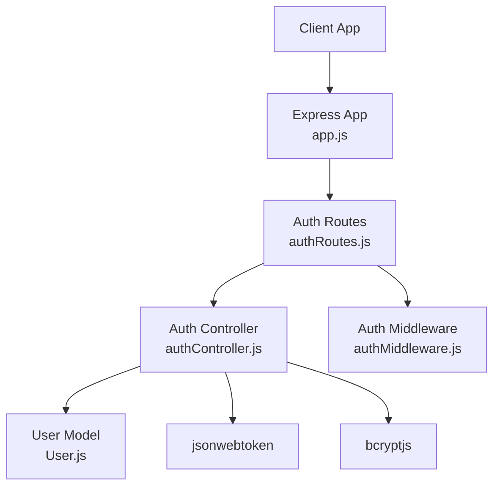
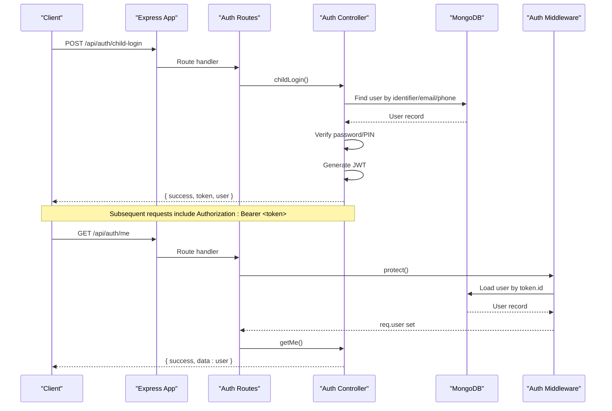
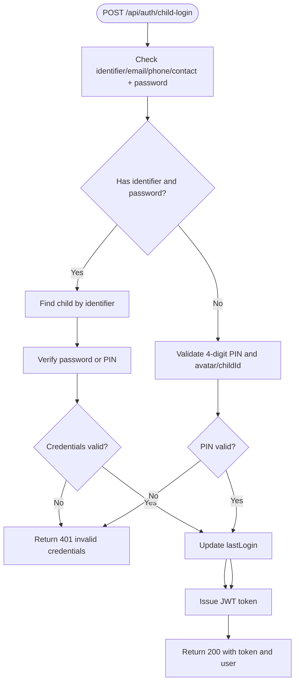
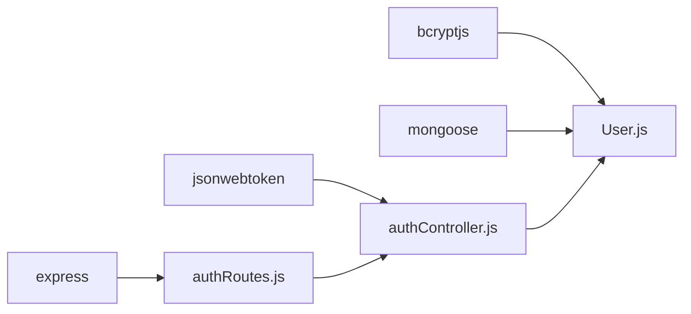

# Authentication & Authorization API

<cite>
**Referenced Files in This Document**
- [authController.js](file://KCEnglishKids_BE/src/controllers/authController.js)
- [authMiddleware.js](file://KCEnglishKids_BE/src/middlewares/authMiddleware.js)
- [authRoutes.js](file://KCEnglishKids_BE/src/routes/authRoutes.js)
- [User.js](file://KCEnglishKids_BE/src/models/User.js)
- [app.js](file://KCEnglishKids_BE/src/app.js)
</cite>

## Table of Contents
1. [Introduction](#introduction)
2. [Project Structure](#project-structure)
3. [Core Components](#core-components)
4. [Architecture Overview](#architecture-overview)
5. [Detailed Component Analysis](#detailed-component-analysis)
6. [Dependency Analysis](#dependency-analysis)
7. [Performance Considerations](#performance-considerations)
8. [Troubleshooting Guide](#troubleshooting-guide)
9. [Conclusion](#conclusion)

## Introduction
This document provides comprehensive API documentation for the Authentication & Authorization system of KCEnglishKids. It covers:
- Dual authentication flows supporting children (PIN-based or email/phone/password) and adults (email/password).
- JWT token issuance, validation, and role-based access control.
- Endpoints for child login, admin/teacher login, user registration, profile retrieval, PIN change, and student lookup.
- Security measures including hashed credentials, token expiration, and middleware protection.
- Request/response schemas, error handling patterns, and practical integration examples.

## Project Structure
The authentication subsystem is organized into controllers, middlewares, routes, and models:
- Controllers implement business logic for authentication endpoints.
- Middlewares provide token verification and role authorization.
- Routes map HTTP endpoints to controller methods.
- Models define data structures and security hooks.

**Diagram sources**
- [app.js:34-45](file://KCEnglishKids_BE/src/app.js#L34-L45)
- [authRoutes.js:1-25](file://KCEnglishKids_BE/src/routes/authRoutes.js#L1-L25)
- [authController.js:1-10](file://KCEnglishKids_BE/src/controllers/authController.js#L1-L10)
- [authMiddleware.js:1-59](file://KCEnglishKids_BE/src/middlewares/authMiddleware.js#L1-L59)
- [User.js:1-109](file://KCEnglishKids_BE/src/models/User.js#L1-L109)

**Section sources**
- [app.js:1-53](file://KCEnglishKids_BE/src/app.js#L1-L53)
- [authRoutes.js:1-25](file://KCEnglishKids_BE/src/routes/authRoutes.js#L1-L25)

## Core Components
- Authentication Controller: Implements endpoints for child login, admin/teacher login, registration, profile retrieval, PIN change, and student lookup. It issues JWT tokens with roles and user metadata.
- Auth Middleware: Provides protect (token verification), authorize (role checks), and optionalProtect (optional token parsing).
- User Model: Defines user schema, pre-save hashing for passwords and PINs, and verification methods for password and PIN.
- Routes: Expose public and protected endpoints under /api/auth.

Key responsibilities:
- Token generation with role and extra payload.
- Credential verification using bcrypt.
- Role-based access enforcement via middleware.
- Secure storage of sensitive fields through hashing.

**Section sources**
- [authController.js:1-488](file://KCEnglishKids_BE/src/controllers/authController.js#L1-L488)
- [authMiddleware.js:1-59](file://KCEnglishKids_BE/src/middlewares/authMiddleware.js#L1-L59)
- [User.js:1-109](file://KCEnglishKids_BE/src/models/User.js#L1-L109)
- [authRoutes.js:1-25](file://KCEnglishKids_BE/src/routes/authRoutes.js#L1-L25)

## Architecture Overview
The authentication architecture follows a layered approach:
- Clients send requests to Express routes.
- Routes delegate to controllers.
- Controllers interact with the database via Mongoose models.
- Protected routes use middleware to validate tokens and enforce roles.

**Diagram sources**
- [authRoutes.js:15-22](file://KCEnglishKids_BE/src/routes/authRoutes.js#L15-L22)
- [authController.js:31-161](file://KCEnglishKids_BE/src/controllers/authController.js#L31-L161)
- [authMiddleware.js:4-31](file://KCEnglishKids_BE/src/middlewares/authMiddleware.js#L4-L31)
- [User.js:96-106](file://KCEnglishKids_BE/src/models/User.js#L96-L106)

## Detailed Component Analysis

### Child Login Endpoint
- Method: POST
- Path: /api/auth/child-login
- Access: Public
- Purpose: Authenticate children via either:
  - Identifier (email/phone/contact/username) + password (supports both password and PIN fallback).
  - Avatar + 4-digit PIN for quick classroom login.
- Request body:
  - Optional fields: childId, avatar, pin, identifier, email, phone, contact, password
- Response:
  - Success: { success: true, token, user: { id, name, role, avatar, avatarUrl, ageGroupCode, ageGroup } }
  - Error: { success: false, message }
- Notes:
  - Supports dual authentication modes for children.
  - Updates lastLogin timestamp on successful login.

**Diagram sources**
- [authController.js:31-161](file://KCEnglishKids_BE/src/controllers/authController.js#L31-L161)

**Section sources**
- [authController.js:31-161](file://KCEnglishKids_BE/src/controllers/authController.js#L31-L161)
- [authRoutes.js:16-16](file://KCEnglishKids_BE/src/routes/authRoutes.js#L16-L16)

### Admin Login Endpoint
- Method: POST
- Path: /api/auth/admin-login
- Access: Public
- Purpose: Authenticate administrators using email and password.
- Request body:
  - Required: email, password
- Response:
  - Success: { success: true, token, user: { id, name, email, role, avatar } }
  - Error: { success: false, message }
- Notes:
  - Ensures user role is ADMIN and status ACTIVE.
  - Updates lastLogin timestamp.

**Section sources**
- [authController.js:163-212](file://KCEnglishKids_BE/src/controllers/authController.js#L163-L212)
- [authRoutes.js:18-18](file://KCEnglishKids_BE/src/routes/authRoutes.js#L18-L18)

### Teacher Login Endpoint
- Method: POST
- Path: /api/auth/teacher-login
- Access: Public
- Purpose: Authenticate teachers using email and password.
- Request body:
  - Required: email, password
- Response:
  - Success: { success: true, token, user: { id, name, email, role, avatar, assignedClass } }
  - Error: { success: false, message }
- Notes:
  - Ensures user role is TEACHER and status ACTIVE.
  - Populates assignedClass information.

**Section sources**
- [authController.js:214-266](file://KCEnglishKids_BE/src/controllers/authController.js#L214-L266)
- [authRoutes.js:19-19](file://KCEnglishKids_BE/src/routes/authRoutes.js#L19-L19)

### Get Current User Profile
- Method: GET
- Path: /api/auth/me
- Access: Private (requires valid JWT)
- Purpose: Retrieve current authenticated user’s profile without sensitive fields.
- Headers:
  - Authorization: Bearer <token>
- Response:
  - Success: { success: true, data: user }
  - Error: { success: false, message }
- Notes:
  - Uses protect middleware to verify token and load user.
  - Excludes password and pin from response.

**Section sources**
- [authController.js:268-285](file://KCEnglishKids_BE/src/controllers/authController.js#L268-L285)
- [authRoutes.js:20-20](file://KCEnglishKids_BE/src/routes/authRoutes.js#L20-L20)
- [authMiddleware.js:4-31](file://KCEnglishKids_BE/src/middlewares/authMiddleware.js#L4-L31)

### Child Registration
- Method: POST
- Path: /api/auth/child-register
- Access: Public
- Purpose: Register a new child account with age group scoping and optional avatar selection.
- Request body:
  - Required: name, identifier/email/phone, password or pin
  - Optional: ageGroupCode, avatar
- Response:
  - Success: { success: true, message, token, user: { id, name, role, avatar, avatarUrl, ageGroupCode, ageGroup } }
  - Error: { success: false, message }
- Notes:
  - Validates uniqueness of email/phone/contact.
  - Defaults ageGroupCode if invalid.
  - Generates avatar URL and emoji mapping.

**Section sources**
- [authController.js:287-369](file://KCEnglishKids_BE/src/controllers/authController.js#L287-L369)
- [authRoutes.js:17-17](file://KCEnglishKids_BE/src/routes/authRoutes.js#L17-L17)

### Change PIN
- Method: POST
- Path: /api/auth/change-pin
- Access: Private (Child only)
- Purpose: Allow children to update their PIN securely.
- Headers:
  - Authorization: Bearer <token>
- Request body:
  - Required: currentPin, newPin (exactly 4 digits)
- Response:
  - Success: { success: true, message }
  - Error: { success: false, message }
- Notes:
  - Verifies current PIN before updating.
  - Updates both pin and password fields to maintain dual auth support.

**Section sources**
- [authController.js:371-422](file://KCEnglishKids_BE/src/controllers/authController.js#L371-L422)
- [authRoutes.js:21-21](file://KCEnglishKids_BE/src/routes/authRoutes.js#L21-L21)
- [authMiddleware.js:4-31](file://KCEnglishKids_BE/src/middlewares/authMiddleware.js#L4-L31)

### Lookup Student by Parent Phone
- Method: POST
- Path: /api/auth/lookup-student
- Access: Public
- Purpose: Parents can find child accounts associated with a registered phone number.
- Request body:
  - Required: phone
- Response:
  - Success: { success: true, message, data: [{ id, name, email, phone, avatar, avatarUrl, ageGroupCode, className }] }
  - Error: { success: false, message }
- Notes:
  - Searches across phone, contact, parentContact fields.
  - Returns limited user info for privacy.

**Section sources**
- [authController.js:424-474](file://KCEnglishKids_BE/src/controllers/authController.js#L424-L474)
- [authRoutes.js:22-22](file://KCEnglishKids_BE/src/routes/authRoutes.js#L22-L22)

### Get Child Avatars List
- Method: GET
- Path: /api/auth/children-avatars
- Access: Public
- Purpose: Provide list of active child avatars for visual login selection.
- Response:
  - Success: { success: true, count, data: [{ _id, name, avatar, avatarUrl, ageGroupCode }] }
  - Error: { success: false, message }

**Section sources**
- [authController.js:12-29](file://KCEnglishKids_BE/src/controllers/authController.js#L12-L29)
- [authRoutes.js:15-15](file://KCEnglishKids_BE/src/routes/authRoutes.js#L15-L15)

## Dependency Analysis
The authentication system relies on several core dependencies:
- jsonwebtoken: For issuing and verifying JWT tokens.
- bcryptjs: For hashing and comparing passwords and PINs.
- mongoose: For interacting with MongoDB via User model.
- express: For routing and request handling.

**Diagram sources**
- [authController.js:1-10](file://KCEnglishKids_BE/src/controllers/authController.js#L1-L10)
- [User.js:1-109](file://KCEnglishKids_BE/src/models/User.js#L1-L109)
- [authRoutes.js:1-25](file://KCEnglishKids_BE/src/routes/authRoutes.js#L1-L25)

**Section sources**
- [authController.js:1-10](file://KCEnglishKids_BE/src/controllers/authController.js#L1-L10)
- [User.js:1-109](file://KCEnglishKids_BE/src/models/User.js#L1-L109)
- [authRoutes.js:1-25](file://KCEnglishKids_BE/src/routes/authRoutes.js#L1-L25)

## Performance Considerations
- Token Expiration: Tokens are issued with a fixed expiration period; clients should handle re-authentication or refresh strategies accordingly.
- Database Queries: Use selective field projection to reduce payload size and improve query performance.
- Hashing Cost: bcrypt salt rounds are configured for secure hashing; consider environment-specific tuning for performance vs. security trade-offs.
- Indexing: Ensure indexes on frequently queried fields like email, phone, role, and status to optimize lookups.

[No sources needed since this section provides general guidance]

## Troubleshooting Guide
Common errors and resolutions:
- Invalid or expired token: Ensure Authorization header includes a valid Bearer token and that the server’s JWT secret matches the issuer.
- Account deactivated or locked: Check user status field; inactive or locked accounts will be rejected by protect middleware.
- Missing credentials: Verify required fields in request bodies for each endpoint.
- Incorrect PIN or password: Confirm correct credential type (password vs. PIN) based on endpoint behavior.

**Section sources**
- [authMiddleware.js:4-31](file://KCEnglishKids_BE/src/middlewares/authMiddleware.js#L4-L31)
- [authController.js:31-161](file://KCEnglishKids_BE/src/controllers/authController.js#L31-L161)

## Conclusion
The KCEnglishKids Authentication & Authorization system provides robust support for dual authentication flows tailored to children and adults. It leverages JWT tokens, bcrypt hashing, and middleware-based protection to ensure secure and role-aware access. The documented endpoints cover essential operations such as login, registration, profile management, and PIN updates, with clear request/response schemas and error handling patterns. Integrators should follow the provided flow diagrams and best practices to implement secure and efficient authentication workflows.

[No sources needed since this section summarizes without analyzing specific files]