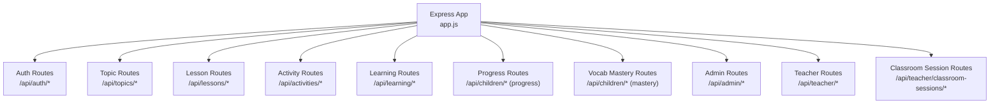
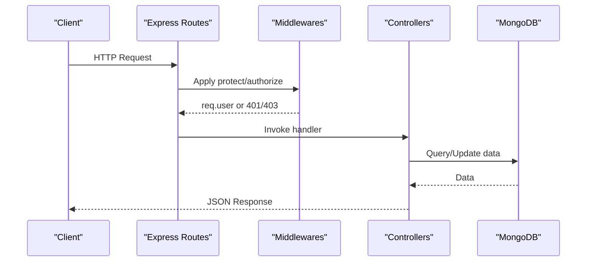
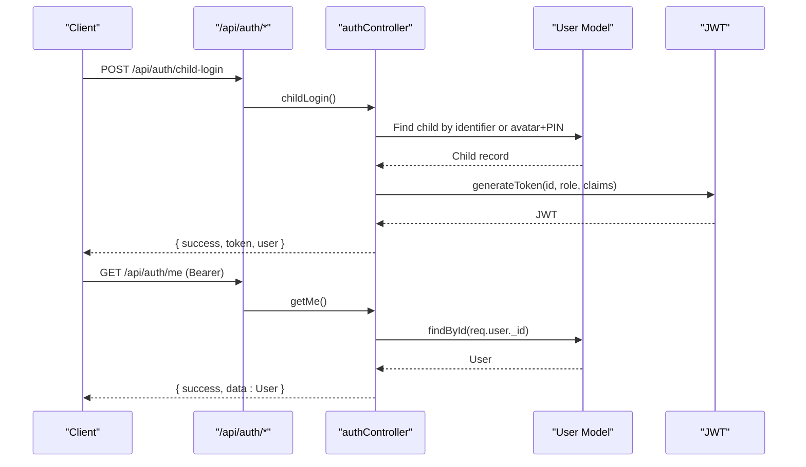
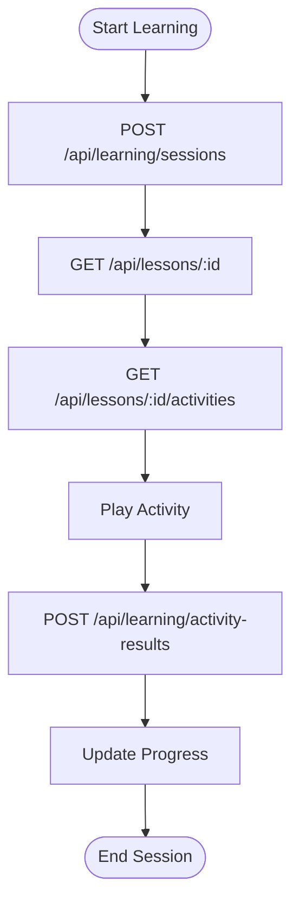
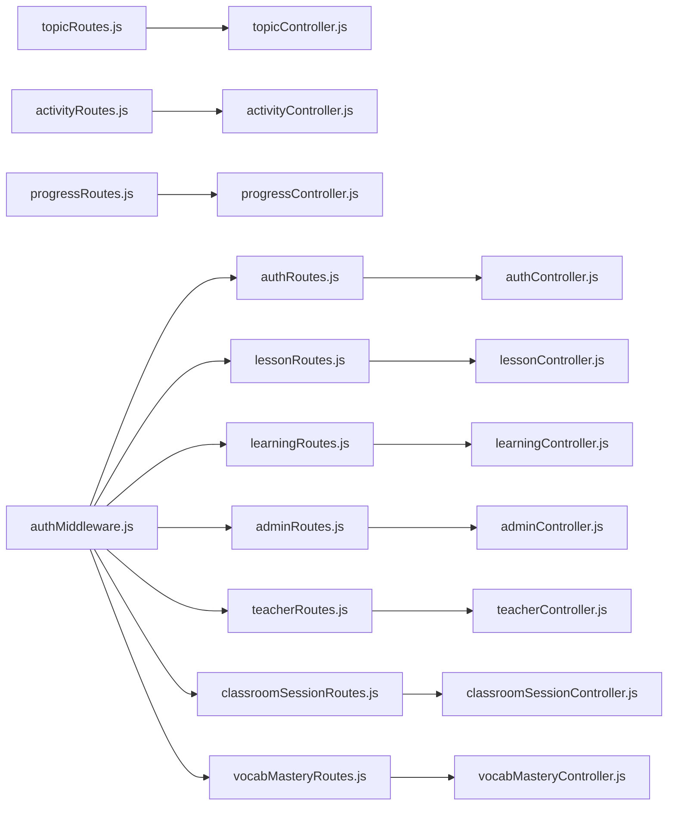

# Backend API Documentation

<cite>
**Referenced Files in This Document**
- [app.js](file://KCEnglishKids_BE/src/app.js)
- [server.js](file://KCEnglishKids_BE/src/server.js)
- [authRoutes.js](file://KCEnglishKids_BE/src/routes/authRoutes.js)
- [topicRoutes.js](file://KCEnglishKids_BE/src/routes/topicRoutes.js)
- [lessonRoutes.js](file://KCEnglishKids_BE/src/routes/lessonRoutes.js)
- [activityRoutes.js](file://KCEnglishKids_BE/src/routes/activityRoutes.js)
- [learningRoutes.js](file://KCEnglishKids_BE/src/routes/learningRoutes.js)
- [progressRoutes.js](file://KCEnglishKids_BE/src/routes/progressRoutes.js)
- [adminRoutes.js](file://KCEnglishKids_BE/src/routes/adminRoutes.js)
- [teacherRoutes.js](file://KCEnglishKids_BE/src/routes/teacherRoutes.js)
- [classroomSessionRoutes.js](file://KCEnglishKids_BE/src/routes/classroomSessionRoutes.js)
- [vocabMasteryRoutes.js](file://KCEnglishKids_BE/src/routes/vocabMasteryRoutes.js)
- [authController.js](file://KCEnglishKids_BE/src/controllers/authController.js)
- [authMiddleware.js](file://KCEnglishKids_BE/src/middlewares/authMiddleware.js)
- [api.md](file://docs/api.md)
</cite>

## Table of Contents
1. Introduction
2. Project Structure
3. Core Components
4. Architecture Overview
5. Detailed Component Analysis
6. Dependency Analysis
7. Performance Considerations
8. Troubleshooting Guide
9. Conclusion

## Introduction
This document provides comprehensive API documentation for the KCEnglishKids backend REST API. It covers Authentication & Authorization, Curriculum Management, Learning & Progress Tracking, Vocabulary & Mastery Tracking, Classroom Management, and Admin Operations. For each endpoint group, it specifies HTTP methods, URL patterns, request/response schemas, authentication requirements, error responses, and practical examples. It also documents the JWT-based authentication flow, role-based authorization middleware, PIN-based child authentication system, security considerations, and client implementation guidelines.

## Project Structure
The backend is an Express application with modular routes, controllers, middlewares, and Mongoose models. Routes are grouped by functional area under /api. The app mounts route modules and applies global middlewares such as CORS, JSON parsing, and centralized error handling.

**Diagram sources**
- [app.js:34-45](file://KCEnglishKids_BE/src/app.js#L34-L45)

**Section sources**
- [app.js:1-53](file://KCEnglishKids_BE/src/app.js#L1-L53)
- [server.js:1-21](file://KCEnglishKids_BE/src/server.js#L1-L21)

## Core Components
- Authentication & Authorization
  - JWT-based session tokens issued on successful login.
  - Role-based access control via protect and authorize middlewares.
  - PIN-based child login supporting avatar+PIN or identifier+password flows.
- Curriculum Management
  - Topics, lessons, activities endpoints for curriculum browsing.
- Learning & Progress Tracking
  - Learning sessions, activity results submission, and child progress retrieval.
- Vocabulary & Mastery Tracking
  - Child vocabulary mastery sync and per-answer practice recording.
- Classroom Management
  - Teacher-managed classroom sessions with scoring and summaries.
- Admin Operations
  - Dashboard stats, curriculum overview, user management, audit logs, topic status controls.

**Section sources**
- [authController.js:1-488](file://KCEnglishKids_BE/src/controllers/authController.js#L1-L488)
- [authMiddleware.js:1-58](file://KCEnglishKids_BE/src/middlewares/authMiddleware.js#L1-L58)
- [api.md:1-29](file://docs/api.md#L1-L29)

## Architecture Overview
The API follows a layered architecture:
- Routes define URL patterns and attach middlewares.
- Controllers implement business logic and interact with models.
- Middlewares handle authentication, authorization, and optional auth contexts.
- Global error middleware centralizes error responses.

**Diagram sources**
- [authMiddleware.js:4-43](file://KCEnglishKids_BE/src/middlewares/authMiddleware.js#L4-L43)
- [app.js:20-49](file://KCEnglishKids_BE/src/app.js#L20-L49)

## Detailed Component Analysis

### Authentication & Authorization
Endpoints:
- GET /api/auth/children-avatars
  - Purpose: List active child avatars for visual sign-in.
  - Auth: Public.
  - Response: { success, count, data: [{ _id, name, avatar, avatarUrl, ageGroupCode }] }
  - Errors: 500 on server errors.

- POST /api/auth/child-login
  - Purpose: Authenticate child via identifier+password or avatar+PIN.
  - Auth: Public.
  - Request body options:
    - Home mode: { identifier|email|phone|contact, password }
    - Classroom mode: { avatar|childId, pin }
  - Response: { success, token, user: { id, name, role, avatar, avatarUrl, ageGroupCode, ageGroup } }
  - Errors: 400 invalid input, 401 invalid credentials/PIN, 404 student not found.

- POST /api/auth/admin-login
  - Purpose: Admin login.
  - Auth: Public.
  - Request body: { email, password }
  - Response: { success, token, user: { id, name, email, role, avatar } }
  - Errors: 400 missing fields, 401 invalid credentials.

- POST /api/auth/teacher-login
  - Purpose: Teacher login.
  - Auth: Public.
  - Request body: { email, password }
  - Response: { success, token, user: { id, name, email, role, avatar, assignedClass } }
  - Errors: 400 missing fields, 401 invalid credentials.

- GET /api/auth/me
  - Purpose: Get current user profile.
  - Auth: Private (Bearer JWT).
  - Response: { success, data: User }
  - Errors: 401 unauthorized.

- POST /api/auth/change-pin
  - Purpose: Change child’s PIN (and learning password).
  - Auth: Private (Child).
  - Request body: { currentPin, newPin }
  - Validation: newPin must be exactly 4 digits; currentPin verified.
  - Response: { success, message }
  - Errors: 400 validation, 401 incorrect PIN, 403 not a child.

- POST /api/auth/lookup-student
  - Purpose: Parent lookup by phone to find associated children.
  - Auth: Public.
  - Request body: { phone }
  - Response: { success, message, data: [{ id, name, email, phone, avatar, avatarUrl, ageGroupCode, className }] }
  - Errors: 400 missing phone, 404 no accounts found.

- POST /api/auth/child-register
  - Purpose: Register a new child account with age group scoping.
  - Auth: Public.
  - Request body: { name, identifier|email|phone, password|pin, ageGroupCode, avatar? }
  - Response: { success, message, token, user }
  - Errors: 400 validation/duplicate, 500 server error.

Authentication Flow (JWT):
- On successful login, server issues a JWT containing user id, role, and selected claims.
- Clients include Authorization: Bearer <token> in subsequent requests.
- protect middleware verifies token and attaches req.user.
- authorize(...roles) enforces role-based access.

**Diagram sources**
- [authController.js:31-161](file://KCEnglishKids_BE/src/controllers/authController.js#L31-L161)
- [authController.js:268-285](file://KCEnglishKids_BE/src/controllers/authController.js#L268-L285)
- [authMiddleware.js:4-31](file://KCEnglishKids_BE/src/middlewares/authMiddleware.js#L4-L31)

Error Responses:
- 400 Bad Request: Missing or invalid fields.
- 401 Unauthorized: Invalid credentials, expired/missing token, wrong PIN.
- 403 Forbidden: Insufficient role.
- 404 Not Found: Resource not found.
- 500 Internal Server Error: Unexpected server errors.

**Section sources**
- [authRoutes.js:1-25](file://KCEnglishKids_BE/src/routes/authRoutes.js#L1-L25)
- [authController.js:1-488](file://KCEnglishKids_BE/src/controllers/authController.js#L1-L488)
- [authMiddleware.js:1-58](file://KCEnglishKids_BE/src/middlewares/authMiddleware.js#L1-L58)

### Curriculum Management
Endpoints:
- GET /api/topics
  - Query params: ageGroup (e.g., 3-4)
  - Auth: Public
  - Response: List of topics filtered by age group.

- GET /api/topics/:id
  - Auth: Public
  - Response: Topic details.

- GET /api/topics/:id/lessons
  - Query params: ageGroup, childId (optional)
  - Auth: Public
  - Response: Lessons under topic with optional child progress context.

- GET /api/lessons/:id
  - Auth: Optional (optionalProtect)
  - Response: Lesson details including vocabulary and activities.

- GET /api/lessons/:id/activities
  - Auth: Optional (optionalProtect)
  - Response: Activities list for the lesson.

- GET /api/activities/:id
  - Auth: Public
  - Response: Activity configuration and questions.

Notes:
- Lesson routes use optionalProtect so clients can fetch content without a token but may receive enriched data when authenticated.

**Section sources**
- [topicRoutes.js:1-14](file://KCEnglishKids_BE/src/routes/topicRoutes.js#L1-L14)
- [lessonRoutes.js:1-15](file://KCEnglishKids_BE/src/routes/lessonRoutes.js#L1-L15)
- [activityRoutes.js:1-8](file://KCEnglishKids_BE/src/routes/activityRoutes.js#L1-L8)
- [api.md:10-15](file://docs/api.md#L10-L15)

### Learning & Progress Tracking
Endpoints:
- POST /api/learning/sessions
  - Purpose: Start or resume a learning session.
  - Request body: { lessonId, childId }
  - Auth: Optional (optionalProtect)
  - Response: Session state object.

- GET /api/learning/sessions/:id
  - Purpose: Retrieve session state.
  - Auth: Optional (optionalProtect)
  - Response: Session state object.

- POST /api/learning/activity-results
  - Purpose: Record activity submission and update progress.
  - Request body: Activity result payload (as defined by controller).
  - Auth: Optional (optionalProtect)
  - Response: Updated progress/session state.

- GET /api/children/:id/progress
  - Purpose: Child star balance, completed lessons, weak vocabulary.
  - Auth: Protected (depends on controller; typically requires token).
  - Response: Progress summary.

**Diagram sources**
- [learningRoutes.js:1-15](file://KCEnglishKids_BE/src/routes/learningRoutes.js#L1-L15)
- [lessonRoutes.js:10-12](file://KCEnglishKids_BE/src/routes/lessonRoutes.js#L10-L12)
- [activityRoutes.js:5](file://KCEnglishKids_BE/src/routes/activityRoutes.js#L5)
- [progressRoutes.js:5](file://KCEnglishKids_BE/src/routes/progressRoutes.js#L5)

**Section sources**
- [learningRoutes.js:1-15](file://KCEnglishKids_BE/src/routes/learningRoutes.js#L1-L15)
- [progressRoutes.js:1-8](file://KCEnglishKids_BE/src/routes/progressRoutes.js#L1-L8)
- [api.md:17-25](file://docs/api.md#L17-L25)

### Vocabulary & Mastery Tracking
Endpoints:
- GET /api/children/:childId/vocabulary-mastery
  - Purpose: Retrieve child’s vocabulary mastery records.
  - Auth: Protected (protect).
  - Response: Mastery data for the child.

- POST /api/children/:childId/vocabulary-mastery
  - Purpose: Sync local mastery data to DB.
  - Auth: Protected (protect).
  - Request body: Mastery items to upsert.
  - Response: Sync result.

- POST /api/children/:childId/vocabulary-mastery/:vocabId/record
  - Purpose: Record a single practice attempt (per-answer in games).
  - Auth: Protected (protect).
  - Request body: Attempt details (score, timestamp, etc.).
  - Response: Updated mastery entry.

Notes:
- These endpoints support both child self-service and teacher/admin oversight depending on roles.

**Section sources**
- [vocabMasteryRoutes.js:1-16](file://KCEnglishKids_BE/src/routes/vocabMasteryRoutes.js#L1-L16)

### Classroom Management
Endpoints:
- GET /api/teacher/classroom-sessions
  - Purpose: List classroom sessions.
  - Auth: TEACHER or ADMIN.

- POST /api/teacher/classroom-sessions
  - Purpose: Create a new classroom session.
  - Auth: TEACHER or ADMIN.

- GET /api/teacher/classroom-sessions/:id
  - Purpose: Get session details.
  - Auth: TEACHER or ADMIN.

- POST /api/teacher/classroom-sessions/:id/start
  - Purpose: Start a session.
  - Auth: TEACHER or ADMIN.

- POST /api/teacher/classroom-sessions/:id/end
  - Purpose: End a session.
  - Auth: TEACHER or ADMIN.

- POST /api/teacher/classroom-sessions/:id/score-student
  - Purpose: Score a specific student in-session.
  - Auth: TEACHER or ADMIN.

- POST /api/teacher/classroom-sessions/:id/score-bulk
  - Purpose: Bulk score multiple students.
  - Auth: TEACHER or ADMIN.

- POST /api/teacher/classroom-sessions/:id/question-result
  - Purpose: Record question-level result during session.
  - Auth: TEACHER or ADMIN.

- PATCH /api/teacher/classroom-sessions/:id/activity-index
  - Purpose: Update current activity index.
  - Auth: TEACHER or ADMIN.

- GET /api/teacher/classroom-sessions/:id/summary
  - Purpose: Get session summary at any time after start.
  - Auth: TEACHER or ADMIN.

Additional Teacher Endpoints (under /api/teacher):
- Class management, assignments, student overviews/history/notes, parent notifications, and vocabulary mastery views.

**Section sources**
- [classroomSessionRoutes.js:1-28](file://KCEnglishKids_BE/src/routes/classroomSessionRoutes.js#L1-L28)
- [teacherRoutes.js:1-50](file://KCEnglishKids_BE/src/routes/teacherRoutes.js#L1-L50)

### Admin Operations
Endpoints:
- GET /api/admin/dashboard
  - Purpose: Platform KPI statistics.
  - Auth: ADMIN.

- GET /api/admin/curriculum
  - Purpose: 3 Books & 27 Units hierarchy.
  - Auth: ADMIN.

- GET /api/admin/users
  - Purpose: List users.
  - Auth: ADMIN.

- POST /api/admin/teachers
  - Purpose: Create teacher account.
  - Auth: ADMIN.

- POST /api/admin/children
  - Purpose: Create child account.
  - Auth: ADMIN.

- PATCH /api/admin/users/:id/status
  - Purpose: Toggle user status (activate/deactivate).
  - Auth: ADMIN.

- GET /api/admin/audit-logs
  - Purpose: View audit logs.
  - Auth: ADMIN.

- PATCH /api/admin/topics/:id/status
  - Purpose: Toggle topic status.
  - Auth: ADMIN.

- GET /api/admin/public-stats
  - Purpose: Public demo preview stats.
  - Auth: Public.

**Section sources**
- [adminRoutes.js:1-34](file://KCEnglishKids_BE/src/routes/adminRoutes.js#L1-L34)
- [api.md:23-29](file://docs/api.md#L23-L29)

## Dependency Analysis
Route-to-controller dependencies and middleware usage:

**Diagram sources**
- [authRoutes.js:1-25](file://KCEnglishKids_BE/src/routes/authRoutes.js#L1-L25)
- [topicRoutes.js:1-14](file://KCEnglishKids_BE/src/routes/topicRoutes.js#L1-L14)
- [lessonRoutes.js:1-15](file://KCEnglishKids_BE/src/routes/lessonRoutes.js#L1-L15)
- [activityRoutes.js:1-8](file://KCEnglishKids_BE/src/routes/activityRoutes.js#L1-L8)
- [learningRoutes.js:1-15](file://KCEnglishKids_BE/src/routes/learningRoutes.js#L1-L15)
- [progressRoutes.js:1-8](file://KCEnglishKids_BE/src/routes/progressRoutes.js#L1-L8)
- [adminRoutes.js:1-34](file://KCEnglishKids_BE/src/routes/adminRoutes.js#L1-L34)
- [teacherRoutes.js:1-50](file://KCEnglishKids_BE/src/routes/teacherRoutes.js#L1-L50)
- [classroomSessionRoutes.js:1-28](file://KCEnglishKids_BE/src/routes/classroomSessionRoutes.js#L1-L28)
- [vocabMasteryRoutes.js:1-16](file://KCEnglishKids_BE/src/routes/vocabMasteryRoutes.js#L1-L16)
- [authMiddleware.js:1-58](file://KCEnglishKids_BE/src/middlewares/authMiddleware.js#L1-L58)

**Section sources**
- [app.js:34-45](file://KCEnglishKids_BE/src/app.js#L34-L45)
- [authMiddleware.js:1-58](file://KCEnglishKids_BE/src/middlewares/authMiddleware.js#L1-L58)

## Performance Considerations
- Database queries: Prefer selective field projection and appropriate indexes on frequently queried fields (e.g., email, phone, role, status).
- Pagination: Implement pagination for list endpoints (topics, lessons, users, classes) to avoid large payloads.
- Caching: Cache static curriculum data (topics, lessons, activities) using short-lived caches where appropriate.
- Rate Limiting: Introduce rate limiting on authentication endpoints to prevent brute-force attacks.
- Connection Pooling: Ensure MongoDB connection pooling is configured for high concurrency.
- Payload Size: Enforce maximum request body sizes and validate inputs early to reduce processing overhead.

[No sources needed since this section provides general guidance]

## Troubleshooting Guide
Common Issues:
- 401 Unauthorized
  - Missing or malformed Authorization header.
  - Expired or invalid JWT.
  - Wrong PIN or password.
  - Check token issuance and verify headers.

- 403 Forbidden
  - Insufficient role for protected endpoints.
  - Ensure user role matches required roles in authorize(...).

- 400 Bad Request
  - Missing required fields or invalid formats (e.g., PIN length).
  - Validate request bodies before sending.

- 404 Not Found
  - Incorrect resource IDs or inactive accounts.
  - Verify IDs and account status.

- 500 Internal Server Error
  - Unexpected server-side exceptions.
  - Review server logs and controller error paths.

Security Considerations:
- Use HTTPS in production to protect tokens and sensitive data.
- Store JWT_SECRET securely via environment variables.
- Avoid logging sensitive fields (passwords, PINs).
- Enforce input validation and sanitization on all endpoints.
- Consider adding CSRF protection for browser-based clients if applicable.

API Versioning Strategy:
- Current base path: /api
- Recommended approach: prefix with version, e.g., /api/v1, to allow backward-compatible evolution.

Client Implementation Guidelines:
- Always send Authorization: Bearer <token> for protected endpoints.
- Handle 401 by refreshing or re-authenticating.
- Retry failed network requests with exponential backoff.
- Persist tokens securely and clear them on logout.
- Validate server responses before rendering UI.

**Section sources**
- [authMiddleware.js:4-43](file://KCEnglishKids_BE/src/middlewares/authMiddleware.js#L4-L43)
- [authController.js:371-422](file://KCEnglishKids_BE/src/controllers/authController.js#L371-L422)

## Conclusion
The KCEnglishKids backend provides a robust, role-aware REST API tailored for early childhood English learning. It supports secure child PIN-based and credential-based logins, structured curriculum browsing, interactive learning sessions, vocabulary mastery tracking, classroom session management, and admin operations. By following the documented endpoints, authentication flows, and security best practices, clients can build reliable and engaging learning experiences.

[No sources needed since this section summarizes without analyzing specific files]