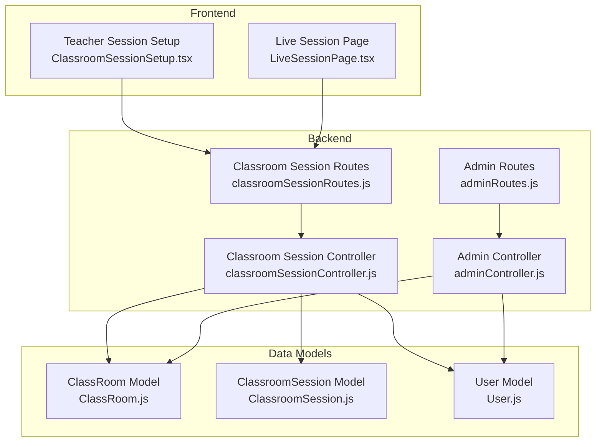
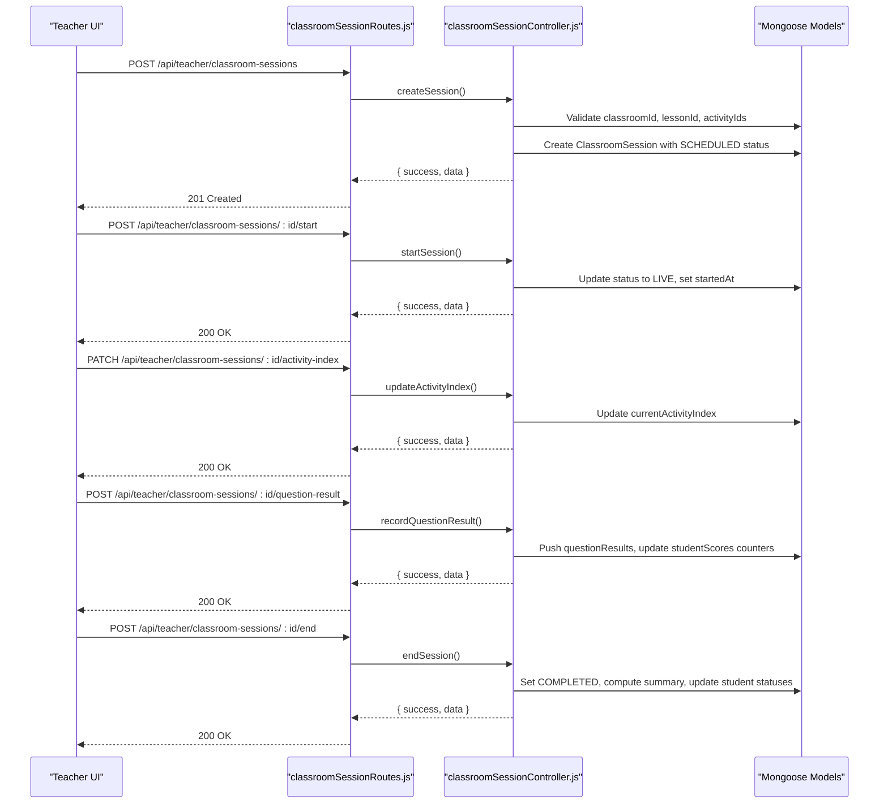
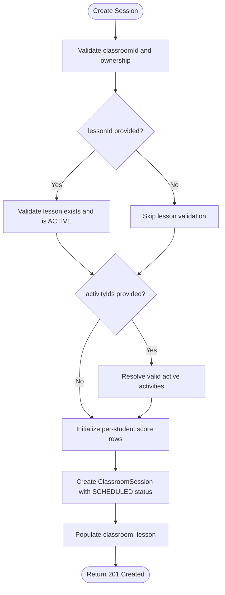
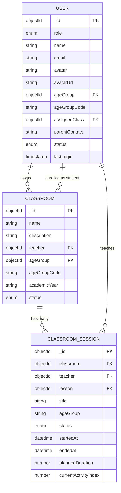
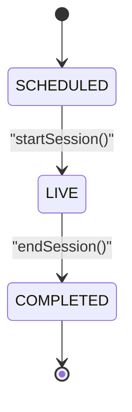
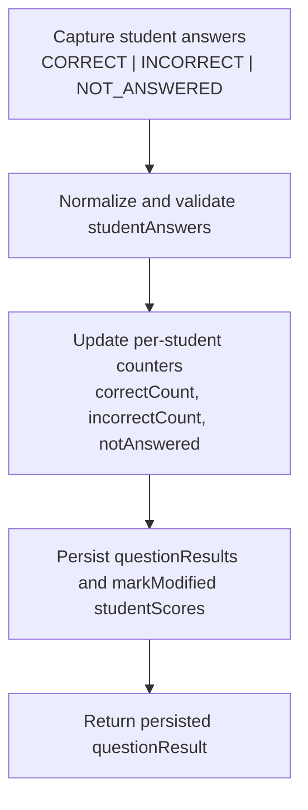
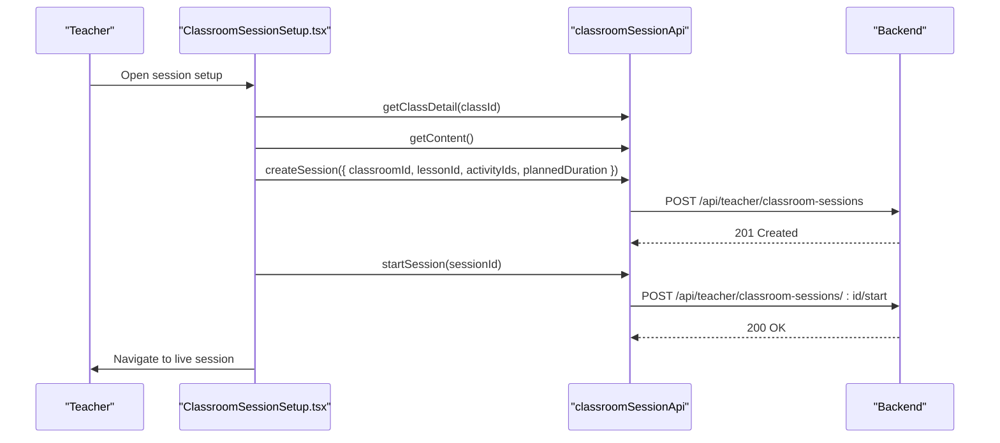
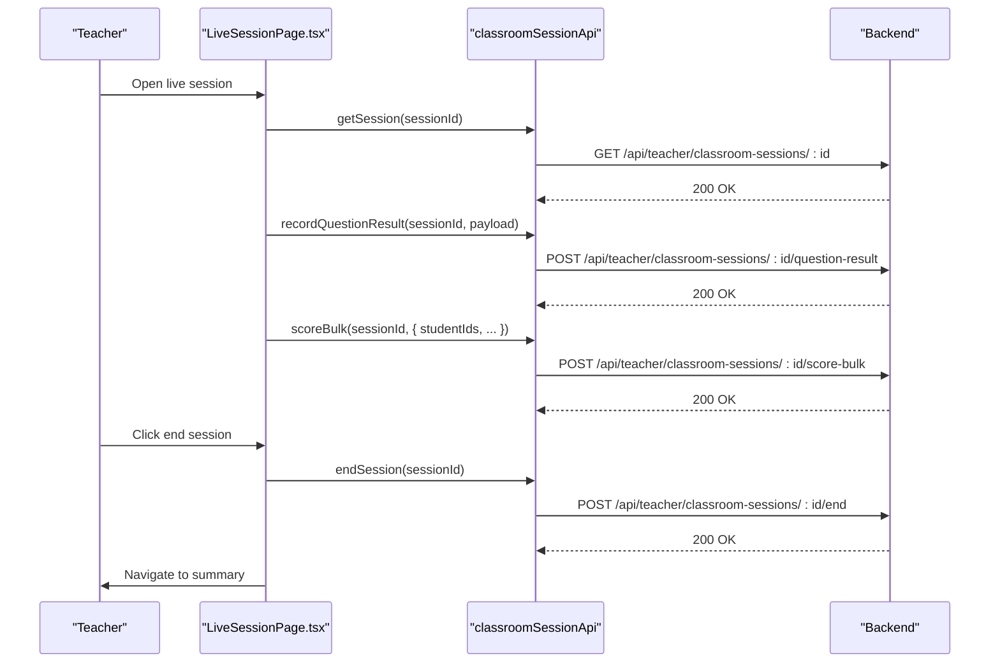
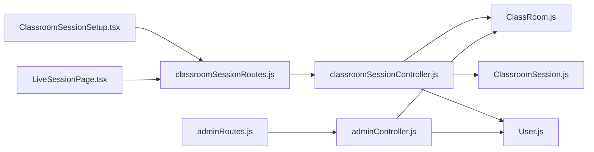

# Classroom Management API

<cite>
**Referenced Files in This Document**
- [api.md](file://docs/api.md)
- [architecture.md](file://docs/architecture.md)
- [classroomSessionRoutes.js](file://KCEnglishKids_BE/src/routes/classroomSessionRoutes.js)
- [classroomSessionController.js](file://KCEnglishKids_BE/src/controllers/classroomSessionController.js)
- [adminRoutes.js](file://KCEnglishKids_BE/src/routes/adminRoutes.js)
- [adminController.js](file://KCEnglishKids_BE/src/controllers/adminController.js)
- [ClassRoom.js](file://KCEnglishKids_BE/src/models/ClassRoom.js)
- [ClassroomSession.js](file://KCEnglishKids_BE/src/models/ClassroomSession.js)
- [User.js](file://KCEnglishKids_BE/src/models/User.js)
- [ClassroomSessionSetup.tsx](file://client/src/dashboards/teacher/ClassroomSessionSetup.tsx)
- [LiveSessionPage.tsx](file://client/src/dashboards/teacher/LiveSessionPage.tsx)
</cite>

## Table of Contents
1. [Introduction](#introduction)
2. [Project Structure](#project-structure)
3. [Core Components](#core-components)
4. [Architecture Overview](#architecture-overview)
5. [Detailed Component Analysis](#detailed-component-analysis)
6. [Dependency Analysis](#dependency-analysis)
7. [Performance Considerations](#performance-considerations)
8. [Troubleshooting Guide](#troubleshooting-guide)
9. [Conclusion](#conclusion)
10. [Appendices](#appendices)

## Introduction
This document provides comprehensive API documentation for the Classroom Management subsystem of KCEnglishKids. It focuses on:
- Classroom administration and hierarchy
- Teacher-student relationships
- Session scheduling, lifecycle management, and live session monitoring
- Real-time student participation tracking through scoring and question result recording
- Request/response schemas for classroom data, session information, and student participation metrics
- Example workflows for classroom setup and live session management

The backend is a Node.js Express application with Mongoose models. The frontend includes teacher dashboards that drive classroom session creation and live session control. Authentication uses JWT tokens for ADMIN and TEACHER roles, while CHILD users authenticate via avatar/PIN.

## Project Structure
The classroom management functionality lives primarily under:
- Backend routes: `src/routes/classroomSessionRoutes.js`
- Backend controller: `src/controllers/classroomSessionController.js`
- Data models: `src/models/ClassRoom.js`, `src/models/ClassroomSession.js`, `src/models/User.js`
- Admin endpoints for user and classroom-related administrative operations: `src/routes/adminRoutes.js`, `src/controllers/adminController.js`
- Frontend teacher UI: `client/src/dashboards/teacher/ClassroomSessionSetup.tsx`, `client/src/dashboards/teacher/LiveSessionPage.tsx`

**Diagram sources**
- [classroomSessionRoutes.js:1-28](file://KCEnglishKids_BE/src/routes/classroomSessionRoutes.js#L1-L28)
- [classroomSessionController.js:1-460](file://KCEnglishKids_BE/src/controllers/classroomSessionController.js#L1-L460)
- [adminRoutes.js:1-34](file://KCEnglishKids_BE/src/routes/adminRoutes.js#L1-L34)
- [adminController.js:1-396](file://KCEnglishKids_BE/src/controllers/adminController.js#L1-L396)
- [ClassRoom.js:1-49](file://KCEnglishKids_BE/src/models/ClassRoom.js#L1-L49)
- [ClassroomSession.js:1-122](file://KCEnglishKids_BE/src/models/ClassroomSession.js#L1-L122)
- [User.js:1-109](file://KCEnglishKids_BE/src/models/User.js#L1-L109)
- [ClassroomSessionSetup.tsx:1-353](file://client/src/dashboards/teacher/ClassroomSessionSetup.tsx#L1-L353)
- [LiveSessionPage.tsx:1-800](file://client/src/dashboards/teacher/LiveSessionPage.tsx#L1-L800)

**Section sources**
- [api.md:1-29](file://docs/api.md#L1-L29)
- [architecture.md:1-29](file://docs/architecture.md#L1-L29)

## Core Components
The classroom management system centers around three core entities:
- ClassRoom: Represents a class managed by a teacher, including students and age group metadata.
- ClassroomSession: Represents a scheduled or live teaching session tied to a classroom, lesson, activities, and per-student scores.
- User: Represents teachers, children, parents, and admins; used for ownership, enrollment, and participation.

Key responsibilities:
- Classroom administration: Create teachers and children, assign children to classrooms, toggle user status.
- Session lifecycle: Schedule sessions, start them as live, track activity index, record question results, score students, end sessions, and generate summaries.
- Participation tracking: Per-student points, stars, correct/incorrect/not answered counts, and aggregated summary metrics.

**Section sources**
- [ClassRoom.js:1-49](file://KCEnglishKids_BE/src/models/ClassRoom.js#L1-L49)
- [ClassroomSession.js:1-122](file://KCEnglishKids_BE/src/models/ClassroomSession.js#L1-L122)
- [User.js:1-109](file://KCEnglishKids_BE/src/models/User.js#L1-L109)
- [classroomSessionController.js:38-460](file://KCEnglishKids_BE/src/controllers/classroomSessionController.js#L38-L460)
- [adminController.js:144-329](file://KCEnglishKids_BE/src/controllers/adminController.js#L144-L329)

## Architecture Overview
The classroom management architecture follows a layered approach:
- Frontend teacher dashboards initiate session creation and live session control.
- Express routes enforce authentication and authorization for TEACHER and ADMIN roles.
- Controllers implement business logic for session CRUD, scoring, question result recording, and summary generation.
- Mongoose models define data structures and relationships between classrooms, sessions, users, lessons, and activities.

**Diagram sources**
- [classroomSessionRoutes.js:1-28](file://KCEnglishKids_BE/src/routes/classroomSessionRoutes.js#L1-L28)
- [classroomSessionController.js:74-460](file://KCEnglishKids_BE/src/controllers/classroomSessionController.js#L74-L460)

## Detailed Component Analysis

### Classroom Administration Endpoints
These endpoints are used by administrators to manage users and link students to classrooms.

- GET /api/admin/users
  - Purpose: List users with optional role filter and search.
  - Authorization: ADMIN only.
  - Query parameters:
    - role: Filter by role (e.g., CHILD, TEACHER).
    - search: Search by name, email, username.
  - Response:
    - success: boolean
    - count: number
    - data: array of User objects (excluding password/pin), populated assignedClass and ageGroup.

- POST /api/admin/teachers
  - Purpose: Create a new teacher account.
  - Authorization: ADMIN only.
  - Request body:
    - name: string
    - username: string
    - email: string
    - password: string
    - avatar: string (optional)
    - contact: string (optional)
  - Response:
    - success: boolean
    - message: string
    - data: User object

- POST /api/admin/children
  - Purpose: Create a child account and optionally assign to a classroom.
  - Authorization: ADMIN only.
  - Request body:
    - name: string
    - dob: date (optional)
    - avatar: string (optional)
    - pin: string (4 digits)
    - assignedClass: ObjectId (optional)
    - email: string (optional)
    - contact: string (optional)
    - password: string (optional)
  - Behavior:
    - Validates PIN format.
    - Determines ageGroupCode from DOB if provided.
    - Links child to classroom by adding child ID to classroom.students.
  - Response:
    - success: boolean
    - message: string
    - data: User object

- PATCH /api/admin/users/:id/status
  - Purpose: Toggle user status between ACTIVE and LOCKED.
  - Authorization: ADMIN only.
  - Path parameter: id (user ObjectId)
  - Response:
    - success: boolean
    - message: string
    - data: { id, status }

**Section sources**
- [adminRoutes.js:15-28](file://KCEnglishKids_BE/src/routes/adminRoutes.js#L15-L28)
- [adminController.js:108-329](file://KCEnglishKids_BE/src/controllers/adminController.js#L108-L329)
- [ClassRoom.js:33-38](file://KCEnglishKids_BE/src/models/ClassRoom.js#L33-L38)
- [User.js:1-109](file://KCEnglishKids_BE/src/models/User.js#L1-L109)

### Classroom Session Endpoints
All classroom session endpoints require authentication and authorization for TEACHER or ADMIN roles.

- GET /api/teacher/classroom-sessions
  - Purpose: List sessions for the logged-in teacher or all sessions for ADMIN.
  - Query parameters:
    - status: Filter by session status (SCHEDULED, LIVE, COMPLETED).
    - classroomId: Filter by classroom.
  - Response:
    - success: boolean
    - count: number
    - data: array of ClassroomSession objects, populated with classroom, teacher, lesson.

- POST /api/teacher/classroom-sessions
  - Purpose: Create a new classroom session.
  - Request body:
    - classroomId: ObjectId (required)
    - lessonId: ObjectId (optional)
    - title: string (optional)
    - activityIds: array of ObjectId (optional)
    - plannedDuration: number (minutes, optional)
  - Behavior:
    - Validates classroom ownership.
    - Validates lesson existence and active status.
    - Resolves valid active activities.
    - Initializes per-student score rows from classroom.students.
    - Creates session with status SCHEDULED.
  - Response:
    - success: boolean
    - data: ClassroomSession object

- GET /api/teacher/classroom-sessions/:id
  - Purpose: Get session details with populated classroom, teacher, lesson, activities, and studentScores.
  - Response:
    - success: boolean
    - data: ClassroomSession object

- POST /api/teacher/classroom-sessions/:id/start
  - Purpose: Start a session, setting status to LIVE and recording startedAt.
  - Response:
    - success: boolean
    - data: ClassroomSession object

- POST /api/teacher/classroom-sessions/:id/end
  - Purpose: End a session, generating summary and updating student statuses.
  - Behavior:
    - Computes participationCount, averageAccuracy, totalStars, totalPoints.
    - Identifies students needing practice (<50% accuracy or no participation).
    - Selects top performers by stars and points.
    - Updates studentScore.status based on accuracy thresholds.
  - Response:
    - success: boolean
    - data: ClassroomSession object with populated summary.

- POST /api/teacher/classroom-sessions/:id/score-student
  - Purpose: Award points/stars and adjust correct/incorrect deltas for a single student.
  - Request body:
    - studentId: ObjectId (required)
    - points: number (optional)
    - stars: number (optional)
    - correctDelta: number (optional)
    - incorrectDelta: number (optional)
  - Response:
    - success: boolean
    - data: { studentId, points, stars, correctCount, incorrectCount }

- POST /api/teacher/classroom-sessions/:id/score-bulk
  - Purpose: Apply scoring updates to multiple students at once.
  - Request body:
    - studentIds: array of ObjectId (required)
    - points: number (optional)
    - stars: number (optional)
    - correctDelta: number (optional)
    - incorrectDelta: number (optional)
  - Response:
    - success: boolean
    - count: number
    - data: array of updated student score summaries

- POST /api/teacher/classroom-sessions/:id/question-result
  - Purpose: Record answer results for a question across students.
  - Request body:
    - activityId: ObjectId (optional)
    - questionIndex: number (default 0)
    - promptText: string (optional)
    - promptImageUrl: string (optional)
    - studentAnswers: array of { studentId, result } where result is CORRECT, INCORRECT, or NOT_ANSWERED
  - Behavior:
    - Normalizes student answers and filters invalid student IDs.
    - Updates per-student correctCount, incorrectCount, notAnswered counters.
    - Pushes questionResults entry.
  - Response:
    - success: boolean
    - data: questionResult object

- PATCH /api/teacher/classroom-sessions/:id/activity-index
  - Purpose: Move to next/previous activity during a session.
  - Request body:
    - index: number (required, non-negative)
  - Response:
    - success: boolean
    - data: { currentActivityIndex }

- GET /api/teacher/classroom-sessions/:id/summary
  - Purpose: Retrieve session summary with populated classroom, lesson, studentScores, and summary fields.
  - Response:
    - success: boolean
    - data: ClassroomSession object

**Diagram sources**
- [classroomSessionController.js:74-136](file://KCEnglishKids_BE/src/controllers/classroomSessionController.js#L74-L136)

**Section sources**
- [classroomSessionRoutes.js:1-28](file://KCEnglishKids_BE/src/routes/classroomSessionRoutes.js#L1-L28)
- [classroomSessionController.js:38-460](file://KCEnglishKids_BE/src/controllers/classroomSessionController.js#L38-L460)
- [ClassroomSession.js:44-122](file://KCEnglishKids_BE/src/models/ClassroomSession.js#L44-L122)

### Classroom Hierarchy and Relationships
The classroom hierarchy defines how teachers, classes, and students relate:
- A ClassRoom has a teacher reference and an array of student references.
- A ClassroomSession references a classroom, teacher, optional lesson, and maintains per-student scores.
- Users have roles (ADMIN, TEACHER, CHILD, PARENT) and can be linked to classrooms via assignedClass or classroom.students.

**Diagram sources**
- [ClassRoom.js:1-49](file://KCEnglishKids_BE/src/models/ClassRoom.js#L1-L49)
- [ClassroomSession.js:44-122](file://KCEnglishKids_BE/src/models/ClassroomSession.js#L44-L122)
- [User.js:1-109](file://KCEnglishKids_BE/src/models/User.js#L1-L109)

**Section sources**
- [ClassRoom.js:1-49](file://KCEnglishKids_BE/src/models/ClassRoom.js#L1-L49)
- [ClassroomSession.js:1-122](file://KCEnglishKids_BE/src/models/ClassroomSession.js#L1-L122)
- [User.js:1-109](file://KCEnglishKids_BE/src/models/User.js#L1-L109)

### Session Lifecycle Management
The session lifecycle transitions through states:
- SCHEDULED: Initial state after creation.
- LIVE: When the teacher starts the session.
- COMPLETED: When the teacher ends the session, triggering summary generation and student status updates.

**Diagram sources**
- [ClassroomSession.js:74-79](file://KCEnglishKids_BE/src/models/ClassroomSession.js#L74-L79)
- [classroomSessionController.js:169-260](file://KCEnglishKids_BE/src/controllers/classroomSessionController.js#L169-L260)

**Section sources**
- [classroomSessionController.js:169-260](file://KCEnglishKids_BE/src/controllers/classroomSessionController.js#L169-L260)

### Real-Time Student Participation Tracking
Participation tracking is implemented through:
- Per-student score rows with points, stars, correctCount, incorrectCount, notAnswered, and status.
- Question result recording that aggregates student answers and updates counters.
- Bulk scoring for efficient classroom management.

**Diagram sources**
- [classroomSessionController.js:357-411](file://KCEnglishKids_BE/src/controllers/classroomSessionController.js#L357-L411)
- [ClassroomSession.js:22-42](file://KCEnglishKids_BE/src/models/ClassroomSession.js#L22-L42)

**Section sources**
- [classroomSessionController.js:262-411](file://KCEnglishKids_BE/src/controllers/classroomSessionController.js#L262-L411)
- [ClassroomSession.js:1-42](file://KCEnglishKids_BE/src/models/ClassroomSession.js#L1-L42)

### Classroom Setup Workflow Example
The teacher dashboard workflow demonstrates creating and starting a session:
1. Load classroom details and curriculum content.
2. Choose a lesson and select activities.
3. Confirm session title and duration.
4. Create session via API and immediately start it.
5. Navigate to the live session page.

**Diagram sources**
- [ClassroomSessionSetup.tsx:63-83](file://client/src/dashboards/teacher/ClassroomSessionSetup.tsx#L63-L83)
- [classroomSessionRoutes.js:9-16](file://KCEnglishKids_BE/src/routes/classroomSessionRoutes.js#L9-L16)
- [classroomSessionController.js:74-184](file://KCEnglishKids_BE/src/controllers/classroomSessionController.js#L74-L184)

**Section sources**
- [ClassroomSessionSetup.tsx:1-353](file://client/src/dashboards/teacher/ClassroomSessionSetup.tsx#L1-L353)

### Live Session Management Example
The live session page supports:
- Loading session data and initializing answer maps.
- Recording question results and updating student scores.
- Bulk scoring for whole-class or selected groups.
- Ending the session and navigating to summary.

**Diagram sources**
- [LiveSessionPage.tsx:109-295](file://client/src/dashboards/teacher/LiveSessionPage.tsx#L109-L295)
- [classroomSessionRoutes.js:14-25](file://KCEnglishKids_BE/src/routes/classroomSessionRoutes.js#L14-L25)
- [classroomSessionController.js:169-411](file://KCEnglishKids_BE/src/controllers/classroomSessionController.js#L169-L411)

**Section sources**
- [LiveSessionPage.tsx:1-800](file://client/src/dashboards/teacher/LiveSessionPage.tsx#L1-L800)

## Dependency Analysis
The classroom management components have clear dependencies:
- Routes depend on controllers and middleware for protection and authorization.
- Controllers depend on models for data access and validation.
- Admin routes and controllers manage user and classroom-related administrative tasks.
- Frontend components call backend APIs to orchestrate classroom setup and live session management.

**Diagram sources**
- [classroomSessionRoutes.js:1-28](file://KCEnglishKids_BE/src/routes/classroomSessionRoutes.js#L1-L28)
- [classroomSessionController.js:1-460](file://KCEnglishKids_BE/src/controllers/classroomSessionController.js#L1-L460)
- [adminRoutes.js:1-34](file://KCEnglishKids_BE/src/routes/adminRoutes.js#L1-L34)
- [adminController.js:1-396](file://KCEnglishKids_BE/src/controllers/adminController.js#L1-L396)
- [ClassRoom.js:1-49](file://KCEnglishKids_BE/src/models/ClassRoom.js#L1-L49)
- [ClassroomSession.js:1-122](file://KCEnglishKids_BE/src/models/ClassroomSession.js#L1-L122)
- [User.js:1-109](file://KCEnglishKids_BE/src/models/User.js#L1-L109)
- [ClassroomSessionSetup.tsx:1-353](file://client/src/dashboards/teacher/ClassroomSessionSetup.tsx#L1-L353)
- [LiveSessionPage.tsx:1-800](file://client/src/dashboards/teacher/LiveSessionPage.tsx#L1-L800)

**Section sources**
- [classroomSessionRoutes.js:1-28](file://KCEnglishKids_BE/src/routes/classroomSessionRoutes.js#L1-L28)
- [classroomSessionController.js:1-460](file://KCEnglishKids_BE/src/controllers/classroomSessionController.js#L1-L460)
- [adminRoutes.js:1-34](file://KCEnglishKids_BE/src/routes/adminRoutes.js#L1-L34)
- [adminController.js:1-396](file://KCEnglishKids_BE/src/controllers/adminController.js#L1-L396)

## Performance Considerations
- Session listing includes automatic cleanup of stale SCHEDULED or LIVE sessions older than 24 hours to reduce database load.
- Populated queries are used judiciously to minimize N+1 problems while providing rich context for teacher dashboards.
- Bulk scoring reduces network overhead when awarding points to multiple students simultaneously.
- Summary generation computes aggregate metrics efficiently using array reductions and filtering.

[No sources needed since this section provides general guidance]

## Troubleshooting Guide
Common issues and resolutions:
- Invalid classroomId or lessonId: Ensure IDs are valid ObjectIds and lessons are active.
- Access denied: Verify teacher owns the classroom or session; admin bypass applies.
- Cannot score after session ends: Scoring is disabled once session status is COMPLETED.
- Missing student in session: Ensure student is part of the classroom roster before scoring.
- Question result submission errors: Validate studentIds and result enums (CORRECT, INCORRECT, NOT_ANSWERED).

**Section sources**
- [classroomSessionController.js:18-36](file://KCEnglishKids_BE/src/controllers/classroomSessionController.js#L18-L36)
- [classroomSessionController.js:267-306](file://KCEnglishKids_BE/src/controllers/classroomSessionController.js#L267-L306)
- [classroomSessionController.js:313-355](file://KCEnglishKids_BE/src/controllers/classroomSessionController.js#L313-L355)
- [classroomSessionController.js:363-411](file://KCEnglishKids_BE/src/controllers/classroomSessionController.js#L363-L411)

## Conclusion
The Classroom Management API provides robust endpoints for classroom administration, session scheduling, live session monitoring, and real-time student participation tracking. The system enforces role-based access, validates data integrity, and generates actionable summaries for educators. The frontend teacher dashboards complement the backend by offering intuitive workflows for classroom setup and live session control.

[No sources needed since this section summarizes without analyzing specific files]

## Appendices

### Request/Response Schemas

#### Classroom Data Schema
- ClassRoom:
  - name: string (required)
  - description: string (optional)
  - teacher: ObjectId (required, ref User)
  - ageGroup: ObjectId (optional, ref AgeGroup)
  - ageGroupCode: enum ['3-4', '4-5', '5-6']
  - academicYear: string (default '2026-2027')
  - students: array of ObjectId (ref User)
  - status: enum ['ACTIVE', 'INACTIVE'] (default 'ACTIVE')

#### Session Information Schema
- ClassroomSession:
  - classroom: ObjectId (required, ref ClassRoom)
  - teacher: ObjectId (required, ref User)
  - lesson: ObjectId (optional, ref Lesson)
  - title: string (required, default 'Classroom Session')
  - ageGroup: enum ['3-4', '4-5', '5-6'] (default '5-6')
  - status: enum ['SCHEDULED', 'LIVE', 'COMPLETED'] (default 'SCHEDULED')
  - startedAt: date (optional)
  - endedAt: date (optional)
  - plannedDuration: number (default 45 minutes)
  - activities: array of ObjectId (ref Activity)
  - currentActivityIndex: number (default 0)
  - studentScores: array of studentScoreSchema
  - questionResults: array of questionResultSchema
  - summary: object with participationCount, averageAccuracy, totalStars, totalPoints, studentsNeedingPractice, topPerformers

#### Student Participation Metrics Schema
- studentScoreSchema:
  - student: ObjectId (required, ref User)
  - points: number (default 0)
  - stars: number (default 0)
  - correctCount: number (default 0)
  - incorrectCount: number (default 0)
  - notAnswered: number (default 0)
  - status: enum ['ACTIVE', 'NEEDS_PRACTICE', 'COMPLETED'] (default 'ACTIVE')

- questionResultSchema:
  - activityId: ObjectId (optional, ref Activity)
  - questionIndex: number (default 0)
  - promptText: string (default '')
  - promptImageUrl: string (default '')
  - studentAnswers: array of { student: ObjectId, result: enum ['CORRECT', 'INCORRECT', 'NOT_ANSWERED'] }

**Section sources**
- [ClassRoom.js:1-49](file://KCEnglishKids_BE/src/models/ClassRoom.js#L1-L49)
- [ClassroomSession.js:1-122](file://KCEnglishKids_BE/src/models/ClassroomSession.js#L1-L122)