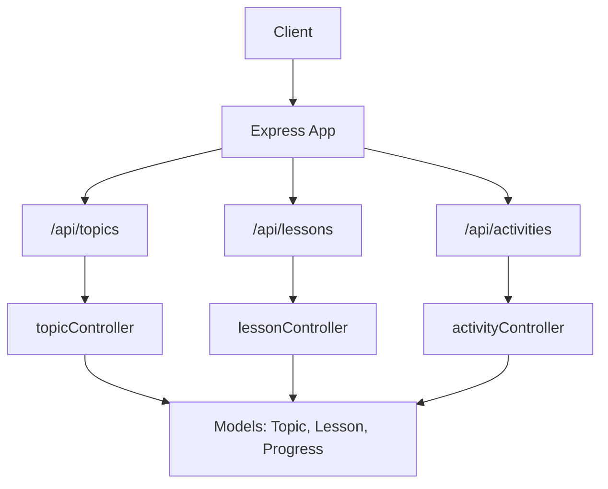
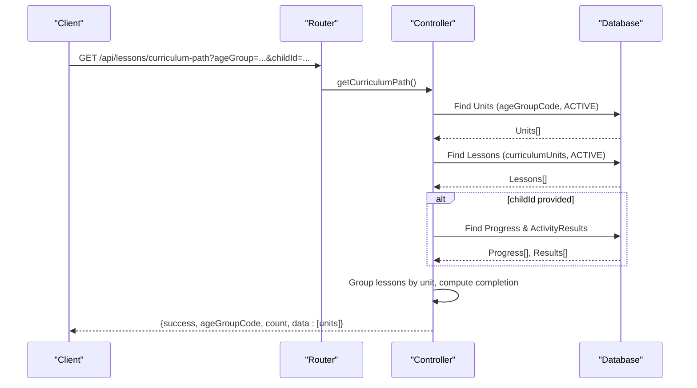
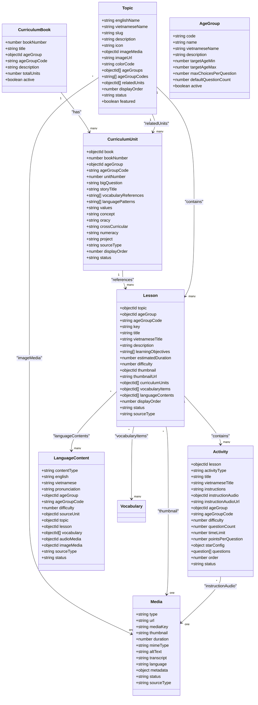
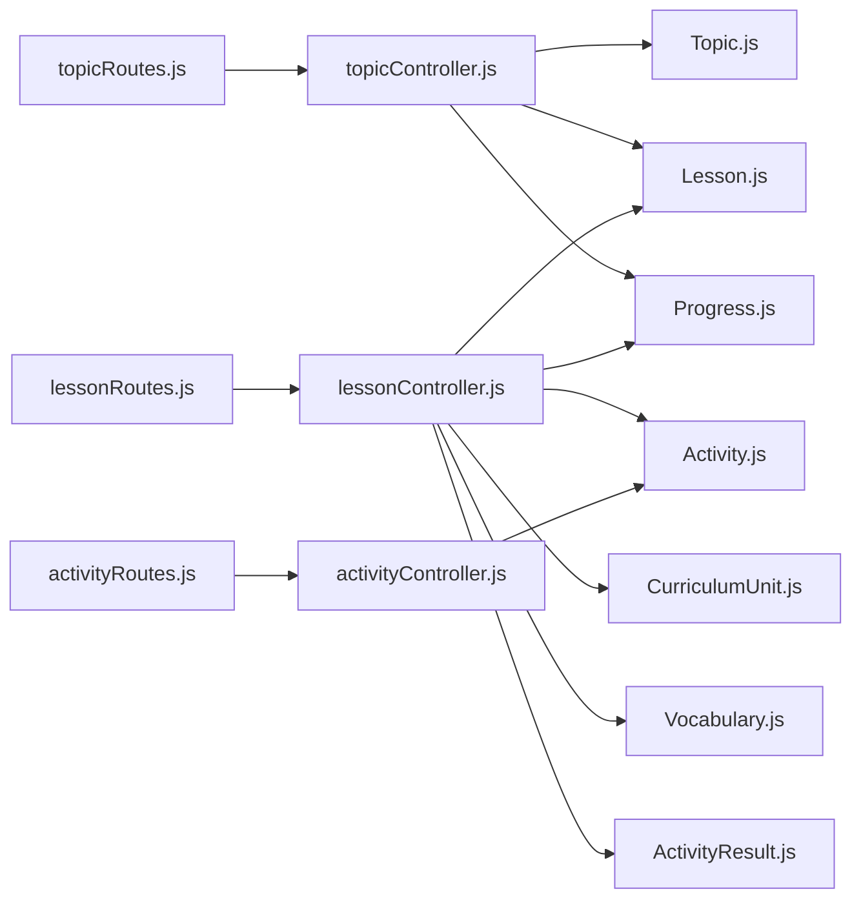

# Curriculum Management API

<cite>
**Referenced Files in This Document**
- [app.js](file://KCEnglishKids_BE/src/app.js)
- [topicRoutes.js](file://KCEnglishKids_BE/src/routes/topicRoutes.js)
- [lessonRoutes.js](file://KCEnglishKids_BE/src/routes/lessonRoutes.js)
- [activityRoutes.js](file://KCEnglishKids_BE/src/routes/activityRoutes.js)
- [topicController.js](file://KCEnglishKids_BE/src/controllers/topicController.js)
- [lessonController.js](file://KCEnglishKids_BE/src/controllers/lessonController.js)
- [activityController.js](file://KCEnglishKids_BE/src/controllers/activityController.js)
- [CurriculumBook.js](file://KCEnglishKids_BE/src/models/CurriculumBook.js)
- [CurriculumUnit.js](file://KCEnglishKids_BE/src/models/CurriculumUnit.js)
- [Topic.js](file://KCEnglishKids_BE/src/models/Topic.js)
- [Lesson.js](file://KCEnglishKids_BE/src/models/Lesson.js)
- [Activity.js](file://KCEnglishKids_BE/src/models/Activity.js)
- [Media.js](file://KCEnglishKids_BE/src/models/Media.js)
- [AgeGroup.js](file://KCEnglishKids_BE/src/models/AgeGroup.js)
- [LanguageContent.js](file://KCEnglishKids_BE/src/models/LanguageContent.js)
</cite>

## Table of Contents
1. [Introduction](#introduction)
2. [Project Structure](#project-structure)
3. [Core Components](#core-components)
4. [Architecture Overview](#architecture-overview)
5. [Detailed Component Analysis](#detailed-component-analysis)
6. [Dependency Analysis](#dependency-analysis)
7. [Performance Considerations](#performance-considerations)
8. [Troubleshooting Guide](#troubleshooting-guide)
9. [Conclusion](#conclusion)

## Introduction
This document provides detailed API documentation for the Curriculum Management endpoints that expose the hierarchical curriculum structure: Book → Unit → Topic → Lesson → Activity. It covers:
- Reading topics, lessons, and activities
- Age group filtering and content retrieval by learning levels
- Media asset references
- Request/response schemas for curriculum data structures
- Pagination parameters (where applicable)
- Search capabilities (as implemented)
- Relationship mapping to the educational framework
- Examples for fetching curriculum content across age groups and progressions
- Content versioning via sourceType and status management
- Bulk operations where available

## Project Structure
The curriculum-related routes are mounted under /api/topics, /api/lessons, and /api/activities. Controllers implement the business logic for retrieving and enriching curriculum data with related entities and optional child progress.

**Diagram sources**
- [app.js:34-45](file://KCEnglishKids_BE/src/app.js#L34-L45)
- [topicRoutes.js:1-14](file://KCEnglishKids_BE/src/routes/topicRoutes.js#L1-L14)
- [lessonRoutes.js:1-15](file://KCEnglishKids_BE/src/routes/lessonRoutes.js#L1-L15)
- [activityRoutes.js:1-8](file://KCEnglishKids_BE/src/routes/activityRoutes.js#L1-L8)

**Section sources**
- [app.js:1-53](file://KCEnglishKids_BE/src/app.js#L1-L53)

## Core Components
- CurriculumBook: Represents a book per age group with metadata and active flag.
- CurriculumUnit: Represents units within a book, linked to an age group and ordered by unitNumber.
- Topic: Thematic grouping of lessons; supports age groups, media, and status.
- Lesson: Learning sessions tied to topics and curriculum units; includes vocabulary and language content references.
- Activity: Interactive exercises within a lesson; includes questions, options, and scoring configuration.
- Media: Centralized media assets referenced by various entities.
- AgeGroup: Defines age ranges and defaults for question behavior.
- LanguageContent: Reusable language items (words, phrases, sentences) linked to units/topics/lessons.

**Section sources**
- [CurriculumBook.js:1-41](file://KCEnglishKids_BE/src/models/CurriculumBook.js#L1-L41)
- [CurriculumUnit.js:1-88](file://KCEnglishKids_BE/src/models/CurriculumUnit.js#L1-L88)
- [Topic.js:1-78](file://KCEnglishKids_BE/src/models/Topic.js#L1-L78)
- [Lesson.js:1-101](file://KCEnglishKids_BE/src/models/Lesson.js#L1-L101)
- [Activity.js:1-176](file://KCEnglishKids_BE/src/models/Activity.js#L1-L176)
- [Media.js:1-57](file://KCEnglishKids_BE/src/models/Media.js#L1-L57)
- [AgeGroup.js:1-48](file://KCEnglishKids_BE/src/models/AgeGroup.js#L1-L48)
- [LanguageContent.js:1-75](file://KCEnglishKids_BE/src/models/LanguageContent.js#L1-L75)

## Architecture Overview
The API exposes read-only endpoints for curriculum navigation and activity retrieval. The controllers enrich responses with related data and optional child progress.

**Diagram sources**
- [lessonRoutes.js:10-12](file://KCEnglishKids_BE/src/routes/lessonRoutes.js#L10-L12)
- [lessonController.js:6-107](file://KCEnglishKids_BE/src/controllers/lessonController.js#L6-L107)

## Detailed Component Analysis

### Topics API
Endpoints:
- GET /api/topics
  - Query params:
    - ageGroup: string (e.g., '3-4', '4-5', '5-6')
  - Response:
    - success: boolean
    - count: number
    - data: array of Topic objects enriched with lessonCount
- GET /api/topics/:id
  - Path param: id can be ObjectId or slug
  - Response:
    - success: boolean
    - data: Topic object with relatedUnits populated
- GET /api/topics/:id/lessons
  - Path param: id can be ObjectId or slug
  - Query params:
    - ageGroup: string
    - childId: string (optional)
  - Response:
    - success: boolean
    - topic: {id, englishName, vietnameseName, colorCode, icon}
    - count: number
    - data: array of Lesson objects (populated vocabularyItems), optionally with progress attached when childId is provided

Notes:
- Filtering by ageGroup applies to both topics and lessons.
- Status filter is applied to return only ACTIVE items.
- No pagination is implemented on these endpoints.

**Section sources**
- [topicRoutes.js:1-14](file://KCEnglishKids_BE/src/routes/topicRoutes.js#L1-L14)
- [topicController.js:6-137](file://KCEnglishKids_BE/src/controllers/topicController.js#L6-L137)

### Lessons API
Endpoints:
- GET /api/lessons/curriculum-path
  - Query params:
    - ageGroup: string (defaults to '3-4' if not provided)
    - childId: string (optional; also inferred from authenticated CHILD user)
  - Response:
    - success: boolean
    - ageGroupCode: string
    - count: number
    - data: array of Unit objects containing:
      - _id, unitNumber, bigQuestion, storyTitle
      - topic info (slug, name, icon, color)
      - lessons: array of Lesson objects with completed and stars fields
      - totalLessons, completedLessons, totalUnitStars, isCompleted
- GET /api/lessons/:id
  - Path param: id (ObjectId)
  - Query params:
    - childId: string (optional; also inferred from authenticated CHILD user)
  - Response:
    - success: boolean
    - data: Lesson object with:
      - topic, curriculumUnits, vocabularyItems, languageContents populated
      - activities: array of simplified Activity summaries with completed, stars, score
      - resumeActivityId, resumeActivityTitle
- GET /api/lessons/:id/activities
  - Path param: id (ObjectId)
  - Response:
    - success: boolean
    - count: number
    - data: array of Activity objects (ACTIVE only, sorted by order)

Notes:
- Curriculum path aggregates lessons by unit and computes completion metrics.
- Resume activity is determined as the first incomplete activity or the first activity if all are complete.
- No pagination is implemented on these endpoints.

**Section sources**
- [lessonRoutes.js:1-15](file://KCEnglishKids_BE/src/routes/lessonRoutes.js#L1-L15)
- [lessonController.js:6-197](file://KCEnglishKids_BE/src/controllers/lessonController.js#L6-L197)

### Activities API
Endpoints:
- GET /api/activities/:id
  - Path param: id (ObjectId)
  - Response:
    - success: boolean
    - data: Activity object with:
      - lesson (title, topic, ageGroupCode)
      - questions with vocabulary populated

Notes:
- Returns full activity details including nested questions and options.
- No pagination is implemented on this endpoint.

**Section sources**
- [activityRoutes.js:1-8](file://KCEnglishKids_BE/src/routes/activityRoutes.js#L1-L8)
- [activityController.js:1-30](file://KCEnglishKids_BE/src/controllers/activityController.js#L1-L30)

### Data Models and Relationships

**Diagram sources**
- [CurriculumBook.js:1-41](file://KCEnglishKids_BE/src/models/CurriculumBook.js#L1-L41)
- [CurriculumUnit.js:1-88](file://KCEnglishKids_BE/src/models/CurriculumUnit.js#L1-L88)
- [Topic.js:1-78](file://KCEnglishKids_BE/src/models/Topic.js#L1-L78)
- [Lesson.js:1-101](file://KCEnglishKids_BE/src/models/Lesson.js#L1-L101)
- [Activity.js:1-176](file://KCEnglishKids_BE/src/models/Activity.js#L1-L176)
- [Media.js:1-57](file://KCEnglishKids_BE/src/models/Media.js#L1-L57)
- [AgeGroup.js:1-48](file://KCEnglishKids_BE/src/models/AgeGroup.js#L1-L48)
- [LanguageContent.js:1-75](file://KCEnglishKids_BE/src/models/LanguageContent.js#L1-L75)

### Request/Response Schemas

#### GET /api/topics
- Query Parameters:
  - ageGroup: string (optional). Allowed values: '3-4', '4-5', '5-6'.
- Response Schema:
  - success: boolean
  - count: number
  - data: array of Topic objects with additional field lessonCount: number

#### GET /api/topics/:id
- Path Parameters:
  - id: string (ObjectId or slug)
- Response Schema:
  - success: boolean
  - data: Topic object with relatedUnits populated

#### GET /api/topics/:id/lessons
- Path Parameters:
  - id: string (ObjectId or slug)
- Query Parameters:
  - ageGroup: string (optional)
  - childId: string (optional)
- Response Schema:
  - success: boolean
  - topic: {id, englishName, vietnameseName, colorCode, icon}
  - count: number
  - data: array of Lesson objects (populated vocabularyItems), optionally with progress attached when childId is provided

#### GET /api/lessons/curriculum-path
- Query Parameters:
  - ageGroup: string (optional; defaults to '3-4')
  - childId: string (optional; also inferred from authenticated CHILD user)
- Response Schema:
  - success: boolean
  - ageGroupCode: string
  - count: number
  - data: array of Unit objects with:
    - _id, unitNumber, bigQuestion, storyTitle
    - topic: {slug, englishName, vietnameseName, icon, colorCode}
    - lessons: array of Lesson objects with completed: boolean, stars: number
    - totalLessons: number
    - completedLessons: number
    - totalUnitStars: number
    - isCompleted: boolean

#### GET /api/lessons/:id
- Path Parameters:
  - id: string (ObjectId)
- Query Parameters:
  - childId: string (optional; also inferred from authenticated CHILD user)
- Response Schema:
  - success: boolean
  - data: Lesson object with:
    - topic, curriculumUnits, vocabularyItems, languageContents populated
    - activities: array of Activity summaries with completed, stars, score
    - resumeActivityId: string|null
    - resumeActivityTitle: string|null

#### GET /api/lessons/:id/activities
- Path Parameters:
  - id: string (ObjectId)
- Response Schema:
  - success: boolean
  - count: number
  - data: array of Activity objects (ACTIVE only, sorted by order)

#### GET /api/activities/:id
- Path Parameters:
  - id: string (ObjectId)
- Response Schema:
  - success: boolean
  - data: Activity object with:
    - lesson: {title, topic, ageGroupCode}
    - questions: array with vocabulary populated

**Section sources**
- [topicController.js:6-137](file://KCEnglishKids_BE/src/controllers/topicController.js#L6-L137)
- [lessonController.js:6-197](file://KCEnglishKids_BE/src/controllers/lessonController.js#L6-L197)
- [activityController.js:1-30](file://KCEnglishKids_BE/src/controllers/activityController.js#L1-L30)

### Age Group Filtering and Learning Levels
- Age group codes: '3-4', '4-5', '5-6'
- Used to filter:
  - Topics (via ageGroupCodes)
  - Lessons (via ageGroupCode)
  - Activities (via ageGroupCode)
- Curriculum path endpoint returns units and lessons aligned to the specified age group.

**Section sources**
- [AgeGroup.js:1-48](file://KCEnglishKids_BE/src/models/AgeGroup.js#L1-L48)
- [Topic.js:40-51](file://KCEnglishKids_BE/src/models/Topic.js#L40-L51)
- [Lesson.js:11-21](file://KCEnglishKids_BE/src/models/Lesson.js#L11-L21)
- [Activity.js:116-125](file://KCEnglishKids_BE/src/models/Activity.js#L116-L125)
- [lessonController.js:6-107](file://KCEnglishKids_BE/src/controllers/lessonController.js#L6-L107)

### Media Asset Management
- Entities reference Media via:
  - Topic.imageMedia
  - Lesson.thumbnail
  - Activity.instructionAudio
  - LanguageContent.audioMedia, imageMedia
- Media schema includes type, url, duration, mimeType, altText, transcript, language, status, sourceType.

**Section sources**
- [Topic.js:29-35](file://KCEnglishKids_BE/src/models/Topic.js#L29-L35)
- [Lesson.js:54-60](file://KCEnglishKids_BE/src/models/Lesson.js#L54-L60)
- [Activity.js:109-115](file://KCEnglishKids_BE/src/models/Activity.js#L109-L115)
- [LanguageContent.js:52-59](file://KCEnglishKids_BE/src/models/LanguageContent.js#L52-L59)
- [Media.js:1-57](file://KCEnglishKids_BE/src/models/Media.js#L1-L57)

### Content Versioning and Status Management
- sourceType:
  - OFFICIAL_CURRICULUM
  - SYSTEM_DESIGN
  - GENERATED_CONTENT
- status:
  - ACTIVE
  - INACTIVE
  - HIDDEN
  - DRAFT (for some models)
- Endpoints typically filter by status = 'ACTIVE' when returning curriculum data.

**Section sources**
- [CurriculumUnit.js:66-79](file://KCEnglishKids_BE/src/models/CurriculumUnit.js#L66-L79)
- [Topic.js:62-70](file://KCEnglishKids_BE/src/models/Topic.js#L62-L70)
- [Lesson.js:83-92](file://KCEnglishKids_BE/src/models/Lesson.js#L83-L92)
- [Activity.js:163-167](file://KCEnglishKids_BE/src/models/Activity.js#L163-L167)
- [Media.js:42-51](file://KCEnglishKids_BE/src/models/Media.js#L42-L51)
- [LanguageContent.js:60-69](file://KCEnglishKids_BE/src/models/LanguageContent.js#L60-L69)

### Pagination and Search
- Pagination: Not implemented on the documented curriculum endpoints.
- Search:
  - Topics support lookup by ObjectId or slug.
  - Other endpoints use filters like ageGroup, childId, status.

**Section sources**
- [topicController.js:48-69](file://KCEnglishKids_BE/src/controllers/topicController.js#L48-L69)

### Examples

- Fetch topics for age group '4-5':
  - GET /api/topics?ageGroup=4-5
  - Returns topics filtered by ageGroupCodes and enriched with lessonCount.

- Get lessons under a topic for age group '5-6' with child progress:
  - GET /api/topics/{topicIdOrSlug}/lessons?ageGroup=5-6&childId={childId}
  - Returns lessons with vocabularyItems and optional progress attached.

- Retrieve structured curriculum path for age group '3-4' with child progress:
  - GET /api/lessons/curriculum-path?ageGroup=3-4&childId={childId}
  - Returns units with grouped lessons, completion metrics, and resume activity guidance.

- Get a single lesson with activities and resume hint:
  - GET /api/lessons/{lessonId}?childId={childId}
  - Returns lesson details, activities summary, and resumeActivityId/title.

- Get activities for a lesson:
  - GET /api/lessons/{lessonId}/activities
  - Returns list of activities sorted by order.

- Get a specific activity detail:
  - GET /api/activities/{activityId}
  - Returns full activity with questions and vocabulary.

**Section sources**
- [topicController.js:6-137](file://KCEnglishKids_BE/src/controllers/topicController.js#L6-L137)
- [lessonController.js:6-197](file://KCEnglishKids_BE/src/controllers/lessonController.js#L6-L197)
- [activityController.js:1-30](file://KCEnglishKids_BE/src/controllers/activityController.js#L1-L30)

## Dependency Analysis

**Diagram sources**
- [topicRoutes.js:1-14](file://KCEnglishKids_BE/src/routes/topicRoutes.js#L1-L14)
- [lessonRoutes.js:1-15](file://KCEnglishKids_BE/src/routes/lessonRoutes.js#L1-L15)
- [activityRoutes.js:1-8](file://KCEnglishKids_BE/src/routes/activityRoutes.js#L1-L8)
- [topicController.js:1-137](file://KCEnglishKids_BE/src/controllers/topicController.js#L1-L137)
- [lessonController.js:1-197](file://KCEnglishKids_BE/src/controllers/lessonController.js#L1-L197)
- [activityController.js:1-30](file://KCEnglishKids_BE/src/controllers/activityController.js#L1-L30)

**Section sources**
- [topicRoutes.js:1-14](file://KCEnglishKids_BE/src/routes/topicRoutes.js#L1-L14)
- [lessonRoutes.js:1-15](file://KCEnglishKids_BE/src/routes/lessonRoutes.js#L1-L15)
- [activityRoutes.js:1-8](file://KCEnglishKids_BE/src/routes/activityRoutes.js#L1-L8)
- [topicController.js:1-137](file://KCEnglishKids_BE/src/controllers/topicController.js#L1-L137)
- [lessonController.js:1-197](file://KCEnglishKids_BE/src/controllers/lessonController.js#L1-L197)
- [activityController.js:1-30](file://KCEnglishKids_BE/src/controllers/activityController.js#L1-L30)

## Performance Considerations
- Population usage:
  - Controllers populate related entities (e.g., vocabularyItems, languageContents, topic, curriculumUnits). Ensure indexes exist on referenced fields to optimize joins.
- Sorting:
  - Responses are sorted by displayOrder, unitNumber, order to ensure consistent presentation.
- Aggregation:
  - Curriculum path builds a map of progress and results; consider caching for repeated requests with the same childId and ageGroup.
- Indexes:
  - Models define useful indexes (e.g., ageGroupCode, status, displayOrder) to speed up queries.

[No sources needed since this section provides general guidance]

## Troubleshooting Guide
Common issues:
- 404 Not Found:
  - Occurs when topic, lesson, or activity IDs do not exist.
- Empty datasets:
  - May result from status filters excluding all records; verify status = 'ACTIVE'.
- Missing child progress:
  - Ensure childId is provided or user role is CHILD to attach progress and activity results.

Error handling:
- Controllers delegate errors to a global error middleware.

**Section sources**
- [topicController.js:48-69](file://KCEnglishKids_BE/src/controllers/topicController.js#L48-L69)
- [lessonController.js:112-170](file://KCEnglishKids_BE/src/controllers/lessonController.js#L112-L170)
- [activityController.js:6-24](file://KCEnglishKids_BE/src/controllers/activityController.js#L6-L24)

## Conclusion
The Curriculum Management API provides robust read endpoints to navigate the hierarchical curriculum structure and retrieve rich content for each level. Age group filtering, status management, and media references enable tailored learning experiences. While pagination is not implemented, the current design supports efficient retrieval and enrichment of curriculum data, including progress-aware responses for children.

[No sources needed since this section summarizes without analyzing specific files]