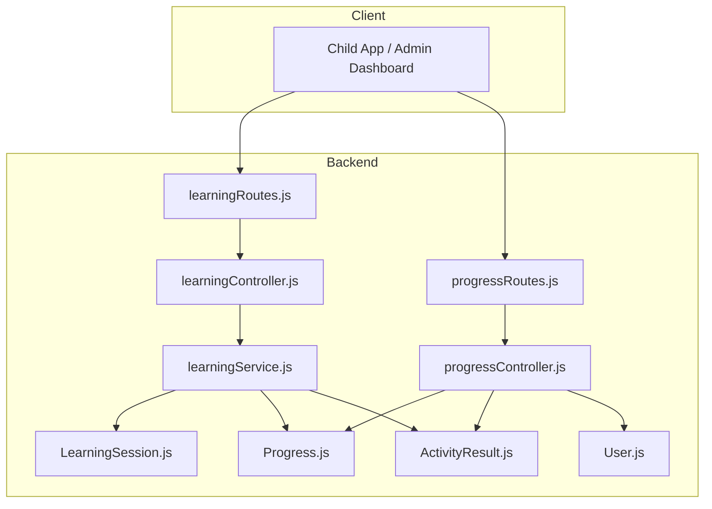
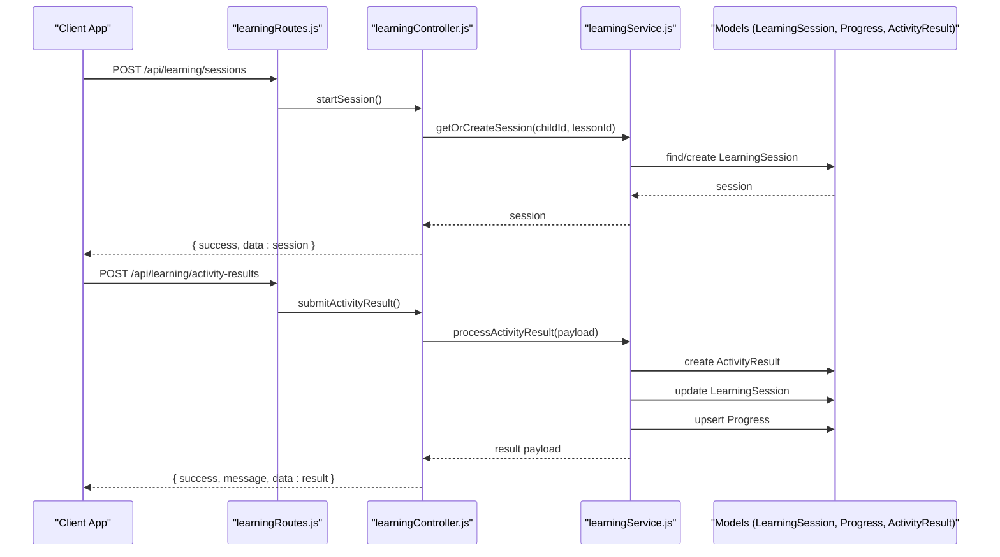
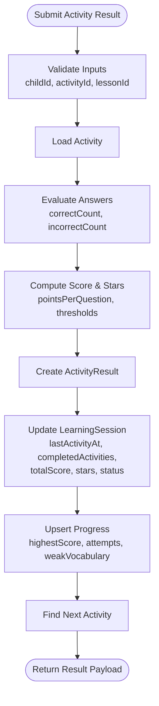
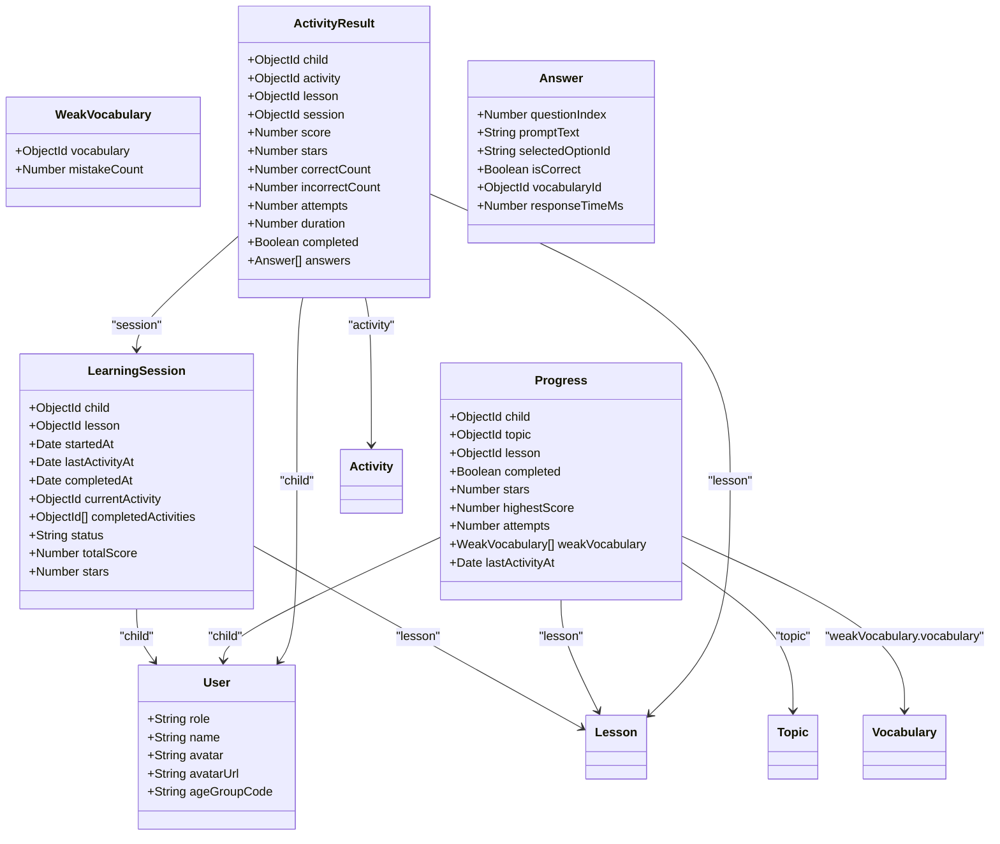
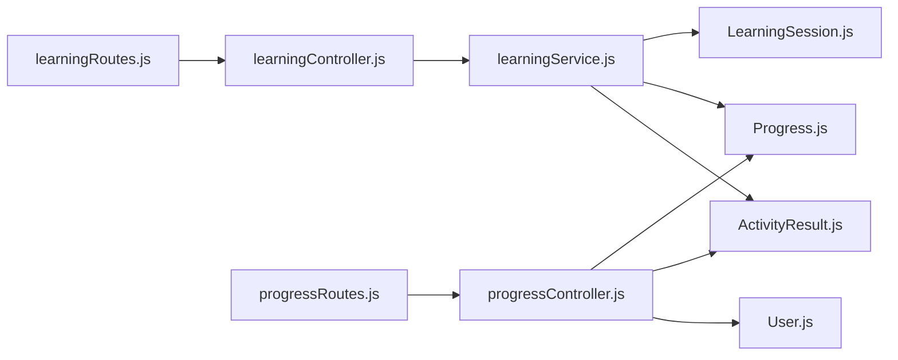

# Learning & Progress Tracking API

<cite>
**Referenced Files in This Document**
- [learningController.js](file://KCEnglishKids_BE/src/controllers/learningController.js)
- [progressController.js](file://KCEnglishKids_BE/src/controllers/progressController.js)
- [activityController.js](file://KCEnglishKids_BE/src/controllers/activityController.js)
- [learningService.js](file://KCEnglishKids_BE/src/services/learningService.js)
- [LearningSession.js](file://KCEnglishKids_BE/src/models/LearningSession.js)
- [Progress.js](file://KCEnglishKids_BE/src/models/Progress.js)
- [ActivityResult.js](file://KCEnglishKids_BE/src/models/ActivityResult.js)
- [User.js](file://KCEnglishKids_BE/src/models/User.js)
- [learningRoutes.js](file://KCEnglishKids_BE/src/routes/learningRoutes.js)
- [progressRoutes.js](file://KCEnglishKids_BE/src/routes/progressRoutes.js)
- [badges.ts](file://client/src/data/badges.ts)
- [api.md](file://docs/api.md)
</cite>

## Table of Contents
1. [Introduction](#introduction)
2. [Project Structure](#project-structure)
3. [Core Components](#core-components)
4. [Architecture Overview](#architecture-overview)
5. [Detailed Component Analysis](#detailed-component-analysis)
6. [Dependency Analysis](#dependency-analysis)
7. [Performance Considerations](#performance-considerations)
8. [Troubleshooting Guide](#troubleshooting-guide)
9. [Conclusion](#conclusion)
10. [Appendices](#appendices)

## Introduction
This document provides comprehensive API documentation for the Learning & Progress Tracking subsystem. It covers learning session management, activity result submission, progress recording, star accumulation logic, badge achievement triggers, and performance analytics endpoints. The goal is to help clients integrate with the backend to record child learning activities, compute stars and scores, track weak vocabulary, and retrieve aggregated progress metrics.

## Project Structure
The Learning & Progress Tracking features are implemented under the backend service layer:
- Routes define REST endpoints for sessions, activity results, and progress queries.
- Controllers handle HTTP requests and delegate business logic to services.
- Services implement core algorithms (star calculation, session lifecycle, progress updates).
- Models define persistent data structures for sessions, progress, and activity results.
- Frontend badge definitions provide reward system configuration used by UI.

**Diagram sources**
- [learningRoutes.js:1-15](file://KCEnglishKids_BE/src/routes/learningRoutes.js#L1-L15)
- [progressRoutes.js:1-8](file://KCEnglishKids_BE/src/routes/progressRoutes.js#L1-L8)
- [learningController.js:1-92](file://KCEnglishKids_BE/src/controllers/learningController.js#L1-L92)
- [progressController.js:1-71](file://KCEnglishKids_BE/src/controllers/progressController.js#L1-L71)
- [learningService.js:1-188](file://KCEnglishKids_BE/src/services/learningService.js#L1-L188)
- [LearningSession.js:1-61](file://KCEnglishKids_BE/src/models/LearningSession.js#L1-L61)
- [Progress.js:1-65](file://KCEnglishKids_BE/src/models/Progress.js#L1-L65)
- [ActivityResult.js:1-78](file://KCEnglishKids_BE/src/models/ActivityResult.js#L1-L78)
- [User.js:1-109](file://KCEnglishKids_BE/src/models/User.js#L1-L109)

**Section sources**
- [learningRoutes.js:1-15](file://KCEnglishKids_BE/src/routes/learningRoutes.js#L1-L15)
- [progressRoutes.js:1-8](file://KCEnglishKids_BE/src/routes/progressRoutes.js#L1-L8)
- [api.md:17-24](file://docs/api.md#L17-L24)

## Core Components
- Learning Session Management: Start/resume sessions, fetch session details, submit activity results.
- Progress Recording: Aggregate per-lesson progress, weak vocabulary tracking, recent activity history.
- Star Calculation: Score-based star rating with configurable thresholds.
- Reward System Integration: Badge definitions and trigger conditions based on lessons, units, and stars.

Key responsibilities:
- learningController.js: Exposes endpoints for session lifecycle and activity result submission.
- learningService.js: Implements getOrCreateSession, processActivityResult, calculateStars.
- progressController.js: Aggregates child progress, total stars, completed lessons, weak vocabulary, and recent results.
- Models: LearningSession, Progress, ActivityResult, User.

**Section sources**
- [learningController.js:1-92](file://KCEnglishKids_BE/src/controllers/learningController.js#L1-L92)
- [learningService.js:1-188](file://KCEnglishKids_BE/src/services/learningService.js#L1-L188)
- [progressController.js:1-71](file://KCEnglishKids_BE/src/controllers/progressController.js#L1-L71)
- [LearningSession.js:1-61](file://KCEnglishKids_BE/src/models/LearningSession.js#L1-L61)
- [Progress.js:1-65](file://KCEnglishKids_BE/src/models/Progress.js#L1-L65)
- [ActivityResult.js:1-78](file://KCEnglishKids_BE/src/models/ActivityResult.js#L1-L78)

## Architecture Overview
The Learning & Progress Tracking API follows a layered architecture:
- Routes map HTTP endpoints to controller methods.
- Controllers validate inputs and orchestrate service calls.
- Services encapsulate domain logic (session lifecycle, scoring, progress updates).
- Models persist structured data with indexes for efficient queries.

**Diagram sources**
- [learningRoutes.js:10-12](file://KCEnglishKids_BE/src/routes/learningRoutes.js#L10-L12)
- [learningController.js:7-85](file://KCEnglishKids_BE/src/controllers/learningController.js#L7-L85)
- [learningService.js:19-181](file://KCEnglishKids_BE/src/services/learningService.js#L19-L181)
- [LearningSession.js:1-61](file://KCEnglishKids_BE/src/models/LearningSession.js#L1-L61)
- [Progress.js:1-65](file://KCEnglishKids_BE/src/models/Progress.js#L1-L65)
- [ActivityResult.js:1-78](file://KCEnglishKids_BE/src/models/ActivityResult.js#L1-L78)

## Detailed Component Analysis

### Learning Sessions API
Endpoints:
- POST /api/learning/sessions
  - Purpose: Start or resume a learning session for a child and lesson.
  - Access: Private / Child (optionalProtect middleware allows flexible auth).
  - Request body:
    - childId: string (required)
    - lessonId: string (required)
  - Response:
    - success: boolean
    - data: LearningSession object
- GET /api/learning/sessions/:id
  - Purpose: Retrieve session details including populated lesson and completed activities.
  - Access: Private / Child
  - Path params: id (string)
  - Response:
    - success: boolean
    - data: LearningSession object with populated fields

Behavior:
- If an IN_PROGRESS session exists for the child+lesson, it resumes; otherwise, a new session is created.
- lastActivityAt is updated on resume.

Error handling:
- Missing required fields return 400 with a descriptive message.
- Not found returns 404 when session does not exist.

**Section sources**
- [learningRoutes.js:10-12](file://KCEnglishKids_BE/src/routes/learningRoutes.js#L10-L12)
- [learningController.js:7-51](file://KCEnglishKids_BE/src/controllers/learningController.js#L7-L51)
- [learningService.js:19-40](file://KCEnglishKids_BE/src/services/learningService.js#L19-L40)
- [LearningSession.js:1-61](file://KCEnglishKids_BE/src/models/LearningSession.js#L1-L61)

### Activity Result Submission & Scoring
Endpoint:
- POST /api/learning/activity-results
  - Purpose: Submit answers for an activity, compute score/stars, update session and progress.
  - Access: Private / Child
  - Request body:
    - activityId: string (required)
    - lessonId: string (required)
    - sessionId: string (optional; if missing, a session is created/resumed)
    - answers: array of answer objects (see schema below)
    - duration: number (seconds, optional)
  - Response:
    - success: boolean
    - message: string
    - data: result payload including score, stars, next activity info

Answer object schema:
- questionIndex: number
- promptText: string
- selectedOptionId: string
- isCorrect: boolean
- vocabularyId: string (optional)
- responseTimeMs: number (optional)

Scoring algorithm:
- Points per question come from activity.pointsPerQuestion (default 25).
- Total score = correctCount * pointsPerQuestion.
- Max score = totalQuestions * pointsPerQuestion.
- Stars are calculated via calculateStars(score, maxScore, activity.starConfig).

Star calculation logic:
- Thresholds default to threeStarsMin=90%, twoStarsMin=70%, oneStarMin=50%.
- Returns 0–3 stars based on percentage thresholds.

Session updates:
- lastActivityAt updated.
- currentActivity set to the latest activity.
- completedActivities list updated.
- totalScore accumulates across activities.
- stars take the maximum earned so far.
- If all lesson activities are completed, session status becomes COMPLETED and completedAt is set.

Progress updates:
- Upserts Progress per child+lesson.
- Tracks highestScore, attempts, weakVocabulary with mistake counts.
- lastActivityAt updated.

Next activity recommendation:
- Finds the next active activity in the same lesson by order.

**Diagram sources**
- [learningController.js:56-85](file://KCEnglishKids_BE/src/controllers/learningController.js#L56-L85)
- [learningService.js:45-181](file://KCEnglishKids_BE/src/services/learningService.js#L45-L181)
- [ActivityResult.js:1-78](file://KCEnglishKids_BE/src/models/ActivityResult.js#L1-L78)
- [LearningSession.js:1-61](file://KCEnglishKids_BE/src/models/LearningSession.js#L1-L61)
- [Progress.js:1-65](file://KCEnglishKids_BE/src/models/Progress.js#L1-L65)

**Section sources**
- [learningController.js:53-85](file://KCEnglishKids_BE/src/controllers/learningController.js#L53-L85)
- [learningService.js:45-181](file://KCEnglishKids_BE/src/services/learningService.js#L45-L181)
- [ActivityResult.js:1-78](file://KCEnglishKids_BE/src/models/ActivityResult.js#L1-L78)

### Progress Analytics Endpoint
Endpoint:
- GET /api/children/:id/progress
  - Purpose: Retrieve child profile, total stars, completed lessons count, detailed progress list, weak vocabulary aggregation, and recent activity results.
  - Access: Private
  - Path params: id (string)
  - Response:
    - success: boolean
    - data:
      - child: User object (name, avatar, avatarUrl, ageGroupCode)
      - totalStars: number (sum of stars across progress items)
      - completedLessonsCount: number
      - progressList: array of Progress objects with populated topic, lesson, weakVocabulary.vocabulary
      - weakVocabulary: aggregated list of vocabulary with cumulative mistakeCount
      - recentActivityResults: up to 5 most recent ActivityResult entries with populated activity and lesson

Aggregation logic:
- Iterates progressList to sum stars and count completed lessons.
- Aggregates weakVocabulary by vocabulary ID, summing mistakeCount across entries.
- Fetches recent ActivityResult entries sorted by createdAt descending.

Error handling:
- Returns 404 if child not found.

**Section sources**
- [progressRoutes.js:5](file://KCEnglishKids_BE/src/routes/progressRoutes.js#L5)
- [progressController.js:6-66](file://KCEnglishKids_BE/src/controllers/progressController.js#L6-L66)
- [Progress.js:1-65](file://KCEnglishKids_BE/src/models/Progress.js#L1-L65)
- [ActivityResult.js:1-78](file://KCEnglishKids_BE/src/models/ActivityResult.js#L1-L78)
- [User.js:1-109](file://KCEnglishKids_BE/src/models/User.js#L1-L109)

### Activity Retrieval
Endpoint:
- GET /api/activities/:id
  - Purpose: Get activity details including questions and associated vocabulary.
  - Access: Public / Child
  - Path params: id (string)
  - Response:
    - success: boolean
    - data: Activity object with populated lesson and questions.vocabulary

Error handling:
- Returns 404 if activity not found.

**Section sources**
- [activityController.js:6-25](file://KCEnglishKids_BE/src/controllers/activityController.js#L6-L25)

### Data Models
- LearningSession: Tracks child’s ongoing session per lesson, timestamps, current/completed activities, status, totalScore, stars.
- Progress: Per-lesson progress per child, includes completion flag, stars, highestScore, attempts, weakVocabulary list, lastActivityAt.
- ActivityResult: Records each activity attempt with score, stars, correct/incorrect counts, attempts, duration, answers detail.
- User: Represents children, teachers, admins, parents with roles, avatars, age group codes, and authentication fields.

**Diagram sources**
- [LearningSession.js:1-61](file://KCEnglishKids_BE/src/models/LearningSession.js#L1-L61)
- [Progress.js:1-65](file://KCEnglishKids_BE/src/models/Progress.js#L1-L65)
- [ActivityResult.js:1-78](file://KCEnglishKids_BE/src/models/ActivityResult.js#L1-L78)
- [User.js:1-109](file://KCEnglishKids_BE/src/models/User.js#L1-L109)

## Dependency Analysis
- Routes depend on controllers for request handling.
- Controllers depend on services for business logic.
- Services depend on models for persistence and cross-entity operations.
- Progress analytics aggregates multiple models (Progress, ActivityResult, User).

**Diagram sources**
- [learningRoutes.js:1-15](file://KCEnglishKids_BE/src/routes/learningRoutes.js#L1-L15)
- [progressRoutes.js:1-8](file://KCEnglishKids_BE/src/routes/progressRoutes.js#L1-L8)
- [learningController.js:1-92](file://KCEnglishKids_BE/src/controllers/learningController.js#L1-L92)
- [progressController.js:1-71](file://KCEnglishKids_BE/src/controllers/progressController.js#L1-L71)
- [learningService.js:1-188](file://KCEnglishKids_BE/src/services/learningService.js#L1-L188)
- [LearningSession.js:1-61](file://KCEnglishKids_BE/src/models/LearningSession.js#L1-L61)
- [Progress.js:1-65](file://KCEnglishKids_BE/src/models/Progress.js#L1-L65)
- [ActivityResult.js:1-78](file://KCEnglishKids_BE/src/models/ActivityResult.js#L1-L78)
- [User.js:1-109](file://KCEnglishKids_BE/src/models/User.js#L1-L109)

**Section sources**
- [learningRoutes.js:1-15](file://KCEnglishKids_BE/src/routes/learningRoutes.js#L1-L15)
- [progressRoutes.js:1-8](file://KCEnglishKids_BE/src/routes/progressRoutes.js#L1-L8)
- [learningController.js:1-92](file://KCEnglishKids_BE/src/controllers/learningController.js#L1-L92)
- [progressController.js:1-71](file://KCEnglishKids_BE/src/controllers/progressController.js#L1-L71)
- [learningService.js:1-188](file://KCEnglishKids_BE/src/services/learningService.js#L1-L188)

## Performance Considerations
- Indexing:
  - LearningSession indexes on child+status and child+lesson improve session lookup and filtering.
  - Progress indexes on child+lesson (unique) and child+topic optimize progress retrieval and uniqueness constraints.
  - ActivityResult indexes on child+activity support quick lookups per child and activity.
- Query population:
  - Controllers populate related entities (lesson, topic, vocabulary) to reduce client-side joins but may increase server load; consider selective population for large datasets.
- Aggregation:
  - Progress endpoint aggregates weakVocabulary across records; ensure database size is reasonable or paginate if needed.
- Star calculation:
  - Simple threshold checks; negligible CPU cost.

[No sources needed since this section provides general guidance]

## Troubleshooting Guide
Common issues and resolutions:
- Missing required fields:
  - Ensure childId, lessonId, activityId are provided where required.
  - Responses include success=false and a descriptive message.
- Session not found:
  - Verify session id exists before fetching; otherwise expect 404.
- Activity not found:
  - Confirm activityId is valid; expect 404 if missing.
- Progress not found:
  - When querying child progress, ensure child id exists; otherwise expect 404.

Operational tips:
- Use optionalProtect middleware appropriately to allow flexible authentication flows for child sessions.
- Validate answers structure to ensure correct scoring and weak vocabulary tracking.

**Section sources**
- [learningController.js:12-17](file://KCEnglishKids_BE/src/controllers/learningController.js#L12-L17)
- [learningController.js:40-42](file://KCEnglishKids_BE/src/controllers/learningController.js#L40-L42)
- [activityController.js:14-16](file://KCEnglishKids_BE/src/controllers/activityController.js#L14-L16)
- [progressController.js:11-13](file://KCEnglishKids_BE/src/controllers/progressController.js#L11-L13)

## Conclusion
The Learning & Progress Tracking API provides robust endpoints for managing learning sessions, submitting activity results, computing scores and stars, and retrieving aggregated progress analytics. The service layer encapsulates key algorithms for star calculation and session lifecycle management, while models enforce data integrity and indexing for performance. The frontend badge definitions complement the backend scoring to deliver a cohesive reward system.

[No sources needed since this section summarizes without analyzing specific files]

## Appendices

### API Endpoints Summary
- Learning Sessions
  - POST /api/learning/sessions
  - GET /api/learning/sessions/:id
  - POST /api/learning/activity-results
- Progress Analytics
  - GET /api/children/:id/progress
- Activities
  - GET /api/activities/:id

Authentication notes:
- Learning routes use optionalProtect middleware to allow flexible auth scenarios.
- Progress route is marked private.

**Section sources**
- [learningRoutes.js:10-12](file://KCEnglishKids_BE/src/routes/learningRoutes.js#L10-L12)
- [progressRoutes.js:5](file://KCEnglishKids_BE/src/routes/progressRoutes.js#L5)
- [api.md:17-24](file://docs/api.md#L17-L24)

### Star Calculation Algorithm Details
- Input: score, maxScore, starConfig (threeStarsMin, twoStarsMin, oneStarMin).
- Output: stars (0–3).
- Logic:
  - percentage = round((score / maxScore) * 100)
  - If percentage >= threeStarsMin → 3 stars
  - Else if percentage >= twoStarsMin → 2 stars
  - Else if percentage >= oneStarMin → 1 star
  - Else → 0 stars

Default thresholds:
- threeStarsMin: 90%
- twoStarsMin: 70%
- oneStarMin: 50%

**Section sources**
- [learningService.js:6-14](file://KCEnglishKids_BE/src/services/learningService.js#L6-L14)

### Badge Achievement Triggers
Badge definitions are maintained in the frontend data file and include categories such as journey, stars, and skills. Trigger types include:
- lesson: Number of lessons completed.
- unit: Number of units completed.
- star: Accumulated star thresholds.

Examples:
- b_first_step: Requires 1 lesson completed.
- b_star_5: Requires 5 stars accumulated.
- b_unit_all: Requires completing all 9 units.

These badges inform UI rewards and can be integrated with backend progress data to unlock achievements.

**Section sources**
- [badges.ts:17-324](file://client/src/data/badges.ts#L17-L324)