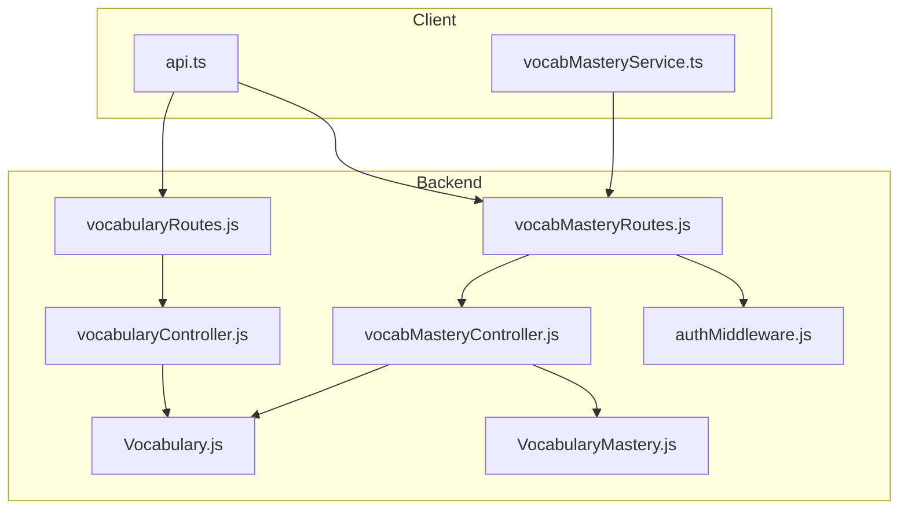
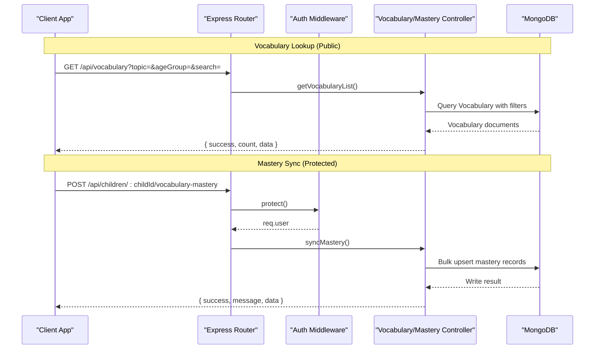
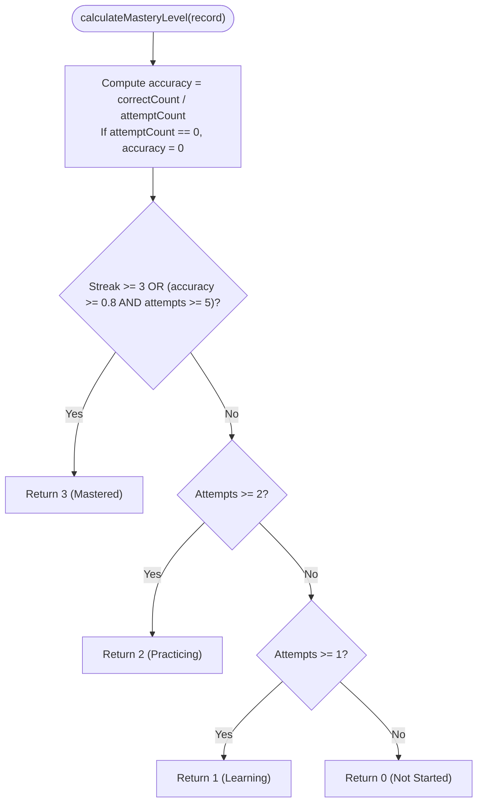
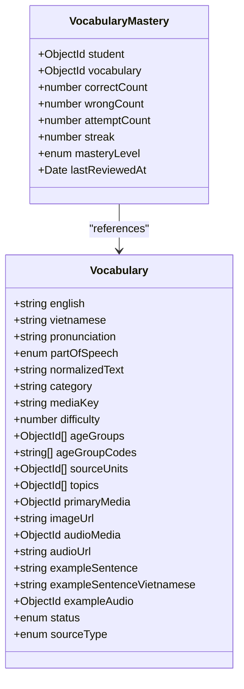
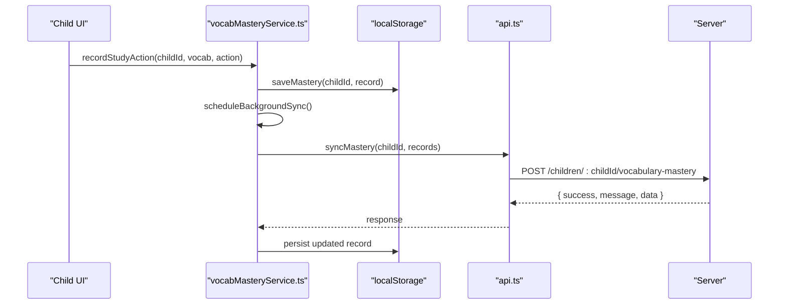
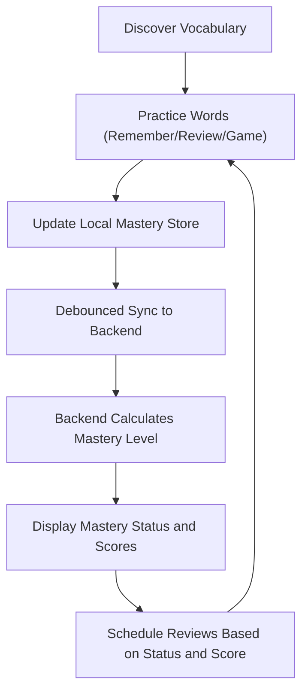
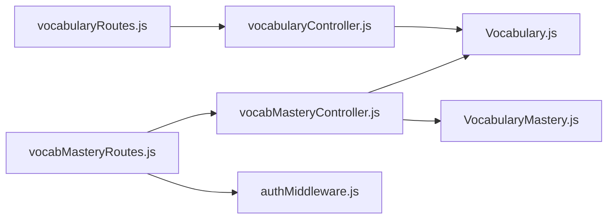

# Vocabulary & Mastery Tracking API

<cite>
**Referenced Files in This Document**
- [vocabularyController.js](file://KCEnglishKids_BE/src/controllers/vocabularyController.js)
- [vocabMasteryController.js](file://KCEnglishKids_BE/src/controllers/vocabMasteryController.js)
- [Vocabulary.js](file://KCEnglishKids_BE/src/models/Vocabulary.js)
- [VocabularyMastery.js](file://KCEnglishKids_BE/src/models/VocabularyMastery.js)
- [vocabularyRoutes.js](file://KCEnglishKids_BE/src/routes/vocabularyRoutes.js)
- [vocabMasteryRoutes.js](file://KCEnglishKids_BE/src/routes/vocabMasteryRoutes.js)
- [authMiddleware.js](file://KCEnglishKids_BE/src/middlewares/authMiddleware.js)
- [api.ts](file://client/src/services/api.ts)
- [vocabMasteryService.ts](file://client/src/services/vocabMasteryService.ts)
- [api.md](file://docs/api.md)
</cite>

## Table of Contents
1. [Introduction](#introduction)
2. [Project Structure](#project-structure)
3. [Core Components](#core-components)
4. [Architecture Overview](#architecture-overview)
5. [Detailed Component Analysis](#detailed-component-analysis)
6. [Dependency Analysis](#dependency-analysis)
7. [Performance Considerations](#performance-considerations)
8. [Troubleshooting Guide](#troubleshooting-guide)
9. [Conclusion](#conclusion)
10. [Appendices](#appendices)

## Introduction
This document provides detailed API documentation for Vocabulary Management and Mastery Tracking endpoints in KCEnglishKids. It covers vocabulary lookup, mastery assessment, practice recording, and the relationship between vocabulary items and student mastery records. It also explains the rule-based mastery algorithm, difficulty progression, and how the client tracks learning states locally before syncing to the server.

The backend exposes:
- Public vocabulary lookup endpoints.
- Protected mastery endpoints for children and teachers.
- A rule-based mastery calculation that maps practice outcomes to mastery levels.

The frontend maintains a local mastery model with debounced synchronization to the backend database.

## Project Structure
The relevant backend implementation is organized by feature:
- Routes define URL paths.
- Controllers handle request logic and response formatting.
- Models define data schemas, indexes, and persistence behavior.
- Middleware enforces authentication and authorization.

**Diagram sources**
- [vocabularyRoutes.js:1-12](file://KCEnglishKids_BE/src/routes/vocabularyRoutes.js#L1-L12)
- [vocabMasteryRoutes.js:1-16](file://KCEnglishKids_BE/src/routes/vocabMasteryRoutes.js#L1-L16)
- [vocabularyController.js:1-64](file://KCEnglishKids_BE/src/controllers/vocabularyController.js#L1-L64)
- [vocabMasteryController.js:1-184](file://KCEnglishKids_BE/src/controllers/vocabMasteryController.js#L1-L184)
- [authMiddleware.js:1-59](file://KCEnglishKids_BE/src/middlewares/authMiddleware.js#L1-L59)
- [Vocabulary.js:1-110](file://KCEnglishKids_BE/src/models/Vocabulary.js#L1-L110)
- [VocabularyMastery.js:1-98](file://KCEnglishKids_BE/src/models/VocabularyMastery.js#L1-L98)

**Section sources**
- [vocabularyRoutes.js:1-12](file://KCEnglishKids_BE/src/routes/vocabularyRoutes.js#L1-L12)
- [vocabMasteryRoutes.js:1-16](file://KCEnglishKids_BE/src/routes/vocabMasteryRoutes.js#L1-L16)
- [vocabularyController.js:1-64](file://KCEnglishKids_BE/src/controllers/vocabularyController.js#L1-L64)
- [vocabMasteryController.js:1-184](file://KCEnglishKids_BE/src/controllers/vocabMasteryController.js#L1-L184)
- [authMiddleware.js:1-59](file://KCEnglishKids_BE/src/middlewares/authMiddleware.js#L1-L59)
- [Vocabulary.js:1-110](file://KCEnglishKids_BE/src/models/Vocabulary.js#L1-L110)
- [VocabularyMastery.js:1-98](file://KCEnglishKids_BE/src/models/VocabularyMastery.js#L1-L98)

## Core Components
- Vocabulary Model: Defines vocabulary item fields such as English and Vietnamese text, pronunciation, part of speech, category, media references, difficulty, age group codes, curriculum unit references, topics, example sentences, status, and source type.
- Vocabulary Mastery Model: Tracks per-student mastery state including correct/wrong/attempt counts, streak, mastery level, and last reviewed timestamp. It includes a rule-based mastery calculation function and pre-save hooks to auto-calculate mastery level.
- Vocabulary Controller: Provides public endpoints to list and retrieve vocabulary items with optional filtering and media population.
- Vocabulary Mastery Controller: Provides protected endpoints to get a child’s mastery records, sync mastery from the client, record individual practice results, and allow teachers to view a student’s mastery.

**Section sources**
- [Vocabulary.js:1-110](file://KCEnglishKids_BE/src/models/Vocabulary.js#L1-L110)
- [VocabularyMastery.js:1-98](file://KCEnglishKids_BE/src/models/VocabularyMastery.js#L1-L98)
- [vocabularyController.js:1-64](file://KCEnglishKids_BE/src/controllers/vocabularyController.js#L1-L64)
- [vocabMasteryController.js:1-184](file://KCEnglishKids_BE/src/controllers/vocabMasteryController.js#L1-L184)

## Architecture Overview
The system separates read-only vocabulary retrieval from mastery tracking. Vocabulary lookup is public and supports filtering by topic, age group, and search terms. Mastery tracking requires authentication and enforces role-based access control. The client maintains a local mastery store and periodically syncs it to the backend using bulk upsert operations.

**Diagram sources**
- [vocabularyRoutes.js:1-12](file://KCEnglishKids_BE/src/routes/vocabularyRoutes.js#L1-L12)
- [vocabularyController.js:1-64](file://KCEnglishKids_BE/src/controllers/vocabularyController.js#L1-L64)
- [vocabMasteryRoutes.js:1-16](file://KCEnglishKids_BE/src/routes/vocabMasteryRoutes.js#L1-L16)
- [vocabMasteryController.js:1-184](file://KCEnglishKids_BE/src/controllers/vocabMasteryController.js#L1-L184)
- [authMiddleware.js:1-59](file://KCEnglishKids_BE/src/middlewares/authMiddleware.js#L1-L59)

## Detailed Component Analysis

### Vocabulary Endpoints
These endpoints provide vocabulary lookup and are publicly accessible.

- GET /api/vocabulary
  - Purpose: List active vocabulary items with optional filtering.
  - Query parameters:
    - topic: Filter by topic reference or identifier.
    - ageGroup: Filter by age group code.
    - search: Case-insensitive substring match against English or Vietnamese text.
  - Response schema:
    - success: boolean
    - count: number
    - data: array of populated vocabulary objects
  - Notes:
    - Only ACTIVE vocabulary items are returned.
    - Primary media, audio media, source units, and topics may be populated depending on the endpoint.

- GET /api/vocabulary/:id
  - Purpose: Retrieve a single vocabulary item by ID.
  - Path parameter:
    - id: MongoDB ObjectId string.
  - Response schema:
    - success: boolean
    - data: populated vocabulary object
  - Error responses:
    - 404 when vocabulary item not found.

Request examples:
- GET /api/vocabulary?topic=animals&ageGroup=4-5&search=dog
- GET /api/vocabulary/60d5fe4d33b7d21f9c3e7a1b

Response examples:
- Success:
  - { success: true, count: 12, data: [...] }
- Not found:
  - { success: false, message: "Vocabulary item not found." }

**Section sources**
- [vocabularyRoutes.js:1-12](file://KCEnglishKids_BE/src/routes/vocabularyRoutes.js#L1-L12)
- [vocabularyController.js:1-64](file://KCEnglishKids_BE/src/controllers/vocabularyController.js#L1-L64)

### Mastery Tracking Endpoints
These endpoints require authentication via Bearer token and enforce role-based access control.

- GET /api/children/:childId/vocabulary-mastery
  - Purpose: Get mastery records for a child.
  - Access:
    - Child can only access their own records.
    - Teacher/Admin can access any child’s records.
  - Response schema:
    - success: boolean
    - summary: object with total, mastered, practicing, learning, notStarted counts
    - data: array of mastery records with populated vocabulary fields
  - Sorting:
    - By masteryLevel descending, then lastReviewedAt descending.

- POST /api/children/:childId/vocabulary-mastery
  - Purpose: Sync or upsert mastery records from the client.
  - Request body:
    - records: array of objects with vocabularyId, correctCount, wrongCount, attemptCount, streak
  - Behavior:
    - Validates IDs and arrays.
    - Calculates mastery level using the shared algorithm.
    - Uses bulkWrite with upsert to create or update one record per student+vocabulary.
  - Response schema:
    - success: boolean
    - message: string describing synced count
    - data: matched, modified, upserted counts

- POST /api/children/:childId/vocabulary-mastery/:vocabId/record
  - Purpose: Record a single practice result for a vocabulary item.
  - Request body:
    - isCorrect: boolean or string 'true'/'false'
  - Behavior:
    - Creates a new mastery record if none exists.
    - Increments attemptCount; updates correctCount/wrongCount and streak.
    - Auto-recalculates masteryLevel via pre-save hook.
  - Response schema:
    - success: boolean
    - data: updated mastery record

- GET /api/teacher/students/:studentId/vocabulary-mastery
  - Purpose: Teacher views a specific student’s mastery records.
  - Response schema:
    - success: boolean
    - summary: object with total, mastered, practicing, learning, notStarted counts
    - data: array of mastery records with populated vocabulary fields

Authentication and authorization:
- All mastery endpoints use the protect middleware.
- Children are restricted to their own childId.
- Teachers/Admins have broader access.

Error handling:
- Invalid IDs return 400.
- Unauthorized access returns 403.
- Missing or invalid payload returns 400.

**Section sources**
- [vocabMasteryRoutes.js:1-16](file://KCEnglishKids_BE/src/routes/vocabMasteryRoutes.js#L1-L16)
- [vocabMasteryController.js:1-184](file://KCEnglishKids_BE/src/controllers/vocabMasteryController.js#L1-L184)
- [authMiddleware.js:1-59](file://KCEnglishKids_BE/src/middlewares/authMiddleware.js#L1-L59)

### Mastery Algorithm and Difficulty Progression
The mastery algorithm is rule-based and uses counts and streaks to determine mastery level.

Mastery levels:
- 0: Not Started
- 1: Learning
- 2: Practicing
- 3: Mastered

Rules:
- Mastered:
  - Streak >= 3 consecutive correct answers, OR
  - Accuracy >= 80% AND attempts >= 5
- Practicing:
  - Attempts >= 2
- Learning:
  - Attempts >= 1
- Not Started:
  - Default when no attempts exist

Difficulty progression:
- Vocabulary items include a difficulty field ranging from 1 to 3.
- Mastery progression is independent of vocabulary difficulty but can be used by the client to tailor review scheduling and presentation.

**Diagram sources**
- [VocabularyMastery.js:1-98](file://KCEnglishKids_BE/src/models/VocabularyMastery.js#L1-L98)

**Section sources**
- [VocabularyMastery.js:1-98](file://KCEnglishKids_BE/src/models/VocabularyMastery.js#L1-L98)

### Data Models and Relationships
Vocabulary and Mastery models define the core entities and relationships.

**Diagram sources**
- [Vocabulary.js:1-110](file://KCEnglishKids_BE/src/models/Vocabulary.js#L1-L110)
- [VocabularyMastery.js:1-98](file://KCEnglishKids_BE/src/models/VocabularyMastery.js#L1-L98)

**Section sources**
- [Vocabulary.js:1-110](file://KCEnglishKids_BE/src/models/Vocabulary.js#L1-L110)
- [VocabularyMastery.js:1-98](file://KCEnglishKids_BE/src/models/VocabularyMastery.js#L1-L98)

### Client-Side Mastery Tracking and Spaced Repetition Support
The client maintains a local mastery store with debounced background sync to the backend. It tracks:
- Remember and review actions.
- Game play and correctness.
- Mastery score computed from flashcard and game performance.
- Status categories: MASTERED, REVIEW, LEARNING.

Key behaviors:
- Local storage keys per child.
- Debounced sync after changes.
- Mapping between server mastery levels and client statuses.
- Utilities to register journey words, toggle word status, and query learned/mastered/review words.

**Diagram sources**
- [vocabMasteryService.ts:1-372](file://client/src/services/vocabMasteryService.ts#L1-L372)
- [api.ts:1-354](file://client/src/services/api.ts#L1-L354)
- [vocabMasteryController.js:48-112](file://KCEnglishKids_BE/src/controllers/vocabMasteryController.js#L48-L112)

**Section sources**
- [vocabMasteryService.ts:1-372](file://client/src/services/vocabMasteryService.ts#L1-L372)
- [api.ts:124-135](file://client/src/services/api.ts#L124-L135)
- [api.ts:298-318](file://client/src/services/api.ts#L298-L318)

### Learning Workflows and Mastery Tracking Patterns
Typical workflows:
- Vocabulary discovery:
  - Client queries vocabulary list with filters.
  - Displays cards with image/audio and example sentences.
- Practice session:
  - Client records remember/review actions and mini-game results.
  - Updates local mastery score and status.
  - Debounced sync sends aggregated counts to backend.
- Mastery assessment:
  - Backend calculates mastery level based on counts and streak.
  - Client maps server mastery levels to display statuses.
- Review scheduling:
  - Client prioritizes REVIEW words and re-promotes MASTERED words based on scores and recency.

[No sources needed since this diagram shows conceptual workflow, not actual code structure]

## Dependency Analysis
The following diagram illustrates dependencies among routes, controllers, middleware, and models.

**Diagram sources**
- [vocabularyRoutes.js:1-12](file://KCEnglishKids_BE/src/routes/vocabularyRoutes.js#L1-L12)
- [vocabMasteryRoutes.js:1-16](file://KCEnglishKids_BE/src/routes/vocabMasteryRoutes.js#L1-L16)
- [vocabularyController.js:1-64](file://KCEnglishKids_BE/src/controllers/vocabularyController.js#L1-L64)
- [vocabMasteryController.js:1-184](file://KCEnglishKids_BE/src/controllers/vocabMasteryController.js#L1-L184)
- [authMiddleware.js:1-59](file://KCEnglishKids_BE/src/middlewares/authMiddleware.js#L1-L59)
- [Vocabulary.js:1-110](file://KCEnglishKids_BE/src/models/Vocabulary.js#L1-L110)
- [VocabularyMastery.js:1-98](file://KCEnglishKids_BE/src/models/VocabularyMastery.js#L1-L98)

**Section sources**
- [vocabularyRoutes.js:1-12](file://KCEnglishKids_BE/src/routes/vocabularyRoutes.js#L1-L12)
- [vocabMasteryRoutes.js:1-16](file://KCEnglishKids_BE/src/routes/vocabMasteryRoutes.js#L1-L16)
- [vocabularyController.js:1-64](file://KCEnglishKids_BE/src/controllers/vocabularyController.js#L1-L64)
- [vocabMasteryController.js:1-184](file://KCEnglishKids_BE/src/controllers/vocabMasteryController.js#L1-L184)
- [authMiddleware.js:1-59](file://KCEnglishKids_BE/src/middlewares/authMiddleware.js#L1-L59)
- [Vocabulary.js:1-110](file://KCEnglishKids_BE/src/models/Vocabulary.js#L1-L110)
- [VocabularyMastery.js:1-98](file://KCEnglishKids_BE/src/models/VocabularyMastery.js#L1-L98)

## Performance Considerations
- Vocabulary listing uses efficient filtering and sorting, with population of related media and topics.
- Mastery sync uses bulkWrite for high-throughput upserts, reducing round trips.
- Pre-save hooks ensure mastery level is always consistent without extra computation in controllers.
- Client-side debounced sync reduces network overhead while keeping data fresh.

Recommendations:
- Add pagination for large vocabulary lists.
- Cache frequently accessed vocabulary details at the CDN or application layer.
- Monitor bulkWrite performance and consider batching strategies for very large sync payloads.

[No sources needed since this section provides general guidance]

## Troubleshooting Guide
Common issues and resolutions:
- Invalid IDs:
  - Ensure all IDs are valid MongoDB ObjectIds.
  - The backend returns 400 for invalid childId or vocabId.
- Authentication failures:
  - Provide a valid Bearer token in Authorization header.
  - If token is missing or expired, expect 401.
- Authorization failures:
  - Children cannot access other children’s mastery data.
  - Expect 403 when accessing unauthorized resources.
- Payload validation:
  - Mastery sync requires an array of records with valid vocabularyId and numeric counts.
  - Missing or malformed records return 400.

**Section sources**
- [vocabMasteryController.js:11-41](file://KCEnglishKids_BE/src/controllers/vocabMasteryController.js#L11-L41)
- [vocabMasteryController.js:48-112](file://KCEnglishKids_BE/src/controllers/vocabMasteryController.js#L48-L112)
- [vocabMasteryController.js:119-155](file://KCEnglishKids_BE/src/controllers/vocabMasteryController.js#L119-L155)
- [authMiddleware.js:1-59](file://KCEnglishKids_BE/src/middlewares/authMiddleware.js#L1-L59)

## Conclusion
The Vocabulary & Mastery Tracking API provides robust vocabulary lookup and mastery assessment capabilities. The rule-based mastery algorithm ensures predictable progression, while the client-side service enables responsive learning experiences with periodic synchronization to the backend. Together, these components support effective vocabulary learning workflows and mastery tracking patterns suitable for young learners.

[No sources needed since this section summarizes without analyzing specific files]

## Appendices

### API Reference Summary
- Vocabulary endpoints:
  - GET /api/vocabulary
  - GET /api/vocabulary/:id
- Mastery endpoints:
  - GET /api/children/:childId/vocabulary-mastery
  - POST /api/children/:childId/vocabulary-mastery
  - POST /api/children/:childId/vocabulary-mastery/:vocabId/record
  - GET /api/teacher/students/:studentId/vocabulary-mastery

Additional context:
- Existing API documentation includes authentication, topics, lessons, activities, progress, and admin endpoints.

**Section sources**
- [api.md:1-29](file://docs/api.md#L1-L29)