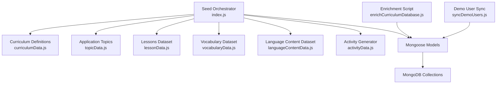
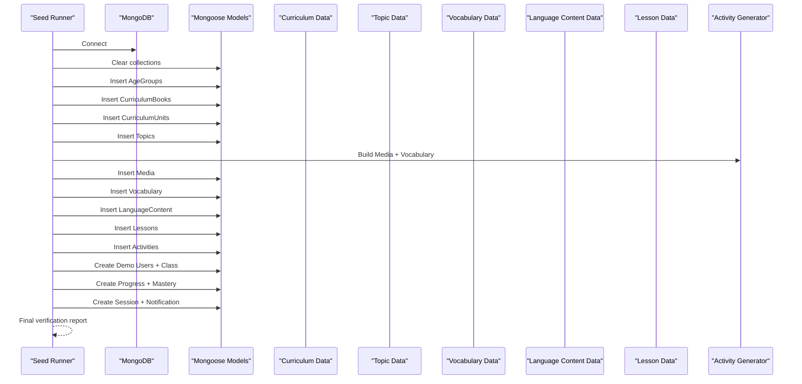
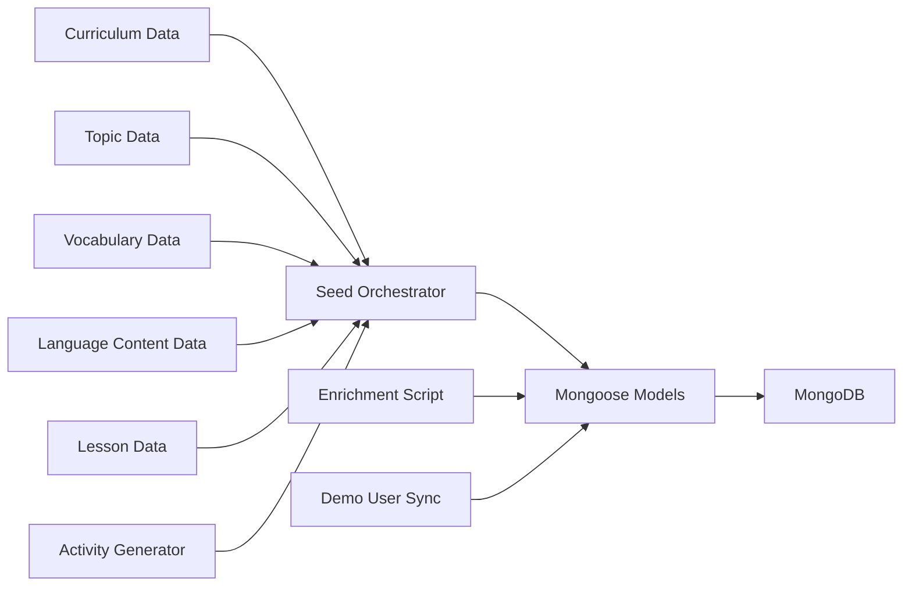
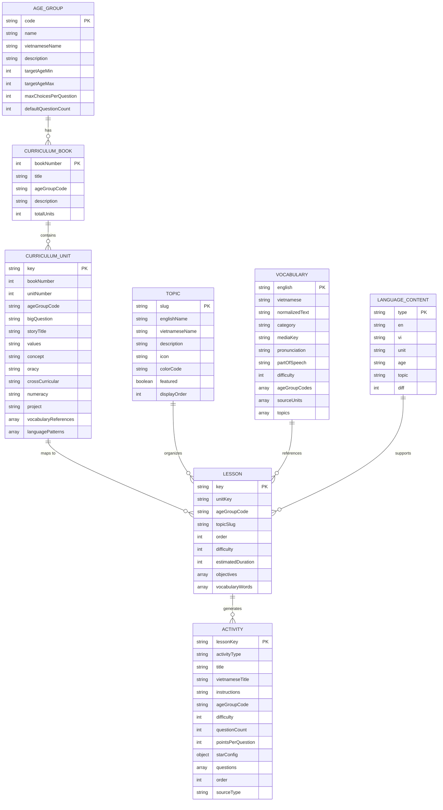

# Data Seeding & Migration

<cite>
**Referenced Files in This Document**
- [index.js](file://KCEnglishKids_BE/src/seeds/index.js)
- [curriculumData.js](file://KCEnglishKids_BE/src/seeds/curriculumData.js)
- [topicData.js](file://KCEnglishKids_BE/src/seeds/topicData.js)
- [lessonData.js](file://KCEnglishKids_BE/src/seeds/lessonData.js)
- [activityData.js](file://KCEnglishKids_BE/src/seeds/activityData.js)
- [vocabularyData.js](file://KCEnglishKids_BE/src/seeds/vocabularyData.js)
- [languageContentData.js](file://KCEnglishKids_BE/src/seeds/languageContentData.js)
- [enrichCurriculumDatabase.js](file://KCEnglishKids_BE/src/scripts/enrichCurriculumDatabase.js)
- [syncDemoUsers.js](file://KCEnglishKids_BE/src/scripts/syncDemoUsers.js)
</cite>

## Table of Contents
1. [Introduction](#introduction)
2. [Project Structure](#project-structure)
3. [Core Components](#core-components)
4. [Architecture Overview](#architecture-overview)
5. [Detailed Component Analysis](#detailed-component-analysis)
6. [Dependency Analysis](#dependency-analysis)
7. [Performance Considerations](#performance-considerations)
8. [Troubleshooting Guide](#troubleshooting-guide)
9. [Conclusion](#conclusion)
10. [Appendices](#appendices)

## Introduction
This document explains the data seeding and enrichment system that populates the learning platform with a complete, curriculum-aligned dataset. It covers:
- The seed pipeline that creates age groups, books, units, topics, vocabulary, language content, lessons, activities, media references, demo users, classroom sessions, progress records, and sample notifications.
- The curriculum structure across 27 official units organized by three books and three age groups.
- Topic organization and relationship mapping between curriculum entities.
- Demo user creation for CHILD, TEACHER, and ADMIN roles with permissions and sample data.
- Database enrichment scripts that enhance existing data with metadata, relationships, and calculated fields.
- Migration strategies for schema changes, data versioning, rollback procedures, backup and restore operations, export/import capabilities, and development versus production data management.

## Project Structure
The data seeding and enrichment logic is implemented under the backend module:
- Seed orchestrator and full dataset population are defined in the main seed entry point.
- Curriculum definitions (age groups, books, units), application topics, lessons, vocabulary, language content, and activity generation are modularized into separate files.
- Enrichment and demo synchronization scripts operate on top of the seeded data to ensure consistency and completeness.

**Diagram sources**
- [index.js:1-36](file://KCEnglishKids_BE/src/seeds/index.js#L1-L36)
- [curriculumData.js:1-62](file://KCEnglishKids_BE/src/seeds/curriculumData.js#L1-L62)
- [topicData.js:1-20](file://KCEnglishKids_BE/src/seeds/topicData.js#L1-L20)
- [lessonData.js:1-16](file://KCEnglishKids_BE/src/seeds/lessonData.js#L1-L16)
- [vocabularyData.js:1-10](file://KCEnglishKids_BE/src/seeds/vocabularyData.js#L1-L10)
- [languageContentData.js:1-8](file://KCEnglishKids_BE/src/seeds/languageContentData.js#L1-L8)
- [activityData.js:1-16](file://KCEnglishKids_BE/src/seeds/activityData.js#L1-L16)
- [enrichCurriculumDatabase.js:1-47](file://KCEnglishKids_BE/src/scripts/enrichCurriculumDatabase.js#L1-L47)
- [syncDemoUsers.js:1-10](file://KCEnglishKids_BE/src/scripts/syncDemoUsers.js#L1-L10)

**Section sources**
- [index.js:1-36](file://KCEnglishKids_BE/src/seeds/index.js#L1-L36)
- [curriculumData.js:1-62](file://KCEnglishKids_BE/src/seeds/curriculumData.js#L1-L62)
- [topicData.js:1-20](file://KCEnglishKids_BE/src/seeds/topicData.js#L1-L20)
- [lessonData.js:1-16](file://KCEnglishKids_BE/src/seeds/lessonData.js#L1-L16)
- [vocabularyData.js:1-10](file://KCEnglishKids_BE/src/seeds/vocabularyData.js#L1-L10)
- [languageContentData.js:1-8](file://KCEnglishKids_BE/src/seeds/languageContentData.js#L1-L8)
- [activityData.js:1-16](file://KCEnglishKids_BE/src/seeds/activityData.js#L1-L16)
- [enrichCurriculumDatabase.js:1-47](file://KCEnglishKids_BE/src/scripts/enrichCurriculumDatabase.js#L1-L47)
- [syncDemoUsers.js:1-10](file://KCEnglishKids_BE/src/scripts/syncDemoUsers.js#L1-L10)

## Core Components
- Age Groups: Three cohorts (3–4, 4–5, 5–6) define pedagogical progression and question complexity.
- Curriculum Books: Three books aligned with age groups, each containing nine units.
- Units: 27 official units with big questions, story titles, values, concepts, oracy, cross-curricular links, numeracy targets, projects, vocabulary references, and language patterns.
- Topics: 19 application topics used to organize lessons and vocabulary across themes like animals, school, body, family, food, toys, colors, numbers, nature, house, clothes, feelings, senses, transportation, weather, daily routines, community, environment, and vacation.
- Vocabulary: Deduplicated vocabulary items with English/Vietnamese text, IPA pronunciation, part of speech, category, age group codes, topic slugs, source unit mappings, and generated media keys.
- Language Content: Exhaustive sentences, questions, answers, patterns, and oracy phrases mapped to units, ages, topics, and difficulty levels.
- Lessons: 108 lessons (4 per unit) with objectives, estimated duration, difficulty, thumbnail references, vocabulary items, and linked language content.
- Activities: Procedurally generated interactive activities across multiple types tailored to lesson context and age group.
- Media References: Generated image cards, audio URLs, and animation placeholders for vocabulary items.
- Demo Users and Classroom: Admin, teacher, and child accounts with class assignment, progress records, mastery samples, session summaries, and parent notifications.

**Section sources**
- [curriculumData.js:7-62](file://KCEnglishKids_BE/src/seeds/curriculumData.js#L7-L62)
- [curriculumData.js:64-702](file://KCEnglishKids_BE/src/seeds/curriculumData.js#L64-L702)
- [topicData.js:6-197](file://KCEnglishKids_BE/src/seeds/topicData.js#L6-L197)
- [vocabularyData.js:7-478](file://KCEnglishKids_BE/src/seeds/vocabularyData.js#L7-L478)
- [languageContentData.js:8-317](file://KCEnglishKids_BE/src/seeds/languageContentData.js#L8-L317)
- [lessonData.js:7-800](file://KCEnglishKids_BE/src/seeds/lessonData.js#L7-L800)
- [activityData.js:18-759](file://KCEnglishKids_BE/src/seeds/activityData.js#L18-L759)
- [index.js:125-755](file://KCEnglishKids_BE/src/seeds/index.js#L125-L755)

## Architecture Overview
The seed orchestrator connects to MongoDB, clears collections idempotently, and then inserts data in dependency order:
1. Age groups
2. Books
3. Units
4. Topics
5. Media references and vocabulary
6. Language content
7. Lessons
8. Activities
9. Demo users, classroom, progress, mastery, sessions, and notifications

**Diagram sources**
- [index.js:125-755](file://KCEnglishKids_BE/src/seeds/index.js#L125-L755)
- [curriculumData.js:64-702](file://KCEnglishKids_BE/src/seeds/curriculumData.js#L64-L702)
- [topicData.js:6-197](file://KCEnglishKids_BE/src/seeds/topicData.js#L6-L197)
- [vocabularyData.js:480-513](file://KCEnglishKids_BE/src/seeds/vocabularyData.js#L480-L513)
- [languageContentData.js:8-317](file://KCEnglishKids_BE/src/seeds/languageContentData.js#L8-L317)
- [lessonData.js:7-800](file://KCEnglishKids_BE/src/seeds/lessonData.js#L7-L800)
- [activityData.js:51-759](file://KCEnglishKids_BE/src/seeds/activityData.js#L51-L759)

## Detailed Component Analysis

### Seed Orchestrator
Responsibilities:
- Connects to MongoDB using environment configuration.
- Clears all relevant collections to ensure idempotent runs.
- Inserts age groups, books, units, topics, vocabulary, language content, lessons, activities.
- Generates media assets (SVG images, audio URLs, animation placeholders).
- Creates demo users (ADMIN, TEACHER, CHILD), assigns a classroom, and links students.
- Seeds sample progress, vocabulary mastery, classroom sessions, and parent notifications.
- Prints a final verification report including counts and demo path validation.

Key behaviors:
- Idempotent clearing of collections before insertion.
- Mapping structures for efficient lookups during insertion.
- Rich emoji and color palette for card visuals.
- Verification of the demo learning path from age group through unit, topic, lesson, and activities.

**Section sources**
- [index.js:1-36](file://KCEnglishKids_BE/src/seeds/index.js#L1-L36)
- [index.js:125-150](file://KCEnglishKids_BE/src/seeds/index.js#L125-L150)
- [index.js:152-233](file://KCEnglishKids_BE/src/seeds/index.js#L152-L233)
- [index.js:234-333](file://KCEnglishKids_BE/src/seeds/index.js#L234-L333)
- [index.js:339-454](file://KCEnglishKids_BE/src/seeds/index.js#L339-L454)
- [index.js:456-694](file://KCEnglishKids_BE/src/seeds/index.js#L456-L694)
- [index.js:696-755](file://KCEnglishKids_BE/src/seeds/index.js#L696-L755)

### Curriculum Data
Structure:
- AGE_GROUPS_DATA defines three cohorts with pedagogical parameters such as max choices per question and default question count.
- BOOKS_DATA defines three books aligned with age groups and total unit counts.
- UNITS_DATA enumerates 27 official units across three books, each with big questions, story titles, values, concepts, oracy, cross-curricular links, numeracy targets, projects, vocabulary references, and language patterns.

Relationship mapping:
- Each unit references its book number and age group code.
- Units include vocabularyReferences and languagePatterns that inform downstream lesson and activity generation.

**Section sources**
- [curriculumData.js:7-62](file://KCEnglishKids_BE/src/seeds/curriculumData.js#L7-L62)
- [curriculumData.js:64-702](file://KCEnglishKids_BE/src/seeds/curriculumData.js#L64-L702)

### Topic Data
Structure:
- TOPICS_DATA defines 19 application topics with English and Vietnamese names, descriptions, icons, color codes, featured flags, and display orders.
- Topics are used to organize lessons and vocabulary thematically.

Relationship mapping:
- Topics are linked to lessons via topicSlug.
- Topics are associated with vocabulary items via topics arrays.

**Section sources**
- [topicData.js:6-197](file://KCEnglishKids_BE/src/seeds/topicData.js#L6-L197)

### Vocabulary Data
Structure:
- RAW_VOCABULARY contains comprehensive vocabulary entries with English/Vietnamese text, IPA, part of speech, units, ages, topics, and categories.
- DEDUPLICATED_VOCABULARITY consolidates duplicates, merges units/ages/topics, and adds normalizedText, mediaKey, sourceType, and status.

Processing:
- Deduplication merges repeated words while preserving all associations.
- Normalization and media key generation prepare vocabulary for media asset creation.

**Section sources**
- [vocabularyData.js:7-478](file://KCEnglishKids_BE/src/seeds/vocabularyData.js#L7-L478)
- [vocabularyData.js:480-513](file://KCEnglishKids_BE/src/seeds/vocabularyData.js#L480-L513)

### Language Content Data
Structure:
- LANGUAGE_CONTENT_DATA includes exhaustive sentences, questions, answers, patterns, and oracy phrases for all 27 units.
- Each item specifies type, unit, age, topic, and difficulty.

Usage:
- Linked to units and topics during seeding.
- Used to populate lessons’ languageContents arrays.

**Section sources**
- [languageContentData.js:8-317](file://KCEnglishKids_BE/src/seeds/languageContentData.js#L8-L317)

### Lesson Data
Structure:
- LESSONS_DATA defines 108 lessons (4 per unit) with keys, unitKey, ageGroupCode, topicSlug, order, difficulty, estimatedDuration, titles, descriptions, objectives, and vocabularyWords.

Relationship mapping:
- Lessons link to units via unitKey.
- Lessons link to topics via topicSlug.
- Lessons reference vocabularyWords which are resolved to vocabulary documents during seeding.

**Section sources**
- [lessonData.js:7-800](file://KCEnglishKids_BE/src/seeds/lessonData.js#L7-L800)

### Activity Data
Structure:
- NUMERACY_PROGRESSION maps unit keys to counting targets and textual number forms.
- buildActivitiesForLesson generates diverse activities based on lesson context, age group, and topic.

Supported activity types:
- LISTEN_CHOOSE, IMAGE_WORD_MATCH, MEMORY_CARD, FIND_OBJECT, MISSING_OBJECT, COLOR_RECOGNITION, COUNT_OBJECTS, TRUE_FALSE, CLASSIFICATION, DRAG_DROP, LISTEN_REPEAT, BUBBLE_POP, FEED_ANIMAL, STAR_CATCHER.

Generation rules:
- Primary activity always created when sufficient vocabulary exists.
- Special cases enrich specific lessons (e.g., Book 1 Unit 5).
- Age-appropriate activities selected (e.g., TRUE_FALSE for older children, FIND_OBJECT for younger).
- Numeracy progression influences COUNT_OBJECTS difficulty.

**Section sources**
- [activityData.js:18-49](file://KCEnglishKids_BE/src/seeds/activityData.js#L18-L49)
- [activityData.js:51-759](file://KCEenglesKids_BE/src/seeds/activityData.js#L51-L759)

### Enrichment Script
Purpose:
- Updates topic age group scoping based on approved curriculum mappings.
- Audits and enriches lesson vocabulary coverage in activities.
- Verifies 100% question coverage across lessons.
- Updates vocabulary difficulty metadata based on age group codes.

Key flows:
- Maps topic slugs to age groups and updates targetAgeGroups.
- For each lesson, ensures missing vocabulary appears in activities with distractors from the same age pool.
- Reports remaining untested lessons if any.
- Sets difficulty levels: 1 for 3–4, 2 for 4–5, 3 for 5–6.

**Section sources**
- [enrichCurriculumDatabase.js:1-47](file://KCEnglishKids_BE/src/scripts/enrichCurriculumDatabase.js#L1-L47)
- [enrichCurriculumDatabase.js:49-258](file://KCEnglishKids_BE/src/scripts/enrichCurriculumDatabase.js#L49-L258)

### Demo User Sync Script
Purpose:
- Ensures demo child users have correct age group assignments.
- Logs child users with their assigned age codes.

Behavior:
- Connects to MongoDB.
- Finds age groups by code and updates specific users (Leo, Mia, Toby).
- Lists all child users with name, email, and ageGroupCode.

**Section sources**
- [syncDemoUsers.js:1-38](file://KCEnglishKids_BE/src/scripts/syncDemoUsers.js#L1-L38)

## Dependency Analysis
The seed orchestrator depends on modular datasets and generators:
- Curriculum definitions provide foundational structure.
- Topics provide thematic organization.
- Vocabulary provides lexical resources and media keys.
- Language content provides structured phrases and dialogues.
- Lessons provide instructional scaffolding.
- Activity generator produces interactive practice aligned with lessons and age groups.

**Diagram sources**
- [index.js:1-36](file://KCEnglishKids_BE/src/seeds/index.js#L1-L36)
- [curriculumData.js:1-62](file://KCEnglishKids_BE/src/seeds/curriculumData.js#L1-L62)
- [topicData.js:1-20](file://KCEnglishKids_BE/src/seeds/topicData.js#L1-L20)
- [vocabularyData.js:1-10](file://KCEnglishKids_BE/src/seeds/vocabularyData.js#L1-L10)
- [languageContentData.js:1-8](file://KCEnglishKids_BE/src/seeds/languageContentData.js#L1-L8)
- [lessonData.js:1-16](file://KCEnglishKids_BE/src/seeds/lessonData.js#L1-L16)
- [activityData.js:1-16](file://KCEnglishKids_BE/src/seeds/activityData.js#L1-L16)
- [enrichCurriculumDatabase.js:1-47](file://KCEnglishKids_BE/src/scripts/enrichCurriculumDatabase.js#L1-L47)
- [syncDemoUsers.js:1-10](file://KCEnglishKids_BE/src/scripts/syncDemoUsers.js#L1-L10)

**Section sources**
- [index.js:1-36](file://KCEnglishKids_BE/src/seeds/index.js#L1-L36)
- [curriculumData.js:1-62](file://KCEnglishKids_BE/src/seeds/curriculumData.js#L1-L62)
- [topicData.js:1-20](file://KCEnglishKids_BE/src/seeds/topicData.js#L1-L20)
- [vocabularyData.js:1-10](file://KCEnglishKids_BE/src/seeds/vocabularyData.js#L1-L10)
- [languageContentData.js:1-8](file://KCEnglishKids_BE/src/seeds/languageContentData.js#L1-L8)
- [lessonData.js:1-16](file://KCEnglishKids_BE/src/seeds/lessonData.js#L1-L16)
- [activityData.js:1-16](file://KCEnglishKids_BE/src/seeds/activityData.js#L1-L16)
- [enrichCurriculumDatabase.js:1-47](file://KCEnglishKids_BE/src/scripts/enrichCurriculumDatabase.js#L1-L47)
- [syncDemoUsers.js:1-10](file://KCEnglishKids_BE/src/scripts/syncDemoUsers.js#L1-L10)

## Performance Considerations
- Bulk insertions: Using insertMany for large datasets reduces round-trips to MongoDB.
- In-memory maps: Building lookup maps for units, topics, vocabulary, and lessons improves join performance during seeding.
- Parallel operations: Clearing collections and inserting independent datasets can be parallelized where safe.
- Idempotency: Clearing collections before seeding avoids duplicate checks and expensive upserts.
- Media generation: Generating SVG images and audio URLs in memory minimizes external I/O during seeding.
- Enrichment batching: Updating difficulties and scoping via updateMany reduces database writes.

[No sources needed since this section provides general guidance]

## Troubleshooting Guide
Common issues and resolutions:
- Connection failures: Ensure MONGODB_URI is correctly set in environment variables.
- Missing dependencies: Verify all required models are exported and imported by the seed orchestrator.
- Duplicate data: Re-run the seed; it clears collections first to maintain idempotency.
- Incomplete vocabulary coverage: Run the enrichment script to add missing questions and verify coverage.
- Incorrect age group scoping: Run the enrichment script to update topic age group mappings.
- Demo user misalignment: Use the sync demo users script to align child users with correct age groups.

Operational tips:
- Check final verification logs printed by the seed orchestrator for counts and demo path validation.
- Validate topic slugs and unit keys match between datasets to avoid broken references.
- Confirm activity types exist in frontend engines corresponding to generated activity definitions.

**Section sources**
- [index.js:696-755](file://KCEnglishKids_BE/src/seeds/index.js#L696-L755)
- [enrichCurriculumDatabase.js:209-258](file://KCEnglishKids_BE/src/scripts/enrichCurriculumDatabase.js#L209-L258)
- [syncDemoUsers.js:5-38](file://KCEnglishKids_BE/src/scripts/syncDemoUsers.js#L5-L38)

## Conclusion
The data seeding and enrichment system provides a robust foundation for the learning platform:
- A complete curriculum aligned across 27 official units, 108 lessons, and rich interactive activities.
- Thematic topic organization and vocabulary mapping that support personalized learning paths.
- Demo users and classroom artifacts enabling immediate testing and demonstration.
- Enrichment scripts ensuring data quality, coverage, and metadata accuracy.
Adopting the recommended migration, backup, and operational practices will help maintain data integrity across environments.

[No sources needed since this section summarizes without analyzing specific files]

## Appendices

### Curriculum Data Model Relationships

**Diagram sources**
- [curriculumData.js:7-62](file://KCEnglishKids_BE/src/seeds/curriculumData.js#L7-L62)
- [curriculumData.js:64-702](file://KCEnglishKids_BE/src/seeds/curriculumData.js#L64-L702)
- [topicData.js:6-197](file://KCEnglishKids_BE/src/seeds/topicData.js#L6-L197)
- [vocabularyData.js:7-478](file://KCEnglishKids_BE/src/seeds/vocabularyData.js#L7-L478)
- [languageContentData.js:8-317](file://KCEnglishKids_BE/src/seeds/languageContentData.js#L8-L317)
- [lessonData.js:7-800](file://KCEnglishKids_BE/src/seeds/lessonData.js#L7-L800)
- [activityData.js:18-759](file://KCEnglishKids_BE/src/seeds/activityData.js#L18-L759)

### Migration Strategies
- Schema changes:
  - Introduce new fields incrementally with backward-compatible defaults.
  - Use upsert patterns to handle partial migrations safely.
  - Validate data integrity after applying schema updates.
- Data versioning:
  - Maintain a versioned seed manifest describing dataset versions and compatibility.
  - Tag releases with semantic versioning and record applied migrations.
- Rollback procedures:
  - Preserve snapshots before major migrations.
  - Provide reverse migration scripts to revert schema and data changes.
  - Test rollbacks in staging environments prior to production deployment.
- Backup and restore:
  - Schedule regular backups of all relevant collections.
  - Export critical datasets (users, curriculum, activities) to JSON for portability.
  - Restore from backups using consistent ordering to respect foreign-key-like relationships.
- Export/import capabilities:
  - Use the provided export utilities to generate JSON dumps for local development.
  - Import curated datasets into production with validation and dry-run modes.
- Development vs production data management:
  - Use separate databases or namespaces for dev/staging/prod.
  - Seed only minimal demo data in production; use enriched datasets selectively.
  - Restrict destructive operations (clearing collections) to development or controlled maintenance windows.

[No sources needed since this section provides general guidance]