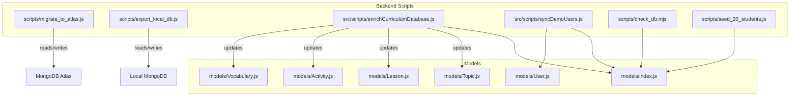
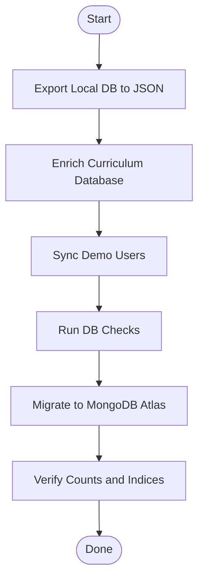
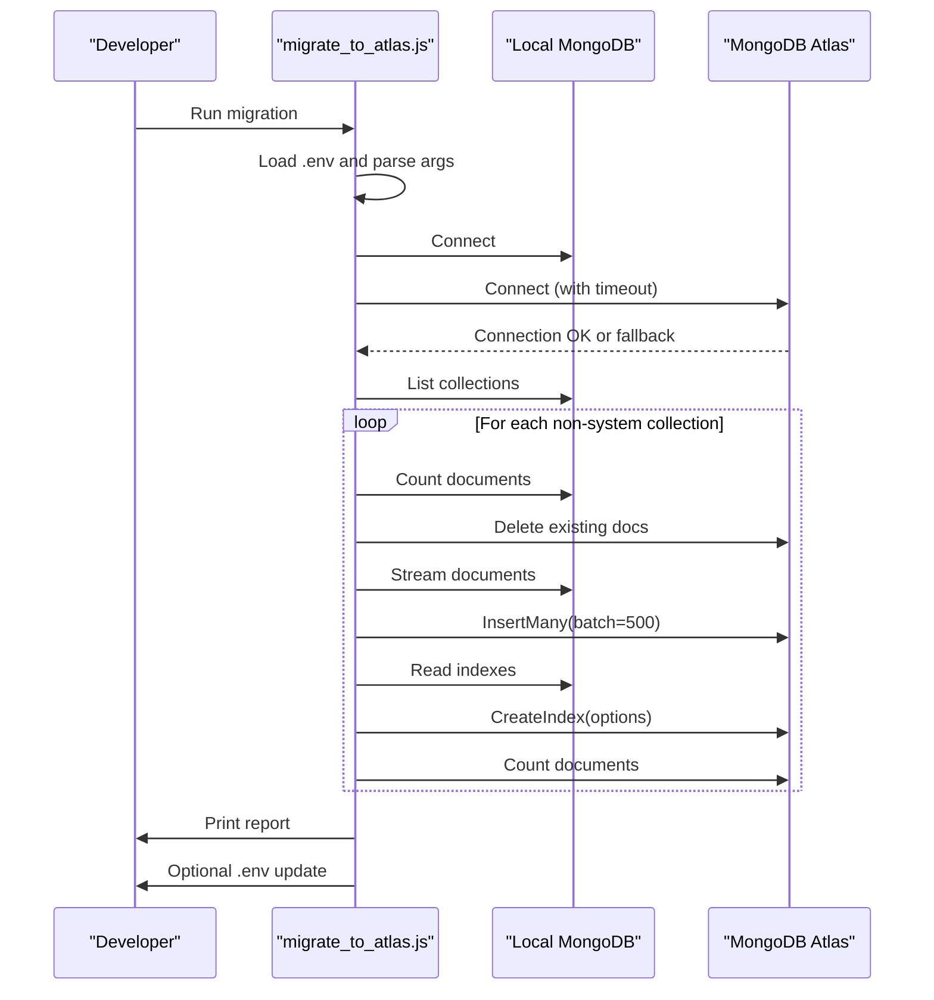
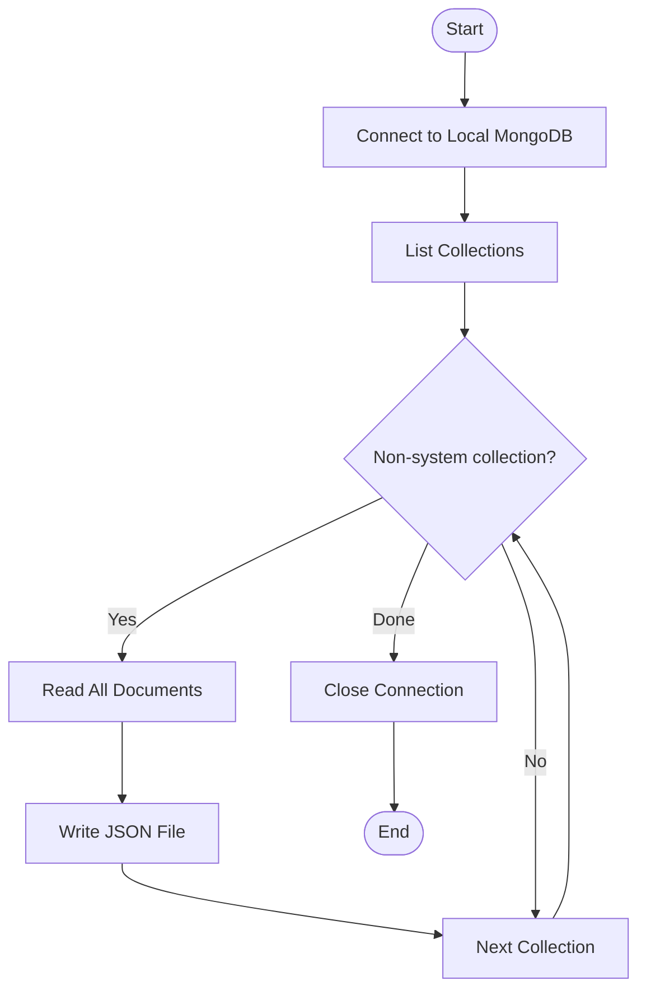
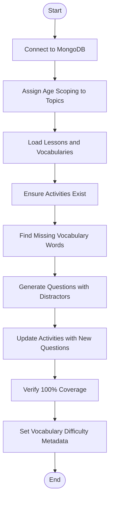
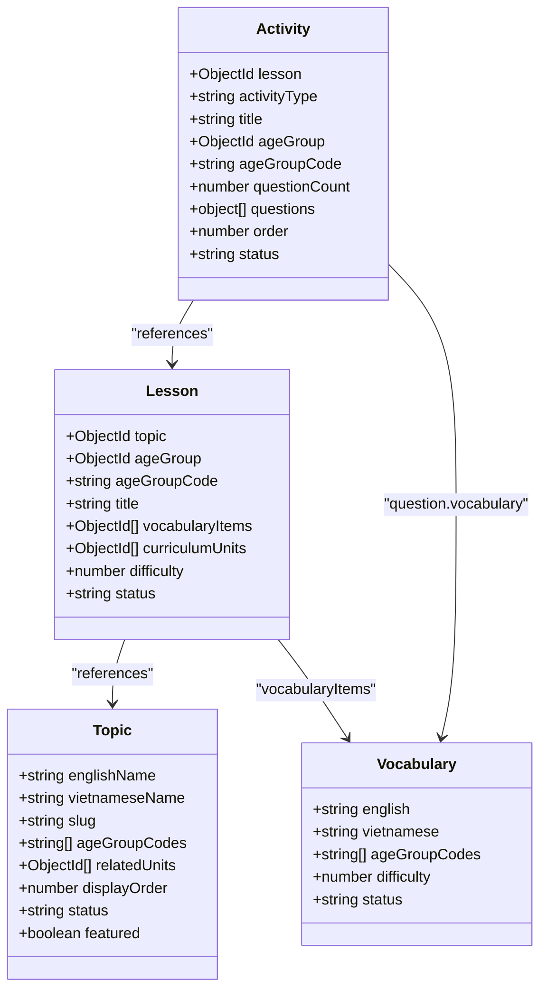
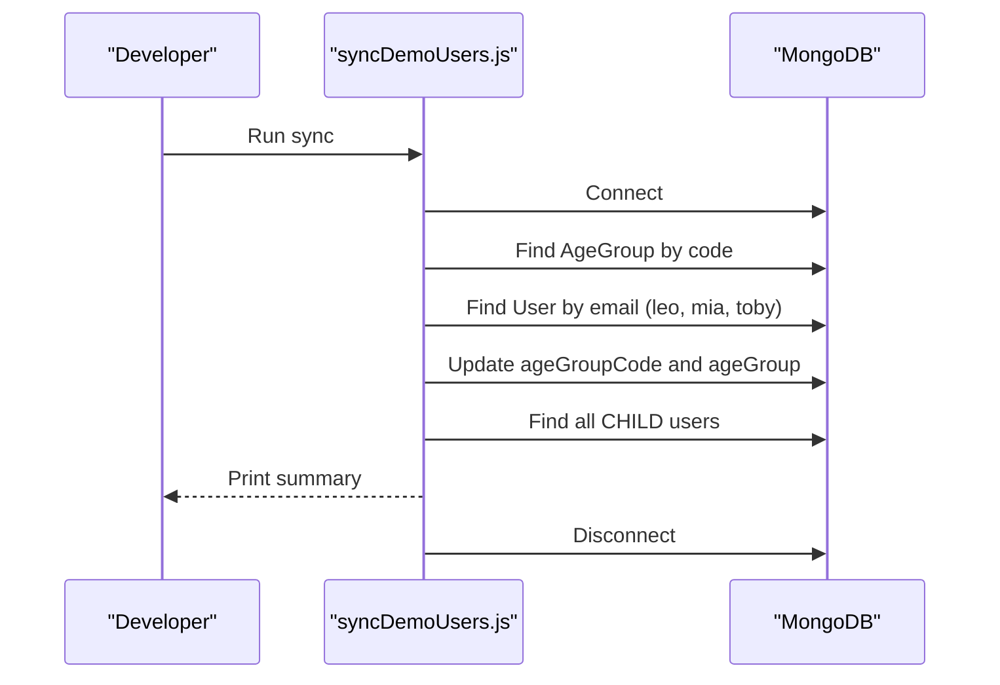
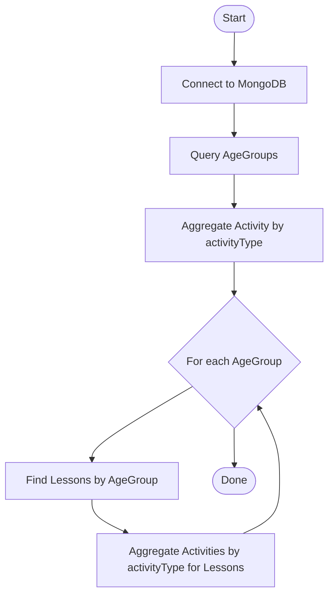
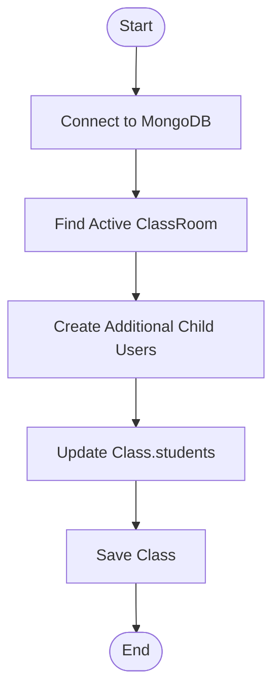
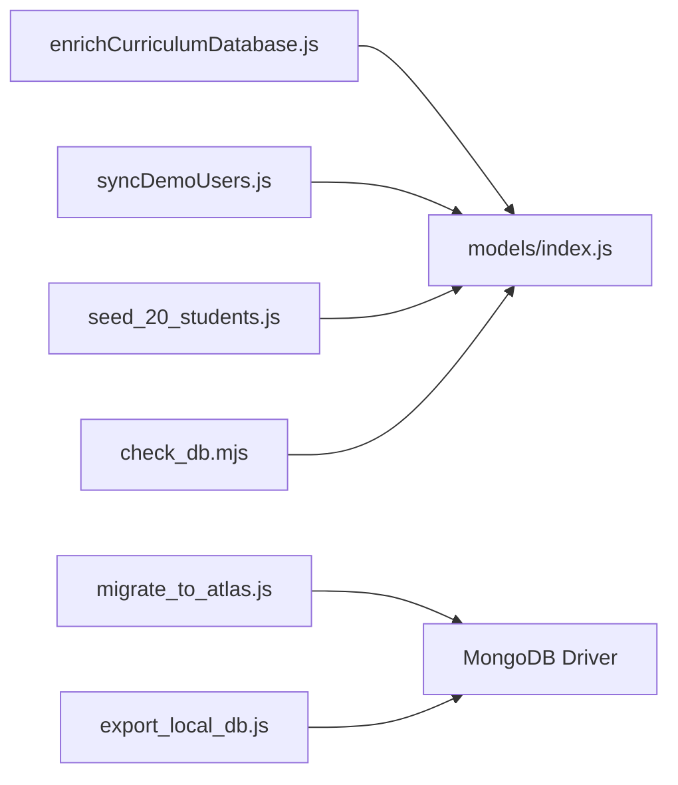

# Database Migration Utilities

<cite>
**Referenced Files in This Document**
- [migrate_to_atlas.js](file://KCEnglishKids_BE/scripts/migrate_to_atlas.js)
- [export_local_db.js](file://KCEnglishKids_BE/scripts/export_local_db.js)
- [enrichCurriculumDatabase.js](file://KCEnglishKids_BE/src/scripts/enrichCurriculumDatabase.js)
- [syncDemoUsers.js](file://KCEnglishKids_BE/src/scripts/syncDemoUsers.js)
- [check_db.mjs](file://KCEnglishKids_BE/scripts/check_db.mjs)
- [seed_20_students.js](file://KCEnglishKids_BE/scripts/seed_20_students.js)
- [index.js](file://KCEnglishKids_BE/src/models/index.js)
- [User.js](file://KCEnglishKids_BE/src/models/User.js)
- [Topic.js](file://KCEnglishKids_BE/src/models/Topic.js)
- [Lesson.js](file://KCEnglishKids_BE/src/models/Lesson.js)
- [Activity.js](file://KCEnglishKids_BE/src/models/Activity.js)
- [Vocabulary.js](file://KCEnglishKids_BE/src/models/Vocabulary.js)
</cite>

## Table of Contents
1. [Introduction](#introduction)
2. [Project Structure](#project-structure)
3. [Core Components](#core-components)
4. [Architecture Overview](#architecture-overview)
5. [Detailed Component Analysis](#detailed-component-analysis)
6. [Dependency Analysis](#dependency-analysis)
7. [Performance Considerations](#performance-considerations)
8. [Troubleshooting Guide](#troubleshooting-guide)
9. [Conclusion](#conclusion)
10. [Appendices](#appendices)

## Introduction
This document explains the database migration and utility scripts that support data transformation, enrichment, and deployment for the KCEnglishKids backend. It covers:
- Curriculum database enrichment to add metadata, calculated fields, and relationship mappings
- Demo user synchronization to maintain consistent test accounts across environments
- MongoDB Atlas migration for cloud deployment
- Local database export for backup and development workflows
- Data consistency checks, error handling, logging, and environment-specific configuration strategies

## Project Structure
The utilities are organized into two main areas:
- Top-level scripts under `KCEnglishKids_BE/scripts` for deployment and data operations
- Mongoose-based scripts under `KCEnglishKids_BE/src/scripts` for curriculum enrichment and demo user synchronization

**Diagram sources**
- [migrate_to_atlas.js:1-248](file://KCEnglishKids_BE/scripts/migrate_to_atlas.js#L1-L248)
- [export_local_db.js:1-40](file://KCEnglishKids_BE/scripts/export_local_db.js#L1-L40)
- [enrichCurriculumDatabase.js:1-258](file://KCEnglishKids_BE/src/scripts/enrichCurriculumDatabase.js#L1-L258)
- [syncDemoUsers.js:1-38](file://KCEnglishKids_BE/src/scripts/syncDemoUsers.js#L1-L38)
- [check_db.mjs:1-31](file://KCEnglishKids_BE/scripts/check_db.mjs#L1-L31)
- [seed_20_students.js:1-102](file://KCEnglishKids_BE/scripts/seed_20_students.js#L1-L102)
- [index.js:1-45](file://KCEnglishKids_BE/src/models/index.js#L1-L45)

**Section sources**
- [migrate_to_atlas.js:1-248](file://KCEnglishKids_BE/scripts/migrate_to_atlas.js#L1-L248)
- [export_local_db.js:1-40](file://KCEnglishKids_BE/scripts/export_local_db.js#L1-L40)
- [enrichCurriculumDatabase.js:1-258](file://KCEnglishKids_BE/src/scripts/enrichCurriculumDatabase.js#L1-L258)
- [syncDemoUsers.js:1-38](file://KCEnglishKids_BE/src/scripts/syncDemoUsers.js#L1-L38)
- [check_db.mjs:1-31](file://KCEnglishKids_BE/scripts/check_db.mjs#L1-L31)
- [seed_20_students.js:1-102](file://KCEnglishKids_BE/scripts/seed_20_students.js#L1-L102)
- [index.js:1-45](file://KCEnglishKids_BE/src/models/index.js#L1-L45)

## Core Components
- MongoDB Atlas migration tool: migrates local data to Atlas with batched inserts, index replication, optional .env update, and robust connection fallbacks.
- Local database export utility: exports all non-system collections to JSON files for backups and dev workflows.
- Curriculum enrichment script: enriches topics, lessons, activities, and vocabulary with age scoping, question generation, coverage verification, and difficulty metadata.
- Demo user synchronization utility: ensures demo child users have correct age group codes and references.
- Database check utility: queries AgeGroup, Activity, and Lesson to validate data distribution by activity type and age group.
- Student seeding utility: creates additional child users and updates class membership for testing.

**Section sources**
- [migrate_to_atlas.js:1-248](file://KCEnglishKids_BE/scripts/migrate_to_atlas.js#L1-L248)
- [export_local_db.js:1-40](file://KCEnglishKids_BE/scripts/export_local_db.js#L1-L40)
- [enrichCurriculumDatabase.js:1-258](file://KCEnglishKids_BE/src/scripts/enrichCurriculumDatabase.js#L1-L258)
- [syncDemoUsers.js:1-38](file://KCEnglishKids_BE/src/scripts/syncDemoUsers.js#L1-L38)
- [check_db.mjs:1-31](file://KCEnglishKids_BE/scripts/check_db.mjs#L1-L31)
- [seed_20_students.js:1-102](file://KCEnglishKids_BE/scripts/seed_20_students.js#L1-L102)

## Architecture Overview
The utilities form a cohesive pipeline for data preparation and deployment:
- Export local data for safe backups before migrations
- Enrich curriculum content to ensure full vocabulary coverage and metadata
- Synchronize demo users for consistent testing
- Migrate enriched data to MongoDB Atlas for production
- Validate data integrity using check utilities

[No sources needed since this diagram shows conceptual workflow, not actual code structure]

## Detailed Component Analysis

### MongoDB Atlas Migration Tool
Purpose:
- Connect to local MongoDB and an Atlas cluster
- Copy all non-system collections with batched inserts
- Replicate indexes (excluding default _id index)
- Optionally update `.env` with the Atlas URI
- Provide robust connection fallbacks and clear error messages

Key behaviors:
- Loads `.env` and supports both `LOCAL_MONGODB_URI` and `MONGODB_URI` as source URIs
- Accepts target Atlas URI via argument or environment variables (`ATLAS_MONGODB_URI`, `TARGET_MONGODB_URI`)
- Normalizes Atlas URIs to include a default database name when missing
- Uses direct shard URI fallback on DNS/SRV issues
- Deletes existing target collection data before insert to avoid duplicate `_id` conflicts
- Inserts documents in batches of 500 with unordered writes for stability
- Copies indexes while preserving unique, sparse, and TTL options
- Prints a summary report per collection and optionally updates `.env`

**Diagram sources**
- [migrate_to_atlas.js:60-231](file://KCEnglishKids_BE/scripts/migrate_to_atlas.js#L60-L231)

Error handling:
- Handles authentication failures, network timeouts, and SRV lookup errors
- Provides actionable guidance for IP access configuration and credentials

Environment configuration:
- Source URI from `LOCAL_MONGODB_URI` or `MONGODB_URI` if it points to localhost
- Target URI from arguments or `ATLAS_MONGODB_URI`/`TARGET_MONGODB_URI`
- Optional flag `--update-env` to automatically set `MONGODB_URI` to Atlas

Rollback strategy:
- The script deletes target collection contents before inserting; to rollback, re-run against a clean target or restore from exported JSON backups.

**Section sources**
- [migrate_to_atlas.js:1-248](file://KCEnglishKids_BE/scripts/migrate_to_atlas.js#L1-L248)

### Local Database Export Utility
Purpose:
- Export all non-system collections from local MongoDB to JSON files under `data_backup`
- Create the directory if it does not exist
- Log progress and completion status

Usage:
- Reads `.env` for `LOCAL_MONGODB_URI` or defaults to local MongoDB
- Iterates collections, skips system namespaces, and writes JSON arrays

**Diagram sources**
- [export_local_db.js:9-39](file://KCEnglishKids_BE/scripts/export_local_db.js#L9-L39)

**Section sources**
- [export_local_db.js:1-40](file://KCEnglishKids_BE/scripts/export_local_db.js#L1-L40)

### Curriculum Database Enrichment Script
Purpose:
- Assign age group scoping to topics based on approved curriculum mapping
- Audit and enrich lesson activities to ensure 100% vocabulary coverage
- Generate questions with distractors from the same age pool
- Update vocabulary difficulty metadata based on age groups
- Verify coverage and report any remaining gaps

Key steps:
1. Topic age scoping:
   - Maps topic slugs to age groups (`3-4`, `4-5`, `5-6`)
   - Defaults unknown topics to `5-6`
   - Updates `ageGroupCodes` and `targetAgeGroups` on Topic documents

2. Lesson and activity enrichment:
   - Populates lessons with vocabulary items and curriculum units
   - Pre-fetches vocabulary pools by age group
   - Ensures each lesson has at least one activity; creates a default activity if missing
   - Identifies missing vocabulary words not yet tested in activities
   - Generates new questions with shuffled options and metadata
   - Appends questions to the first activity and updates counts

3. Coverage verification:
   - Re-checks lessons and activities to confirm all vocabulary is covered
   - Warns about lessons still needing attention

4. Vocabulary difficulty metadata:
   - Sets difficulty levels based on age group codes

**Diagram sources**
- [enrichCurriculumDatabase.js:49-248](file://KCEnglishKids_BE/src/scripts/enrichCurriculumDatabase.js#L49-L248)

Data structures involved:
- Topic: age scoping via `ageGroupCodes` and `targetAgeGroups`
- Lesson: links to vocabulary items and curriculum units
- Activity: contains questions and metadata
- Vocabulary: includes age group codes and difficulty

**Diagram sources**
- [Topic.js:1-78](file://KCEnglishKids_BE/src/models/Topic.js#L1-L78)
- [Lesson.js:1-101](file://KCEnglishKids_BE/src/models/Lesson.js#L1-L101)
- [Activity.js:1-176](file://KCEnglishKids_BE/src/models/Activity.js#L1-L176)
- [Vocabulary.js:1-110](file://KCEnglishKids_BE/src/models/Vocabulary.js#L1-L110)

**Section sources**
- [enrichCurriculumDatabase.js:1-258](file://KCEnglishKids_BE/src/scripts/enrichCurriculumDatabase.js#L1-L258)
- [Topic.js:1-78](file://KCEnglishKids_BE/src/models/Topic.js#L1-L78)
- [Lesson.js:1-101](file://KCEnglishKids_BE/src/models/Lesson.js#L1-L101)
- [Activity.js:1-176](file://KCEnglishKids_BE/src/models/Activity.js#L1-L176)
- [Vocabulary.js:1-110](file://KCEnglishKids_BE/src/models/Vocabulary.js#L1-L110)

### Demo User Synchronization Utility
Purpose:
- Ensure demo child users have correct age group codes and references
- Print a summary of child users for verification

Behavior:
- Connects to MongoDB using `MONGODB_URI`
- Looks up AgeGroup entries for `3-4`, `4-5`, `5-6`
- Updates specific demo users by email with appropriate age group code and reference
- Lists all child users with their age group codes

**Diagram sources**
- [syncDemoUsers.js:5-35](file://KCEnglishKids_BE/src/scripts/syncDemoUsers.js#L5-L35)

**Section sources**
- [syncDemoUsers.js:1-38](file://KCEnglishKids_BE/src/scripts/syncDemoUsers.js#L1-L38)
- [User.js:1-109](file://KCEnglishKids_BE/src/models/User.js#L1-L109)

### Database Check Utility
Purpose:
- Validate AgeGroup records
- Aggregate Activity counts by activityType
- Break down activity types per AgeGroup through Lesson associations

Behavior:
- Connects to local MongoDB
- Queries AgeGroup and aggregates Activity by activityType
- For each AgeGroup, finds associated Lessons and aggregates Activity counts

**Diagram sources**
- [check_db.mjs:3-27](file://KCEnglishKids_BE/scripts/check_db.mjs#L3-L27)

**Section sources**
- [check_db.mjs:1-31](file://KCEnglishKids_BE/scripts/check_db.mjs#L1-L31)

### Student Seeding Utility
Purpose:
- Create additional child users for a demo class
- Update class student list with newly created users

Behavior:
- Connects to MongoDB using `MONGODB_URI`
- Finds an active ClassRoom and uses its age group settings
- Creates child users with generated avatars, pins, and contact info
- Adds new students to the class’s student array

**Diagram sources**
- [seed_20_students.js:29-98](file://KCEnglishKids_BE/scripts/seed_20_students.js#L29-L98)

**Section sources**
- [seed_20_students.js:1-102](file://KCEnglishKids_BE/scripts/seed_20_students.js#L1-L102)

## Dependency Analysis
Scripts depend on models and environment configuration:
- Enrichment and demo user scripts use Mongoose models via `models/index.js`
- Atlas migration and local export scripts use the native MongoDB driver
- All scripts read `.env` for connection strings

**Diagram sources**
- [index.js:1-45](file://KCEnglishKids_BE/src/models/index.js#L1-L45)
- [enrichCurriculumDatabase.js:1-4](file://KCEnglishKids_BE/src/scripts/enrichCurriculumDatabase.js#L1-L4)
- [syncDemoUsers.js:1-3](file://KCEnglishKids_BE/src/scripts/syncDemoUsers.js#L1-L3)
- [seed_20_students.js:1-7](file://KCEnglishKids_BE/scripts/seed_20_students.js#L1-L7)
- [check_db.mjs:1-7](file://KCEnglishKids_BE/scripts/check_db.mjs#L1-L7)
- [migrate_to_atlas.js:1-6](file://KCEnglishKids_BE/scripts/migrate_to_atlas.js#L1-L6)
- [export_local_db.js:1-4](file://KCEnglishKids_BE/scripts/export_local_db.js#L1-L4)

**Section sources**
- [index.js:1-45](file://KCEnglishKids_BE/src/models/index.js#L1-L45)
- [enrichCurriculumDatabase.js:1-4](file://KCEnglishKids_BE/src/scripts/enrichCurriculumDatabase.js#L1-L4)
- [syncDemoUsers.js:1-3](file://KCEnglishKids_BE/src/scripts/syncDemoUsers.js#L1-L3)
- [seed_20_students.js:1-7](file://KCEnglishKids_BE/scripts/seed_20_students.js#L1-L7)
- [check_db.mjs:1-7](file://KCEnglishKids_BE/scripts/check_db.mjs#L1-L7)
- [migrate_to_atlas.js:1-6](file://KCEnglishKids_BE/scripts/migrate_to_atlas.js#L1-L6)
- [export_local_db.js:1-4](file://KCEnglishKids_BE/scripts/export_local_db.js#L1-L4)

## Performance Considerations
- Batched inserts during Atlas migration reduce memory pressure and improve stability
- Unordered inserts allow partial success even if some documents fail
- Index replication avoids performance penalties post-migration
- Pre-fetching vocabulary pools by age group minimizes repeated queries during enrichment
- Using lean queries where possible reduces overhead (as seen in pre-fetching vocabularies)
- Avoid large in-memory sets beyond necessity; current usage is bounded by lesson and vocabulary sizes

[No sources needed since this section provides general guidance]

## Troubleshooting Guide
Common issues and resolutions:
- Atlas connection failures:
  - Authentication failed: verify username/password in connection string
  - Network Access: ensure IP whitelist includes your current IP or `0.0.0.0/0`
  - SRV DNS lookup issues: script falls back to direct shard URI; verify cluster shards are reachable
- Local export errors:
  - Ensure `.env` contains valid `LOCAL_MONGODB_URI` or default local connection works
  - Check write permissions for `data_backup` directory
- Enrichment failures:
  - Verify Mongoose connection string and model availability
  - Confirm presence of required collections (Topic, Lesson, Activity, Vocabulary)
- Demo user sync:
  - Ensure AgeGroup entries exist for `3-4`, `4-5`, `5-6`
  - Confirm demo user emails exist or adjust script targets
- Database checks:
  - Validate AgeGroup IDs and Lesson-AgeGroup relationships
  - Confirm Activity.activityType values match expected enums

Logging and diagnostics:
- Atlas migration prints masked target URI and detailed logs per collection
- Enrichment script logs step-by-step progress and warnings for uncovered lessons
- Demo user sync prints child user summaries
- Check utility outputs aggregated statistics for validation

**Section sources**
- [migrate_to_atlas.js:233-240](file://KCEnglishKids_BE/scripts/migrate_to_atlas.js#L233-L240)
- [export_local_db.js:32-36](file://KCEnglishKids_BE/scripts/export_local_db.js#L32-L36)
- [enrichCurriculumDatabase.js:251-254](file://KCEnglishKids_BE/src/scripts/enrichCurriculumDatabase.js#L251-L254)
- [syncDemoUsers.js:32-35](file://KCEnglishKids_BE/src/scripts/syncDemoUsers.js#L32-L35)
- [check_db.mjs:9-25](file://KCEnglishKids_BE/scripts/check_db.mjs#L9-L25)

## Conclusion
These utilities provide a robust foundation for data preparation, enrichment, and deployment:
- Atlas migration ensures reliable data transfer with index replication and environment updates
- Local export supports safe backups and development workflows
- Curriculum enrichment guarantees comprehensive vocabulary coverage and metadata alignment
- Demo user synchronization maintains consistent test accounts
- Check utilities enable ongoing data validation

Adopt these scripts as part of your CI/CD pipeline to ensure consistent, verifiable deployments across environments.

[No sources needed since this section summarizes without analyzing specific files]

## Appendices

### Migration Strategies and Best Practices
- Schema changes:
  - Prefer additive changes (new fields, new collections) over destructive changes
  - Use backward-compatible updates and deprecation phases
- Data versioning:
  - Maintain a migration log and version tags in `.env` or a dedicated collection
  - Record counts and checksums pre/post migration for auditability
- Rollback procedures:
  - Keep JSON backups from export utility
  - For Atlas, consider maintaining a staging cluster to restore from backups
- Environment-specific configurations:
  - Use separate `.env` files per environment (local, staging, production)
  - Validate connection strings and feature flags before running migrations

[No sources needed since this section provides general guidance]