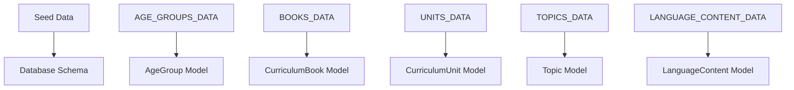
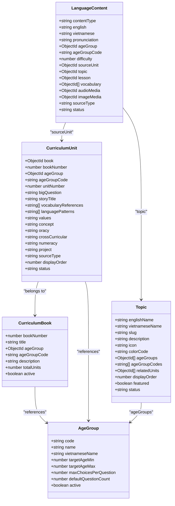
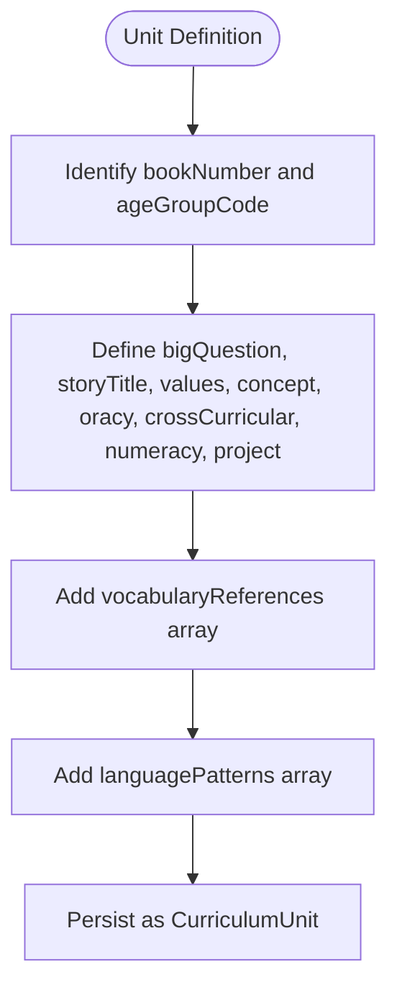
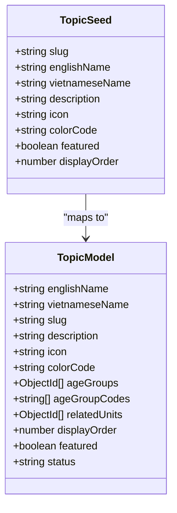
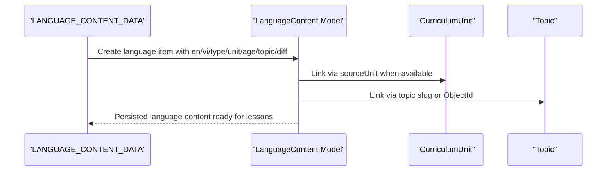
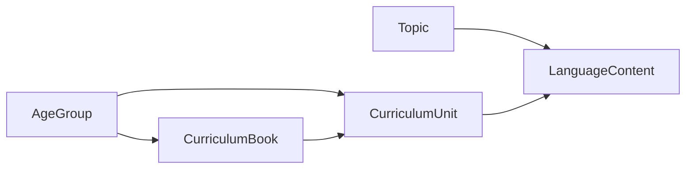

# Curriculum Data Structure

<cite>
**Referenced Files in This Document**
- [curriculumData.js](file://KCEnglishKids_BE/src/seeds/curriculumData.js)
- [topicData.js](file://KCEnglishKids_BE/src/seeds/topicData.js)
- [languageContentData.js](file://KCEnglishKids_BE/src/seeds/languageContentData.js)
- [AgeGroup.js](file://KCEnglishKids_BE/src/models/AgeGroup.js)
- [CurriculumBook.js](file://KCEnglishKids_BE/src/models/CurriculumBook.js)
- [CurriculumUnit.js](file://KCEnglishKids_BE/src/models/CurriculumUnit.js)
- [LanguageContent.js](file://KCEnglishKids_BE/src/models/LanguageContent.js)
- [Topic.js](file://KCEnglishKids_BE/src/models/Topic.js)
</cite>

## Table of Contents
1. [Introduction](#introduction)
2. [Project Structure](#project-structure)
3. [Core Components](#core-components)
4. [Architecture Overview](#architecture-overview)
5. [Detailed Component Analysis](#detailed-component-analysis)
6. [Dependency Analysis](#dependency-analysis)
7. [Performance Considerations](#performance-considerations)
8. [Troubleshooting Guide](#troubleshooting-guide)
9. [Conclusion](#conclusion)

## Introduction
This document explains the curriculum data structure components that define the educational content hierarchy for KCEnglishKids. It focuses on:
- Age group definitions for three age ranges: 3–4, 4–5, and 5–6.
- Three official curriculum books with metadata.
- Twenty-seven official curriculum units across all books.
- Nineteen application topics with English-Vietnamese bilingual support and icon mappings.
- One hundred four structured language items including sentence patterns, vocabulary references, and difficulty levels.
- How these seed data structures map to the database schema through Mongoose models.

The goal is to make the curriculum architecture understandable for both technical and non-technical readers while providing precise code-level traceability.

## Project Structure
The curriculum data lives primarily in backend seed files and is persisted through Mongoose models:
- Seed data defines the authoritative curriculum content.
- Models define the database schema and relationships.
- The mapping between seed arrays and model documents is explicit through shared identifiers such as age group codes, book numbers, unit keys, and topic slugs.

**Diagram sources**
- [curriculumData.js:7-62](file://KCEnglishKids_BE/src/seeds/curriculumData.js#L7-L62)
- [topicData.js:6-197](file://KCEnglishKids_BE/src/seeds/topicData.js#L6-L197)
- [languageContentData.js:8-317](file://KCEnglishKids_BE/src/seeds/languageContentData.js#L8-L317)
- [AgeGroup.js:3-47](file://KCEnglishKids_BE/src/models/AgeGroup.js#L3-L47)
- [CurriculumBook.js:3-40](file://KCEnglishKids_BE/src/models/CurriculumBook.js#L3-L40)
- [CurriculumUnit.js:3-87](file://KCEnglishKids_BE/src/models/CurriculumUnit.js#L3-L87)
- [LanguageContent.js:3-74](file://KCEnglishKids_BE/src/models/LanguageContent.js#L3-L74)
- [Topic.js:3-77](file://KCEnglishKids_BE/src/models/Topic.js#L3-L77)

**Section sources**
- [curriculumData.js:1-709](file://KCEnglishKids_BE/src/seeds/curriculumData.js#L1-L709)
- [topicData.js:1-202](file://KCEnglishKids_BE/src/seeds/topicData.js#L1-L202)
- [languageContentData.js:1-322](file://KCEnglishKids_BE/src/seeds/languageContentData.js#L1-L322)
- [AgeGroup.js:1-48](file://KCEnglishKids_BE/src/models/AgeGroup.js#L1-L48)
- [CurriculumBook.js:1-41](file://KCEnglishKids_BE/src/models/CurriculumBook.js#L1-L41)
- [CurriculumUnit.js:1-88](file://KCEnglishKids_BE/src/models/CurriculumUnit.js#L1-L88)
- [LanguageContent.js:1-75](file://KCEnglishKids_BE/src/models/LanguageContent.js#L1-L75)
- [Topic.js:1-78](file://KCEnglishKids_BE/src/models/Topic.js#L1-L78)

## Core Components
The core curriculum data components are:
- AGE_GROUPS_DATA: Defines three age ranges with learning characteristics and UI constraints.
- BOOKS_DATA: Defines three curriculum books linked to age groups.
- UNITS_DATA: Defines twenty-seven official units with rich metadata.
- TOPICS_DATA: Defines nineteen application topics with bilingual names and icons.
- LANGUAGE_CONTENT_DATA: Defines one hundred four structured language items with bilingual text and difficulty levels.

These components form a layered curriculum hierarchy:
- Age Group → Book → Unit → Language Content
- Topic acts as a cross-cutting classification used by both Units and Language Content.

**Section sources**
- [curriculumData.js:7-702](file://KCEnglishKids_BE/src/seeds/curriculumData.js#L7-L702)
- [topicData.js:6-197](file://KCEnglishKids_BE/src/seeds/topicData.js#L6-L197)
- [languageContentData.js:8-317](file://KCEnglishKids_BE/src/seeds/languageContentData.js#L8-L317)

## Architecture Overview
The curriculum architecture maps seed data to database entities with clear relationships:
- AgeGroup is referenced by CurriculumBook and CurriculumUnit.
- CurriculumBook contains multiple CurriculumUnits.
- CurriculumUnit stores vocabularyReferences and languagePatterns as string arrays.
- Topic provides a topic slug and display metadata; it can be related to units and language content.
- LanguageContent references CurriculumUnit, Topic, Vocabulary, Lesson, and Media.

**Diagram sources**
- [AgeGroup.js:3-47](file://KCEnglishKids_BE/src/models/AgeGroup.js#L3-L47)
- [CurriculumBook.js:3-40](file://KCEnglishKids_BE/src/models/CurriculumBook.js#L3-L40)
- [CurriculumUnit.js:3-87](file://KCEnglishKids_BE/src/models/CurriculumUnit.js#L3-L87)
- [Topic.js:3-77](file://KCEnglishKids_BE/src/models/Topic.js#L3-L77)
- [LanguageContent.js:3-74](file://KCEnglishKids_BE/src/models/LanguageContent.js#L3-L74)

## Detailed Component Analysis

### AGE_GROUPS_DATA
AGE_GROUPS_DATA defines three age ranges:
- Code 3–4: Foundational stage with single words, large recognition cards, audio-first learning, and 2–3 choices per question.
- Code 4–5: Expanding communication stage with short phrases, simple matching, everyday descriptions, and 3–4 choices per question.
- Code 5–6: Advanced conversational stage with questions, answers, opinions, and reasoning, using 3–4 choices per question.

Each entry includes:
- A stable code used across books and units.
- Human-readable names in English and Vietnamese.
- Target age range boundaries.
- UI behavior hints like maximum choices per question and default question count.

Mapping to the database:
- Each AGE_GROUPS_DATA entry maps to an AgeGroup document.
- The code field is unique and indexed.
- Books and units reference the same code via ageGroupCode and ObjectId.

**Section sources**
- [curriculumData.js:7-38](file://KCEnglishKids_BE/src/seeds/curriculumData.js#L7-L38)
- [AgeGroup.js:3-47](file://KCEnglishKids_BE/src/models/AgeGroup.js#L3-L47)

### BOOKS_DATA
BOOKS_DATA defines three curriculum books:
- Book 1: Foundational English for ages 3–4 with nine units.
- Book 2: Expanding English communication for ages 4–5 with nine units.
- Book 3: Advanced conversational and literacy English for ages 5–6 with nine units.

Each book includes:
- A numeric bookNumber (1, 2, 3).
- A title.
- An ageGroupCode linking to the appropriate AgeGroup.
- A description summarizing the curriculum focus.
- A totalUnits count aligned with the official curriculum.

Mapping to the database:
- Each BOOKS_DATA entry maps to a CurriculumBook document.
- The model enforces bookNumber uniqueness and enum validation.
- The ageGroupCode must match one of the allowed age ranges.

**Section sources**
- [curriculumData.js:40-62](file://KCEnglishKids_BE/src/seeds/curriculumData.js#L40-L62)
- [CurriculumBook.js:3-40](file://KCEnglishKids_BE/src/models/CurriculumBook.js#L3-L40)

### UNITS_DATA
UNITS_DATA defines twenty-seven official curriculum units across three books:
- Nine units per book, totaling twenty-seven units.
- Each unit has a stable key such as B1_U1, B2_U5, B3_U9.
- Units include metadata like bigQuestion, storyTitle, values, concept, oracy, crossCurricular, numeracy, project, vocabularyReferences, and languagePatterns.

Key design points:
- Units are grouped by bookNumber and unitNumber.
- Units carry ageGroupCode to align with the corresponding AgeGroup.
- vocabularyReferences lists English vocabulary terms referenced by the unit.
- languagePatterns lists key sentences or phrases taught in the unit.

Mapping to the database:
- Each UNITS_DATA entry maps to a CurriculumUnit document.
- The model supports arrays for vocabularyReferences and languagePatterns.
- Unique indexes enforce uniqueness by bookNumber/unitNumber and by ageGroupCode/unitNumber.

**Diagram sources**
- [curriculumData.js:64-702](file://KCEnglishKids_BE/src/seeds/curriculumData.js#L64-L702)
- [CurriculumUnit.js:3-87](file://KCEnglishKids_BE/src/models/CurriculumUnit.js#L3-L87)

**Section sources**
- [curriculumData.js:64-702](file://KCEnglishKids_BE/src/seeds/curriculumData.js#L64-L702)
- [CurriculumUnit.js:3-87](file://KCEnglishKids_BE/src/models/CurriculumUnit.js#L3-L87)

### TOPICS_DATA
TOPICS_DATA defines nineteen application topics with bilingual support and icon mappings:
- Topics include animals, school, my-body, family, food, toys, colors, numbers, nature, my-house, clothes, feelings, senses, transportation, weather, daily-routines, community, environment, vacation.
- Each topic includes:
  - slug: a stable identifier.
  - englishName and vietnameseName: bilingual labels.
  - description: thematic summary.
  - icon: emoji-based icon.
  - colorCode: visual accent color.
  - featured flag and displayOrder for UI presentation.

Mapping to the database:
- Each TOPICS_DATA entry maps to a Topic document.
- The model supports bilingual fields, slug uniqueness, icon and color metadata.
- Topics can relate to AgeGroup via ageGroups and ageGroupCodes.
- Topics can relate to CurriculumUnit via relatedUnits.

**Diagram sources**
- [topicData.js:6-197](file://KCEnglishKids_BE/src/seeds/topicData.js#L6-L197)
- [Topic.js:3-77](file://KCEnglishKids_BE/src/models/Topic.js#L3-L77)

**Section sources**
- [topicData.js:6-197](file://KCEnglishKids_BE/src/seeds/topicData.js#L6-L197)
- [Topic.js:3-77](file://KCEnglishKids_BE/src/models/Topic.js#L3-L77)

### LANGUAGE_CONTENT_DATA
LANGUAGE_CONTENT_DATA defines one hundred four structured language items covering all twenty-seven units:
- Each item includes:
  - en: English text.
  - vi: Vietnamese translation.
  - type: content type such as QUESTION, ANSWER, SENTENCE, PATTERN, ORACY.
  - unit: unit key like B1_U1, B2_U5, B3_U9.
  - age: age group code like 3-4, 4-5, 5-6.
  - topic: topic slug like school, animals, food.
  - diff: difficulty level, typically increasing from 1 to 3 across books.

Design highlights:
- Bilingual support is built into every language item.
- Difficulty increases with age group and book progression.
- Items are organized by unit and topic, enabling curriculum-aligned content retrieval.

Mapping to the database:
- Each LANGUAGE_CONTENT_DATA entry maps to a LanguageContent document.
- The model supports contentType, bilingual text, pronunciation, ageGroup and ageGroupCode, difficulty, sourceUnit, topic, lesson, vocabulary references, and media attachments.
- sourceType defaults to OFFICIAL_CURRICULUM.

**Diagram sources**
- [languageContentData.js:8-317](file://KCEnglishKids_BE/src/seeds/languageContentData.js#L8-L317)
- [LanguageContent.js:3-74](file://KCEnglishKids_BE/src/models/LanguageContent.js#L3-L74)
- [CurriculumUnit.js:3-87](file://KCEnglishKids_BE/src/models/CurriculumUnit.js#L3-L87)
- [Topic.js:3-77](file://KCEnglishKids_BE/src/models/Topic.js#L3-L77)

**Section sources**
- [languageContentData.js:8-317](file://KCEnglishKids_BE/src/seeds/languageContentData.js#L8-L317)
- [LanguageContent.js:3-74](file://KCEnglishKids_BE/src/models/LanguageContent.js#L3-L74)

## Dependency Analysis
The dependencies between curriculum data structures are:
- AgeGroup is foundational and referenced by Books and Units.
- CurriculumBook depends on AgeGroup and contains multiple CurriculumUnits.
- CurriculumUnit depends on CurriculumBook and AgeGroup, and exposes vocabularyReferences and languagePatterns.
- Topic is independent but can relate to AgeGroup and CurriculumUnit.
- LanguageContent depends on CurriculumUnit and Topic, and optionally on Vocabulary, Lesson, and Media.

**Diagram sources**
- [AgeGroup.js:3-47](file://KCEnglishKids_BE/src/models/AgeGroup.js#L3-L47)
- [CurriculumBook.js:3-40](file://KCEnglishKids_BE/src/models/CurriculumBook.js#L3-L40)
- [CurriculumUnit.js:3-87](file://KCEnglishKids_BE/src/models/CurriculumUnit.js#L3-L87)
- [Topic.js:3-77](file://KCEnglishKids_BE/src/models/Topic.js#L3-L77)
- [LanguageContent.js:3-74](file://KCEnglishKids_BE/src/models/LanguageContent.js#L3-L74)

**Section sources**
- [AgeGroup.js:1-48](file://KCEnglishKids_BE/src/models/AgeGroup.js#L1-L48)
- [CurriculumBook.js:1-41](file://KCEnglishKids_BE/src/models/CurriculumBook.js#L1-L41)
- [CurriculumUnit.js:1-88](file://KCEnglishKids_BE/src/models/CurriculumUnit.js#L1-L88)
- [Topic.js:1-78](file://KCEnglishKids_BE/src/models/Topic.js#L1-L78)
- [LanguageContent.js:1-75](file://KCEnglishKids_BE/src/models/LanguageContent.js#L1-L75)

## Performance Considerations
- Use indexes on frequently queried fields such as ageGroupCode, bookNumber, unitNumber, and topic slug.
- Avoid loading full language content arrays when only summaries are needed; paginate or filter by unit and difficulty.
- Cache topic metadata and age group configurations at the API layer to reduce repeated lookups.
- Keep vocabularyReferences and languagePatterns as lightweight strings in units; store detailed vocabulary and sentence enrichment in separate collections if needed.

[No sources needed since this section provides general guidance]

## Troubleshooting Guide
Common issues and resolutions:
- Mismatched ageGroupCode: Ensure that BOOKS_DATA and UNITS_DATA use one of the allowed codes: 3-4, 4-5, 5-6.
- Missing topic slug: When creating LanguageContent, ensure the topic slug matches a defined Topic entry.
- Duplicate unit keys: Verify that each UNITS_DATA entry has a unique key and that bookNumber/unitNumber combinations are unique.
- Difficulty scaling: Confirm that difficulty values increase appropriately across books and age groups.
- Bilingual consistency: Ensure every LanguageContent entry has both English and Vietnamese text where required.

**Section sources**
- [curriculumData.js:7-702](file://KCEnglishKids_BE/src/seeds/curriculumData.js#L7-L702)
- [topicData.js:6-197](file://KCEnglishKids_BE/src/seeds/topicData.js#L6-L197)
- [languageContentData.js:8-317](file://KCEnglishKids_BE/src/seeds/languageContentData.js#L8-L317)
- [AgeGroup.js:3-47](file://KCEnglishKids_BE/src/models/AgeGroup.js#L3-L47)
- [CurriculumBook.js:3-40](file://KCEnglishKids_BE/src/models/CurriculumBook.js#L3-L40)
- [CurriculumUnit.js:3-87](file://KCEnglishKids_BE/src/models/CurriculumUnit.js#L3-L87)
- [LanguageContent.js:3-74](file://KCEnglishKids_BE/src/models/LanguageContent.js#L3-L74)
- [Topic.js:3-77](file://KCEnglishKids_BE/src/models/Topic.js#L3-L77)

## Conclusion
The curriculum data structure for KCEnglishKids is a well-defined hierarchy:
- Age groups provide foundational constraints and UI behavior.
- Books organize units by age-appropriate curriculum stages.
- Units encapsulate rich pedagogical metadata and language patterns.
- Topics provide cross-cutting thematic organization with bilingual support and visual identity.
- Language content delivers structured, bilingual, and difficulty-tagged learning material aligned with units and topics.

Together, these components enable consistent curriculum delivery, scalable content management, and clear mapping to the database schema.

[No sources needed since this section summarizes without analyzing specific files]