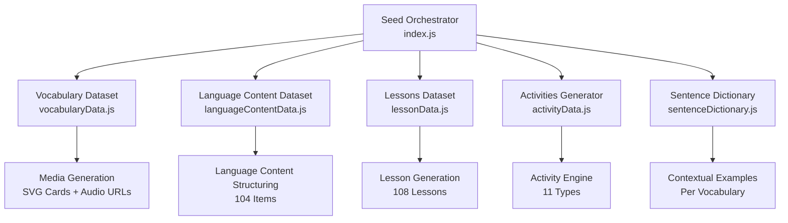
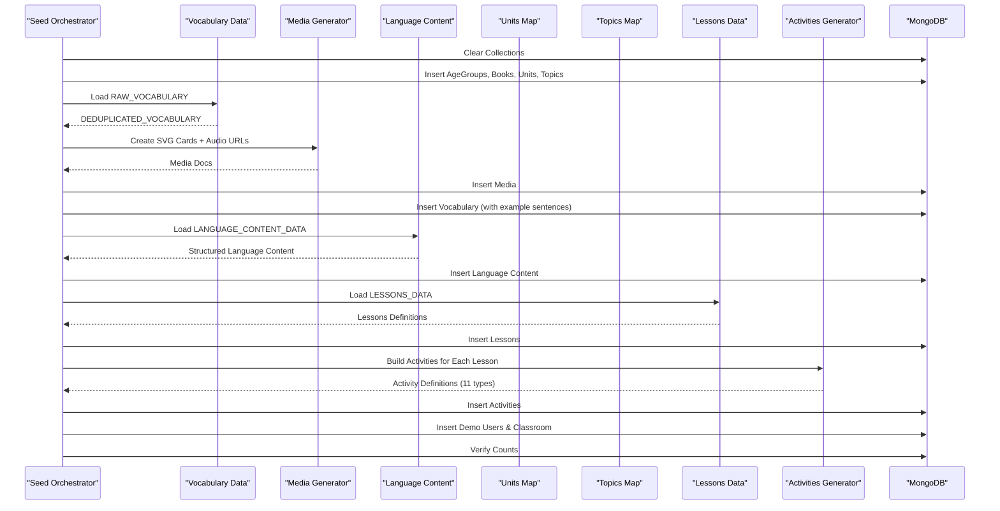
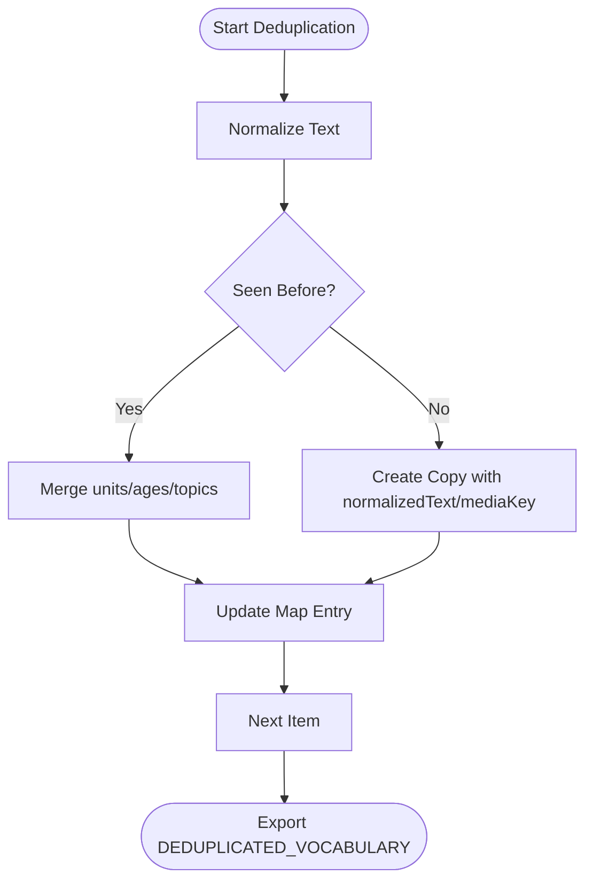
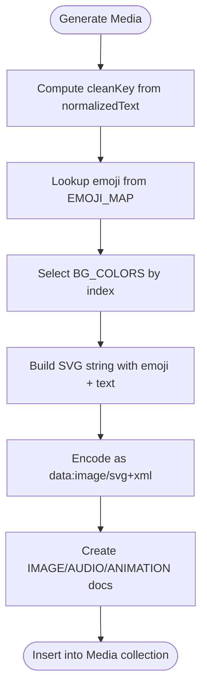
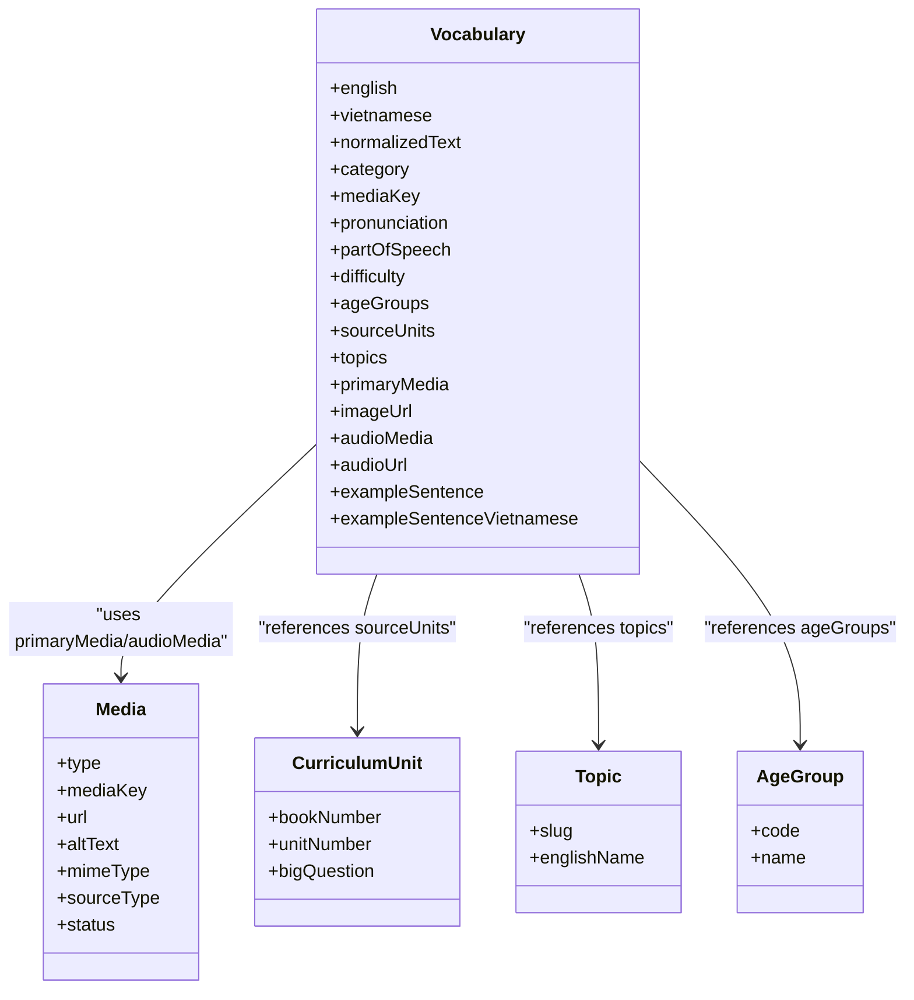
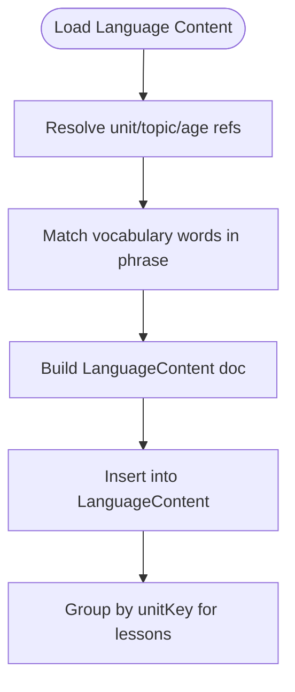
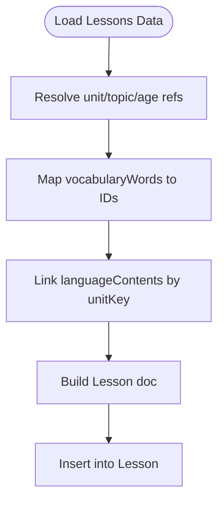
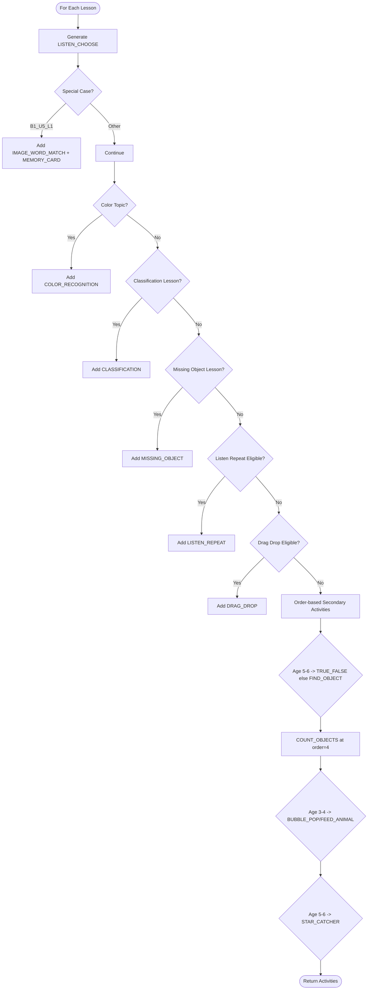
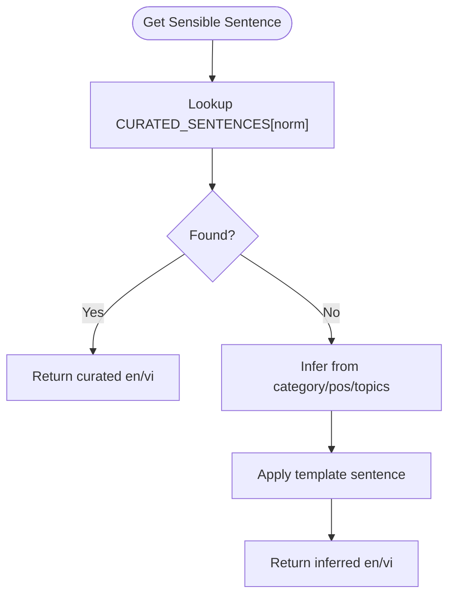
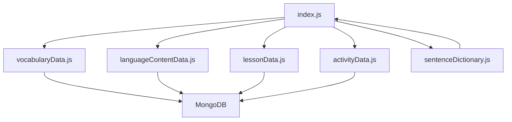

# Content Population Phases

<cite>
**Referenced Files in This Document**
- [index.js](file://KCEnglishKids_BE/src/seeds/index.js)
- [vocabularyData.js](file://KCEnglishKids_BE/src/seeds/vocabularyData.js)
- [languageContentData.js](file://KCEnglishKids_BE/src/seeds/languageContentData.js)
- [lessonData.js](file://KCEnglishKids_BE/src/seeds/lessonData.js)
- [activityData.js](file://KCEnglishKids_BE/src/seeds/activityData.js)
- [sentenceDictionary.js](file://KCEnglishKids_BE/src/seeds/sentenceDictionary.js)
</cite>

## Table of Contents
1. [Introduction](#introduction)
2. [Project Structure](#project-structure)
3. [Core Components](#core-components)
4. [Architecture Overview](#architecture-overview)
5. [Detailed Component Analysis](#detailed-component-analysis)
6. [Dependency Analysis](#dependency-analysis)
7. [Performance Considerations](#performance-considerations)
8. [Troubleshooting Guide](#troubleshooting-guide)
9. [Conclusion](#conclusion)

## Introduction
This document explains the content population phases that build the learning dataset for KCEnglishKids. It covers:
- Vocabulary deduplication producing 384 unique vocabulary items
- Media generation system that creates SVG cards with emojis and audio references
- Language content structuring producing 104 educational phrases
- Lesson generation system creating 108 lessons (4 per unit across 27 units)
- Activity generation engine producing 11 activity types
- Sentence dictionary integration for contextual examples
- Relationship building between all content entities

The seed pipeline orchestrates these phases to populate curriculum, topics, vocabulary, language content, lessons, activities, media, and demo users into MongoDB.

## Project Structure
The content population is implemented as a Node.js seed script that imports modular datasets and services:
- Seed orchestrator: index.js
- Vocabulary dataset and deduplication: vocabularyData.js
- Language content dataset: languageContentData.js
- Lessons dataset: lessonData.js
- Activities generator: activityData.js
- Sentence dictionary: sentenceDictionary.js

**Diagram sources**
- [index.js:125-454](file://KCEnglishKids_BE/src/seeds/index.js#L125-L454)
- [vocabularyData.js:480-512](file://KCEnglishKids_BE/src/seeds/vocabularyData.js#L480-L512)
- [languageContentData.js:1-322](file://KCEnglishKids_BE/src/seeds/languageContentData.js#L1-L322)
- [lessonData.js:1-800](file://KCEnglishKids_BE/src/seeds/lessonData.js#L1-L800)
- [activityData.js:1-759](file://KCEnglishKids_BE/src/seeds/activityData.js#L1-L759)
- [sentenceDictionary.js:1-296](file://KCEnglishKids_BE/src/seeds/sentenceDictionary.js#L1-L296)

**Section sources**
- [index.js:125-454](file://KCEnglishKids_BE/src/seeds/index.js#L125-L454)

## Core Components
- Vocabulary Deduplication: Consolidates repeated words across units, ages, and topics; assigns normalized keys and media keys.
- Media Generation: Produces SVG card images with emojis and background colors, plus audio URLs from an external dictionary service.
- Language Content Structuring: Maps structured phrases to units, age groups, topics, and links to vocabulary.
- Lesson Generation: Creates 4 lessons per unit, linking vocabulary, language content, and thumbnails.
- Activity Generation: Builds 11 activity types per lesson using vocabulary and numeracy progression rules.
- Sentence Dictionary Integration: Provides curated or context-aware example sentences for each vocabulary item.

**Section sources**
- [vocabularyData.js:480-512](file://KCEnglishKids_BE/src/seeds/vocabularyData.js#L480-L512)
- [index.js:234-333](file://KCEnglishKids_BE/src/seeds/index.js#L234-L333)
- [languageContentData.js:1-322](file://KCEnglishKids_BE/src/seeds/languageContentData.js#L1-L322)
- [lessonData.js:1-800](file://KCEnglishKids_BE/src/seeds/lessonData.js#L1-L800)
- [activityData.js:1-759](file://KCEnglishKids_BE/src/seeds/activityData.js#L1-L759)
- [sentenceDictionary.js:1-296](file://KCEnglishKids_BE/src/seeds/sentenceDictionary.js#L1-L296)

## Architecture Overview
The seed pipeline runs sequentially through clear phases:
1. Clear collections
2. Seed Age Groups, Books, Units, Topics
3. Generate Media References and Vocabulary (384 unique)
4. Seed Language Content (104 items)
5. Seed Lessons (108 lessons)
6. Generate Activities (11 types)
7. Seed Demo Users and Classroom
8. Final verification counts

**Diagram sources**
- [index.js:125-454](file://KCEnglishKids_BE/src/seeds/index.js#L125-L454)
- [vocabularyData.js:480-512](file://KCEnglishKids_BE/src/seeds/vocabularyData.js#L480-L512)
- [languageContentData.js:1-322](file://KCEnglishKids_BE/src/seeds/languageContentData.js#L1-L322)
- [lessonData.js:1-800](file://KCEnglishKids_BE/src/seeds/lessonData.js#L1-L800)
- [activityData.js:1-759](file://KCEnglishKids_BE/src/seeds/activityData.js#L1-L759)
- [sentenceDictionary.js:1-296](file://KCEnglishKids_BE/src/seeds/sentenceDictionary.js#L1-L296)

## Detailed Component Analysis

### Vocabulary Deduplication System
- Input: RAW_VOCABULARY array spanning multiple books and units
- Process:
  - Normalize text to lowercase and trim
  - Merge duplicate entries by consolidating units, ages, and topics
  - Assign normalizedText and mediaKey
  - Export DEDUPLICATED_VOCABULARY
- Output: 384 unique vocabulary items ready for media and relationships

**Diagram sources**
- [vocabularyData.js:480-512](file://KCEnglishKids_BE/src/seeds/vocabularyData.js#L480-L512)

**Section sources**
- [vocabularyData.js:480-512](file://KCEnglishKids_BE/src/seeds/vocabularyData.js#L480-L512)

### Media Generation System (SVG Cards with Emojis)
- Purpose: Create child-friendly visual assets for vocabulary
- Inputs:
  - Vocabulary word
  - Background color palette
  - Emoji mapping based on normalized key
- Process:
  - Generate SVG string with rounded rectangle, emoji, and label
  - Encode as data URL
  - Create MEDIA docs for IMAGE, AUDIO, and ANIMATION placeholders
- Outputs:
  - Media documents with url, altText, mimeType, sourceType, status
  - Links to primaryMedia and audioMedia in Vocabulary

**Diagram sources**
- [index.js:37-123](file://KCEnglishKids_BE/src/seeds/index.js#L37-L123)
- [index.js:234-279](file://KCEnglishKids_BE/src/seeds/index.js#L234-L279)

**Section sources**
- [index.js:37-123](file://KCEnglishKids_BE/src/seeds/index.js#L37-L123)
- [index.js:234-279](file://KCEnglishKids_BE/src/seeds/index.js#L234-L279)

### Vocabulary Records and Relationships
- Fields include English/Vietnamese names, normalizedText, category, mediaKey, pronunciation, partOfSpeech, difficulty, ageGroups, sourceUnits, topics, primaryMedia, imageUrl, audioMedia, audioUrl, exampleSentence, exampleSentenceVietnamese
- Difficulty mapping:
  - 3-4 → 1
  - 4-5 → 2
  - 5-6 → 3
- Relationships:
  - Links to Unit IDs via sourceUnits
  - Links to Topic IDs via topics
  - Links to AgeGroup IDs via ageGroups
  - Links to Media via primaryMedia/audioMedia

**Diagram sources**
- [index.js:284-333](file://KCEnglishKids_BE/src/seeds/index.js#L284-L333)

**Section sources**
- [index.js:284-333](file://KCEnglishKids_BE/src/seeds/index.js#L284-L333)

### Language Content Structuring (104 Items)
- Input: LANGUAGE_CONTENT_DATA containing questions, answers, patterns, oracy, and sentences
- Process:
  - Resolve unit, topic, and age group references
  - Match vocabulary words within phrase text (up to 3 matches)
  - Store contentType, english, vietnamese, difficulty, and relations
- Output: 104 LanguageContent records linked to units, topics, and vocabulary

**Diagram sources**
- [index.js:339-381](file://KCEnglishKids_BE/src/seeds/index.js#L339-L381)
- [languageContentData.js:1-322](file://KCEnglishKids_BE/src/seeds/languageContentData.js#L1-L322)

**Section sources**
- [index.js:339-381](file://KCEnglishKids_BE/src/seeds/index.js#L339-L381)
- [languageContentData.js:1-322](file://KCEnglishKids_BE/src/seeds/languageContentData.js#L1-L322)

### Lesson Generation System (108 Lessons)
- Input: LESSONS_DATA defining 4 lessons per unit across 27 units
- Process:
  - Resolve unit, topic, and age group references
  - Map vocabularyWords to Vocabulary IDs
  - Link languageContents grouped by unitKey
  - Set thumbnail from first vocabulary’s primaryMedia
- Output: 108 Lesson records with objectives, duration, difficulty, and relations

**Diagram sources**
- [index.js:383-422](file://KCEnglishKids_BE/src/seeds/index.js#L383-L422)
- [lessonData.js:1-800](file://KCEnglishKids_BE/src/seeds/lessonData.js#L1-L800)

**Section sources**
- [index.js:383-422](file://KCEnglishKids_BE/src/seeds/index.js#L383-L422)
- [lessonData.js:1-800](file://KCEnglishKids_BE/src/seeds/lessonData.js#L1-L800)

### Activity Generation Engine (11 Types)
- Supported types:
  1. LISTEN_CHOOSE
  2. LISTEN_REPEAT
  3. IMAGE_WORD_MATCH
  4. DRAG_DROP
  5. MEMORY_CARD
  6. FIND_OBJECT
  7. MISSING_OBJECT
  8. COLOR_RECOGNITION
  9. COUNT_OBJECTS
  10. TRUE_FALSE
  11. CLASSIFICATION
- Additional preschool games:
  - BUBBLE_POP / FEED_ANIMAL (Age 3–4)
  - STAR_CATCHER (Age 5–6)
- Numeracy progression maps count targets per unit
- Process:
  - For each lesson definition, generate primary LISTEN_CHOOSE
  - Apply special-case logic for specific lessons (e.g., B1_U5_L1)
  - Add secondary activities based on lesson order and age group
  - Attach starConfig, points, and metadata

**Diagram sources**
- [activityData.js:1-759](file://KCEnglishKids_BE/src/seeds/activityData.js#L1-L759)

**Section sources**
- [activityData.js:1-759](file://KCEnglishKids_BE/src/seeds/activityData.js#L1-L759)

### Sentence Dictionary Integration
- Curated sentences provide meaningful, cheerful examples for many vocabulary words
- Fallback logic uses category, part-of-speech, and topics to generate contextual sentences
- Integration point:
  - During Vocabulary insertion, getSensibleSentence(v) sets exampleSentence and exampleSentenceVietnamese

**Diagram sources**
- [sentenceDictionary.js:1-296](file://KCEnglishKids_BE/src/seeds/sentenceDictionary.js#L1-L296)
- [index.js:326-327](file://KCEnglishKids_BE/src/seeds/index.js#L326-L327)

**Section sources**
- [sentenceDictionary.js:1-296](file://KCEnglishKids_BE/src/seeds/sentenceDictionary.js#L1-L296)
- [index.js:326-327](file://KCEnglishKids_BE/src/seeds/index.js#L326-L327)

## Dependency Analysis
- The seed orchestrator depends on:
  - vocabularyData.js for deduplicated vocabulary
  - languageContentData.js for structured phrases
  - lessonData.js for lesson definitions
  - activityData.js for activity generation
  - sentenceDictionary.js for contextual examples
- Internal mappings:
  - unitsMap, topicsMap, ageGroupsMap, vocabMapByWord, mediaByLookupKey, langByUnitKey, lessonsMapByKey
- External dependencies:
  - MongoDB via Mongoose models
  - Youdao dictionary API for audio URLs

**Diagram sources**
- [index.js:1-35](file://KCEnglishKids_BE/src/seeds/index.js#L1-L35)
- [vocabularyData.js:480-512](file://KCEnglishKids_BE/src/seeds/vocabularyData.js#L480-L512)
- [languageContentData.js:1-322](file://KCEnglishKids_BE/src/seeds/languageContentData.js#L1-L322)
- [lessonData.js:1-800](file://KCEnglishKids_BE/src/seeds/lessonData.js#L1-L800)
- [activityData.js:1-759](file://KCEnglishKids_BE/src/seeds/activityData.js#L1-L759)
- [sentenceDictionary.js:1-296](file://KCEnglishKids_BE/src/seeds/sentenceDictionary.js#L1-L296)

**Section sources**
- [index.js:1-35](file://KCEnglishKids_BE/src/seeds/index.js#L1-L35)

## Performance Considerations
- Bulk insertions:
  - Media.insertMany and Vocabulary.insertMany reduce round-trips
- In-memory maps:
  - mediaByLookupKey, vocabMapByWord, unitsMap, topicsMap, ageGroupsMap improve lookup performance
- Idempotent seeding:
  - deleteMany before insert ensures repeatable runs without duplicates
- SVG generation:
  - Lightweight vector graphics avoid heavy image processing overhead
- Audio URLs:
  - External API calls are not performed during seed; only URLs are stored

[No sources needed since this section provides general guidance]

## Troubleshooting Guide
- If final counts do not match expected totals:
  - Verify that collections were cleared before insertion
  - Confirm that unitsMap, topicsMap, and ageGroupsMap contain expected keys
  - Ensure vocabulary normalization matches EMOJI_MAP keys
- If vocabulary lacks example sentences:
  - Check getSensibleSentence fallback logic and category/topic fields
- If activities are missing:
  - Validate lessonDef.key and order values
  - Confirm NUMERACY_PROGRESSION has entries for unitKey
- If media URLs are invalid:
  - Ensure createCardSvg returns valid data URLs
  - Confirm audio URL format for Youdao dictionary

**Section sources**
- [index.js:132-150](file://KCEnglishKids_BE/src/seeds/index.js#L132-L150)
- [index.js:234-279](file://KCEnglishKids_BE/src/seeds/index.js#L234-L279)
- [index.js:326-327](file://KCEnglishKids_BE/src/seeds/index.js#L326-L327)
- [activityData.js:18-49](file://KCEnglishKids_BE/src/seeds/activityData.js#L18-L49)

## Conclusion
The content population pipeline systematically constructs a rich, interconnected learning dataset:
- 384 unique vocabulary items with media and contextual sentences
- 104 structured language content phrases mapped to units and topics
- 108 lessons organized by unit with objectives and vocabulary links
- 11 activity types tailored to age groups and lesson themes
- Robust relationship modeling across units, topics, age groups, media, and users

This design enables scalable content expansion while maintaining consistency and pedagogical coherence.