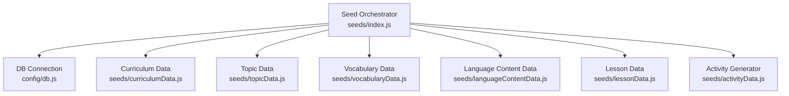
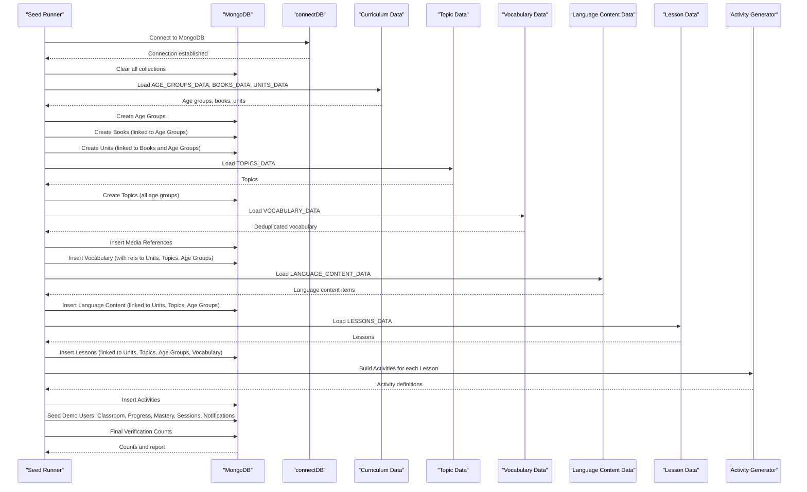
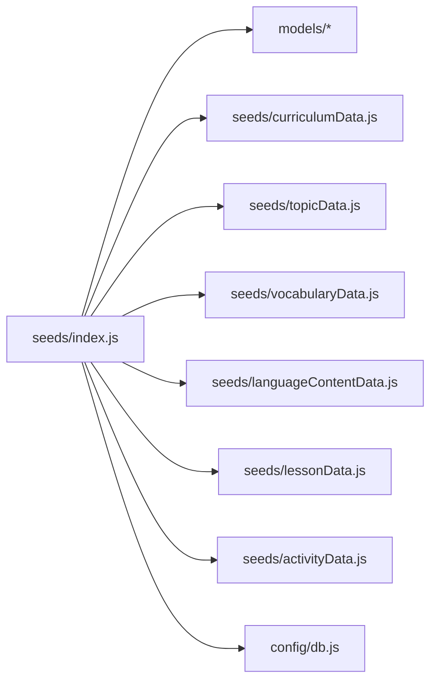

# Core Seeding Workflow

<cite>
**Referenced Files in This Document**
- [index.js](file://KCEnglishKids_BE/src/seeds/index.js)
- [db.js](file://KCEnglishKids_BE/src/config/db.js)
- [curriculumData.js](file://KCEnglishKids_BE/src/seeds/curriculumData.js)
- [topicData.js](file://KCEnglishKids_BE/src/seeds/topicData.js)
- [vocabularyData.js](file://KCEnglishKids_BE/src/seeds/vocabularyData.js)
- [languageContentData.js](file://KCEnglishKids_BE/src/seeds/languageContentData.js)
- [lessonData.js](file://KCEnglishKids_BE/src/seeds/lessonData.js)
- [activityData.js](file://KCEnglishKids_BE/src/seeds/activityData.js)
</cite>

## Table of Contents
1. [Introduction](#introduction)
2. [Project Structure](#project-structure)
3. [Core Components](#core-components)
4. [Architecture Overview](#architecture-overview)
5. [Detailed Component Analysis](#detailed-component-analysis)
6. [Dependency Analysis](#dependency-analysis)
7. [Performance Considerations](#performance-considerations)
8. [Troubleshooting Guide](#troubleshooting-guide)
9. [Conclusion](#conclusion)

## Introduction
This document explains the core seeding workflow that populates the learning database for KCEnglishKids. It covers a systematic 9-phase process: clearing collections, creating age groups, establishing curriculum hierarchy (books and units), building application topics, generating media references and vocabulary, inserting structured language content, creating lessons, generating activities across multiple activity types, and finally seeding demo users, classroom, progress, mastery, sessions, and notifications. The workflow also includes verification and reporting to ensure data integrity after seeding.

The seed script orchestrates modular dataset imports separated by domain: curriculum data, topic data, vocabulary data, language content data, lesson data, and activity generation logic. It builds relationships between entities using maps keyed by stable identifiers such as age group codes, book numbers, unit keys, and topic slugs.

## Project Structure
The seeding system is organized into a central orchestrator and several domain-specific data modules:

- Orchestrator: seeds/index.js
- Database connection: config/db.js
- Curriculum data: seeds/curriculumData.js
- Topic data: seeds/topicData.js
- Vocabulary data: seeds/vocabularyData.js
- Language content data: seeds/languageContentData.js
- Lesson data: seeds/lessonData.js
- Activity generator: seeds/activityData.js

**Diagram sources**
- [index.js:1-35](file://KCEnglishKids_BE/src/seeds/index.js#L1-L35)
- [db.js:11-30](file://KCEnglishKids_BE/src/config/db.js#L11-L30)
- [curriculumData.js:1-62](file://KCEnglishKids_BE/src/seeds/curriculumData.js#L1-L62)
- [topicData.js:1-20](file://KCEnglishKids_BE/src/seeds/topicData.js#L1-L20)
- [vocabularyData.js:1-10](file://KCEnglishKids_BE/src/seeds/vocabularyData.js#L1-L10)
- [languageContentData.js:1-10](file://KCEnglishKids_BE/src/seeds/languageContentData.js#L1-L10)
- [lessonData.js:1-10](file://KCEnglishKids_BE/src/seeds/lessonData.js#L1-L10)
- [activityData.js:1-16](file://KCEnglishKids_BE/src/seeds/activityData.js#L1-L16)

**Section sources**
- [index.js:1-35](file://KCEnglishKids_BE/src/seeds/index.js#L1-L35)
- [db.js:11-30](file://KCEnglishKids_BE/src/config/db.js#L11-L30)

## Core Components
- Database connection utility: Provides resilient MongoDB connection with fallback URIs and DNS configuration.
- Seed orchestrator: Coordinates the 9-phase seeding pipeline, manages maps for entity references, and performs final verification.
- Modular datasets:
  - Curriculum data: Age groups, books, and official units.
  - Topic data: Application topics with metadata and display order.
  - Vocabulary data: Deduplicated vocabulary entries with normalized text, media keys, and mappings to units, ages, and topics.
  - Language content data: Structured sentences, questions, answers, patterns, and oracy phrases per unit and age.
  - Lesson data: Application lessons mapping units to topics with objectives and vocabulary words.
  - Activity generator: Builds diverse activities per lesson based on age, topic, and numeracy progression.

Key responsibilities:
- Idempotent collection clearing.
- Sequential creation of foundational entities (age groups, books, units).
- Building cross-entity relationships via maps.
- Bulk insertions for performance.
- Demo user and classroom setup.
- Verification and reporting.

**Section sources**
- [index.js:125-755](file://KCEnglishKids_BE/src/seeds/index.js#L125-L755)
- [db.js:11-30](file://KCEnglishKids_BE/src/config/db.js#L11-L30)

## Architecture Overview
The seeding workflow follows a clear sequence from connection to verification:

**Diagram sources**
- [index.js:125-755](file://KCEnglishKids_BE/src/seeds/index.js#L125-L755)
- [db.js:11-30](file://KCEnglishKids_BE/src/config/db.js#L11-L30)
- [curriculumData.js:7-62](file://KCEnglishKids_BE/src/seeds/curriculumData.js#L7-L62)
- [topicData.js:6-196](file://KCEnglishKids_BE/src/seeds/topicData.js#L6-L196)
- [vocabularyData.js:480-512](file://KCEnglishKids_BE/src/seeds/vocabularyData.js#L480-L512)
- [languageContentData.js:8-317](file://KCEnglishKids_BE/src/seeds/languageContentData.js#L8-L317)
- [lessonData.js:7-10](file://KCEnglishKids_BE/src/seeds/lessonData.js#L7-L10)
- [activityData.js:51-758](file://KCEnglishKids_BE/src/seeds/activityData.js#L51-L758)

## Detailed Component Analysis

### Phase 0: Collection Clearing
Purpose: Ensure idempotent seeding by removing existing records across all relevant collections before insertion.

Behavior:
- Clears AgeGroup, CurriculumBook, CurriculumUnit, Media, Topic, Vocabulary, LanguageContent, Lesson, Activity, User, ClassRoom, LearningSession, ActivityResult, Progress.
- Uses parallel deletion for efficiency.

Outcome:
- Clean state for subsequent phases.

**Section sources**
- [index.js:132-150](file://KCEnglishKids_BE/src/seeds/index.js#L132-L150)

### Phase 1: Age Group Creation
Purpose: Establish foundational age categories used throughout the curriculum.

Inputs:
- AGE_GROUPS_DATA from curriculumData.js.

Processing:
- Creates AgeGroup documents.
- Stores created objects in ageGroupsMap keyed by code.

Relationships:
- Age groups are referenced by books, units, lessons, vocabulary, and language content.

**Section sources**
- [index.js:152-158](file://KCEnglishKids_BE/src/seeds/index.js#L152-L158)
- [curriculumData.js:7-38](file://KCEnglishKids_BE/src/seeds/curriculumData.js#L7-L38)

### Phase 2: Curriculum Book Creation
Purpose: Introduce books aligned with age groups.

Inputs:
- BOOKS_DATA from curriculumData.js.

Processing:
- Creates CurriculumBook documents linked to age groups via object IDs and codes.
- Stores created books in booksMap keyed by bookNumber.

Relationships:
- Books reference age groups; units will reference books.

**Section sources**
- [index.js:160-173](file://KCEnglishKids_BE/src/seeds/index.js#L160-L173)
- [curriculumData.js:40-62](file://KCEnglishKids_BE/src/seeds/curriculumData.js#L40-L62)

### Phase 3: Official Curriculum Units
Purpose: Populate official units for each book and age group.

Inputs:
- UNITS_DATA from curriculumData.js.

Processing:
- Creates CurriculumUnit documents with metadata (bigQuestion, storyTitle, values, concept, oracy, cross-curricular, numeracy, project, vocabularyReferences, languagePatterns).
- Stores units in unitsMap keyed by composite key like B1_U5.
- Captures a demo unit reference for later linking.

Relationships:
- Units link to books and age groups; vocabulary and language content will reference units.

**Section sources**
- [index.js:175-208](file://KCEnglishKids_BE/src/seeds/index.js#L175-L208)
- [curriculumData.js:64-701](file://KCEnglishKids_BE/src/seeds/curriculumData.js#L64-L701)

### Phase 4: Application Topics
Purpose: Define application-level topics that organize learning themes across age groups.

Inputs:
- TOPICS_DATA from topicData.js.

Processing:
- Creates Topic documents with English/Vietnamese names, slug, description, icon, colorCode, displayOrder, featured flag.
- Assigns all age group IDs and codes to topics.
- Links specific topics to units (e.g., animals to Unit 5).

Relationships:
- Topics are referenced by lessons and vocabulary.

**Section sources**
- [index.js:210-232](file://KCEnglishKids_BE/src/seeds/index.js#L210-L232)
- [topicData.js:6-196](file://KCEnglishKids_BE/src/seeds/topicData.js#L6-L196)

### Phase 5: Media References and Vocabulary
Purpose: Generate media assets and populate vocabulary with rich metadata and relationships.

Inputs:
- VOCABULARY_DATA from vocabularyData.js.

Processing:
- Generates SVG image cards and audio URLs for each vocabulary item.
- Inserts Media documents with unique mediaKey.
- Builds vocabulary documents including:
  - Normalized text, category, pronunciation, part of speech.
  - Difficulty derived from age groups.
  - References to sourceUnits, ageGroups, topics.
  - Primary media and audio media links.
  - Example sentences generated via sentenceDictionary helper.
- Maintains vocabMapByWord for fast lookup.

Relationships:
- Vocabulary links to units, topics, and age groups.
- Media references are stored separately and linked by ID.

Complexity considerations:
- Two-pass processing: first build media docs, then vocabulary docs.
- Map-based lookups reduce repeated queries.

**Section sources**
- [index.js:234-337](file://KCEnglishKids_BE/src/seeds/index.js#L234-L337)
- [vocabularyData.js:480-512](file://KCEnglishKids_BE/src/seeds/vocabularyData.js#L480-L512)

### Phase 6: Language Content
Purpose: Insert structured language content items aligned with units, topics, and age groups.

Inputs:
- LANGUAGE_CONTENT_DATA from languageContentData.js.

Processing:
- For each language content item:
  - Resolves unit, topic, and age group references.
  - Matches vocabulary words contained in the English text (limited to top matches).
  - Inserts LanguageContent documents with type, difficulty, and references.
- Groups inserted language content by unitKey for later lesson linkage.

Relationships:
- Language content links to units, topics, age groups, and selected vocabulary.

**Section sources**
- [index.js:339-381](file://KCEnglishKids_BE/src/seeds/index.js#L339-L381)
- [languageContentData.js:8-317](file://KCEnglishKids_BE/src/seeds/languageContentData.js#L8-L317)

### Phase 7: Lessons
Purpose: Create application lessons that map official units to topics and include vocabulary and language content.

Inputs:
- LESSONS_DATA from lessonData.js.

Processing:
- For each lesson definition:
  - Resolves unit, topic, and age group references.
  - Maps vocabulary words to vocabulary IDs.
  - Associates language content IDs grouped by unit.
  - Sets thumbnail and thumbnailUrl from primary vocabulary media.
  - Inserts Lesson documents with objectives, duration, difficulty, and display order.
- Maintains lessonsMapByKey for quick retrieval.

Relationships:
- Lessons link to units, topics, age groups, vocabulary, and language content.

**Section sources**
- [index.js:383-422](file://KCEnglishKids_BE/src/seeds/index.js#L383-L422)
- [lessonData.js:7-10](file://KCEnglishKids_BE/src/seeds/lessonData.js#L7-L10)

### Phase 8: Activities
Purpose: Generate diverse interactive activities for each lesson across multiple activity types.

Inputs:
- LESSONS_DATA and buildActivitiesForLesson from activityData.js.

Processing:
- For each lesson:
  - Calls buildActivitiesForLesson to generate activity definitions.
  - Supports activity types including LISTEN_CHOOSE, IMAGE_WORD_MATCH, MEMORY_CARD, FIND_OBJECT, MISSING_OBJECT, COLOR_RECOGNITION, COUNT_OBJECTS, TRUE_FALSE, CLASSIFICATION, DRAG_DROP, LISTEN_REPEAT, STAR_CATCHER, BUBBLE_POP, FEED_ANIMAL.
  - Applies age-appropriate rules and numeracy progression.
  - Inserts Activity documents with questions, scoring, star configurations, and metadata.

Relationships:
- Activities link to lessons and vocabulary.

Algorithm highlights:
- Special cases for vertical slice demo path (B1_U5_L1).
- Topic-driven activity selection (colors, classification).
- Order-based secondary activities.
- Age-specific game integrations.

**Section sources**
- [index.js:424-454](file://KCEnglishKids_BE/src/seeds/index.js#L424-L454)
- [activityData.js:51-758](file://KCEnglishKids_BE/src/seeds/activityData.js#L51-L758)

### Phase 9: Demo Users, Classroom, Progress, Mastery, Sessions, Notifications
Purpose: Provide sample operational data for demonstration and testing.

Processing:
- Creates admin and teacher users.
- Creates a classroom assigned to the teacher and populated with student users.
- Links children to age groups and classrooms.
- Creates sample Progress records for a child and lesson.
- Seeds VocabularyMastery records for sample vocabulary.
- Creates a sample ClassroomSession with activities and student scores.
- Creates a ParentNotification summarizing session outcomes.

Relationships:
- Users link to classrooms and age groups.
- Progress links child, topic, and lesson.
- Mastery links student and vocabulary.
- Session links classroom, teacher, lesson, activities, and student scores.
- Notification links teacher, child, session, and summary metrics.

**Section sources**
- [index.js:456-694](file://KCEnglishKids_BE/src/seeds/index.js#L456-L694)

### Verification and Reporting
Purpose: Validate data integrity and provide a comprehensive report.

Processing:
- Counts documents across major collections.
- Verifies unit counts per book.
- Validates the demo learning path: Age Group -> Book -> Unit -> Topic -> Lesson -> Activities.
- Logs detailed activity listings for the demo lesson.

Outcome:
- Confirms expected counts and relationships.
- Ensures frontend can consume the seeded data reliably.

**Section sources**
- [index.js:696-745](file://KCEnglishKids_BE/src/seeds/index.js#L696-L745)

## Dependency Analysis
The seed orchestrator depends on modular datasets and models:

Coupling and cohesion:
- High cohesion within each dataset module (domain-specific data).
- Low coupling between datasets; index.js coordinates dependencies.
- Relationships built via maps minimize direct model coupling during seeding.

Potential circular dependencies:
- None observed; datasets are pure data exports.

External integration points:
- MongoDB via Mongoose.
- Environment variables for connection strings.

**Diagram sources**
- [index.js:1-35](file://KCEnglishKids_BE/src/seeds/index.js#L1-L35)
- [db.js:11-30](file://KCEnglishKids_BE/src/config/db.js#L11-L30)

**Section sources**
- [index.js:1-35](file://KCEnglishKids_BE/src/seeds/index.js#L1-L35)
- [db.js:11-30](file://KCEnglishKids_BE/src/config/db.js#L11-L30)

## Performance Considerations
- Parallel collection clearing reduces initialization time.
- Bulk insert operations (insertMany) for media, vocabulary, language content, lessons, and activities improve throughput.
- In-memory maps (ageGroupsMap, booksMap, unitsMap, topicsMap, vocabMapByWord, lessonsMapByKey) avoid repeated database queries.
- Precomputing media documents and associating them with vocabulary reduces per-item overhead.
- Numeracy progression and activity generation are computed locally to minimize DB round-trips.

[No sources needed since this section provides general guidance]

## Troubleshooting Guide
Common issues and resolutions:
- MongoDB connection failures:
  - Verify environment variable MONGODB_URI or local server availability.
  - Check DNS resolution and network access settings for Atlas.
- Seed errors:
  - Review console logs for phase-specific failures.
  - Ensure all required datasets are present and correctly exported.
- Missing relationships:
  - Confirm that maps are populated before referencing IDs.
  - Validate unit keys, topic slugs, and age group codes match dataset definitions.

Operational tips:
- Re-run seed to refresh data due to idempotent clearing.
- Inspect final verification report for expected counts.
- Use provided demo paths to validate end-to-end flows.

**Section sources**
- [db.js:11-30](file://KCEnglishKids_BE/src/config/db.js#L11-L30)
- [index.js:747-751](file://KCEnglishKids_BE/src/seeds/index.js#L747-L751)

## Conclusion
The core seeding workflow systematically constructs a rich, interconnected learning dataset. By separating concerns across modular datasets and leveraging efficient in-memory maps, it ensures reliable relationship building and high-performance bulk inserts. The 9-phase approach guarantees consistent state, while the final verification report provides confidence in data integrity. This design enables the React frontend to consume a complete, well-structured curriculum with engaging activities and meaningful demo data.

[No sources needed since this section summarizes without analyzing specific files]