# Curriculum Hierarchy Establishment

<cite>
**Referenced Files in This Document**
- [curriculumData.js](file://KCEnglishKids_BE/src/seeds/curriculumData.js)
- [topicData.js](file://KCEnglishKids_BE/src/seeds/topicData.js)
- [index.js](file://KCEnglishKids_BE/src/seeds/index.js)
- [AgeGroup.js](file://KCEnglishKids_BE/src/models/AgeGroup.js)
- [CurriculumBook.js](file://KCEnglishKids_BE/src/models/CurriculumBook.js)
- [CurriculumUnit.js](file://KCEnglishKids_BE/src/models/CurriculumUnit.js)
- [Topic.js](file://KCEnglishKids_BE/src/models/Topic.js)
- [enrichCurriculumDatabase.js](file://KCEnglishKids_BE/src/scripts/enrichCurriculumDatabase.js)
</cite>

## Table of Contents
1. [Introduction](#introduction)
2. [Project Structure](#project-structure)
3. [Core Components](#core-components)
4. [Architecture Overview](#architecture-overview)
5. [Detailed Component Analysis](#detailed-component-analysis)
6. [Dependency Analysis](#dependency-analysis)
7. [Performance Considerations](#performance-considerations)
8. [Troubleshooting Guide](#troubleshooting-guide)
9. [Conclusion](#conclusion)

## Introduction
This document explains how the curriculum hierarchy is established for KCEnglishKids. It covers the systematic creation of:
- Age Groups: 3–4, 4–5, 5–6
- Curriculum Books: 3 books (one per age group)
- Official Curriculum Units: 27 units across the 3 books (9 units per book)
- Application Topics: 19 topics used to organize and navigate learning content

It also documents the relationship mapping between entities using maps and references, particularly:
- How age groups connect to books
- How books connect to units
- How units connect to topics through a demo reference system
- The data structures defined in curriculumData.js and topicData.js
- How the seed process wires everything together into the database

## Project Structure
The curriculum hierarchy is primarily defined in seed datasets and persisted by the seeding script. The relevant files are:
- Seed datasets:
  - curriculumData.js: defines age groups, books, and official units
  - topicData.js: defines application topics
- Seeding orchestration:
  - index.js: seeds Age Groups, Books, Units, Topics, and links them
- Data models:
  - AgeGroup.js, CurriculumBook.js, CurriculumUnit.js, Topic.js

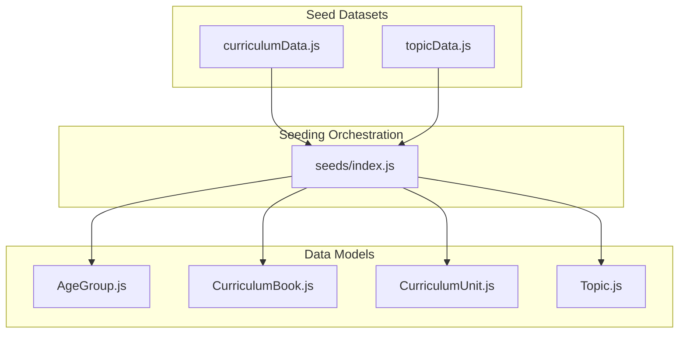

**Diagram sources**
- [curriculumData.js:7-62](file://KCEnglishKids_BE/src/seeds/curriculumData.js#L7-L62)
- [topicData.js:6-196](file://KCEnglishKids_BE/src/seeds/topicData.js#L6-L196)
- [index.js:125-232](file://KCEnglishKids_BE/src/seeds/index.js#L125-L232)
- [AgeGroup.js:3-47](file://KCEnglishKids_BE/src/models/AgeGroup.js#L3-L47)
- [CurriculumBook.js:3-40](file://KCEnglishKids_BE/src/models/CurriculumBook.js#L3-L40)
- [CurriculumUnit.js:3-87](file://KCEnglishKids_BE/src/models/CurriculumUnit.js#L3-L87)
- [Topic.js:3-77](file://KCEnglishKids_BE/src/models/Topic.js#L3-L77)

**Section sources**
- [curriculumData.js:7-62](file://KCEnglishKids_BE/src/seeds/curriculumData.js#L7-L62)
- [topicData.js:6-196](file://KCEnglishKids_BE/src/seeds/topicData.js#L6-L196)
- [index.js:125-232](file://KCEnglishKids_BE/src/seeds/index.js#L125-L232)

## Core Components
This section summarizes the core components that form the curriculum hierarchy.

- Age Groups
  - Three age ranges: 3–4, 4–5, 5–6
  - Each has metadata such as name, Vietnamese name, description, target age range, question configuration, and active flag
  - Persisted via AgeGroup model with code enum validation

- Curriculum Books
  - Three books: Book 1, Book 2, Book 3
  - Each book is linked to an Age Group by ObjectId and code
  - Includes title, description, totalUnits, and active flag

- Official Curriculum Units
  - 27 units total: 9 per book
  - Each unit belongs to a specific book and age group
  - Contains pedagogical fields like bigQuestion, storyTitle, values, concept, oracy, crossCurricular, numeracy, project, vocabularyReferences, languagePatterns
  - Indexed by bookNumber + unitNumber and by ageGroupCode + unitNumber

- Application Topics
  - 19 topics covering themes such as Animals, School, My Body, Family, Food, Toys, Colors, Numbers, Nature, My House, Clothes, Feelings, Senses, Transportation, Weather, Daily Routines, Community, Environment, Vacation
  - Each topic includes displayOrder, featured flag, icon, colorCode, and optional media references
  - Topics can be associated with multiple Age Groups and can link to Curriculum Units via relatedUnits

**Section sources**
- [AgeGroup.js:3-47](file://KCEnglishKids_BE/src/models/AgeGroup.js#L3-L47)
- [CurriculumBook.js:3-40](file://KCEnglishKids_BE/src/models/CurriculumBook.js#L3-L40)
- [CurriculumUnit.js:3-87](file://KCEnglishKids_BE/src/models/CurriculumUnit.js#L3-L87)
- [Topic.js:3-77](file://KCEnglishKids_BE/src/models/Topic.js#L3-L77)
- [curriculumData.js:7-62](file://KCEnglishKids_BE/src/seeds/curriculumData.js#L7-L62)
- [topicData.js:6-196](file://KCEnglishKids_BE/src/seeds/topicData.js#L6-L196)

## Architecture Overview
The seeding process establishes the curriculum hierarchy in a deterministic order:
1. Create Age Groups
2. Create Curriculum Books linked to Age Groups
3. Create 27 Official Curriculum Units linked to Books and Age Groups
4. Create 19 Application Topics linked to all Age Groups and optionally to specific Units
5. Populate additional learning assets (vocabulary, lessons, activities) referencing these core entities

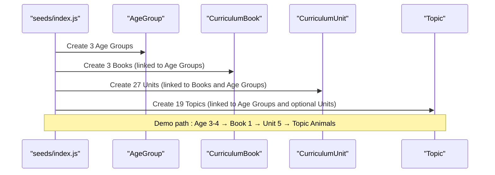

**Diagram sources**
- [index.js:152-232](file://KCEnglishKids_BE/src/seeds/index.js#L152-L232)
- [AgeGroup.js:3-47](file://KCEnglishKids_BE/src/models/AgeGroup.js#L3-L47)
- [CurriculumBook.js:3-40](file://KCEnglishKids_BE/src/models/CurriculumBook.js#L3-L40)
- [CurriculumUnit.js:3-87](file://KCEnglishKids_BE/src/models/CurriculumUnit.js#L3-L87)
- [Topic.js:3-77](file://KCEnglishKids_BE/src/models/Topic.js#L3-L77)

## Detailed Component Analysis

### Age Groups
- Purpose: Define learner cohorts by age range and configure interaction difficulty
- Key attributes:
  - code: '3-4', '4-5', '5-6'
  - name, vietnameseName, description
  - targetAgeMin, targetAgeMax
  - maxChoicesPerQuestion, defaultQuestionCount
  - active
- Validation:
  - code is required, unique, and enumerated
  - targetAgeMin and targetAgeMax are required numbers

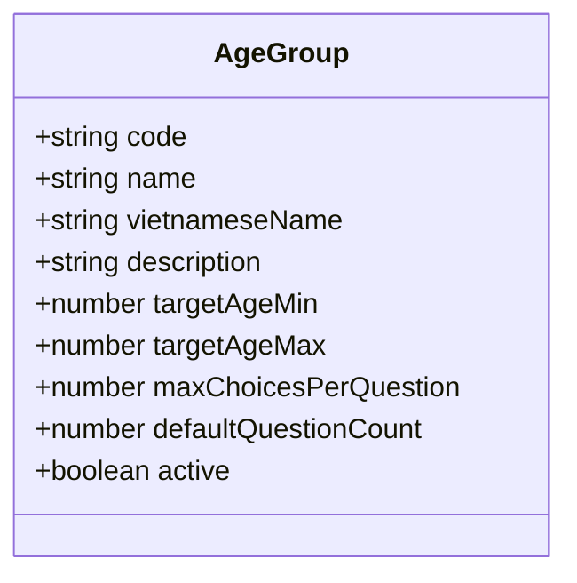

**Diagram sources**
- [AgeGroup.js:3-47](file://KCEnglishKids_BE/src/models/AgeGroup.js#L3-L47)

**Section sources**
- [AgeGroup.js:3-47](file://KCEnglishKids_BE/src/models/AgeGroup.js#L3-L47)

### Curriculum Books
- Purpose: Organize units by book number and associate each book with an Age Group
- Key attributes:
  - bookNumber: 1, 2, 3
  - title
  - ageGroup: ObjectId ref to AgeGroup
  - ageGroupCode: '3-4', '4-5', '5-6'
  - description
  - totalUnits
  - active
- Relationship:
  - One-to-one with AgeGroup via ObjectId and code
  - One-to-many with CurriculumUnit via bookNumber and ObjectId

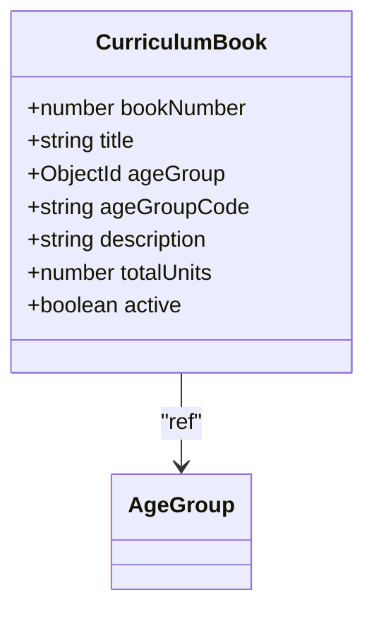

**Diagram sources**
- [CurriculumBook.js:3-40](file://KCEnglishKids_BE/src/models/CurriculumBook.js#L3-L40)
- [AgeGroup.js:3-47](file://KCEnglishKids_BE/src/models/AgeGroup.js#L3-L47)

**Section sources**
- [CurriculumBook.js:3-40](file://KCEnglishKids_BE/src/models/CurriculumBook.js#L3-L40)

### Official Curriculum Units
- Purpose: Represent the 27 official units across three books
- Key attributes:
  - book: ObjectId ref to CurriculumBook
  - bookNumber: 1, 2, 3
  - ageGroup: ObjectId ref to AgeGroup
  - ageGroupCode: '3-4', '4-5', '5-6'
  - unitNumber: 1..9
  - bigQuestion, storyTitle
  - vocabularyReferences: array of strings
  - languagePatterns: array of strings
  - values, concept, oracy, crossCurricular, numeracy, project
  - sourceType, displayOrder, status
- Indexes:
  - Unique by bookNumber + unitNumber
  - Indexed by ageGroupCode + unitNumber

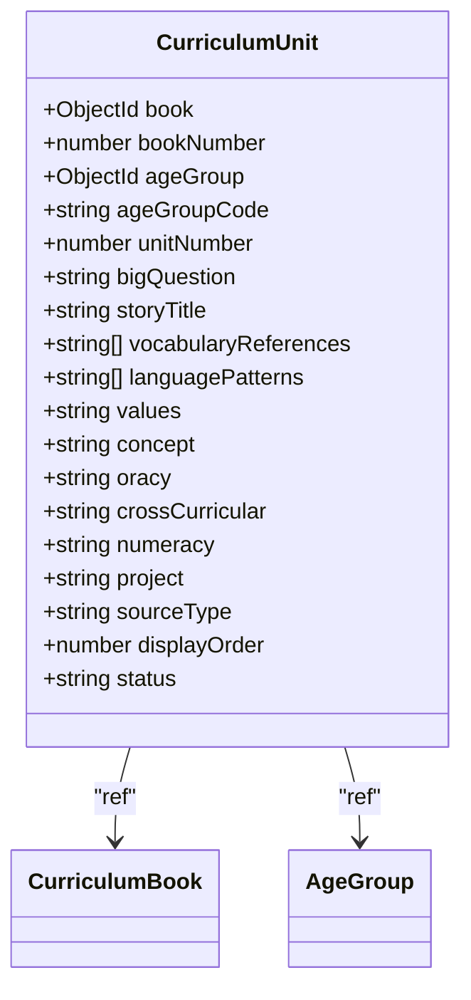

**Diagram sources**
- [CurriculumUnit.js:3-87](file://KCEnglishKids_BE/src/models/CurriculumUnit.js#L3-L87)
- [CurriculumBook.js:3-40](file://KCEnglishKids_BE/src/models/CurriculumBook.js#L3-L40)
- [AgeGroup.js:3-47](file://KCEnglishKids_BE/src/models/AgeGroup.js#L3-L47)

**Section sources**
- [CurriculumUnit.js:3-87](file://KCEnglishKids_BE/src/models/CurriculumUnit.js#L3-L87)

### Application Topics
- Purpose: Provide thematic navigation and grouping for lessons and activities
- Key attributes:
  - englishName, vietnameseName
  - slug: unique identifier
  - description
  - icon, imageUrl, imageMedia
  - colorCode
  - ageGroups: array of ObjectId refs to AgeGroup
  - ageGroupCodes: array of '3-4', '4-5', '5-6'
  - relatedUnits: array of ObjectId refs to CurriculumUnit
  - displayOrder, status, featured
- Relationship:
  - Many-to-many with AgeGroup via arrays
  - Optional many-to-many with CurriculumUnit via relatedUnits

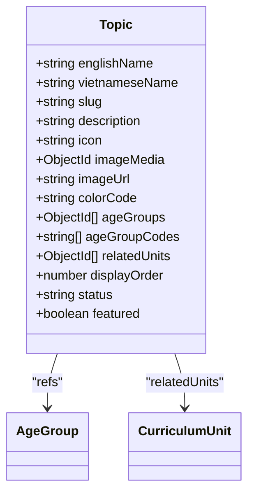

**Diagram sources**
- [Topic.js:3-77](file://KCEnglishKids_BE/src/models/Topic.js#L3-L77)
- [AgeGroup.js:3-47](file://KCEnglishKids_BE/src/models/AgeGroup.js#L3-L47)
- [CurriculumUnit.js:3-87](file://KCEnglishKids_BE/src/models/CurriculumUnit.js#L3-L87)

**Section sources**
- [Topic.js:3-77](file://KCEnglishKids_BE/src/models/Topic.js#L3-L77)

### Seed Data Structures: curriculumData.js
- AGE_GROUPS_DATA: Defines the three age groups with codes, names, descriptions, and configuration
- BOOKS_DATA: Defines three books with bookNumber, title, ageGroupCode, description, totalUnits
- UNITS_DATA: Defines 27 units with:
  - key: e.g., B1_U1, B2_U3, B3_U9
  - bookNumber, unitNumber, ageGroupCode
  - bigQuestion, storyTitle, values, concept, oracy, crossCurricular, numeracy, project
  - vocabularyReferences: list of English words referenced by the unit
  - languagePatterns: key phrases/sentences for practice

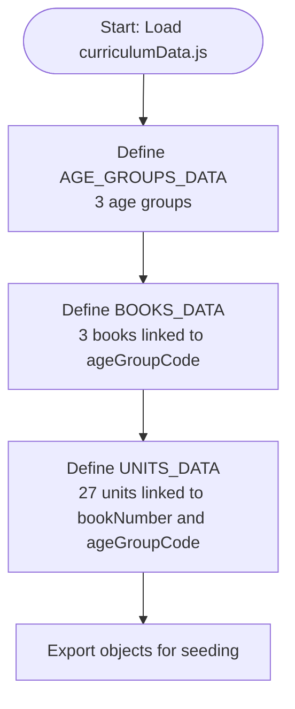

**Diagram sources**
- [curriculumData.js:7-62](file://KCEnglishKids_BE/src/seeds/curriculumData.js#L7-L62)
- [curriculumData.js:64-702](file://KCEnglishKids_BE/src/seeds/curriculumData.js#L64-L702)

**Section sources**
- [curriculumData.js:7-62](file://KCEnglishKids_BE/src/seeds/curriculumData.js#L7-L62)
- [curriculumData.js:64-702](file://KCEnglishKids_BE/src/seeds/curriculumData.js#L64-L702)

### Seed Data Structures: topicData.js
- TOPICS_DATA: Defines 19 application topics with:
  - slug, englishName, vietnameseName
  - description, icon, colorCode
  - featured, displayOrder
- These topics are later associated with all Age Groups and optionally with Curriculum Units during seeding

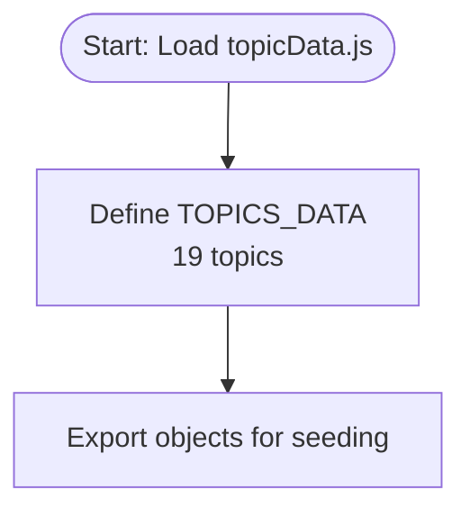

**Diagram sources**
- [topicData.js:6-196](file://KCEnglishKids_BE/src/seeds/topicData.js#L6-L196)

**Section sources**
- [topicData.js:6-196](file://KCEnglishKids_BE/src/seeds/topicData.js#L6-L196)

### Seeding Process and Mapping Logic
The seeding script orchestrates the creation and linking of entities:
- Creates Age Groups from AGE_GROUPS_DATA and stores them in a map keyed by code
- Creates Curriculum Books from BOOKS_DATA, linking each to the corresponding Age Group ObjectId and storing in a map keyed by bookNumber
- Creates 27 Curriculum Units from UNITS_DATA, linking each to the corresponding Book ObjectId and Age Group ObjectId; stores in a map keyed by unit key (e.g., B1_U5)
- Creates 19 Topics from TOPICS_DATA, associating all Age Group ObjectIds and codes; sets relatedUnits only for the demo case where topic slug equals 'animals' and links to Book 1 Unit 5

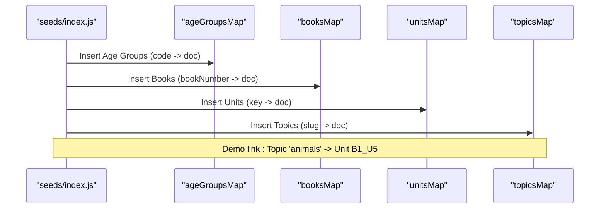

**Diagram sources**
- [index.js:152-232](file://KCEnglishKids_BE/src/seeds/index.js#L152-L232)

**Section sources**
- [index.js:152-232](file://KCEnglishKids_BE/src/seeds/index.js#L152-L232)

### Demo Unit Reference System
The demo reference system demonstrates how a Topic connects to a specific Curriculum Unit:
- During seeding, when creating the Topic with slug 'animals', the script checks if a demo unit exists for Book 1 Unit 5
- If found, it adds that unit’s ObjectId to the Topic’s relatedUnits array
- This creates a direct link: Topic 'Animals' → CurriculumUnit B1_U5

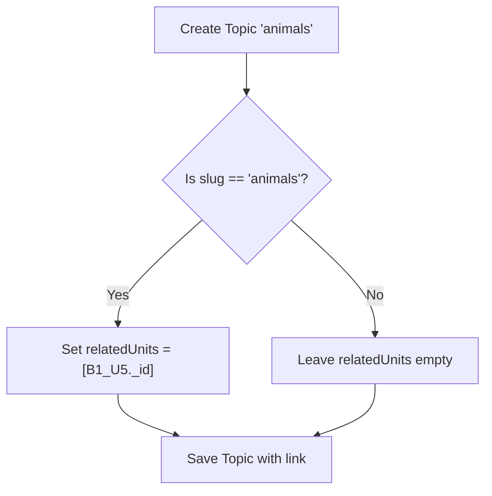

**Diagram sources**
- [index.js:216-232](file://KCEnglishKids_BE/src/seeds/index.js#L216-L232)

**Section sources**
- [index.js:216-232](file://KCEnglishKids_BE/src/seeds/index.js#L216-L232)

### Topic-to-Unit Linking Strategy
Beyond the demo link, the system supports broader linking strategies:
- Topic.ageGroups and Topic.ageGroupCodes allow associating topics with one or more age groups
- Topic.relatedUnits allows explicit association with specific Curriculum Units
- Additional scripts may enrich mappings based on approved curriculum alignment

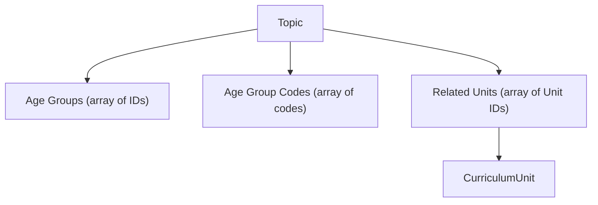

**Diagram sources**
- [Topic.js:40-57](file://KCEnglishKids_BE/src/models/Topic.js#L40-L57)
- [CurriculumUnit.js:5-24](file://KCEnglishKids_BE/src/models/CurriculumUnit.js#L5-L24)

**Section sources**
- [Topic.js:40-57](file://KCEnglishKids_BE/src/models/Topic.js#L40-L57)
- [CurriculumUnit.js:5-24](file://KCEnglishKids_BE/src/models/CurriculumUnit.js#L5-L24)

### Enrichment Script for Age-Topic Mapping
An enrichment script provides a structured mapping of topic slugs to age groups according to the approved curriculum. This helps ensure consistent alignment between topics and age-appropriate units.

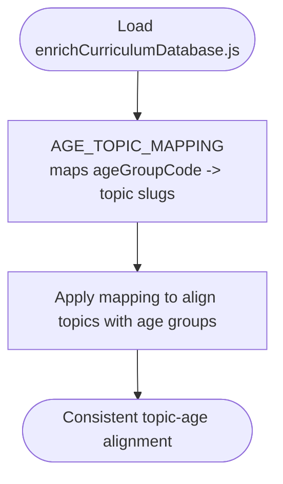

**Diagram sources**
- [enrichCurriculumDatabase.js:5-47](file://KCEnglishKids_BE/src/scripts/enrichCurriculumDatabase.js#L5-L47)

**Section sources**
- [enrichCurriculumDatabase.js:5-47](file://KCEnglishKids_BE/src/scripts/enrichCurriculumDatabase.js#L5-L47)

## Dependency Analysis
The following diagram shows the primary dependencies among the core curriculum entities:

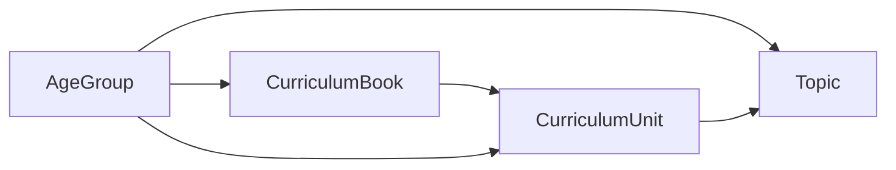

- AgeGroup is referenced by CurriculumBook and CurriculumUnit
- CurriculumBook is referenced by CurriculumUnit
- Topic references AgeGroup and optionally CurriculumUnit

**Diagram sources**
- [AgeGroup.js:3-47](file://KCEnglishKids_BE/src/models/AgeGroup.js#L3-L47)
- [CurriculumBook.js:3-40](file://KCEnglishKids_BE/src/models/CurriculumBook.js#L3-L40)
- [CurriculumUnit.js:3-87](file://KCEnglishKids_BE/src/models/CurriculumUnit.js#L3-L87)
- [Topic.js:3-77](file://KCEnglishKids_BE/src/models/Topic.js#L3-L77)

**Section sources**
- [AgeGroup.js:3-47](file://KCEnglishKids_BE/src/models/AgeGroup.js#L3-L47)
- [CurriculumBook.js:3-40](file://KCEnglishKids_BE/src/models/CurriculumBook.js#L3-L40)
- [CurriculumUnit.js:3-87](file://KCEnglishKids_BE/src/models/CurriculumUnit.js#L3-L87)
- [Topic.js:3-77](file://KCEnglishKids_BE/src/models/Topic.js#L3-L77)

## Performance Considerations
- Indexing:
  - CurriculumUnit indexes by bookNumber + unitNumber and ageGroupCode + unitNumber improve lookup performance for queries filtering by book or age group
- Seeding efficiency:
  - Using maps (ageGroupsMap, booksMap, unitsMap, topicsMap) reduces repeated lookups during seeding
- Data volume:
  - 27 units and 19 topics are small enough for efficient in-memory processing during seeding
- Future scaling:
  - Consider pagination and selective population when retrieving topics with relatedUnits to avoid heavy joins

[No sources needed since this section provides general guidance]

## Troubleshooting Guide
Common issues and resolutions when establishing the curriculum hierarchy:
- Missing Age Group code:
  - Ensure AGE_GROUPS_DATA contains exactly the codes '3-4', '4-5', '5-6'
  - Validate that BOOKS_DATA and UNITS_DATA reference valid ageGroupCode values
- Incorrect Book-Unit linkage:
  - Verify UNITS_DATA.bookNumber matches the intended CurriculumBook
  - Confirm that unitsMap keys (e.g., B1_U5) are correctly constructed
- Topic-Unit demo link not applied:
  - Check that the Topic slug is 'animals' and that the demo unit for Book 1 Unit 5 exists before setting relatedUnits
- Enrichment mapping mismatches:
  - Review AGE_TOPIC_MAPPING in enrichCurriculumDatabase.js to ensure topic slugs match those in topicData.js

**Section sources**
- [curriculumData.js:7-62](file://KCEnglishKids_BE/src/seeds/curriculumData.js#L7-L62)
- [curriculumData.js:64-702](file://KCEnglishKids_BE/src/seeds/curriculumData.js#L64-L702)
- [topicData.js:6-196](file://KCEnglishKids_BE/src/seeds/topicData.js#L6-L196)
- [index.js:216-232](file://KCEnglishKids_BE/src/seeds/index.js#L216-L232)
- [enrichCurriculumDatabase.js:5-47](file://KCEnglishKids_BE/src/scripts/enrichCurriculumDatabase.js#L5-L47)

## Conclusion
The curriculum hierarchy for KCEnglishKids is systematically established through seed datasets and a robust seeding process:
- Age Groups define learner cohorts
- Curriculum Books organize content by age group
- Official Curriculum Units provide detailed pedagogical structure
- Application Topics offer thematic navigation and optional unit linkage

The relationships are implemented using Mongoose references and arrays, with maps facilitating efficient seeding and linking. The demo reference system demonstrates how a Topic can be explicitly linked to a specific Curriculum Unit, providing a clear example of cross-entity mapping.

[No sources needed since this section summarizes without analyzing specific files]