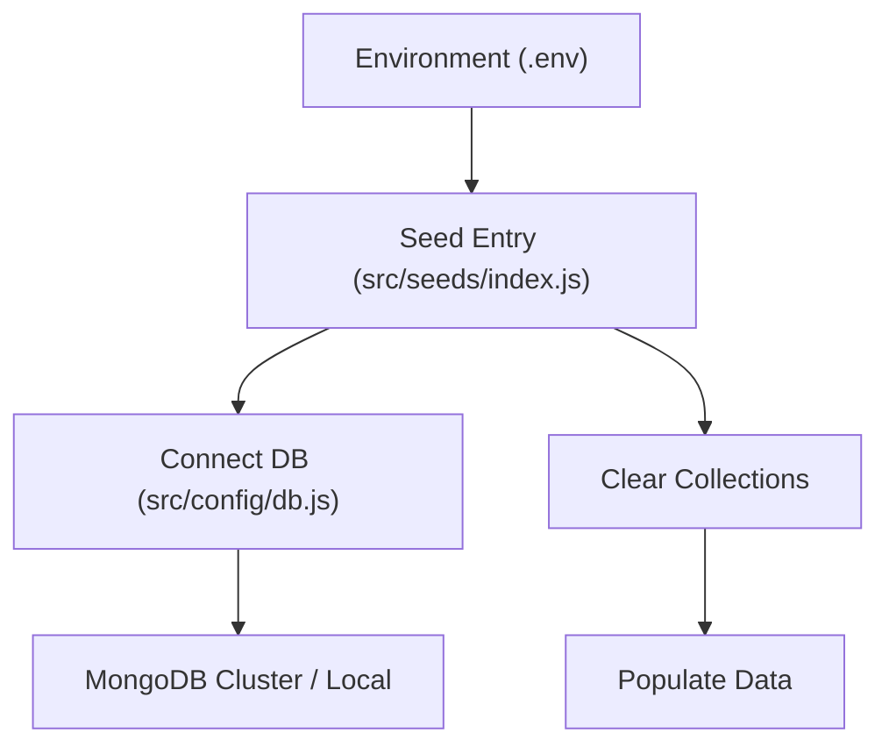
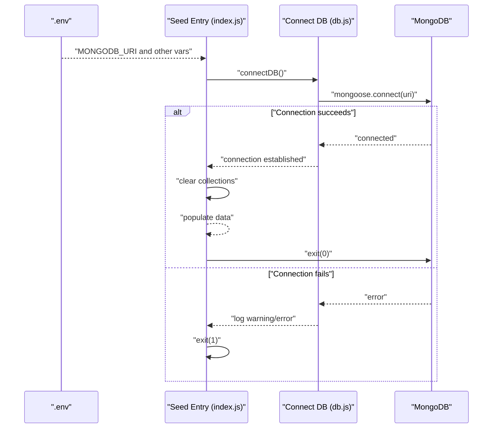
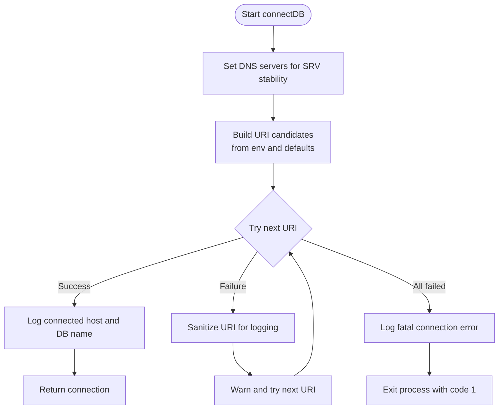
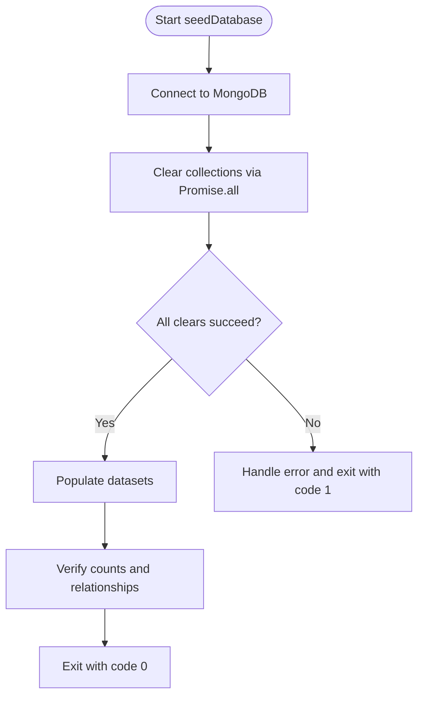
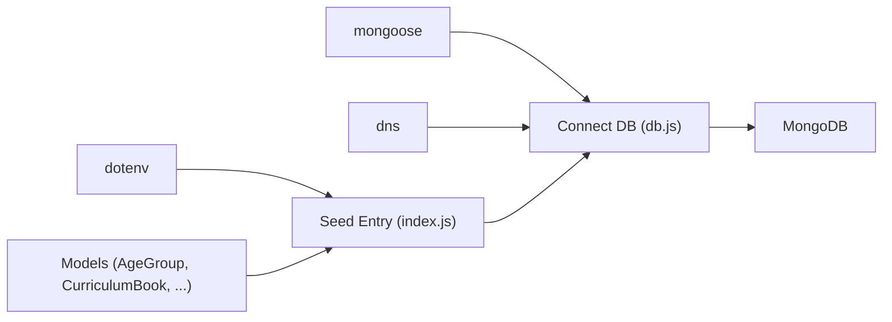

# Initialization & Setup Phase

<cite>
**Referenced Files in This Document**
- [db.js](file://KCEnglishKids_BE/src/config/db.js)
- [index.js](file://KCEnglishKids_BE/src/seeds/index.js)
- [.env](file://KCEnglishKids_BE/.env)
- [migrate_to_atlas.js](file://KCEnglishKids_BE/scripts/migrate_to_atlas.js)
</cite>

## Table of Contents
1. [Introduction](#introduction)
2. [Project Structure](#project-structure)
3. [Core Components](#core-components)
4. [Architecture Overview](#architecture-overview)
5. [Detailed Component Analysis](#detailed-component-analysis)
6. [Dependency Analysis](#dependency-analysis)
7. [Performance Considerations](#performance-considerations)
8. [Troubleshooting Guide](#troubleshooting-guide)
9. [Conclusion](#conclusion)

## Introduction
This document explains the initialization and setup phase of the seeding workflow for the KCEnglishKids backend. It focuses on:
- Establishing a MongoDB connection using environment configuration
- Loading environment variables from .env
- Clearing all relevant collections to ensure idempotent seeding
- Error handling and logging strategies during initialization

The goal is to prepare a clean, consistent database state before populating learning content such as Age Groups, Curriculum Books, Units, Topics, Vocabulary, Language Content, Lessons, Activities, Users, Classrooms, Learning Sessions, Activity Results, and Progress records.

## Project Structure
The seeding initialization spans two primary areas:
- Configuration and connection logic under src/config/db.js
- Seed orchestration and collection clearing under src/seeds/index.js
- Environment configuration under .env
- Migration utilities that also demonstrate environment loading and connection patterns under scripts/migrate_to_atlas.js

**Diagram sources**
- [.env:1-6](file://KCEnglishKids_BE/.env#L1-L6)
- [index.js:1-35](file://KCEnglishKids_BE/src/seeds/index.js#L1-L35)
- [db.js:11-30](file://KCEnglishKids_BE/src/config/db.js#L11-L30)

**Section sources**
- [index.js:1-35](file://KCEnglishKids_BE/src/seeds/index.js#L1-L35)
- [db.js:1-33](file://KCEnglishKids_BE/src/config/db.js#L1-L33)
- [.env:1-6](file://KCEnglishKids_BE/.env#L1-L6)

## Core Components
- Environment configuration loader: The seed script loads environment variables from .env at startup.
- MongoDB connection manager: A dedicated module establishes a Mongoose connection with DNS fallbacks and URI candidates.
- Collection clearing pipeline: A parallelized cleanup step removes all target collections to guarantee idempotency.
- Logging and error handling: Console-based logs and structured error messages guide troubleshooting and process termination.

Key responsibilities:
- Load .env variables including MONGODB_URI
- Attempt multiple MongoDB URIs with safe logging
- Clear all seeded collections concurrently
- Exit with non-zero status on failure

**Section sources**
- [index.js:1-6](file://KCEnglishKids_BE/src/seeds/index.js#L1-L6)
- [db.js:1-33](file://KCEnglishKids_BE/src/config/db.js#L1-L33)

## Architecture Overview
The initialization flow follows a clear sequence:
1. Seed entry loads environment variables
2. Seed entry imports the connection module
3. Connection module attempts to connect to MongoDB using configured or fallback URIs
4. On success, seed proceeds to clear collections
5. Seed then populates data and exits successfully; errors terminate the process

**Diagram sources**
- [index.js:1-35](file://KCEnglishKids_BE/src/seeds/index.js#L1-L35)
- [db.js:11-30](file://KCEnglishKids_BE/src/config/db.js#L11-L30)

## Detailed Component Analysis

### MongoDB Connection Establishment
The connection module sets DNS servers to mitigate SRV lookup issues on certain platforms and then tries candidate URIs in order:
- First, the value from process.env.MONGODB_URI
- Then local development URIs if the environment variable is absent

It uses Mongoose’s connect method with serverSelectionTimeoutMS to avoid long hangs. Each attempt logs either a success message or a warning with a sanitized URI (removing sensitive parts). If all candidates fail, it logs an error and terminates the process.

**Diagram sources**
- [db.js:1-30](file://KCEnglishKids_BE/src/config/db.js#L1-L30)

**Section sources**
- [db.js:1-33](file://KCEnglishKids_BE/src/config/db.js#L1-L33)

### Environment Configuration Loading
The seed script explicitly loads environment variables from the repository’s .env file using dotenv. This ensures that MONGODB_URI and other runtime settings are available before connecting to MongoDB.

Behavior:
- Loads .env from the project root
- Exposes variables via process.env
- Uses MONGODB_URI to select the target database

Example usage context:
- Seed entry calls dotenv.config with the absolute path to .env
- Connection module reads process.env.MONGODB_URI

**Section sources**
- [index.js:1-6](file://KCEnglishKids_BE/src/seeds/index.js#L1-L6)
- [.env:1-6](file://KCEnglishKids_BE/.env#L1-L6)

### Collection Clearing Process for Idempotent Seeding
Before any population, the seed clears all relevant collections in parallel to ensure idempotency. This guarantees that repeated runs produce a consistent dataset without duplicates or stale records.

Collections cleared:
- AgeGroup
- CurriculumBook
- CurriculumUnit
- Media
- Topic
- Vocabulary
- LanguageContent
- Lesson
- Activity
- User
- ClassRoom
- LearningSession
- ActivityResult
- Progress

Implementation approach:
- Use Promise.all to execute deleteMany operations concurrently
- Log progress and completion
- Proceed to populate only after successful clearing

**Diagram sources**
- [index.js:125-150](file://KCEnglishKids_BE/src/seeds/index.js#L125-L150)

**Section sources**
- [index.js:125-150](file://KCEnglishKids_BE/src/seeds/index.js#L125-L150)

### Error Handling and Logging Strategies
Initialization employs straightforward but effective error handling and logging:
- Connection failures:
  - Warn with sanitized URI and continue trying next candidate
  - Fatal error when all candidates fail, followed by process.exit(1)
- Seed execution:
  - Wrap main logic in try/catch
  - Log detailed error messages
  - Exit with non-zero status on failure

Additional notes:
- Logs include human-readable markers like “[Seed]” and “[MongoDB Connected/Warning/Error]”
- Migration utility demonstrates similar patterns for environment loading and connection handling, including explicit error messaging for authentication and network issues

**Section sources**
- [db.js:18-30](file://KCEnglishKids_BE/src/config/db.js#L18-L30)
- [index.js:125-150](file://KCEnglishKids_BE/src/seeds/index.js#L125-L150)
- [index.js:748-751](file://KCEnglishKids_BE/src/seeds/index.js#L748-L751)
- [migrate_to_atlas.js:15-19](file://KCEnglishKids_BE/scripts/migrate_to_atlas.js#L15-L19)
- [migrate_to_atlas.js:101-126](file://KCEnglishKids_BE/scripts/migrate_to_atlas.js#L101-L126)
- [migrate_to_atlas.js:233-240](file://KCEnglishKids_BE/scripts/migrate_to_atlas.js#L233-L240)

## Dependency Analysis
The initialization depends on:
- dotenv for environment loading
- mongoose for MongoDB connectivity
- Node’s dns module for DNS server configuration
- Model classes imported by the seed script for collection operations

**Diagram sources**
- [index.js:1-6](file://KCEnglishKids_BE/src/seeds/index.js#L1-L6)
- [db.js:1-3](file://KCEnglishKids_BE/src/config/db.js#L1-L3)

**Section sources**
- [index.js:1-6](file://KCEnglishKids_BE/src/seeds/index.js#L1-L6)
- [db.js:1-3](file://KCEnglishKids_BE/src/config/db.js#L1-L3)

## Performance Considerations
- Parallel collection clearing: Using Promise.all reduces total cleanup time by executing deletions concurrently.
- Short connection timeout: serverSelectionTimeoutMS prevents long waits on unreachable hosts.
- DNS fallback: Setting DNS servers mitigates platform-specific SRV lookup delays.
- Batch insertions: Population steps use insertMany where possible to reduce round-trips.

[No sources needed since this section provides general guidance]

## Troubleshooting Guide
Common issues and resolutions during initialization:
- MongoDB connection failures:
  - Ensure MONGODB_URI is set correctly in .env
  - Check network access rules for Atlas clusters
  - Validate credentials and cluster availability
- DNS/SRV resolution problems:
  - The connection module sets DNS servers to improve reliability
  - On Windows, SRV lookups may require additional configuration
- Authentication or network timeouts:
  - Review migration utility logs for specific error messages
  - Confirm IP allowlists and firewall settings for remote databases

Operational tips:
- Run the seed script in isolation to verify environment and connectivity
- Inspect console logs for “[MongoDB Warning]” and “[MongoDB Connection Error]” messages
- Use the migration utility to validate Atlas connectivity and update .env if needed

**Section sources**
- [db.js:18-30](file://KCEnglishKids_BE/src/config/db.js#L18-L30)
- [migrate_to_atlas.js:101-126](file://KCEnglishKids_BE/scripts/migrate_to_atlas.js#L101-L126)
- [migrate_to_atlas.js:233-240](file://KCEnglishKids_BE/scripts/migrate_to_atlas.js#L233-L240)

## Conclusion
The initialization and setup phase ensures a reliable, idempotent seeding process by:
- Loading environment configuration from .env
- Establishing a robust MongoDB connection with fallbacks and safe logging
- Clearing all relevant collections concurrently to reset the database state
- Applying clear error handling and logging to facilitate troubleshooting

This systematic approach prepares the database for fresh data population while maintaining consistency across repeated runs.