# Demo User & Classroom Setup

<cite>
**Referenced Files in This Document**
- [index.js](file://KCEnglishKids_BE/src/seeds/index.js)
- [users.json](file://KCEnglishKids_BE/data_backup/users.json)
- [classrooms.json](file://KCEnglishKids_BE/data_backup/classrooms.json)
- [progresses.json](file://KCEnglishKids_BE/data_backup/progresses.json)
- [classroomsessions.json](file://KCEnglishKids_BE/data_backup/classroomsessions.json)
- [parentnotifications.json](file://KCEnglishKids_BE/data_backup/parentnotifications.json)
</cite>

## Table of Contents
1. [Introduction](#introduction)
2. [Project Structure](#project-structure)
3. [Core Components](#core-components)
4. [Architecture Overview](#architecture-overview)
5. [Detailed Component Analysis](#detailed-component-analysis)
6. [Dependency Analysis](#dependency-analysis)
7. [Performance Considerations](#performance-considerations)
8. [Troubleshooting Guide](#troubleshooting-guide)
9. [Conclusion](#conclusion)

## Introduction
This document explains the demo user and classroom setup created by the backend seeding process. It covers how administrative users, teacher accounts, and multiple child accounts are generated; how a classroom is created with student enrollment; how learning progress and sample activity results are initialized; how passwords and PINs are configured; how avatars are generated using an SVG system; and how a sample classroom session and parent notification complete the end-to-end demo journey.

The focus is on understanding what data is created, how it relates to each other, and how the seed script orchestrates the full demo environment for KCEnglishKids.

## Project Structure
The demo setup lives primarily in the backend seed script and is reflected in the backup data files that represent the seeded database state.

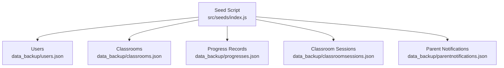

**Diagram sources**
- [index.js:125-755](file://KCEnglishKids_BE/src/seeds/index.js#L125-L755)
- [users.json:1-468](file://KCEnglishKids_BE/data_backup/users.json#L1-L468)
- [classrooms.json:1-35](file://KCEnglishKids_BE/data_backup/classrooms.json#L1-L35)
- [progresses.json:1-167](file://KCEnglishKids_BE/data_backup/progresses.json#L1-L167)
- [classroomsessions.json:1-800](file://KCEnglishKids_BE/data_backup/classroomsessions.json#L1-L800)
- [parentnotifications.json:1-800](file://KCEnglishKids_BE/data_backup/parentnotifications.json#L1-L800)

**Section sources**
- [index.js:125-755](file://KCEnglishKids_BE/src/seeds/index.js#L125-L755)

## Core Components
The seed script creates the following core demo components:

- Administrative user: admin
- Teacher account: teacher_sarah
- Child accounts: Leo, Mia, Toby, plus additional demo students
- Classroom: Little Stars Class (Age 3–4)
- Learning progress records for selected lessons
- Sample vocabulary mastery records
- Sample classroom session with per-student scores
- Sample parent notification linked to a session

These components form a complete demo learning journey from user creation to classroom participation and parent reporting.

**Section sources**
- [index.js:456-694](file://KCEnglishKids_BE/src/seeds/index.js#L456-L694)

## Architecture Overview
The seed script connects to MongoDB, clears collections, seeds curriculum content, then creates demo users, classroom, progress, sessions, and notifications. The relationships are:

- Admin and Teacher are User documents.
- Children are User documents with role CHILD.
- Classroom references a Teacher and stores enrolled Student IDs.
- Progress links a Child to a Topic and Lesson.
- ClassroomSession links Classroom, Teacher, Lesson, Activities, and per-student scores.
- ParentNotification links Teacher, Child, Session, and contact information.

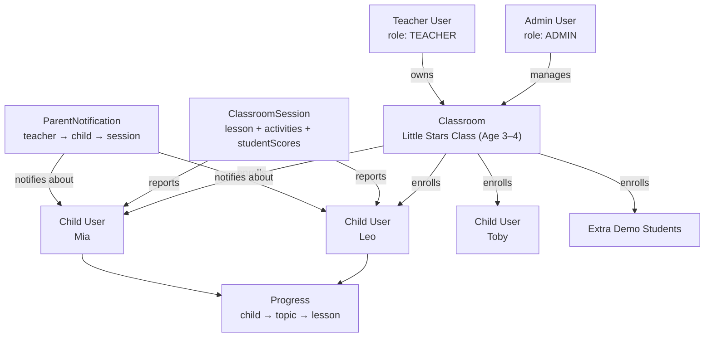

**Diagram sources**
- [index.js:456-694](file://KCEnglishKids_BE/src/seeds/index.js#L456-L694)
- [users.json:1-468](file://KCEnglishKids_BE/data_backup/users.json#L1-L468)
- [classrooms.json:1-35](file://KCEnglishKids_BE/data_backup/classrooms.json#L1-L35)
- [progresses.json:1-167](file://KCEnglishKids_BE/data_backup/progresses.json#L1-L167)
- [classroomsessions.json:1-800](file://KCEnglishKids_BE/data_backup/classroomsessions.json#L1-L800)
- [parentnotifications.json:1-800](file://KCEnglishKids_BE/data_backup/parentnotifications.json#L1-L800)

## Detailed Component Analysis

### Administrative User Creation
The seed script creates an administrative user with:
- Role: ADMIN
- Username: admin
- Email: admin@kcenglishkids.com
- Password: Admin@123
- Name: System Administrator
- Avatar: bear
- Avatar URL: dynamically generated SVG card
- Status: ACTIVE

The avatar is generated via an SVG helper that produces a colorful card with an emoji and name text.

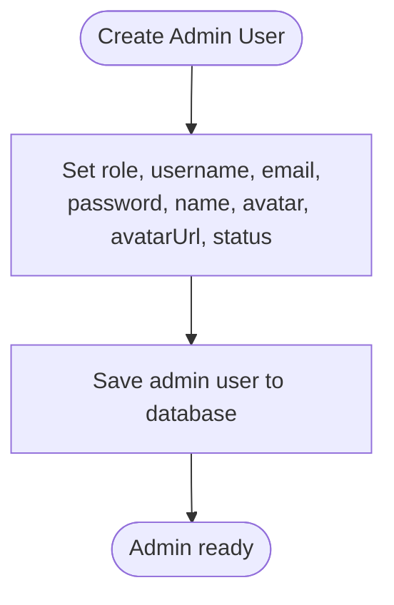

**Diagram sources**
- [index.js:458-468](file://KCEnglishKids_BE/src/seeds/index.js#L458-L468)

**Section sources**
- [index.js:458-468](file://KCEnglishKids_BE/src/seeds/index.js#L458-L468)
- [users.json:1-16](file://KCEnglishKids_BE/data_backup/users.json#L1-L16)

### Teacher Account Creation
The seed script creates a teacher account with:
- Role: TEACHER
- Username: teacher_sarah
- Email: teacher@kcenglishkids.com
- Password: Teacher@123
- Name: Ms. Sarah Johnson
- Avatar: fox
- Avatar URL: dynamically generated SVG card
- Status: ACTIVE
- Assigned class reference updated after classroom creation

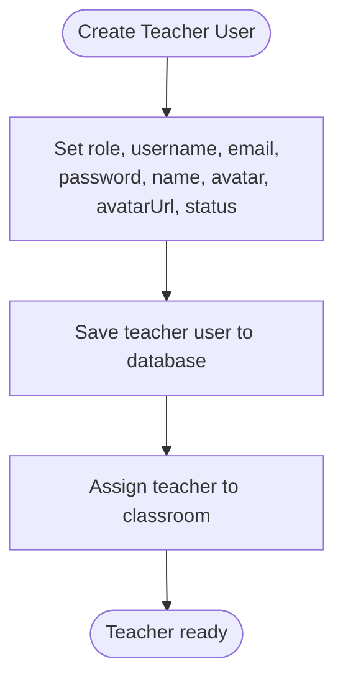

**Diagram sources**
- [index.js:470-492](file://KCEnglishKids_BE/src/seeds/index.js#L470-L492)

**Section sources**
- [index.js:470-492](file://KCEnglishKids_BE/src/seeds/index.js#L470-L492)
- [users.json:17-32](file://KCEnglishKids_BE/data_backup/users.json#L17-L32)

### Classroom Structure and Student Enrollment
The seed script creates a classroom named "Little Stars Class (Age 3–4)" with:
- Teacher reference set to teacher_sarah
- Age group: 3-4
- Academic year: 2026-2027
- Initial empty student list
- Status: ACTIVE

After creating children, the script enrolls Leo and Mia into the classroom and updates the classroom’s student list. Additional demo students are also enrolled.

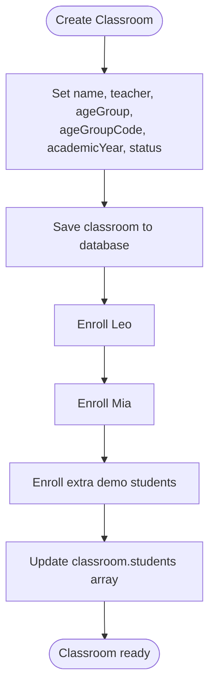

**Diagram sources**
- [index.js:482-590](file://KCEnglishKids_BE/src/seeds/index.js#L482-L590)

**Section sources**
- [index.js:482-590](file://KCEnglishKids_BE/src/seeds/index.js#L482-L590)
- [classrooms.json:1-35](file://KCEnglishKids_BE/data_backup/classrooms.json#L1-L35)

### Child Accounts: Leo, Mia, Toby, and Additional Demo Students
The seed script creates three primary child accounts:

- Leo
  - Role: CHILD
  - Name: Leo
  - Email: leo@kcenglishkids.com
  - Phone and contact: 0901234567
  - Avatar: lion
  - Avatar URL: SVG card
  - Password: 123456
  - PIN: 1234
  - Age group: 3-4
  - Assigned class: Little Stars Class
  - Status: ACTIVE

- Mia
  - Role: CHILD
  - Name: Mia
  - Email: mia@kcenglishkids.com
  - Phone and contact: 0902345678
  - Avatar: panda
  - Avatar URL: SVG card
  - Password: 123456
  - PIN: 5678
  - Age group: 3-4
  - Assigned class: Little Stars Class
  - Status: ACTIVE

- Toby
  - Role: CHILD
  - Name: Toby
  - Email: toby@kcenglishkids.com
  - Phone and contact: 0903456789
  - Avatar: rabbit
  - Avatar URL: SVG card
  - Password: 123456
  - PIN: 1111
  - Age group: 4-5
  - Status: ACTIVE

Additional demo students include Emma, Liam, Sophia, Noah, Ava, Oliver, Lucas, Isabella, Ethan, Harper, Chloe, Mason, James, Ella, Jackson, Lily, Henry, Grace. Each has:
- Role: CHILD
- Unique name, email, phone/contact
- Avatar and SVG avatar URL
- Password: 123456
- Unique PIN
- Age group: 3-4
- Assigned class: Little Stars Class
- Status: ACTIVE

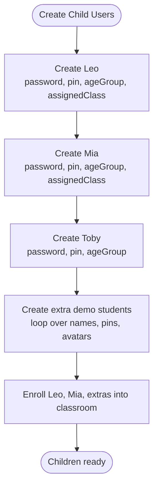

**Diagram sources**
- [index.js:494-587](file://KCEnglishKids_BE/src/seeds/index.js#L494-L587)

**Section sources**
- [index.js:494-587](file://KCEnglishKids_BE/src/seeds/index.js#L494-L587)
- [users.json:33-468](file://KCEnglishKids_BE/data_backup/users.json#L33-L468)

### Password and PIN Configuration
- Admin password: Admin@123
- Teacher password: Teacher@123
- Child passwords: 123456 for all demo children
- Child PINs:
  - Leo: 1234
  - Mia: 5678
  - Toby: 1111
  - Extra students: unique numeric PINs starting at 2001

In the backed-up database, passwords and PINs are stored as hashed values, indicating secure storage.

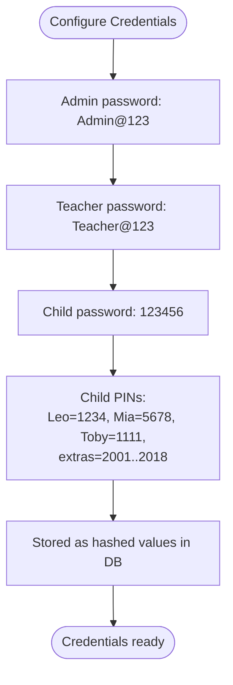

**Diagram sources**
- [index.js:458-587](file://KCEnglishKids_BE/src/seeds/index.js#L458-L587)
- [users.json:1-468](file://KCEnglishKids_BE/data_backup/users.json#L1-L468)

**Section sources**
- [index.js:458-587](file://KCEnglishKids_BE/src/seeds/index.js#L458-L587)
- [users.json:1-468](file://KCEnglishKids_BE/data_backup/users.json#L1-L468)

### Avatar Generation Using the SVG System
The seed script defines a function that generates SVG-based avatar cards:
- Background color chosen from a vibrant palette
- Emoji mapped from a rich emoji dictionary
- Text label showing role or name
- Output as a data URL containing SVG markup

This system is used for:
- Admin avatar: bear emoji with "ADMIN" label
- Teacher avatar: fox emoji with "TEACHER" label
- Child avatars: animal emojis with child names

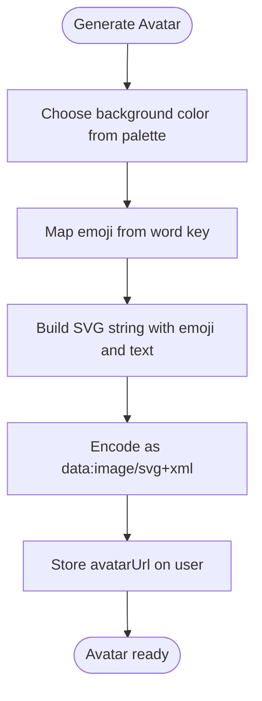

**Diagram sources**
- [index.js:37-123](file://KCEnglishKids_BE/src/seeds/index.js#L37-L123)
- [index.js:458-587](file://KCEnglishKids_BE/src/seeds/index.js#L458-L587)

**Section sources**
- [index.js:37-123](file://KCEnglishKids_BE/src/seeds/index.js#L37-L123)
- [index.js:458-587](file://KCEnglishKids_BE/src/seeds/index.js#L458-L587)
- [users.json:1-468](file://KCEnglishKids_BE/data_backup/users.json#L1-L468)

### Relationship Between Users, Classrooms, and Learning Progress
- Users:
  - Admin and Teacher are administrative roles.
  - Children are learners with age groups and optional classroom assignment.
- Classroom:
  - Owned by a teacher.
  - Contains a list of enrolled student IDs.
- Progress:
  - Links a child to a topic and lesson.
  - Tracks completion, stars, highest score, attempts, and weak vocabulary.

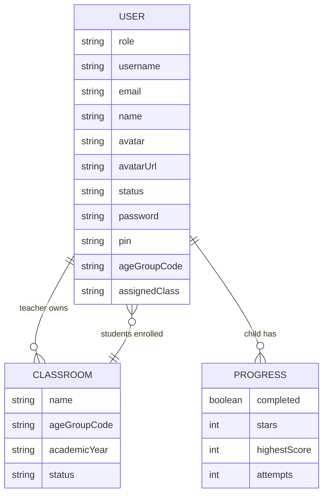

**Diagram sources**
- [index.js:456-604](file://KCEnglishKids_BE/src/seeds/index.js#L456-L604)
- [users.json:1-468](file://KCEnglishKids_BE/data_backup/users.json#L1-L468)
- [classrooms.json:1-35](file://KCEnglishKids_BE/data_backup/classrooms.json#L1-L35)
- [progresses.json:1-167](file://KCEnglishKids_BE/data_backup/progresses.json#L1-L167)

**Section sources**
- [index.js:456-604](file://KCEnglishKids_BE/src/seeds/index.js#L456-L604)
- [users.json:1-468](file://KCEnglishKids_BE/data_backup/users.json#L1-L468)
- [classrooms.json:1-35](file://KCEnglishKids_BE/data_backup/classrooms.json#L1-L35)
- [progresses.json:1-167](file://KCEnglishKids_BE/data_backup/progresses.json#L1-L167)

### Sample Activity Results and Vocabulary Mastery
The seed script:
- Finds the Pet Animals lesson associated with Book 1 Unit 5.
- Creates a Progress record for Leo marking the lesson as completed with stars and highest score.
- Creates sample VocabularyMastery records for Leo and Mia across a few vocabulary items.

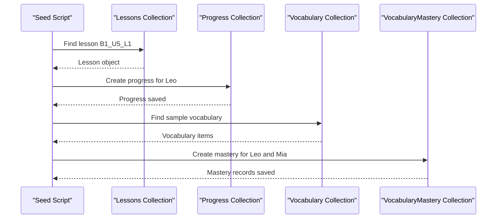

**Diagram sources**
- [index.js:592-629](file://KCEnglishKids_BE/src/seeds/index.js#L592-L629)

**Section sources**
- [index.js:592-629](file://KCEnglishKids_BE/src/seeds/index.js#L592-L629)
- [progresses.json:1-167](file://KCEnglishKids_BE/data_backup/progresses.json#L1-L167)

### Sample Classroom Session Creation
The seed script creates a sample classroom session titled "Pet Animals Live Exploration":
- Classroom: Little Stars Class
- Teacher: teacher_sarah
- Lesson: Pet Animals lesson
- Age group: 3-4
- Status: COMPLETED
- Planned duration: 45 minutes
- Activities: first three activities from the lesson
- Student scores:
  - Leo: points, stars, correctCount, incorrectCount, notAnswered, status
  - Mia: points, stars, correctCount, incorrectCount, notAnswered, status
- Summary: participation count, average accuracy, total stars, students needing practice

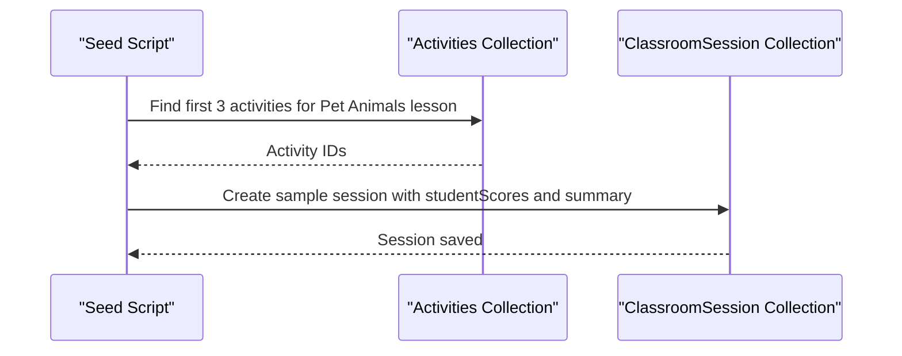

**Diagram sources**
- [index.js:631-672](file://KCEnglishKids_BE/src/seeds/index.js#L631-L672)

**Section sources**
- [index.js:631-672](file://KCEnglishKids_BE/src/seeds/index.js#L631-L672)
- [classroomsessions.json:1-800](file://KCEnglishKids_BE/data_backup/classroomsessions.json#L1-L800)

### Parent Notification Setup
The seed script creates a sample parent notification:
- Teacher: teacher_sarah
- Child: Leo
- Session: sample session ID
- Recipient contact: Leo’s parent contact
- Child name: Leo
- Class name: Little Stars Class (Age 3–4)
- Session date: current date
- Subject: Learning Update — Leo
- Content: Vietnamese message describing Leo’s participation
- Teacher note: positive feedback
- Score, vocab mastered, stars, accuracy: sample values
- Template type: SESSION_REPORT
- Status: SENT
- Sent timestamp: current time

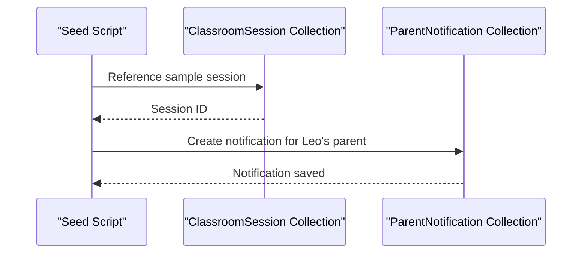

**Diagram sources**
- [index.js:674-694](file://KCEnglishKids_BE/src/seeds/index.js#L674-L694)

**Section sources**
- [index.js:674-694](file://KCEnglishKids_BE/src/seeds/index.js#L674-L694)
- [parentnotifications.json:1-800](file://KCEnglishKids_BE/data_backup/parentnotifications.json#L1-L800)

## Dependency Analysis
The seed script depends on several models and data modules:
- Models: User, ClassRoom, Progress, ClassroomSession, ParentNotification, Activity, Lesson, Topic, Vocabulary, Media, CurriculumBook, CurriculumUnit, LanguageContent, AgeGroup
- Data modules: curriculumData, topicData, vocabularyData, languageContentData, lessonData, sentenceDictionary, activityData

The demo path verification ensures:
- Age Group: 3-4
- Book: Book 1
- Unit 5: Big question related to animals
- Topic: Animals
- Lesson: Pet Animals
- Activities: generated for the lesson

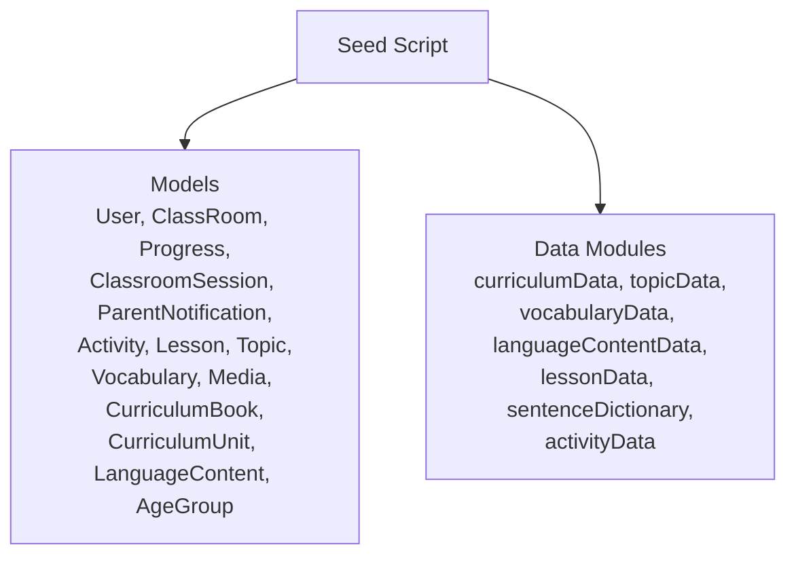

**Diagram sources**
- [index.js:1-36](file://KCEnglishKids_BE/src/seeds/index.js#L1-L36)
- [index.js:696-745](file://KCEnglishKids_BE/src/seeds/index.js#L696-L745)

**Section sources**
- [index.js:1-36](file://KCEnglishKids_BE/src/seeds/index.js#L1-L36)
- [index.js:696-745](file://KCEnglishKids_BE/src/seeds/index.js#L696-L745)

## Performance Considerations
- The seed script clears collections before inserting data to maintain idempotency.
- Bulk insert operations are used for media, vocabulary, language content, lessons, and activities.
- In-memory maps and lookups reduce repeated database queries during seeding.
- Avatar generation uses lightweight SVG strings rather than external image processing.

[No sources needed since this section provides general guidance]

## Troubleshooting Guide
Common issues when running the demo setup:

- Database connection failures:
  - Ensure MongoDB is reachable and credentials are correct.
  - Check environment variables loaded by the seed script.

- Duplicate or inconsistent data:
  - Re-run the seed script; it clears collections before insertion.
  - Verify that backups reflect expected counts.

- Missing relationships:
  - Confirm that age groups, books, units, topics, lessons, and activities exist before creating progress or sessions.
  - Validate that classroom.student arrays contain valid user IDs.

- Avatar rendering issues:
  - Ensure SVG generation produces valid data URLs.
  - Check that emoji mappings exist for avatar keys.

- Parent notification mismatches:
  - Verify that recipientContact matches the child’s parent contact.
  - Confirm that session and child IDs are valid.

**Section sources**
- [index.js:125-150](file://KCEnglishKids_BE/src/seeds/index.js#L125-L150)
- [index.js:696-751](file://KCEnglishKids_BE/src/seeds/index.js#L696-L751)

## Conclusion
The seed script establishes a complete demo environment for KCEnglishKids. It creates administrative and teacher accounts, multiple child accounts, a classroom with enrolled students, learning progress records, sample activity results, a classroom session, and a parent notification. The SVG avatar system provides consistent visual identity across roles. The resulting data model demonstrates the relationships between users, classrooms, learning progress, sessions, and notifications, providing a solid foundation for frontend consumption and further development.

[No sources needed since this section summarizes without analyzing specific files]