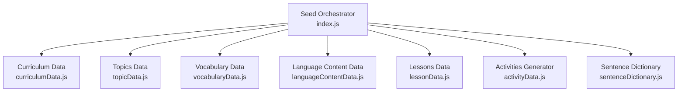
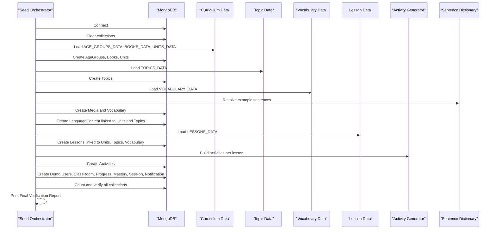
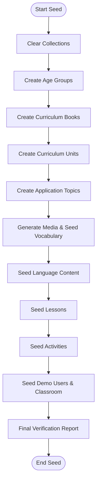
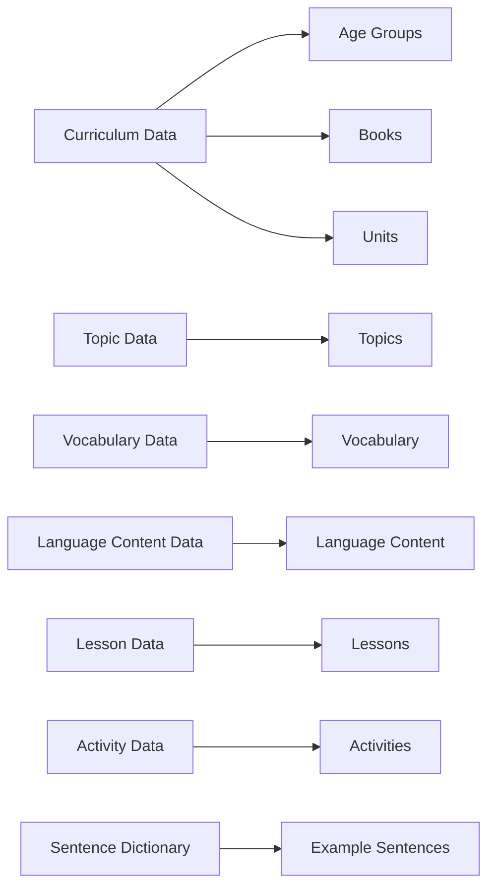
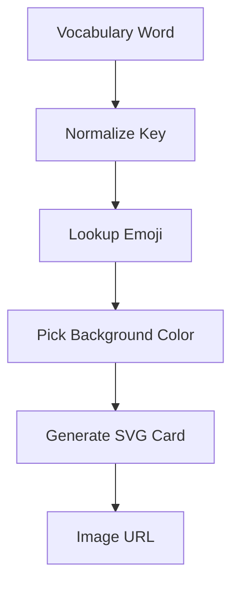
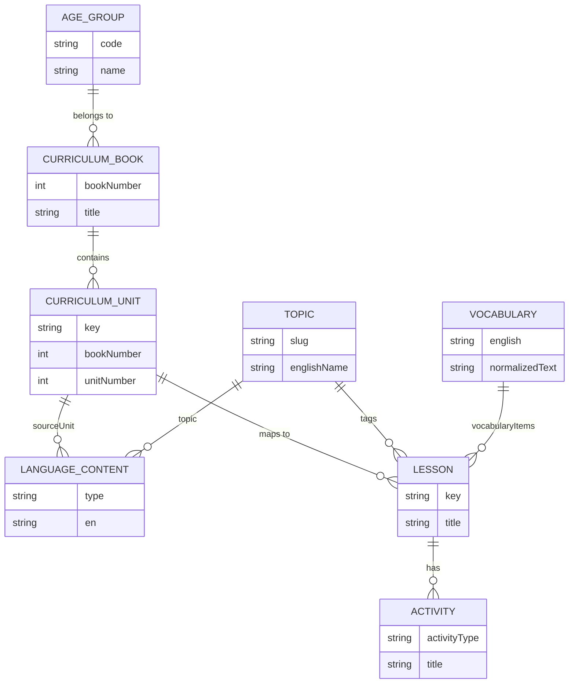
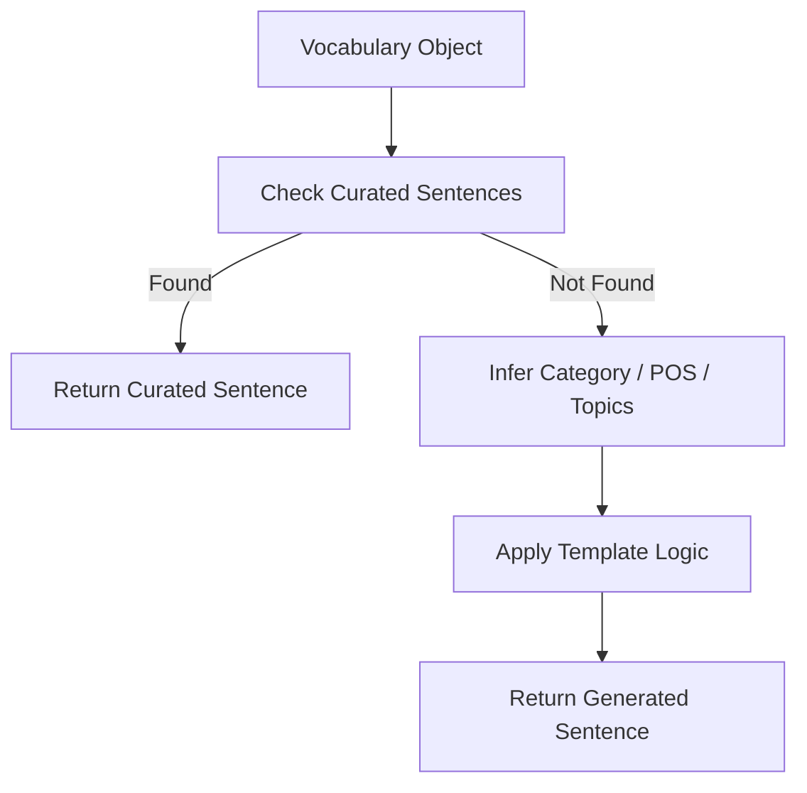
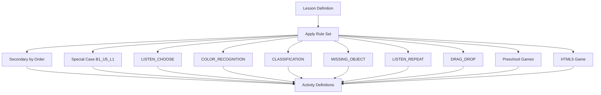
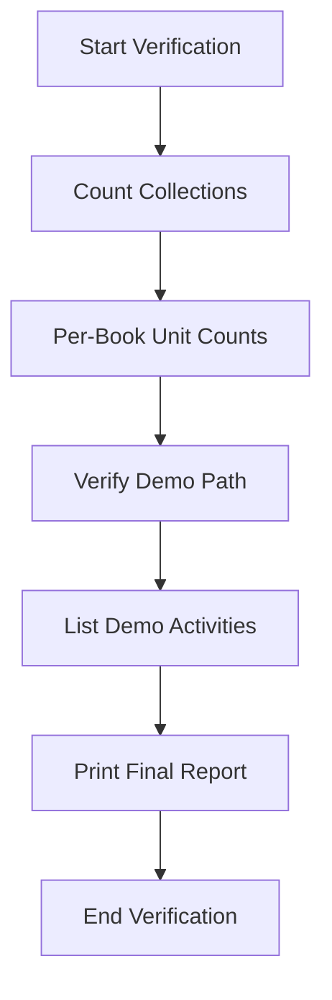
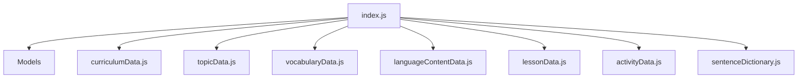

# Main Seed Orchestrator

<cite>
**Referenced Files in This Document**
- [index.js](file://KCEnglishKids_BE/src/seeds/index.js)
- [curriculumData.js](file://KCEnglishKids_BE/src/seeds/curriculumData.js)
- [topicData.js](file://KCEnglishKids_BE/src/seeds/topicData.js)
- [vocabularyData.js](file://KCEnglishKids_BE/src/seeds/vocabularyData.js)
- [languageContentData.js](file://KCEnglishKids_BE/src/seeds/languageContentData.js)
- [lessonData.js](file://KCEnglishKids_BE/src/seeds/lessonData.js)
- [activityData.js](file://KCEnglishKids_BE/src/seeds/activityData.js)
- [sentenceDictionary.js](file://KCEnglishKids_BE/src/seeds/sentenceDictionary.js)
</cite>

## Table of Contents
1. [Introduction](#introduction)
2. [Project Structure](#project-structure)
3. [Core Components](#core-components)
4. [Architecture Overview](#architecture-overview)
5. [Detailed Component Analysis](#detailed-component-analysis)
6. [Dependency Analysis](#dependency-analysis)
7. [Performance Considerations](#performance-considerations)
8. [Troubleshooting Guide](#troubleshooting-guide)
9. [Conclusion](#conclusion)

## Introduction
This document explains the main seed orchestrator that coordinates the entire database population process for the learning platform. It covers the systematic seeding workflow, modular data imports, emoji mapping and SVG generation for child-friendly visuals, relationship building between curriculum entities, and the final verification report. The orchestrator executes nine major phases: clearing collections, creating age groups, establishing curriculum books and units, creating application topics, generating media references and vocabulary, inserting language content, creating lessons, generating activities, and finally seeding demo users, classroom, progress, mastery, sessions, and notifications.

## Project Structure
The seed system is organized around a central orchestrator and several domain-specific data modules:

- Orchestrator: index.js
- Curriculum hierarchy: curriculumData.js (age groups, books, units)
- Application topics: topicData.js
- Vocabulary dataset: vocabularyData.js
- Language patterns: languageContentData.js
- Lessons: lessonData.js
- Activities generator: activityData.js
- Sentence helper: sentenceDictionary.js

**Diagram sources**
- [index.js:1-36](file://KCEnglishKids_BE/src/seeds/index.js#L1-L36)
- [curriculumData.js:1-62](file://KCEnglishKids_BE/src/seeds/curriculumData.js#L1-L62)
- [topicData.js:1-20](file://KCEnglishKids_BE/src/seeds/topicData.js#L1-L20)
- [vocabularyData.js:1-10](file://KCEnglishKids_BE/src/seeds/vocabularyData.js#L1-L10)
- [languageContentData.js:1-8](file://KCEnglishKids_BE/src/seeds/languageContentData.js#L1-L8)
- [lessonData.js:1-10](file://KCEnglishKids_BE/src/seeds/lessonData.js#L1-L10)
- [activityData.js:1-16](file://KCEnglishKids_BE/src/seeds/activityData.js#L1-L16)
- [sentenceDictionary.js:1-6](file://KCEnglishKids_BE/src/seeds/sentenceDictionary.js#L1-L6)

**Section sources**
- [index.js:1-36](file://KCEnglishKids_BE/src/seeds/index.js#L1-L36)

## Core Components
- Modular dataset imports separate concerns by domain: curriculum, topics, vocabulary, language content, lessons, activities, and sentences.
- Emoji mapping provides child-friendly icons for vocabulary cards.
- SVG card generator creates inline images for each vocabulary item.
- Relationship maps connect age groups to books, books to units, units to topics, lessons to vocabulary, and activities to lessons.
- Verification queries count documents and validate the demo path from age group to lesson and activities.

Key responsibilities:
- Connect to MongoDB and clear existing data idempotently.
- Create foundational entities: AgeGroup, CurriculumBook, CurriculumUnit.
- Create application Topics and link them to curriculum units.
- Generate Media references and insert deduplicated Vocabulary with rich metadata.
- Insert LanguageContent items and associate them with units and topics.
- Create Lessons and attach vocabulary and language content.
- Generate Activities across multiple types per lesson.
- Seed Demo Users, ClassRoom, Progress, VocabularyMastery, ClassroomSession, and ParentNotification.
- Print a final verification report.

**Section sources**
- [index.js:28-36](file://KCEnglishKids_BE/src/seeds/index.js#L28-L36)
- [index.js:37-123](file://KCEnglishKids_BE/src/seeds/index.js#L37-L123)
- [index.js:125-755](file://KCEnglishKids_BE/src/seeds/index.js#L125-L755)

## Architecture Overview
The orchestrator follows a sequential pipeline with strong relationships between entities. Each phase depends on previous map structures to resolve foreign keys and build consistent links.

**Diagram sources**
- [index.js:125-755](file://KCEnglishKids_BE/src/seeds/index.js#L125-L755)
- [curriculumData.js:7-62](file://KCEnglishKids_BE/src/seeds/curriculumData.js#L7-L62)
- [topicData.js:6-196](file://KCEnglishKids_BE/src/seeds/topicData.js#L6-L196)
- [vocabularyData.js:480-512](file://KCEnglishKids_BE/src/seeds/vocabularyData.js#L480-L512)
- [lessonData.js:7-10](file://KCEnglishKids_BE/src/seeds/lessonData.js#L7-L10)
- [activityData.js:51-758](file://KCEnglishKids_BE/src/seeds/activityData.js#L51-L758)
- [sentenceDictionary.js:196-295](file://KCEnglishKids_BE/src/seeds/sentenceDictionary.js#L196-L295)

## Detailed Component Analysis

### Systematic Seeding Workflow (Nine Major Phases)
Phase 0: Clear collections
- Clears all relevant collections to ensure idempotent runs.

Phase 1: Seed Age Groups
- Creates three age groups and builds an age group code-to-document map.

Phase 2: Seed Curriculum Books
- Creates three books and associates each with its age group.

Phase 3: Seed Official Curriculum Units
- Creates 27 units across three books and tracks Book 1 Unit 5 for the demo path.

Phase 4: Seed Application Topics
- Creates 19 topics and links the Animals topic to the demo unit reference.

Phase 5: Generate Media References and Seed Vocabulary
- Builds image, audio, and animation placeholders for each vocabulary word.
- Deduplicates vocabulary entries and enriches them with normalized text, difficulty, age groups, source units, topics, primary media, and example sentences.

Phase 6: Seed Language Content
- Inserts structured language content items and links them to units, topics, and matched vocabulary words.

Phase 7: Seed Lessons
- Creates 108 lessons mapped to units, topics, and vocabulary, and attaches language content IDs.

Phase 8: Seed Activities
- Generates activities for every lesson using the activity generator, supporting multiple activity types.

Phase 9: Seed Demo Users, Classroom, and Related Entities
- Creates admin, teacher, and child users; a classroom; progress records; vocabulary mastery samples; a classroom session; and a parent notification.

Verification
- Counts all collections and prints a detailed report including per-book unit counts and the demo learning path validation.

**Diagram sources**
- [index.js:125-755](file://KCEnglishKids_BE/src/seeds/index.js#L125-L755)

**Section sources**
- [index.js:125-755](file://KCEnglishKids_BE/src/seeds/index.js#L125-L755)

### Modular Import Structure and Data Domains
- Curriculum data defines age groups, books, and units.
- Topic data defines application topics with display order and featured flags.
- Vocabulary data defines raw vocabulary and deduplication logic.
- Language content data defines exhaustive question-answer-pattern-oracy sets.
- Lesson data defines application lessons mapped to units and topics.
- Activity data generates diverse activities per lesson.
- Sentence dictionary provides curated example sentences and fallback logic.

**Diagram sources**
- [curriculumData.js:7-62](file://KCEnglishKids_BE/src/seeds/curriculumData.js#L7-L62)
- [topicData.js:6-196](file://KCEnglishKids_BE/src/seeds/topicData.js#L6-L196)
- [vocabularyData.js:480-512](file://KCEnglishKids_BE/src/seeds/vocabularyData.js#L480-L512)
- [languageContentData.js:8-316](file://KCEnglishKids_BE/src/seeds/languageContentData.js#L8-L316)
- [lessonData.js:7-10](file://KCEnglishKids_BE/src/seeds/lessonData.js#L7-L10)
- [activityData.js:51-758](file://KCEnglishKids_BE/src/seeds/activityData.js#L51-L758)
- [sentenceDictionary.js:196-295](file://KCEnglishKids_BE/src/seeds/sentenceDictionary.js#L196-L295)

**Section sources**
- [curriculumData.js:7-62](file://KCEnglishKids_BE/src/seeds/curriculumData.js#L7-L62)
- [topicData.js:6-196](file://KCEnglishKids_BE/src/seeds/topicData.js#L6-L196)
- [vocabularyData.js:480-512](file://KCEnglishKids_BE/src/seeds/vocabularyData.js#L480-L512)
- [languageContentData.js:8-316](file://KCEnglishKids_BE/src/seeds/languageContentData.js#L8-L316)
- [lessonData.js:7-10](file://KCEnglishKids_BE/src/seeds/lessonData.js#L7-L10)
- [activityData.js:51-758](file://KCEnglishKids_BE/src/seeds/activityData.js#L51-L758)
- [sentenceDictionary.js:196-295](file://KCEnglishKids_BE/src/seeds/sentenceDictionary.js#L196-L295)

### Emoji Mapping and Child-Friendly SVG Cards
- An extensive emoji map associates vocabulary terms with emojis.
- A card generator produces inline SVG images with background colors and labels for visual flashcards.
- Colors are selected from a vibrant palette to make cards engaging for children.

**Diagram sources**
- [index.js:37-123](file://KCEnglishKids_BE/src/seeds/index.js#L37-L123)

**Section sources**
- [index.js:37-123](file://KCEnglishKids_BE/src/seeds/index.js#L37-L123)

### Relationship Building Between Entities
- Age groups are referenced by books and units.
- Units are referenced by lessons and language content.
- Topics are referenced by lessons and language content.
- Vocabulary items are linked to units, age groups, topics, and media.
- Lessons include vocabulary items and language content IDs.
- Activities are attached to lessons and include metadata such as star configuration and points.

**Diagram sources**
- [index.js:152-208](file://KCEnglishKids_BE/src/seeds/index.js#L152-L208)
- [index.js:210-232](file://KCEnglishKids_BE/src/seeds/index.js#L210-L232)
- [index.js:234-333](file://KCEnglishKids_BE/src/seeds/index.js#L234-L333)
- [index.js:339-369](file://KCEnglishKids_BE/src/seeds/index.js#L339-L369)
- [index.js:383-422](file://KCEnglishKids_BE/src/seeds/index.js#L383-L422)
- [index.js:424-454](file://KCEnglishKids_BE/src/seeds/index.js#L424-L454)

**Section sources**
- [index.js:152-454](file://KCEnglishKids_BE/src/seeds/index.js#L152-L454)

### Example Sentence Generation
- The sentence dictionary provides curated sentences for many vocabulary terms.
- Fallback logic constructs meaningful sentences based on category, part of speech, and topics.
- The orchestrator uses this helper when creating vocabulary records.

**Diagram sources**
- [sentenceDictionary.js:196-295](file://KCEnglishKids_BE/src/seeds/sentenceDictionary.js#L196-L295)
- [index.js:309-330](file://KCEnglishKids_BE/src/seeds/index.js#L309-L330)

**Section sources**
- [sentenceDictionary.js:196-295](file://KCEnglishKids_BE/src/seeds/sentenceDictionary.js#L196-L295)
- [index.js:309-330](file://KCEnglishKids_BE/src/seeds/index.js#L309-L330)

### Activity Generation Engine
- The activity generator supports multiple activity types, including listen-and-choose, image-word match, memory cards, classification, missing object, drag-and-drop, true/false, find object, count objects, bubble pop, feed animal, and star catcher.
- Numeracy progression ensures counting activities align with curriculum goals.
- Special cases enrich the demo path with richer interactive sets.

**Diagram sources**
- [activityData.js:51-758](file://KCEnglishKids_BE/src/seeds/activityData.js#L51-L758)

**Section sources**
- [activityData.js:51-758](file://KCEnglishKids_BE/src/seeds/activityData.js#L51-L758)

### Demo Path and Verification Report
- The demo path connects Age Group 3–4, Book 1, Unit 5, Animals topic, and Pet Animals lesson.
- The orchestrator verifies counts for all major collections and prints per-book unit counts.
- It also lists activities for the demo lesson and confirms readiness for frontend consumption.

**Diagram sources**
- [index.js:696-745](file://KCEnglishKids_BE/src/seeds/index.js#L696-L745)

**Section sources**
- [index.js:696-745](file://KCEnglishKids_BE/src/seeds/index.js#L696-L745)

## Dependency Analysis
The orchestrator depends on multiple data modules and model definitions. Relationships are established through ID maps and lookup tables.

**Diagram sources**
- [index.js:1-36](file://KCEnglishKids_BE/src/seeds/index.js#L1-L36)

Potential coupling:
- High cohesion within each data module.
- Orchestrator acts as a coordinator with minimal business logic beyond orchestration and mapping.
- Activity generator encapsulates complex rules for activity creation.

**Section sources**
- [index.js:1-36](file://KCEnglishKids_BE/src/seeds/index.js#L1-L36)

## Performance Considerations
- Batch inserts are used for large datasets like media and vocabulary to reduce round trips.
- In-memory maps accelerate lookups for units, topics, vocabulary, and lessons.
- Parallel collection clearing reduces initialization time.
- Avoiding redundant operations by deduplicating vocabulary before insertion improves efficiency.

[No sources needed since this section provides general guidance]

## Troubleshooting Guide
Common issues and resolutions:
- Connection failures: Ensure environment variables are loaded and MongoDB is reachable.
- Duplicate data: Re-run the seed; it clears collections first to maintain idempotency.
- Missing relationships: Verify that maps for units, topics, and vocabulary are populated before dependent inserts.
- Incorrect emoji or image: Check the emoji map and SVG generator for proper key normalization.
- Activity mismatches: Confirm lesson definitions and vocabulary lists match expected activity rules.

Operational checks:
- Review the final verification report for expected counts.
- Validate the demo path to ensure end-to-end linkage.

**Section sources**
- [index.js:125-150](file://KCEnglishKids_BE/src/seeds/index.js#L125-L150)
- [index.js:696-745](file://KCEnglishKids_BE/src/seeds/index.js#L696-L745)

## Conclusion
The main seed orchestrator provides a robust, modular, and verifiable pipeline for populating the learning platform’s database. It separates concerns across curriculum, topics, vocabulary, language content, lessons, and activities while ensuring rich relationships and child-friendly visuals. The final verification report guarantees data integrity and demonstrates the complete flow from initial connection to a fully seeded environment ready for frontend consumption.

[No sources needed since this section summarizes without analyzing specific files]