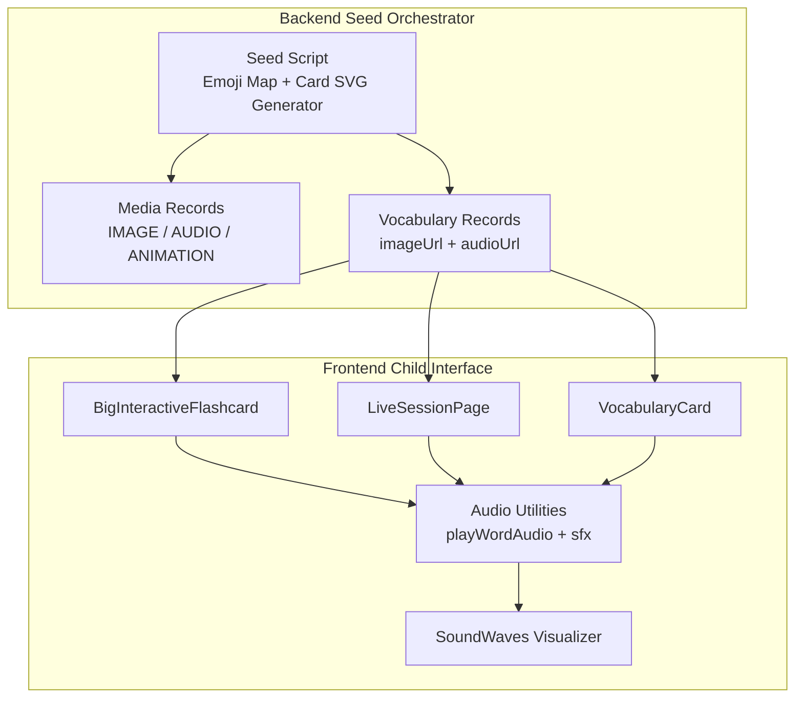
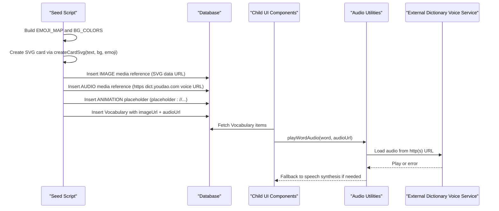
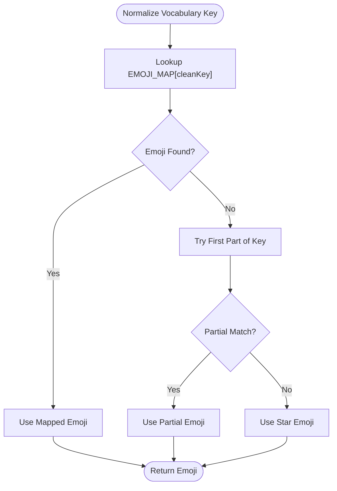
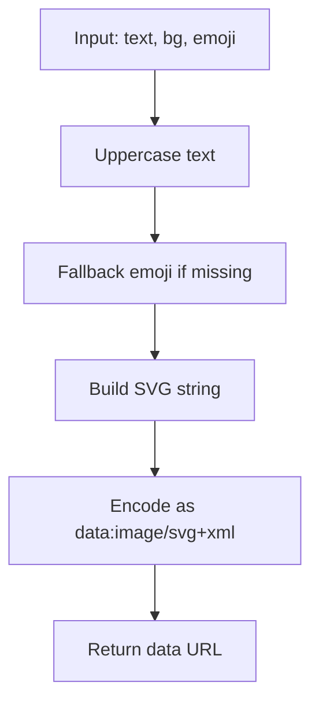
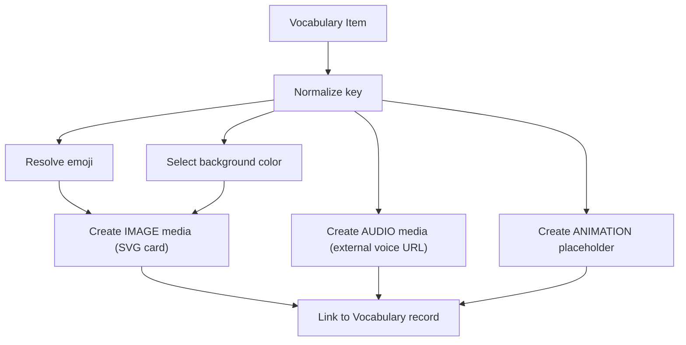
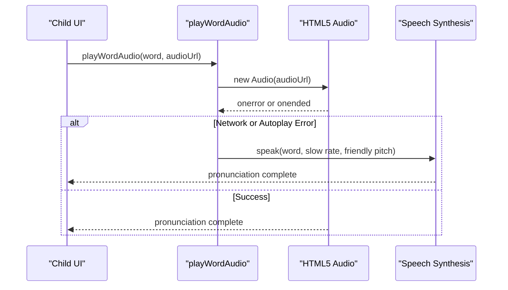
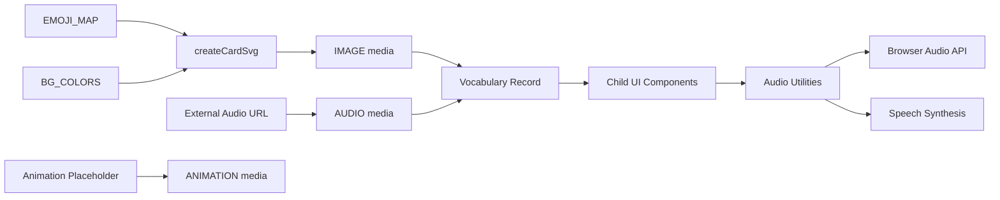

# Media & Content Generation Utilities

<cite>
**Referenced Files in This Document**
- [index.js](file://KCEnglishKids_BE/src/seeds/index.js)
- [audio.ts](file://client/src/utils/audio.ts)
- [VocabularyCard.tsx](file://client/src/components/child/VocabularyCard.tsx)
- [BigInteractiveFlashcard.tsx](file://client/src/components/child/BigInteractiveFlashcard.tsx)
- [LiveSessionPage.tsx](file://client/src/dashboards/teacher/LiveSessionPage.tsx)
- [ActivityPlayPage.tsx](file://client/src/pages/child/ActivityPlayPage.tsx)
- [SoundWaves.tsx](file://client/src/components/child/SoundWaves.tsx)
- [index.css](file://client/src/index.css)
</cite>

## Table of Contents
1. [Introduction](#introduction)
2. [Project Structure](#project-structure)
3. [Core Components](#core-components)
4. [Architecture Overview](#architecture-overview)
5. [Detailed Component Analysis](#detailed-component-analysis)
6. [Dependency Analysis](#dependency-analysis)
7. [Performance Considerations](#performance-considerations)
8. [Troubleshooting Guide](#troubleshooting-guide)
9. [Conclusion](#conclusion)

## Introduction
This document explains the media and content generation utilities used by the seed orchestrator to build a child-friendly learning experience. It covers:
- The emoji mapping system that provides visual representations for curriculum vocabulary words.
- The SVG card generator that creates colorful, rounded cards with large emojis and bold labels.
- The color palette system used throughout the application for vibrant backgrounds and UI elements.
- How media references are created for images, audio, and animations for each vocabulary item.
- Integration with external audio services and the fallback speech synthesis mechanism.
- The placeholder system for animations.
- Examples of generated SVG structures and how the media system supports the child-friendly interface design.

## Project Structure
The media and content generation pipeline spans backend seeding logic and frontend presentation utilities:
- Backend seed script generates vocabulary records, media references, and links them together.
- Frontend components render vocabulary cards, flashcards, and audio controls using the generated media.
- Shared CSS defines child-friendly typography, animations, and playful UI styles.

**Diagram sources**
- [index.js:37-123](file://KCEnglishKids_BE/src/seeds/index.js#L37-L123)
- [index.js:234-330](file://KCEnglishKids_BE/src/seeds/index.js#L234-L330)
- [VocabularyCard.tsx:1-17](file://client/src/components/child/VocabularyCard.tsx#L1-L17)
- [BigInteractiveFlashcard.tsx:1-41](file://client/src/components/child/BigInteractiveFlashcard.tsx#L1-L41)
- [LiveSessionPage.tsx:451-496](file://client/src/dashboards/teacher/LiveSessionPage.tsx#L451-L496)
- [audio.ts:217-318](file://client/src/utils/audio.ts#L217-L318)
- [SoundWaves.tsx:1-42](file://client/src/components/child/SoundWaves.tsx#L1-L42)

**Section sources**
- [index.js:37-123](file://KCEnglishKids_BE/src/seeds/index.js#L37-L123)
- [index.js:234-330](file://KCEnglishKids_BE/src/seeds/index.js#L234-L330)
- [VocabularyCard.tsx:1-17](file://client/src/components/child/VocabularyCard.tsx#L1-L17)
- [BigInteractiveFlashcard.tsx:1-41](file://client/src/components/child/BigInteractiveFlashcard.tsx#L1-L41)
- [LiveSessionPage.tsx:451-496](file://client/src/dashboards/teacher/LiveSessionPage.tsx#L451-L496)
- [audio.ts:217-318](file://client/src/utils/audio.ts#L217-L318)
- [SoundWaves.tsx:1-42](file://client/src/components/child/SoundWaves.tsx#L1-L42)

## Core Components
- Emoji Mapping System: A curated map associates normalized vocabulary keys with friendly emojis for quick visual recognition.
- SVG Card Generator: Produces child-friendly SVG data URLs with pastel backgrounds, large emoji centers, and bold uppercase labels.
- Color Palette System: A set of soft, vibrant colors used across cards and UI elements to create a cheerful environment.
- Media Reference Creation: For each vocabulary word, three media references are created: image (SVG card), audio (external dictionary voice URL), and animation (placeholder).
- Audio Integration: Frontend plays word audio via HTML5 audio or falls back to browser speech synthesis; sound effects provide playful feedback.
- Placeholder Animation System: Animation placeholders use a structured URL scheme for future Lottie-style assets.

**Section sources**
- [index.js:37-123](file://KCEnglishKids_BE/src/seeds/index.js#L37-L123)
- [index.js:234-330](file://KCEnglishKids_BE/src/seeds/index.js#L234-L330)
- [audio.ts:217-318](file://client/src/utils/audio.ts#L217-L318)

## Architecture Overview
The media generation architecture connects seed-time asset creation with runtime presentation:

**Diagram sources**
- [index.js:37-123](file://KCEnglishKids_BE/src/seeds/index.js#L37-L123)
- [index.js:234-330](file://KCEnglishKids_BE/src/seeds/index.js#L234-L330)
- [audio.ts:217-318](file://client/src/utils/audio.ts#L217-L318)

## Detailed Component Analysis

### Emoji Mapping System
The emoji mapping system provides consistent visual cues for vocabulary words. Keys are normalized from vocabulary text and mapped to emojis covering animals, food, school tools, days, toys, body parts, feelings, senses, family, clothes, weather, places, transport, community roles, routines, environment, and more. If no exact match is found, it tries partial key matches and finally defaults to a star emoji.

Key behaviors:
- Normalized keys are derived from vocabulary text.
- Fallback strategy ensures every word gets an emoji.
- Emojis are embedded into SVG cards for immediate visual recognition.

**Diagram sources**
- [index.js:44-110](file://KCEnglishKids_BE/src/seeds/index.js#L44-L110)

**Section sources**
- [index.js:44-110](file://KCEnglishKids_BE/src/seeds/index.js#L44-L110)

### SVG Card Generation Function
The SVG card generator produces child-friendly cards with:
- Rounded background rectangles using pastel colors.
- A semi-transparent white circle behind the emoji for contrast.
- Large emoji centered on the card.
- A white label bar at the bottom with bold uppercase text.
- Data URL encoding suitable for direct display in `` tags.

Generated structure highlights:
- Root SVG with viewBox and dimensions.
- Background rectangle with rounded corners and pastel fill.
- Center circle for visual emphasis.
- Emoji text element with large font size.
- Label rectangle with high-opacity white fill.
- Label text with system font stack and dark color.

**Diagram sources**
- [index.js:112-123](file://KCEnglishKids_BE/src/seeds/index.js#L112-L123)

**Section sources**
- [index.js:112-123](file://KCEnglishKids_BE/src/seeds/index.js#L112-L123)

### Color Palette System
The palette includes soft, vibrant pastel colors used for card backgrounds and UI accents. These colors support a cheerful, child-friendly aesthetic and are cycled through when generating multiple cards.

Palette characteristics:
- Soft pastels reduce eye strain while remaining engaging.
- Colors are applied consistently across cards and UI elements.
- Tailwind utility classes and custom CSS define additional playful gradients and button styles.

**Section sources**
- [index.js:37-42](file://KCEnglishKids_BE/src/seeds/index.js#L37-L42)
- [index.css:205-275](file://client/src/index.css#L205-L275)

### Media References Creation for Images, Audio, and Animations
For each vocabulary item, the seed script creates three media references:
- Image: An SVG card data URL generated by `createCardSvg`.
- Audio: A URL pointing to an external dictionary voice service.
- Animation: A placeholder URL following a structured naming convention.

These references are inserted into the database and then linked to vocabulary records via IDs and URLs.

**Diagram sources**
- [index.js:234-330](file://KCEnglishKids_BE/src/seeds/index.js#L234-L330)

**Section sources**
- [index.js:234-330](file://KCEnglishKids_BE/src/seeds/index.js#L234-L330)

### Integration with External Audio Services
The frontend audio utility integrates with external audio services and provides robust fallbacks:
- Attempts to play HTML5 audio from HTTP(S) URLs.
- Handles autoplay restrictions and network errors gracefully.
- Falls back to browser speech synthesis with child-appropriate speed and pitch.
- Provides sound effects for positive feedback and gentle correction.

**Diagram sources**
- [audio.ts:217-318](file://client/src/utils/audio.ts#L217-L318)

**Section sources**
- [audio.ts:217-318](file://client/src/utils/audio.ts#L217-L318)

### Placeholder System for Animations
Animation placeholders use a structured URL scheme:
- Pattern: `placeholder://animations/vocab_${cleanKey}_anim.json`
- Purpose: Reserve slots for future Lottie or JSON-based animations per vocabulary item.
- Status: Marked as active during seeding, ready for replacement with real assets.

This approach allows seamless integration of animated visuals without breaking current workflows.

**Section sources**
- [index.js:268-276](file://KCEnglishKids_BE/src/seeds/index.js#L268-L276)

### Generated SVG Structures Example
An example of the generated SVG structure includes:
- Root SVG element with viewBox and dimensions.
- Rounded background rectangle filled with a pastel color.
- Semi-transparent white circle for visual emphasis.
- Large emoji text element centered.
- White label rectangle at the bottom.
- Bold uppercase text inside the label.

This structure ensures readability and appeal for young learners.

**Section sources**
- [index.js:112-123](file://KCEnglishKids_BE/src/seeds/index.js#L112-L123)

### Child-Friendly Interface Design Support
The media system supports child-friendly design through:
- Vibrant pastel backgrounds and large emojis.
- Big, bold text labels for easy reading.
- Playful animations and sound effects.
- Accessible audio playback with fallbacks.
- Consistent visual language across cards, flashcards, and teacher dashboards.

Components like `VocabularyCard`, `BigInteractiveFlashcard`, and `LiveSessionPage` render these assets effectively, while `SoundWaves` adds visual feedback during audio playback.

**Section sources**
- [VocabularyCard.tsx:1-17](file://client/src/components/child/VocabularyCard.tsx#L1-L17)
- [BigInteractiveFlashcard.tsx:1-41](file://client/src/components/child/BigInteractiveFlashcard.tsx#L1-L41)
- [LiveSessionPage.tsx:451-496](file://client/src/dashboards/teacher/LiveSessionPage.tsx#L451-L496)
- [SoundWaves.tsx:1-42](file://client/src/components/child/SoundWaves.tsx#L1-L42)
- [index.css:60-174](file://client/src/index.css#L60-L174)

## Dependency Analysis
The media and content generation utilities have clear dependencies:
- Seed script depends on emoji mapping and color palette to generate SVG cards and media references.
- Frontend components depend on vocabulary records containing imageUrl and audioUrl.
- Audio utilities depend on browser APIs and external audio services.
- CSS defines shared styles and animations used across components.

**Diagram sources**
- [index.js:37-123](file://KCEnglishKids_BE/src/seeds/index.js#L37-L123)
- [index.js:234-330](file://KCEnglishKids_BE/src/seeds/index.js#L234-L330)
- [audio.ts:217-318](file://client/src/utils/audio.ts#L217-L318)

**Section sources**
- [index.js:37-123](file://KCEnglishKids_BE/src/seeds/index.js#L37-L123)
- [index.js:234-330](file://KCEnglishKids_BE/src/seeds/index.js#L234-L330)
- [audio.ts:217-318](file://client/src/utils/audio.ts#L217-L318)

## Performance Considerations
- SVG data URLs avoid network requests for images, improving load times.
- External audio URLs may incur latency; fallback to speech synthesis ensures responsiveness.
- Sound effects are lightweight and generated programmatically to minimize resource usage.
- Placeholder animations allow future optimization without disrupting current functionality.

[No sources needed since this section provides general guidance]

## Troubleshooting Guide
Common issues and resolutions:
- Audio not playing due to autoplay restrictions: Ensure user interaction triggers audio playback; the utility handles this automatically.
- External audio service unavailable: Speech synthesis fallback activates automatically.
- Missing emoji for a vocabulary word: The mapping system falls back to partial keys and then a default star emoji.
- Animation placeholders not rendering: Replace placeholder URLs with actual animation assets when available.

**Section sources**
- [audio.ts:217-318](file://client/src/utils/audio.ts#L217-L318)
- [index.js:44-110](file://KCEnglishKids_BE/src/seeds/index.js#L44-L110)
- [index.js:268-276](file://KCEnglishKids_BE/src/seeds/index.js#L268-L276)

## Conclusion
The media and content generation utilities in the seed orchestrator create a cohesive, child-friendly learning environment. By combining emoji mappings, SVG card generation, vibrant color palettes, and robust audio integration, the system delivers engaging visuals and sounds tailored for young learners. The placeholder animation system prepares the foundation for future enhancements, ensuring scalability and maintainability.

[No sources needed since this section summarizes without analyzing specific files]