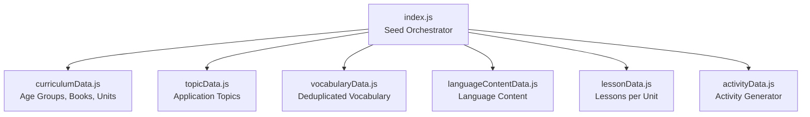
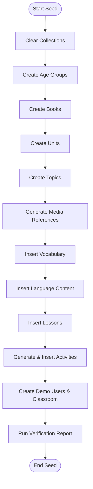
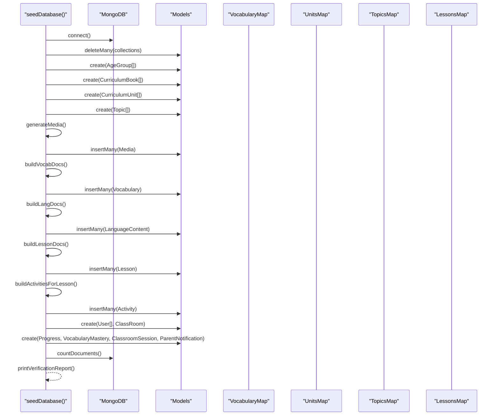
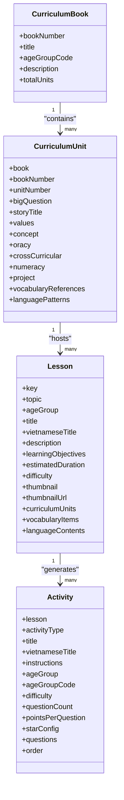
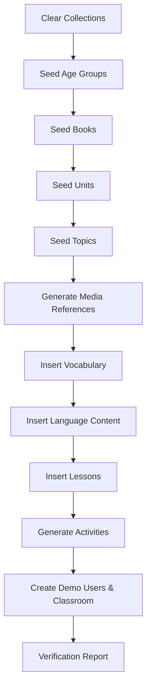
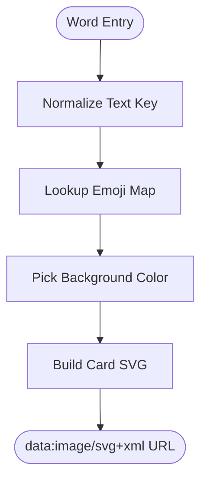
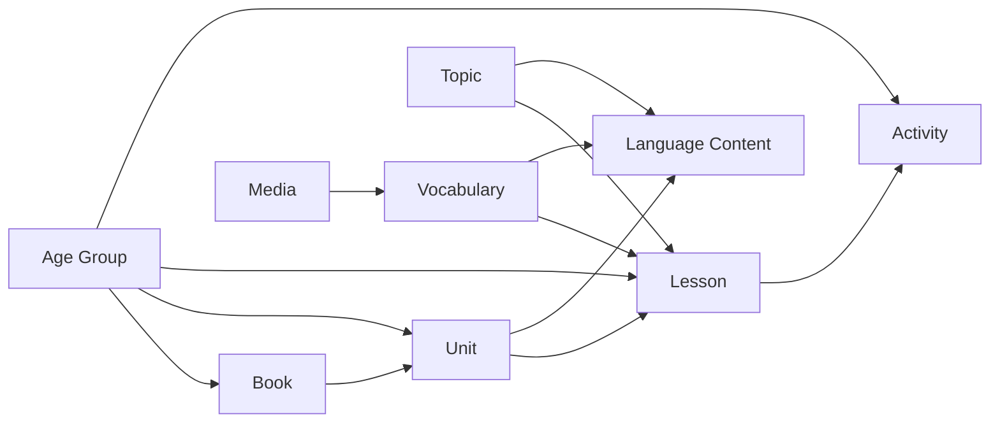
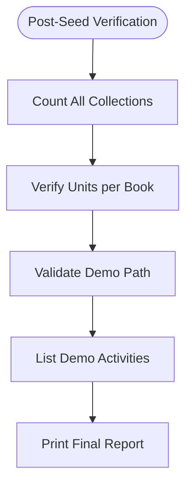
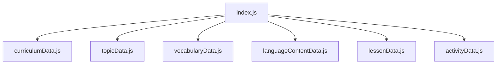

# Seed Data Scripts

<cite>
**Referenced Files in This Document**
- [index.js](file://KCEnglishKids_BE/src/seeds/index.js)
- [curriculumData.js](file://KCEnglishKids_BE/src/seeds/curriculumData.js)
- [topicData.js](file://KCEnglishKids_BE/src/seeds/topicData.js)
- [vocabularyData.js](file://KCEnglishKids_BE/src/seeds/vocabularyData.js)
- [languageContentData.js](file://KCEnglishKids_BE/src/seeds/languageContentData.js)
- [lessonData.js](file://KCEnglishKids_BE/src/seeds/lessonData.js)
- [activityData.js](file://KCEnglishKids_BE/src/seeds/activityData.js)
</cite>

## Table of Contents
1. [Introduction](#introduction)
2. [Project Structure](#project-structure)
3. [Core Components](#core-components)
4. [Architecture Overview](#architecture-overview)
5. [Detailed Component Analysis](#detailed-component-analysis)
6. [Dependency Analysis](#dependency-analysis)
7. [Performance Considerations](#performance-considerations)
8. [Troubleshooting Guide](#troubleshooting-guide)
9. [Conclusion](#conclusion)

## Introduction
This document explains the seed data scripts that populate the database with a complete, child-friendly English curriculum for ages 3–6. The main orchestrator coordinates modular datasets for age groups, books, units, topics, vocabulary, language content, lessons, and activities. It also generates media references (images, audio, animation placeholders), builds relationships between entities, creates demo users and classroom context, and runs verification reporting to ensure data integrity after seeding.

## Project Structure
The seed system is organized around one orchestrator script and several focused dataset modules:

- Orchestrator: index.js
- Curriculum structure: curriculumData.js
- Application topics: topicData.js
- Vocabulary master list: vocabularyData.js
- Language patterns and dialogues: languageContentData.js
- Lessons mapped to units and topics: lessonData.js
- Activity generator per lesson: activityData.js

**Diagram sources**
- [index.js:28-35](file://KCEnglishKids_BE/src/seeds/index.js#L28-L35)
- [curriculumData.js:7-62](file://KCEnglishKids_BE/src/seeds/curriculumData.js#L7-L62)
- [topicData.js:6-197](file://KCEnglishKids_BE/src/seeds/topicData.js#L6-L197)
- [vocabularyData.js:480-512](file://KCEnglishKids_BE/src/seeds/vocabularyData.js#L480-L512)
- [languageContentData.js:8-317](file://KCEnglishKids_BE/src/seeds/languageContentData.js#L8-L317)
- [lessonData.js:7-800](file://KCEnglishKids_BE/src/seeds/lessonData.js#L7-L800)
- [activityData.js:51-753](file://KCEnglishKids_BE/src/seeds/activityData.js#L51-L753)

**Section sources**
- [index.js:1-35](file://KCEnglishKids_BE/src/seeds/index.js#L1-L35)
- [curriculumData.js:1-62](file://KCEnglishKids_BE/src/seeds/curriculumData.js#L1-L62)
- [topicData.js:1-197](file://KCEnglishKids_BE/src/seeds/topicData.js#L1-L197)
- [vocabularyData.js:1-512](file://KCEnglishKids_BE/src/seeds/vocabularyData.js#L1-L512)
- [languageContentData.js:1-322](file://KCEnglishKids_BE/src/seeds/languageContentData.js#L1-L322)
- [lessonData.js:1-800](file://KCEnglishKids_BE/src/seeds/lessonData.js#L1-L800)
- [activityData.js:1-759](file://KCEnglishKids_BE/src/seeds/activityData.js#L1-L759)

## Core Components
- Age Groups: Three cohorts (3–4, 4–5, 5–6) define question complexity and default counts.
- Books: Three official books aligned to age groups.
- Units: 27 official units (9 per book) with big questions, values, concepts, oracy, cross-curricular links, numeracy, projects, vocabulary references, and language patterns.
- Topics: 19 application topics used to organize learning experiences across units.
- Vocabulary: Deduplicated word list with Vietnamese translations, IPA, part of speech, categories, unit mappings, age group mappings, and topic mappings.
- Language Content: Exhaustive sentences, questions, answers, patterns, and oracy phrases per unit.
- Lessons: 108 lessons (4 per unit) mapping to topics, vocabulary words, objectives, and durations.
- Activities: Per-lesson interactive activities generated from lesson definitions and vocabulary, supporting multiple game types and age-appropriate interactions.

**Section sources**
- [curriculumData.js:7-62](file://KCEnglishKids_BE/src/seeds/curriculumData.js#L7-L62)
- [curriculumData.js:64-702](file://KCEnglishKids_BE/src/seeds/curriculumData.js#L64-L702)
- [topicData.js:6-197](file://KCEnglishKids_BE/src/seeds/topicData.js#L6-L197)
- [vocabularyData.js:480-512](file://KCEnglishKids_BE/src/seeds/vocabularyData.js#L480-L512)
- [languageContentData.js:8-317](file://KCEnglishKids_BE/src/seeds/languageContentData.js#L8-L317)
- [lessonData.js:7-800](file://KCEnglishKids_BE/src/seeds/lessonData.js#L7-L800)
- [activityData.js:51-753](file://KCEnglishKids_BE/src/seeds/activityData.js#L51-L753)

## Architecture Overview
The seed process follows a strict pipeline: clear collections, create foundational entities, build relationships, generate media assets, and verify results.

**Diagram sources**
- [index.js:125-747](file://KCEnglishKids_BE/src/seeds/index.js#L125-L747)

**Section sources**
- [index.js:125-747](file://KCEnglishKids_BE/src/seeds/index.js#L125-L747)

## Detailed Component Analysis

### Seed Orchestrator (index.js)
Responsibilities:
- Connects to MongoDB and loads environment configuration.
- Imports modular datasets and models.
- Defines emoji mapping and SVG card generation for child-friendly visuals.
- Executes the systematic seeding steps:
  - Clears all relevant collections idempotently.
  - Seeds age groups, books, units, topics.
  - Generates media references (image SVGs, audio URLs, animation placeholders).
  - Inserts deduplicated vocabulary with normalized keys and derived fields.
  - Inserts structured language content linked to units, topics, and vocabulary.
  - Creates lessons tied to units, topics, vocabulary, and language content.
  - Generates activities per lesson using the activity generator.
  - Creates demo users (admin, teacher, children), a classroom, progress records, mastery samples, classroom sessions, and parent notifications.
  - Runs final verification counts and prints a detailed report.

Key implementation highlights:
- Emoji mapping provides visual cues for vocabulary cards.
- SVG generation produces inline images suitable for young learners.
- Relationship building uses maps to resolve IDs for units, topics, age groups, and vocabulary.
- Verification section reports counts for each entity and validates the demo path through Book 1, Unit 5, Animals, Pet Animals lesson.

**Diagram sources**
- [index.js:125-747](file://KCEnglishKids_BE/src/seeds/index.js#L125-L747)

**Section sources**
- [index.js:1-124](file://KCEnglishKids_BE/src/seeds/index.js#L1-L124)
- [index.js:125-747](file://KCEnglishKids_BE/src/seeds/index.js#L125-L747)

### Curriculum Structure Mapping (Books → Units → Lessons → Activities)
Curriculum hierarchy:
- Books are assigned to age groups and contain units.
- Units define big questions, values, concepts, oracy, cross-curricular themes, numeracy, projects, vocabulary references, and language patterns.
- Lessons map to units and topics, include vocabulary words, objectives, and durations.
- Activities are generated per lesson based on lesson order, age group, and vocabulary set.

**Diagram sources**
- [curriculumData.js:40-702](file://KCEnglishKids_BE/src/seeds/curriculumData.js#L40-L702)
- [lessonData.js:7-800](file://KCEnglishKids_BE/src/seeds/lessonData.js#L7-L800)
- [activityData.js:51-753](file://KCEnglishKids_BE/src/seeds/activityData.js#L51-L753)

**Section sources**
- [curriculumData.js:40-702](file://KCEnglishKids_BE/src/seeds/curriculumData.js#L40-L702)
- [lessonData.js:7-800](file://KCEnglishKids_BE/src/seeds/lessonData.js#L7-L800)
- [activityData.js:51-753](file://KCEnglishKids_BE/src/seeds/activityData.js#L51-L753)

### Systematic Seeding Process
Steps executed by the orchestrator:
1. Clear collections to maintain idempotent consistency.
2. Create age groups and store them in a code-to-document map.
3. Create books and link to age groups; store in a book-number map.
4. Create units and link to books and age groups; store in a key-to-document map.
5. Create topics and assign all age groups; optionally link specific topics to units.
6. Generate media references for each vocabulary item:
   - Image SVG card created via createCardSvg with background color and emoji.
   - Audio URL pointing to an external dictionary voice service.
   - Animation placeholder URL.
7. Insert vocabulary documents with normalized text, category, pronunciation, difficulty, age groups, source units, topics, primary media, audio media, example sentences, and status.
8. Insert language content documents linked to units, topics, age groups, and matched vocabulary items.
9. Insert lessons linked to units, topics, vocabulary items, and language contents.
10. Generate activities per lesson using buildActivitiesForLesson and insert them.
11. Create demo users (admin, teacher, children), a classroom, progress records, vocabulary mastery samples, classroom session summaries, and parent notifications.
12. Run verification counts and print a detailed report including the demo learning path.

**Diagram sources**
- [index.js:132-747](file://KCEnglishKids_BE/src/seeds/index.js#L132-L747)

**Section sources**
- [index.js:132-747](file://KCEnglishKids_BE/src/seeds/index.js#L132-L747)

### Emoji Mapping and SVG Generation
- Emoji mapping associates normalized vocabulary keys with emojis for visual cards.
- Background colors cycle through a vibrant palette for child-friendly interfaces.
- SVG generation function creates inline SVG strings representing colorful cards with emoji and uppercase text labels.

**Diagram sources**
- [index.js:37-123](file://KCEnglishKids_BE/src/seeds/index.js#L37-L123)

**Section sources**
- [index.js:37-123](file://KCEnglishKids_BE/src/seeds/index.js#L37-L123)

### Relationship Building Between Entities
- Age groups are referenced by books, units, lessons, and activities.
- Books are referenced by units.
- Units are referenced by lessons and language content.
- Topics are referenced by lessons and language content.
- Vocabulary items are referenced by lessons and language content.
- Lessons are referenced by activities.
- Media references are linked to vocabulary items as primary image and audio.

**Diagram sources**
- [index.js:152-454](file://KCEnglishKids_BE/src/seeds/index.js#L152-L454)

**Section sources**
- [index.js:152-454](file://KCEnglishKids_BE/src/seeds/index.js#L152-L454)

### Verification and Reporting Mechanisms
After seeding, the orchestrator:
- Counts documents for each major collection.
- Verifies per-book unit counts.
- Validates the demo learning path: Age 3–4 → Book 1 → Unit 5 → Topic Animals → Lesson Pet Animals.
- Lists activities associated with the demo lesson.
- Prints a comprehensive verification report to confirm data integrity.

**Diagram sources**
- [index.js:696-747](file://KCEnglishKids_BE/src/seeds/index.js#L696-L747)

**Section sources**
- [index.js:696-747](file://KCEnglishKids_BE/src/seeds/index.js#L696-L747)

## Dependency Analysis
The seed orchestrator depends on modular datasets and model definitions:

**Diagram sources**
- [index.js:28-35](file://KCEnglishKids_BE/src/seeds/index.js#L28-L35)

**Section sources**
- [index.js:28-35](file://KCEnglishKids_BE/src/seeds/index.js#L28-L35)

## Performance Considerations
- Bulk inserts: Media, vocabulary, language content, lessons, and activities use batch insertion to reduce round trips.
- In-memory maps: Maps for age groups, books, units, topics, vocabulary, and lessons minimize repeated lookups.
- Idempotent clearing: Deleting all collections ensures clean re-runs without manual cleanup.
- Deterministic ordering: Display orders and numeric progression guide consistent sequencing.
- External audio URLs: Using dictionary voice services avoids embedding large audio files in the database.

[No sources needed since this section provides general guidance]

## Troubleshooting Guide
Common issues and resolutions:
- Missing environment variables: Ensure .env is present and contains database connection details before running the seed.
- Duplicate or inconsistent data: Re-run the seed to clear and rebuild collections; the script clears all relevant collections at start.
- Broken media references: Verify that normalized vocabulary keys match emoji map entries and that SVG generation succeeds.
- Incorrect relationships: Check maps for units, topics, age groups, and vocabulary to ensure correct ID resolution during seeding.
- Verification failures: Review the final verification report for counts and demo path validation; adjust datasets if expected numbers do not match.

**Section sources**
- [index.js:125-150](file://KCEnglishKids_BE/src/seeds/index.js#L125-L150)
- [index.js:696-747](file://KCEnglishKids_BE/src/seeds/index.js#L696-L747)

## Conclusion
The seed data scripts provide a robust, modular foundation for populating the database with a complete, child-friendly English curriculum. The orchestrator coordinates data imports, relationship building, media asset generation, and verification reporting. The result is a rich, interconnected dataset ready for frontend consumption, supporting age-appropriate learning paths, interactive activities, and meaningful analytics.

[No sources needed since this section summarizes without analyzing specific files]