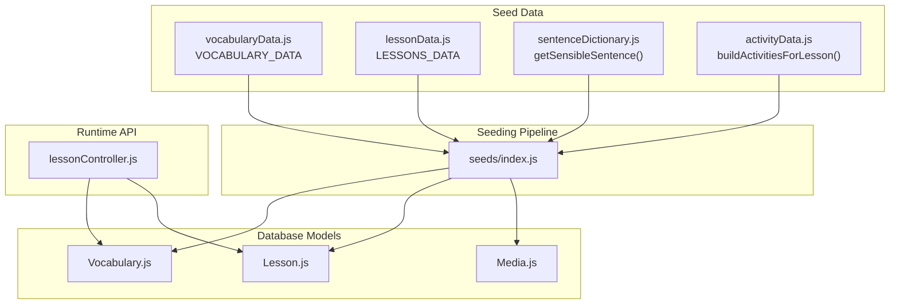
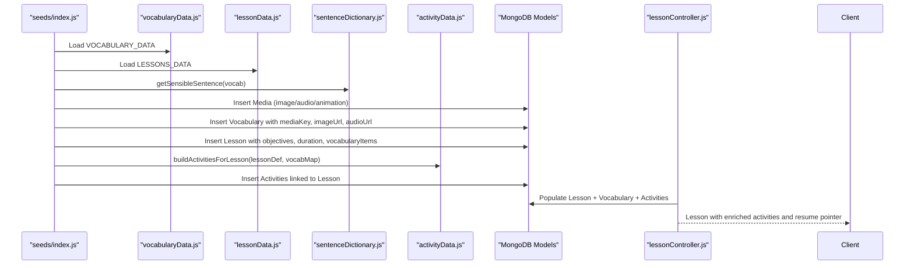
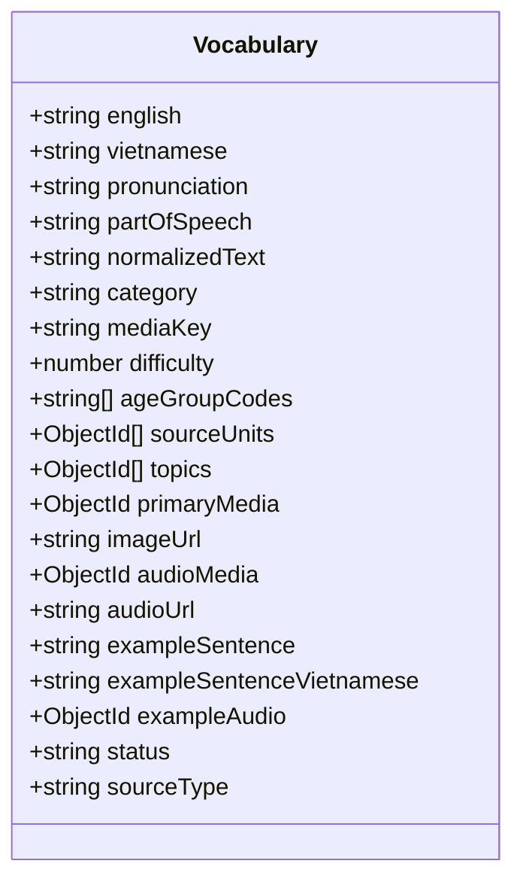
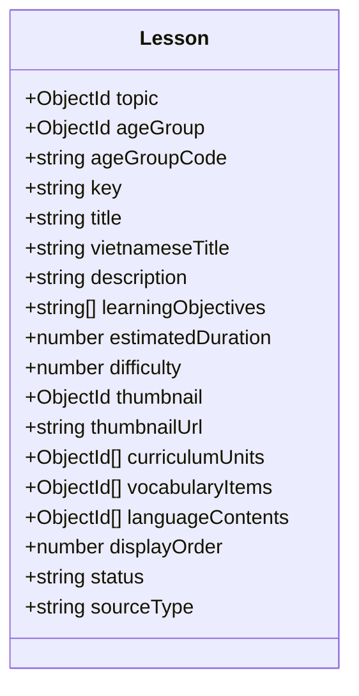
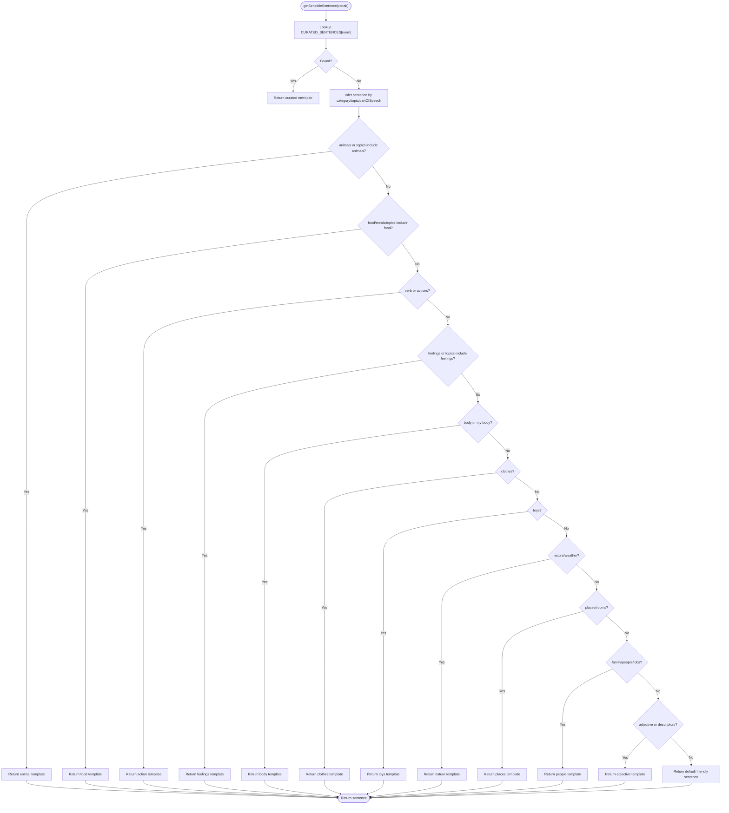
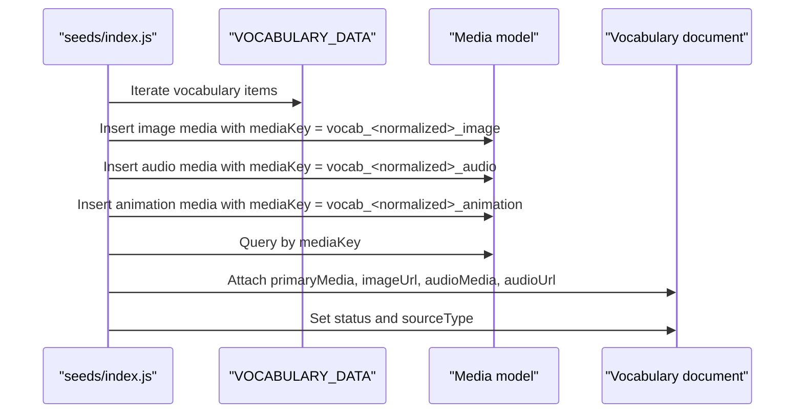
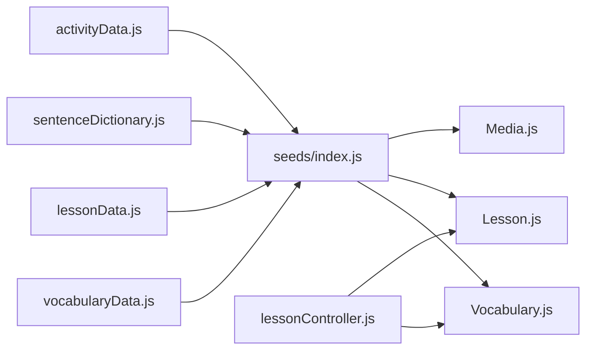

# Vocabulary & Content Generation

<cite>
**Referenced Files in This Document**
- [vocabularyData.js](file://KCEnglishKids_BE/src/seeds/vocabularyData.js)
- [lessonData.js](file://KCEnglishKids_BE/src/seeds/lessonData.js)
- [activityData.js](file://KCEnglishKids_BE/src/seeds/activityData.js)
- [sentenceDictionary.js](file://KCEnglishKids_BE/src/seeds/sentenceDictionary.js)
- [seeds/index.js](file://KCEnglishKids_BE/src/seeds/index.js)
- [Vocabulary.js](file://KCEnglishKids_BE/src/models/Vocabulary.js)
- [Lesson.js](file://KCEnglishKids_BE/src/models/Lesson.js)
- [Media.js](file://KCEnglishKids_BE/src/models/Media.js)
- [lessonController.js](file://KCEnglishKids_BE/src/controllers/lessonController.js)
</cite>

## Table of Contents
1. [Introduction](#introduction)
2. [Project Structure](#project-structure)
3. [Core Components](#core-components)
4. [Architecture Overview](#architecture-overview)
5. [Detailed Component Analysis](#detailed-component-analysis)
6. [Dependency Analysis](#dependency-analysis)
7. [Performance Considerations](#performance-considerations)
8. [Troubleshooting Guide](#troubleshooting-guide)
9. [Conclusion](#conclusion)

## Introduction
This document explains the vocabulary and content generation systems that populate learning materials for KCEnglishKids. It focuses on:
- The `VOCABULARY_DATA` structure containing 384 deduplicated vocabulary items with English-Vietnamese translations, IPA pronunciation guides, category classifications, age-appropriate difficulty levels, unit mappings, topics, and media keys.
- The `LESSONS_DATA` structure defining 108 lessons across 27 units with learning objectives, estimated durations, difficulty levels, and vocabulary associations.
- The activity generation system through `buildActivitiesForLesson`, which creates multiple age-appropriate activity types per lesson.
- The sentence dictionary functionality that generates sensible example sentences for vocabulary words.
- The media reference generation system that creates SVG image placeholders, audio URL references, and animation placeholders for each vocabulary item.

## Project Structure
The vocabulary and lesson content is defined as seed data, then transformed into database-ready records during seeding. Activities are generated dynamically from lesson definitions and vocabulary maps.

**Diagram sources**
- [vocabularyData.js:1-513](file://KCEnglishKids_BE/src/seeds/vocabularyData.js#L1-L513)
- [lessonData.js:1-825](file://KCEnglishKids_BE/src/seeds/lessonData.js#L1-L825)
- [activityData.js:1-759](file://KCEnglishKids_BE/src/seeds/activityData.js#L1-L759)
- [sentenceDictionary.js:1-296](file://KCEnglishKids_BE/src/seeds/sentenceDictionary.js#L1-L296)
- [seeds/index.js:267-305](file://KCEnglishKids_BE/src/seeds/index.js#L267-L305)
- [Vocabulary.js:1-110](file://KCEnglishKids_BE/src/models/Vocabulary.js#L1-L110)
- [Lesson.js:1-101](file://KCEnglishKids_BE/src/models/Lesson.js#L1-L101)
- [Media.js:1-200](file://KCEnglishKids_BE/src/models/Media.js#L1-L200)
- [lessonController.js:120-173](file://KCEnglishKids_BE/src/controllers/lessonController.js#L120-L173)

**Section sources**
- [vocabularyData.js:1-513](file://KCEnglishKids_BE/src/seeds/vocabularyData.js#L1-L513)
- [lessonData.js:1-825](file://KCEnglishKids_BE/src/seeds/lessonData.js#L1-L825)
- [activityData.js:1-759](file://KCEnglishKids_BE/src/seeds/activityData.js#L1-L759)
- [sentenceDictionary.js:1-296](file://KCEnglishKids_BE/src/seeds/sentenceDictionary.js#L1-L296)
- [seeds/index.js:267-305](file://KCEnglishKids_BE/src/seeds/index.js#L267-L305)
- [Vocabulary.js:1-110](file://KCEnglishKids_BE/src/models/Vocabulary.js#L1-L110)
- [Lesson.js:1-101](file://KCEnglishKids_BE/src/models/Lesson.js#L1-L101)
- [lessonController.js:120-173](file://KCEnglishKids_BE/src/controllers/lessonController.js#L120-L173)

## Core Components
- **Vocabulary dataset**: A curated list of vocabulary entries with normalized text, media keys, source type, status, and metadata such as part of speech, categories, topics, and age groups.
- **Lesson dataset**: A structured curriculum mapping official units to application-level lessons with titles, descriptions, objectives, vocabulary word lists, difficulty, and duration.
- **Activity generator**: A function that converts a lesson definition and vocabulary map into a set of interactive activities tailored by age group, lesson order, and topic.
- **Sentence dictionary**: A lookup table plus fallback logic that returns child-friendly example sentences for vocabulary words.
- **Media reference generator**: Seeding logic that creates media records for images, audio, and animations, and attaches them to vocabulary and lesson records.

**Section sources**
- [vocabularyData.js:480-513](file://KCEnglishKids_BE/src/seeds/vocabularyData.js#L480-L513)
- [lessonData.js:1-825](file://KCEnglishKids_BE/src/seeds/lessonData.js#L1-L825)
- [activityData.js:51-759](file://KCEnglishKids_BE/src/seeds/activityData.js#L51-L759)
- [sentenceDictionary.js:6-296](file://KCEnglishKids_BE/src/seeds/sentenceDictionary.js#L6-L296)
- [seeds/index.js:267-305](file://KCEnglishKids_BE/src/seeds/index.js#L267-L305)

## Architecture Overview
The content pipeline connects seed data to database models and runtime APIs.

**Diagram sources**
- [seeds/index.js:267-305](file://KCEnglishKids_BE/src/seeds/index.js#L267-L305)
- [vocabularyData.js:480-513](file://KCEnglishKids_BE/src/seeds/vocabularyData.js#L480-L513)
- [lessonData.js:1-825](file://KCEnglishKids_BE/src/seeds/lessonData.js#L1-L825)
- [sentenceDictionary.js:196-296](file://KCEnglishKids_BE/src/seeds/sentenceDictionary.js#L196-L296)
- [activityData.js:51-759](file://KCEnglishKids_BE/src/seeds/activityData.js#L51-L759)
- [lessonController.js:120-173](file://KCEnglishKids_BE/src/controllers/lessonController.js#L120-L173)

## Detailed Component Analysis

### Vocabulary Dataset: VOCABULARY_DATA
The vocabulary dataset defines 384 unique vocabulary items after deduplication. Each entry includes:
- English term and Vietnamese translation.
- IPA pronunciation guide.
- Part of speech.
- Age group codes.
- Topic tags.
- Category classification.
- Source unit mappings.
- Normalized text for matching.
- Media key for asset resolution.
- Source type and status.

Deduplication consolidates repeated terms by merging their unit mappings, age groups, and topics while generating a stable media key.

**Diagram sources**
- [Vocabulary.js:3-102](file://KCEnglishKids_BE/src/models/Vocabulary.js#L3-L102)

**Section sources**
- [vocabularyData.js:7-478](file://KCEnglishKids_BE/src/seeds/vocabularyData.js#L7-L478)
- [vocabularyData.js:480-513](file://KCEnglishKids_BE/src/seeds/vocabularyData.js#L480-L513)
- [Vocabulary.js:3-102](file://KCEnglishKids_BE/src/models/Vocabulary.js#L3-L102)

### Lesson Dataset: LESSONS_DATA
The lesson dataset defines 108 lessons across 27 units, four lessons per unit. Each lesson includes:
- Unique key and unit key.
- Age group code.
- Topic slug.
- Order within unit.
- Difficulty level.
- Estimated duration in minutes.
- Title and Vietnamese title.
- Description.
- Learning objectives.
- Associated vocabulary words.

**Diagram sources**
- [Lesson.js:3-93](file://KCEnglishKids_BE/src/models/Lesson.js#L3-L93)

**Section sources**
- [lessonData.js:1-825](file://KCEnglishKids_BE/src/seeds/lessonData.js#L1-L825)
- [Lesson.js:3-93](file://KCEnglishKids_BE/src/models/Lesson.js#L3-L93)

### Activity Generation System: buildActivitiesForLesson
The activity generator transforms a lesson definition and vocabulary map into a set of activities. It supports at least these activity types:
- LISTEN_CHOOSE
- IMAGE_WORD_MATCH
- MEMORY_CARD
- FIND_OBJECT
- MISSING_OBJECT
- COLOR_RECOGNITION
- COUNT_OBJECTS
- TRUE_FALSE
- CLASSIFICATION
- DRAG_DROP
- LISTEN_REPEAT
- BUBBLE_POP
- FEED_ANIMAL
- STAR_CATCHER

Key behaviors:
- Every lesson starts with a primary LISTEN_CHOOSE activity when enough vocabulary words exist.
- Special-case enrichment exists for specific lessons (for example, pet animals).
- Color recognition is added for color-related topics or lessons.
- Classification is added for lessons focused on categorization.
- Missing object is added for observation-focused lessons.
- Listen & repeat is added for older age groups in selected lessons.
- Drag & drop is added for interactive organizing or dressing/routine lessons.
- Secondary activities depend on lesson order: match, memory card, true/false or find object, and counting.
- Numeracy progression is applied via a predefined mapping per unit.
- Age-specific games are added for preschoolers and older children.

```mermaid
flowchart TD
Start(["buildActivitiesForLesson"]) --> ReadLesson["Read lessonDef<br/>vocabularyWords, unitKey, ageGroupCode, topicSlug, order"]
ReadLesson --> PrimaryListen["Create LISTEN_CHOOSE if words >= 2"]
PrimaryListen --> SpecialCases{"Special lesson?"}
SpecialCases --> |Yes| AddSpecial["Add IMAGE_WORD_MATCH / MEMORY_CARD"]
SpecialCases --> |No| NextChecks["Continue checks"]
AddSpecial --> NextChecks
NextChecks --> ColorCheck{"Topic is colors?"}
ColorCheck --> |Yes| AddColor["Add COLOR_RECOGNITION"]
ColorCheck --> |No| ClassCheck{"Classification lesson?"}
AddColor --> ClassCheck
ClassCheck --> |Yes| AddClass["Add CLASSIFICATION"]
ClassCheck --> |No| MissingCheck{"Missing object lesson?"}
AddClass --> MissingCheck
MissingCheck --> |Yes| AddMissing["Add MISSING_OBJECT"]
MissingCheck --> |No| RepeatCheck{"Age 5-6 and selected lesson?"}
AddMissing --> RepeatCheck
RepeatCheck --> |Yes| AddRepeat["Add LISTEN_REPEAT"]
RepeatCheck --> |No| DragCheck{"Drag-drop lesson?"}
AddRepeat --> DragCheck
DragCheck --> |Yes| AddDrag["Add DRAG_DROP"]
DragCheck --> Order1{"order == 1?"}
AddDrag --> Order1
Order1 --> |Yes| AddMatch["Add IMAGE_WORD_MATCH"]
Order1 --> |No| Order2{"order == 2?"}
AddMatch --> Order2
Order2 --> |Yes| AddMemory["Add MEMORY_CARD"]
Order2 --> |No| Order3{"order == 3?"}
AddMemory --> Order3
Order3 --> |Yes| AgeBranch{"Age 5-6?"}
AgeBranch --> |Yes| AddTF["Add TRUE_FALSE"]
AgeBranch --> |No| AddFind["Add FIND_OBJECT"]
AddTF --> Order4{"order == 4?"}
AddFind --> Order4
Order4 --> |Yes| AddCount["Add COUNT_OBJECTS using NUMERACY_PROGRESSION"]
Order4 --> |No| AgeGames{"Age 3-4 or 5-6?"}
AddCount --> AgeGames
AgeGames --> |3-4| AddPreschool["Add BUBBLE_POP or FEED_ANIMAL"]
AgeGames --> |5-6| AddHTML5["Add STAR_CATCHER"]
AddPreschool --> End(["Return activities"])
AddHTML5 --> End
```

**Diagram sources**
- [activityData.js:51-759](file://KCEnglishKids_BE/src/seeds/activityData.js#L51-L759)

**Section sources**
- [activityData.js:1-759](file://KCEnglishKids_BE/src/seeds/activityData.js#L1-L759)

### Sentence Dictionary Functionality
The sentence dictionary provides child-friendly example sentences for vocabulary words. It uses:
- A curated lookup table keyed by normalized English terms.
- Fallback logic based on category, part of speech, and topics.
- Consistent tone suitable for ages 3–6.

**Diagram sources**
- [sentenceDictionary.js:6-296](file://KCEnglishKids_BE/src/seeds/sentenceDictionary.js#L6-L296)

**Section sources**
- [sentenceDictionary.js:6-296](file://KCEnglishKids_BE/src/seeds/sentenceDictionary.js#L6-L296)

### Media Reference Generation System
During seeding, the system creates media references for each vocabulary item:
- Image placeholder: an SVG or icon reference.
- Audio placeholder: a direct audio URL reference.
- Animation placeholder: an animation JSON placeholder.

These media records are inserted first, then mapped back to vocabulary records using stable media keys. The vocabulary model stores both relational media IDs and cached URLs for performance.

**Diagram sources**
- [seeds/index.js:267-305](file://KCEnglishKids_BE/src/seeds/index.js#L267-L305)
- [Vocabulary.js:34-81](file://KCEnglishKids_BE/src/models/Vocabulary.js#L34-L81)
- [Media.js:1-200](file://KCEnglishKids_BE/src/models/Media.js#L1-L200)

**Section sources**
- [seeds/index.js:267-305](file://KCEnglishKids_BE/src/seeds/index.js#L267-L305)
- [Vocabulary.js:34-81](file://KCEnglishKids_BE/src/models/Vocabulary.js#L34-L81)

## Dependency Analysis
The following diagram shows how seed data, models, controllers, and generators interact.

**Diagram sources**
- [vocabularyData.js:480-513](file://KCEnglishKids_BE/src/seeds/vocabularyData.js#L480-L513)
- [lessonData.js:1-825](file://KCEnglishKids_BE/src/seeds/lessonData.js#L1-L825)
- [sentenceDictionary.js:196-296](file://KCEnglishKids_BE/src/seeds/sentenceDictionary.js#L196-L296)
- [activityData.js:51-759](file://KCEnglishKids_BE/src/seeds/activityData.js#L51-L759)
- [seeds/index.js:267-305](file://KCEnglishKids_BE/src/seeds/index.js#L267-L305)
- [Vocabulary.js:1-110](file://KCEnglishKids_BE/src/models/Vocabulary.js#L1-L110)
- [Lesson.js:1-101](file://KCEnglishKids_BE/src/models/Lesson.js#L1-L101)
- [lessonController.js:120-173](file://KCEnglishKids_BE/src/controllers/lessonController.js#L120-L173)

**Section sources**
- [vocabularyData.js:480-513](file://KCEnglishKids_BE/src/seeds/vocabularyData.js#L480-L513)
- [lessonData.js:1-825](file://KCEnglishKids_BE/src/seeds/lessonData.js#L1-L825)
- [sentenceDictionary.js:196-296](file://KCEnglishKids_BE/src/seeds/sentenceDictionary.js#L196-L296)
- [activityData.js:51-759](file://KCEnglishKids_BE/src/seeds/activityData.js#L51-L759)
- [seeds/index.js:267-305](file://KCEnglishKids_BE/src/seeds/index.js#L267-L305)
- [Vocabulary.js:1-110](file://KCEnglishKids_BE/src/models/Vocabulary.js#L1-L110)
- [Lesson.js:1-101](file://KCEnglishKids_BE/src/models/Lesson.js#L1-L101)
- [lessonController.js:120-173](file://KCEnglishKids_BE/src/controllers/lessonController.js#L120-L173)

## Performance Considerations
- Deduplicated vocabulary reduces redundant storage and simplifies lookups.
- Cached `imageUrl` and `audioUrl` fields avoid repeated joins for common UI rendering paths.
- Precomputed activity structures reduce runtime computation; however, dynamic generation still occurs during seeding.
- Numeracy progression is centralized to avoid scattered constants.
- Media keys provide deterministic asset resolution without expensive string parsing at runtime.

[No sources needed since this section provides general guidance]

## Troubleshooting Guide
Common issues and resolutions:
- Missing vocabulary media: Ensure seeding inserts image, audio, and animation media before inserting vocabulary documents. Verify media keys match normalized vocabulary text.
- Empty example sentences: Confirm that `getSensibleSentence` receives a valid vocabulary object and that the normalized key matches the curated dictionary or falls back to category-based templates.
- No activities generated: Check that the lesson has enough vocabulary words and that the lesson order and age group match the conditional branches in `buildActivitiesForLesson`.
- Incorrect counting numbers: Validate that `NUMERACY_PROGRESSION` contains the correct count for the lesson’s unit key.
- Resume activity not found: Ensure activities are persisted with `_id` values and that the controller populates completed state correctly.

**Section sources**
- [seeds/index.js:267-305](file://KCEnglishKids_BE/src/seeds/index.js#L267-L305)
- [sentenceDictionary.js:196-296](file://KCEnglishKids_BE/src/seeds/sentenceDictionary.js#L196-L296)
- [activityData.js:51-759](file://KCEnglishKids_BE/src/seeds/activityData.js#L51-L759)
- [lessonController.js:131-173](file://KCEnglishKids_BE/src/controllers/lessonController.js#L131-L173)

## Conclusion
KCEnglishKids’ vocabulary and content generation system combines carefully curated seed data with deterministic transformation logic. The vocabulary dataset provides rich metadata for pronunciation, categorization, and age-appropriate difficulty. The lesson dataset structures learning objectives and vocabulary associations across 108 lessons. The activity generator produces diverse, age-targeted interactions per lesson, while the sentence dictionary supplies meaningful example sentences. The media reference generator ensures every vocabulary item can be presented with images, audio, and animations. Together, these components create scalable, maintainable learning materials for young learners.

[No sources needed since this section summarizes without analyzing specific files]