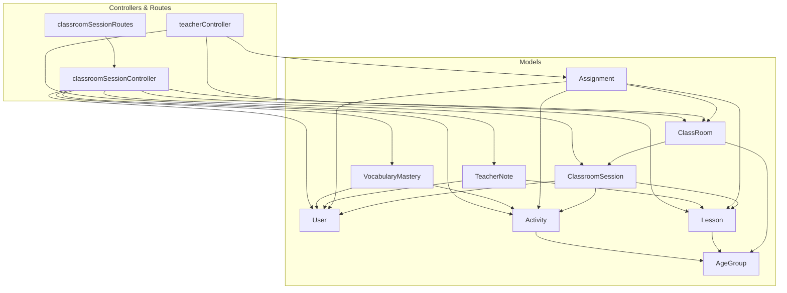
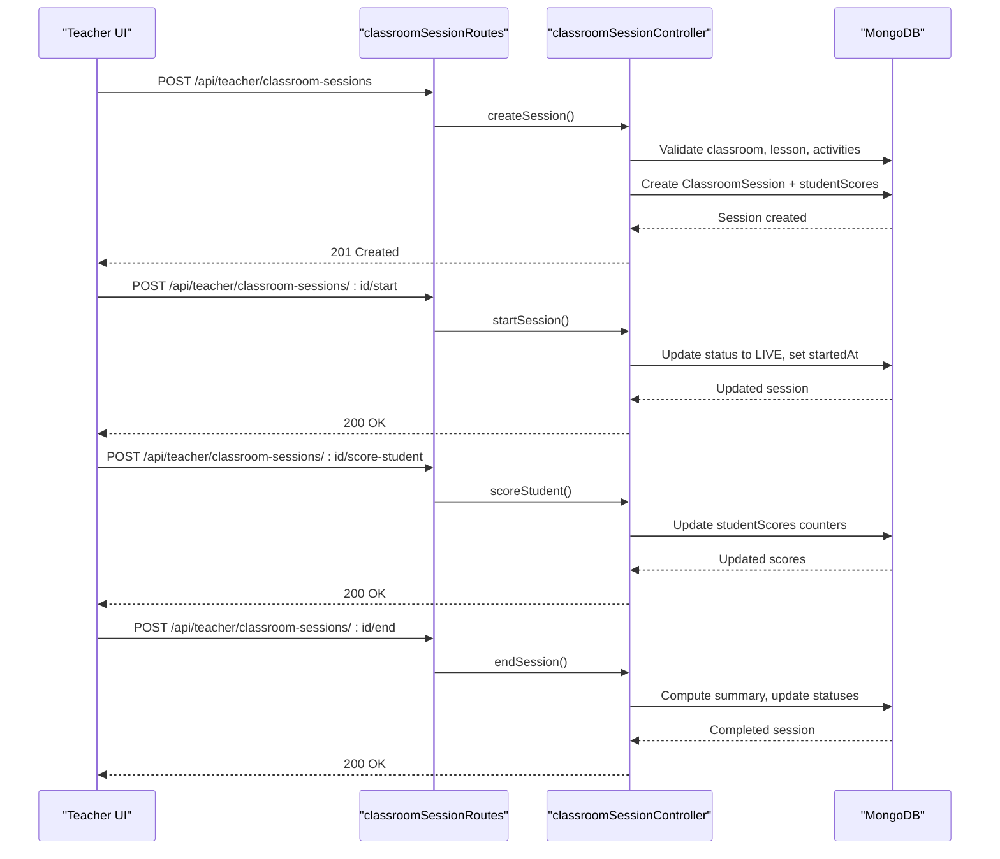
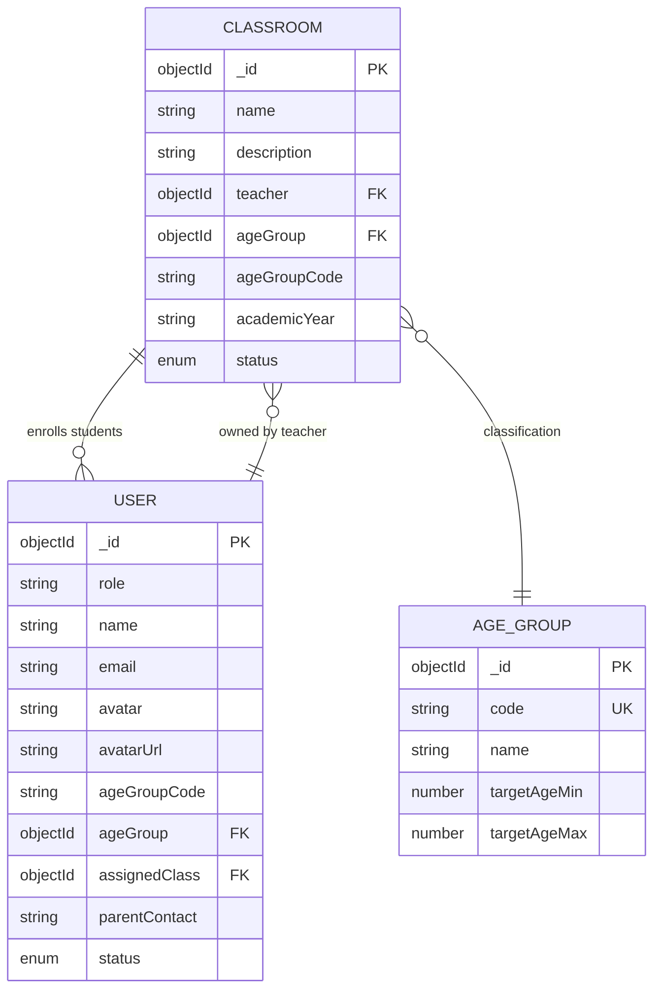
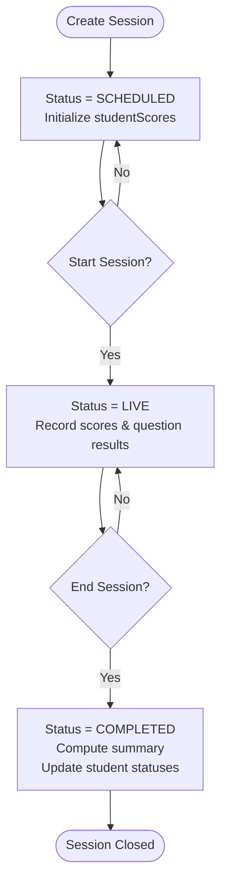
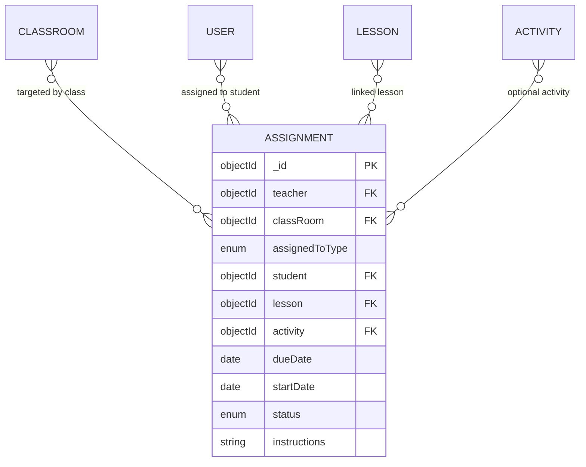
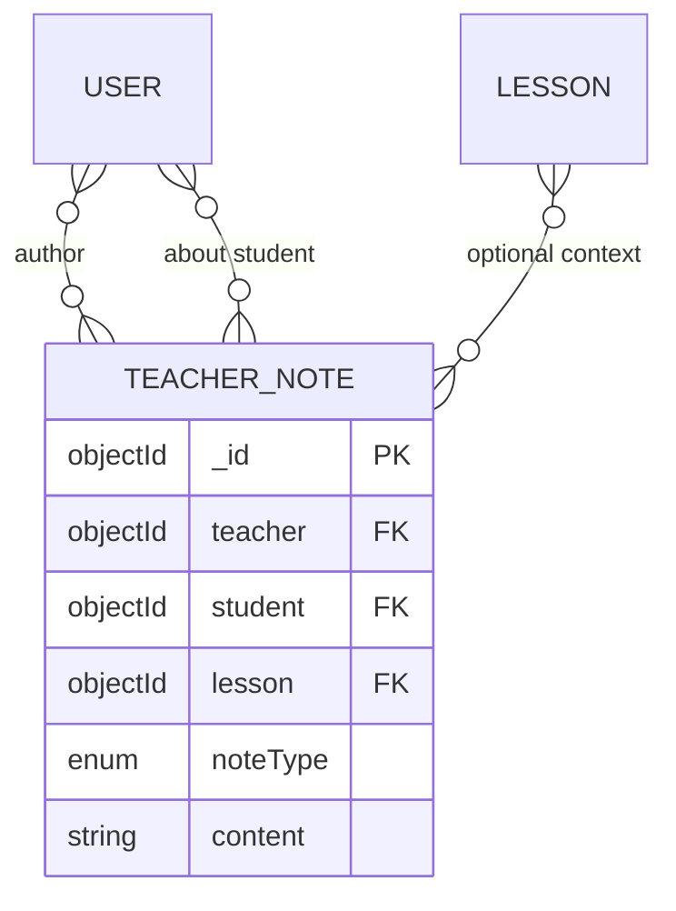
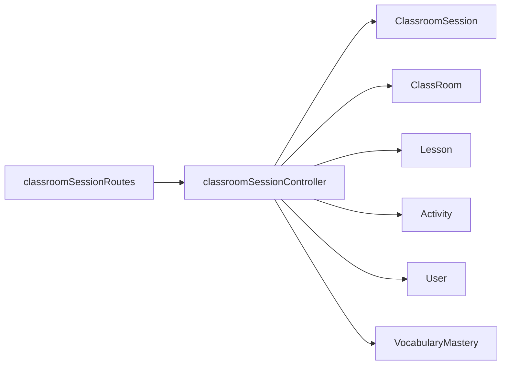

# Classroom Management Models

<cite>
**Referenced Files in This Document**
- [ClassRoom.js](file://KCEnglishKids_BE/src/models/ClassRoom.js)
- [ClassroomSession.js](file://KCEnglishKids_BE/src/models/ClassroomSession.js)
- [Assignment.js](file://KCEnglishKids_BE/src/models/Assignment.js)
- [TeacherNote.js](file://KCEnglishKids_BE/src/models/TeacherNote.js)
- [User.js](file://KCEnglishKids_BE/src/models/User.js)
- [AgeGroup.js](file://KCEnglishKids_BE/src/models/AgeGroup.js)
- [Lesson.js](file://KCEnglishKids_BE/src/models/Lesson.js)
- [Activity.js](file://KCEnglishKids_BE/src/models/Activity.js)
- [VocabularyMastery.js](file://KCEnglishKids_BE/src/models/VocabularyMastery.js)
- [classroomSessionController.js](file://KCEnglishKids_BE/src/controllers/classroomSessionController.js)
- [classroomSessionRoutes.js](file://KCEnglishKids_BE/src/routes/classroomSessionRoutes.js)
- [teacherController.js](file://KCEnglishKids_BE/src/controllers/teacherController.js)
</cite>

## Table of Contents
1. [Introduction](#introduction)
2. [Project Structure](#project-structure)
3. [Core Components](#core-components)
4. [Architecture Overview](#architecture-overview)
5. [Detailed Component Analysis](#detailed-component-analysis)
6. [Dependency Analysis](#dependency-analysis)
7. [Performance Considerations](#performance-considerations)
8. [Troubleshooting Guide](#troubleshooting-guide)
9. [Conclusion](#conclusion)

## Introduction
This document explains the data models and workflows that support classroom administration and teacher tools in KCEnglishKids. It focuses on:
- ClassRoom for organizing classrooms and enrolling students
- ClassroomSession for live session management, real-time monitoring, and performance tracking
- Assignment for homework and practice tasks distributed to classes or individual students
- TeacherNote for pedagogical observations and student feedback

It also documents relationships between classrooms, sessions, students, teachers, lessons, activities, and related entities, along with security considerations for accessing classroom data and protecting student information.

## Project Structure
The backend organizes domain logic under src/models for data schemas, src/controllers for business logic, and src/routes for API endpoints. The classroom-related models are defined in dedicated files and consumed by controllers and routes.

**Diagram sources**
- [ClassRoom.js:1-49](file://KCEnglishKids_BE/src/models/ClassRoom.js#L1-L49)
- [ClassroomSession.js:1-122](file://KCEnglishKids_BE/src/models/ClassroomSession.js#L1-L122)
- [Assignment.js:1-56](file://KCEnglishKids_BE/src/models/Assignment.js#L1-L56)
- [TeacherNote.js:1-34](file://KCEnglishKids_BE/src/models/TeacherNote.js#L1-L34)
- [User.js:1-109](file://KCEnglishKids_BE/src/models/User.js#L1-L109)
- [AgeGroup.js:1-48](file://KCEnglishKids_BE/src/models/AgeGroup.js#L1-L48)
- [Lesson.js:1-101](file://KCEnglishKids_BE/src/models/Lesson.js#L1-L101)
- [Activity.js:1-176](file://KCEnglishKids_BE/src/models/Activity.js#L1-L176)
- [VocabularyMastery.js:1-98](file://KCEnglishKids_BE/src/models/VocabularyMastery.js#L1-L98)
- [classroomSessionRoutes.js:1-28](file://KCEnglishKids_BE/src/routes/classroomSessionRoutes.js#L1-L28)
- [classroomSessionController.js:1-460](file://KCEnglishKids_BE/src/controllers/classroomSessionController.js#L1-L460)
- [teacherController.js:1-79](file://KCEnglishKids_BE/src/controllers/teacherController.js#L1-L79)

**Section sources**
- [ClassRoom.js:1-49](file://KCEnglishKids_BE/src/models/ClassRoom.js#L1-L49)
- [ClassroomSession.js:1-122](file://KCEnglishKids_BE/src/models/ClassroomSession.js#L1-L122)
- [Assignment.js:1-56](file://KCEnglishKids_BE/src/models/Assignment.js#L1-L56)
- [TeacherNote.js:1-34](file://KCEnglishKids_BE/src/models/TeacherNote.js#L1-L34)
- [classroomSessionRoutes.js:1-28](file://KCEnglishKids_BE/src/routes/classroomSessionRoutes.js#L1-L28)
- [classroomSessionController.js:1-460](file://KCEnglishKids_BE/src/controllers/classroomSessionController.js#L1-L460)
- [teacherController.js:1-79](file://KCEnglishKids_BE/src/controllers/teacherController.js#L1-L79)

## Core Components
This section summarizes the primary data models used for classroom administration and teacher tools.

- ClassRoom
  - Represents a class managed by a teacher.
  - Contains name, description, teacher reference, optional age group, academic year, enrolled student references, and status.
  - Supports enrollment via an array of student references.

- ClassroomSession
  - Represents a live teaching session tied to a classroom and teacher.
  - Tracks lesson, title, age group, lifecycle status, timing, selected activities, current activity index, per-student scores, per-question results, and generated summary metrics.
  - Includes nested schemas for studentScoreSchema and questionResultSchema.

- Assignment
  - Represents homework or practice tasks assigned by a teacher.
  - Can be assigned to an entire class or a specific student.
  - Links to a lesson and optionally an activity, with scheduling fields and status.

- TeacherNote
  - Records pedagogical observations and feedback about a student.
  - Includes note type categories and optional lesson linkage.

- Supporting Entities
  - User: Central identity model for ADMIN, TEACHER, CHILD, PARENT roles; includes authentication fields and child-specific PIN handling.
  - AgeGroup: Defines age ranges and configuration for content difficulty and question counts.
  - Lesson: Curriculum-aligned learning units with vocabulary and language content references.
  - Activity: Interactive exercises linked to lessons, with questions and scoring configuration.
  - VocabularyMastery: Tracks student mastery of vocabulary items with rule-based levels.

**Section sources**
- [ClassRoom.js:1-49](file://KCEnglishKids_BE/src/models/ClassRoom.js#L1-L49)
- [ClassroomSession.js:1-122](file://KCEnglishKids_BE/src/models/ClassroomSession.js#L1-L122)
- [Assignment.js:1-56](file://KCEnglishKids_BE/src/models/Assignment.js#L1-L56)
- [TeacherNote.js:1-34](file://KCEnglishKids_BE/src/models/TeacherNote.js#L1-L34)
- [User.js:1-109](file://KCEnglishKids_BE/src/models/User.js#L1-L109)
- [AgeGroup.js:1-48](file://KCEnglishKids_BE/src/models/AgeGroup.js#L1-L48)
- [Lesson.js:1-101](file://KCEnglishKids_BE/src/models/Lesson.js#L1-L101)
- [Activity.js:1-176](file://KCEnglishKids_BE/src/models/Activity.js#L1-L176)
- [VocabularyMastery.js:1-98](file://KCEnglishKids_BE/src/models/VocabularyMastery.js#L1-L98)

## Architecture Overview
The classroom session workflow is exposed through authenticated routes and enforced by middleware. Teachers can create, start, score, and end sessions, while the controller manages state transitions and aggregates performance data.

**Diagram sources**
- [classroomSessionRoutes.js:1-28](file://KCEnglishKids_BE/src/routes/classroomSessionRoutes.js#L1-L28)
- [classroomSessionController.js:74-136](file://KCEnglishKids_BE/src/controllers/classroomSessionController.js#L74-L136)
- [classroomSessionController.js:169-184](file://KCEnglishKids_BE/src/controllers/classroomSessionController.js#L169-L184)
- [classroomSessionController.js:267-306](file://KCEnglishKids_BE/src/controllers/classroomSessionController.js#L267-L306)
- [classroomSessionController.js:190-260](file://KCEnglishKids_BE/src/controllers/classroomSessionController.js#L190-L260)

**Section sources**
- [classroomSessionRoutes.js:1-28](file://KCEnglishKids_BE/src/routes/classroomSessionRoutes.js#L1-L28)
- [classroomSessionController.js:1-460](file://KCEnglishKids_BE/src/controllers/classroomSessionController.js#L1-L460)

## Detailed Component Analysis

### ClassRoom Model
Purpose: Organize classrooms, assign a teacher, define age group and academic year, enroll students, and track active/inactive status.

Key fields and semantics:
- name: Required classroom name.
- description: Optional description.
- teacher: Reference to User (TEACHER).
- ageGroup: Reference to AgeGroup.
- ageGroupCode: Enum code for quick filtering.
- academicYear: Default academic year string.
- students: Array of User references (CHILD).
- status: ACTIVE or INACTIVE.

Relationships:
- One teacher owns many classrooms.
- Many students can be enrolled in one classroom.
- AgeGroup provides classification and configuration.

Enrollment mechanics:
- Students are added via teacher controller methods that validate eligibility and synchronize both the classroom’s student array and the student’s assignedClass field.

**Diagram sources**
- [ClassRoom.js:1-49](file://KCEnglishKids_BE/src/models/ClassRoom.js#L1-L49)
- [User.js:1-109](file://KCEnglishKids_BE/src/models/User.js#L1-L109)
- [AgeGroup.js:1-48](file://KCEnglishKids_BE/src/models/AgeGroup.js#L1-L48)

**Section sources**
- [ClassRoom.js:1-49](file://KCEnglishKids_BE/src/models/ClassRoom.js#L1-L49)
- [teacherController.js:19-48](file://KCEnglishKids_BE/src/controllers/teacherController.js#L19-L48)

### ClassroomSession Model
Purpose: Manage live sessions, track participation, record per-question results, and generate performance summaries.

Key structures:
- studentScoreSchema: Per-student points, stars, correct/incorrect/not answered counts, and status.
- questionResultSchema: Per-question snapshot including prompt metadata and per-student answers.
- ClassroomSession fields: classroom, teacher, lesson, title, ageGroup, status, timestamps, plannedDuration, activities, currentActivityIndex, studentScores, questionResults, summary.

Lifecycle states:
- SCHEDULED: Created but not started.
- LIVE: Active session; scoring and question recording allowed.
- COMPLETED: Ended; summary computed; further scoring blocked.

Summary computation:
- Participation count based on students who answered at least one question.
- Average accuracy across all answers.
- Total stars and points aggregated from student scores.
- Students needing practice flagged when accuracy below threshold or no participation.
- Top performers derived from stars and points ranking.

**Diagram sources**
- [ClassroomSession.js:1-122](file://KCEnglishKids_BE/src/models/ClassroomSession.js#L1-L122)
- [classroomSessionController.js:74-136](file://KCEnglishKids_BE/src/controllers/classroomSessionController.js#L74-L136)
- [classroomSessionController.js:169-184](file://KCEnglishKids_BE/src/controllers/classroomSessionController.js#L169-L184)
- [classroomSessionController.js:190-260](file://KCEnglishKids_BE/src/controllers/classroomSessionController.js#L190-L260)

Real-time updates:
- scoreStudent and scoreBulk update per-student counters during LIVE sessions.
- recordQuestionResult stores per-question snapshots and increments counters.
- updateActivityIndex tracks the current activity being presented.

Attendance tracking:
- Derived from studentScores counters; participationCount reflects students with any answer attempts.

Performance reporting:
- Summary includes averageAccuracy, totalStars, totalPoints, studentsNeedingPractice, topPerformers.

**Section sources**
- [ClassroomSession.js:1-122](file://KCEnglishKids_BE/src/models/ClassroomSession.js#L1-L122)
- [classroomSessionController.js:267-411](file://KCEnglishKids_BE/src/controllers/classroomSessionController.js#L267-L411)

### Assignment Model
Purpose: Distribute homework or practice tasks to a class or individual student, with scheduling and status tracking.

Key fields and semantics:
- teacher: Reference to User (TEACHER).
- classRoom: Reference to ClassRoom.
- assignedToType: CLASS or STUDENT.
- student: Optional reference to User (CHILD) when assignedToType is STUDENT.
- lesson: Required reference to Lesson.
- activity: Optional reference to Activity.
- dueDate, startDate: Scheduling windows.
- status: ASSIGNED, IN_PROGRESS, COMPLETED, CANCELLED.
- instructions: Optional guidance text.

Distribution mechanisms:
- When assignedToType is CLASS, results are aggregated across all students in the class.
- When assignedToType is STUDENT, results are scoped to that student only.
- Status updates allow teachers to manage assignment lifecycle.

**Diagram sources**
- [Assignment.js:1-56](file://KCEnglishKids_BE/src/models/Assignment.js#L1-L56)
- [ClassRoom.js:1-49](file://KCEnglishKids_BE/src/models/ClassRoom.js#L1-L49)
- [User.js:1-109](file://KCEnglishKids_BE/src/models/User.js#L1-L109)
- [Lesson.js:1-101](file://KCEnglishKids_BE/src/models/Lesson.js#L1-L101)
- [Activity.js:1-176](file://KCEnglishKids_BE/src/models/Activity.js#L1-L176)

**Section sources**
- [Assignment.js:1-56](file://KCEnglishKids_BE/src/models/Assignment.js#L1-L56)
- [teacherController.js:66-72](file://KCEnglishKids_BE/src/controllers/teacherController.js#L66-L72)

### TeacherNote Model
Purpose: Capture pedagogical observations and feedback for individual students, optionally linked to a lesson.

Key fields and semantics:
- teacher: Reference to User (TEACHER).
- student: Reference to User (CHILD).
- lesson: Optional reference to Lesson.
- noteType: Categories such as INTEREST, VOCABULARY, PARTICIPATION, LISTENING, SPEAKING, STRENGTH, DIFFICULTY, REINFORCEMENT, GENERAL.
- content: Required trimmed text.

Usage:
- Teachers create notes scoped to their own students.
- Notes can be retrieved per student and edited/deleted only by the authoring teacher.

**Diagram sources**
- [TeacherNote.js:1-34](file://KCEnglishKids_BE/src/models/TeacherNote.js#L1-L34)
- [User.js:1-109](file://KCEnglishKids_BE/src/models/User.js#L1-L109)
- [Lesson.js:1-101](file://KCEnglishKids_BE/src/models/Lesson.js#L1-L101)

**Section sources**
- [TeacherNote.js:1-34](file://KCEnglishKids_BE/src/models/TeacherNote.js#L1-L34)
- [teacherController.js:74-77](file://KCEnglishKids_BE/src/controllers/teacherController.js#L74-L77)

### Supporting Models

#### User
- Role-based access control: ADMIN, TEACHER, CHILD, PARENT.
- Authentication: password hashing for adults; PIN hashing for children.
- Child profile: ageGroup, assignedClass, parentContact.
- Security: pre-save hooks hash credentials; matchPassword/matchPin methods verify credentials.

#### AgeGroup
- Code enumeration for age bands.
- Configuration for maxChoicesPerQuestion and defaultQuestionCount.
- Used to classify lessons, activities, and classroom cohorts.

#### Lesson
- Links to Topic, AgeGroup, and curriculum units.
- Contains vocabularyItems and languageContents references.
- Status controls visibility and availability.

#### Activity
- Rich question definitions with options, media, and explanations.
- Scoring configuration via pointsPerQuestion and starConfig thresholds.
- Linked to Lesson and AgeGroup.

#### VocabularyMastery
- Rule-based mastery calculation using streak, accuracy, and attempt thresholds.
- Auto-recalculates masteryLevel before save.

**Section sources**
- [User.js:1-109](file://KCEnglishKids_BE/src/models/User.js#L1-L109)
- [AgeGroup.js:1-48](file://KCEnglishKids_BE/src/models/AgeGroup.js#L1-L48)
- [Lesson.js:1-101](file://KCEnglishKids_BE/src/models/Lesson.js#L1-L101)
- [Activity.js:1-176](file://KCEnglishKids_BE/src/models/Activity.js#L1-L176)
- [VocabularyMastery.js:1-98](file://KCEnglishKids_BE/src/models/VocabularyMastery.js#L1-L98)

## Dependency Analysis
The classroom session feature depends on multiple models and controllers:

- classroomSessionRoutes enforces authentication and authorization for TEACHER/ADMIN roles.
- classroomSessionController validates IDs, checks ownership of sessions and classrooms, and orchestrates CRUD and scoring operations.
- Controllers populate related entities (classroom, teacher, lesson, activities, student details) for rich responses.

**Diagram sources**
- [classroomSessionRoutes.js:1-28](file://KCEnglishKids_BE/src/routes/classroomSessionRoutes.js#L1-L28)
- [classroomSessionController.js:1-460](file://KCEnglishKids_BE/src/controllers/classroomSessionController.js#L1-L460)
- [ClassroomSession.js:1-122](file://KCEnglishKids_BE/src/models/ClassroomSession.js#L1-L122)
- [ClassRoom.js:1-49](file://KCEnglishKids_BE/src/models/ClassRoom.js#L1-L49)
- [Lesson.js:1-101](file://KCEnglishKids_BE/src/models/Lesson.js#L1-L101)
- [Activity.js:1-176](file://KCEnglishKids_BE/src/models/Activity.js#L1-L176)
- [User.js:1-109](file://KCEnglishKids_BE/src/models/User.js#L1-L109)
- [VocabularyMastery.js:1-98](file://KCEnglishKids_BE/src/models/VocabularyMastery.js#L1-L98)

**Section sources**
- [classroomSessionRoutes.js:1-28](file://KCEnglishKids_BE/src/routes/classroomSessionRoutes.js#L1-L28)
- [classroomSessionController.js:1-460](file://KCEnglishKids_BE/src/controllers/classroomSessionController.js#L1-L460)

## Performance Considerations
- Indexes:
  - ClassroomSession indexes on classroom+status and teacher+createdAt improve query performance for listing and filtering.
  - Lesson and Activity indexes on ageGroupCode and status aid content retrieval.
  - VocabularyMastery has a unique compound index on student+vocabulary to prevent duplicates.
- Aggregations:
  - Dashboard and class detail endpoints aggregate activity results to compute averages and totals; consider caching frequently accessed aggregates if traffic increases.
- Population:
  - Heavy population calls in session retrieval and summary endpoints should be optimized by selecting only necessary fields and limiting result sets.
- Cleanup:
  - Stale SCHEDULED/LIVE sessions older than 24 hours are automatically deleted to keep data manageable.

[No sources needed since this section provides general guidance]

## Troubleshooting Guide
Common issues and resolutions:

- Access denied errors:
  - Ensure requests include valid authentication tokens and that the user role is TEACHER or ADMIN for classroom session routes.
  - Verify that the teacher owns the classroom or session being accessed.

- Invalid ID errors:
  - Confirm that all referenced IDs (classroomId, lessonId, activityId, studentId) are valid MongoDB ObjectIds.

- Cannot score after session ends:
  - Scoring endpoints reject updates once session status is COMPLETED.

- Student not found in session:
  - Ensure the student is enrolled in the classroom associated with the session.

- Lesson or activity unavailable:
  - Only ACTIVE lessons and activities can be referenced when creating sessions or assignments.

- Note editing/deletion permissions:
  - Teachers can only edit or delete their own notes; ensure the request originates from the note author.

**Section sources**
- [classroomSessionController.js:11-16](file://KCEnglishKids_BE/src/controllers/classroomSessionController.js#L11-L16)
- [classroomSessionController.js:74-136](file://KCEnglishKids_BE/src/controllers/classroomSessionController.js#L74-L136)
- [classroomSessionController.js:169-184](file://KCEnglishKids_BE/src/controllers/classroomSessionController.js#L169-L184)
- [classroomSessionController.js:267-306](file://KCEnglishKids_BE/src/controllers/classroomSessionController.js#L267-L306)
- [teacherController.js:74-77](file://KCEnglishKids_BE/src/controllers/teacherController.js#L74-L77)

## Conclusion
KCEnglishKids’ classroom management models provide a robust foundation for organizing classrooms, managing live sessions, distributing assignments, and capturing pedagogical insights. The data structures support real-time participation tracking, attendance aggregation, and performance reporting, while role-based access control and credential hashing protect sensitive student data. Proper use of indexes, validation, and ownership checks ensures secure and efficient operations across the system.

[No sources needed since this section summarizes without analyzing specific files]