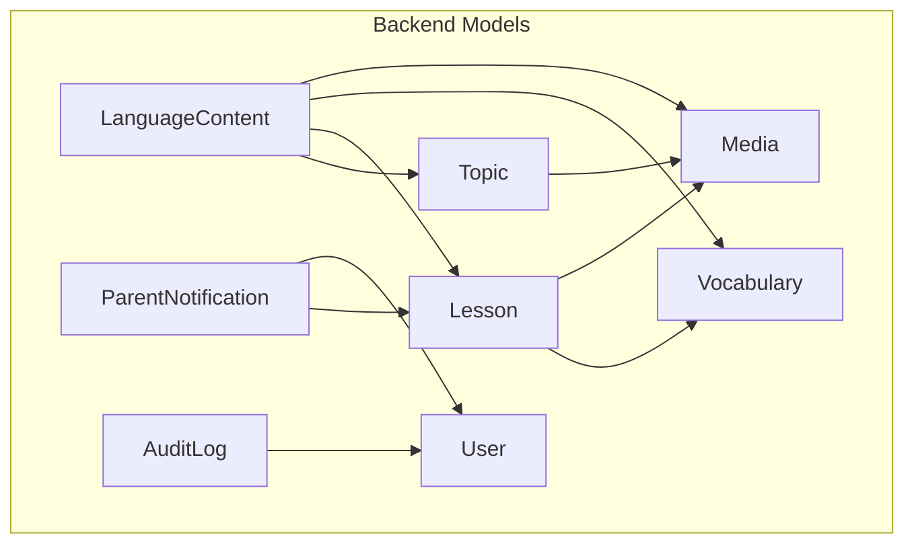
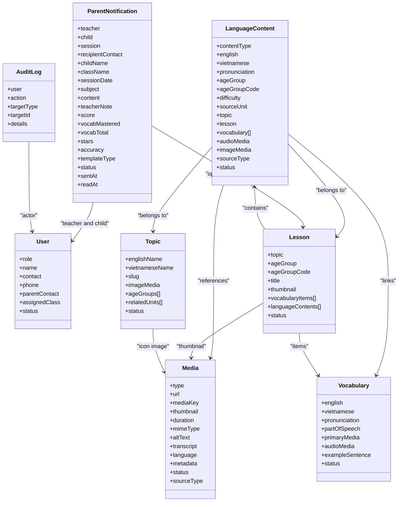
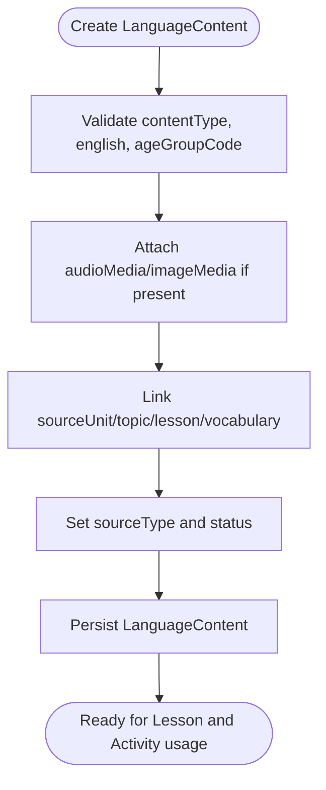
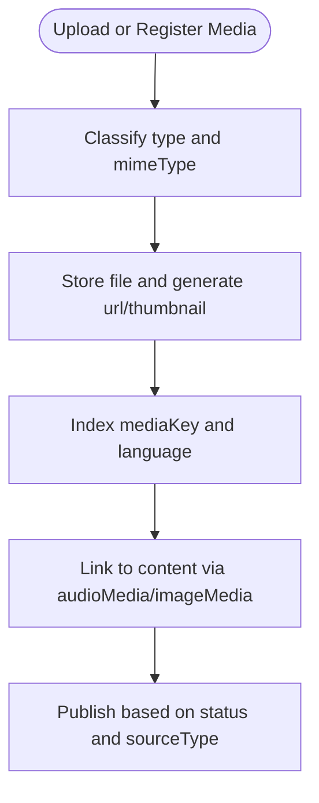
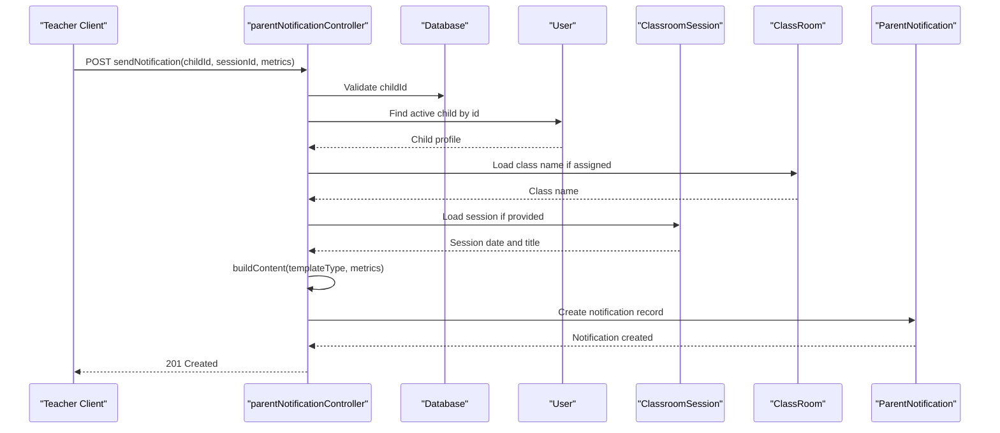
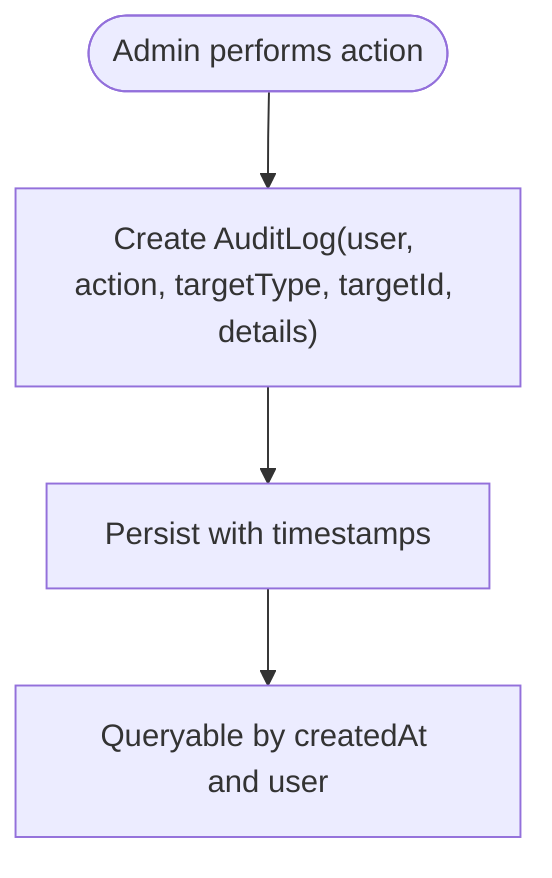
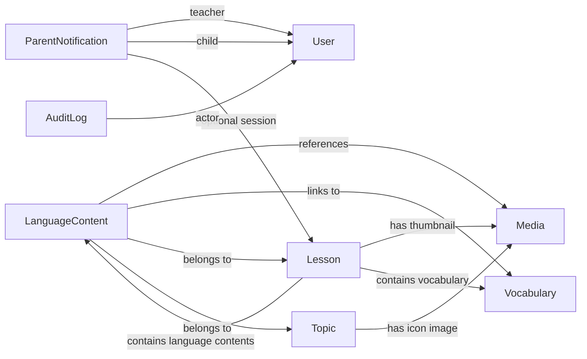

# Content & Media Models

<cite>
**Referenced Files in This Document**   
- [LanguageContent.js](file://KCEnglishKids_BE/src/models/LanguageContent.js)
- [Media.js](file://KCEnglishKids_BE/src/models/Media.js)
- [ParentNotification.js](file://KCEnglishKids_BE/src/models/ParentNotification.js)
- [AuditLog.js](file://KCEnglishKids_BE/src/models/AuditLog.js)
- [parentNotificationController.js](file://KCEnglishKids_BE/src/controllers/parentNotificationController.js)
- [User.js](file://KCEnglishKids_BE/src/models/User.js)
- [Lesson.js](file://KCEnglishKids_BE/src/models/Lesson.js)
- [Topic.js](file://KCEnglishKids_BE/src/models/Topic.js)
- [Vocabulary.js](file://KCEnglishKids_BE/src/models/Vocabulary.js)
- [languagecontents.json](file://KCEnglishKids_BE/data_backup/languagecontents.json)
- [media.json](file://KCEnglishKids_BE/data_backup/media.json)
- [parentnotifications.json](file://KCEnglishKids_BE/data_backup/parentnotifications.json)
</cite>

## Table of Contents
1. [Introduction](#introduction)
2. [Project Structure](#project-structure)
3. [Core Components](#core-components)
4. [Architecture Overview](#architecture-overview)
5. [Detailed Component Analysis](#detailed-component-analysis)
6. [Dependency Analysis](#dependency-analysis)
7. [Performance Considerations](#performance-considerations)
8. [Security and Compliance](#security-and-compliance)
9. [Troubleshooting Guide](#troubleshooting-guide)
10. [Conclusion](#conclusion)

## Introduction
This document explains the data models used for content management and system administration in KCEnglishKids. It focuses on:
- LanguageContent for multilingual text, pronunciation, curriculum linkage, and media references.
- Media for asset metadata including images, audio, animations, videos, and Lottie assets.
- ParentNotification for parent communication, session-linked progress reports, and notification templates.
- AuditLog for tracking administrative actions and compliance events.

It also documents field definitions, relationships, file storage strategies, content versioning approaches, notification delivery mechanisms, and security considerations for moderation, upload validation, and audit integrity.

## Project Structure
The relevant backend data models live under `KCEnglishKids_BE/src/models`. Sample seed and backup data are stored under `KCEnglishKids_BE/data_backup`. The parent notification workflow is implemented in a controller that composes notifications from child, class, and session data.

**Diagram sources**
- [LanguageContent.js:1-75](file://KCEnglishKids_BE/src/models/LanguageContent.js#L1-L75)
- [Media.js:1-57](file://KCEnglishKids_BE/src/models/Media.js#L1-L57)
- [ParentNotification.js:1-90](file://KCEnglishKids_BE/src/models/ParentNotification.js#L1-L90)
- [AuditLog.js:1-34](file://KCEnglishKids_BE/src/models/AuditLog.js#L1-L34)
- [User.js:1-109](file://KCEnglishKids_BE/src/models/User.js#L1-L109)
- [Lesson.js:1-101](file://KCEnglishKids_BE/src/models/Lesson.js#L1-L101)
- [Topic.js:1-78](file://KCEnglishKids_BE/src/models/Topic.js#L1-L78)
- [Vocabulary.js:1-110](file://KCEnglishKids_BE/src/models/Vocabulary.js#L1-L110)

**Section sources**
- [LanguageContent.js:1-75](file://KCEnglishKids_BE/src/models/LanguageContent.js#L1-L75)
- [Media.js:1-57](file://KCEnglishKids_BE/src/models/Media.js#L1-L57)
- [ParentNotification.js:1-90](file://KCEnglishKids_BE/src/models/ParentNotification.js#L1-L90)
- [AuditLog.js:1-34](file://KCEnglishKids_BE/src/models/AuditLog.js#L1-L34)
- [User.js:1-109](file://KCEnglishKids_BE/src/models/User.js#L1-L109)
- [Lesson.js:1-101](file://KCEnglishKids_BE/src/models/Lesson.js#L1-L101)
- [Topic.js:1-78](file://KCEnglishKids_BE/src/models/Topic.js#L1-L78)
- [Vocabulary.js:1-110](file://KCEnglishKids_BE/src/models/Vocabulary.js#L1-L110)

## Core Components
This section summarizes the four core models and their responsibilities.

### LanguageContent
- Purpose: Stores curriculum-aligned language items such as words, phrases, sentences, questions, answers, instructions, patterns, oracy prompts, and dialogues.
- Key capabilities:
  - Multilingual text via English and Vietnamese fields.
  - Optional pronunciation guidance.
  - Age group targeting through both ObjectId and code.
  - Curriculum linkage to units, topics, lessons, and vocabulary.
  - Media attachment points for audio and image assets.
  - Source classification and status control.

**Section sources**
- [LanguageContent.js:1-75](file://KCEnglishKids_BE/src/models/LanguageContent.js#L1-L75)
- [languagecontents.json:1-800](file://KCEnglishKids_BE/data_backup/languagecontents.json#L1-L800)

### Media
- Purpose: Centralized asset registry for images, audio, animations, videos, and Lottie files.
- Key capabilities:
  - Type enumeration for asset categories.
  - URL-based storage with optional thumbnail and MIME type.
  - Accessibility support via alt text and transcripts.
  - Language tagging and flexible metadata.
  - Status and source classification.

**Section sources**
- [Media.js:1-57](file://KCEnglishKids_BE/src/models/Media.js#L1-L57)
- [media.json:1-800](file://KCEnglishKids_BE/data_backup/media.json#L1-L800)

### ParentNotification
- Purpose: Records teacher-to-parent learning updates and progress reports.
- Key capabilities:
  - Links to teacher, child, and optional classroom session.
  - Denormalized snapshot fields for child name, class name, and session date.
  - Template-driven content generation for session reports, progress updates, and general messages.
  - Metrics capture for score, vocabulary mastery, stars, and accuracy.
  - Delivery state tracking with sent timestamps and optional read tracking.

**Section sources**
- [ParentNotification.js:1-90](file://KCEnglishKids_BE/src/models/ParentNotification.js#L1-L90)
- [parentNotificationController.js:1-301](file://KCEnglishKids_BE/src/controllers/parentNotificationController.js#L1-L301)
- [parentnotifications.json:1-800](file://KCEnglishKids_BE/data_backup/parentnotifications.json#L1-L800)

### AuditLog
- Purpose: Tracks administrative actions for compliance and operational visibility.
- Key capabilities:
  - Actor identification via user reference.
  - Action categorization for user lifecycle and content toggling.
  - Target typing and optional target ID for granular traceability.
  - Flexible details payload for change context.
  - Time-indexed ordering for efficient auditing.

**Section sources**
- [AuditLog.js:1-34](file://KCEnglishKids_BE/src/models/AuditLog.js#L1-L34)

## Architecture Overview
The content and media architecture centers around LanguageContent as the primary curriculum item, enriched by Media assets and linked to higher-level Lesson and Topic structures. ParentNotification provides a reporting layer that connects teaching outcomes to parents. AuditLog records administrative changes across the system.

**Diagram sources**
- [LanguageContent.js:1-75](file://KCEnglishKids_BE/src/models/LanguageContent.js#L1-L75)
- [Media.js:1-57](file://KCEnglishKids_BE/src/models/Media.js#L1-L57)
- [ParentNotification.js:1-90](file://KCEnglishKids_BE/src/models/ParentNotification.js#L1-L90)
- [AuditLog.js:1-34](file://KCEnglishKids_BE/src/models/AuditLog.js#L1-L34)
- [User.js:1-109](file://KCEnglishKids_BE/src/models/User.js#L1-L109)
- [Lesson.js:1-101](file://KCEnglishKids_BE/src/models/Lesson.js#L1-L101)
- [Topic.js:1-78](file://KCEnglishKids_BE/src/models/Topic.js#L1-L78)
- [Vocabulary.js:1-110](file://KCEnglishKids_BE/src/models/Vocabulary.js#L1-L110)

## Detailed Component Analysis

### LanguageContent Model
LanguageContent represents a single piece of curriculum-aligned language material. It supports multiple content types and links to related entities.

- Field semantics:
  - contentType: Enumerated category describing whether the item is a word, phrase, sentence, question, answer, instruction, pattern, oracy prompt, or dialogue.
  - english: Required base text.
  - vietnamese: Optional localized translation.
  - pronunciation: Optional phonetic or pronunciation hint.
  - ageGroup / ageGroupCode: Target audience segmentation.
  - difficulty: Numeric difficulty level.
  - sourceUnit / topic / lesson: Curriculum hierarchy linkage.
  - vocabulary: Array of related vocabulary entries.
  - audioMedia / imageMedia: References to Media assets.
  - sourceType: Origin classification (official curriculum, system design, generated content).
  - status: Lifecycle state (active, inactive, hidden).

- Data flow:
  - Content is typically seeded from curriculum datasets and referenced by lessons and activities.
  - Media attachments provide audio playback and visual support.

**Diagram sources**
- [LanguageContent.js:1-75](file://KCEnglishKids_BE/src/models/LanguageContent.js#L1-L75)

**Section sources**
- [LanguageContent.js:1-75](file://KCEnglishKids_BE/src/models/LanguageContent.js#L1-L75)
- [languagecontents.json:1-800](file://KCEnglishKids_BE/data_backup/languagecontents.json#L1-L800)

### Media Model
Media stores asset metadata and pointers to actual files or URLs.

- Field semantics:
  - type: Asset category (image, audio, animation, video, lottie).
  - url: Storage location; can be external URL or embedded data URI.
  - mediaKey: Stable identifier for lookup and deduplication.
  - thumbnail: Optional preview image.
  - duration: Duration for audio/video.
  - mimeType: File type hint.
  - altText: Accessibility description.
  - transcript: Text representation for audio/video.
  - language: Default language tag.
  - metadata: Flexible extension object.
  - status: Lifecycle state.
  - sourceType: Origin classification.

- Storage strategy:
  - The model does not enforce local storage; it accepts any URL, including data URIs and remote endpoints.
  - For production, recommend storing files in a secure object store and keeping only URLs here.
  - Use mediaKey for consistent referencing across LanguageContent, Vocabulary, and Lesson.

**Diagram sources**
- [Media.js:1-57](file://KCEnglishKids_BE/src/models/Media.js#L1-L57)

**Section sources**
- [Media.js:1-57](file://KCEnglishKids_BE/src/models/Media.js#L1-L57)
- [media.json:1-800](file://KCEnglishKids_BE/data_backup/media.json#L1-L800)

### ParentNotification Model and Workflow
ParentNotification captures teacher-generated reports for parents, with template-driven content and optional session linkage.

- Field semantics:
  - teacher: Administering teacher.
  - child: Child receiving the report.
  - session: Optional ClassroomSession reference.
  - recipientContact: Derived contact from child’s parentContact, contact, or phone.
  - childName / className / sessionDate: Snapshot fields for self-contained reports.
  - subject / content / teacherNote: Human-readable message body.
  - score / vocabMastered / vocabTotal / stars / accuracy: Learning metrics.
  - templateType: SESSION_REPORT, PROGRESS_UPDATE, or GENERAL.
  - status: DRAFT or SENT.
  - sentAt / readAt: Delivery and read timestamps.

- Controller workflow:
  - Single send: Validates child, resolves contact, loads class and session, builds content, creates notification.
  - Bulk send: Iterates child reports, builds content per child, creates notifications in batch.
  - Listing: Returns recent notifications with populated child and session data.

**Diagram sources**
- [parentNotificationController.js:15-99](file://KCEnglishKids_BE/src/controllers/parentNotificationController.js#L15-L99)
- [ParentNotification.js:1-90](file://KCEnglishKids_BE/src/models/ParentNotification.js#L1-L90)
- [User.js:1-109](file://KCEnglishKids_BE/src/models/User.js#L1-L109)

**Section sources**
- [ParentNotification.js:1-90](file://KCEnglishKids_BE/src/models/ParentNotification.js#L1-L90)
- [parentNotificationController.js:1-301](file://KCEnglishKids_BE/src/controllers/parentNotificationController.js#L1-L301)
- [parentnotifications.json:1-800](file://KCEnglishKids_BE/data_backup/parentnotifications.json#L1-L800)

### AuditLog Model
AuditLog records administrative actions with actor, action type, target, and details.

- Field semantics:
  - user: Actor performing the action.
  - action: Categorized operation (e.g., create/update user, lock/unlock, toggle topic/lesson).
  - targetType: Entity type affected.
  - targetId: Optional specific entity ID.
  - details: Flexible JSON-like payload for additional context.

- Usage:
  - Integrate into admin controllers to log sensitive operations.
  - Use indexes for time-based queries and compliance reporting.

**Diagram sources**
- [AuditLog.js:1-34](file://KCEnglishKids_BE/src/models/AuditLog.js#L1-L34)

**Section sources**
- [AuditLog.js:1-34](file://KCEnglishKids_BE/src/models/AuditLog.js#L1-L34)

## Dependency Analysis
Relationships between models define how content, assets, and communications interconnect.

**Diagram sources**
- [LanguageContent.js:1-75](file://KCEnglishKids_BE/src/models/LanguageContent.js#L1-L75)
- [Media.js:1-57](file://KCEnglishKids_BE/src/models/Media.js#L1-L57)
- [ParentNotification.js:1-90](file://KCEnglishKids_BE/src/models/ParentNotification.js#L1-L90)
- [AuditLog.js:1-34](file://KCEnglishKids_BE/src/models/AuditLog.js#L1-L34)
- [User.js:1-109](file://KCEnglishKids_BE/src/models/User.js#L1-L109)
- [Lesson.js:1-101](file://KCEnglishKids_BE/src/models/Lesson.js#L1-L101)
- [Topic.js:1-78](file://KCEnglishKids_BE/src/models/Topic.js#L1-L78)
- [Vocabulary.js:1-110](file://KCEnglishKids_BE/src/models/Vocabulary.js#L1-L110)

**Section sources**
- [LanguageContent.js:1-75](file://KCEnglishKids_BE/src/models/LanguageContent.js#L1-L75)
- [Media.js:1-57](file://KCEnglishKids_BE/src/models/Media.js#L1-L57)
- [ParentNotification.js:1-90](file://KCEnglishKids_BE/src/models/ParentNotification.js#L1-L90)
- [AuditLog.js:1-34](file://KCEnglishKids_BE/src/models/AuditLog.js#L1-L34)
- [User.js:1-109](file://KCEnglishKids_BE/src/models/User.js#L1-L109)
- [Lesson.js:1-101](file://KCEnglishKids_BE/src/models/Lesson.js#L1-L101)
- [Topic.js:1-78](file://KCEnglishKids_BE/src/models/Topic.js#L1-L78)
- [Vocabulary.js:1-110](file://KCEnglishKids_BE/src/models/Vocabulary.js#L1-L110)

## Performance Considerations
- Indexes:
  - ParentNotification uses compound indexes for teacher+createdAt and child+createdAt to optimize listing and filtering.
  - AuditLog indexes createdAt for chronological queries.
  - Vocabulary and Lesson include indexes for ageGroupCodes and status to improve filtered retrieval.
- Population:
  - Notification listing populates child and session fields; ensure population depth is controlled to avoid N+1 queries.
- Media loading:
  - Prefer lazy-loading thumbnails and large assets; cache frequently accessed media URLs at the application layer.
- Content queries:
  - Filter LanguageContent by contentType, ageGroupCode, and status to reduce result sets.
- Bulk operations:
  - Use bulk creation for notifications and audit logs where possible to reduce round-trips.

[No sources needed since this section provides general guidance]

## Security and Compliance
- Content moderation:
  - Enforce status controls (ACTIVE/INACTIVE/HIDDEN) for LanguageContent and Media to prevent exposure of unreviewed content.
  - Validate contentType, sourceType, and status enums at schema level.
- Media upload validation:
  - Validate mimeType against allowed types before accepting uploads.
  - Enforce size limits and scan for malicious payloads.
  - Avoid storing executable content; prefer safe formats like SVG, PNG, MP3, MP4.
  - Sanitize altText and transcript to prevent XSS when rendering.
- Notification delivery:
  - Validate child role and ACTIVE status before sending reports.
  - Derive recipientContact safely from child.parentContact, contact, or phone.
  - Do not expose internal IDs or sensitive fields in public endpoints.
- Audit log integrity:
  - Ensure every sensitive admin action writes an AuditLog entry with immutable details.
  - Restrict write access to AuditLog to trusted server-side processes.
  - Retain audit logs according to compliance requirements and protect them from tampering.

**Section sources**
- [LanguageContent.js:1-75](file://KCEnglishKids_BE/src/models/LanguageContent.js#L1-L75)
- [Media.js:1-57](file://KCEnglishKids_BE/src/models/Media.js#L1-L57)
- [ParentNotification.js:1-90](file://KCEnglishKids_BE/src/models/ParentNotification.js#L1-L90)
- [AuditLog.js:1-34](file://KCEnglishKids_BE/src/models/AuditLog.js#L1-L34)
- [parentNotificationController.js:15-99](file://KCEnglishKids_BE/src/controllers/parentNotificationController.js#L15-L99)

## Troubleshooting Guide
- Missing media references:
  - If LanguageContent.audioMedia or imageMedia is set but the Media record is missing, verify referential integrity and re-link assets.
- Empty localization:
  - If vietnamese is empty, ensure content creators populate translations; UI should gracefully fall back to english.
- Notification delivery failures:
  - Check child.role and child.status; only ACTIVE CHILD users should receive notifications.
  - Verify recipientContact resolution order: parentContact > contact > phone.
- Audit gaps:
  - If expected AuditLog entries are missing, confirm that admin controllers invoke logging for all sensitive mutations.
- Performance issues:
  - Reduce population depth in notification listings.
  - Add appropriate filters for contentType, ageGroupCode, and status when querying LanguageContent.

**Section sources**
- [parentNotificationController.js:15-99](file://KCEnglishKids_BE/src/controllers/parentNotificationController.js#L15-L99)
- [ParentNotification.js:1-90](file://KCEnglishKids_BE/src/models/ParentNotification.js#L1-L90)
- [LanguageContent.js:1-75](file://KCEnglishKids_BE/src/models/LanguageContent.js#L1-L75)
- [AuditLog.js:1-34](file://KCEnglishKids_BE/src/models/AuditLog.js#L1-L34)

## Conclusion
KCEnglishKids’ data model for content and administration centers on LanguageContent as the curriculum anchor, Media as the asset registry, ParentNotification as the communication bridge, and AuditLog as the compliance backbone. Together they enable multilingual content delivery, structured media management, reliable parent reporting, and auditable system operations. Proper validation, indexing, and security practices ensure scalability, safety, and maintainability.

[No sources needed since this section summarizes without analyzing specific files]