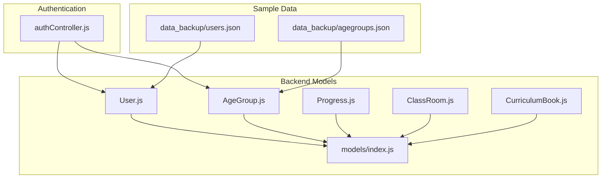
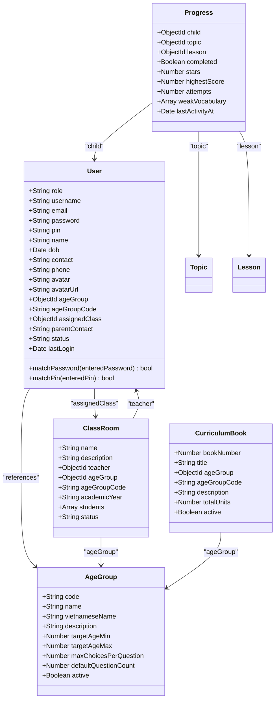
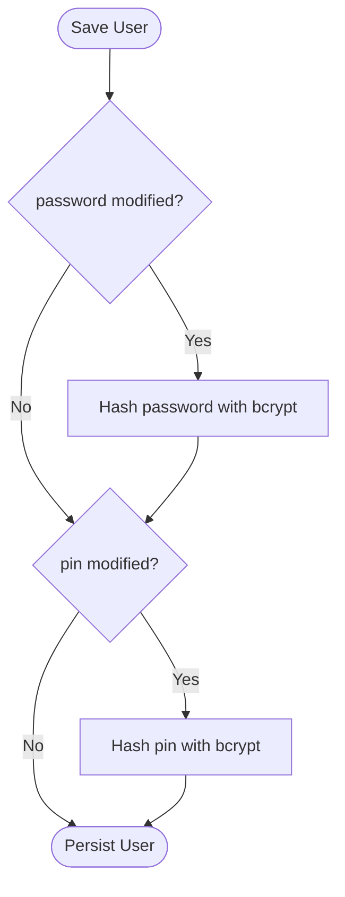
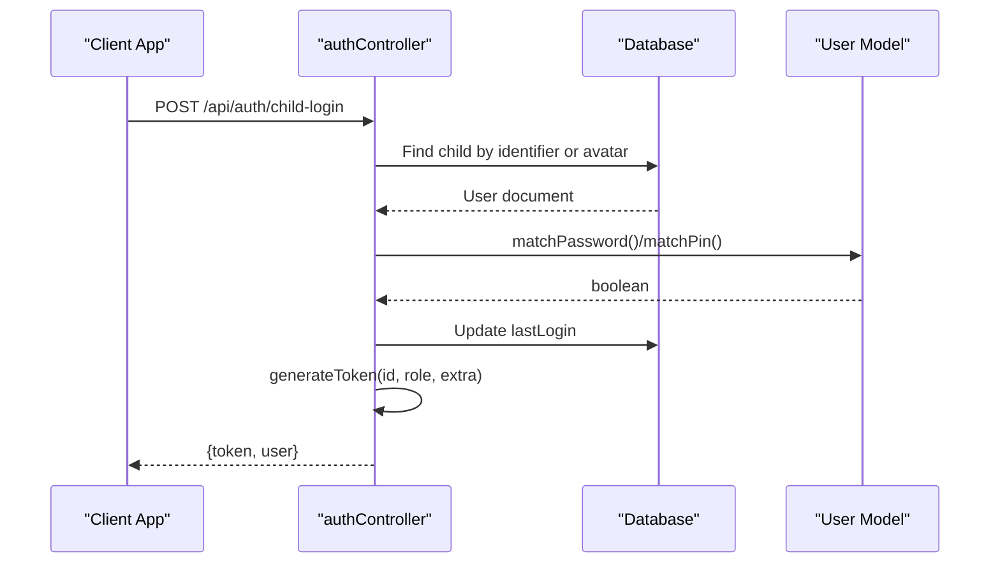
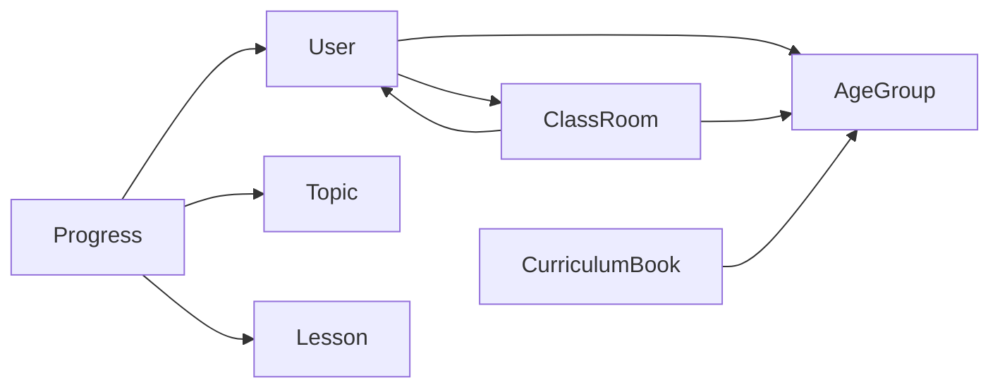

# Core Models

<cite>
**Referenced Files in This Document**   
- [User.js](file://KCEnglishKids_BE/src/models/User.js)
- [AgeGroup.js](file://KCEnglishKids_BE/src/models/AgeGroup.js)
- [Progress.js](file://KCEnglishKids_BE/src/models/Progress.js)
- [ClassRoom.js](file://KCEnglishKids_BE/src/models/ClassRoom.js)
- [CurriculumBook.js](file://KCEnglishKids_BE/src/models/CurriculumBook.js)
- [index.js](file://KCEnglishKids_BE/src/models/index.js)
- [authController.js](file://KCEnglishKids_BE/src/controllers/authController.js)
- [users.json](file://KCEnglishKids_BE/data_backup/users.json)
- [agegroups.json](file://KCEnglishKids_BE/data_backup/agegroups.json)
</cite>

## Table of Contents
1. [Introduction](#introduction)
2. [Project Structure](#project-structure)
3. [Core Components](#core-components)
4. [Architecture Overview](#architecture-overview)
5. [Detailed Component Analysis](#detailed-component-analysis)
6. [Dependency Analysis](#dependency-analysis)
7. [Performance Considerations](#performance-considerations)
8. [Security Considerations](#security-considerations)
9. [Troubleshooting Guide](#troubleshooting-guide)
10. [Conclusion](#conclusion)

## Introduction
This document explains the core data models that power KCEnglishKids, focusing on the User model with its multi-role system (CHILD, TEACHER, ADMIN), authentication fields, PIN-based access for children, and role-based permissions. It also documents the AgeGroup model used to filter content by age range, along with related entities such as Progress tracking, classroom enrollment, and curriculum access. Field definitions, data types, validation rules, business constraints, relationships, and security considerations are covered so both technical and non-technical readers can understand how these models support the application architecture.

## Project Structure
The core models live under the backend models directory and are exported through a central index file. Authentication logic that uses these models is implemented in the auth controller. Sample seed data for users and age groups is stored in JSON backups for reference.

**Diagram sources**
- [index.js:1-45](file://KCEnglishKids_BE/src/models/index.js#L1-L45)
- [authController.js:1-10](file://KCEnglishKids_BE/src/controllers/authController.js#L1-L10)
- [users.json:1-16](file://KCEnglishKids_BE/data_backup/users.json#L1-L16)
- [agegroups.json:1-15](file://KCEnglishKids_BE/data_backup/agegroups.json#L1-L15)

**Section sources**
- [index.js:1-45](file://KCEnglishKids_BE/src/models/index.js#L1-L45)
- [authController.js:1-10](file://KCEnglishKids_BE/src/controllers/authController.js#L1-L10)
- [users.json:1-16](file://KCEnglishKids_BE/data_backup/users.json#L1-L16)
- [agegroups.json:1-15](file://KCEnglishKids_BE/data_backup/agegroups.json#L1-L15)

## Core Components
This section summarizes the primary entities and their responsibilities:

- User: Central identity entity supporting roles CHILD, TEACHER, ADMIN, and PARENT; stores credentials, profile metadata, age group assignment, class assignment, and status.
- AgeGroup: Defines age ranges and learning configuration parameters for content filtering.
- Progress: Tracks per-child completion, scores, attempts, and vocabulary weaknesses per lesson/topic.
- ClassRoom: Represents a teacher-managed class with students and an associated age group.
- CurriculumBook: Links curriculum books to specific age groups.

Key behaviors:
- Role-based access control via JWT tokens generated after successful login.
- Password hashing and PIN hashing using bcrypt before persistence.
- Age-group scoping for child registration and content exposure.
- Classroom enrollment linking children to teachers and classes.

**Section sources**
- [User.js:4-82](file://KCEnglishKids_BE/src/models/User.js#L4-L82)
- [AgeGroup.js:3-45](file://KCEnglishKids_BE/src/models/AgeGroup.js#L3-L45)
- [Progress.js:3-59](file://KCEnglishKids_BE/src/models/Progress.js#L3-L59)
- [ClassRoom.js:3-46](file://KCEnglishKids_BE/src/models/ClassRoom.js#L3-L46)
- [CurriculumBook.js:3-38](file://KCEnglishKids_BE/src/models/CurriculumBook.js#L3-L38)
- [authController.js:4-10](file://KCEnglishKids_BE/src/controllers/authController.js#L4-L10)

## Architecture Overview
The core models form a layered data architecture:
- Identity and access layer: User model with hashed credentials and role-based token issuance.
- Content scoping layer: AgeGroup and CurriculumBook define what content is appropriate for which age range.
- Learning outcomes layer: Progress records capture child performance against lessons and topics.
- Organizational layer: ClassRoom connects teachers, students, and age groups.

**Diagram sources**
- [User.js:4-82](file://KCEnglishKids_BE/src/models/User.js#L4-L82)
- [AgeGroup.js:3-45](file://KCEnglishKids_BE/src/models/AgeGroup.js#L3-L45)
- [Progress.js:3-59](file://KCEnglishKids_BE/src/models/Progress.js#L3-L59)
- [ClassRoom.js:3-46](file://KCEnglishKids_BE/src/models/ClassRoom.js#L3-L46)
- [CurriculumBook.js:3-38](file://KCEnglishKids_BE/src/models/CurriculumBook.js#L3-L38)

## Detailed Component Analysis

### User Model
Purpose:
- Stores user identities across roles: CHILD, TEACHER, ADMIN, and PARENT.
- Supports two authentication methods:
  - Email/username/password for adults (ADMIN, TEACHER).
  - Avatar + 4-digit PIN for quick classroom login for CHILD.
- Tracks profile information, age group assignment, classroom assignment, and account status.

Key fields and constraints:
- role: Enumerated values include ADMIN, TEACHER, CHILD, PARENT; required and indexed.
- username/email: Unique and sparse; trimmed; email lowercased.
- password/pin: Stored as bcrypt hashes; optional depending on role and login method.
- name: Required and trimmed.
- dob: Optional date of birth for age classification.
- contact/phone: Optional contact info; trimmed; phone sparse.
- avatar/avatarUrl: Visual identity for children; default avatar key provided.
- ageGroup/ageGroupCode: References AgeGroup and mirrors code for fast filtering.
- assignedClass: Reference to ClassRoom for teacher-student association.
- parentContact: Optional parent contact for notifications.
- status: Enum ACTIVE, INACTIVE, LOCKED; defaults to ACTIVE.
- lastLogin: Timestamp updated on successful login.

Validation and hooks:
- Pre-save hook hashes password and pin when modified.
- Methods matchPassword and matchPin compare plaintext inputs against stored hashes.

Relationships:
- ageGroup: Many-to-one with AgeGroup.
- assignedClass: Many-to-one with ClassRoom.
- Progress.child: Many-to-one from Progress to User.

Business rules:
- Children can authenticate via either password or PIN; adult accounts use password only.
- Status controls login eligibility (e.g., ACTIVE).
- Age group code must be one of '3-4', '4-5', '5-6'.

Security:
- Passwords and PINs are never stored in plaintext.
- Sensitive fields are excluded from profile responses.

**Diagram sources**
- [User.js:84-94](file://KCEnglishKids_BE/src/models/User.js#L84-L94)

**Section sources**
- [User.js:4-109](file://KCEnglishKids_BE/src/models/User.js#L4-L109)

### AgeGroup Model
Purpose:
- Defines age-appropriate content categories and learning parameters.
- Provides codes '3-4', '4-5', '5-6' used throughout the app for scoping.

Key fields and constraints:
- code: Required, unique, enumerated to '3-4', '4-5', '5-6'; indexed.
- name/vietnameseName/description: Human-readable labels and descriptions.
- targetAgeMin/targetAgeMax: Numeric bounds for age classification.
- maxChoicesPerQuestion/defaultQuestionCount: Defaults guiding question difficulty and volume.
- active: Boolean flag to enable/disable age groups.

Usage:
- Used to scope curriculum books and child experiences.
- Referenced by User.ageGroup and ClassRoom.ageGroup.

**Section sources**
- [AgeGroup.js:3-47](file://KCEnglishKids_BE/src/models/AgeGroup.js#L3-L47)

### Progress Model
Purpose:
- Tracks each child’s progress per lesson and topic.
- Captures completion status, star ratings, highest score, attempt counts, and weak vocabulary items.

Key fields and constraints:
- child: Required reference to User; indexed.
- topic/lesson: Required references to curriculum entities; indexed.
- completed: Boolean default false.
- stars: Number between 0 and 3 inclusive.
- highestScore/attempts: Numeric counters.
- weakVocabulary: Array of vocabulary references with mistake counts.
- lastActivityAt: Timestamp updated on activity.

Indexes:
- Composite index on child+lesson for uniqueness.
- Index on child+topic for efficient queries.

Relationships:
- child: Many-to-one with User.
- topic/lesson: Many-to-one with curriculum entities.

**Section sources**
- [Progress.js:3-64](file://KCEnglishKids_BE/src/models/Progress.js#L3-L64)

### ClassRoom Model
Purpose:
- Represents a teacher-managed classroom with student enrollment and age group alignment.

Key fields and constraints:
- name: Required, trimmed.
- description: Optional, trimmed.
- teacher: Required reference to User; indexed.
- ageGroup/ageGroupCode: Optional reference and code mirroring AgeGroup.
- academicYear: String default value.
- students: Array of User references (children).
- status: Enum ACTIVE/INACTIVE; defaults to ACTIVE.

Relationships:
- teacher: Many-to-one with User.
- ageGroup: Many-to-one with AgeGroup.
- students: One-to-many with User.

**Section sources**
- [ClassRoom.js:3-48](file://KCEnglishKids_BE/src/models/ClassRoom.js#L3-L48)

### CurriculumBook Model
Purpose:
- Associates curriculum books with specific age groups and provides metadata like unit counts.

Key fields and constraints:
- bookNumber: Required, unique, enumerated to 1, 2, 3.
- title: Required.
- ageGroup: Required reference to AgeGroup.
- ageGroupCode: Required enum matching AgeGroup codes.
- description: Optional.
- totalUnits: Default number of units.
- active: Boolean flag.

Relationships:
- ageGroup: Many-to-one with AgeGroup.

**Section sources**
- [CurriculumBook.js:3-40](file://KCEnglishKids_BE/src/models/CurriculumBook.js#L3-L40)

### Authentication Flow Using Core Models
The authentication controller demonstrates how User and AgeGroup models integrate with login flows:
- Child login supports:
  - Identifier-based login (email/phone/contact/username) with password verification.
  - Quick classroom login using avatar selection plus a 4-digit PIN.
- Admin and Teacher logins require email and password.
- Successful authentication issues a JWT containing user id, role, and relevant context (name, ageGroupCode).
- Profile retrieval excludes sensitive fields like password and pin.

**Diagram sources**
- [authController.js:31-161](file://KCEnglishKids_BE/src/controllers/authController.js#L31-L161)
- [User.js:96-106](file://KCEnglishKids_BE/src/models/User.js#L96-L106)

**Section sources**
- [authController.js:31-161](file://KCEnglishKids_BE/src/controllers/authController.js#L31-L161)
- [authController.js:163-266](file://KCEnglishKids_BE/src/controllers/authController.js#L163-L266)
- [authController.js:268-285](file://KCEnglishKids_BE/src/controllers/authController.js#L268-L285)
- [authController.js:287-369](file://KCEnglishKids_BE/src/controllers/authController.js#L287-L369)
- [authController.js:371-422](file://KCEnglishKids_BE/src/controllers/authController.js#L371-L422)

## Dependency Analysis
Model dependencies and relationships:
- User depends on AgeGroup and ClassRoom via references.
- Progress depends on User, Topic, and Lesson.
- ClassRoom depends on User (teacher) and AgeGroup.
- CurriculumBook depends on AgeGroup.
- The models index exports all entities for centralized imports.

**Diagram sources**
- [User.js:55-66](file://KCEnglishKids_BE/src/models/User.js#L55-L66)
- [Progress.js:5-22](file://KCEnglishKids_BE/src/models/Progress.js#L5-L22)
- [ClassRoom.js:15-28](file://KCEnglishKids_BE/src/models/ClassRoom.js#L15-L28)
- [CurriculumBook.js:15-24](file://KCEnglishKids_BE/src/models/CurriculumBook.js#L15-L24)

**Section sources**
- [index.js:1-45](file://KCEnglishKids_BE/src/models/index.js#L1-L45)
- [User.js:55-66](file://KCEnglishKids_BE/src/models/User.js#L55-L66)
- [Progress.js:5-22](file://KCEnglishKids_BE/src/models/Progress.js#L5-L22)
- [ClassRoom.js:15-28](file://KCEnglishKids_BE/src/models/ClassRoom.js#L15-L28)
- [CurriculumBook.js:15-24](file://KCEnglishKids_BE/src/models/CurriculumBook.js#L15-L24)

## Performance Considerations
- Indexing:
  - User.role is indexed for faster role-based queries.
  - Progress indexes on child+lesson and child+topic optimize lookup and aggregation.
  - AgeGroup.code is indexed for fast scoping.
- Sparse fields:
  - username, email, phone are sparse to avoid unnecessary indexing overhead.
- Query efficiency:
  - Use ageGroupCode alongside ObjectId references for quick filtering without joins where possible.
- Response minimization:
  - Exclude sensitive fields (password, pin) from profile endpoints.

[No sources needed since this section provides general guidance]

## Security Considerations
- Password hashing:
  - bcrypt is used to hash passwords before saving to the database.
- PIN encryption:
  - bcrypt is also used to hash 4-digit PINs for children.
- Role-based access control:
  - Login endpoints enforce role checks (ADMIN, TEACHER, CHILD).
  - JWT tokens include role claims for downstream authorization.
- Data protection:
  - Sensitive fields are omitted from API responses (e.g., getMe excludes password and pin).
- Validation:
  - PIN format enforced as exactly four digits.
  - Enumerated enums constrain role, status, and age group codes.

**Section sources**
- [User.js:84-106](file://KCEnglishKids_BE/src/models/User.js#L84-L106)
- [authController.js:4-10](file://KCEnglishKids_BE/src/controllers/authController.js#L4-L10)
- [authController.js:268-285](file://KCEnglishKids_BE/src/controllers/authController.js#L268-L285)
- [authController.js:371-422](file://KCEnglishKids_BE/src/controllers/authController.js#L371-L422)

## Troubleshooting Guide
Common issues and resolutions:
- Invalid credentials:
  - Ensure correct email/username and password for admin/teacher login.
  - For child login, verify either identifier+password or avatar+PIN combination.
- PIN errors:
  - Confirm PIN is exactly four digits and matches the stored hash.
- Account not found:
  - Verify child account exists and is ACTIVE.
- Role mismatch:
  - Ensure the logged-in user has the expected role for the requested endpoint.
- Profile response missing fields:
  - Remember password and pin are intentionally excluded from profile responses.

**Section sources**
- [authController.js:31-161](file://KCEnglishKids_BE/src/controllers/authController.js#L31-L161)
- [authController.js:163-266](file://KCEnglishKids_BE/src/controllers/authController.js#L163-L266)
- [authController.js:268-285](file://KCEnglishKids_BE/src/controllers/authController.js#L268-L285)
- [authController.js:371-422](file://KCEnglishKids_BE/src/controllers/authController.js#L371-L422)

## Conclusion
The core models in KCEnglishKids provide a robust foundation for identity management, age-appropriate content delivery, and learning outcome tracking. The User model’s multi-role design, combined with secure credential handling and PIN-based access, enables flexible and safe authentication flows. AgeGroup and CurriculumBook ensure content suitability for different age ranges, while Progress captures meaningful learning metrics. ClassRoom ties together teachers, students, and curricula. Together, these models support a scalable, secure, and child-friendly educational platform.

[No sources needed since this section summarizes without analyzing specific files]