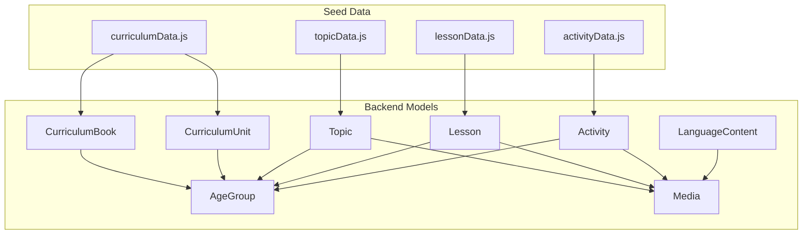
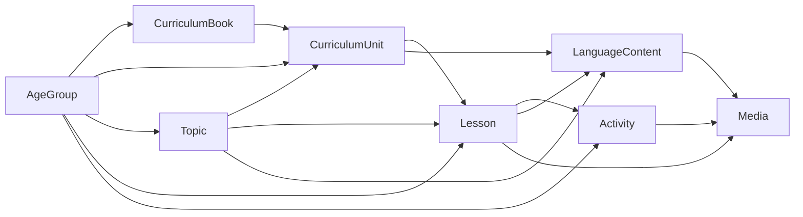

# Curriculum Models

<cite>
**Referenced Files in This Document**
- [CurriculumBook.js](file://KCEnglishKids_BE/src/models/CurriculumBook.js)
- [CurriculumUnit.js](file://KCEnglishKids_BE/src/models/CurriculumUnit.js)
- [Topic.js](file://KCEnglishKids_BE/src/models/Topic.js)
- [Lesson.js](file://KCEnglishKids_BE/src/models/Lesson.js)
- [Activity.js](file://KCEnglishKids_BE/src/models/Activity.js)
- [AgeGroup.js](file://KCEnglishKids_BE/src/models/AgeGroup.js)
- [Media.js](file://KCEnglishKids_BE/src/models/Media.js)
- [LanguageContent.js](file://KCEnglishKids_BE/src/models/LanguageContent.js)
- [curriculumData.js](file://KCEnglishKids_BE/src/seeds/curriculumData.js)
- [topicData.js](file://KCEnglishKids_BE/src/seeds/topicData.js)
- [lessonData.js](file://KCEnglishKids_BE/src/seeds/lessonData.js)
- [activityData.js](file://KCEnglishKids_BE/src/seeds/activityData.js)
</cite>

## Table of Contents
1. [Introduction](#introduction)
2. [Project Structure](#project-structure)
3. [Core Components](#core-components)
4. [Architecture Overview](#architecture-overview)
5. [Detailed Component Analysis](#detailed-component-analysis)
6. [Dependency Analysis](#dependency-analysis)
7. [Performance Considerations](#performance-considerations)
8. [Troubleshooting Guide](#troubleshooting-guide)
9. [Conclusion](#conclusion)
10. [Appendices](#appendices)

## Introduction
This document describes the hierarchical curriculum data model used by KCEnglishKids. The curriculum is organized as:
- CurriculumBook → CurriculumUnit → Topic → Lesson → Activity

Each level carries age-group associations, difficulty levels, learning objectives, content metadata, media references, and educational alignment fields. The models support progressive learning across three age groups: 3–4, 4–5, and 5–6 years old. Indexing strategies are defined at the model level to enable efficient navigation and search for books, units, topics, lessons, and activities.

## Project Structure
The curriculum models live under the backend models directory. Seed files provide official curriculum data, application topics, lesson mappings, and activity generation logic.

**Diagram sources**
- [CurriculumBook.js:1-41](file://KCEnglishKids_BE/src/models/CurriculumBook.js#L1-L41)
- [CurriculumUnit.js:1-88](file://KCEnglishKids_BE/src/models/CurriculumUnit.js#L1-L88)
- [Topic.js:1-78](file://KCEnglishKids_BE/src/models/Topic.js#L1-L78)
- [Lesson.js:1-101](file://KCEnglishKids_BE/src/models/Lesson.js#L1-L101)
- [Activity.js:1-176](file://KCEnglishKids_BE/src/models/Activity.js#L1-L176)
- [AgeGroup.js:1-48](file://KCEnglishKids_BE/src/models/AgeGroup.js#L1-L48)
- [Media.js:1-57](file://KCEnglishKids_BE/src/models/Media.js#L1-L57)
- [LanguageContent.js:1-75](file://KCEnglishKids_BE/src/models/LanguageContent.js#L1-L75)
- [curriculumData.js:1-709](file://KCEnglishKids_BE/src/seeds/curriculumData.js#L1-L709)
- [topicData.js:1-202](file://KCEnglishKids_BE/src/seeds/topicData.js#L1-L202)
- [lessonData.js:1-825](file://KCEnglishKids_BE/src/seeds/lessonData.js#L1-L825)
- [activityData.js:1-759](file://KCEnglishKids_BE/src/seeds/activityData.js#L1-L759)

**Section sources**
- [CurriculumBook.js:1-41](file://KCEnglishKids_BE/src/models/CurriculumBook.js#L1-L41)
- [CurriculumUnit.js:1-88](file://KCEnglishKids_BE/src/models/CurriculumUnit.js#L1-L88)
- [Topic.js:1-78](file://KCEnglishKids_BE/src/models/Topic.js#L1-L78)
- [Lesson.js:1-101](file://KCEnglishKids_BE/src/models/Lesson.js#L1-L101)
- [Activity.js:1-176](file://KCEnglishKids_BE/src/models/Activity.js#L1-L176)
- [AgeGroup.js:1-48](file://KCEnglishKids_BE/src/models/AgeGroup.js#L1-L48)
- [Media.js:1-57](file://KCEnglishKids_BE/src/models/Media.js#L1-L57)
- [LanguageContent.js:1-75](file://KCEnglishKids_BE/src/models/LanguageContent.js#L1-L75)
- [curriculumData.js:1-709](file://KCEnglishKids_BE/src/seeds/curriculumData.js#L1-L709)
- [topicData.js:1-202](file://KCEnglishKids_BE/src/seeds/topicData.js#L1-L202)
- [lessonData.js:1-825](file://KCEnglishKids_BE/src/seeds/lessonData.js#L1-L825)
- [activityData.js:1-759](file://KCEnglishKids_BE/src/seeds/activityData.js#L1-L759)

## Core Components
The core curriculum hierarchy consists of five primary models plus supporting entities:
- CurriculumBook: Represents a book aligned to an age group with metadata like total units and active status.
- CurriculumUnit: Represents a unit within a book, including big questions, vocabulary references, language patterns, and cross-curricular alignment.
- Topic: Represents thematic categories (e.g., Animals, School) with multilingual names, icons, images, and age group associations.
- Lesson: Represents instructional segments tied to a topic and age group, with learning objectives, difficulty, duration, and links to units, vocabulary, and language content.
- Activity: Represents interactive exercises attached to a lesson, with types, questions, scoring, and media.

Supporting models:
- AgeGroup: Defines age ranges, display names, and default game parameters.
- Media: Centralized asset storage with type, URL, transcript, and metadata.
- LanguageContent: Stores words, phrases, sentences, instructions, or dialogues linked to units, topics, lessons, and vocabulary.

**Section sources**
- [CurriculumBook.js:1-41](file://KCEnglishKids_BE/src/models/CurriculumBook.js#L1-L41)
- [CurriculumUnit.js:1-88](file://KCEnglishKids_BE/src/models/CurriculumUnit.js#L1-L88)
- [Topic.js:1-78](file://KCEnglishKids_BE/src/models/Topic.js#L1-L78)
- [Lesson.js:1-101](file://KCEnglishKids_BE/src/models/Lesson.js#L1-L101)
- [Activity.js:1-176](file://KCEnglishKids_BE/src/models/Activity.js#L1-L176)
- [AgeGroup.js:1-48](file://KCEnglishKids_BE/src/models/AgeGroup.js#L1-L48)
- [Media.js:1-57](file://KCEnglishKids_BE/src/models/Media.js#L1-L57)
- [LanguageContent.js:1-75](file://KCEnglishKids_BE/src/models/LanguageContent.js#L1-L75)

## Architecture Overview
The curriculum architecture enforces a strict hierarchy:
- A CurriculumBook contains multiple CurriculumUnits.
- A CurriculumUnit defines scope and alignment but does not directly contain Lessons; instead, Lessons reference Units via an array field.
- A Topic provides thematic grouping and can be related to Units and Lessons.
- A Lesson belongs to a Topic and AgeGroup, includes learning objectives and difficulty, and references CurriculumUnits, Vocabulary, and LanguageContent.
- An Activity belongs to a Lesson and AgeGroup, contains structured questions and scoring configuration.

```mermaid
classDiagram
class CurriculumBook {
+number bookNumber
+string title
+ObjectId ageGroup
+string ageGroupCode
+string description
+number totalUnits
+boolean active
}
class CurriculumUnit {
+ObjectId book
+number bookNumber
+ObjectId ageGroup
+string ageGroupCode
+number unitNumber
+string bigQuestion
+string storyTitle
+string[] vocabularyReferences
+string[] languagePatterns
+string values
+string concept
+string oracy
+string crossCurricular
+string numeracy
+string project
+string sourceType
+number displayOrder
+string status
}
class Topic {
+string englishName
+string vietnameseName
+string slug
+string description
+string icon
+ObjectId imageMedia
+string imageUrl
+string colorCode
+ObjectId[] ageGroups
+string[] ageGroupCodes
+ObjectId[] relatedUnits
+number displayOrder
+string status
+boolean featured
}
class Lesson {
+ObjectId topic
+ObjectId ageGroup
+string ageGroupCode
+string key
+string title
+string vietnameseTitle
+string description
+string[] learningObjectives
+number estimatedDuration
+number difficulty
+ObjectId thumbnail
+string thumbnailUrl
+ObjectId[] curriculumUnits
+ObjectId[] vocabularyItems
+ObjectId[] languageContents
+number displayOrder
+string status
+string sourceType
}
class Activity {
+ObjectId lesson
+string activityType
+string title
+string vietnameseTitle
+string instructions
+ObjectId instructionAudio
+string instructionAudioUrl
+ObjectId ageGroup
+string ageGroupCode
+number difficulty
+number questionCount
+number timeLimit
+number pointsPerQuestion
+object starConfig
+object[] questions
+number order
+string status
}
class AgeGroup {
+string code
+string name
+string vietnameseName
+string description
+number targetAgeMin
+number targetAgeMax
+number maxChoicesPerQuestion
+number defaultQuestionCount
+boolean active
}
class Media {
+string type
+string url
+string mediaKey
+string thumbnail
+number duration
+string mimeType
+string altText
+string transcript
+string language
+object metadata
+string status
+string sourceType
}
class LanguageContent {
+string contentType
+string english
+string vietnamese
+string pronunciation
+ObjectId ageGroup
+string ageGroupCode
+number difficulty
+ObjectId sourceUnit
+ObjectId topic
+ObjectId lesson
+ObjectId[] vocabulary
+ObjectId audioMedia
+ObjectId imageMedia
+string sourceType
+string status
}
CurriculumBook --> AgeGroup : "ref"
CurriculumUnit --> CurriculumBook : "ref"
CurriculumUnit --> AgeGroup : "ref"
Topic --> AgeGroup : "ref[]"
Topic --> CurriculumUnit : "relatedUnits"
Lesson --> Topic : "ref"
Lesson --> AgeGroup : "ref"
Lesson --> CurriculumUnit : "ref[]"
Lesson --> Media : "thumbnail"
Lesson --> LanguageContent : "ref[]"
Activity --> Lesson : "ref"
Activity --> AgeGroup : "ref"
Activity --> Media : "instructionAudio"
LanguageContent --> CurriculumUnit : "sourceUnit"
LanguageContent --> Topic : "ref"
LanguageContent --> Lesson : "ref"
LanguageContent --> Media : "audioMedia,imageMedia"
```

**Diagram sources**
- [CurriculumBook.js:1-41](file://KCEnglishKids_BE/src/models/CurriculumBook.js#L1-L41)
- [CurriculumUnit.js:1-88](file://KCEnglishKids_BE/src/models/CurriculumUnit.js#L1-L88)
- [Topic.js:1-78](file://KCEnglishKids_BE/src/models/Topic.js#L1-L78)
- [Lesson.js:1-101](file://KCEnglishKids_BE/src/models/Lesson.js#L1-L101)
- [Activity.js:1-176](file://KCEnglishKids_BE/src/models/Activity.js#L1-L176)
- [AgeGroup.js:1-48](file://KCEnglishKids_BE/src/models/AgeGroup.js#L1-L48)
- [Media.js:1-57](file://KCEnglishKids_BE/src/models/Media.js#L1-L57)
- [LanguageContent.js:1-75](file://KCEnglishKids_BE/src/models/LanguageContent.js#L1-L75)

## Detailed Component Analysis

### CurriculumBook Model
Purpose:
- Top-level container for curriculum content per age group.
- Provides book number, title, age group association, description, total units, and active flag.

Key fields:
- bookNumber: Unique integer constrained to 1, 2, 3.
- title: Required string label for the book.
- ageGroup: Reference to AgeGroup.
- ageGroupCode: Enumerated code for age range.
- description: Optional descriptive text.
- totalUnits: Default 9.
- active: Boolean flag controlling visibility.

Validation rules:
- bookNumber required and unique with enum constraints.
- title required.
- ageGroup required.
- ageGroupCode required with allowed values.

Relationships:
- One-to-many with CurriculumUnit through book reference.

Progressive learning support:
- Each book targets a specific age group, ensuring age-appropriate progression from foundational to advanced content.

Indexing:
- No explicit indexes beyond Mongoose defaults; uniqueness enforced on bookNumber.

**Section sources**
- [CurriculumBook.js:1-41](file://KCEnglishKids_BE/src/models/CurriculumBook.js#L1-L41)

### CurriculumUnit Model
Purpose:
- Represents a unit within a book, capturing big questions, vocabulary references, language patterns, and cross-curricular alignment.

Key fields:
- book: Reference to CurriculumBook.
- bookNumber: Enumerated 1–3.
- ageGroup: Reference to AgeGroup.
- ageGroupCode: Enumerated age code.
- unitNumber: Integer 1–9.
- bigQuestion: Required string defining the unit’s central inquiry.
- storyTitle: Optional narrative title.
- vocabularyReferences: Array of English words referenced in the unit.
- languagePatterns: Array of key sentences/phrases.
- values, concept, oracy, crossCurricular, numeracy, project: Educational alignment fields.
- sourceType: Enum indicating origin.
- displayOrder: Sorting control.
- status: Enum for lifecycle state.

Validation rules:
- book, bookNumber, ageGroup, ageGroupCode, unitNumber, bigQuestion required.
- unitNumber bounded between 1 and 9.
- sourceType and status enums enforced.

Relationships:
- Many-to-one with CurriculumBook.
- Many-to-one with AgeGroup.
- Used indirectly by Lesson via curriculumUnits array.

Indexing:
- Composite unique index on bookNumber + unitNumber.
- Secondary index on ageGroupCode + unitNumber for fast retrieval by age and unit sequence.

Progressive learning support:
- Big questions and language patterns scaffold learning progression across units.
- Cross-curricular and numeracy fields align content with broader educational goals.

**Section sources**
- [CurriculumUnit.js:1-88](file://KCEnglishKids_BE/src/models/CurriculumUnit.js#L1-L88)

### Topic Model
Purpose:
- Thematic categorization of content (e.g., Animals, School).
- Supports multilingual names, icons, images, and age group associations.

Key fields:
- englishName, vietnameseName: Required bilingual labels.
- slug: Unique lowercase identifier.
- description: Optional thematic description.
- icon: Emoji or icon name.
- imageMedia: Reference to Media.
- imageUrl: Optional direct URL.
- colorCode: Visual accent.
- ageGroups: References to AgeGroup.
- ageGroupCodes: Enumerated codes.
- relatedUnits: References to CurriculumUnit.
- displayOrder: Sorting control.
- status: Lifecycle state.
- featured: Flag for highlighting.

Validation rules:
- englishName, vietnameseName, slug required.
- slug unique and trimmed.
- ageGroupCodes enumerated.
- status enum enforced.

Relationships:
- Many-to-many with AgeGroup via arrays.
- Related to CurriculumUnit through relatedUnits.
- Used by Lesson via topic reference.

Indexing:
- Compound index on ageGroupCodes + status + displayOrder for filtered topic queries.

Progressive learning support:
- Topics allow cross-cutting themes across books and units, enabling thematic continuity.

**Section sources**
- [Topic.js:1-78](file://KCEnglishKids_BE/src/models/Topic.js#L1-L78)

### Lesson Model
Purpose:
- Instructional segment tied to a Topic and AgeGroup, containing learning objectives, difficulty, duration, and references to Units, Vocabulary, and LanguageContent.

Key fields:
- topic: Reference to Topic.
- ageGroup: Reference to AgeGroup.
- ageGroupCode: Enumerated age code.
- key: Trimmed identifier.
- title, vietnameseTitle: Bilingual titles.
- description: Optional summary.
- learningObjectives: Array of objectives.
- estimatedDuration: Minutes.
- difficulty: Number 1–3.
- thumbnail: Reference to Media.
- thumbnailUrl: Optional URL.
- curriculumUnits: Array of CurriculumUnit references.
- vocabularyItems: Array of Vocabulary references.
- languageContents: Array of LanguageContent references.
- displayOrder: Sorting control.
- status: Lifecycle state.
- sourceType: Enum indicating origin.

Validation rules:
- topic, ageGroup, ageGroupCode, title required.
- difficulty bounded 1–3.
- status and sourceType enums enforced.

Relationships:
- Many-to-one with Topic and AgeGroup.
- Many-to-many with CurriculumUnit, Vocabulary, LanguageContent via arrays.

Indexing:
- Index on topic + status + displayOrder.
- Index on ageGroupCode + status for filtering by age and visibility.

Progressive learning support:
- Difficulty increases across age groups.
- Learning objectives define measurable outcomes.
- Links to Units and LanguageContent ensure alignment with curriculum design.

**Section sources**
- [Lesson.js:1-101](file://KCEnglishKids_BE/src/models/Lesson.js#L1-L101)

### Activity Model
Purpose:
- Interactive exercise attached to a Lesson, with structured questions, scoring, and media.

Key fields:
- lesson: Reference to Lesson.
- activityType: Enum of supported interaction types.
- title, vietnameseTitle: Bilingual labels.
- instructions: Default guidance text.
- instructionAudio: Reference to Media.
- instructionAudioUrl: Optional URL.
- ageGroup: Reference to AgeGroup.
- ageGroupCode: Enumerated age code.
- difficulty: Number 1–3.
- questionCount: Number of questions.
- timeLimit: Seconds (0 = unlimited).
- pointsPerQuestion: Scoring weight.
- starConfig: Thresholds for star ratings.
- questions: Array of question objects with prompts, options, correct answers, explanations, and metadata.
- order: Sorting control.
- status: Lifecycle state.

Validation rules:
- lesson, activityType, title required.
- ageGroup and ageGroupCode required.
- difficulty bounded 1–3.
- status enum enforced.

Relationships:
- Many-to-one with Lesson and AgeGroup.
- Questions may reference Media and Vocabulary.

Indexing:
- Index on lesson + status + order.
- Index on ageGroupCode + status for filtering by age and visibility.

Progressive learning support:
- Question count, time limits, and star thresholds adapt to age and difficulty.
- Diverse activity types support multimodal learning.

**Section sources**
- [Activity.js:1-176](file://KCEnglishKids_BE/src/models/Activity.js#L1-L176)

### AgeGroup Model
Purpose:
- Defines age ranges and default parameters for activities and content delivery.

Key fields:
- code: Enumerated age code.
- name, vietnameseName: Display labels.
- description: Optional context.
- targetAgeMin, targetAgeMax: Numeric bounds.
- maxChoicesPerQuestion: Default option count.
- defaultQuestionCount: Default number of questions.
- active: Visibility flag.

Validation rules:
- code required and unique.
- name required.
- targetAgeMin and targetAgeMax required.

Relationships:
- Referenced by CurriculumBook, CurriculumUnit, Topic, Lesson, Activity.

Progressive learning support:
- Controls default behavior for interactions and content complexity.

**Section sources**
- [AgeGroup.js:1-48](file://KCEnglishKids_BE/src/models/AgeGroup.js#L1-L48)

### Media Model
Purpose:
- Centralized asset management for images, audio, animations, videos, and Lottie assets.

Key fields:
- type: Enum of asset types.
- url: Required asset URL.
- mediaKey: Optional indexed key.
- thumbnail: Optional preview URL.
- duration: Seconds for audio/video.
- mimeType: Content type.
- altText: Accessibility text.
- transcript: Text transcript.
- language: Default 'en'.
- metadata: Flexible object.
- status: Lifecycle state.
- sourceType: Enum indicating origin.

Validation rules:
- type and url required.
- status and sourceType enums enforced.

Relationships:
- Referenced by Topic, Lesson, Activity, LanguageContent.

Progressive learning support:
- Transcript and altText improve accessibility across ages.

**Section sources**
- [Media.js:1-57](file://KCEnglishKids_BE/src/models/Media.js#L1-L57)

### LanguageContent Model
Purpose:
- Stores reusable linguistic content such as words, phrases, sentences, instructions, patterns, or dialogues.

Key fields:
- contentType: Enum of content types.
- english: Required text.
- vietnamese: Optional translation.
- pronunciation: Optional phonetic guide.
- ageGroup: Optional reference.
- ageGroupCode: Optional code.
- difficulty: Number.
- sourceUnit: Optional CurriculumUnit reference.
- topic: Optional Topic reference.
- lesson: Optional Lesson reference.
- vocabulary: Array of Vocabulary references.
- audioMedia, imageMedia: References to Media.
- sourceType: Enum indicating origin.
- status: Lifecycle state.

Validation rules:
- contentType and english required.
- status and sourceType enums enforced.

Relationships:
- Optional references to CurriculumUnit, Topic, Lesson, Vocabulary, Media.

Progressive learning support:
- Difficulty and age group coding enable targeted content delivery.

**Section sources**
- [LanguageContent.js:1-75](file://KCEnglishKids_BE/src/models/LanguageContent.js#L1-L75)

## Dependency Analysis
The curriculum hierarchy creates clear dependency chains:
- CurriculumBook depends on AgeGroup.
- CurriculumUnit depends on CurriculumBook and AgeGroup.
- Topic depends on AgeGroup and optionally relates to CurriculumUnit.
- Lesson depends on Topic, AgeGroup, and optionally references CurriculumUnit, Vocabulary, and LanguageContent.
- Activity depends on Lesson and AgeGroup.
- LanguageContent optionally references CurriculumUnit, Topic, Lesson, Vocabulary, and Media.
- Media is a leaf entity referenced by multiple models.

**Diagram sources**
- [CurriculumBook.js:1-41](file://KCEnglishKids_BE/src/models/CurriculumBook.js#L1-L41)
- [CurriculumUnit.js:1-88](file://KCEnglishKids_BE/src/models/CurriculumUnit.js#L1-L88)
- [Topic.js:1-78](file://KCEnglishKids_BE/src/models/Topic.js#L1-L78)
- [Lesson.js:1-101](file://KCEnglishKids_BE/src/models/Lesson.js#L1-L101)
- [Activity.js:1-176](file://KCEnglishKids_BE/src/models/Activity.js#L1-L176)
- [AgeGroup.js:1-48](file://KCEnglishKids_BE/src/models/AgeGroup.js#L1-L48)
- [Media.js:1-57](file://KCEnglishKids_BE/src/models/Media.js#L1-L57)
- [LanguageContent.js:1-75](file://KCEnglishKids_BE/src/models/LanguageContent.js#L1-L75)

**Section sources**
- [CurriculumBook.js:1-41](file://KCEnglishKids_BE/src/models/CurriculumBook.js#L1-L41)
- [CurriculumUnit.js:1-88](file://KCEnglishKids_BE/src/models/CurriculumUnit.js#L1-L88)
- [Topic.js:1-78](file://KCEnglishKids_BE/src/models/Topic.js#L1-L78)
- [Lesson.js:1-101](file://KCEnglishKids_BE/src/models/Lesson.js#L1-L101)
- [Activity.js:1-176](file://KCEnglishKids_BE/src/models/Activity.js#L1-L176)
- [AgeGroup.js:1-48](file://KCEnglishKids_BE/src/models/AgeGroup.js#L1-L48)
- [Media.js:1-57](file://KCEnglishKids_BE/src/models/Media.js#L1-L57)
- [LanguageContent.js:1-75](file://KCEnglishKids_BE/src/models/LanguageContent.js#L1-L75)

## Performance Considerations
- Index usage:
  - CurriculumUnit: Composite unique index on bookNumber + unitNumber; secondary index on ageGroupCode + unitNumber.
  - Topic: Compound index on ageGroupCodes + status + displayOrder.
  - Lesson: Indexes on topic + status + displayOrder and ageGroupCode + status.
  - Activity: Indexes on lesson + status + order and ageGroupCode + status.
- Query optimization:
  - Filter by ageGroupCode to narrow results quickly.
  - Use status filters to exclude inactive/hidden/draft items.
  - Leverage displayOrder for consistent UI sorting.
- Media handling:
  - Prefer referencing Media via ObjectId and lazy-loading thumbnails to reduce payload size.
  - Use transcript and altText for accessibility without heavy inline content.

[No sources needed since this section provides general guidance]

## Troubleshooting Guide
Common issues and resolutions:
- Missing ageGroupCode:
  - Ensure all curriculum entities include a valid ageGroupCode matching the allowed enum values.
- Invalid difficulty range:
  - Keep difficulty between 1 and 3 for Lesson and Activity.
- Status mismatches:
  - Verify status enums match ACTIVE, INACTIVE, HIDDEN, or DRAFT where applicable.
- Broken references:
  - Validate that ObjectId references point to existing documents (e.g., lesson must exist before creating activities).
- Index conflicts:
  - For CurriculumUnit, ensure bookNumber + unitNumber combinations are unique.
  - For Topic, ensure slugs are unique and lowercase.

**Section sources**
- [CurriculumUnit.js:1-88](file://KCEnglishKids_BE/src/models/CurriculumUnit.js#L1-L88)
- [Topic.js:1-78](file://KCEnglishKids_BE/src/models/Topic.js#L1-L78)
- [Lesson.js:1-101](file://KCEnglishKids_BE/src/models/Lesson.js#L1-L101)
- [Activity.js:1-176](file://KCEnglishKids_BE/src/models/Activity.js#L1-L176)

## Conclusion
KCEnglishKids’ curriculum model enforces a clear, progressive hierarchy from CurriculumBook down to Activity, with robust age-group targeting, difficulty scaling, and educational alignment fields. Indexing strategies facilitate efficient navigation and search across books, units, topics, lessons, and activities. Supporting models for Media and LanguageContent provide flexible content and asset management. Seed data demonstrates how official curriculum content maps to application topics, lessons, and activities, ensuring consistency between pedagogical design and system implementation.

[No sources needed since this section summarizes without analyzing specific files]

## Appendices

### Field Definitions Summary

- CurriculumBook
  - bookNumber: Number, required, unique, enum [1,2,3]
  - title: String, required
  - ageGroup: ObjectId ref AgeGroup, required
  - ageGroupCode: String, required, enum ['3-4','4-5','5-6']
  - description: String
  - totalUnits: Number, default 9
  - active: Boolean, default true

- CurriculumUnit
  - book: ObjectId ref CurriculumBook, required
  - bookNumber: Number, required, enum [1,2,3]
  - ageGroup: ObjectId ref AgeGroup, required
  - ageGroupCode: String, required, enum ['3-4','4-5','5-6']
  - unitNumber: Number, required, min 1, max 9
  - bigQuestion: String, required
  - storyTitle: String
  - vocabularyReferences: String[]
  - languagePatterns: String[]
  - values: String
  - concept: String
  - oracy: String
  - crossCurricular: String
  - numeracy: String
  - project: String
  - sourceType: String, enum ['OFFICIAL_CURRICULUM','SYSTEM_DESIGN','GENERATED_CONTENT'], default OFFICIAL_CURRICULUM
  - displayOrder: Number, default 0
  - status: String, enum ['ACTIVE','INACTIVE','HIDDEN','DRAFT'], default ACTIVE

- Topic
  - englishName: String, required, trim
  - vietnameseName: String, required, trim
  - slug: String, required, unique, lowercase, trim
  - description: String
  - icon: String, default '🌟'
  - imageMedia: ObjectId ref Media
  - imageUrl: String
  - colorCode: String, default '#FF7043'
  - ageGroups: ObjectId[] ref AgeGroup
  - ageGroupCodes: String[], enum ['3-4','4-5','5-6']
  - relatedUnits: ObjectId[] ref CurriculumUnit
  - displayOrder: Number, default 0
  - status: String, enum ['ACTIVE','INACTIVE','HIDDEN','DRAFT'], default ACTIVE
  - featured: Boolean, default false

- Lesson
  - topic: ObjectId ref Topic, required, indexed
  - ageGroup: ObjectId ref AgeGroup, required
  - ageGroupCode: String, required, enum ['3-4','4-5','5-6'], indexed
  - key: String, trim, indexed
  - title: String, required, trim
  - vietnameseTitle: String, trim
  - description: String
  - learningObjectives: String[]
  - estimatedDuration: Number, default 10
  - difficulty: Number, default 1, min 1, max 3
  - thumbnail: ObjectId ref Media
  - thumbnailUrl: String
  - curriculumUnits: ObjectId[] ref CurriculumUnit
  - vocabularyItems: ObjectId[] ref Vocabulary
  - languageContents: ObjectId[] ref LanguageContent
  - displayOrder: Number, default 0
  - status: String, enum ['ACTIVE','INACTIVE','HIDDEN','DRAFT'], default ACTIVE
  - sourceType: String, enum ['OFFICIAL_CURRICULUM','SYSTEM_DESIGN','GENERATED_CONTENT'], default SYSTEM_DESIGN

- Activity
  - lesson: ObjectId ref Lesson, required, indexed
  - activityType: String, required, enum of supported types
  - title: String, required
  - vietnameseTitle: String
  - instructions: String, default 'Listen and choose the correct picture!'
  - instructionAudio: ObjectId ref Media
  - instructionAudioUrl: String
  - ageGroup: ObjectId ref AgeGroup, required
  - ageGroupCode: String, required, enum ['3-4','4-5','5-6']
  - difficulty: Number, default 1, min 1, max 3
  - questionCount: Number, default 4
  - timeLimit: Number, default 0
  - pointsPerQuestion: Number, default 10
  - starConfig: Object with threeStarsMin, twoStarsMin, oneStarMin
  - questions: Array of question objects
  - order: Number, default 0
  - status: String, enum ['ACTIVE','INACTIVE','HIDDEN','DRAFT'], default ACTIVE

- AgeGroup
  - code: String, required, unique, enum ['3-4','4-5','5-6'], indexed
  - name: String, required
  - vietnameseName: String, default 'Lớp Mầm (3–4 tuổi)'
  - description: String
  - targetAgeMin: Number, required
  - targetAgeMax: Number, required
  - maxChoicesPerQuestion: Number, default 3
  - defaultQuestionCount: Number, default 4
  - active: Boolean, default true

- Media
  - type: String, required, enum ['IMAGE','AUDIO','ANIMATION','VIDEO','LOTTIE']
  - url: String, required
  - mediaKey: String, trim, indexed
  - thumbnail: String
  - duration: Number
  - mimeType: String
  - altText: String
  - transcript: String
  - language: String, default 'en'
  - metadata: Mixed, default {}
  - status: String, enum ['ACTIVE','INACTIVE','HIDDEN'], default ACTIVE
  - sourceType: String, enum ['OFFICIAL_CURRICULUM','SYSTEM_DESIGN','GENERATED_CONTENT'], default SYSTEM_DESIGN

- LanguageContent
  - contentType: String, required, enum ['WORD','PHRASE','SENTENCE','QUESTION','ANSWER','INSTRUCTION','PATTERN','ORACY','DIALOGUE']
  - english: String, required, trim
  - vietnamese: String, trim
  - pronunciation: String
  - ageGroup: ObjectId ref AgeGroup
  - ageGroupCode: String, enum ['3-4','4-5','5-6']
  - difficulty: Number, default 1
  - sourceUnit: ObjectId ref CurriculumUnit
  - topic: ObjectId ref Topic
  - lesson: ObjectId ref Lesson
  - vocabulary: ObjectId[] ref Vocabulary
  - audioMedia: ObjectId ref Media
  - imageMedia: ObjectId ref Media
  - sourceType: String, enum ['OFFICIAL_CURRICULUM','SYSTEM_DESIGN','GENERATED_CONTENT'], default OFFICIAL_CURRICULUM
  - status: String, enum ['ACTIVE','INACTIVE','HIDDEN'], default ACTIVE

**Section sources**
- [CurriculumBook.js:1-41](file://KCEnglishKids_BE/src/models/CurriculumBook.js#L1-L41)
- [CurriculumUnit.js:1-88](file://KCEnglishKids_BE/src/models/CurriculumUnit.js#L1-L88)
- [Topic.js:1-78](file://KCEnglishKids_BE/src/models/Topic.js#L1-L78)
- [Lesson.js:1-101](file://KCEnglishKids_BE/src/models/Lesson.js#L1-L101)
- [Activity.js:1-176](file://KCEnglishKids_BE/src/models/Activity.js#L1-L176)
- [AgeGroup.js:1-48](file://KCEnglishKids_BE/src/models/AgeGroup.js#L1-L48)
- [Media.js:1-57](file://KCEnglishKids_BE/src/models/Media.js#L1-L57)
- [LanguageContent.js:1-75](file://KCEnglishKids_BE/src/models/LanguageContent.js#L1-L75)

### Curriculum Navigation and Search Strategy
- By Book:
  - Query CurriculumBook by ageGroupCode and active status.
- By Unit:
  - Query CurriculumUnit by bookNumber and unitNumber; filter by ageGroupCode and status.
- By Topic:
  - Query Topic by slug or ageGroupCodes; filter by status and displayOrder.
- By Lesson:
  - Query Lesson by topic, ageGroupCode, and status; sort by displayOrder.
- By Activity:
  - Query Activity by lesson and status; sort by order.

Index utilization:
- Use composite indexes on ageGroupCode + status for fast filtering.
- Use topic + status + displayOrder for ordered lesson lists.
- Use lesson + status + order for ordered activity lists.

**Section sources**
- [CurriculumUnit.js:1-88](file://KCEnglishKids_BE/src/models/CurriculumUnit.js#L1-L88)
- [Topic.js:1-78](file://KCEnglishKids_BE/src/models/Topic.js#L1-L78)
- [Lesson.js:1-101](file://KCEnglishKids_BE/src/models/Lesson.js#L1-L101)
- [Activity.js:1-176](file://KCEnglishKids_BE/src/models/Activity.js#L1-L176)

### Progressive Learning and Age-Appropriate Delivery
- Age groups:
  - 3–4: Foundational recognition, audio-first, limited choices.
  - 4–5: Short phrases, simple matching, everyday descriptions.
  - 5–6: Conversational sentences, questions & answers, reasoning.
- Difficulty scaling:
  - Lesson and Activity difficulty increase with age group.
- Numeracy progression:
  - Activity generator uses numerical progression per unit to align counting tasks with age-appropriate expectations.

**Section sources**
- [curriculumData.js:1-709](file://KCEnglishKids_BE/src/seeds/curriculumData.js#L1-L709)
- [activityData.js:1-759](file://KCEnglishKids_BE/src/seeds/activityData.js#L1-L759)

### Official Curriculum Mapping
- Books and units are seeded from official textbook specifications.
- Topics map application themes to curriculum units.
- Lessons map each unit to structured instructional segments with objectives and vocabulary.
- Activities are generated per lesson, respecting age group and numeracy progression.

**Section sources**
- [curriculumData.js:1-709](file://KCEnglishKids_BE/src/seeds/curriculumData.js#L1-L709)
- [topicData.js:1-202](file://KCEnglishKids_BE/src/seeds/topicData.js#L1-L202)
- [lessonData.js:1-825](file://KCEnglishKids_BE/src/seeds/lessonData.js#L1-L825)
- [activityData.js:1-759](file://KCEnglishKids_BE/src/seeds/activityData.js#L1-L759)