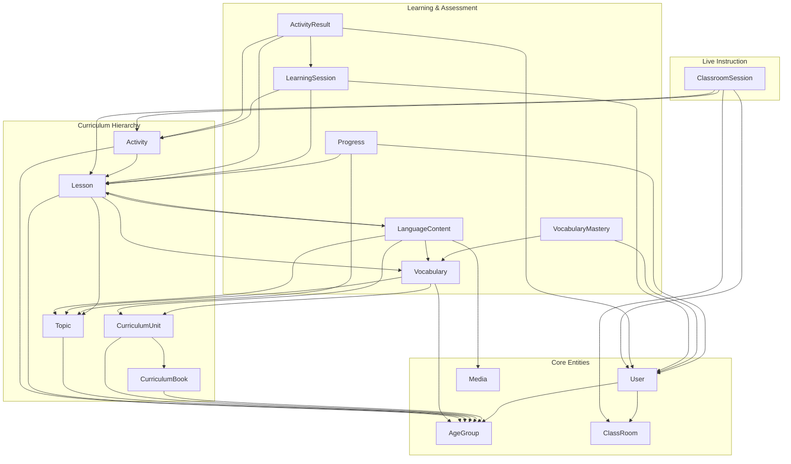
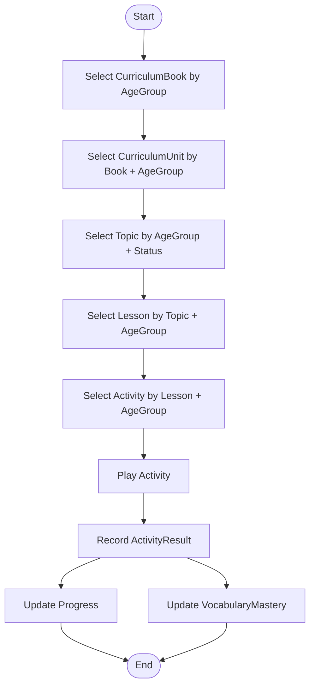
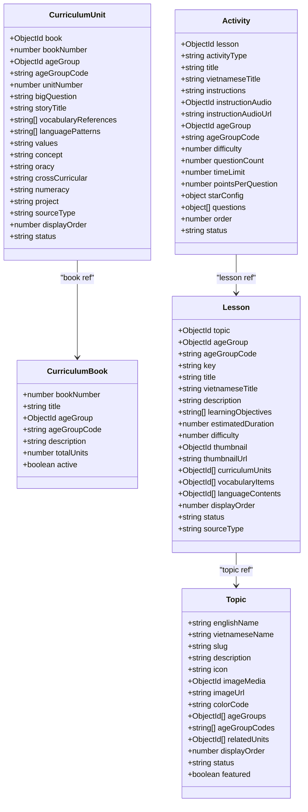
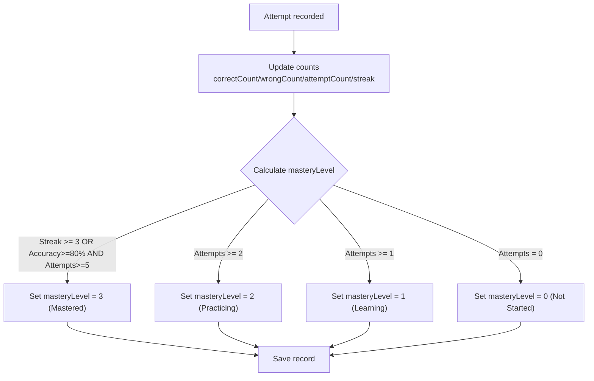
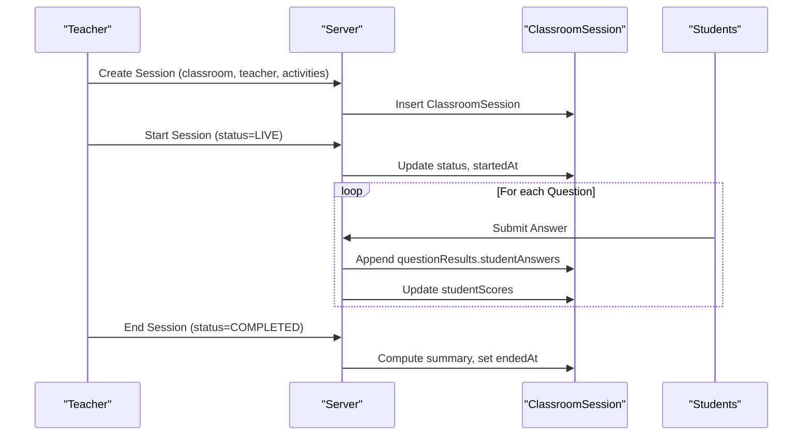
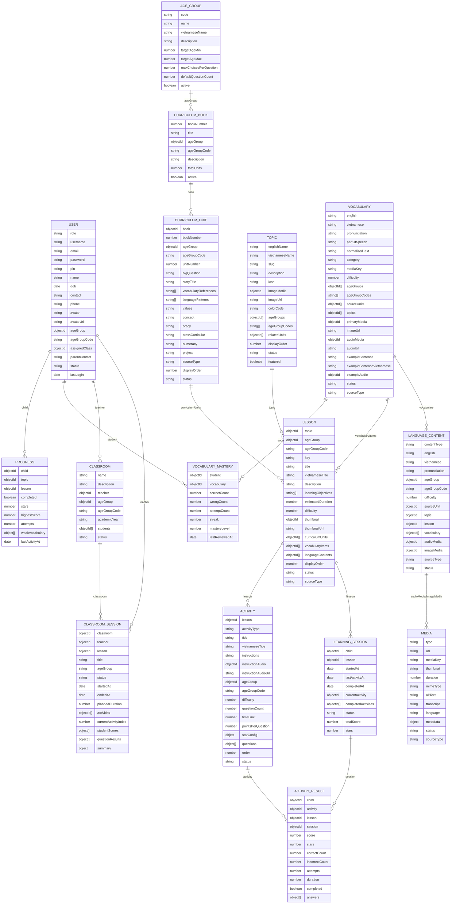
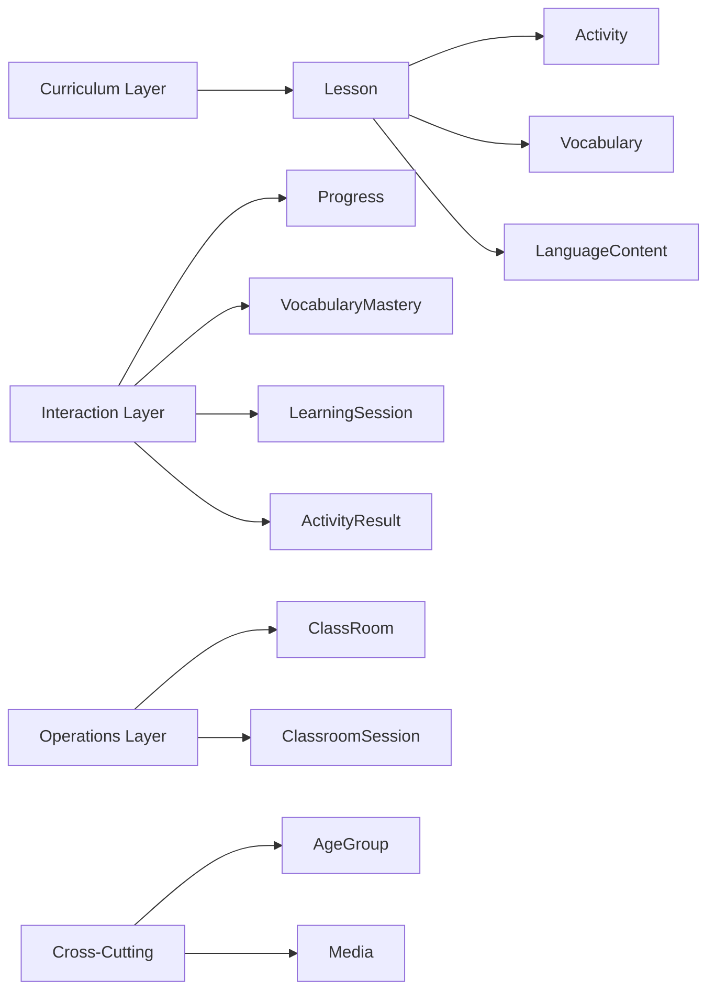

# Database Schema Design

<cite>
**Referenced Files in This Document**
- [User.js](file://KCEnglishKids_BE/src/models/User.js)
- [CurriculumBook.js](file://KCEnglishKids_BE/src/models/CurriculumBook.js)
- [CurriculumUnit.js](file://KCEnglishKids_BE/src/models/CurriculumUnit.js)
- [Topic.js](file://KCEnglishKids_BE/src/models/Topic.js)
- [Lesson.js](file://KCEnglishKids_BE/src/models/Lesson.js)
- [Activity.js](file://KCEnglishKids_BE/src/models/Activity.js)
- [Progress.js](file://KCEnglishKids_BE/src/models/Progress.js)
- [Vocabulary.js](file://KCEnglishKids_BE/src/models/Vocabulary.js)
- [VocabularyMastery.js](file://KCEnglishKids_BE/src/models/VocabularyMastery.js)
- [ClassRoom.js](file://KCEnglishKids_BE/src/models/ClassRoom.js)
- [ClassroomSession.js](file://KCEnglishKids_BE/src/models/ClassroomSession.js)
- [AgeGroup.js](file://KCEnglishKids_BE/src/models/AgeGroup.js)
- [Media.js](file://KCEnglishKids_BE/src/models/Media.js)
- [LanguageContent.js](file://KCEnglishKids_BE/src/models/LanguageContent.js)
- [ActivityResult.js](file://KCEnglishKids_BE/src/models/ActivityResult.js)
- [LearningSession.js](file://KCEnglishKids_BE/src/models/LearningSession.js)
</cite>

## Table of Contents
1. Introduction
2. Project Structure
3. Core Components
4. Architecture Overview
5. Detailed Component Analysis
6. Dependency Analysis
7. Performance Considerations
8. Troubleshooting Guide
9. Conclusion

## Introduction
This document provides comprehensive data model documentation for the KCEnglishKids database schema. It details all Mongoose models, including User, CurriculumBook, CurriculumUnit, Topic, Lesson, Activity, Progress, Vocabulary, VocabularyMastery, ClassRoom, ClassroomSession, and related entities such as AgeGroup, Media, LanguageContent, LearningSession, and ActivityResult. The documentation covers entity relationships, field definitions, data types, validation rules, business constraints, primary/foreign key relationships, indexes, performance considerations, hierarchical curriculum structure (Book → Unit → Topic → Lesson → Activity), mapping to age groups and learning progression, data lifecycle and retention strategies, and security and privacy requirements.

## Project Structure
The backend models are organized under src/models with one file per entity. Each model defines a Mongoose schema, optional indexes, pre-save hooks, and methods. Related entities are linked via ObjectId references.

**Diagram sources**
- [User.js:4-82](file://KCEnglishKids_BE/src/models/User.js#L4-L82)
- [AgeGroup.js:3-45](file://KCEnglishKids_BE/src/models/AgeGroup.js#L3-L45)
- [ClassRoom.js:3-46](file://KCEnglishKids_BE/src/models/ClassRoom.js#L3-L46)
- [Media.js:3-54](file://KCEnglishKids_BE/src/models/Media.js#L3-L54)
- [CurriculumBook.js:3-38](file://KCEnglishKids_BE/src/models/CurriculumBook.js#L3-L38)
- [CurriculumUnit.js:3-82](file://KCEnglishKids_BE/src/models/CurriculumUnit.js#L3-L82)
- [Topic.js:3-73](file://KCEnglishKids_BE/src/models/Topic.js#L3-L73)
- [Lesson.js:3-95](file://KCEnglishKids_BE/src/models/Lesson.js#L3-L95)
- [Activity.js:66-170](file://KCEnglishKids_BE/src/models/Activity.js#L66-L170)
- [Progress.js:3-59](file://KCEnglishKids_BE/src/models/Progress.js#L3-L59)
- [Vocabulary.js:3-104](file://KCEnglishKids_BE/src/models/Vocabulary.js#L3-L104)
- [VocabularyMastery.js:49-84](file://KCEnglishKids_BE/src/models/VocabularyMastery.js#L49-L84)
- [LanguageContent.js:3-72](file://KCEnglishKids_BE/src/models/LanguageContent.js#L3-L72)
- [LearningSession.js:3-55](file://KCEnglishKids_BE/src/models/LearningSession.js#L3-L55)
- [ActivityResult.js:3-73](file://KCEnglishKids_BE/src/models/ActivityResult.js#L3-L73)
- [ClassroomSession.js:44-116](file://KCEnglishKids_BE/src/models/ClassroomSession.js#L44-L116)

**Section sources**
- [User.js:4-82](file://KCEnglishKids_BE/src/models/User.js#L4-L82)
- [CurriculumBook.js:3-38](file://KCEnglishKids_BE/src/models/CurriculumBook.js#L3-L38)
- [CurriculumUnit.js:3-82](file://KCEnglishKids_BE/src/models/CurriculumUnit.js#L3-L82)
- [Topic.js:3-73](file://KCEnglishKids_BE/src/models/Topic.js#L3-L73)
- [Lesson.js:3-95](file://KCEnglishKids_BE/src/models/Lesson.js#L3-L95)
- [Activity.js:66-170](file://KCEnglishKids_BE/src/models/Activity.js#L66-L170)
- [Progress.js:3-59](file://KCEnglishKids_BE/src/models/Progress.js#L3-L59)
- [Vocabulary.js:3-104](file://KCEnglishKids_BE/src/models/Vocabulary.js#L3-L104)
- [VocabularyMastery.js:49-84](file://KCEnglishKids_BE/src/models/VocabularyMastery.js#L49-L84)
- [ClassRoom.js:3-46](file://KCEnglishKids_BE/src/models/ClassRoom.js#L3-L46)
- [ClassroomSession.js:44-116](file://KCEnglishKids_BE/src/models/ClassroomSession.js#L44-L116)
- [AgeGroup.js:3-45](file://KCEnglishKids_BE/src/models/AgeGroup.js#L3-L45)
- [Media.js:3-54](file://KCEnglishKids_BE/src/models/Media.js#L3-L54)
- [LanguageContent.js:3-72](file://KCEnglishKids_BE/src/models/LanguageContent.js#L3-L72)
- [LearningSession.js:3-55](file://KCEnglishKids_BE/src/models/LearningSession.js#L3-L55)
- [ActivityResult.js:3-73](file://KCEnglishKids_BE/src/models/ActivityResult.js#L3-L73)

## Core Components
This section summarizes each core model’s purpose, fields, validations, and relationships.

- User
  - Purpose: Represents system users (ADMIN, TEACHER, CHILD, PARENT).
  - Key fields: role, username, email, password, pin, name, dob, contact, phone, avatar/avatarUrl, ageGroup (ref), ageGroupCode, assignedClass (ref), parentContact, status, lastLogin.
  - Validations: role enum; username/email unique and sparse; name required; ageGroupCode enum; status enum.
  - Security: Passwords and PINs hashed on save; matchPassword/matchPin methods.
  - Indexes: role index; username/email unique/sparse.

- AgeGroup
  - Purpose: Defines age ranges and defaults for activities/questions.
  - Key fields: code (enum), name, vietnameseName, description, targetAgeMin/Max, maxChoicesPerQuestion, defaultQuestionCount, active.
  - Indexes: code unique.

- CurriculumBook
  - Purpose: Top-level curriculum book aligned to an age group.
  - Key fields: bookNumber (enum 1..3), title, ageGroup (ref), ageGroupCode, description, totalUnits, active.
  - Constraints: bookNumber unique.

- CurriculumUnit
  - Purpose: Units within a book, tied to age groups and containing vocabulary/language patterns.
  - Key fields: book (ref), bookNumber, ageGroup (ref), ageGroupCode, unitNumber (1..9), bigQuestion, storyTitle, vocabularyReferences[], languagePatterns[], values/concept/oracy/crossCurricular/numeracy/project, sourceType, displayOrder, status.
  - Indexes: unique(bookNumber, unitNumber); composite(ageGroupCode, unitNumber).

- Topic
  - Purpose: Thematic topics across age groups, linking to units and media.
  - Key fields: englishName, vietnameseName, slug (unique), description, icon, imageMedia/imageUrl, colorCode, ageGroups[], ageGroupCodes[], relatedUnits[], displayOrder, status, featured.
  - Indexes: composite(ageGroupCodes, status, displayOrder).

- Lesson
  - Purpose: Age-specific lessons under a topic, referencing vocabulary and language content.
  - Key fields: topic (ref), ageGroup (ref), ageGroupCode, key (indexed), title, vietnameseTitle, description, learningObjectives[], estimatedDuration, difficulty (1..3), thumbnail/thumbnailUrl, curriculumUnits[], vocabularyItems[], languageContents[], displayOrder, status, sourceType.
  - Indexes: composite(topic, status, displayOrder); composite(ageGroupCode, status).

- Activity
  - Purpose: Interactive exercises attached to a lesson, with questions/options/media.
  - Key fields: lesson (ref), activityType (enum), title/vietnameseTitle, instructions/instructionAudio, ageGroup (ref), ageGroupCode, difficulty (1..3), questionCount, timeLimit, pointsPerQuestion, starConfig{threeStarsMin,twoStarsMin,oneStarMin}, questions[], order, status.
  - Nested schemas: activityOptionSchema (id, text, vietnameseText, imageUrl/imageMedia, audioUrl, isCorrect), activityQuestionSchema (promptText/promptAudio/promptImageUrl, correctAnswer, options[], vocabulary(ref), explanation, metadata).
  - Indexes: composite(lesson, status, order); composite(ageGroupCode, status).

- Progress
  - Purpose: Per-child progress per lesson/topic.
  - Key fields: child (ref), topic (ref), lesson (ref), completed, stars (0..3), highestScore, attempts, weakVocabulary[{vocabulary(ref), mistakeCount}], lastActivityAt.
  - Indexes: unique(child, lesson); composite(child, topic).

- Vocabulary
  - Purpose: Lexical items with bilingual support and media.
  - Key fields: english (indexed), vietnamese, pronunciation, partOfSpeech (enum), normalizedText (indexed), category, mediaKey, difficulty (1..3), ageGroups[], ageGroupCodes[], sourceUnits[], topics[], primaryMedia/audioMedia/exampleAudio (refs), imageUrl/audioUrl, exampleSentence(s), status, sourceType.
  - Indexes: composite(ageGroupCodes, status); index(sourceUnits).

- VocabularyMastery
  - Purpose: Tracks student mastery per vocabulary item with rule-based level calculation.
  - Key fields: student (ref), vocabulary (ref), correctCount, wrongCount, attemptCount, streak, masteryLevel (0..3), lastReviewedAt.
  - Logic: Pre-save recalculates masteryLevel using MASTERY_CONFIG thresholds.
  - Indexes: unique(student, vocabulary).

- ClassRoom
  - Purpose: Teacher-managed class grouping students by age group and academic year.
  - Key fields: name, description, teacher (ref), ageGroup (ref), ageGroupCode, academicYear, students[], status.
  - Indexes: teacher index.

- ClassroomSession
  - Purpose: Live or scheduled session led by a teacher for a class, tracking activities and per-student scores.
  - Key fields: classroom (ref), teacher (ref), lesson (ref), title, ageGroup (enum), status (SCHEDULED/LIVE/COMPLETED), startedAt/endedAt, plannedDuration, activities[], currentActivityIndex, studentScores[], questionResults[], summary{participationCount, averageAccuracy, totalStars, totalPoints, studentsNeedingPractice[], topPerformers[]}.
  - Nested schemas: studentScoreSchema (student, points, stars, correctCount, incorrectCount, notAnswered, status), questionResultSchema (activityId, questionIndex, promptText/promptImageUrl, studentAnswers[{student, result}]).
  - Indexes: composite(classroom, status); composite(teacher, createdAt).

- LanguageContent
  - Purpose: Reusable language assets (words, phrases, sentences, dialogues) linked to units/topics/lessons/vocabulary/media.
  - Key fields: contentType (enum), english, vietnamese, pronunciation, ageGroup (ref), ageGroupCode, difficulty, sourceUnit (ref), topic (ref), lesson (ref), vocabulary[], audioMedia/imageMedia (refs), sourceType, status.

- LearningSession
  - Purpose: A child’s session through a lesson, tracking current/completed activities and aggregate score/stars.
  - Key fields: child (ref), lesson (ref), startedAt, lastActivityAt, completedAt, currentActivity (ref), completedActivities[], status (IN_PROGRESS/COMPLETED/ABANDONED), totalScore, stars (0..3).
  - Indexes: composite(child, status); composite(child, lesson).

- ActivityResult
  - Purpose: Per-attempt results for a child on an activity within a learning session.
  - Key fields: child (ref), activity (ref), lesson (ref), session (ref), score, stars (0..3), correctCount, incorrectCount, attempts, duration, completed, answers[{questionIndex, promptText, selectedOptionId, isCorrect, vocabularyId(ref), responseTimeMs}].
  - Indexes: composite(child, activity).

**Section sources**
- [User.js:4-108](file://KCEnglishKids_BE/src/models/User.js#L4-L108)
- [AgeGroup.js:3-47](file://KCEnglishKids_BE/src/models/AgeGroup.js#L3-L47)
- [CurriculumBook.js:3-40](file://KCEnglishKids_BE/src/models/CurriculumBook.js#L3-L40)
- [CurriculumUnit.js:3-87](file://KCEenglishKids_BE/src/models/CurriculumUnit.js#L3-L87)
- [Topic.js:3-77](file://KCEnglishKids_BE/src/models/Topic.js#L3-L77)
- [Lesson.js:3-100](file://KCEnglishKids_BE/src/models/Lesson.js#L3-L100)
- [Activity.js:3-175](file://KCEnglishKids_BE/src/models/Activity.js#L3-L175)
- [Progress.js:3-64](file://KCEnglishKids_BE/src/models/Progress.js#L3-L64)
- [Vocabulary.js:3-109](file://KCEnglishKids_BE/src/models/Vocabulary.js#L3-L109)
- [VocabularyMastery.js:49-97](file://KCEnglishKids_BE/src/models/VocabularyMastery.js#L49-L97)
- [ClassRoom.js:3-48](file://KCEnglishKids_BE/src/models/ClassRoom.js#L3-L48)
- [ClassroomSession.js:4-121](file://KCEnglishKids_BE/src/models/ClassroomSession.js#L4-L121)
- [LanguageContent.js:3-74](file://KCEnglishKids_BE/src/models/LanguageContent.js#L3-L74)
- [LearningSession.js:3-60](file://KCEnglishKids_BE/src/models/LearningSession.js#L3-L60)
- [ActivityResult.js:3-77](file://KCEnglishKids_BE/src/models/ActivityResult.js#L3-L77)

## Architecture Overview
The curriculum hierarchy drives content delivery:
- Book → Unit → Topic → Lesson → Activity
Each layer is associated with AgeGroup(s) and may reference Vocabulary, LanguageContent, and Media. Student interactions produce LearningSession and ActivityResult records, which update Progress and VocabularyMastery. Teachers orchestrate live sessions via ClassroomSession.

**Diagram sources**
- [CurriculumBook.js:3-38](file://KCEnglishKids_BE/src/models/CurriculumBook.js#L3-L38)
- [CurriculumUnit.js:3-82](file://KCEnglishKids_BE/src/models/CurriculumUnit.js#L3-L82)
- [Topic.js:3-73](file://KCEnglishKids_BE/src/models/Topic.js#L3-L73)
- [Lesson.js:3-95](file://KCEnglishKids_BE/src/models/Lesson.js#L3-L95)
- [Activity.js:66-170](file://KCEnglishKids_BE/src/models/Activity.js#L66-L170)
- [ActivityResult.js:3-73](file://KCEnglishKids_BE/src/models/ActivityResult.js#L3-L73)
- [Progress.js:3-59](file://KCEnglishKids_BE/src/models/Progress.js#L3-L59)
- [VocabularyMastery.js:49-97](file://KCEnglishKids_BE/src/models/VocabularyMastery.js#L49-L97)

## Detailed Component Analysis

### Hierarchical Curriculum Model
- Book
  - Fields: bookNumber (enum 1..3), title, ageGroup (ref), ageGroupCode, description, totalUnits, active.
  - Constraints: bookNumber unique; ageGroup required.
- Unit
  - Fields: book (ref), bookNumber, ageGroup (ref), ageGroupCode, unitNumber (1..9), bigQuestion, storyTitle, vocabularyReferences[], languagePatterns[], cross-curricular fields, sourceType, displayOrder, status.
  - Indexes: unique(bookNumber, unitNumber); composite(ageGroupCode, unitNumber).
- Topic
  - Fields: englishName, vietnameseName, slug (unique), description, icon, imageMedia/imageUrl, colorCode, ageGroups[], ageGroupCodes[], relatedUnits[], displayOrder, status, featured.
  - Indexes: composite(ageGroupCodes, status, displayOrder).
- Lesson
  - Fields: topic (ref), ageGroup (ref), ageGroupCode, key (indexed), title, vietnameseTitle, description, learningObjectives[], estimatedDuration, difficulty (1..3), thumbnail/thumbnailUrl, curriculumUnits[], vocabularyItems[], languageContents[], displayOrder, status, sourceType.
  - Indexes: composite(topic, status, displayOrder); composite(ageGroupCode, status).
- Activity
  - Fields: lesson (ref), activityType (enum), title/vietnameseTitle, instructions/instructionAudio, ageGroup (ref), ageGroupCode, difficulty (1..3), questionCount, timeLimit, pointsPerQuestion, starConfig, questions[], order, status.
  - Nested: activityOptionSchema, activityQuestionSchema.
  - Indexes: composite(lesson, status, order); composite(ageGroupCode, status).

**Diagram sources**
- [CurriculumBook.js:3-38](file://KCEnglishKids_BE/src/models/CurriculumBook.js#L3-L38)
- [CurriculumUnit.js:3-82](file://KCEnglishKids_BE/src/models/CurriculumUnit.js#L3-L82)
- [Topic.js:3-73](file://KCEnglishKids_BE/src/models/Topic.js#L3-L73)
- [Lesson.js:3-95](file://KCEnglishKids_BE/src/models/Lesson.js#L3-L95)
- [Activity.js:66-170](file://KCEnglishKids_BE/src/models/Activity.js#L66-L170)

**Section sources**
- [CurriculumBook.js:3-38](file://KCEnglishKids_BE/src/models/CurriculumBook.js#L3-L38)
- [CurriculumUnit.js:3-82](file://KCEnglishKids_BE/src/models/CurriculumUnit.js#L3-L82)
- [Topic.js:3-73](file://KCEnglishKids_BE/src/models/Topic.js#L3-L73)
- [Lesson.js:3-95](file://KCEnglishKids_BE/src/models/Lesson.js#L3-L95)
- [Activity.js:66-170](file://KCEnglishKids_BE/src/models/Activity.js#L66-L170)

### Vocabulary Mastery Lifecycle
- VocabularyMastery tracks per-student mastery over Vocabulary.
- Mastery levels: 0=Not Started, 1=Learning, 2=Practicing, 3=Mastered.
- Calculation uses streak and accuracy/attempts thresholds defined in MASTERY_CONFIG.
- Pre-save hook recalculates masteryLevel and updates lastReviewedAt.

**Diagram sources**
- [VocabularyMastery.js:25-46](file://KCEnglishKids_BE/src/models/VocabularyMastery.js#L25-L46)
- [VocabularyMastery.js:49-97](file://KCEnglishKids_BE/src/models/VocabularyMastery.js#L49-L97)

**Section sources**
- [VocabularyMastery.js:25-46](file://KCEnglishKids_BE/src/models/VocabularyMastery.js#L25-L46)
- [VocabularyMastery.js:49-97](file://KCEnglishKids_BE/src/models/VocabularyMastery.js#L49-L97)

### Classroom Session Flow
- Teacher creates a ClassroomSession for a ClassRoom and selects Activities.
- During LIVE, per-question results are aggregated into questionResults and studentScores.
- On COMPLETED, summary metrics are computed.

**Diagram sources**
- [ClassroomSession.js:44-116](file://KCEnglishKids_BE/src/models/ClassroomSession.js#L44-L116)

**Section sources**
- [ClassroomSession.js:4-121](file://KCEnglishKids_BE/src/models/ClassroomSession.js#L4-L121)

### Data Models Diagram

**Diagram sources**
- [User.js:4-82](file://KCEnglishKids_BE/src/models/User.js#L4-L82)
- [AgeGroup.js:3-45](file://KCEnglishKids_BE/src/models/AgeGroup.js#L3-L45)
- [CurriculumBook.js:3-38](file://KCEnglishKids_BE/src/models/CurriculumBook.js#L3-L38)
- [CurriculumUnit.js:3-82](file://KCEnglishKids_BE/src/models/CurriculumUnit.js#L3-L82)
- [Topic.js:3-73](file://KCEnglishKids_BE/src/models/Topic.js#L3-L73)
- [Lesson.js:3-95](file://KCEnglishKids_BE/src/models/Lesson.js#L3-L95)
- [Activity.js:66-170](file://KCEnglishKids_BE/src/models/Activity.js#L66-L170)
- [Progress.js:3-59](file://KCEnglishKids_BE/src/models/Progress.js#L3-L59)
- [Vocabulary.js:3-104](file://KCEnglishKids_BE/src/models/Vocabulary.js#L3-L104)
- [VocabularyMastery.js:49-84](file://KCEnglishKids_BE/src/models/VocabularyMastery.js#L49-L84)
- [ClassRoom.js:3-46](file://KCEnglishKids_BE/src/models/ClassRoom.js#L3-L46)
- [ClassroomSession.js:44-116](file://KCEnglishKids_BE/src/models/ClassroomSession.js#L44-L116)
- [LanguageContent.js:3-72](file://KCEnglishKids_BE/src/models/LanguageContent.js#L3-L72)
- [LearningSession.js:3-55](file://KCEnglishKids_BE/src/models/LearningSession.js#L3-L55)
- [ActivityResult.js:3-73](file://KCEnglishKids_BE/src/models/ActivityResult.js#L3-L73)
- [Media.js:3-54](file://KCEnglishKids_BE/src/models/Media.js#L3-L54)

## Dependency Analysis
- Cohesion
  - Content models (CurriculumBook, CurriculumUnit, Topic, Lesson, Activity) are cohesive around curriculum design.
  - Learner models (Progress, VocabularyMastery, LearningSession, ActivityResult) are cohesive around student interaction and assessment.
  - Operational models (ClassRoom, ClassroomSession) encapsulate teacher-led workflows.
- Coupling
  - High coupling between Lesson ↔ Activity and Lesson ↔ Vocabulary/LanguageContent.
  - Moderate coupling between Progress/VocabularyMastery and Lesson/Activity/Vocabulary.
  - Loose coupling via AgeGroup codes used across models for filtering and indexing.
- External dependencies
  - bcrypt for hashing credentials/PINs.
  - Mongoose for schema validation, indexes, and pre-save hooks.

**Diagram sources**
- [Lesson.js:3-95](file://KCEnglishKids_BE/src/models/Lesson.js#L3-L95)
- [Activity.js:66-170](file://KCEnglishKids_BE/src/models/Activity.js#L66-L170)
- [Vocabulary.js:3-104](file://KCEnglishKids_BE/src/models/Vocabulary.js#L3-L104)
- [LanguageContent.js:3-72](file://KCEnglishKids_BE/src/models/LanguageContent.js#L3-L72)
- [Progress.js:3-59](file://KCEnglishKids_BE/src/models/Progress.js#L3-L59)
- [VocabularyMastery.js:49-97](file://KCEnglishKids_BE/src/models/VocabularyMastery.js#L49-L97)
- [LearningSession.js:3-60](file://KCEnglishKids_BE/src/models/LearningSession.js#L3-L60)
- [ActivityResult.js:3-77](file://KCEnglishKids_BE/src/models/ActivityResult.js#L3-L77)
- [ClassRoom.js:3-48](file://KCEnglishKids_BE/src/models/ClassRoom.js#L3-L48)
- [ClassroomSession.js:44-116](file://KCEnglishKids_BE/src/models/ClassroomSession.js#L44-L116)
- [AgeGroup.js:3-47](file://KCEnglishKids_BE/src/models/AgeGroup.js#L3-L47)
- [Media.js:3-57](file://KCEnglishKids_BE/src/models/Media.js#L3-L57)

**Section sources**
- [Lesson.js:3-95](file://KCEnglishKids_BE/src/models/Lesson.js#L3-L95)
- [Activity.js:66-170](file://KCEnglishKids_BE/src/models/Activity.js#L66-L170)
- [Vocabulary.js:3-104](file://KCEnglishKids_BE/src/models/Vocabulary.js#L3-L104)
- [LanguageContent.js:3-72](file://KCEnglishKids_BE/src/models/LanguageContent.js#L3-L72)
- [Progress.js:3-59](file://KCEnglishKids_BE/src/models/Progress.js#L3-L59)
- [VocabularyMastery.js:49-97](file://KCEnglishKids_BE/src/models/VocabularyMastery.js#L49-L97)
- [LearningSession.js:3-60](file://KCEnglishKids_BE/src/models/LearningSession.js#L3-L60)
- [ActivityResult.js:3-77](file://KCEnglishKids_BE/src/models/ActivityResult.js#L3-L77)
- [ClassRoom.js:3-48](file://KCEnglishKids_BE/src/models/ClassRoom.js#L3-L48)
- [ClassroomSession.js:44-116](file://KCEnglishKids_BE/src/models/ClassroomSession.js#L44-L116)
- [AgeGroup.js:3-47](file://KCEnglishKids_BE/src/models/AgeGroup.js#L3-L47)
- [Media.js:3-57](file://KCEnglishKids_BE/src/models/Media.js#L3-L57)

## Performance Considerations
- Indexing strategy
  - Unique constraints: bookNumber (CurriculumBook), slug (Topic), code (AgeGroup), unique(bookNumber, unitNumber) (CurriculumUnit), unique(child, lesson) (Progress), unique(student, vocabulary) (VocabularyMastery).
  - Composite indexes:
    - Age-group queries: ageGroupCode/status across Topic, Lesson, Activity, Vocabulary.
    - Lesson retrieval: topic/status/displayOrder; ageGroupCode/status.
    - Activity retrieval: lesson/status/order; ageGroupCode/status.
    - ClassroomSession: classroom/status; teacher/createdAt.
    - LearningSession: child/status; child/lesson.
    - ActivityResult: child/activity.
- Denormalization
  - ageGroupCode stored alongside ObjectId references to enable efficient filtering without joins.
- Query optimization
  - Use lean queries where possible for read-heavy endpoints (e.g., listing Lessons/Activities).
  - Prefer projection to avoid loading nested arrays (questions, answers) unless needed.
- Write patterns
  - Batch updates for classroom session scoring to reduce round-trips.
  - Defer heavy computations (summary generation) until session completion.
- Storage considerations
  - Media URLs and keys are stored separately from binary content; ensure CDN caching for images/audio.
  - Limit size of embedded arrays (questions, answers) to prevent large documents.

[No sources needed since this section provides general guidance]

## Troubleshooting Guide
- Authentication issues
  - Ensure passwords/PINs are hashed before saving; verify pre-save hooks run.
  - Validate that matchPassword/matchPin methods return expected booleans.
- Curriculum visibility
  - Check status enums (ACTIVE/INACTIVE/HIDDEN/DRAFT) and ageGroupCode filters when querying Books/Units/Topics/Lessons/Activities.
- Progress inconsistencies
  - Verify unique constraint on child+lesson; ensure atomic updates to Progress.stars/highestScore/attempts.
- Vocabulary mastery not updating
  - Confirm pre-save hook recalculates masteryLevel; check MASTERY_CONFIG thresholds and input counts.
- Classroom session anomalies
  - Validate studentScores/questionResults aggregation logic; ensure status transitions SCHEDULED→LIVE→COMPLETED are enforced.

**Section sources**
- [User.js:84-106](file://KCEnglishKids_BE/src/models/User.js#L84-L106)
- [Progress.js:61-62](file://KCEnglishKids_BE/src/models/Progress.js#L61-L62)
- [VocabularyMastery.js:89-93](file://KCEnglishKids_BE/src/models/VocabularyMastery.js#L89-L93)
- [ClassroomSession.js:74-79](file://KCEnglishKids_BE/src/models/ClassroomSession.js#L74-L79)

## Conclusion
The KCEnglishKids data model supports a structured, age-aware curriculum hierarchy with robust learner analytics and teacher-led live sessions. Clear validation rules, strategic indexes, and denormalized ageGroupCode fields optimize both reads and writes. Security measures include hashed credentials and PINs. To maintain performance at scale, continue leveraging indexes, projections, and batch operations while keeping embedded arrays bounded.

[No sources needed since this section summarizes without analyzing specific files]