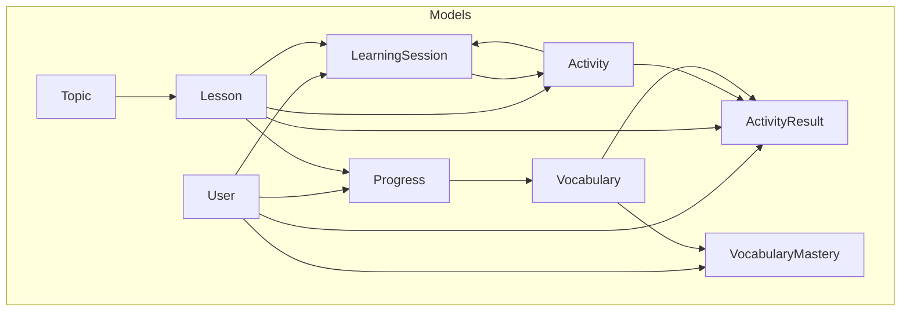
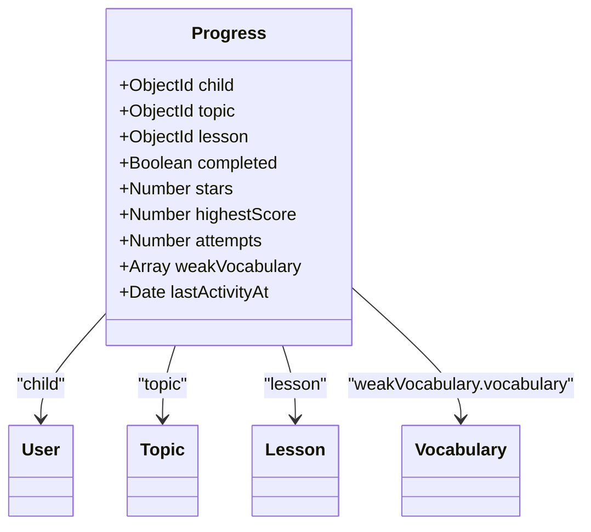
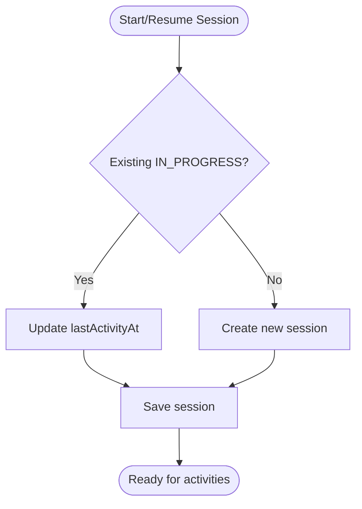
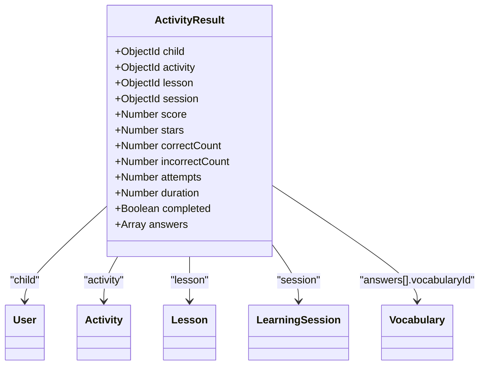
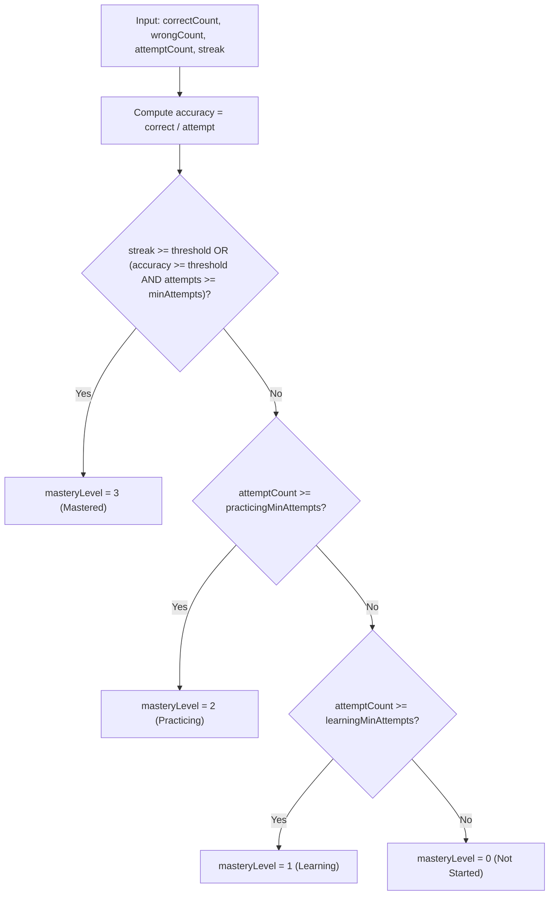
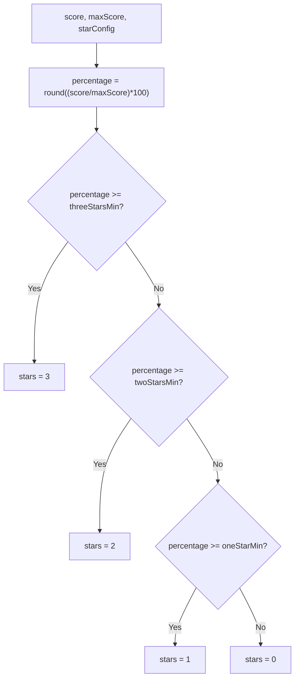
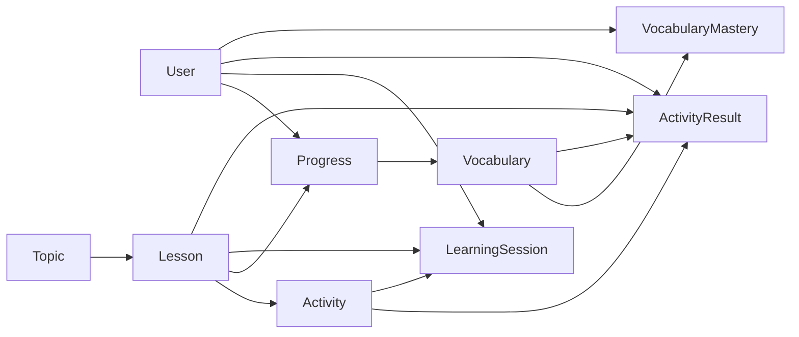

# Learning & Progress Models

<cite>
**Referenced Files in This Document**
- [Progress.js](file://KCEnglishKids_BE/src/models/Progress.js)
- [LearningSession.js](file://KCEnglishKids_BE/src/models/LearningSession.js)
- [ActivityResult.js](file://KCEnglishKids_BE/src/models/ActivityResult.js)
- [Vocabulary.js](file://KCEnglishKids_BE/src/models/Vocabulary.js)
- [VocabularyMastery.js](file://KCEnglishKids_BE/src/models/VocabularyMastery.js)
- [User.js](file://KCEnglishKids_BE/src/models/User.js)
- [Activity.js](file://KCEnglishKids_BE/src/models/Activity.js)
- [Lesson.js](file://KCEnglishKids_BE/src/models/Lesson.js)
- [Topic.js](file://KCEnglishKids_BE/src/models/Topic.js)
- [progressController.js](file://KCEnglishKids_BE/src/controllers/progressController.js)
- [vocabMasteryController.js](file://KCEnglishKids_BE/src/controllers/vocabMasteryController.js)
- [learningService.js](file://KCEnglishKids_BE/src/services/learningService.js)
</cite>

## Table of Contents
1. [Introduction](#introduction)
2. [Project Structure](#project-structure)
3. [Core Components](#core-components)
4. [Architecture Overview](#architecture-overview)
5. [Detailed Component Analysis](#detailed-component-analysis)
6. [Dependency Analysis](#dependency-analysis)
7. [Performance Considerations](#performance-considerations)
8. [Troubleshooting Guide](#troubleshooting-guide)
9. [Conclusion](#conclusion)
10. [Appendices](#appendices)

## Introduction
This document explains the data models that power learning tracking and progress management in KCEnglishKids. It focuses on:
- Progress for star accumulation, lesson completion, and weak vocabulary identification
- LearningSession for session lifecycle, timing, and per-session scoring
- ActivityResult for detailed game performance, answers, and scores
- Vocabulary and VocabularyMastery for word-level learning progression, mastery levels, and spaced repetition metrics
It also covers calculation algorithms (stars and mastery), relationships to users and curriculum entities, analytics usage, retention considerations, performance strategies, and privacy safeguards for child learning data.

## Project Structure
The learning and progress domain spans several Mongoose models and supporting controllers/services:
- Models define schemas, indexes, and hooks for data integrity and automatic calculations
- Controllers expose APIs for reading and updating progress and mastery
- Services implement core business logic such as star calculation and session orchestration



**Diagram sources**
- [Progress.js:3-64](file://KCEnglishKids_BE/src/models/Progress.js#L3-L64)
- [LearningSession.js:3-55](file://KCEnglishKids_BE/src/models/LearningSession.js#L3-L55)
- [ActivityResult.js:3-73](file://KCEnglishKids_BE/src/models/ActivityResult.js#L3-L73)
- [Vocabulary.js:3-104](file://KCEnglishKids_BE/src/models/Vocabulary.js#L3-L104)
- [VocabularyMastery.js:49-84](file://KCEnglishKids_BE/src/models/VocabularyMastery.js#L49-L84)
- [User.js:4-82](file://KCEnglishKids_BE/src/models/User.js#L4-L82)
- [Activity.js:66-170](file://KCEnglishKids_BE/src/models/Activity.js#L66-L170)
- [Lesson.js:3-95](file://KCEnglishKids_BE/src/models/Lesson.js#L3-L95)
- [Topic.js:3-73](file://KCEnglishKids_BE/src/models/Topic.js#L3-L73)

**Section sources**
- [Progress.js:1-65](file://KCEnglishKids_BE/src/models/Progress.js#L1-L65)
- [LearningSession.js:1-61](file://KCEnglishKids_BE/src/models/LearningSession.js#L1-L61)
- [ActivityResult.js:1-78](file://KCEnglishKids_BE/src/models/ActivityResult.js#L1-L78)
- [Vocabulary.js:1-110](file://KCEnglishKids_BE/src/models/Vocabulary.js#L1-L110)
- [VocabularyMastery.js:1-98](file://KCEnglishKids_BE/src/models/VocabularyMastery.js#L1-L98)
- [User.js:1-109](file://KCEnglishKids_BE/src/models/User.js#L1-L109)
- [Activity.js:1-176](file://KCEnglishKids_BE/src/models/Activity.js#L1-L176)
- [Lesson.js:1-101](file://KCEnglishKids_BE/src/models/Lesson.js#L1-L101)
- [Topic.js:1-78](file://KCEnglishKids_BE/src/models/Topic.js#L1-L78)

## Core Components
This section summarizes each model’s purpose, key fields, and how it participates in learning analytics.

- Progress
  - Purpose: Tracks a child’s per-lesson progress, stars earned, highest score, attempts, weak vocabulary, and last activity timestamp.
  - Key fields: child, topic, lesson, completed, stars, highestScore, attempts, weakVocabulary[], lastActivityAt.
  - Relationships: References User, Topic, Lesson, and Vocabulary (via weakVocabulary).
  - Indexes: Optimized queries by child+lesson uniqueness and child+topic grouping.

- LearningSession
  - Purpose: Represents an active or completed learning session for a child and lesson, including timing and cumulative scores.
  - Key fields: child, lesson, startedAt, lastActivityAt, completedAt, currentActivity, completedActivities[], status, totalScore, stars.
  - Relationships: References User, Lesson, Activity.
  - Indexes: Fast lookup by child+status and child+lesson.

- ActivityResult
  - Purpose: Records a single activity attempt with granular answer details, duration, and derived metrics.
  - Key fields: child, activity, lesson, session, score, stars, correctCount, incorrectCount, attempts, duration, completed, answers[].
  - Relationships: References User, Activity, Lesson, LearningSession, and Vocabulary (per-answer).
  - Indexes: Optimized by child+activity.

- Vocabulary
  - Purpose: Defines curriculum vocabulary items with metadata, media references, difficulty, and curriculum alignment.
  - Key fields: english, vietnamese, pronunciation, partOfSpeech, normalizedText, category, mediaKey, difficulty, ageGroups, ageGroupCodes, sourceUnits, topics, primaryMedia, imageUrl, audioMedia, audioUrl, exampleSentence(s), exampleAudio, status, sourceType.
  - Indexes: Query-friendly by ageGroupCodes+status and sourceUnits.

- VocabularyMastery
  - Purpose: Tracks per-student vocabulary mastery using counts, streaks, and computed mastery level.
  - Key fields: student, vocabulary, correctCount, wrongCount, attemptCount, streak, masteryLevel, lastReviewedAt.
  - Relationships: References User and Vocabulary.
  - Hooks: Auto-recalculates masteryLevel and updates lastReviewedAt on save.
  - Indexes: Unique compound index on student+vocabulary.

**Section sources**
- [Progress.js:3-64](file://KCEnglishKids_BE/src/models/Progress.js#L3-L64)
- [LearningSession.js:3-55](file://KCEnglishKids_BE/src/models/LearningSession.js#L3-L55)
- [ActivityResult.js:3-73](file://KCEenglishKids_BE/src/models/ActivityResult.js#L3-L73)
- [Vocabulary.js:3-104](file://KCEnglishKids_BE/src/models/Vocabulary.js#L3-L104)
- [VocabularyMastery.js:49-93](file://KCEnglishKids_BE/src/models/VocabularyMastery.js#L49-L93)

## Architecture Overview
The learning flow connects activities, sessions, results, and progress, while vocabulary mastery is tracked independently but feeds into personalized learning.

```mermaid
sequenceDiagram
participant Client as "Client App"
participant Service as "learningService.processActivityResult"
participant Session as "LearningSession"
participant Result as "ActivityResult"
participant Progress as "Progress"
participant Vocab as "Vocabulary"
Client->>Service : Submit answers + duration
Service->>Service : calculateStars(score, maxScore, config)
Service->>Result : Create result record
Service->>Session : Update totals, mark completed if all done
Service->>Progress : Upsert progress; update stars, highestScore, attempts, weakVocabulary
Service-->>Client : Return result, stars, nextActivityId
```

**Diagram sources**
- [learningService.js:45-180](file://KCEnglishKids_BE/src/services/learningService.js#L45-L180)
- [ActivityResult.js:3-73](file://KCEnglishKids_BE/src/models/ActivityResult.js#L3-L73)
- [LearningSession.js:3-55](file://KCEnglishKids_BE/src/models/LearningSession.js#L3-L55)
- [Progress.js:3-64](file://KCEnglishKids_BE/src/models/Progress.js#L3-L64)
- [Vocabulary.js:3-104](file://KCEnglishKids_BE/src/models/Vocabulary.js#L3-L104)

## Detailed Component Analysis

### Progress Model
- Fields
  - child: reference to User
  - topic: reference to Topic
  - lesson: reference to Lesson
  - completed: boolean flag for lesson completion
  - stars: number capped between 0 and 3
  - highestScore: best score achieved across attempts
  - attempts: count of attempts
  - weakVocabulary: array of { vocabulary, mistakeCount }
  - lastActivityAt: timestamp of most recent activity
- Calculations
  - Stars are set from activity scoring via service logic; Progress.stars is updated to the maximum earned so far.
  - highestScore is updated to the maximum score seen.
  - attempts increments per activity submission.
  - weakVocabulary accumulates mistakes for vocabulary items answered incorrectly.
- Indexes
  - Unique constraint on child+lesson ensures one progress record per lesson per child.
  - child+topic index supports topic-level aggregation.



**Diagram sources**
- [Progress.js:3-64](file://KCEnglishKids_BE/src/models/Progress.js#L3-L64)
- [User.js:4-82](file://KCEnglishKids_BE/src/models/User.js#L4-L82)
- [Topic.js:3-73](file://KCEnglishKids_BE/src/models/Topic.js#L3-L73)
- [Lesson.js:3-95](file://KCEnglishKids_BE/src/models/Lesson.js#L3-L95)
- [Vocabulary.js:3-104](file://KCEnglishKids_BE/src/models/Vocabulary.js#L3-L104)

**Section sources**
- [Progress.js:3-64](file://KCEnglishKids_BE/src/models/Progress.js#L3-L64)
- [learningService.js:121-159](file://KCEnglishKids_BE/src/services/learningService.js#L121-L159)

### LearningSession Model
- Fields
  - child: reference to User
  - lesson: reference to Lesson
  - startedAt, lastActivityAt, completedAt: timestamps
  - currentActivity: reference to Activity
  - completedActivities: array of Activity references
  - status: IN_PROGRESS | COMPLETED | ABANDONED
  - totalScore: cumulative score across activities
  - stars: best stars earned during the session
- Lifecycle
  - Created or resumed when starting a lesson
  - Updated with each activity submission
  - Marked COMPLETED when all lesson activities are completed
- Indexes
  - child+status and child+lesson for efficient queries



**Diagram sources**
- [learningService.js:19-40](file://KCEnglishKids_BE/src/services/learningService.js#L19-L40)
- [LearningSession.js:3-55](file://KCEnglishKids_BE/src/models/LearningSession.js#L3-L55)

**Section sources**
- [LearningSession.js:3-55](file://KCEnglishKids_BE/src/models/LearningSession.js#L3-L55)
- [learningService.js:19-40](file://KCEnglishKids_BE/src/services/learningService.js#L19-L40)

### ActivityResult Model
- Fields
  - child: reference to User
  - activity: reference to Activity
  - lesson: reference to Lesson
  - session: reference to LearningSession
  - score, stars: derived from activity scoring
  - correctCount, incorrectCount, attempts, duration: performance metrics
  - completed: boolean
  - answers: array of question-level details including vocabularyId and responseTimeMs
- Relationships
  - Links to User, Activity, Lesson, LearningSession, and Vocabulary (per answer)



**Diagram sources**
- [ActivityResult.js:3-73](file://KCEnglishKids_BE/src/models/ActivityResult.js#L3-L73)
- [User.js:4-82](file://KCEnglishKids_BE/src/models/User.js#L4-L82)
- [Activity.js:66-170](file://KCEnglishKids_BE/src/models/Activity.js#L66-L170)
- [Lesson.js:3-95](file://KCEnglishKids_BE/src/models/Lesson.js#L3-L95)
- [LearningSession.js:3-55](file://KCEnglishKids_BE/src/models/LearningSession.js#L3-L55)
- [Vocabulary.js:3-104](file://KCEnglishKids_BE/src/models/Vocabulary.js#L3-L104)

**Section sources**
- [ActivityResult.js:3-73](file://KCEnglishKids_BE/src/models/ActivityResult.js#L3-L73)

### Vocabulary Model
- Purpose: Stores vocabulary entries with bilingual text, pronunciation, part-of-speech, media assets, difficulty, and curriculum alignment.
- Key aspects
  - Supports categorization and filtering by age groups and status
  - Provides image/audio URLs and media references for rich content
  - Includes example sentences and audio for reinforcement
- Indexes
  - ageGroupCodes+status and sourceUnits for efficient retrieval

**Section sources**
- [Vocabulary.js:3-104](file://KCEnglishKids_BE/src/models/Vocabulary.js#L3-L104)

### VocabularyMastery Model
- Purpose: Tracks per-student vocabulary mastery using counts, streaks, and a computed mastery level.
- Mastery algorithm
  - Level 3 (Mastered): either a streak threshold or accuracy threshold combined with minimum attempts
  - Level 2 (Practicing): minimum attempts reached
  - Level 1 (Learning): at least one attempt
  - Level 0 (Not Started): no attempts
- Hook behavior
  - On save, recalculates masteryLevel and updates lastReviewedAt
- Indexes
  - Unique compound index on student+vocabulary ensures one record per student-vocabulary pair



**Diagram sources**
- [VocabularyMastery.js:5-46](file://KCEnglishKids_BE/src/models/VocabularyMastery.js#L5-L46)

**Section sources**
- [VocabularyMastery.js:5-46](file://KCEnglishKids_BE/src/models/VocabularyMastery.js#L5-L46)
- [VocabularyMastery.js:49-93](file://KCEnglishKids_BE/src/models/VocabularyMastery.js#L49-L93)

### Star Calculation Algorithm
- Input: score, maxScore, starConfig (thresholds for 1, 2, 3 stars)
- Logic: percentage = round((score / maxScore) * 100); thresholds determine stars
- Usage: applied to ActivityResult and used to update Progress.stars and LearningSession.stars



**Diagram sources**
- [learningService.js:6-14](file://KCEnglishKids_BE/src/services/learningService.js#L6-L14)

**Section sources**
- [learningService.js:6-14](file://KCEnglishKids_BE/src/services/learningService.js#L6-L14)

### Relationship Mapping to Users and Activities
- Users
  - All learning records (Progress, LearningSession, ActivityResult, VocabularyMastery) reference User to attribute data to a specific child.
- Activities
  - ActivityResult links to Activity and Lesson; LearningSession tracks currentActivity and completedActivities; Progress aggregates per-lesson outcomes.
- Curriculum
  - Progress ties to Topic and Lesson; VocabularyMastery ties to Vocabulary; Activity and Lesson connect to curriculum structure.

**Section sources**
- [Progress.js:3-64](file://KCEnglishKids_BE/src/models/Progress.js#L3-L64)
- [LearningSession.js:3-55](file://KCEnglishKids_BE/src/models/LearningSession.js#L3-L55)
- [ActivityResult.js:3-73](file://KCEnglishKids_BE/src/models/ActivityResult.js#L3-L73)
- [VocabularyMastery.js:49-84](file://KCEnglishKids_BE/src/models/VocabularyMastery.js#L49-L84)
- [Activity.js:66-170](file://KCEnglishKids_BE/src/models/Activity.js#L66-L170)
- [Lesson.js:3-95](file://KCEnglishKids_BE/src/models/Lesson.js#L3-L95)

## Dependency Analysis
The following diagram shows how the core models depend on each other and on User, Topic, Lesson, and Activity.



**Diagram sources**
- [Progress.js:3-64](file://KCEnglishKids_BE/src/models/Progress.js#L3-L64)
- [LearningSession.js:3-55](file://KCEnglishKids_BE/src/models/LearningSession.js#L3-L55)
- [ActivityResult.js:3-73](file://KCEnglishKids_BE/src/models/ActivityResult.js#L3-L73)
- [VocabularyMastery.js:49-84](file://KCEnglishKids_BE/src/models/VocabularyMastery.js#L49-L84)
- [Vocabulary.js:3-104](file://KCEnglishKids_BE/src/models/Vocabulary.js#L3-L104)
- [Activity.js:66-170](file://KCEnglishKids_BE/src/models/Activity.js#L66-L170)
- [Lesson.js:3-95](file://KCEnglishKids_BE/src/models/Lesson.js#L3-L95)
- [Topic.js:3-73](file://KCEnglishKids_BE/src/models/Topic.js#L3-L73)
- [User.js:4-82](file://KCEnglishKids_BE/src/models/User.js#L4-L82)

**Section sources**
- [Progress.js:3-64](file://KCEnglishKids_BE/src/models/Progress.js#L3-L64)
- [LearningSession.js:3-55](file://KCEnglishKids_BE/src/models/LearningSession.js#L3-L55)
- [ActivityResult.js:3-73](file://KCEnglishKids_BE/src/models/ActivityResult.js#L3-L73)
- [VocabularyMastery.js:49-84](file://KCEnglishKids_BE/src/models/VocabularyMastery.js#L49-L84)
- [Vocabulary.js:3-104](file://KCEnglishKids_BE/src/models/Vocabulary.js#L3-L104)
- [Activity.js:66-170](file://KCEnglishKids_BE/src/models/Activity.js#L66-L170)
- [Lesson.js:3-95](file://KCEnglishKids_BE/src/models/Lesson.js#L3-L95)
- [Topic.js:3-73](file://KCEnglishKids_BE/src/models/Topic.js#L3-L73)
- [User.js:4-82](file://KCEnglishKids_BE/src/models/User.js#L4-L82)

## Performance Considerations
- Indexing strategy
  - Progress: unique index on child+lesson; index on child+topic for aggregation
  - LearningSession: indexes on child+status and child+lesson for fast session lookups
  - ActivityResult: index on child+activity for quick retrieval
  - Vocabulary: indexes on ageGroupCodes+status and sourceUnits for filtered queries
  - VocabularyMastery: unique index on student+vocabulary to ensure upsert efficiency
- Query patterns
  - Use population sparingly; prefer returning IDs and enriching on demand for large datasets
  - Aggregate summaries server-side (e.g., total stars, completed lessons) to reduce client load
- Bulk operations
  - Use bulkWrite for syncing multiple mastery records to minimize round trips
- Caching
  - Cache frequently accessed vocabulary metadata and lesson structures
- Pagination
  - Paginate ActivityResult lists and mastery records to avoid large payloads

[No sources needed since this section provides general guidance]

## Troubleshooting Guide
- Progress not updating
  - Verify that processActivityResult is invoked and that Progress is created/updated per lesson
  - Ensure weakVocabulary accumulation runs when incorrect answers contain vocabularyId
- Session state inconsistencies
  - Confirm that getOrCreateSession is called before submitting results
  - Validate that completedActivities list grows and session status transitions to COMPLETED when appropriate
- Mastery level not changing
  - Check that VocabularyMastery pre-save hook recalculates masteryLevel
  - Ensure recordPractice increments attemptCount and adjusts streak correctly
- Access control issues
  - Controllers enforce role-based access; ensure requests include proper authentication context

**Section sources**
- [learningService.js:45-180](file://KCEnglishKids_BE/src/services/learningService.js#L45-L180)
- [vocabMasteryController.js:119-155](file://KCEnglishKids_BE/src/controllers/vocabMasteryController.js#L119-L155)
- [vocabMasteryController.js:48-112](file://KCEnglishKids_BE/src/controllers/vocabMasteryController.js#L48-L112)

## Conclusion
The learning and progress models in KCEnglishKids provide a robust foundation for tracking children’s educational journeys. Progress captures lesson-level achievements and weak areas; LearningSession orchestrates timing and cumulative scoring; ActivityResult preserves detailed performance data; Vocabulary and VocabularyMastery enable word-level mastery tracking with a clear algorithmic approach. Together, they support comprehensive learning analytics, adaptive recommendations, and personalized education paths while maintaining strong indexing and controlled access for privacy and performance.

[No sources needed since this section summarizes without analyzing specific files]

## Appendices

### Data Retention Policies for Learning Analytics
- ActivityResult
  - Keep detailed answer logs for a defined period (e.g., 90–180 days) to support analytics and debugging
  - Archive or anonymize older records for long-term trends
- LearningSession
  - Retain completed sessions for a shorter window (e.g., 30–90 days) unless required for compliance
- Progress
  - Retain indefinitely or until user deletion, as it represents longitudinal achievement
- VocabularyMastery
  - Retain indefinitely or until user deletion; it reflects long-term learning trajectory
- Privacy
  - Anonymize or delete personal identifiers upon retention expiry
  - Provide mechanisms for parents/guardians to request data export or deletion

[No sources needed since this section provides general guidance]

### Privacy Considerations for Child Learning Data
- Authentication and authorization
  - Enforce role-based access (CHILD self-view, TEACHER/Admin view)
  - Validate childId ownership for sensitive endpoints
- Data minimization
  - Avoid storing unnecessary personal details in learning records
- Secure storage
  - Hash sensitive credentials (passwords/PINs) at rest
- Consent and transparency
  - Inform parents/guardians about data collection and retention policies
- Compliance
  - Align with applicable child privacy regulations (e.g., COPPA, GDPR-K)

**Section sources**
- [User.js:84-106](file://KCEnglishKids_BE/src/models/User.js#L84-L106)
- [vocabMasteryController.js:11-41](file://KCEnglishKids_BE/src/controllers/vocabMasteryController.js#L11-L41)
- [vocabMasteryController.js:48-112](file://KCEnglishKids_BE/src/controllers/vocabMasteryController.js#L48-L112)