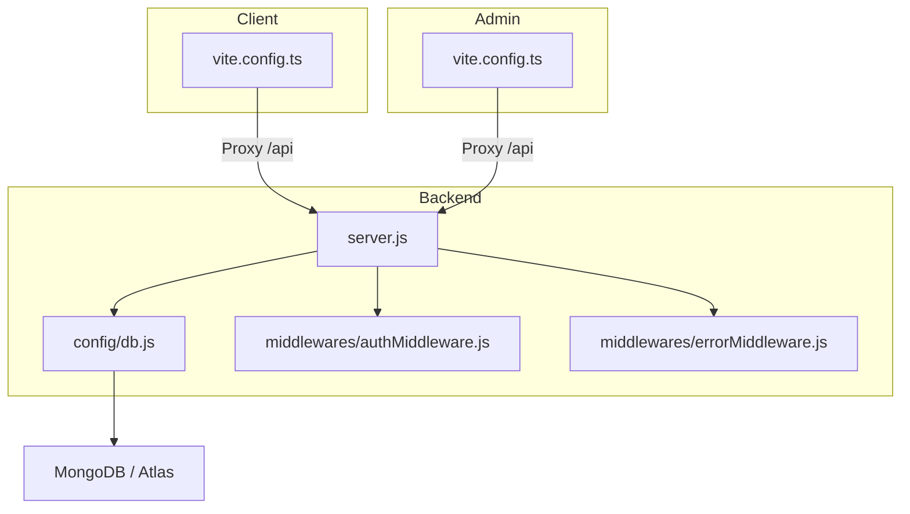
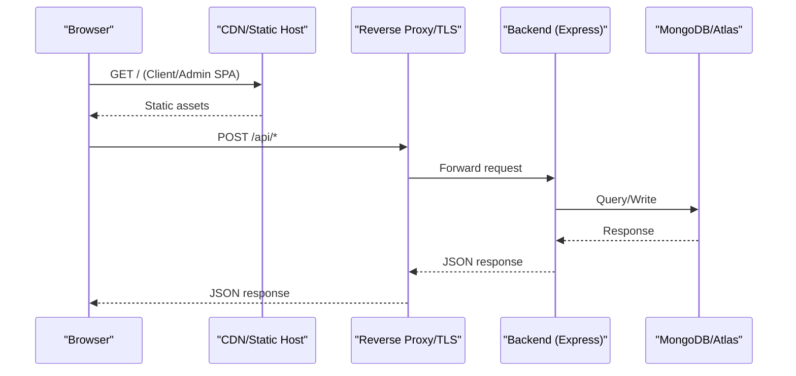
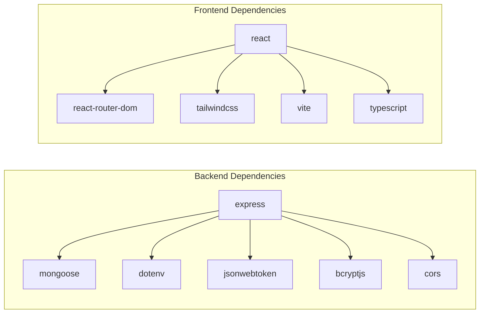

# Deployment Guide

<cite>
**Referenced Files in This Document**
- [README.md](file://README.md)
- [KCEnglishKids_BE/package.json](file://KCEnglishKids_BE/package.json)
- [client/package.json](file://client/package.json)
- [admin/package.json](file://admin/package.json)
- [KCEnglishKids_BE/src/config/db.js](file://KCEnglishKids_BE/src/config/db.js)
- [KCEnglishKids_BE/src/server.js](file://KCEnglishKids_BE/src/server.js)
- [client/vite.config.ts](file://client/vite.config.ts)
- [admin/vite.config.ts](file://admin/vite.config.ts)
- [KCEnglishKids_BE/scripts/migrate_to_atlas.js](file://KCEnglishKids_BE/scripts/migrate_to_atlas.js)
- [KCEnglishKids_BE/src/middlewares/authMiddleware.js](file://KCEnglishKids_BE/src/middlewares/authMiddleware.js)
- [KCEnglishKids_BE/src/middlewares/errorMiddleware.js](file://KCEnglishKids_BE/src/middlewares/errorMiddleware.js)
</cite>

## Table of Contents
1. Introduction
2. Project Structure
3. Core Components
4. Architecture Overview
5. Detailed Component Analysis
6. Dependency Analysis
7. Performance Considerations
8. Troubleshooting Guide
9. Conclusion

## Introduction
This deployment guide explains how to deploy the KCEnglishKids platform across development, staging, and production environments. It covers environment configuration (Node.js, MongoDB), build processes for Backend, Client, and Admin Portal, database setup including MongoDB Atlas migration, containerization and orchestration patterns, monitoring/logging strategies, and security considerations such as TLS, secrets management, and access control.

## Project Structure
The repository contains three applications:
- Backend: Node.js + Express REST API with Mongoose and MongoDB
- Client: React + TypeScript + Vite application for students and teachers
- Admin Portal: React + TypeScript + Vite application for administrators

**Diagram sources**
- [KCEnglishKids_BE/src/server.js:1-21](file://KCEnglishKids_BE/src/server.js#L1-L21)
- [KCEnglishKids_BE/src/config/db.js:1-33](file://KCEnglishKids_BE/src/config/db.js#L1-L33)
- [client/vite.config.ts:1-21](file://client/vite.config.ts#L1-L21)
- [admin/vite.config.ts:1-21](file://admin/vite.config.ts#L1-L21)

**Section sources**
- [README.md:31-79](file://README.md#L31-L79)

## Core Components
- Backend runtime and entrypoint
  - Loads environment variables, connects to MongoDB, starts Express server on a configurable port, and handles unhandled rejections.
- Database connection
  - Tries multiple MongoDB URIs with a timeout; exits on failure after all candidates are exhausted.
- Frontend dev servers
  - Client and Admin use Vite dev servers with proxy rules to forward API requests to the backend during development.

Key responsibilities:
- Environment loading and server startup: [KCEnglishKids_BE/src/server.js:1-21](file://KCEnglishKids_BE/src/server.js#L1-L21)
- MongoDB connection logic: [KCEnglishKids_BE/src/config/db.js:1-33](file://KCEnglishKids_BE/src/config/db.js#L1-L33)
- Client dev proxy: [client/vite.config.ts:11-19](file://client/vite.config.ts#L11-L19)
- Admin dev proxy: [admin/vite.config.ts:11-19](file://admin/vite.config.ts#L11-L19)

**Section sources**
- [KCEnglishKids_BE/src/server.js:1-21](file://KCEnglishKids_BE/src/server.js#L1-L21)
- [KCEnglishKids_BE/src/config/db.js:1-33](file://KCEnglishKids_BE/src/config/db.js#L1-L33)
- [client/vite.config.ts:1-21](file://client/vite.config.ts#L1-L21)
- [admin/vite.config.ts:1-21](file://admin/vite.config.ts#L1-L21)

## Architecture Overview
High-level deployment architecture:
- Clients (Browser) -> CDN/Static Host (Client/Admin) -> Reverse Proxy/TLS Termination -> Backend API -> Database (MongoDB or Atlas)

[No sources needed since this diagram shows conceptual workflow, not actual code structure]

## Detailed Component Analysis

### Environment Configuration Requirements
- Node.js
  - Minimum version: Node.js 18+ (tested on v24.15.0).
- MongoDB
  - Local default: mongodb://localhost:27017/kcenglishkids
  - Production: Use MongoDB Atlas with secure connection string.
- Environment Variables
  - PORT: Backend HTTP port (default 5000)
  - NODE_ENV: Environment flag (development, staging, production)
  - MONGODB_URI: Primary MongoDB connection string
  - JWT_SECRET: Secret used to sign/verify tokens
  - ATLAS_MONGODB_URI / TARGET_MONGODB_URI: Used by migration tooling
  - LOCAL_MONGODB_URI: Source database URI for migrations

Where they are used:
- Server startup and port: [KCEnglishKids_BE/src/server.js:11-15](file://KCEnglishKids_BE/src/server.js#L11-L15)
- MongoDB connection fallbacks: [KCEnglishKids_BE/src/config/db.js:11-30](file://KCEnglishKids_BE/src/config/db.js#L11-L30)
- JWT secret usage: [KCEnglishKids_BE/src/middlewares/authMiddleware.js:45-56](file://KCEnglishKids_BE/src/middlewares/authMiddleware.js#L45-L56)
- Migration tool env usage: [KCEnglishKids_BE/scripts/migrate_to_atlas.js:15-19](file://KCEnglishKids_BE/scripts/migrate_to_atlas.js#L15-L19)

**Section sources**
- [README.md:53-55](file://README.md#L53-L55)
- [KCEnglishKids_BE/src/server.js:11-15](file://KCEnglishKids_BE/src/server.js#L11-L15)
- [KCEnglishKids_BE/src/config/db.js:11-30](file://KCEnglishKids_BE/src/config/db.js#L11-L30)
- [KCEnglishKids_BE/src/middlewares/authMiddleware.js:45-56](file://KCEnglishKids_BE/src/middlewares/authMiddleware.js#L45-L56)
- [KCEnglishKids_BE/scripts/migrate_to_atlas.js:15-19](file://KCEnglishKids_BE/scripts/migrate_to_atlas.js#L15-L19)

### Build Process for All Applications
- Backend
  - Install dependencies and start: npm install; npm start
  - Seed data: npm run seed
  - Scripts available: start, dev, seed, migrate:atlas
  - Entry point: src/server.js
- Client (Student/Teacher App)
  - Install dependencies: npm install
  - Development: npm run dev (Vite dev server)
  - Build: npm run build (TypeScript build + Vite build)
  - Dev proxy configured to backend at localhost:5000
- Admin Portal
  - Install dependencies: npm install
  - Development: npm run dev (Vite dev server)
  - Build: npm run build (TypeScript build + Vite build)
  - Dev proxy configured to backend at localhost:5000

Build scripts reference:
- Backend: [KCEnglishKids_BE/package.json:6-12](file://KCEnglishKids_BE/package.json#L6-L12)
- Client: [client/package.json:6-10](file://client/package.json#L6-L10)
- Admin: [admin/package.json:6-9](file://admin/package.json#L6-L9)

Development proxies:
- Client: [client/vite.config.ts:11-19](file://client/vite.config.ts#L11-L19)
- Admin: [admin/vite.config.ts:11-19](file://admin/vite.config.ts#L11-L19)

**Section sources**
- [README.md:57-79](file://README.md#L57-L79)
- [KCEnglishKids_BE/package.json:6-12](file://KCEnglishKids_BE/package.json#L6-L12)
- [client/package.json:6-10](file://client/package.json#L6-L10)
- [admin/package.json:6-9](file://admin/package.json#L6-L9)
- [client/vite.config.ts:11-19](file://client/vite.config.ts#L11-L19)
- [admin/vite.config.ts:11-19](file://admin/vite.config.ts#L11-L19)

### Deployment Strategies by Environment
- Development
  - Run Backend locally on port 5000
  - Run Client and Admin via Vite dev servers with built-in proxy to backend
- Staging
  - Build static assets for Client and Admin
  - Serve static files via a web server or CDN
  - Deploy Backend behind a reverse proxy with TLS termination
  - Configure NODE_ENV=staging and set appropriate MONGODB_URI
- Production
  - Build static assets for Client and Admin
  - Serve static files via CDN or cloud storage
  - Deploy Backend as a stateless service behind a load balancer
  - Set NODE_ENV=production, strong JWT_SECRET, and production MONGODB_URI
  - Enable health checks and graceful shutdown handling

Environment-specific notes:
- Error stack exposure is controlled by NODE_ENV: [KCEnglishKids_BE/src/middlewares/errorMiddleware.js:12-12](file://KCEnglishKids_BE/src/middlewares/errorMiddleware.js#L12-L12)

**Section sources**
- [client/vite.config.ts:11-19](file://client/vite.config.ts#L11-L19)
- [admin/vite.config.ts:11-19](file://admin/vite.config.ts#L11-L19)
- [KCEnglishKids_BE/src/middlewares/errorMiddleware.js:12-12](file://KCEnglishKids_BE/src/middlewares/errorMiddleware.js#L12-L12)

### Database Configuration and MongoDB Atlas
- Connection behavior
  - The backend tries multiple URIs with a selection timeout and logs warnings when a candidate fails.
- Atlas migration tool
  - Reads .env, supports interactive prompts, normalizes target URIs, migrates collections and indexes, and can update MONGODB_URI in .env.
- Recommended production settings
  - Use MongoDB Atlas cluster with SSL enabled
  - Restrict network access to trusted IPs or use private networking where possible
  - Use dedicated database user with least privilege

Migration tool references:
- Atlas migration script: [KCEnglishKids_BE/scripts/migrate_to_atlas.js:60-126](file://KCEnglishKids_BE/scripts/migrate_to_atlas.js#L60-L126)
- Batch insert and index copy: [KCEnglishKids_BE/scripts/migrate_to_atlas.js:143-198](file://KCEnglishKids_BE/scripts/migrate_to_atlas.js#L143-L198)
- Optional .env update: [KCEnglishKids_BE/scripts/migrate_to_atlas.js:204-229](file://KCEnglishKids_BE/scripts/migrate_to_atlas.js#L204-L229)

Connection pool tuning
- Mongoose defaults are used; consider adjusting options like maxPoolSize, minPoolSize, serverSelectionTimeoutMS based on workload and latency requirements.

**Section sources**
- [KCEnglishKids_BE/src/config/db.js:11-30](file://KCEnglishKids_BE/src/config/db.js#L11-L30)
- [KCEnglishKids_BE/scripts/migrate_to_atlas.js:60-126](file://KCEnglishKids_BE/scripts/migrate_to_atlas.js#L60-L126)
- [KCEnglishKids_BE/scripts/migrate_to_atlas.js:143-198](file://KCEnglishKids_BE/scripts/migrate_to_atlas.js#L143-L198)
- [KCEnglishKids_BE/scripts/migrate_to_atlas.js:204-229](file://KCEnglishKids_BE/scripts/migrate_to_atlas.js#L204-L229)

### Containerization Options
- Backend container
  - Base image: node:18-alpine or node:20-slim
  - Copy package files, install production dependencies only, expose port 5000
  - Use non-root user for running the process
- Client and Admin containers
  - Multi-stage builds: builder stage installs dependencies and runs tsc + vite build; final stage serves static files via nginx or caddy
- Example Docker Compose
  - Services: backend, client, admin, mongodb (or external Atlas)
  - Networks: shared internal network
  - Volumes: persistent data for local DB if used

[No sources needed since this section provides general guidance]

### Orchestration with Kubernetes
- Deployments
  - One Deployment per service (backend, client, admin)
  - Horizontal Pod Autoscaler for backend based on CPU/memory
- Services/Ingress
  - Ingress controller terminates TLS and routes traffic to services
  - Path-based routing: /api -> backend, /* -> client/admin
- ConfigMaps and Secrets
  - Store MONGODB_URI, JWT_SECRET, and other config in Secrets
  - Mount ConfigMaps for non-sensitive configuration
- Health Checks
  - Liveness and readiness probes for backend endpoints

[No sources needed since this section provides general guidance]

### Cloud Platform Deployment Patterns
- PaaS (e.g., Render, Railway, Fly.io)
  - Connect source repo, define build commands, set environment variables, attach managed MongoDB
- IaaS (e.g., AWS/GCP/Azure VMs)
  - Provision VMs, install Node.js, run PM2/systemd service, configure Nginx/Caddy for TLS and reverse proxy
- Serverless/API Gateway
  - Wrap backend endpoints behind API Gateway/Lambda or Cloud Functions if refactored accordingly

[No sources needed since this section provides general guidance]

### Monitoring, Logging, and Error Tracking
- Application logging
  - Use structured logging library (e.g., pino/winston) and ship logs to centralized logging (CloudWatch, GCP Logging, Azure Monitor, ELK)
- Metrics and performance monitoring
  - Expose metrics endpoint (Prometheus) or integrate APM (OpenTelemetry, New Relic, Datadog)
- Error tracking
  - Integrate error tracking (Sentry, LogRocket) for frontend and backend
- Audit and admin logs
  - Admin UI displays audit logs for administrative actions

[No sources needed since this section provides general guidance]

### Security Considerations for Production
- TLS/SSL
  - Terminate TLS at reverse proxy or ingress controller; enforce HTTPS
- Secrets Management
  - Never commit secrets; use environment variable injection from platform secret stores
  - Rotate JWT_SECRET regularly
- Access Control
  - Enforce role-based authorization using middleware
  - Validate and sanitize inputs; enable CORS only for trusted origins
- Network Security
  - Restrict database access to whitelisted IPs or private networks
  - Use least-privilege database users

Security-related code references:
- JWT verification and optional auth: [KCEnglishKids_BE/src/middlewares/authMiddleware.js:45-56](file://KCEnglishKids_BE/src/middlewares/authMiddleware.js#L45-L56)
- Error stack suppression in production: [KCEnglishKids_BE/src/middlewares/errorMiddleware.js:12-12](file://KCEnglishKids_BE/src/middlewares/errorMiddleware.js#L12-L12)

**Section sources**
- [KCEnglishKids_BE/src/middlewares/authMiddleware.js:45-56](file://KCEnglishKids_BE/src/middlewares/authMiddleware.js#L45-L56)
- [KCEnglishKids_BE/src/middlewares/errorMiddleware.js:12-12](file://KCEnglishKids_BE/src/middlewares/errorMiddleware.js#L12-L12)

## Dependency Analysis
Runtime dependencies overview:
- Backend uses Express, Mongoose, dotenv, jsonwebtoken, bcryptjs, cors
- Client and Admin use React, React Router, Tailwind CSS, Vite, TypeScript

**Diagram sources**
- [KCEnglishKids_BE/package.json:17-27](file://KCEnglishKids_BE/package.json#L17-L27)
- [client/package.json:12-34](file://client/package.json#L12-L34)
- [admin/package.json:11-28](file://admin/package.json#L11-L28)

**Section sources**
- [KCEnglishKids_BE/package.json:17-27](file://KCEnglishKids_BE/package.json#L17-L27)
- [client/package.json:12-34](file://client/package.json#L12-L34)
- [admin/package.json:11-28](file://admin/package.json#L11-L28)

## Performance Considerations
- Backend
  - Tune Mongoose connection pool settings according to expected concurrency and latency targets
  - Use compression and caching headers at the reverse proxy layer
  - Keep payload sizes small; paginate large responses
- Frontend
  - Leverage CDN caching for static assets
  - Minimize bundle size; tree-shake unused modules
- Database
  - Ensure proper indexing on frequently queried fields
  - Use read replicas for heavy read workloads if supported by provider

[No sources needed since this section provides general guidance]

## Troubleshooting Guide
- Cannot connect to MongoDB
  - Verify MONGODB_URI format and credentials
  - Check DNS resolution and network access rules (especially for Atlas)
  - Review connection fallback behavior and timeouts
- Authentication failures
  - Confirm JWT_SECRET matches between token issuance and verification
  - Ensure Authorization header is correctly formatted
- Port conflicts
  - Change PORT environment variable for backend or dev servers
- Migration issues
  - Validate Atlas connection string and IP allowlist
  - Use provided migration script to normalize URIs and update .env

Relevant references:
- MongoDB connection fallback and errors: [KCEnglishKids_BE/src/config/db.js:11-30](file://KCEnglishKids_BE/src/config/db.js#L11-L30)
- JWT secret usage: [KCEnglishKids_BE/src/middlewares/authMiddleware.js:45-56](file://KCEnglishKids_BE/src/middlewares/authMiddleware.js#L45-L56)
- Migration tool error messages and hints: [KCEnglishKids_BE/scripts/migrate_to_atlas.js:233-240](file://KCEnglishKids_BE/scripts/migrate_to_atlas.js#L233-L240)

**Section sources**
- [KCEnglishKids_BE/src/config/db.js:11-30](file://KCEnglishKids_BE/src/config/db.js#L11-L30)
- [KCEnglishKids_BE/src/middlewares/authMiddleware.js:45-56](file://KCEnglishKids_BE/src/middlewares/authMiddleware.js#L45-L56)
- [KCEnglishKids_BE/scripts/migrate_to_atlas.js:233-240](file://KCEnglishKids_BE/scripts/migrate_to_atlas.js#L233-L240)

## Conclusion
By following this guide, you can reliably deploy KCEnglishKids across environments, securely manage secrets and access controls, scale the backend and frontends, and maintain observability through logging and monitoring. For production, prefer managed databases (MongoDB Atlas), terminate TLS at the edge, and centralize logs and metrics for proactive operations.