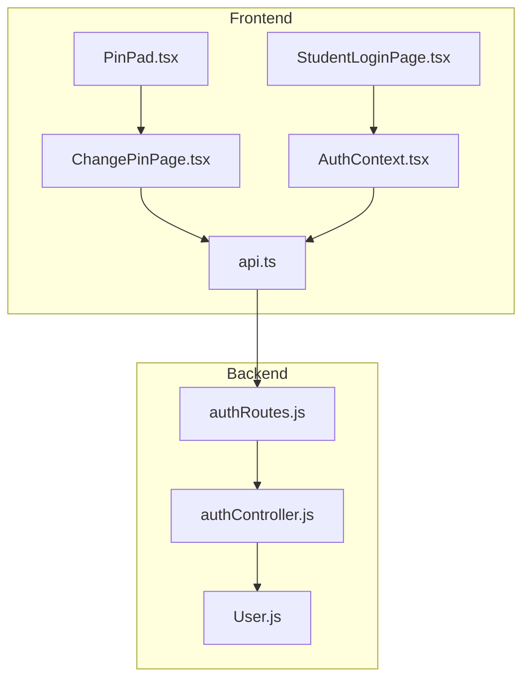
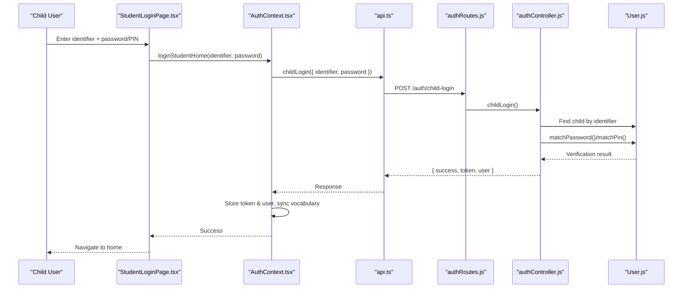
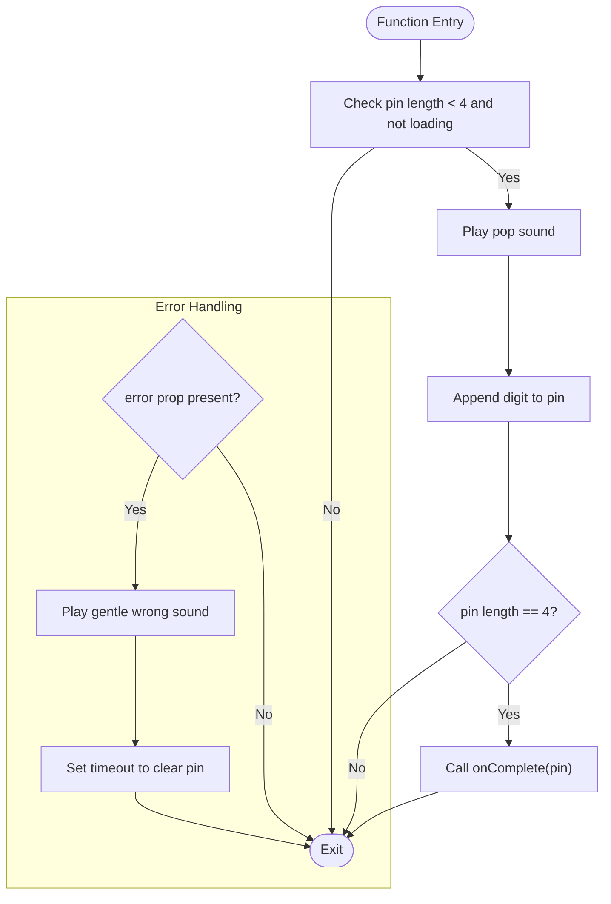
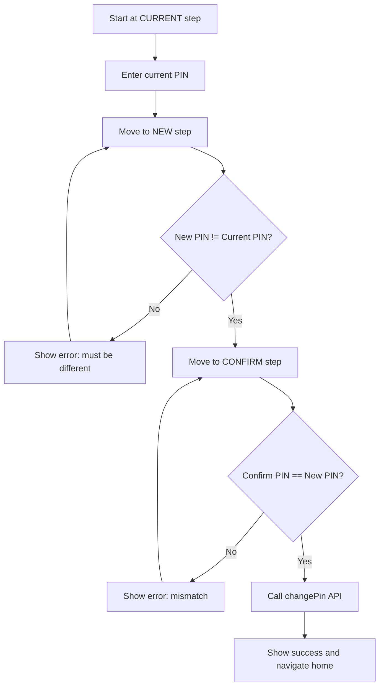
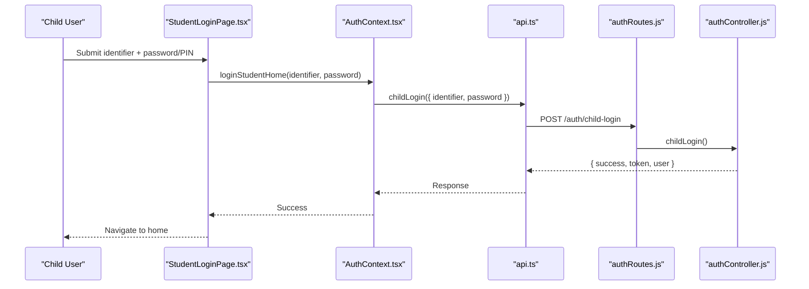
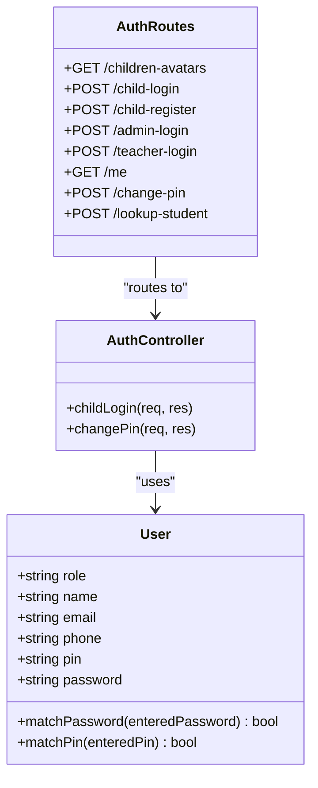
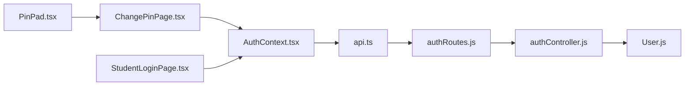

# Child Authentication System

<cite>
**Referenced Files in This Document**
- [PinPad.tsx](file://client/src/components/child/PinPad.tsx)
- [ChangePinPage.tsx](file://client/src/pages/child/ChangePinPage.tsx)
- [StudentLoginPage.tsx](file://client/src/pages/child/StudentLoginPage.tsx)
- [AuthContext.tsx](file://client/src/context/AuthContext.tsx)
- [api.ts](file://client/src/services/api.ts)
- [authController.js](file://KCEnglishKids_BE/src/controllers/authController.js)
- [User.js](file://KCEnglishKids_BE/src/models/User.js)
- [authRoutes.js](file://KCEnglishKids_BE/src/routes/authRoutes.js)
</cite>

## Table of Contents
1. [Introduction](#introduction)
2. [Project Structure](#project-structure)
3. [Core Components](#core-components)
4. [Architecture Overview](#architecture-overview)
5. [Detailed Component Analysis](#detailed-component-analysis)
6. [Dependency Analysis](#dependency-analysis)
7. [Performance Considerations](#performance-considerations)
8. [Troubleshooting Guide](#troubleshooting-guide)
9. [Conclusion](#conclusion)

## Introduction
This document explains the child-friendly PIN-based authentication system designed for children aged 3–6. It covers the secure PIN entry interface, age-appropriate design patterns, PIN validation logic, security considerations, and integration with the main authentication context. It also documents the PIN pad component implementation, including number grid layout, audio feedback, error handling, accessibility features, and workflows for PIN creation, modification, and validation.

The system supports two primary child login modes:
- Home login using an identifier (email or phone) plus either a password or a 4-digit PIN.
- Classroom quick login using an avatar and a 4-digit PIN.

PINs are stored securely on the server as hashed values, and the UI provides large touch targets, visual feedback, and gentle audio cues to make interactions intuitive for young users.

## Project Structure
The child authentication feature spans both frontend React components and backend Express routes and controllers:
- Frontend:
  - PinPad component for accessible, child-friendly PIN entry.
  - ChangePinPage for guided PIN creation and modification.
  - StudentLoginPage for home login flows.
  - AuthContext for session management and API integration.
  - api.ts for HTTP requests and endpoints.
- Backend:
  - authController.js handles child login and PIN change operations.
  - User.js defines the user model with hashed PIN/password storage and verification methods.
  - authRoutes.js exposes endpoints for child login, registration, token verification, and PIN changes.

**Diagram sources**
- [PinPad.tsx:1-101](file://client/src/components/child/PinPad.tsx#L1-L101)
- [ChangePinPage.tsx:1-206](file://client/src/pages/child/ChangePinPage.tsx#L1-L206)
- [StudentLoginPage.tsx:1-461](file://client/src/pages/child/StudentLoginPage.tsx#L1-L461)
- [AuthContext.tsx:1-161](file://client/src/context/AuthContext.tsx#L1-L161)
- [api.ts:1-354](file://client/src/services/api.ts#L1-L354)
- [authRoutes.js:1-25](file://KCEnglishKids_BE/src/routes/authRoutes.js#L1-L25)
- [authController.js:38-161](file://KCEnglishKids_BE/src/controllers/authController.js#L38-L161)
- [User.js:1-109](file://KCEnglishKids_BE/src/models/User.js#L1-L109)

**Section sources**
- [PinPad.tsx:1-101](file://client/src/components/child/PinPad.tsx#L1-L101)
- [ChangePinPage.tsx:1-206](file://client/src/pages/child/ChangePinPage.tsx#L1-L206)
- [StudentLoginPage.tsx:1-461](file://client/src/pages/child/StudentLoginPage.tsx#L1-L461)
- [AuthContext.tsx:1-161](file://client/src/context/AuthContext.tsx#L1-L161)
- [api.ts:1-354](file://client/src/services/api.ts#L1-L354)
- [authRoutes.js:1-25](file://KCEnglishKids_BE/src/routes/authRoutes.js#L1-L25)
- [authController.js:38-161](file://KCEnglishKids_BE/src/controllers/authController.js#L38-L161)
- [User.js:1-109](file://KCEnglishKids_BE/src/models/User.js#L1-L109)

## Core Components
- PinPad: A reusable, child-friendly numeric keypad that enforces a maximum of four digits, provides audio feedback, visual bubble indicators, and gentle error animations. It clears input automatically when an external error is provided.
- ChangePinPage: A multi-step workflow guiding children through entering their current PIN, creating a new PIN, confirming it, and receiving success feedback. It integrates with the backend via the change-pin endpoint.
- StudentLoginPage: The home login page supporting email/phone identifiers and password or PIN inputs, along with quick demo accounts and a parent phone lookup modal.
- AuthContext: Centralized authentication state and methods for child login, student home login, registration, admin/teacher login, logout, and session persistence.
- api.ts: HTTP client utilities and typed API functions for child login, registration, token verification, and PIN changes.
- authController.js: Server-side logic for child login (identifier + password/PIN or avatar + PIN), token generation, and PIN change enforcement.
- User.js: Mongoose model with pre-save hashing for passwords and PINs, and verification methods for password and PIN.
- authRoutes.js: Express routes exposing endpoints for child login, registration, token verification, and PIN changes.

**Section sources**
- [PinPad.tsx:1-101](file://client/src/components/child/PinPad.tsx#L1-L101)
- [ChangePinPage.tsx:1-206](file://client/src/pages/child/ChangePinPage.tsx#L1-L206)
- [StudentLoginPage.tsx:1-461](file://client/src/pages/child/StudentLoginPage.tsx#L1-L461)
- [AuthContext.tsx:1-161](file://client/src/context/AuthContext.tsx#L1-L161)
- [api.ts:1-354](file://client/src/services/api.ts#L1-L354)
- [authController.js:38-161](file://KCEnglishKids_BE/src/controllers/authController.js#L38-L161)
- [User.js:1-109](file://KCEnglishKids_BE/src/models/User.js#L1-L109)
- [authRoutes.js:1-25](file://KCEnglishKids_BE/src/routes/authRoutes.js#L1-L25)

## Architecture Overview
The child authentication flow combines a friendly UI with secure backend validation:

**Diagram sources**
- [StudentLoginPage.tsx:51-63](file://client/src/pages/child/StudentLoginPage.tsx#L51-L63)
- [AuthContext.tsx:75-85](file://client/src/context/AuthContext.tsx#L75-L85)
- [api.ts:64-94](file://client/src/services/api.ts#L64-L94)
- [authRoutes.js:15-22](file://KCEnglishKids_BE/src/routes/authRoutes.js#L15-L22)
- [authController.js:38-97](file://KCEnglishKids_BE/src/controllers/authController.js#L38-L97)
- [User.js:96-106](file://KCEnglishKids_BE/src/models/User.js#L96-L106)

## Detailed Component Analysis

### PinPad Component
PinPad implements a child-friendly numeric keypad with:
- Input constraints: Maximum of four digits; prevents further input once full.
- Audio feedback: Plays a pop sound on digit press and delete; plays a gentle wrong sound on error.
- Visual feedback: Four bubble indicators fill as digits are entered; wobble animation on error.
- Error handling: Clears input after a short delay when an external error prop is set.
- Accessibility: Large buttons, clear labels, and keyboard-like behavior via click handlers.

**Diagram sources**
- [PinPad.tsx:14-41](file://client/src/components/child/PinPad.tsx#L14-L41)

**Section sources**
- [PinPad.tsx:1-101](file://client/src/components/child/PinPad.tsx#L1-L101)

### ChangePinPage Workflow
ChangePinPage guides children through a three-step PIN change process:
- Step 1: Enter current PIN.
- Step 2: Create a new PIN (must differ from current).
- Step 3: Confirm new PIN (must match).
- Success: Show confirmation and navigate back to home.

**Diagram sources**
- [ChangePinPage.tsx:21-65](file://client/src/pages/child/ChangePinPage.tsx#L21-L65)

**Section sources**
- [ChangePinPage.tsx:1-206](file://client/src/pages/child/ChangePinPage.tsx#L1-L206)

### StudentLoginPage Integration
StudentLoginPage supports:
- Identifier input (email or phone).
- Password or PIN input with visibility toggle.
- Quick demo accounts for different age groups.
- Parent phone lookup modal to find child accounts.
- Integration with AuthContext.loginStudentHome for authentication.

**Diagram sources**
- [StudentLoginPage.tsx:51-63](file://client/src/pages/child/StudentLoginPage.tsx#L51-L63)
- [AuthContext.tsx:75-85](file://client/src/context/AuthContext.tsx#L75-L85)
- [api.ts:64-94](file://client/src/services/api.ts#L64-L94)
- [authRoutes.js:15-22](file://KCEnglishKids_BE/src/routes/authRoutes.js#L15-L22)
- [authController.js:38-97](file://KCEnglishKids_BE/src/controllers/authController.js#L38-L97)

**Section sources**
- [StudentLoginPage.tsx:1-461](file://client/src/pages/child/StudentLoginPage.tsx#L1-L461)

### Backend PIN Validation and Security
- Login Modes:
  - Home login: Identifier (email/phone/contact/username) plus password or PIN.
  - Classroom quick login: Avatar or childId plus 4-digit PIN.
- PIN Storage:
  - PINs are hashed using bcrypt before saving to the database.
- Verification:
  - matchPin compares entered PIN against stored hash.
- PIN Change:
  - Requires authenticated child role.
  - Validates current PIN and enforces exactly four digits for new PIN.
  - Updates both pin and password fields to keep login modes consistent.

**Diagram sources**
- [User.js:1-109](file://KCEnglishKids_BE/src/models/User.js#L1-L109)
- [authController.js:38-161](file://KCEnglishKids_BE/src/controllers/authController.js#L38-L161)
- [authController.js:371-422](file://KCEnglishKids_BE/src/controllers/authController.js#L371-L422)
- [authRoutes.js:1-25](file://KCEnglishKids_BE/src/routes/authRoutes.js#L1-L25)

**Section sources**
- [authController.js:38-161](file://KCEnglishKids_BE/src/controllers/authController.js#L38-L161)
- [authController.js:371-422](file://KCEnglishKids_BE/src/controllers/authController.js#L371-L422)
- [User.js:1-109](file://KCEnglishKids_BE/src/models/User.js#L1-L109)
- [authRoutes.js:1-25](file://KCEnglishKids_BE/src/routes/authRoutes.js#L1-L25)

## Dependency Analysis
The child authentication system has clear separation between UI, service layer, and backend:
- UI components depend on AuthContext for state and navigation.
- AuthContext depends on api.ts for HTTP calls.
- api.ts depends on express routes defined in authRoutes.js.
- authController.js uses User.js for data access and validation.

**Diagram sources**
- [PinPad.tsx:1-101](file://client/src/components/child/PinPad.tsx#L1-L101)
- [ChangePinPage.tsx:1-206](file://client/src/pages/child/ChangePinPage.tsx#L1-L206)
- [StudentLoginPage.tsx:1-461](file://client/src/pages/child/StudentLoginPage.tsx#L1-L461)
- [AuthContext.tsx:1-161](file://client/src/context/AuthContext.tsx#L1-L161)
- [api.ts:1-354](file://client/src/services/api.ts#L1-L354)
- [authRoutes.js:1-25](file://KCEnglishKids_BE/src/routes/authRoutes.js#L1-L25)
- [authController.js:38-161](file://KCEnglishKids_BE/src/controllers/authController.js#L38-L161)
- [User.js:1-109](file://KCEnglishKids_BE/src/models/User.js#L1-L109)

**Section sources**
- [PinPad.tsx:1-101](file://client/src/components/child/PinPad.tsx#L1-L101)
- [ChangePinPage.tsx:1-206](file://client/src/pages/child/ChangePinPage.tsx#L1-L206)
- [StudentLoginPage.tsx:1-461](file://client/src/pages/child/StudentLoginPage.tsx#L1-L461)
- [AuthContext.tsx:1-161](file://client/src/context/AuthContext.tsx#L1-L161)
- [api.ts:1-354](file://client/src/services/api.ts#L1-L354)
- [authRoutes.js:1-25](file://KCEnglishKids_BE/src/routes/authRoutes.js#L1-L25)
- [authController.js:38-161](file://KCEnglishKids_BE/src/controllers/authController.js#L38-L161)
- [User.js:1-109](file://KCEnglishKids_BE/src/models/User.js#L1-L109)

## Performance Considerations
- Client-side input constraints prevent unnecessary network calls by enforcing a maximum of four digits.
- Audio feedback is lightweight and improves perceived responsiveness for young users.
- Backend validation ensures minimal round-trips by rejecting invalid PIN formats early.
- Token storage in localStorage avoids repeated authentication checks during active sessions.

[No sources needed since this section provides general guidance]

## Troubleshooting Guide
Common issues and resolutions:
- Incorrect PIN or password:
  - The UI displays a friendly error message and plays a gentle wrong sound.
  - The backend returns a 401 status with a localized message.
- PIN change failures:
  - Ensure the current PIN is correct.
  - Ensure the new PIN differs from the current PIN and is exactly four digits.
  - On failure, the UI resets to the current PIN step and clears inputs.
- Session expiration:
  - If the token is invalid, the context clears local storage and logs out the user.

**Section sources**
- [PinPad.tsx:32-41](file://client/src/components/child/PinPad.tsx#L32-L41)
- [ChangePinPage.tsx:39-65](file://client/src/pages/child/ChangePinPage.tsx#L39-L65)
- [AuthContext.tsx:37-61](file://client/src/context/AuthContext.tsx#L37-L61)
- [authController.js:68-73](file://KCEnglishKids_BE/src/controllers/authController.js#L68-L73)
- [authController.js:401-408](file://KCEnglishKids_BE/src/controllers/authController.js#L401-L408)

## Conclusion
The child authentication system balances usability and security for young learners. The PinPad component offers an accessible, engaging interface with clear feedback. The backend enforces robust validation and secure storage of PINs. Multi-mode login supports both home and classroom scenarios, while the ChangePinPage provides a guided, safe way for children to update their credentials. Together, these components create a secure, child-friendly experience aligned with best practices for protecting young users’ data.

[No sources needed since this section summarizes without analyzing specific files]