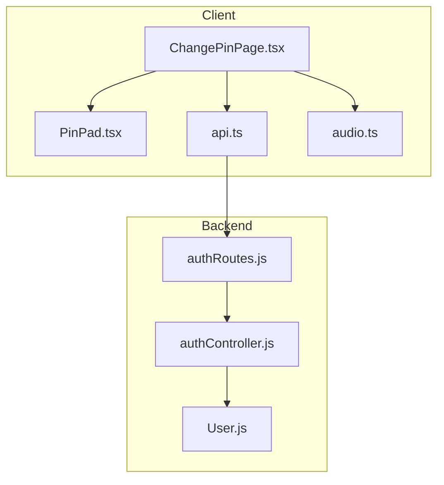
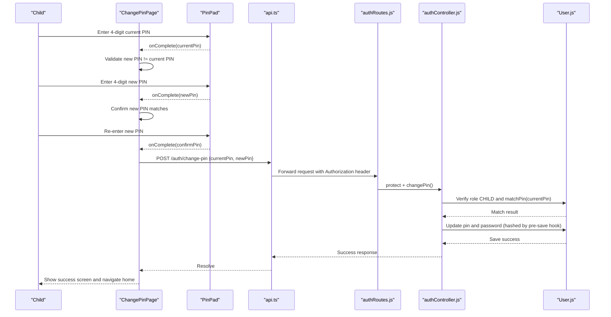
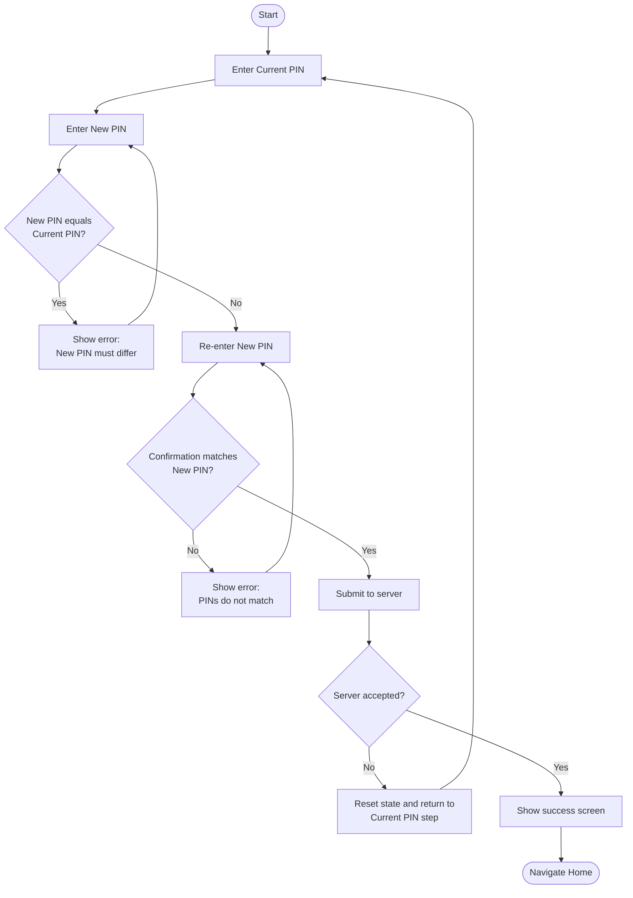
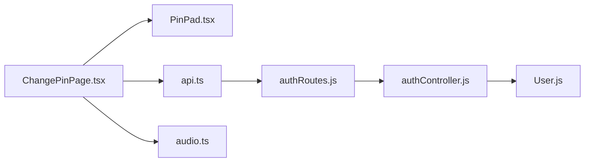

# Child Change PIN Page

<cite>
**Referenced Files in This Document**
- [ChangePinPage.tsx](file://client/src/pages/child/ChangePinPage.tsx)
- [PinPad.tsx](file://client/src/components/child/PinPad.tsx)
- [api.ts](file://client/src/services/api.ts)
- [authController.js](file://KCEnglishKids_BE/src/controllers/authController.js)
- [User.js](file://KCEnglishKids_BE/src/models/User.js)
- [authRoutes.js](file://KCEnglishKids_BE/src/routes/authRoutes.js)
- [audio.ts](file://client/src/utils/audio.ts)
</cite>

## Table of Contents
1. [Introduction](#introduction)
2. [Project Structure](#project-structure)
3. [Core Components](#core-components)
4. [Architecture Overview](#architecture-overview)
5. [Detailed Component Analysis](#detailed-component-analysis)
6. [Dependency Analysis](#dependency-analysis)
7. [Performance Considerations](#performance-considerations)
8. [Troubleshooting Guide](#troubleshooting-guide)
9. [Conclusion](#conclusion)

## Introduction
This document explains the child-facing PIN change feature that allows children to update their learning access credentials securely. It covers the user interface, validation rules, confirmation steps, error handling, security controls, input sanitization, accessibility considerations, and age-appropriate design patterns used across the client and backend implementations.

## Project Structure
The PIN change flow spans a React page, a reusable keypad component, an API service layer, backend routes and controller logic, and a data model with secure hashing.

**Diagram sources**
- [ChangePinPage.tsx:1-206](file://client/src/pages/child/ChangePinPage.tsx#L1-L206)
- [PinPad.tsx:1-101](file://client/src/components/child/PinPad.tsx#L1-L101)
- [api.ts:63-94](file://client/src/services/api.ts#L63-L94)
- [authRoutes.js:1-25](file://KCEnglishKids_BE/src/routes/authRoutes.js#L1-L25)
- [authController.js:371-422](file://KCEnglishKids_BE/src/controllers/authController.js#L371-L422)
- [User.js:84-106](file://KCEnglishKids_BE/src/models/User.js#L84-L106)

**Section sources**
- [ChangePinPage.tsx:1-206](file://client/src/pages/child/ChangePinPage.tsx#L1-L206)
- [PinPad.tsx:1-101](file://client/src/components/child/PinPad.tsx#L1-L101)
- [api.ts:63-94](file://client/src/services/api.ts#L63-L94)
- [authRoutes.js:1-25](file://KCEnglishKids_BE/src/routes/authRoutes.js#L1-L25)
- [authController.js:371-422](file://KCEnglishKids_BE/src/controllers/authController.js#L371-L422)
- [User.js:84-106](file://KCEnglishKids_BE/src/models/User.js#L84-L106)

## Core Components
- ChangePinPage: Orchestrates the multi-step PIN change flow, validates inputs, manages UI state, and calls the backend API.
- PinPad: Provides a child-friendly numeric keypad for entering exactly four digits, with visual feedback and error clearing behavior.
- api.ts: Exposes authApi.changePin to send the current and new PINs to the server with authentication headers.
- authRoutes.js: Registers the protected route for changing a child’s PIN.
- authController.js: Validates request payloads, enforces role-based access, verifies the current PIN, and updates credentials securely.
- User.js: Defines the child schema, hashes PINs on save, and provides a method to compare entered PINs against stored hashes.
- audio.ts: Supplies playful sound effects (pop, correct, gentle wrong) to reinforce child-friendly feedback.

**Section sources**
- [ChangePinPage.tsx:11-73](file://client/src/pages/child/ChangePinPage.tsx#L11-L73)
- [PinPad.tsx:11-41](file://client/src/components/child/PinPad.tsx#L11-L41)
- [api.ts:63-94](file://client/src/services/api.ts#L63-L94)
- [authRoutes.js:20-21](file://KCEnglishKids_BE/src/routes/authRoutes.js#L20-L21)
- [authController.js:371-422](file://KCEnglishKids_BE/src/controllers/authController.js#L371-L422)
- [User.js:84-106](file://KCEnglishKids_BE/src/models/User.js#L84-L106)
- [audio.ts:40-114](file://client/src/utils/audio.ts#L40-L114)

## Architecture Overview
The PIN change process is a secure, multi-step workflow:

**Diagram sources**
- [ChangePinPage.tsx:21-65](file://client/src/pages/child/ChangePinPage.tsx#L21-L65)
- [PinPad.tsx:14-23](file://client/src/components/child/PinPad.tsx#L14-L23)
- [api.ts:21-30](file://client/src/services/api.ts#L21-L30)
- [api.ts:90-91](file://client/src/services/api.ts#L90-L91)
- [authRoutes.js:20-21](file://KCEnglishKids_BE/src/routes/authRoutes.js#L20-L21)
- [authController.js:371-422](file://KCEnglishKids_BE/src/controllers/authController.js#L371-L422)
- [User.js:84-106](file://KCEnglishKids_BE/src/models/User.js#L84-L106)

## Detailed Component Analysis

### ChangePinPage
Responsibilities:
- Manages step progression: CURRENT → NEW → CONFIRM → SUCCESS.
- Enforces local validation rules:
  - New PIN must differ from current PIN.
  - Confirmation PIN must match the new PIN.
- Calls the backend only after successful confirmation.
- Handles loading states and errors; resets state on failure.
- Plays appropriate sound effects for positive and negative feedback.
- Provides a “restart” action to start over and a helper message guiding users to contact a teacher if the current PIN is forgotten.

Validation rules:
- Exactly four digits are required per step via PinPad.
- New PIN cannot equal current PIN.
- Confirmation must match the new PIN.

Error handling:
- On mismatch or server error, displays a friendly error message, plays a gentle wrong sound, clears inputs, and returns to the first step.

Accessibility and UX:
- Large, high-contrast buttons and clear progress indicators.
- Encouraging language and simple instructions tailored for children.
- Clear navigation back to the home page.

**Section sources**
- [ChangePinPage.tsx:11-73](file://client/src/pages/child/ChangePinPage.tsx#L11-L73)
- [ChangePinPage.tsx:75-206](file://client/src/pages/child/ChangePinPage.tsx#L75-L206)

#### Flowchart: PIN Change Validation

**Diagram sources**
- [ChangePinPage.tsx:28-65](file://client/src/pages/child/ChangePinPage.tsx#L28-L65)

### PinPad
Responsibilities:
- Accepts exactly four digits.
- Prevents further input while loading.
- Provides delete functionality.
- Clears internal buffer when an external error is provided.
- Triggers completion callback upon reaching four digits.

Input sanitization:
- Only numeric keys are rendered; length is capped at four.
- Ignores additional input during loading to prevent race conditions.

Feedback:
- Visual bubble indicators fill as digits are entered.
- Error state triggers a wobble animation and clears the buffer after a short delay.
- Sound effects play on digit entry and deletion.

**Section sources**
- [PinPad.tsx:11-41](file://client/src/components/child/PinPad.tsx#L11-L41)
- [PinPad.tsx:43-99](file://client/src/components/child/PinPad.tsx#L43-L99)

### API Layer (api.ts)
Responsibilities:
- Adds Authorization header using a stored token.
- Throws errors with messages from server responses.
- Exposes authApi.changePin(payload) to call the backend endpoint.

Security:
- Ensures requests include a bearer token for authenticated operations.

**Section sources**
- [api.ts:3-9](file://client/src/services/api.ts#L3-L9)
- [api.ts:21-30](file://client/src/services/api.ts#L21-L30)
- [api.ts:63-94](file://client/src/services/api.ts#L63-L94)

### Backend Route (authRoutes.js)
Responsibilities:
- Registers the /auth/change-pin route.
- Applies the protect middleware to enforce authentication before invoking the controller.

**Section sources**
- [authRoutes.js:1-25](file://KCEnglishKids_BE/src/routes/authRoutes.js#L1-L25)

### Backend Controller (authController.js)
Responsibilities:
- Validates presence of currentPin and newPin.
- Sanitizes and validates newPin format (exactly four digits).
- Confirms the requesting user is a child.
- Verifies current PIN using the model’s comparison method.
- Updates both pin and password fields, relying on the model’s pre-save hook for hashing.
- Returns success or appropriate error responses.

Security measures:
- Role check ensures only children can change their own PIN.
- Input validation prevents malformed or unsafe values.
- Secure comparison via bcrypt-backed method.
- Sensitive fields are hashed before persistence.

**Section sources**
- [authController.js:371-422](file://KCEnglishKids_BE/src/controllers/authController.js#L371-L422)

### Data Model (User.js)
Responsibilities:
- Stores hashed PIN and password fields.
- Pre-save hook hashes both password and pin when modified.
- Provides matchPin method to compare plaintext PINs against stored hashes.

Security measures:
- Uses bcrypt with salt rounds for strong hashing.
- Never stores or compares plaintext PINs.

**Section sources**
- [User.js:25-30](file://KCEnglishKids_BE/src/models/User.js#L25-L30)
- [User.js:84-106](file://KCEnglishKids_BE/src/models/User.js#L84-L106)

### Audio Feedback (audio.ts)
Responsibilities:
- Provides playful sounds for button presses, correct actions, and gentle incorrect feedback.
- Ensures audio context is unlocked by user interaction.

Design pattern:
- Non-punishing feedback aligns with child safety and encourages retrying without frustration.

**Section sources**
- [audio.ts:40-114](file://client/src/utils/audio.ts#L40-L114)

## Dependency Analysis

**Diagram sources**
- [ChangePinPage.tsx:1-7](file://client/src/pages/child/ChangePinPage.tsx#L1-L7)
- [PinPad.tsx:1-3](file://client/src/components/child/PinPad.tsx#L1-L3)
- [api.ts:63-94](file://client/src/services/api.ts#L63-L94)
- [authRoutes.js:1-25](file://KCEnglishKids_BE/src/routes/authRoutes.js#L1-L25)
- [authController.js:371-422](file://KCEnglishKids_BE/src/controllers/authController.js#L371-L422)
- [User.js:84-106](file://KCEnglishKids_BE/src/models/User.js#L84-L106)

**Section sources**
- [ChangePinPage.tsx:1-7](file://client/src/pages/child/ChangePinPage.tsx#L1-L7)
- [PinPad.tsx:1-3](file://client/src/components/child/PinPad.tsx#L1-L3)
- [api.ts:63-94](file://client/src/services/api.ts#L63-L94)
- [authRoutes.js:1-25](file://KCEnglishKids_BE/src/routes/authRoutes.js#L1-L25)
- [authController.js:371-422](file://KCEnglishKids_BE/src/controllers/authController.js#L371-L422)
- [User.js:84-106](file://KCEnglishKids_BE/src/models/User.js#L84-L106)

## Performance Considerations
- Client-side validation avoids unnecessary network calls until all checks pass.
- Loading flags disable keypad interactions to prevent duplicate submissions.
- Backend performs minimal work: one lookup, one comparison, and one save operation.
- Hashing occurs only on save via a pre-save hook, avoiding repeated hashing during reads.

[No sources needed since this section provides general guidance]

## Troubleshooting Guide
Common issues and resolutions:
- New PIN equals current PIN: The page shows a friendly error and keeps the user on the new PIN step.
- Confirmation does not match: The page shows a mismatch error and prompts re-entry.
- Incorrect current PIN: The server rejects the request; the page resets state and returns to the first step.
- Network or token errors: The API layer throws an error message; the page catches it and guides the user to retry.

Operational tips:
- If the child forgets the current PIN, guide them to contact the class teacher for assistance.
- Ensure the browser allows audio playback; otherwise, sound feedback may be muted but the flow still works.

**Section sources**
- [ChangePinPage.tsx:28-65](file://client/src/pages/child/ChangePinPage.tsx#L28-L65)
- [ChangePinPage.tsx:199-202](file://client/src/pages/child/ChangePinPage.tsx#L199-L202)
- [api.ts:21-30](file://client/src/services/api.ts#L21-L30)
- [authController.js:371-422](file://KCEnglishKids_BE/src/controllers/authController.js#L371-L422)

## Conclusion
The child PIN change feature combines a child-friendly interface with robust security. It enforces strict validation, uses secure hashing, restricts access to authenticated children, and provides encouraging feedback. The design prioritizes safety, clarity, and accessibility for young users while maintaining a clean separation between client and backend responsibilities.

[No sources needed since this section summarizes without analyzing specific files]