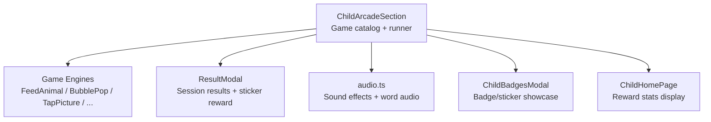
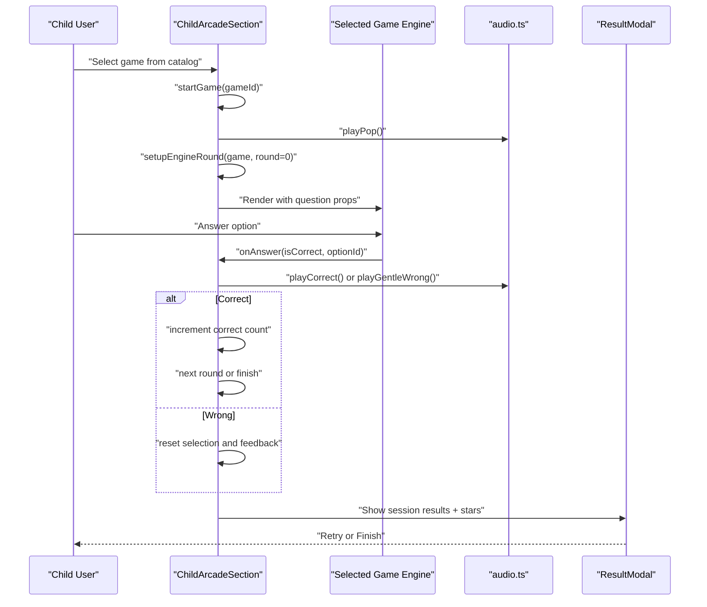
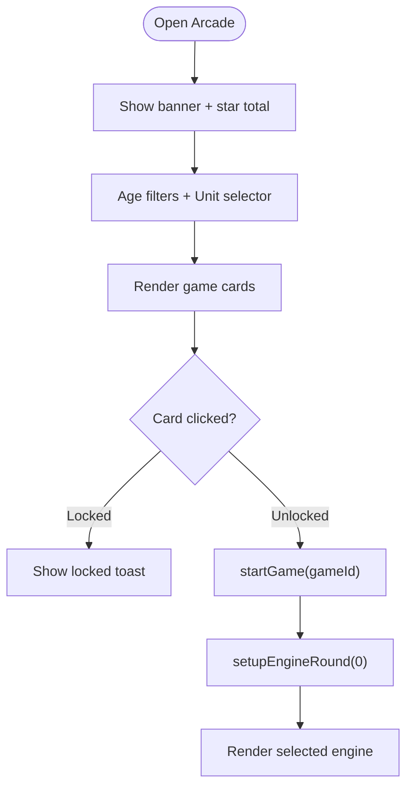
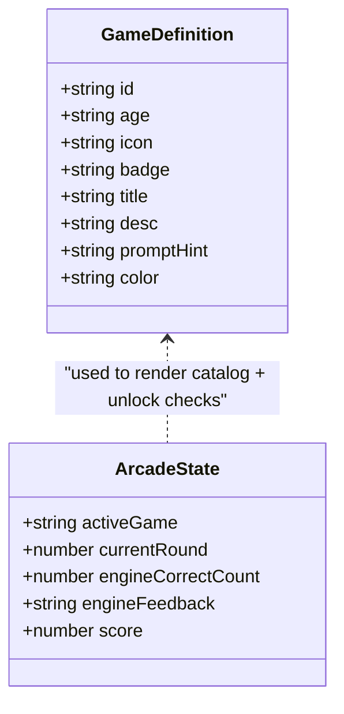
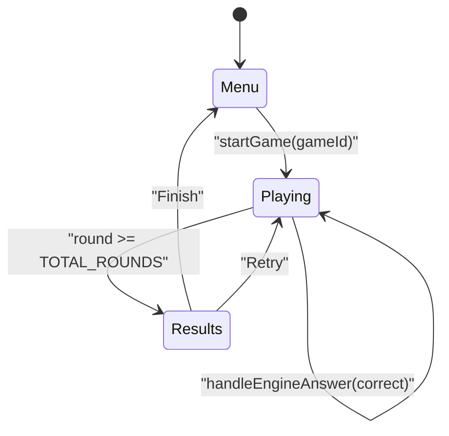
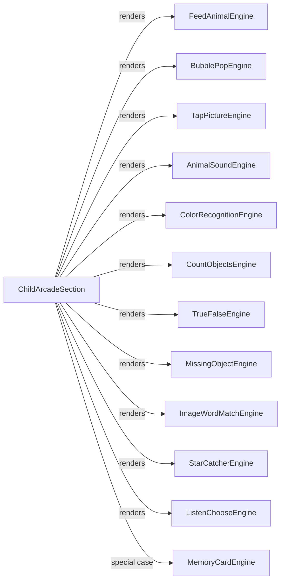
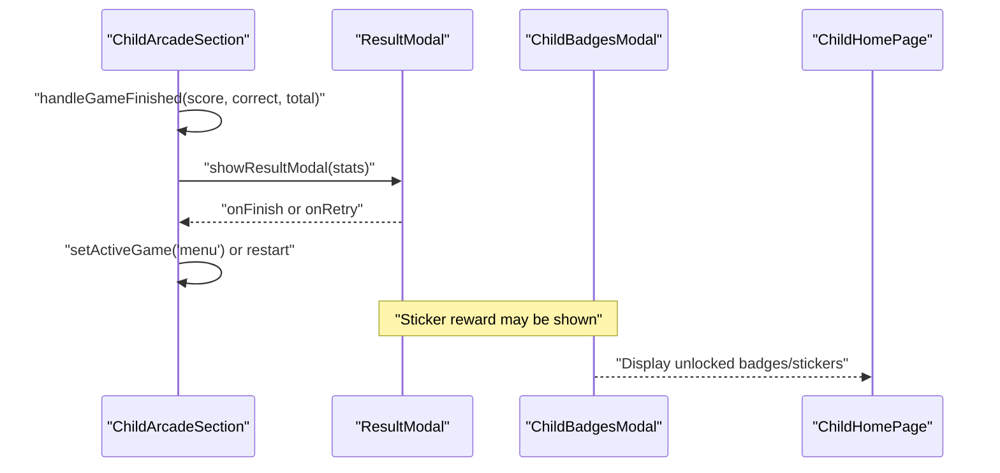
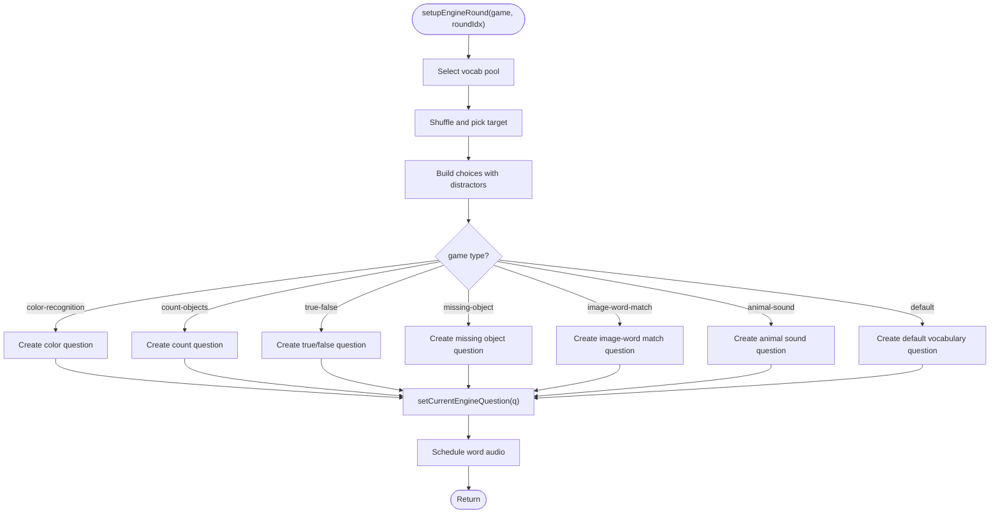
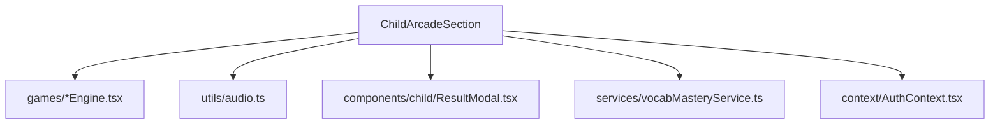

# Arcade Games Section

<cite>
**Referenced Files in This Document**
- [ChildArcadeSection.tsx](file://client/src/components/child/ChildArcadeSection.tsx)
- [ActivityPlayPage.tsx](file://client/src/pages/child/ActivityPlayPage.tsx)
- [ResultModal.tsx](file://client/src/components/child/ResultModal.tsx)
- [ChildBadgesModal.tsx](file://client/src/components/child/ChildBadgesModal.tsx)
- [ChildHomePage.tsx](file://client/src/pages/child/ChildHomePage.tsx)
- [audio.ts](file://client/src/utils/audio.ts)
</cite>

## Table of Contents
1. [Introduction](#introduction)
2. [Project Structure](#project-structure)
3. [Core Components](#core-components)
4. [Architecture Overview](#architecture-overview)
5. [Detailed Component Analysis](#detailed-component-analysis)
6. [Dependency Analysis](#dependency-analysis)
7. [Performance Considerations](#performance-considerations)
8. [Troubleshooting Guide](#troubleshooting-guide)
9. [Conclusion](#conclusion)

## Introduction
The Arcade Games section is the child-facing gateway to a curated catalog of interactive learning mini-games. It presents a colorful game grid, categorizes games by age group, and guides children through short rounds with immediate feedback. The component orchestrates vocabulary pools, difficulty progression, state transitions between menu and active gameplay, and integrates with reward visuals such as stars, badges, and stickers.

This document explains:
- How the game catalog is displayed and filtered
- How game types are categorized and unlocked by age level
- How individual game engines are integrated and rendered
- How game state transitions and round management work
- How progress tracking and rewards connect to the broader child experience
- Performance strategies for loading multiple game types and improving user experience

## Project Structure
The arcade feature lives under the child components and pages:
- The main arcade hub is implemented as a single React component that manages UI state, game selection, and engine rendering.
- Individual game engines are separate components under a dedicated games directory.
- A shared result modal displays session outcomes and can show sticker rewards.
- Badge and sticker collections are managed elsewhere but referenced from the arcade flow.

**Diagram sources**
- [ChildArcadeSection.tsx:15-27](file://client/src/components/child/ChildArcadeSection.tsx#L15-L27)
- [ChildArcadeSection.tsx:814-893](file://client/src/components/child/ChildArcadeSection.tsx#L814-L893)
- [ResultModal.tsx:159-177](file://client/src/components/child/ResultModal.tsx#L159-L177)
- [audio.ts:1-39](file://client/src/utils/audio.ts#L1-L39)

**Section sources**
- [ChildArcadeSection.tsx:15-27](file://client/src/components/child/ChildArcadeSection.tsx#L15-L27)
- [ChildArcadeSection.tsx:814-893](file://client/src/components/child/ChildArcadeSection.tsx#L814-L893)

## Core Components
- Game Catalog and Filters
  - Displays 12 mini-games grouped by age levels: 3–4, 4–5, and 5–6.
  - Provides filter buttons for “All”, “Mầm (3–4)”, “Chồi (4–5)”, and “Lá (5–6)”.
  - Includes a unit content selector dropdown for curriculum alignment.
- Game Unlocking and Difficulty Indicators
  - Each game has an associated age requirement; locked games show a lock badge and disabled play button.
  - Clicking a locked game shows a friendly toast explaining the required age level.
- Active Game Runner
  - Renders the selected game engine when a game is launched.
  - Manages round progression, correct answer counting, and session scoring.
- Vocabulary Pool Management
  - Uses learned/mastered/review vocabularies from mastery service or fallback presets.
  - Ensures at least two valid items are available for question generation.
- Reward Integration
  - Accumulates stars across sessions and shows a celebratory result modal.
  - Can unlock and display sticker rewards after successful completion.

**Section sources**
- [ChildArcadeSection.tsx:81-101](file://client/src/components/child/ChildArcadeSection.tsx#L81-L101)
- [ChildArcadeSection.tsx:107-114](file://client/src/components/child/ChildArcadeSection.tsx#L107-L114)
- [ChildArcadeSection.tsx:145-186](file://client/src/components/child/ChildArcadeSection.tsx#L145-L186)
- [ChildArcadeSection.tsx:465-604](file://client/src/components/child/ChildArcadeSection.tsx#L465-L604)
- [ChildArcadeSection.tsx:707-785](file://client/src/components/child/ChildArcadeSection.tsx#L707-L785)
- [ChildArcadeSection.tsx:787-893](file://client/src/components/child/ChildArcadeSection.tsx#L787-L893)
- [ResultModal.tsx:159-177](file://client/src/components/child/ResultModal.tsx#L159-L177)

## Architecture Overview
The arcade section acts as a central controller:
- It holds global session state (active game, current round, score).
- It prepares per-round questions using a vocabulary pool and game-specific logic.
- It conditionally renders one of many game engines based on the active game mode.
- It coordinates audio feedback and transitions to the result modal upon completion.

**Diagram sources**
- [ChildArcadeSection.tsx:427-463](file://client/src/components/child/ChildArcadeSection.tsx#L427-L463)
- [ChildArcadeSection.tsx:203-395](file://client/src/components/child/ChildArcadeSection.tsx#L203-L395)
- [ChildArcadeSection.tsx:397-425](file://client/src/components/child/ChildArcadeSection.tsx#L397-L425)
- [ChildArcadeSection.tsx:814-893](file://client/src/components/child/ChildArcadeSection.tsx#L814-L893)
- [audio.ts:1-39](file://client/src/utils/audio.ts#L1-L39)

## Detailed Component Analysis

### Game Catalog Display and Filtering
- The catalog renders a responsive grid of game cards.
- Each card includes:
  - Icon and title
  - Age badge (e.g., “Lớp Mầm (3–4t)”)
  - Locked indicator if the child’s age level does not meet the requirement
  - Description and prompt hint
- Filter tabs allow quick narrowing by age group.
- A unit content dropdown provides curriculum-based filtering hooks.

**Diagram sources**
- [ChildArcadeSection.tsx:612-705](file://client/src/components/child/ChildArcadeSection.tsx#L612-L705)
- [ChildArcadeSection.tsx:707-785](file://client/src/components/child/ChildArcadeSection.tsx#L707-L785)
- [ChildArcadeSection.tsx:107-114](file://client/src/components/child/ChildArcadeSection.tsx#L107-L114)

**Section sources**
- [ChildArcadeSection.tsx:612-705](file://client/src/components/child/ChildArcadeSection.tsx#L612-L705)
- [ChildArcadeSection.tsx:707-785](file://client/src/components/child/ChildArcadeSection.tsx#L707-L785)

### Game Type Categorization and Difficulty Levels
- Games are defined in a centralized list with metadata: id, age group, icon, badge, title, description, prompt hint, and color.
- Age groups map to numeric levels:
  - 3–4 → Level 1
  - 4–5 → Level 2
  - 5–6 → Level 3
- Unlocking logic compares the child’s age level against the game’s required level.
- Locked games display a lock badge and prevent launching.

**Diagram sources**
- [ChildArcadeSection.tsx:465-604](file://client/src/components/child/ChildArcadeSection.tsx#L465-L604)
- [ChildArcadeSection.tsx:87-101](file://client/src/components/child/ChildArcadeSection.tsx#L87-L101)

**Section sources**
- [ChildArcadeSection.tsx:87-101](file://client/src/components/child/ChildArcadeSection.tsx#L87-L101)
- [ChildArcadeSection.tsx:465-604](file://client/src/components/child/ChildArcadeSection.tsx#L465-L604)

### Game Selection Interface and State Transitions
- Selecting a game triggers:
  - Sound effect playback
  - Transition to active game view
  - Resetting round and correct counts
  - Preparing the first round via setupEngineRound
- For memory-card, a dummy activity structure is created and passed to the memory engine.
- For other games, a question object is generated based on the active vocabulary pool and game type.

**Diagram sources**
- [ChildArcadeSection.tsx:427-463](file://client/src/components/child/ChildArcadeSection.tsx#L427-L463)
- [ChildArcadeSection.tsx:397-425](file://client/src/components/child/ChildArcadeSection.tsx#L397-L425)
- [ChildArcadeSection.tsx:900-919](file://client/src/components/child/ChildArcadeSection.tsx#L900-L919)

**Section sources**
- [ChildArcadeSection.tsx:427-463](file://client/src/components/child/ChildArcadeSection.tsx#L427-L463)
- [ChildArcadeSection.tsx:397-425](file://client/src/components/child/ChildArcadeSection.tsx#L397-L425)
- [ChildArcadeSection.tsx:900-919](file://client/src/components/child/ChildArcadeSection.tsx#L900-L919)

### Integration with Individual Game Engines
- The arcade component conditionally renders the appropriate engine based on activeGame:
  - FeedAnimalEngine
  - BubblePopEngine
  - TapPictureEngine
  - AnimalSoundEngine
  - ColorRecognitionEngine
  - CountObjectsEngine
  - TrueFalseEngine
  - MissingObjectEngine
  - ImageWordMatchEngine
  - StarCatcherEngine
  - ListenChooseEngine
- MemoryCardEngine is handled separately with a constructed Activity object.
- Each engine receives:
  - question data
  - onAnswer callback
  - disabled flag during feedback states
  - optional props like selectedOptionId and feedbackState for specialized engines

**Diagram sources**
- [ChildArcadeSection.tsx:814-893](file://client/src/components/child/ChildArcadeSection.tsx#L814-L893)

**Section sources**
- [ChildArcadeSection.tsx:814-893](file://client/src/components/child/ChildArcadeSection.tsx#L814-L893)

### Progress Tracking and Reward System Connections
- Session scoring:
  - Correct answers increment engineCorrectCount.
  - Total score accumulates across sessions.
  - Stars are awarded based on correct answer thresholds.
- Result modal:
  - Shows score, max score, stars, correct/total counts.
  - Offers retry or finish actions.
- Sticker rewards:
  - After success, a sticker banner may appear within the result modal.
- Badges and stickers collection:
  - The child home page and badges modal provide overview and showcase of earned rewards.

**Diagram sources**
- [ChildArcadeSection.tsx:188-201](file://client/src/components/child/ChildArcadeSection.tsx#L188-L201)
- [ChildArcadeSection.tsx:900-919](file://client/src/components/child/ChildArcadeSection.tsx#L900-L919)
- [ResultModal.tsx:159-177](file://client/src/components/child/ResultModal.tsx#L159-L177)
- [ChildBadgesModal.tsx:106-135](file://client/src/components/child/ChildBadgesModal.tsx#L106-L135)
- [ChildHomePage.tsx:545-610](file://client/src/pages/child/ChildHomePage.tsx#L545-L610)

**Section sources**
- [ChildArcadeSection.tsx:188-201](file://client/src/components/child/ChildArcadeSection.tsx#L188-L201)
- [ChildArcadeSection.tsx:900-919](file://client/src/components/child/ChildArcadeSection.tsx#L900-L919)
- [ResultModal.tsx:159-177](file://client/src/components/child/ResultModal.tsx#L159-L177)
- [ChildBadgesModal.tsx:106-135](file://client/src/components/child/ChildBadgesModal.tsx#L106-L135)
- [ChildHomePage.tsx:545-610](file://client/src/pages/child/ChildHomePage.tsx#L545-L610)

### Question Generation and Round Logic
- setupEngineRound generates a question tailored to the active game:
  - For color-recognition: selects a target color and options with hex values.
  - For count-objects: determines quantity and distractors.
  - For true-false: randomly decides truthfulness and constructs options.
  - For missing-object: hides one item from initial set.
  - For image-word-match: pairs image and word.
  - For animal-sound: maps sound text to animal choices.
  - Default path: uses vocabulary target and choices.
- Audio prompts are scheduled after question creation.

**Diagram sources**
- [ChildArcadeSection.tsx:203-395](file://client/src/components/child/ChildArcadeSection.tsx#L203-L395)

**Section sources**
- [ChildArcadeSection.tsx:203-395](file://client/src/components/child/ChildArcadeSection.tsx#L203-L395)

## Dependency Analysis
- Internal dependencies:
  - ChildArcadeSection imports all game engines directly at the top of the file.
  - It depends on audio utilities for sound effects and word pronunciation.
  - It references the result modal for session outcomes.
  - It connects to badge/sticker UIs indirectly via shared reward concepts.
- External integration points:
  - Vocab mastery service provides learned/mastered/review words.
  - Auth context supplies child user identity and age group code.

**Diagram sources**
- [ChildArcadeSection.tsx:1-13](file://client/src/components/child/ChildArcadeSection.tsx#L1-L13)
- [ChildArcadeSection.tsx:15-27](file://client/src/components/child/ChildArcadeSection.tsx#L15-L27)
- [ChildArcadeSection.tsx:10-12](file://client/src/components/child/ChildArcadeSection.tsx#L10-L12)

**Section sources**
- [ChildArcadeSection.tsx:1-13](file://client/src/components/child/ChildArcadeSection.tsx#L1-L13)
- [ChildArcadeSection.tsx:15-27](file://client/src/components/child/ChildArcadeSection.tsx#L15-L27)

## Performance Considerations
Current implementation characteristics:
- All game engines are statically imported at the top of the arcade component. This means they are bundled together and loaded regardless of whether they are immediately used.
- Rendering of engines is conditional based on activeGame, which avoids unnecessary DOM updates for inactive engines.
- Vocabulary pools are memoized to avoid recomputation on every render.
- Audio context is initialized lazily and resumed on user interaction to comply with browser policies.

Optimization opportunities:
- Lazy load game engines using dynamic imports to reduce initial bundle size and improve perceived performance.
- Defer heavy assets (images/audio) until a game is actually launched.
- Use virtualization or pagination if the catalog grows significantly beyond 12 games.
- Cache generated questions per round to avoid redundant computation when navigating back and forth.

[No sources needed since this section provides general guidance]

## Troubleshooting Guide
Common issues and resolutions:
- Locked games do not launch
  - Ensure the child’s ageGroupCode matches the required level for the game.
  - Check the unlock logic and age mapping.
- No audio plays
  - Verify that user interaction has occurred to resume the audio context.
  - Confirm that audio utilities are correctly invoked.
- Empty vocabulary pool
  - Ensure mastery service returns at least two valid words or that fallback presets are used.
- Incorrect question generation
  - Validate game-specific branches in setupEngineRound and ensure metadata is properly set.

**Section sources**
- [ChildArcadeSection.tsx:87-101](file://client/src/components/child/ChildArcadeSection.tsx#L87-L101)
- [ChildArcadeSection.tsx:145-186](file://client/src/components/child/ChildArcadeSection.tsx#L145-L186)
- [audio.ts:1-39](file://client/src/utils/audio.ts#L1-L39)

## Conclusion
The Arcade Games section provides a cohesive, child-friendly interface for exploring and playing educational mini-games. It organizes games by age, enforces unlocking rules, and seamlessly transitions between catalog browsing and active gameplay. While the current architecture bundles all engines upfront, it offers clear extension points for lazy loading and further performance tuning. Integration with audio, result modals, and reward systems ensures a motivating and engaging learning loop for young users.