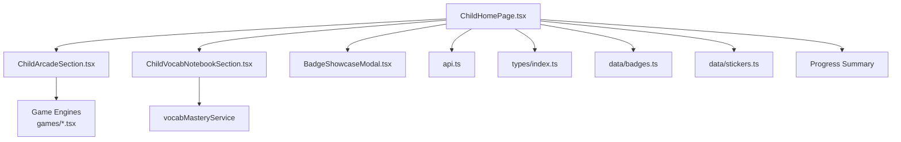
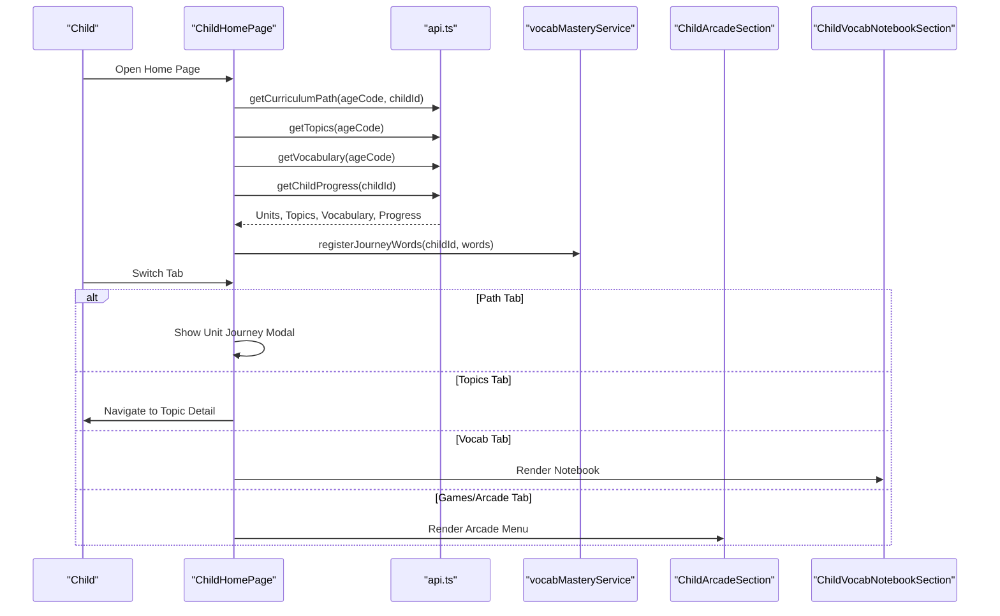
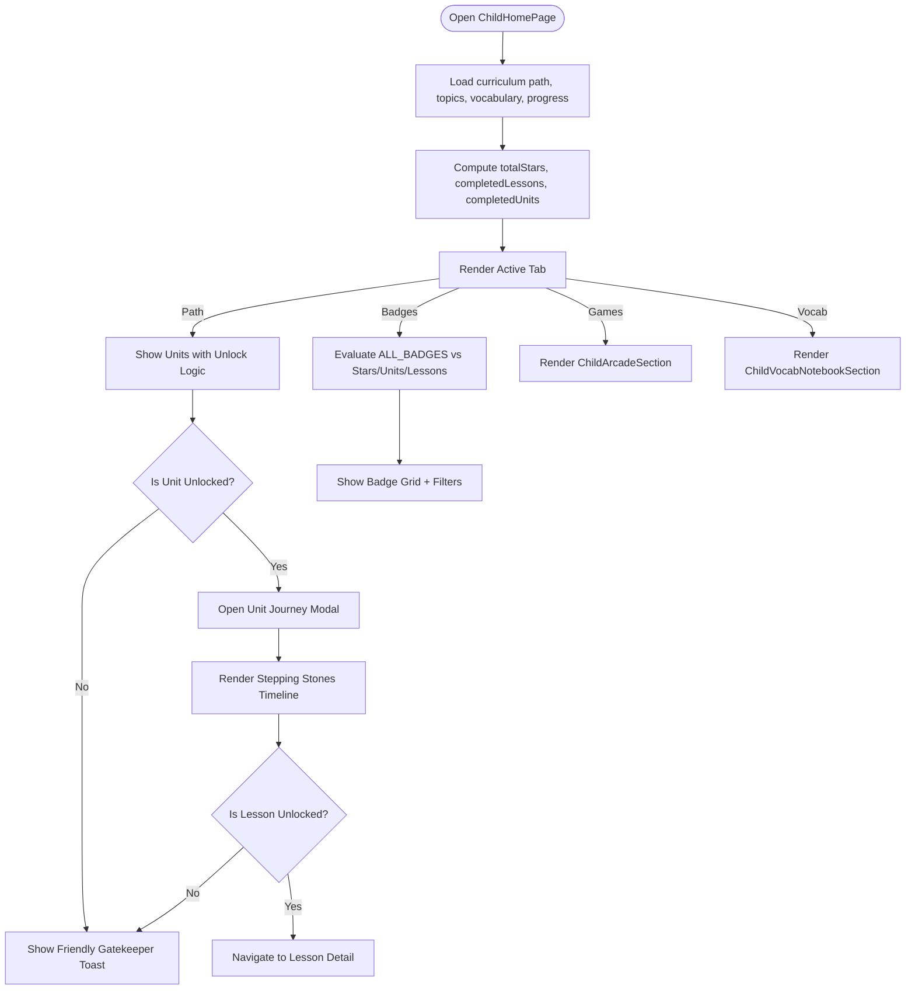
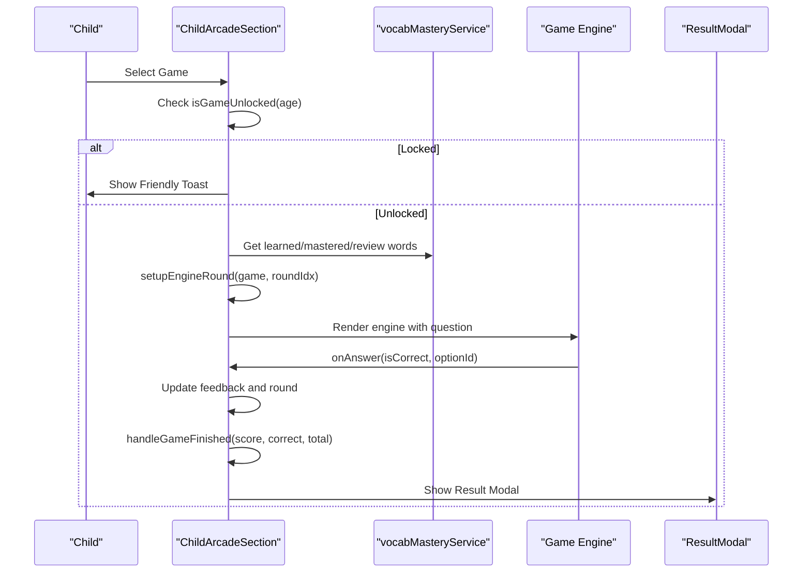
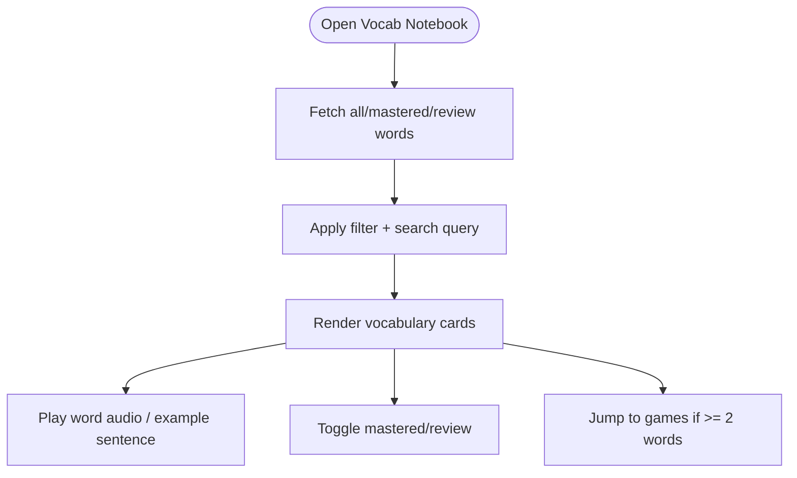
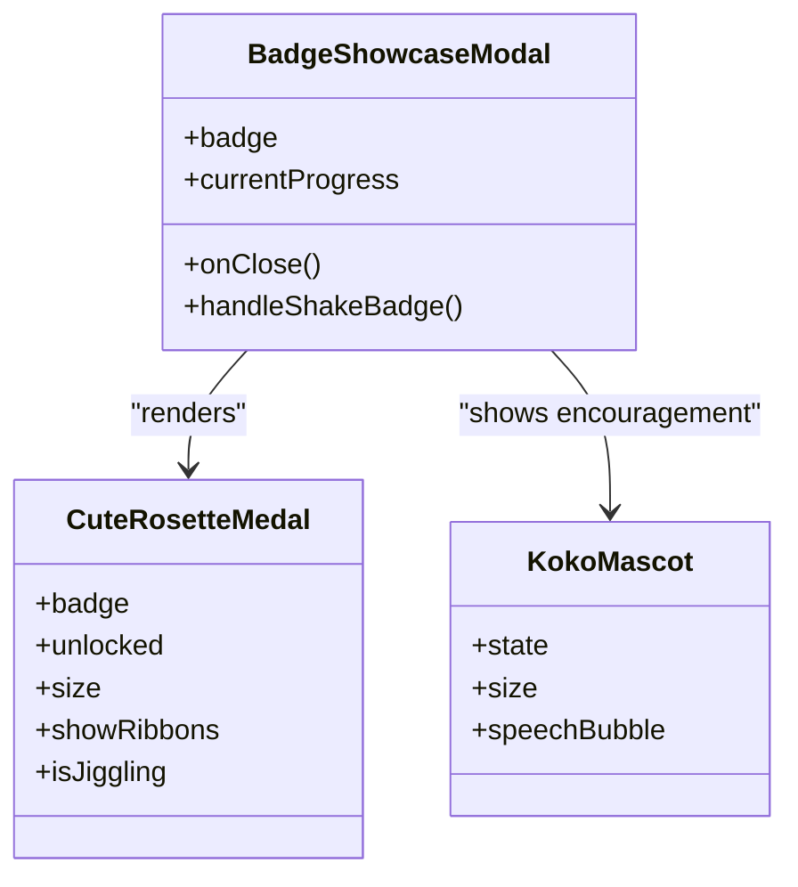
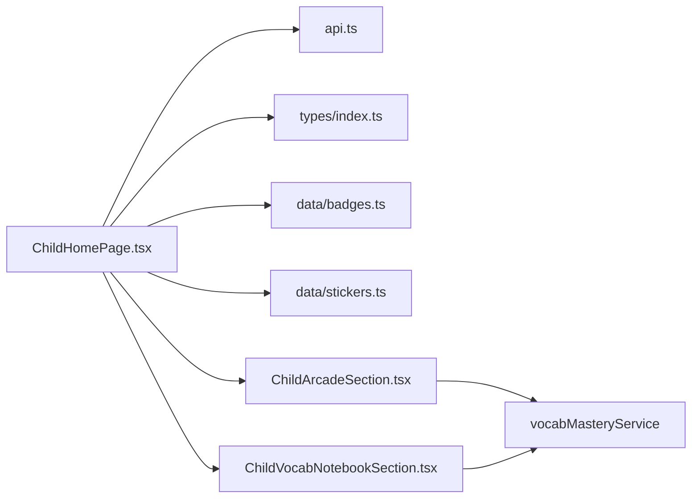

# Child Home Page

<cite>
**Referenced Files in This Document**
- [ChildHomePage.tsx](file://client/src/pages/child/ChildHomePage.tsx)
- [ChildArcadeSection.tsx](file://client/src/components/child/ChildArcadeSection.tsx)
- [ChildVocabNotebookSection.tsx](file://client/src/components/child/ChildVocabNotebookSection.tsx)
- [BadgeShowcaseModal.tsx](file://client/src/components/child/BadgeShowcaseModal.tsx)
- [api.ts](file://client/src/services/api.ts)
- [index.ts](file://client/src/types/index.ts)
- [badges.ts](file://client/src/data/badges.ts)
- [stickers.ts](file://client/src/data/stickers.ts)
</cite>

## Table of Contents
1. [Introduction](#introduction)
2. [Project Structure](#project-structure)
3. [Core Components](#core-components)
4. [Architecture Overview](#architecture-overview)
5. [Detailed Component Analysis](#detailed-component-analysis)
6. [Dependency Analysis](#dependency-analysis)
7. [Performance Considerations](#performance-considerations)
8. [Troubleshooting Guide](#troubleshooting-guide)
9. [Conclusion](#conclusion)

## Introduction
The Child Home Page is the central hub for a child’s learning experience. It provides a multi-tab interface that guides children through:
- Curriculum path exploration with progressive unlocking by age and lesson completion
- Topic selection filtered by age group
- A vocabulary notebook showing learned, mastered, and review words
- An arcade section with age-gated mini-games
- A reward showcase for badges and stickers

It uses a progressive disclosure pattern to keep content age-appropriate and motivating, while integrating curriculum data, progress tracking, and gamification systems.

## Project Structure
The Child Home Page is implemented as a React component that composes several child-focused subcomponents and integrates with API services and local mastery state.

**Diagram sources**
- [ChildHomePage.tsx:1-1038](file://client/src/pages/child/ChildHomePage.tsx#L1-L1038)
- [ChildArcadeSection.tsx:1-941](file://client/src/components/child/ChildArcadeSection.tsx#L1-L941)
- [ChildVocabNotebookSection.tsx:1-411](file://client/src/components/child/ChildVocabNotebookSection.tsx#L1-L411)
- [BadgeShowcaseModal.tsx:1-201](file://client/src/components/child/BadgeShowcaseModal.tsx#L1-L201)
- [api.ts:1-354](file://client/src/services/api.ts#L1-L354)
- [index.ts:1-233](file://client/src/types/index.ts#L1-L233)
- [badges.ts:1-324](file://client/src/data/badges.ts#L1-L324)
- [stickers.ts:1-162](file://client/src/data/stickers.ts#L1-L162)

**Section sources**
- [ChildHomePage.tsx:1-1038](file://client/src/pages/child/ChildHomePage.tsx#L1-L1038)
- [api.ts:112-158](file://client/src/services/api.ts#L112-L158)
- [index.ts:99-120](file://client/src/types/index.ts#L99-L120)

## Core Components
- ChildHomePage: Main tabbed shell, loads curriculum path, topics, vocabulary, and progress; manages unit journey modal, secret gift modal, badge showcase, sticker showcase, and friendly gatekeeper toasts.
- ChildArcadeSection: Game menu and active game runner; selects vocab pool from mastery service or fallback presets; runs rounds and shows result modal.
- ChildVocabNotebookSection: Vocabulary notebook with filters (all/mastered/review), search, audio playback, example sentences, and quick navigation to games.
- BadgeShowcaseModal: Detailed view of a badge with progress bar, tier info, mascot speech, and action buttons.
- Data and types: API clients, TypeScript models, badge definitions, and sticker catalog.

**Section sources**
- [ChildHomePage.tsx:62-175](file://client/src/pages/child/ChildHomePage.tsx#L62-L175)
- [ChildArcadeSection.tsx:71-186](file://client/src/components/child/ChildArcadeSection.tsx#L71-L186)
- [ChildVocabNotebookSection.tsx:21-69](file://client/src/components/child/ChildVocabNotebookSection.tsx#L21-L69)
- [BadgeShowcaseModal.tsx:14-56](file://client/src/components/child/BadgeShowcaseModal.tsx#L14-L56)
- [api.ts:96-158](file://client/src/services/api.ts#L96-L158)
- [index.ts:17-39](file://client/src/types/index.ts#L17-L39)

## Architecture Overview
The home page orchestrates data fetching, UI state, and user interactions across tabs. It uses a progressive disclosure model where units and lessons unlock based on prior completion and age group.

**Diagram sources**
- [ChildHomePage.tsx:117-169](file://client/src/pages/child/ChildHomePage.tsx#L117-L169)
- [ChildHomePage.tsx:227-519](file://client/src/pages/child/ChildHomePage.tsx#L227-L519)
- [api.ts:112-158](file://client/src/services/api.ts#L112-L158)

## Detailed Component Analysis

### ChildHomePage: Multi-Tab Hub and Progressive Disclosure
Responsibilities:
- Derives age code and level mapping for progression gating
- Loads curriculum path, topics, vocabulary, and progress in parallel
- Computes totals for stars, completed lessons, and units
- Renders tabs: path, topics, vocab, games/arcade, badges
- Manages modals: unit journey stepping stones, secret gift chest, badge showcase, sticker showcase
- Provides friendly gatekeeper toasts when locked content is clicked

Progressive disclosure patterns:
- Units unlock sequentially: first unit always open; subsequent units require previous unit completion
- Lessons within a unit unlock sequentially: first incomplete lesson is highlighted as current
- Locked items show lock icons and friendly messages guiding next steps

Examples:
- Unit journey visualization: stepping stone timeline with alternating nodes, current lesson marker, and treasure chest at the end
- Lesson completion tracking: completed lessons show star ratings; current lesson shows “Play now” indicator
- Star accumulation display: total stars shown in header banner and bottom nav

Gamification elements:
- Badges evaluated against stars, units, or lessons with progress bars and tiers
- Sticker collection with rarity filters and unlock status
- Secret gift mystery chest rewarding completed units

**Diagram sources**
- [ChildHomePage.tsx:117-175](file://client/src/pages/child/ChildHomePage.tsx#L117-L175)
- [ChildHomePage.tsx:227-412](file://client/src/pages/child/ChildHomePage.tsx#L227-L412)
- [ChildHomePage.tsx:521-748](file://client/src/pages/child/ChildHomePage.tsx#L521-L748)
- [ChildHomePage.tsx:764-982](file://client/src/pages/child/ChildHomePage.tsx#L764-L982)

**Section sources**
- [ChildHomePage.tsx:62-175](file://client/src/pages/child/ChildHomePage.tsx#L62-L175)
- [ChildHomePage.tsx:227-412](file://client/src/pages/child/ChildHomePage.tsx#L227-L412)
- [ChildHomePage.tsx:521-748](file://client/src/pages/child/ChildHomePage.tsx#L521-L748)
- [ChildHomePage.tsx:764-1038](file://client/src/pages/child/ChildHomePage.tsx#L764-L1038)

### ChildArcadeSection: Age-Gated Mini-Games and Round Runner
Responsibilities:
- Presents an arcade menu with 12 mini-games grouped by age groups
- Enforces age-based unlocking using user age code and level mapping
- Selects vocabulary pool from mastery service, prop list, or default preset
- Runs rounds per game with feedback and scoring
- Shows celebratory result modal with stars earned

Key behaviors:
- Locked games show friendly toast explaining required age group
- Rounds incrementally increase difficulty via choice count
- Specialized engines handle color recognition, counting, true/false, missing object, image-word match, animal sounds, memory cards, and star catcher

**Diagram sources**
- [ChildArcadeSection.tsx:91-114](file://client/src/components/child/ChildArcadeSection.tsx#L91-L114)
- [ChildArcadeSection.tsx:145-186](file://client/src/components/child/ChildArcadeSection.tsx#L145-L186)
- [ChildArcadeSection.tsx:203-395](file://client/src/components/child/ChildArcadeSection.tsx#L203-L395)
- [ChildArcadeSection.tsx:427-463](file://client/src/components/child/ChildArcadeSection.tsx#L427-L463)
- [ChildArcadeSection.tsx:801-941](file://client/src/components/child/ChildArcadeSection.tsx#L801-L941)

**Section sources**
- [ChildArcadeSection.tsx:71-186](file://client/src/components/child/ChildArcadeSection.tsx#L71-L186)
- [ChildArcadeSection.tsx:465-604](file://client/src/components/child/ChildArcadeSection.tsx#L465-L604)
- [ChildArcadeSection.tsx:707-941](file://client/src/components/child/ChildArcadeSection.tsx#L707-L941)

### ChildVocabNotebookSection: Smart Vocabulary Notebook
Responsibilities:
- Displays all learned words, with filters for mastered and review lists
- Supports search by English or Vietnamese text
- Plays audio pronunciation and example sentences
- Allows toggling word status between mastered and review
- Quick navigation to games if enough words are available

Design highlights:
- Hero stats card showing counts and average mastery score
- Empty state encourages returning to path or topics
- Cards show mastery percentage, source (journey/topic), and contextual sentence

**Diagram sources**
- [ChildVocabNotebookSection.tsx:31-69](file://client/src/components/child/ChildVocabNotebookSection.tsx#L31-L69)
- [ChildVocabNotebookSection.tsx:71-83](file://client/src/components/child/ChildVocabNotebookSection.tsx#L71-L83)
- [ChildVocabNotebookSection.tsx:85-150](file://client/src/components/child/ChildVocabNotebookSection.tsx#L85-L150)
- [ChildVocabNotebookSection.tsx:152-241](file://client/src/components/child/ChildVocabNotebookSection.tsx#L152-L241)
- [ChildVocabNotebookSection.tsx:283-411](file://client/src/components/child/ChildVocabNotebookSection.tsx#L283-L411)

**Section sources**
- [ChildVocabNotebookSection.tsx:1-411](file://client/src/components/child/ChildVocabNotebookSection.tsx#L1-L411)

### BadgeShowcaseModal: Reward Details and Progress
Responsibilities:
- Displays badge details, category, tier, and description
- Shows progress bar toward requirement (stars, units, lessons)
- Provides mascot speech and interactive bell sound for unlocked badges
- Guides users to continue learning when locked

**Diagram sources**
- [BadgeShowcaseModal.tsx:14-56](file://client/src/components/child/BadgeShowcaseModal.tsx#L14-L56)
- [BadgeShowcaseModal.tsx:93-107](file://client/src/components/child/BadgeShowcaseModal.tsx#L93-L107)
- [BadgeShowcaseModal.tsx:161-172](file://client/src/components/child/BadgeShowcaseModal.tsx#L161-L172)

**Section sources**
- [BadgeShowcaseModal.tsx:1-201](file://client/src/components/child/BadgeShowcaseModal.tsx#L1-L201)

## Dependency Analysis
- ChildHomePage depends on:
  - API services for curriculum path, topics, vocabulary, and progress
  - Types for ProgressSummary, Topic, Vocabulary
  - Local data for badges and stickers
  - Subcomponents for arcade, notebook, badges, and mascots
- ChildArcadeSection depends on:
  - vocabMasteryService for learned/mastered/review words
  - Game engines for specific mini-games
  - Audio utilities for prompts and feedback
- ChildVocabNotebookSection depends on:
  - vocabMasteryService for word lists
  - Sentence dictionary for contextual examples
  - Audio utilities for pronunciation

**Diagram sources**
- [ChildHomePage.tsx:1-31](file://client/src/pages/child/ChildHomePage.tsx#L1-L31)
- [ChildArcadeSection.tsx:1-27](file://client/src/components/child/ChildArcadeSection.tsx#L1-L27)
- [ChildVocabNotebookSection.tsx:1-13](file://client/src/components/child/ChildVocabNotebookSection.tsx#L1-L13)
- [api.ts:96-158](file://client/src/services/api.ts#L96-L158)

**Section sources**
- [ChildHomePage.tsx:1-31](file://client/src/pages/child/ChildHomePage.tsx#L1-L31)
- [ChildArcadeSection.tsx:1-27](file://client/src/components/child/ChildArcadeSection.tsx#L1-L27)
- [ChildVocabNotebookSection.tsx:1-13](file://client/src/components/child/ChildVocabNotebookSection.tsx#L1-L13)
- [api.ts:96-158](file://client/src/services/api.ts#L96-L158)

## Performance Considerations
- Parallel data loading: The home page fetches curriculum path, topics, vocabulary, and progress concurrently to reduce load time.
- Memoization: Arcade section computes vocab pools and displayed games using memoization to avoid unnecessary re-renders.
- Fallback vocab pool: Ensures games never run without content by falling back to built-in presets when mastery data is insufficient.
- Lightweight modals: Modals render only when needed and use simple state flags to minimize overhead.

[No sources needed since this section provides general guidance]

## Troubleshooting Guide
Common issues and resolutions:
- Locked content clicks: Friendly toasts explain prerequisites; verify age group and progression state.
- No vocabulary in notebook: Encourage starting path or exploring topics; ensure journey words are registered.
- Arcade games not launching: Confirm age unlock logic; check that vocab pool has at least two valid entries.
- Badge progress not updating: Ensure progress summary and unit completion states are correctly computed.

**Section sources**
- [ChildHomePage.tsx:107-114](file://client/src/pages/child/ChildHomePage.tsx#L107-L114)
- [ChildHomePage.tsx:1006-1023](file://client/src/pages/child/ChildHomePage.tsx#L1006-L1023)
- [ChildArcadeSection.tsx:103-114](file://client/src/components/child/ChildArcadeSection.tsx#L103-L114)
- [ChildArcadeSection.tsx:920-937](file://client/src/components/child/ChildArcadeSection.tsx#L920-L937)

## Conclusion
The Child Home Page delivers a cohesive, gamified learning hub tailored for young learners. Through progressive disclosure, age-appropriate gating, and engaging visuals, it motivates children to explore curriculum units, practice vocabulary, play mini-games, and collect rewards. The architecture cleanly separates concerns across components, services, and data models, enabling maintainable enhancements and scalable growth.

[No sources needed since this section summarizes without analyzing specific files]