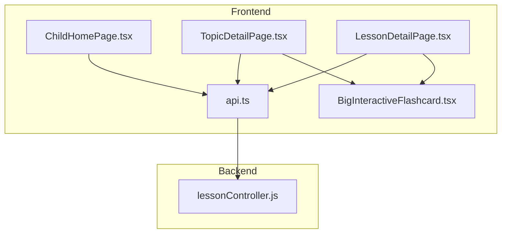
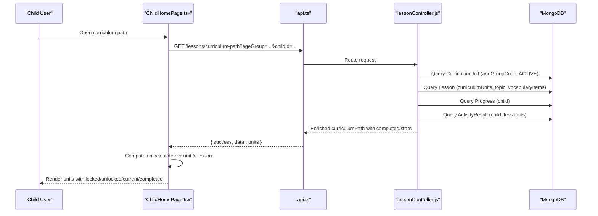
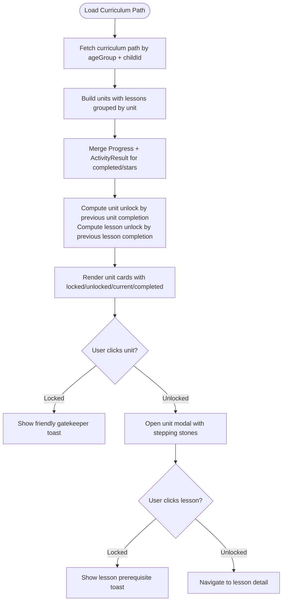
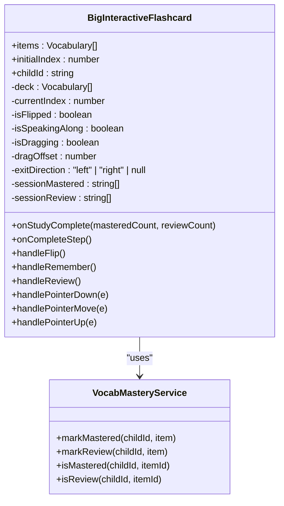
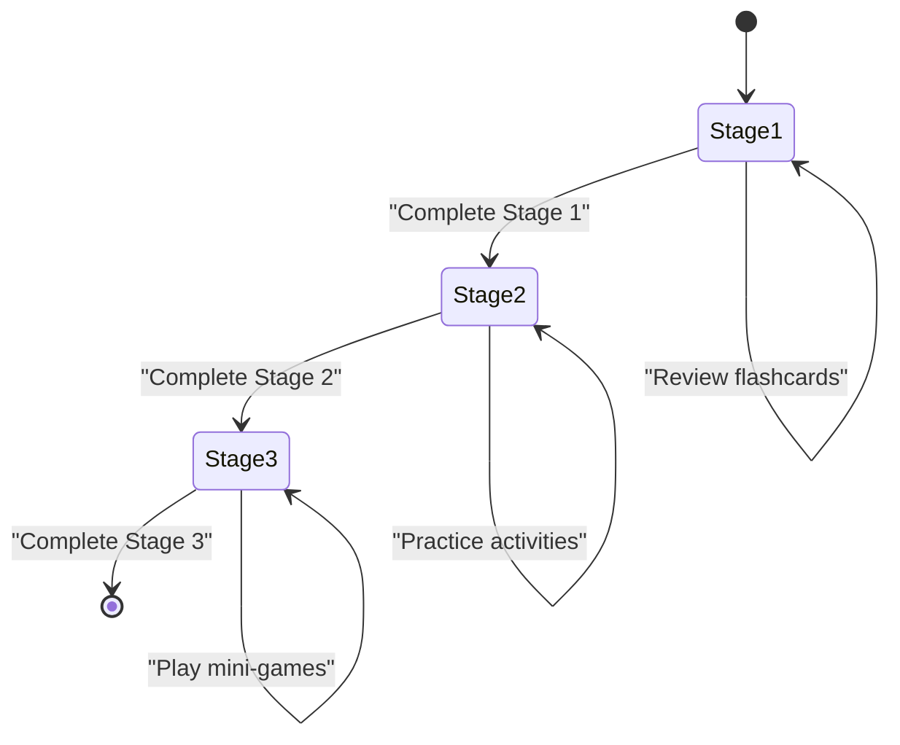
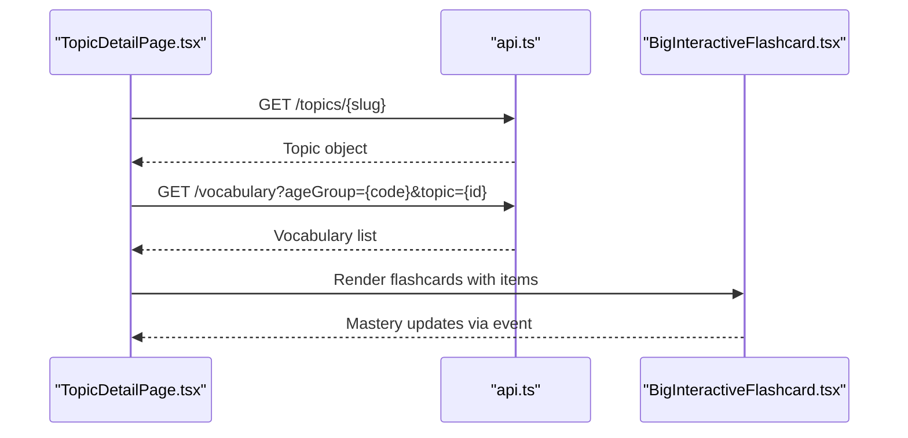
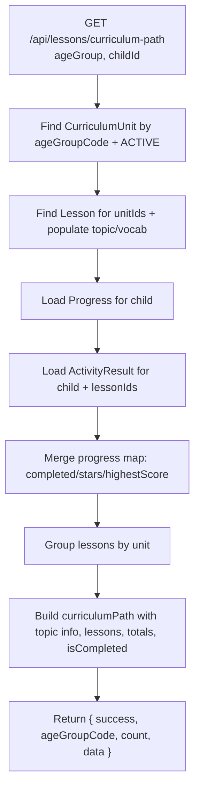
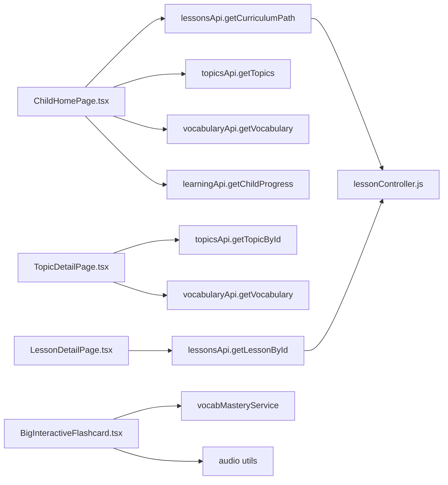

# Curriculum Path Exploration

<cite>
**Referenced Files in This Document**
- [README.md](file://README.md)
- [ChildHomePage.tsx](file://client/src/pages/child/ChildHomePage.tsx)
- [TopicDetailPage.tsx](file://client/src/pages/child/TopicDetailPage.tsx)
- [LessonDetailPage.tsx](file://client/src/pages/child/LessonDetailPage.tsx)
- [BigInteractiveFlashcard.tsx](file://client/src/components/child/BigInteractiveFlashcard.tsx)
- [lessonController.js](file://KCEnglishKids_BE/src/controllers/lessonController.js)
- [api.ts](file://client/src/services/api.ts)
</cite>

## Table of Contents
1. [Introduction](#introduction)
2. [Project Structure](#project-structure)
3. [Core Components](#core-components)
4. [Architecture Overview](#architecture-overview)
5. [Detailed Component Analysis](#detailed-component-analysis)
6. [Dependency Analysis](#dependency-analysis)
7. [Performance Considerations](#performance-considerations)
8. [Troubleshooting Guide](#troubleshooting-guide)
9. [Conclusion](#conclusion)

## Introduction
This document explains the curriculum path exploration feature that guides children through their learning journey. It focuses on:
- Progressive disclosure that unlocks units and lessons based on age-appropriate progression and lesson completion status.
- Visual indicators for locked, unlocked, current, completed, and recommended next steps.
- The interactive flashcard interface used for vocabulary study and navigation.
- Progress visualization patterns including stars, unit completion, badges, stickers, and encouragement feedback.
- Backend integration for curriculum data and how UI updates reflect student progress.

The system is designed for young learners with large touch targets, playful animations, clear visual states, and encouraging audio feedback.

## Project Structure
At a high level, the feature spans:
- Frontend child pages for curriculum path, topic exploration, and lesson flow.
- A reusable big interactive flashcard component for vocabulary study.
- Backend controller logic that builds the structured curriculum path and enriches it with progress data.
- API service layer that connects frontend components to backend endpoints.

**Diagram sources**
- [ChildHomePage.tsx:116-169](file://client/src/pages/child/ChildHomePage.tsx#L116-L169)
- [TopicDetailPage.tsx:33-77](file://client/src/pages/child/TopicDetailPage.tsx#L33-L77)
- [LessonDetailPage.tsx:46-89](file://client/src/pages/child/LessonDetailPage.tsx#L46-L89)
- [BigInteractiveFlashcard.tsx:24-30](file://client/src/components/child/BigInteractiveFlashcard.tsx#L24-L30)
- [lessonController.js:6-107](file://KCEnglishKids_BE/src/controllers/lessonController.js#L6-L107)
- [api.ts:112-122](file://client/src/services/api.ts#L112-L122)

**Section sources**
- [README.md:7-27](file://README.md#L7-L27)

## Core Components
- Curriculum Path Page (ChildHomePage): Loads the child’s age-scoped curriculum path, topics, vocabulary, and progress. Displays units as cards with unlock conditions and opens a modal showing sequential lessons with stepping-stone visuals.
- Topic Detail Page (TopicDetailPage): Loads topic-specific vocabulary and renders the BigInteractiveFlashcard for exploratory study.
- Lesson Detail Page (LessonDetailPage): Renders a three-stage lesson flow: vocabulary flashcards, interactive practice studio, and mini-games. Enforces stage gating and age-appropriate game types.
- BigInteractiveFlashcard: Provides swipe-to-remember/review, flip-to-meaning, audio pronunciation, mastery tracking, and motivational feedback.
- Backend Lesson Controller: Builds the curriculum path by age group, groups lessons into units, merges progress from Progress and ActivityResult, and returns enriched unit and lesson data.
- API Service Layer: Provides typed methods for curriculum path, topics, vocabulary, activities, and learning progress.

**Section sources**
- [ChildHomePage.tsx:62-169](file://client/src/pages/child/ChildHomePage.tsx#L62-L169)
- [TopicDetailPage.tsx:14-77](file://client/src/pages/child/TopicDetailPage.tsx#L14-L77)
- [LessonDetailPage.tsx:34-131](file://client/src/pages/child/LessonDetailPage.tsx#L34-L131)
- [BigInteractiveFlashcard.tsx:24-219](file://client/src/components/child/BigInteractiveFlashcard.tsx#L24-L219)
- [lessonController.js:6-107](file://KCEnglishKids_BE/src/controllers/lessonController.js#L6-L107)
- [api.ts:96-158](file://client/src/services/api.ts#L96-L158)

## Architecture Overview
The curriculum path exploration follows a progressive disclosure model:
- Age Group Filtering: Only units and content matching the child’s age group are shown.
- Unit Unlocking: Units unlock sequentially; the first unit is always available, and subsequent units unlock when the previous unit is fully completed.
- Lesson Unlocking: Within an unlocked unit, lessons unlock sequentially; the first lesson is available, and later lessons unlock after the prior lesson is completed.
- Progress Integration: Backend merges Progress and ActivityResult data to mark lessons as completed and compute stars.
- UI Feedback: Locked items show lock icons and friendly messages; current items highlight “next step”; completed items show checkmarks and stars.

**Diagram sources**
- [ChildHomePage.tsx:116-169](file://client/src/pages/child/ChildHomePage.tsx#L116-L169)
- [lessonController.js:6-107](file://KCEnglishKids_BE/src/controllers/lessonController.js#L6-L107)
- [api.ts:112-122](file://client/src/services/api.ts#L112-L122)

## Detailed Component Analysis

### Curriculum Path Page: Progressive Disclosure and Visual Indicators
The curriculum path page loads:
- Curriculum path scoped by age group.
- Topics scoped by age group.
- Vocabulary scoped by age group.
- Child progress summary.

Unlock rules:
- Unit unlock: index 0 is always unlocked; other units unlock if the previous unit is completed.
- Lesson unlock within a unit: index 0 is always unlocked; other lessons unlock if the previous lesson is completed.

Visual indicators:
- Locked unit or lesson: grayed out, lock icon, and friendly toast message guiding the child to complete prerequisites.
- Current lesson: highlighted with animated ring and “Play now” badge.
- Completed lesson: green border, checkmark, and star rating.
- Unit completion: “Completed perfectly” badge and total stars.

Progress visualization:
- Total stars and completed lessons displayed in header.
- Unit-level progress shows completed lessons count and total stars.
- Badges and stickers sections provide long-term motivation tied to stars, completed lessons, and completed units.

**Diagram sources**
- [ChildHomePage.tsx:116-169](file://client/src/pages/child/ChildHomePage.tsx#L116-L169)
- [ChildHomePage.tsx:254-409](file://client/src/pages/child/ChildHomePage.tsx#L254-L409)
- [ChildHomePage.tsx:821-916](file://client/src/pages/child/ChildHomePage.tsx#L821-L916)
- [lessonController.js:25-96](file://KCEnglishKids_BE/src/controllers/lessonController.js#L25-L96)

**Section sources**
- [ChildHomePage.tsx:62-169](file://client/src/pages/child/ChildHomePage.tsx#L62-L169)
- [ChildHomePage.tsx:254-409](file://client/src/pages/child/ChildHomePage.tsx#L254-L409)
- [ChildHomePage.tsx:821-916](file://client/src/pages/child/ChildHomePage.tsx#L821-L916)
- [lessonController.js:25-96](file://KCEnglishKids_BE/src/controllers/lessonController.js#L25-L96)

### Interactive Flashcard Interface: Navigation and Mastery Tracking
The BigInteractiveFlashcard component supports:
- Swipe right to mark “Remembered”, swipe left to mark “Needs Review”.
- Flip card to reveal Vietnamese meaning and play English pronunciation.
- Speak-along button to encourage pronunciation practice.
- Session stats: mastered vs review counts.
- Mini-thumbnails carousel with mastery dots.
- Encouragement banner when marking review.

Mastery integration:
- Uses vocabMasteryService to track per-child mastery and review states.
- Emits events to refresh UI when mastery changes.

**Diagram sources**
- [BigInteractiveFlashcard.tsx:24-219](file://client/src/components/child/BigInteractiveFlashcard.tsx#L24-L219)
- [BigInteractiveFlashcard.tsx:289-322](file://client/src/components/child/BigInteractiveFlashcard.tsx#L289-L322)
- [BigInteractiveFlashcard.tsx:575-624](file://client/src/components/child/BigInteractiveFlashcard.tsx#L575-L624)

**Section sources**
- [BigInteractiveFlashcard.tsx:24-219](file://client/src/components/child/BigInteractiveFlashcard.tsx#L24-L219)
- [BigInteractiveFlashcard.tsx:289-322](file://client/src/components/child/BigInteractiveFlashcard.tsx#L289-L322)
- [BigInteractiveFlashcard.tsx:575-624](file://client/src/components/child/BigInteractiveFlashcard.tsx#L575-L624)

### Lesson Flow: Three-Stage Sequential Learning
The lesson detail page enforces a three-stage flow:
- Stage 1: Learn new words via flashcards.
- Stage 2: Interactive practice studio to reinforce vocabulary.
- Stage 3: Age-appropriate mini-games to earn stars and stickers.

Stage gating:
- Stage 2 unlocks after Stage 1 completion.
- Stage 3 unlocks after Stage 2 completion.
- LocalStorage persists stage progress and active stage selection.

Age-appropriate games:
- For younger age group (3–4), only specific game types are allowed.
- For older age groups, broader game types are available.

**Diagram sources**
- [LessonDetailPage.tsx:119-131](file://client/src/pages/child/LessonDetailPage.tsx#L119-L131)
- [LessonDetailPage.tsx:140-159](file://client/src/pages/child/LessonDetailPage.tsx#L140-L159)
- [LessonDetailPage.tsx:95-117](file://client/src/pages/child/LessonDetailPage.tsx#L95-L117)

**Section sources**
- [LessonDetailPage.tsx:34-131](file://client/src/pages/child/LessonDetailPage.tsx#L34-L131)
- [LessonDetailPage.tsx:140-159](file://client/src/pages/child/LessonDetailPage.tsx#L140-L159)
- [LessonDetailPage.tsx:95-117](file://client/src/pages/child/LessonDetailPage.tsx#L95-L117)

### Topic Exploration: Age-Appropriate Vocabulary Study
The topic detail page:
- Loads topic metadata by slug.
- Loads curated vocabulary for the child’s age group and topic.
- Renders BigInteractiveFlashcard for interactive study.
- Shows quick stats: total words, mastered, needs review.
- Provides navigation to games and other topics.

**Diagram sources**
- [TopicDetailPage.tsx:33-77](file://client/src/pages/child/TopicDetailPage.tsx#L33-L77)
- [TopicDetailPage.tsx:186-191](file://client/src/pages/child/TopicDetailPage.tsx#L186-L191)
- [api.ts:96-134](file://client/src/services/api.ts#L96-L134)

**Section sources**
- [TopicDetailPage.tsx:33-77](file://client/src/pages/child/TopicDetailPage.tsx#L33-L77)
- [TopicDetailPage.tsx:186-191](file://client/src/pages/child/TopicDetailPage.tsx#L186-L191)

### Backend Curriculum Data Integration
The backend lesson controller:
- Queries CurriculumUnit by ageGroupCode and status.
- Queries Lesson for those units, populating topic and vocabularyItems.
- If childId is provided, queries Progress and ActivityResult to merge completion and stars.
- Groups lessons by unit and computes unit completion and total stars.
- Returns structured curriculumPath with topic metadata, lesson lists, and progress flags.

**Diagram sources**
- [lessonController.js:6-107](file://KCEnglishKids_BE/src/controllers/lessonController.js#L6-L107)

**Section sources**
- [lessonController.js:6-107](file://KCEnglishKids_BE/src/controllers/lessonController.js#L6-L107)

## Dependency Analysis
Key dependencies:
- ChildHomePage depends on lessonsApi.getCurriculumPath, topicsApi.getTopics, vocabularyApi.getVocabulary, and learningApi.getChildProgress.
- TopicDetailPage depends on topicsApi.getTopicById and vocabularyApi.getVocabulary.
- LessonDetailPage depends on lessonsApi.getLessonById and uses local storage for stage persistence.
- BigInteractiveFlashcard depends on vocabMasteryService for mastery state and audio utilities for sound effects.
- Backend lessonController depends on Mongoose models: Lesson, Activity, Vocabulary, ActivityResult, CurriculumUnit, Progress.

**Diagram sources**
- [ChildHomePage.tsx:116-169](file://client/src/pages/child/ChildHomePage.tsx#L116-L169)
- [TopicDetailPage.tsx:33-77](file://client/src/pages/child/TopicDetailPage.tsx#L33-L77)
- [LessonDetailPage.tsx:46-89](file://client/src/pages/child/LessonDetailPage.tsx#L46-L89)
- [BigInteractiveFlashcard.tsx:11-14](file://client/src/components/child/BigInteractiveFlashcard.tsx#L11-L14)
- [lessonController.js:1-2](file://KCEnglishKids_BE/src/controllers/lessonController.js#L1-L2)
- [api.ts:96-158](file://client/src/services/api.ts#L96-L158)

**Section sources**
- [ChildHomePage.tsx:116-169](file://client/src/pages/child/ChildHomePage.tsx#L116-L169)
- [TopicDetailPage.tsx:33-77](file://client/src/pages/child/TopicDetailPage.tsx#L33-L77)
- [LessonDetailPage.tsx:46-89](file://client/src/pages/child/LessonDetailPage.tsx#L46-L89)
- [BigInteractiveFlashcard.tsx:11-14](file://client/src/components/child/BigInteractiveFlashcard.tsx#L11-L14)
- [lessonController.js:1-2](file://KCEnglishKids_BE/src/controllers/lessonController.js#L1-L2)
- [api.ts:96-158](file://client/src/services/api.ts#L96-L158)

## Performance Considerations
- Batch loading: ChildHomePage uses parallel requests for curriculum path, topics, vocabulary, and progress to reduce load time.
- Lean queries: Backend uses lean queries to minimize payload size.
- Progress merging: Backend merges Progress and ActivityResult efficiently using maps to avoid repeated lookups.
- Localized state: Lesson stages use localStorage to avoid unnecessary re-fetching and to persist user progress across sessions.
- Flashcard deck sync: BigInteractiveFlashcard resets state when items change to prevent stale UI.

[No sources needed since this section provides general guidance]

## Troubleshooting Guide
Common issues and resolutions:
- Units not unlocking:
  - Ensure previous unit is marked completed by backend.
  - Verify child progress and activity results are recorded correctly.
- Lessons remain locked:
  - Confirm previous lesson completion status is set.
  - Check that lesson order and displayOrder are correct in backend.
- Flashcard mastery not updating:
  - Verify vocabMasteryService calls are triggered on remember/review actions.
  - Ensure mastery update event listeners are attached in topic pages.
- Age-group mismatch:
  - Confirm ageGroupCode is passed correctly to curriculum path and vocabulary APIs.
  - Validate that CurriculumUnit and vocabulary records match the child’s age group.

**Section sources**
- [ChildHomePage.tsx:107-114](file://client/src/pages/child/ChildHomePage.tsx#L107-L114)
- [lessonController.js:25-96](file://KCEnglishKids_BE/src/controllers/lessonController.js#L25-L96)
- [BigInteractiveFlashcard.tsx:172-219](file://client/src/components/child/BigInteractiveFlashcard.tsx#L172-L219)
- [TopicDetailPage.tsx:69-77](file://client/src/pages/child/TopicDetailPage.tsx#L69-L77)

## Conclusion
The curriculum path exploration feature provides a structured, age-appropriate learning journey for children. It uses progressive disclosure to unlock units and lessons based on completion status, displays clear visual indicators for locked/unlocked/current/completed states, and integrates interactive flashcards for vocabulary study. Backend logic ensures accurate progress tracking and enrichment, while the UI offers motivational elements such as stars, badges, stickers, and encouraging feedback. Together, these components create an engaging and pedagogically sound experience tailored to young learners.

[No sources needed since this section summarizes without analyzing specific files]