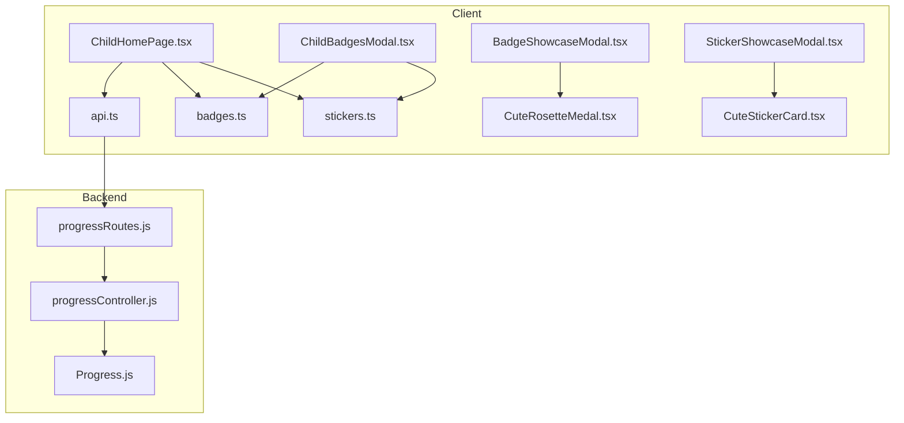
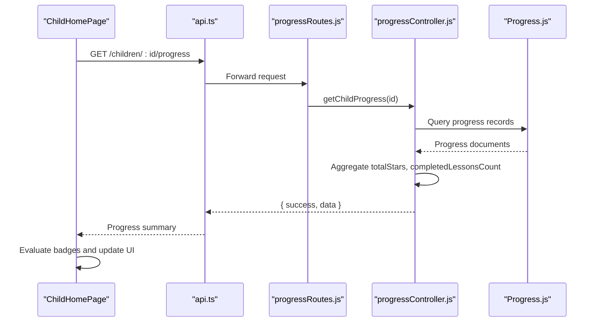
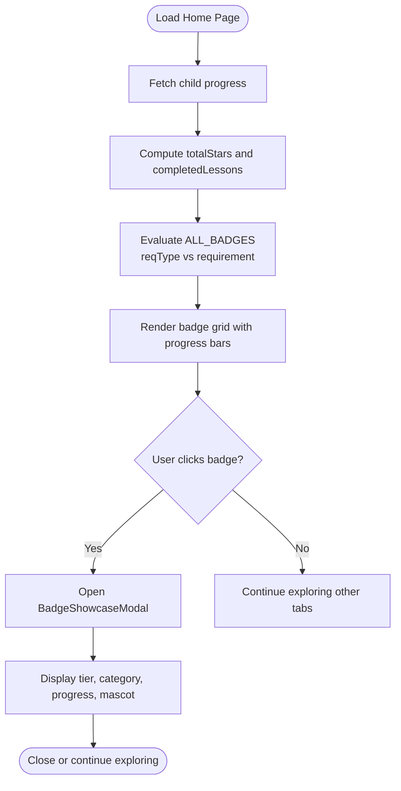
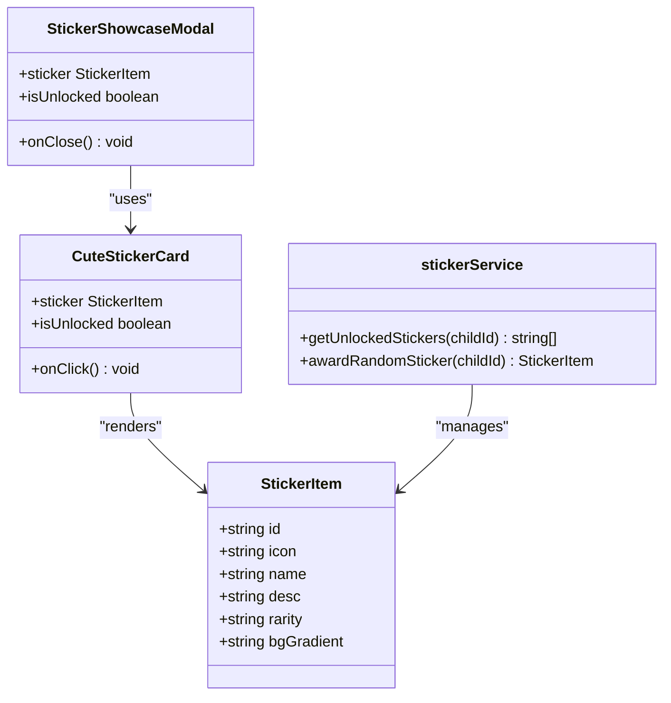
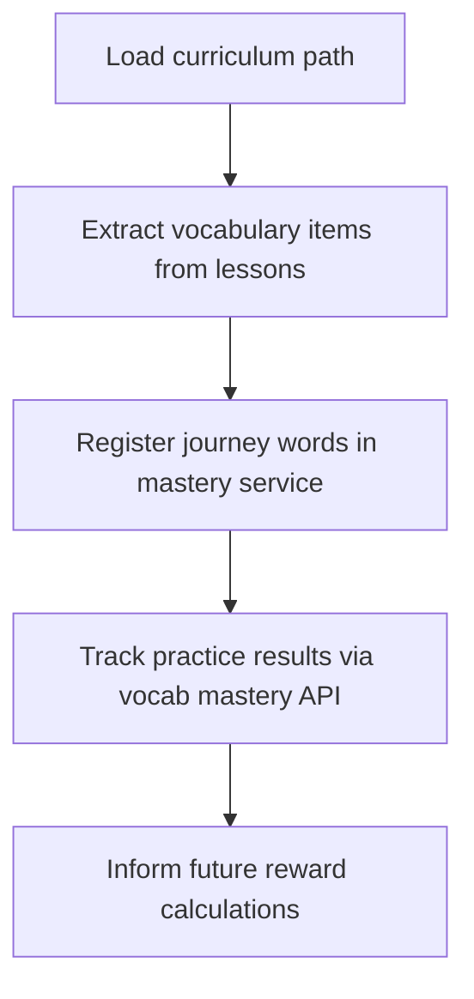
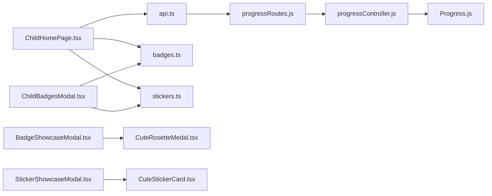

# Reward Showcase Integration

<cite>
**Referenced Files in This Document**   
- [ChildHomePage.tsx](file://client/src/pages/child/ChildHomePage.tsx)
- [BadgeShowcaseModal.tsx](file://client/src/components/child/BadgeShowcaseModal.tsx)
- [StickerShowcaseModal.tsx](file://client/src/components/child/StickerShowcaseModal.tsx)
- [ChildBadgesModal.tsx](file://client/src/components/child/ChildBadgesModal.tsx)
- [CuteRosetteMedal.tsx](file://client/src/components/child/CuteRosetteMedal.tsx)
- [CuteStickerCard.tsx](file://client/src/components/child/CuteStickerCard.tsx)
- [badges.ts](file://client/src/data/badges.ts)
- [stickers.ts](file://client/src/data/stickers.ts)
- [api.ts](file://client/src/services/api.ts)
- [progressController.js](file://KCEnglishKids_BE/src/controllers/progressController.js)
- [Progress.js](file://KCEnglishKids_BE/src/models/Progress.js)
- [progressRoutes.js](file://KCEnglishKids_BE/src/routes/progressRoutes.js)
</cite>

## Table of Contents
1. [Introduction](#introduction)
2. [Project Structure](#project-structure)
3. [Core Components](#core-components)
4. [Architecture Overview](#architecture-overview)
5. [Detailed Component Analysis](#detailed-component-analysis)
6. [Dependency Analysis](#dependency-analysis)
7. [Performance Considerations](#performance-considerations)
8. [Troubleshooting Guide](#troubleshooting-guide)
9. [Conclusion](#conclusion)

## Introduction
This document explains the reward showcase integration that displays earned badges, stickers, and achievements on the child’s home page. It covers:
- Star accumulation display and progress metrics
- Badge collection visualization with categories, tiers, and unlock conditions
- Sticker collection visualization with rarity levels and local persistence
- Motivation patterns such as animations, mascot feedback, milestone celebrations, and friendly gating
- Backend integration for progress data and how rewards are calculated from activity completion, vocabulary mastery, and consistent learning patterns

The system is designed to be accessible to children while providing clear visual feedback and encouraging continued engagement through gamified elements.

## Project Structure
The reward showcase spans client-side components, data definitions, API services, and backend controllers:
- Client pages render the home dashboard and reward tabs
- Modal components provide detailed badge and sticker showcases
- Data files define badge rules and sticker catalog
- Services call backend endpoints for curriculum path, topics, vocabulary, and progress
- Backend aggregates stars and completed lessons for a child

**Diagram sources**
- [ChildHomePage.tsx:1-1038](file://client/src/pages/child/ChildHomePage.tsx#L1-L1038)
- [ChildBadgesModal.tsx:1-316](file://client/src/components/child/ChildBadgesModal.tsx#L1-L316)
- [BadgeShowcaseModal.tsx:1-201](file://client/src/components/child/BadgeShowcaseModal.tsx#L1-L201)
- [StickerShowcaseModal.tsx:1-168](file://client/src/components/child/StickerShowcaseModal.tsx#L1-L168)
- [CuteRosetteMedal.tsx:1-142](file://client/src/components/child/CuteRosetteMedal.tsx#L1-L142)
- [CuteStickerCard.tsx:1-141](file://client/src/components/child/CuteStickerCard.tsx#L1-L141)
- [badges.ts:1-324](file://client/src/data/badges.ts#L1-L324)
- [stickers.ts:1-162](file://client/src/data/stickers.ts#L1-L162)
- [api.ts:1-354](file://client/src/services/api.ts#L1-L354)
- [progressRoutes.js:1-8](file://KCEnglishKids_BE/src/routes/progressRoutes.js#L1-L8)
- [progressController.js:1-71](file://KCEnglishKids_BE/src/controllers/progressController.js#L1-L71)
- [Progress.js:1-65](file://KCEnglishKids_BE/src/models/Progress.js#L1-L65)

**Section sources**
- [ChildHomePage.tsx:1-1038](file://client/src/pages/child/ChildHomePage.tsx#L1-L1038)
- [api.ts:112-158](file://client/src/services/api.ts#L112-L158)
- [progressRoutes.js:1-8](file://KCEnglishKids_BE/src/routes/progressRoutes.js#L1-L8)
- [progressController.js:1-71](file://KCEnglishKids_BE/src/controllers/progressController.js#L1-L71)
- [Progress.js:1-65](file://KCEnglishKids_BE/src/models/Progress.js#L1-L65)

## Core Components
- ChildHomePage: Main dashboard showing star totals, completed lessons, unit journey, topic cards, vocabulary notebook, arcade games, and reward tabs (badges and stickers). It loads curriculum path, topics, vocabulary, and child progress, then computes total stars and lesson counts for reward evaluation.
- ChildBadgesModal: A full-screen modal that lists all badges and stickers, filters by category/rarity, and opens spotlight modals for individual items.
- BadgeShowcaseModal: Spotlight view for a single badge, including tier, category, progress bar, mascot encouragement, and sound effects.
- StickerShowcaseModal: Spotlight view for a single sticker, including rarity, peel animation, confetti celebration, and mascot cheer.
- CuteRosetteMedal: Reusable 3D medal component used across badges with size variants, ribbons, and tier-based styling.
- CuteStickerCard: Reusable sticker card with rarity labels, puffy design, and locked/unlocked states.
- badges.ts: Defines badge catalog with requirements, tiers, categories, and visual metadata.
- stickers.ts: Defines sticker catalog and local storage service for unlocked stickers.
- api.ts: Frontend API layer calling backend endpoints for curriculum path, topics, vocabulary, activities, and progress.
- Backend progress controller and model: Aggregate stars and completed lessons per child; expose a progress endpoint consumed by the frontend.

**Section sources**
- [ChildHomePage.tsx:62-175](file://client/src/pages/child/ChildHomePage.tsx#L62-L175)
- [ChildBadgesModal.tsx:22-65](file://client/src/components/child/ChildBadgesModal.tsx#L22-L65)
- [BadgeShowcaseModal.tsx:14-47](file://client/src/components/child/BadgeShowcaseModal.tsx#L14-L47)
- [StickerShowcaseModal.tsx:14-54](file://client/src/components/child/StickerShowcaseModal.tsx#L14-L54)
- [CuteRosetteMedal.tsx:14-83](file://client/src/components/child/CuteRosetteMedal.tsx#L14-L83)
- [CuteStickerCard.tsx:13-66](file://client/src/components/child/CuteStickerCard.tsx#L13-L66)
- [badges.ts:1-15](file://client/src/data/badges.ts#L1-L15)
- [stickers.ts:1-8](file://client/src/data/stickers.ts#L1-L8)
- [api.ts:142-158](file://client/src/services/api.ts#L142-L158)
- [progressController.js:6-66](file://KCEnglishKids_BE/src/controllers/progressController.js#L6-L66)
- [Progress.js:3-58](file://KCEnglishKids_BE/src/models/Progress.js#L3-L58)

## Architecture Overview
The reward showcase integrates front-end UI with back-end progress aggregation:
- The child home page fetches curriculum path, topics, vocabulary, and progress using the API service.
- Progress data includes total stars and completed lessons, which drive badge unlock logic.
- Badges are evaluated locally based on current stars, completed lessons, and completed units.
- Stickers are managed via a local service that persists unlocked stickers per child ID.
- Modals provide rich visual feedback and motivational messaging.

**Diagram sources**
- [ChildHomePage.tsx:117-169](file://client/src/pages/child/ChildHomePage.tsx#L117-L169)
- [api.ts:156-158](file://client/src/services/api.ts#L156-L158)
- [progressRoutes.js:1-8](file://KCEnglishKids_BE/src/routes/progressRoutes.js#L1-L8)
- [progressController.js:6-66](file://KCEnglishKids_BE/src/controllers/progressController.js#L6-L66)
- [Progress.js:1-65](file://KCEnglishKids_BE/src/models/Progress.js#L1-L65)

## Detailed Component Analysis

### Star Accumulation Display
- The home banner shows total stars and completed lessons.
- Stars are aggregated from backend progress records and displayed prominently to motivate continued learning.
- Unit-level stars contribute to the total when not provided directly by the backend.

Key behaviors:
- Fetching progress and computing totals
- Rendering star count in header and reward tab banners
- Using stars to evaluate star-based badges

**Section sources**
- [ChildHomePage.tsx:171-175](file://client/src/pages/child/ChildHomePage.tsx#L171-L175)
- [ChildHomePage.tsx:187-218](file://client/src/pages/child/ChildHomePage.tsx#L187-L218)
- [progressController.js:20-27](file://KCEnglishKids_BE/src/controllers/progressController.js#L20-L27)

### Badge Collection Visualization
- Badges are defined in a catalog with categories (journey, stars, skills), tiers (bronze, silver, gold, diamond), and requirements (lesson, unit, star).
- The home page evaluates each badge against current progress:
  - Star-based badges compare total stars to requirement
  - Unit-based badges compare completed units to requirement
  - Lesson-based badges compare completed lessons to requirement
- Category filters allow focusing on specific badge types.
- Each badge card shows a progress bar indicating how close the child is to unlocking it.
- Clicking a badge opens a spotlight modal with detailed information, mascot encouragement, and sound effects.

**Diagram sources**
- [ChildHomePage.tsx:521-695](file://client/src/pages/child/ChildHomePage.tsx#L521-L695)
- [badges.ts:17-323](file://client/src/data/badges.ts#L17-L323)
- [BadgeShowcaseModal.tsx:14-47](file://client/src/components/child/BadgeShowcaseModal.tsx#L14-L47)

**Section sources**
- [ChildHomePage.tsx:521-695](file://client/src/pages/child/ChildHomePage.tsx#L521-L695)
- [badges.ts:1-324](file://client/src/data/badges.ts#L1-L324)
- [BadgeShowcaseModal.tsx:1-201](file://client/src/components/child/BadgeShowcaseModal.tsx#L1-L201)
- [CuteRosetteMedal.tsx:1-142](file://client/src/components/child/CuteRosetteMedal.tsx#L1-L142)

### Sticker Collection Visualization
- Stickers are defined in a catalog with rarity levels (common, rare, epic, legendary).
- Unlocked stickers are stored locally per child ID using a simple service.
- The home page renders sticker cards with rarity labels and locked/unlocked states.
- Clicking a sticker opens a spotlight modal with peel animation, confetti celebration, and mascot cheer.
- The sticker service supports awarding random stickers and persisting unlocks.

**Diagram sources**
- [stickers.ts:1-162](file://client/src/data/stickers.ts#L1-L162)
- [CuteStickerCard.tsx:1-141](file://client/src/components/child/CuteStickerCard.tsx#L1-L141)
- [StickerShowcaseModal.tsx:1-168](file://client/src/components/child/StickerShowcaseModal.tsx#L1-L168)

**Section sources**
- [ChildHomePage.tsx:697-745](file://client/src/pages/child/ChildHomePage.tsx#L697-L745)
- [stickers.ts:1-162](file://client/src/data/stickers.ts#L1-L162)
- [StickerShowcaseModal.tsx:1-168](file://client/src/components/child/StickerShowcaseModal.tsx#L1-L168)
- [CuteStickerCard.tsx:1-141](file://client/src/components/child/CuteStickerCard.tsx#L1-L141)

### Streak Tracking and Consistent Learning Patterns
- The badge catalog includes a streak-oriented badge (“Ong Vàng Chăm Chỉ”) tied to accumulating stars, reflecting consistent learning behavior.
- While explicit daily streak counters are not present in the analyzed files, the system encourages consistency through:
  - Star accumulation thresholds
  - Lesson completion milestones
  - Encouraging mascot messages and progressive difficulty in badge tiers

Recommendation for future enhancement:
- Introduce a daily streak counter in the progress model and UI to explicitly track consecutive days of learning.
- Surface streak status in the home banner and badge progress to reinforce habit formation.

**Section sources**
- [badges.ts:232-245](file://client/src/data/badges.ts#L232-L245)
- [ChildHomePage.tsx:521-695](file://client/src/pages/child/ChildHomePage.tsx#L521-L695)

### Vocabulary Mastery Integration
- The home page registers “journey words” into a local mastery service after loading the curriculum path.
- Vocabulary mastery is tracked separately via a dedicated API and service, enabling long-term retention insights.
- While the reward showcase primarily uses stars and lesson completion, vocabulary mastery can inform future reward logic (e.g., badges for mastering specific word sets).

**Diagram sources**
- [ChildHomePage.tsx:136-157](file://client/src/pages/child/ChildHomePage.tsx#L136-L157)
- [api.ts:298-318](file://client/src/services/api.ts#L298-L318)

**Section sources**
- [ChildHomePage.tsx:136-157](file://client/src/pages/child/ChildHomePage.tsx#L136-L157)
- [api.ts:298-318](file://client/src/services/api.ts#L298-L318)

### Reward Animation Effects and Motivational Design Patterns
- Animations include:
  - Confetti bursts for sticker unlocks
  - Jiggling/shake effects for badges and stickers
  - Floating and bouncing animations for medals and stars
  - Sunburst glow backgrounds for unlocked badges
- Mascot feedback provides contextual encouragement:
  - Celebrating unlocked items
  - Encouraging continued effort for locked items
- Friendly sequential gating prevents progression until prerequisites are met, guiding children through the curriculum path.

Examples:
- Sticker spotlight triggers confetti and fanfare sounds when unlocked.
- Badge spotlight plays chime sounds and shows progress percentage.
- Locked unit cards show lock icons and friendly toast messages.

**Section sources**
- [StickerShowcaseModal.tsx:21-37](file://client/src/components/child/StickerShowcaseModal.tsx#L21-L37)
- [BadgeShowcaseModal.tsx:21-29](file://client/src/components/child/BadgeShowcaseModal.tsx#L21-L29)
- [CuteRosetteMedal.tsx:105-137](file://client/src/components/child/CuteRosetteMedal.tsx#L105-L137)
- [ChildHomePage.tsx:107-114](file://client/src/pages/child/ChildHomePage.tsx#L107-L114)

### Backend Reward Calculation System and Real-Time Updates
- Backend progress controller aggregates stars and completed lessons from progress records.
- The frontend consumes this data to evaluate badge unlocks and display totals.
- Real-time updates depend on re-fetching progress after activity completion; the current implementation loads progress once on home page mount.

Recommendation for real-time updates:
- After submitting activity results, re-fetch progress to refresh stars and completed lessons.
- Optionally introduce WebSocket or polling mechanisms for live progress updates during sessions.

**Section sources**
- [progressController.js:6-66](file://KCEnglishKids_BE/src/controllers/progressController.js#L6-L66)
- [ChildHomePage.tsx:117-169](file://client/src/pages/child/ChildHomePage.tsx#L117-L169)

## Dependency Analysis
- ChildHomePage depends on:
  - API service for curriculum path, topics, vocabulary, and progress
  - Badge and sticker data catalogs
  - Local mastery service for vocabulary registration
  - Audio utilities for sound effects
- ChildBadgesModal depends on:
  - Badge and sticker catalogs
  - Local sticker service
  - Spotlight modals for detailed views
- BadgeShowcaseModal and StickerShowcaseModal depend on:
  - Visual components (medal, sticker card)
  - Audio utilities and confetti library
- Backend routes and controller depend on:
  - Progress model for querying and aggregating data

**Diagram sources**
- [ChildHomePage.tsx:1-1038](file://client/src/pages/child/ChildHomePage.tsx#L1-L1038)
- [ChildBadgesModal.tsx:1-316](file://client/src/components/child/ChildBadgesModal.tsx#L1-L316)
- [BadgeShowcaseModal.tsx:1-201](file://client/src/components/child/BadgeShowcaseModal.tsx#L1-L201)
- [StickerShowcaseModal.tsx:1-168](file://client/src/components/child/StickerShowcaseModal.tsx#L1-L168)
- [api.ts:1-354](file://client/src/services/api.ts#L1-L354)
- [progressRoutes.js:1-8](file://KCEnglishKids_BE/src/routes/progressRoutes.js#L1-L8)
- [progressController.js:1-71](file://KCEnglishKids_BE/src/controllers/progressController.js#L1-L71)
- [Progress.js:1-65](file://KCEnglishKids_BE/src/models/Progress.js#L1-L65)

**Section sources**
- [ChildHomePage.tsx:1-1038](file://client/src/pages/child/ChildHomePage.tsx#L1-L1038)
- [ChildBadgesModal.tsx:1-316](file://client/src/components/child/ChildBadgesModal.tsx#L1-L316)
- [api.ts:1-354](file://client/src/services/api.ts#L1-L354)
- [progressRoutes.js:1-8](file://KCEnglishKids_BE/src/routes/progressRoutes.js#L1-L8)
- [progressController.js:1-71](file://KCEnglishKids_BE/src/controllers/progressController.js#L1-L71)
- [Progress.js:1-65](file://KCEnglishKids_BE/src/models/Progress.js#L1-L65)

## Performance Considerations
- Avoid unnecessary re-renders by memoizing computed values like total stars and completed lessons.
- Defer heavy animations (confetti, jiggling) until user interactions occur.
- Cache sticker unlocks locally to minimize localStorage reads/writes.
- Batch API calls where possible; the home page already uses parallel requests for curriculum path, topics, vocabulary, and progress.

[No sources needed since this section provides general guidance]

## Troubleshooting Guide
Common issues and resolutions:
- Progress not updating after activity completion:
  - Ensure progress is re-fetched after submitting activity results.
  - Verify backend aggregation logic sums stars and marks completed lessons correctly.
- Stickers not persisting:
  - Check localStorage key naming and JSON parsing errors.
  - Confirm sticker service awardRandomSticker updates the list and persists changes.
- Badge progress bars not reflecting current state:
  - Validate reqType mapping and requirement thresholds.
  - Ensure current values (stars, lessons, units) are computed accurately.

**Section sources**
- [progressController.js:20-27](file://KCEnglishKids_BE/src/controllers/progressController.js#L20-L27)
- [stickers.ts:133-161](file://client/src/data/stickers.ts#L133-L161)
- [ChildHomePage.tsx:521-695](file://client/src/pages/child/ChildHomePage.tsx#L521-L695)

## Conclusion
The reward showcase integration delivers a child-friendly, gamified experience that highlights star accumulation, badge collections, and sticker discoveries. It leverages clear visual feedback, mascot encouragement, and structured progression to motivate continued learning. The backend provides essential progress aggregation, while the frontend evaluates and displays rewards dynamically. Future enhancements could include explicit streak tracking, real-time progress updates, and vocabulary mastery-driven rewards to further personalize and deepen engagement.

[No sources needed since this section summarizes without analyzing specific files]