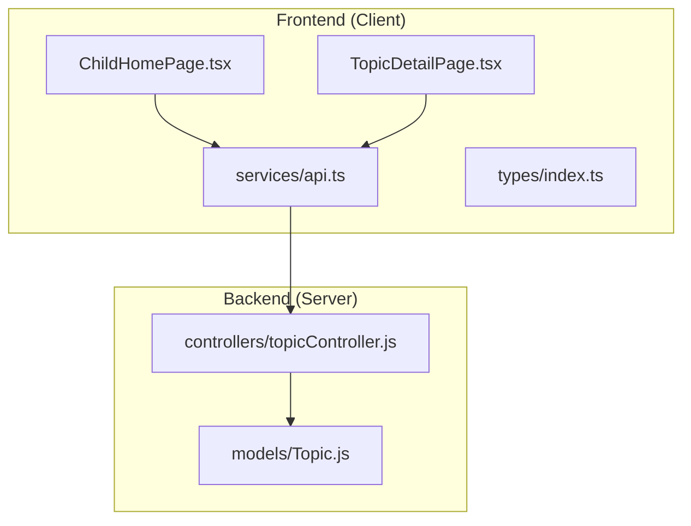
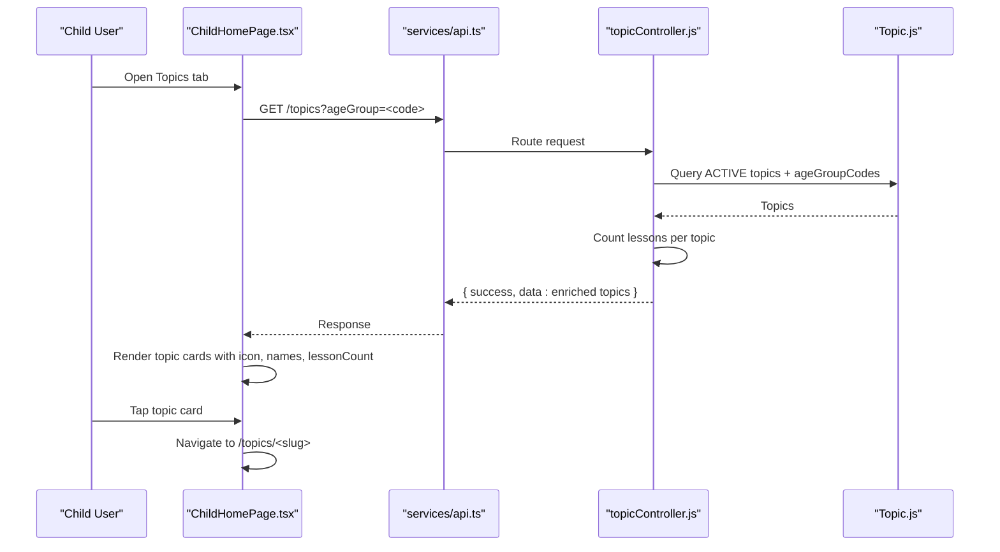
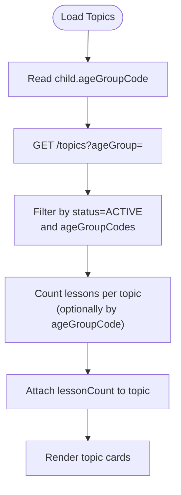
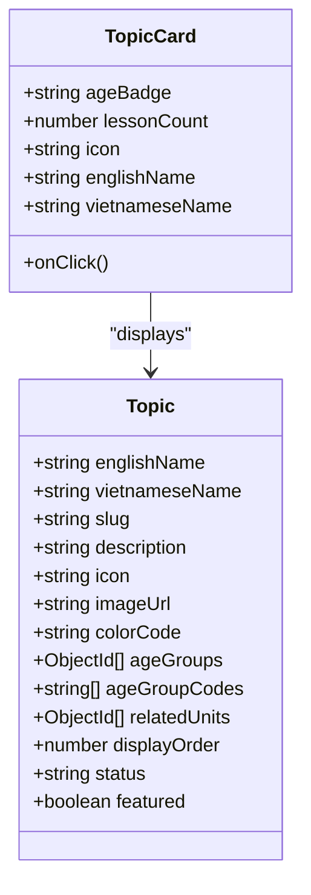
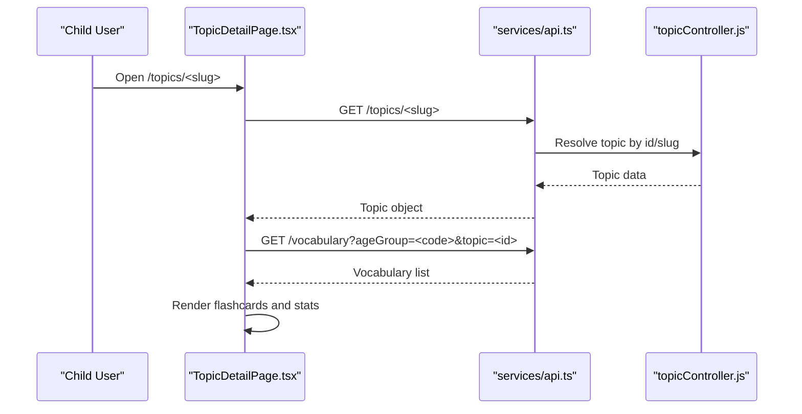
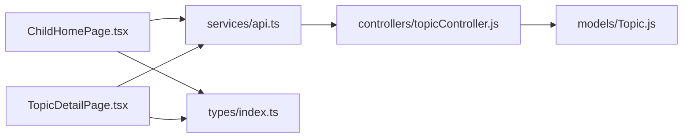

# Topic Selection Interface

<cite>
**Referenced Files in This Document**
- [README.md](file://README.md)
- [Topic.js](file://KCEnglishKids_BE/src/models/Topic.js)
- [topicController.js](file://KCEnglishKids_BE/src/controllers/topicController.js)
- [api.ts](file://client/src/services/api.ts)
- [index.ts](file://client/src/types/index.ts)
- [ChildHomePage.tsx](file://client/src/pages/child/ChildHomePage.tsx)
- [TopicDetailPage.tsx](file://client/src/pages/child/TopicDetailPage.tsx)
</cite>

## Table of Contents
1. [Introduction](#introduction)
2. [Project Structure](#project-structure)
3. [Core Components](#core-components)
4. [Architecture Overview](#architecture-overview)
5. [Detailed Component Analysis](#detailed-component-analysis)
6. [Dependency Analysis](#dependency-analysis)
7. [Performance Considerations](#performance-considerations)
8. [Troubleshooting Guide](#troubleshooting-guide)
9. [Conclusion](#conclusion)

## Introduction
This document explains the topic selection interface that allows children to choose learning activities based on their age group and interests. It covers:
- Age-based filtering for 3–4, 4–5, and 5–6 years
- How topics are categorized and displayed with icons, descriptions, and lesson counts
- Visual presentation and interaction design for young users
- Topic detail page integration and vocabulary preview functionality
- Curriculum progression and availability logic
- Responsive design and accessibility considerations

The system is designed for early learners, emphasizing large touch targets, clear visual cues, playful feedback, and simple navigation.

## Project Structure
The topic selection feature spans both frontend and backend:
- Backend models and controllers define topic data and API endpoints
- Frontend pages render the child-friendly topic grid and topic details
- Services provide typed API calls for topics, lessons, and vocabulary
- Types define shared domain models used across the app

**Diagram sources**
- [ChildHomePage.tsx:116-169](file://client/src/pages/child/ChildHomePage.tsx#L116-L169)
- [TopicDetailPage.tsx:27-77](file://client/src/pages/child/TopicDetailPage.tsx#L27-L77)
- [api.ts:96-109](file://client/src/services/api.ts#L96-L109)
- [topicController.js:6-43](file://KCEnglishKids_BE/src/controllers/topicController.js#L6-L43)
- [Topic.js:3-77](file://KCEnglishKids_BE/src/models/Topic.js#L3-L77)

**Section sources**
- [README.md:1-28](file://README.md#L1-L28)
- [README.md:95-138](file://README.md#L95-L138)

## Core Components
- Topic model: Defines topic fields including names, slug, icon, color, age groups, related units, display order, status, and featured flag.
- Topic controller: Provides endpoints to list topics filtered by age group, fetch a single topic, and get lessons under a topic with optional progress enrichment.
- Client services: Typed wrappers for topics, lessons, and vocabulary APIs.
- Child home page: Renders the “Topics” tab with an age-scoped grid of topic cards, each showing icon, bilingual name, lesson count, and CTA.
- Topic detail page: Loads topic info and curated vocabulary flashcards for the current child’s age group.

Key responsibilities:
- Filtering topics by ageGroupCode
- Enriching topic cards with lessonCount
- Navigating from topic card to topic detail
- Displaying vocabulary preview via flashcards

**Section sources**
- [Topic.js:3-77](file://KCEnglishKids_BE/src/models/Topic.js#L3-L77)
- [topicController.js:6-43](file://KCEnglishKids_BE/src/controllers/topicController.js#L6-L43)
- [api.ts:96-109](file://client/src/services/api.ts#L96-L109)
- [ChildHomePage.tsx:414-499](file://client/src/pages/child/ChildHomePage.tsx#L414-L499)
- [TopicDetailPage.tsx:27-77](file://client/src/pages/child/TopicDetailPage.tsx#L27-L77)

## Architecture Overview
The topic selection flow connects the child’s age profile to backend topic queries and renders interactive UI elements suitable for young users.

**Diagram sources**
- [ChildHomePage.tsx:116-169](file://client/src/pages/child/ChildHomePage.tsx#L116-L169)
- [ChildHomePage.tsx:414-499](file://client/src/pages/child/ChildHomePage.tsx#L414-L499)
- [api.ts:96-109](file://client/src/services/api.ts#L96-L109)
- [topicController.js:6-43](file://KCEnglishKids_BE/src/controllers/topicController.js#L6-L43)
- [Topic.js:3-77](file://KCEnglishKids_BE/src/models/Topic.js#L3-L77)

## Detailed Component Analysis

### Age-Based Filtering System
- Age codes supported: 3-4, 4-5, 5-6
- The child’s age code is derived from the authenticated user profile
- Topics are filtered server-side by ageGroupCodes and status ACTIVE
- Lesson counts are computed per topic, optionally scoped by ageGroupCode

Implementation highlights:
- Backend query filters by status and ageGroupCodes when provided
- Lesson count aggregation uses a separate query per topic
- Frontend passes the child’s ageGroupCode to the topics endpoint

**Diagram sources**
- [topicController.js:6-43](file://KCEnglishKids_BE/src/controllers/topicController.js#L6-L43)
- [api.ts:96-109](file://client/src/services/api.ts#L96-L109)
- [ChildHomePage.tsx:116-169](file://client/src/pages/child/ChildHomePage.tsx#L116-L169)

**Section sources**
- [topicController.js:6-43](file://KCEnglishKids_BE/src/controllers/topicController.js#L6-L43)
- [api.ts:96-109](file://client/src/services/api.ts#L96-L109)
- [index.ts:1-3](file://client/src/types/index.ts#L1-L3)

### Topic Categorization and Display
- Each topic includes:
  - English and Vietnamese names
  - Icon (emoji or icon name)
  - Color accent
  - Optional description and image
  - Related curriculum units
  - Display order and status
- The topic card shows:
  - Age badge (e.g., “3-4 tuổi”)
  - Lesson count
  - Large icon
  - Bilingual title
  - CTA button (“Khám phá ngay”)

Visual design principles:
- Large rounded cards with soft gradients and borders
- Playful color palettes per card
- Clear hierarchy with bold titles and concise subtitles
- Hover and tap animations for engagement

**Diagram sources**
- [Topic.js:3-77](file://KCEnglishKids_BE/src/models/Topic.js#L3-L77)
- [ChildHomePage.tsx:414-499](file://client/src/pages/child/ChildHomePage.tsx#L414-L499)

**Section sources**
- [Topic.js:3-77](file://KCEnglishKids_BE/src/models/Topic.js#L3-L77)
- [ChildHomePage.tsx:414-499](file://client/src/pages/child/ChildHomePage.tsx#L414-L499)

### Visual Presentation: Icons, Descriptions, Difficulty Indicators
- Icons: Each topic displays a prominent emoji/icon in a rounded container; colors vary by palette.
- Descriptions: Bilingual titles are shown; descriptions can be present in the model but are not prominently rendered in the card.
- Difficulty indicators:
  - Not directly shown on topic cards
  - Lesson-level difficulty exists in the Lesson type but is not surfaced in the topic selection view
  - Progress and stars are shown at lesson/unit level elsewhere

Recommendations:
- If needed, add a small badge for estimated difficulty or star requirement on topic cards
- Use consistent iconography and alt text for accessibility

**Section sources**
- [Topic.js:3-77](file://KCEnglishKids_BE/src/models/Topic.js#L3-L77)
- [index.ts:80-97](file://client/src/types/index.ts#L80-L97)
- [ChildHomePage.tsx:414-499](file://client/src/pages/child/ChildHomePage.tsx#L414-L499)

### Topic Detail Page Integration
- Navigation: Clicking a topic card navigates to `/topics/<slug>`
- Data loading:
  - Fetches topic by slug/id
  - Fetches vocabulary for the current age group, optionally scoped by topic
  - Falls back to search by topic name if no direct mapping
- Vocabulary preview:
  - Displays up to 10 curated words
  - Uses BigInteractiveFlashcard component for swipe-to-learn interactions
  - Shows mastery stats (total, mastered, review)

**Diagram sources**
- [TopicDetailPage.tsx:27-77](file://client/src/pages/child/TopicDetailPage.tsx#L27-L77)
- [api.ts:96-135](file://client/src/services/api.ts#L96-L135)
- [topicController.js:45-70](file://KCEnglishKids_BE/src/controllers/topicController.js#L45-L70)

**Section sources**
- [TopicDetailPage.tsx:27-77](file://client/src/pages/child/TopicDetailPage.tsx#L27-L77)
- [TopicDetailPage.tsx:89-247](file://client/src/pages/child/TopicDetailPage.tsx#L89-L247)
- [api.ts:96-135](file://client/src/services/api.ts#L96-L135)

### Lesson Preview Functionality
- Topic detail page provides a vocabulary preview through interactive flashcards
- Lesson-level previews are available via the lessons API and can be integrated into the topic detail page if desired
- Lessons include difficulty, thumbnail, objectives, and activity metadata

Integration options:
- Add a “Preview Lessons” section in the topic detail page
- Show lesson thumbnails and difficulty badges
- Provide quick links to start a lesson session

**Section sources**
- [TopicDetailPage.tsx:186-191](file://client/src/pages/child/TopicDetailPage.tsx#L186-L191)
- [api.ts:111-122](file://client/src/services/api.ts#L111-L122)
- [index.ts:80-97](file://client/src/types/index.ts#L80-L97)

### Topic Availability Based on Curriculum Progression
- Topics are filtered by status ACTIVE and ageGroupCodes
- Curriculum path and unit unlocking are handled separately in the child home page
- Unit unlocking logic:
  - First unit is always accessible
  - Subsequent units unlock after the previous unit is completed
- Topic availability is independent of unit completion; it is primarily age-scoped

Progression considerations:
- Ensure topics relevant to the child’s age are visible
- Optionally gate advanced topics until prerequisite units are completed
- Surface guidance messages for locked content

**Section sources**
- [topicController.js:6-43](file://KCEnglishKids_BE/src/controllers/topicController.js#L6-L43)
- [ChildHomePage.tsx:252-409](file://client/src/pages/child/ChildHomePage.tsx#L252-L409)

### Responsive Design Considerations for Young Users
- Touch-friendly:
  - Large tap targets and buttons
  - Generous spacing between cards
  - Clear visual feedback on hover/tap
- Readability:
  - Bold, large fonts for titles
  - High contrast labels and badges
- Layout:
  - Single column on small screens
  - Multi-column grids on larger screens
- Feedback:
  - Sound effects on interactions
  - Animated transitions and subtle motion

**Section sources**
- [ChildHomePage.tsx:187-218](file://client/src/pages/child/ChildHomePage.tsx#L187-L218)
- [ChildHomePage.tsx:414-499](file://client/src/pages/child/ChildHomePage.tsx#L414-L499)
- [TopicDetailPage.tsx:89-118](file://client/src/pages/child/TopicDetailPage.tsx#L89-L118)

### Accessibility Features
- Semantic navigation:
  - Back button with aria-label
- Keyboard support:
  - Buttons and cards are focusable and clickable
- Screen reader hints:
  - Meaningful labels and descriptive text
- Visual clarity:
  - Consistent color usage and high contrast
- Audio feedback:
  - Optional sound effects for engagement

Recommendations:
- Add ARIA roles and labels where appropriate
- Ensure sufficient color contrast ratios
- Provide text alternatives for icons and images

**Section sources**
- [TopicDetailPage.tsx:94-118](file://client/src/pages/child/TopicDetailPage.tsx#L94-L118)
- [ChildHomePage.tsx:414-499](file://client/src/pages/child/ChildHomePage.tsx#L414-L499)

## Dependency Analysis
The following diagram maps key dependencies among components involved in topic selection:

**Diagram sources**
- [ChildHomePage.tsx:116-169](file://client/src/pages/child/ChildHomePage.tsx#L116-L169)
- [TopicDetailPage.tsx:27-77](file://client/src/pages/child/TopicDetailPage.tsx#L27-L77)
- [api.ts:96-135](file://client/src/services/api.ts#L96-L135)
- [topicController.js:6-70](file://KCEnglishKids_BE/src/controllers/topicController.js#L6-L70)
- [Topic.js:3-77](file://KCEnglishKids_BE/src/models/Topic.js#L3-L77)
- [index.ts:17-28](file://client/src/types/index.ts#L17-L28)

**Section sources**
- [api.ts:96-135](file://client/src/services/api.ts#L96-L135)
- [topicController.js:6-70](file://KCEnglishKids_BE/src/controllers/topicController.js#L6-L70)
- [Topic.js:3-77](file://KCEnglishKids_BE/src/models/Topic.js#L3-L77)
- [index.ts:17-28](file://client/src/types/index.ts#L17-L28)

## Performance Considerations
- Minimize network requests:
  - Batch load topics, vocabulary, and progress on home page initialization
- Efficient filtering:
  - Server-side filtering by ageGroupCodes reduces payload size
- Pagination:
  - Consider paginating topics if the number grows significantly
- Caching:
  - Cache topic lists and vocabulary for the current age group locally
- Rendering optimization:
  - Use virtualized lists for large grids
  - Defer heavy animations until after initial render

[No sources needed since this section provides general guidance]

## Troubleshooting Guide
Common issues and resolutions:
- Topics not appearing:
  - Verify the child’s ageGroupCode matches topic ageGroupCodes
  - Check that topics have status ACTIVE
- Lesson count mismatch:
  - Ensure lessons are marked ACTIVE and scoped to the same ageGroupCode
- Topic detail page empty:
  - Confirm vocabulary is associated with the topic or searchable by topic name
  - Validate slug resolution in the backend controller

Debugging steps:
- Inspect API responses from /topics and /vocabulary endpoints
- Validate topic slug and id resolution
- Check error middleware and console logs for failed requests

**Section sources**
- [topicController.js:6-43](file://KCEnglishKids_BE/src/controllers/topicController.js#L6-L43)
- [topicController.js:45-70](file://KCEnglishKids_BE/src/controllers/topicController.js#L45-L70)
- [TopicDetailPage.tsx:27-77](file://client/src/pages/child/TopicDetailPage.tsx#L27-L77)

## Conclusion
The topic selection interface provides an engaging, age-appropriate way for children to explore learning activities. It leverages robust backend filtering, rich visual presentation, and intuitive navigation tailored for young users. By integrating topic details with vocabulary previews and considering responsive and accessible design, the system supports effective early learning experiences. Future enhancements could include explicit difficulty indicators on topic cards, lesson previews within topic details, and additional personalization based on curriculum progression.

[No sources needed since this section summarizes without analyzing specific files]