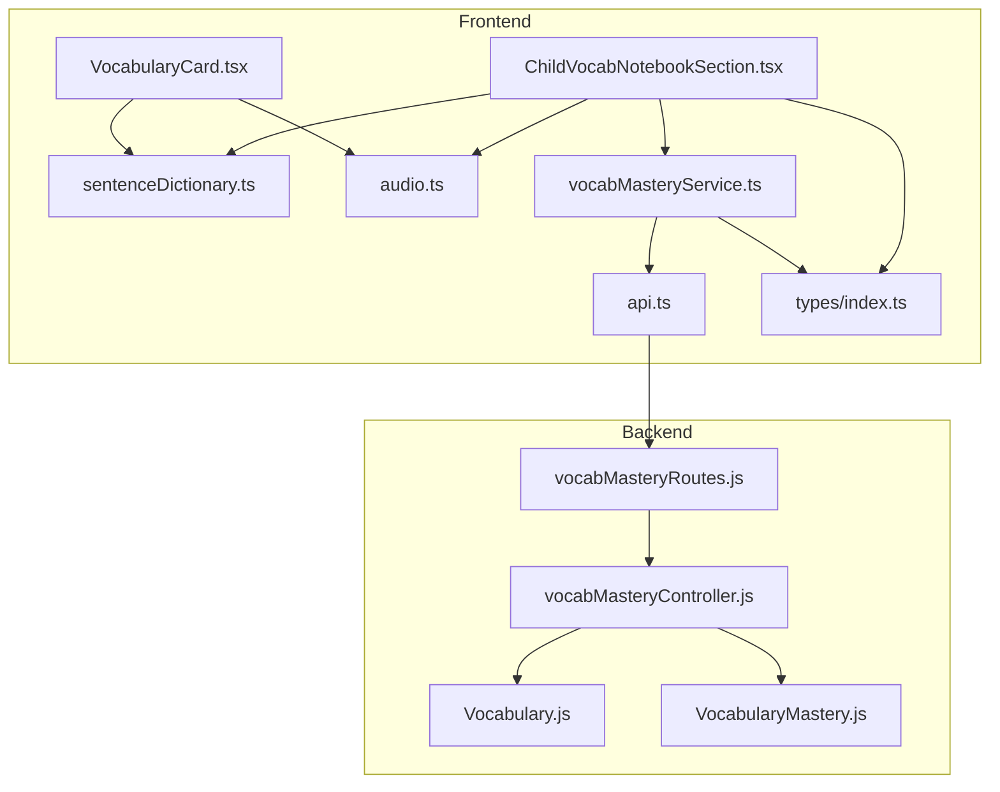
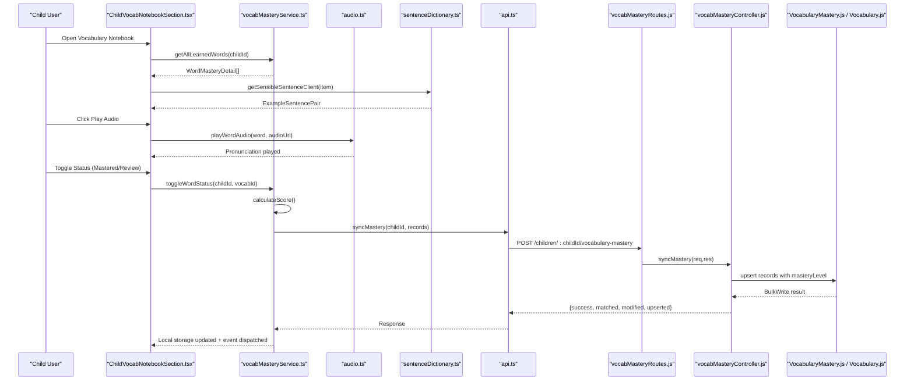
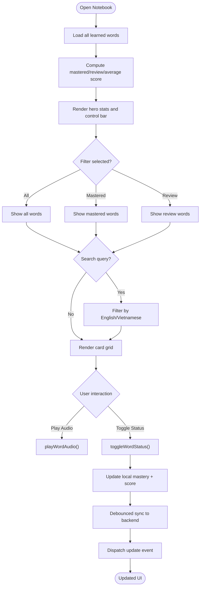
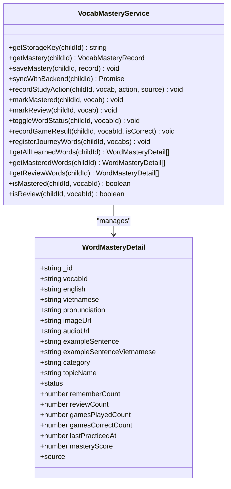
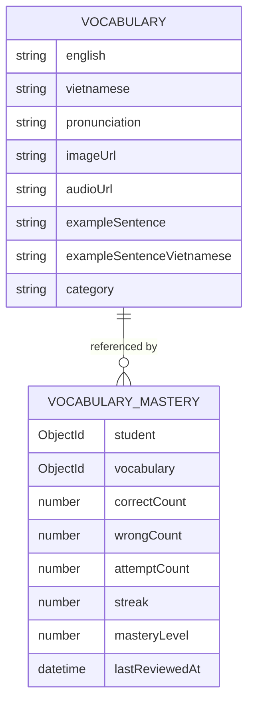
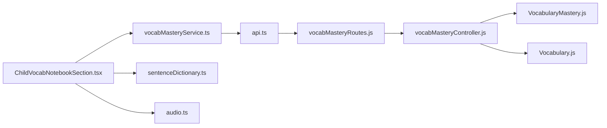

# Vocabulary Notebook Section

<cite>
**Referenced Files in This Document**
- [ChildVocabNotebookSection.tsx](file://client/src/components/child/ChildVocabNotebookSection.tsx)
- [VocabularyCard.tsx](file://client/src/components/child/VocabularyCard.tsx)
- [vocabMasteryService.ts](file://client/src/services/vocabMasteryService.ts)
- [audio.ts](file://client/src/utils/audio.ts)
- [sentenceDictionary.ts](file://client/src/utils/sentenceDictionary.ts)
- [api.ts](file://client/src/services/api.ts)
- [index.ts](file://client/src/types/index.ts)
- [Vocabulary.js](file://KCEnglishKids_BE/src/models/Vocabulary.js)
- [VocabularyMastery.js](file://KCEnglishKids_BE/src/models/VocabularyMastery.js)
- [vocabMasteryController.js](file://KCEnglishKids_BE/src/controllers/vocabMasteryController.js)
- [vocabMasteryRoutes.js](file://KCEnglishKids_BE/src/routes/vocabMasteryRoutes.js)
</cite>

## Table of Contents
1. [Introduction](#introduction)
2. [Project Structure](#project-structure)
3. [Core Components](#core-components)
4. [Architecture Overview](#architecture-overview)
5. [Detailed Component Analysis](#detailed-component-analysis)
6. [Dependency Analysis](#dependency-analysis)
7. [Performance Considerations](#performance-considerations)
8. [Troubleshooting Guide](#troubleshooting-guide)
9. [Conclusion](#conclusion)

## Introduction
The Vocabulary Notebook section is an interactive learning space for children to review, practice, and track vocabulary mastery. It presents vocabulary cards with images, pronunciation, example sentences, and mastery indicators. Children can filter words by learned status, search across English and Vietnamese text, listen to audio, and toggle whether a word needs review or has been mastered. The section integrates with a local mastery tracking system that persists progress in the browser and periodically syncs it to the backend database. Mastery levels are calculated using counts of correct and incorrect attempts, game performance, and streaks, enabling spaced repetition concepts through score-based prioritization and categorization into “mastered” and “review” groups.

## Project Structure
The vocabulary notebook spans frontend components, services, utilities, and backend models and controllers:

- Frontend UI:
  - ChildVocabNotebookSection.tsx: Main notebook interface with stats, filters, search, and card grid.
  - VocabularyCard.tsx: Reusable card component used elsewhere for vocabulary display.
  - sentenceDictionary.ts: Curated and generated example sentences for vocabulary items.
  - audio.ts: Audio playback engine and speech synthesis fallback.
  - vocabMasteryService.ts: Local mastery state management, scoring, and backend sync.
  - api.ts: API client including vocabulary mastery endpoints.
  - index.ts: Shared TypeScript types for vocabulary and mastery records.

- Backend persistence and logic:
  - Vocabulary.js: Vocabulary data model.
  - VocabularyMastery.js: Mastery record model with level calculation.
  - vocabMasteryController.js: Endpoints for fetching, syncing, and recording practice results.
  - vocabMasteryRoutes.js: Express routes for mastery operations.

**Diagram sources**
- [ChildVocabNotebookSection.tsx:1-411](file://client/src/components/child/ChildVocabNotebookSection.tsx#L1-L411)
- [VocabularyCard.tsx:1-72](file://client/src/components/child/VocabularyCard.tsx#L1-L72)
- [vocabMasteryService.ts:1-372](file://client/src/services/vocabMasteryService.ts#L1-L372)
- [audio.ts:1-360](file://client/src/utils/audio.ts#L1-L360)
- [sentenceDictionary.ts:1-281](file://client/src/utils/sentenceDictionary.ts#L1-L281)
- [api.ts:298-318](file://client/src/services/api.ts#L298-L318)
- [index.ts:30-39](file://client/src/types/index.ts#L30-L39)
- [Vocabulary.js:1-110](file://KCEnglishKids_BE/src/models/Vocabulary.js#L1-L110)
- [VocabularyMastery.js:1-98](file://KCEnglishKids_BE/src/models/VocabularyMastery.js#L1-L98)
- [vocabMasteryController.js:1-184](file://KCEnglishKids_BE/src/controllers/vocabMasteryController.js#L1-L184)
- [vocabMasteryRoutes.js:1-16](file://KCEnglishKids_BE/src/routes/vocabMasteryRoutes.js#L1-L16)

**Section sources**
- [ChildVocabNotebookSection.tsx:1-411](file://client/src/components/child/ChildVocabNotebookSection.tsx#L1-L411)
- [VocabularyCard.tsx:1-72](file://client/src/components/child/VocabularyCard.tsx#L1-L72)
- [vocabMasteryService.ts:1-372](file://client/src/services/vocabMasteryService.ts#L1-L372)
- [audio.ts:1-360](file://client/src/utils/audio.ts#L1-L360)
- [sentenceDictionary.ts:1-281](file://client/src/utils/sentenceDictionary.ts#L1-L281)
- [api.ts:298-318](file://client/src/services/api.ts#L298-L318)
- [index.ts:30-39](file://client/src/types/index.ts#L30-L39)
- [Vocabulary.js:1-110](file://KCEnglishKids_BE/src/models/Vocabulary.js#L1-L110)
- [VocabularyMastery.js:1-98](file://KCEnglishKids_BE/src/models/VocabularyMastery.js#L1-L98)
- [vocabMasteryController.js:1-184](file://KCEnglishKids_BE/src/controllers/vocabMasteryController.js#L1-L184)
- [vocabMasteryRoutes.js:1-16](file://KCEnglishKids_BE/src/routes/vocabMasteryRoutes.js#L1-L16)

## Core Components
- ChildVocabNotebookSection.tsx: Provides the notebook UI with hero stats (total learned, mastered, review needed, average score), filter tabs (all/mastered/review), search input, and a responsive grid of vocabulary cards. It uses the mastery service to retrieve lists, toggles word status, plays example sentences via speech synthesis, and navigates to mini-games when enough words exist.
- VocabularyCard.tsx: Displays a single vocabulary item with image, English word, pronunciation hint, Vietnamese meaning, and example sentence. It integrates audio playback via AudioButton and sentence generation.
- vocabMasteryService.ts: Manages local mastery records in localStorage, calculates mastery scores from remember/review/game metrics, toggles statuses, records study actions and game results, registers journey words, and syncs to the backend via debounced background requests.
- audio.ts: Provides sound effects and robust audio playback with HTML5 audio and SpeechSynthesis fallback, ensuring child-friendly feedback sounds and clear pronunciation.
- sentenceDictionary.ts: Supplies curated example sentences for many common words and generates contextual sentences based on category and part-of-speech when no curated sentence exists.
- api.ts: Exposes vocabulary mastery API methods for fetching child mastery, syncing records, and recording practice attempts.
- index.ts: Defines shared types for Vocabulary, MasteryLevel, and related structures.
- Vocabulary.js: Defines vocabulary schema fields such as english, vietnamese, pronunciation, imageUrl, audioUrl, exampleSentence, and category.
- VocabularyMastery.js: Defines mastery schema with counts, streak, and auto-calculated mastery level using thresholds for mastering accuracy and attempts.
- vocabMasteryController.js: Implements endpoints to get mastery records, bulk sync records, and record individual practice attempts.
- vocabMasteryRoutes.js: Registers routes for mastery operations under protected paths.

**Section sources**
- [ChildVocabNotebookSection.tsx:21-411](file://client/src/components/child/ChildVocabNotebookSection.tsx#L21-L411)
- [VocabularyCard.tsx:11-70](file://client/src/components/child/VocabularyCard.tsx#L11-L70)
- [vocabMasteryService.ts:37-372](file://client/src/services/vocabMasteryService.ts#L37-L372)
- [audio.ts:184-318](file://client/src/utils/audio.ts#L184-L318)
- [sentenceDictionary.ts:169-281](file://client/src/utils/sentenceDictionary.ts#L169-L281)
- [api.ts:298-318](file://client/src/services/api.ts#L298-L318)
- [index.ts:30-39](file://client/src/types/index.ts#L30-L39)
- [Vocabulary.js:3-103](file://KCEnglishKids_BE/src/models/Vocabulary.js#L3-L103)
- [VocabularyMastery.js:48-95](file://KCEnglishKids_BE/src/models/VocabularyMastery.js#L48-L95)
- [vocabMasteryController.js:11-184](file://KCEnglishKids_BE/src/controllers/vocabMasteryController.js#L11-L184)
- [vocabMasteryRoutes.js:6-15](file://KCEnglishKids_BE/src/routes/vocabMasteryRoutes.js#L6-L15)

## Architecture Overview
The vocabulary notebook follows a layered architecture:

- Presentation Layer: React components render the notebook UI and cards.
- Service Layer: vocabMasteryService manages local state and orchestrates backend sync.
- API Layer: api.ts calls backend endpoints for mastery data and updates.
- Backend Layer: Express routes and controller handle persistence and calculations.
- Data Layer: MongoDB schemas define vocabulary and mastery records.

**Diagram sources**
- [ChildVocabNotebookSection.tsx:71-83](file://client/src/components/child/ChildVocabNotebookSection.tsx#L71-L83)
- [ChildVocabNotebookSection.tsx:286-403](file://client/src/components/child/ChildVocabNotebookSection.tsx#L286-L403)
- [vocabMasteryService.ts:239-260](file://client/src/services/vocabMasteryService.ts#L239-L260)
- [vocabMasteryService.ts:76-105](file://client/src/services/vocabMasteryService.ts#L76-L105)
- [api.ts:298-318](file://client/src/services/api.ts#L298-L318)
- [vocabMasteryRoutes.js:6-15](file://KCEnglishKids_BE/src/routes/vocabMasteryRoutes.js#L6-L15)
- [vocabMasteryController.js:48-112](file://KCEnglishKids_BE/src/controllers/vocabMasteryController.js#L48-L112)
- [VocabularyMastery.js:89-95](file://KCEnglishKids_BE/src/models/VocabularyMastery.js#L89-L95)

## Detailed Component Analysis

### ChildVocabNotebookSection.tsx
This component renders the main notebook experience:
- Hero Stats: Shows total learned words, mastered count, review-needed count, and average mastery score.
- Filters: Tabs for all/mastered/review; each tab shows a badge with the count.
- Search: Filters words by English or Vietnamese text.
- Card Grid: Displays WordMasteryDetail items with image, English word, pronunciation, Vietnamese meaning, example sentence, and mastery badge.
- Interactions:
  - Play audio for the word and example sentence.
  - Toggle status between mastered and review, updating local mastery and triggering background sync.
  - Navigate to games if at least two words have been learned.

Key behaviors:
- Uses useMemo to compute filtered lists and average score efficiently.
- Subscribes to a custom event to refresh UI when mastery changes occur elsewhere.
- Integrates with sentenceDictionary.ts for contextual example sentences.
- Uses audio.ts for pronunciation and sound effects.

**Diagram sources**
- [ChildVocabNotebookSection.tsx:31-69](file://client/src/components/child/ChildVocabNotebookSection.tsx#L31-L69)
- [ChildVocabNotebookSection.tsx:71-83](file://client/src/components/child/ChildVocabNotebookSection.tsx#L71-L83)
- [ChildVocabNotebookSection.tsx:152-241](file://client/src/components/child/ChildVocabNotebookSection.tsx#L152-L241)
- [ChildVocabNotebookSection.tsx:286-403](file://client/src/components/child/ChildVocabNotebookSection.tsx#L286-L403)

**Section sources**
- [ChildVocabNotebookSection.tsx:21-411](file://client/src/components/child/ChildVocabNotebookSection.tsx#L21-L411)

### VocabularyCard.tsx
A reusable card displaying:
- Image placeholder or illustration.
- English word and pronunciation hint.
- Vietnamese meaning pill.
- Example sentence with bilingual support.
- Audio button integrated via AudioButton.

It focuses on presentation and does not manage mastery state directly.

**Section sources**
- [VocabularyCard.tsx:11-70](file://client/src/components/child/VocabularyCard.tsx#L11-L70)

### vocabMasteryService.ts
Manages mastery state and scoring:
- Local Storage: Stores per-child mastery records keyed by child ID.
- Scoring Algorithm: Blends flashcard recall rate and game accuracy to compute a 0–100% mastery score.
- Actions:
  - recordStudyAction: Increments remember/review counts, updates status, recalculates score, and saves.
  - toggleWordStatus: Allows direct UI toggling between mastered and review.
  - recordGameResult: Updates game metrics and promotes to mastered after sufficient correct responses.
  - registerJourneyWords: Adds words introduced in lessons to the child’s vocabulary pool.
- Queries: getAllLearnedWords, getMasteredWords, getReviewWords, isMastered, isReview.
- Backend Sync: Debounced background sync sends aggregated records to the server.

**Diagram sources**
- [vocabMasteryService.ts:6-33](file://client/src/services/vocabMasteryService.ts#L6-L33)
- [vocabMasteryService.ts:37-51](file://client/src/services/vocabMasteryService.ts#L37-L51)
- [vocabMasteryService.ts:162-285](file://client/src/services/vocabMasteryService.ts#L162-L285)
- [vocabMasteryService.ts:337-370](file://client/src/services/vocabMasteryService.ts#L337-L370)

**Section sources**
- [vocabMasteryService.ts:1-372](file://client/src/services/vocabMasteryService.ts#L1-L372)

### audio.ts
Provides:
- SoundEffectsEngine: Pop, correct, gentle wrong, star fanfare, badge chime.
- playWordAudio: Attempts HTML5 audio playback with fallback to SpeechSynthesis; handles errors, timeouts, and interruptions gracefully.
- playWordAudioSlow: Slower pronunciation for early learners.

This ensures accessible and engaging audio experiences for children.

**Section sources**
- [audio.ts:1-360](file://client/src/utils/audio.ts#L1-L360)

### sentenceDictionary.ts
Generates contextual example sentences:
- Prioritizes curated sentences for specific words.
- Falls back to template-based sentences based on category and part-of-speech.
- Returns bilingual pairs for display and speech synthesis.

**Section sources**
- [sentenceDictionary.ts:1-281](file://client/src/utils/sentenceDictionary.ts#L1-L281)

### Backend Models and Controllers
- Vocabulary.js: Defines vocabulary fields including english, vietnamese, pronunciation, imageUrl, audioUrl, exampleSentence, category, and more.
- VocabularyMastery.js: Defines mastery fields and auto-calculates mastery level using thresholds:
  - Mastered: streak >= 3 OR accuracy >= 80% with attempts >= 5.
  - Practicing: attempts >= 2.
  - Learning: attempts >= 1.
- vocabMasteryController.js:
  - getChildMastery: Fetches mastery records populated with vocabulary details.
  - syncMastery: Bulk upserts records with calculated mastery levels.
  - recordPractice: Records single attempt, updates streak and counts.
- vocabMasteryRoutes.js: Protects routes and maps them to controller methods.

**Diagram sources**
- [Vocabulary.js:3-103](file://KCEnglishKids_BE/src/models/Vocabulary.js#L3-L103)
- [VocabularyMastery.js:48-95](file://KCEnglishKids_BE/src/models/VocabularyMastery.js#L48-L95)

**Section sources**
- [Vocabulary.js:1-110](file://KCEnglishKids_BE/src/models/Vocabulary.js#L1-L110)
- [VocabularyMastery.js:1-98](file://KCEnglishKids_BE/src/models/VocabularyMastery.js#L1-L98)
- [vocabMasteryController.js:11-184](file://KCEnglishKids_BE/src/controllers/vocabMasteryController.js#L11-L184)
- [vocabMasteryRoutes.js:1-16](file://KCEnglishKids_BE/src/routes/vocabMasteryRoutes.js#L1-L16)

## Dependency Analysis
- ChildVocabNotebookSection depends on:
  - vocabMasteryService for data retrieval and state updates.
  - sentenceDictionary for example sentences.
  - audio for pronunciation and sound effects.
  - types for shared interfaces.
- vocabMasteryService depends on:
  - api for backend communication.
  - types for WordMasteryDetail and VocabMasteryRecord.
- Backend routes depend on:
  - auth middleware for protection.
  - controller for business logic.
- Controller depends on:
  - VocabularyMastery model for persistence and level calculation.
  - Vocabulary model for population.

**Diagram sources**
- [ChildVocabNotebookSection.tsx:1-13](file://client/src/components/child/ChildVocabNotebookSection.tsx#L1-L13)
- [vocabMasteryService.ts:1-3](file://client/src/services/vocabMasteryService.ts#L1-L3)
- [api.ts:298-318](file://client/src/services/api.ts#L298-L318)
- [vocabMasteryRoutes.js:1-16](file://KCEnglishKids_BE/src/routes/vocabMasteryRoutes.js#L1-L16)
- [vocabMasteryController.js:1-4](file://KCEnglishKids_BE/src/controllers/vocabMasteryController.js#L1-L4)

**Section sources**
- [ChildVocabNotebookSection.tsx:1-411](file://client/src/components/child/ChildVocabNotebookSection.tsx#L1-L411)
- [vocabMasteryService.ts:1-372](file://client/src/services/vocabMasteryService.ts#L1-L372)
- [api.ts:298-318](file://client/src/services/api.ts#L298-L318)
- [vocabMasteryRoutes.js:1-16](file://KCEnglishKids_BE/src/routes/vocabMasteryRoutes.js#L1-L16)
- [vocabMasteryController.js:1-184](file://KCEnglishKids_BE/src/controllers/vocabMasteryController.js#L1-L184)

## Performance Considerations
- Memoization: Notebook computes filtered lists and averages using useMemo to avoid unnecessary re-renders.
- Debounced Sync: Background sync to backend is throttled to reduce network overhead.
- Efficient Queries: Backend uses bulk write operations for syncing multiple records at once.
- Audio Optimization: Audio playback cancels previous instances and uses fallback strategies to prevent blocking.

[No sources needed since this section provides general guidance]

## Troubleshooting Guide
- Audio Not Playing:
  - Ensure user gesture has unlocked AudioContext.
  - Check for autoplay restrictions; fallback to SpeechSynthesis is implemented.
  - Verify audioUrl validity and network availability.
- Mastery Not Syncing:
  - Confirm childId is valid and not guest/default.
  - Check network connectivity and token authorization.
  - Inspect console warnings for sync errors.
- Incorrect Mastery Levels:
  - Validate correct/wrong/attempts/streak counts.
  - Review backend pre-save hook for automatic level recalculation.
- Empty Notebook:
  - If no words appear, ensure journey words are registered or activities have recorded interactions.

**Section sources**
- [audio.ts:1-360](file://client/src/utils/audio.ts#L1-L360)
- [vocabMasteryService.ts:76-105](file://client/src/services/vocabMasteryService.ts#L76-L105)
- [vocabMasteryController.js:48-112](file://KCEnglishKids_BE/src/controllers/vocabMasteryController.js#L48-L112)
- [VocabularyMastery.js:89-95](file://KCEnglishKids_BE/src/models/VocabularyMastery.js#L89-L95)

## Conclusion
The Vocabulary Notebook section offers a child-friendly, interactive environment for reviewing and practicing vocabulary. It combines visual cards, audio pronunciation, contextual example sentences, and mastery indicators to support spaced repetition concepts. The local mastery tracking system captures detailed metrics and periodically syncs with the backend, where mastery levels are computed using rule-based thresholds. Together, these components provide a cohesive learning loop that encourages retention and engagement while offering clear progress metrics for children and educators.

[No sources needed since this section summarizes without analyzing specific files]