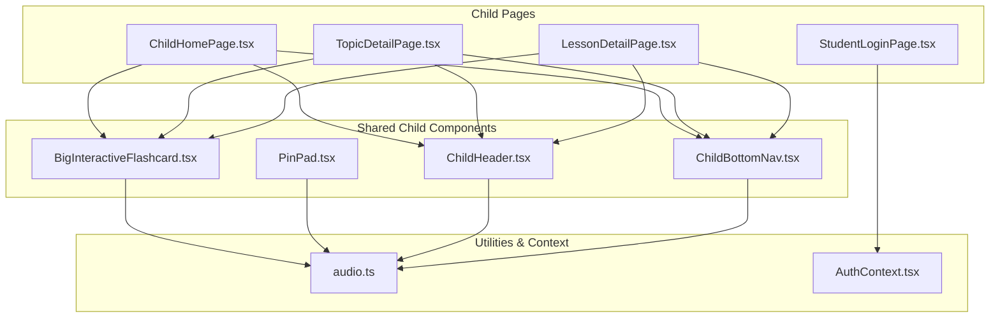
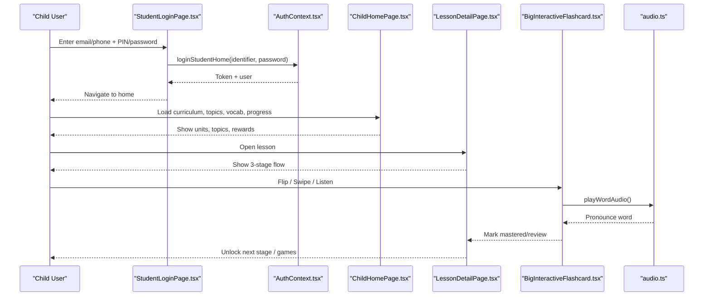
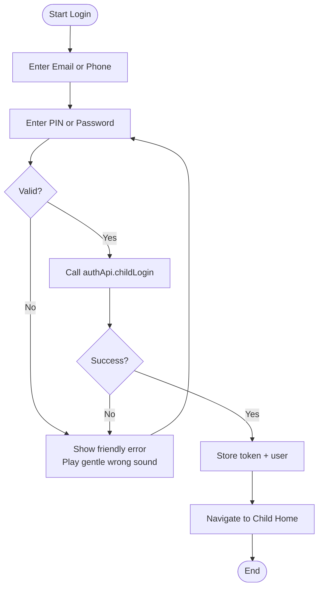
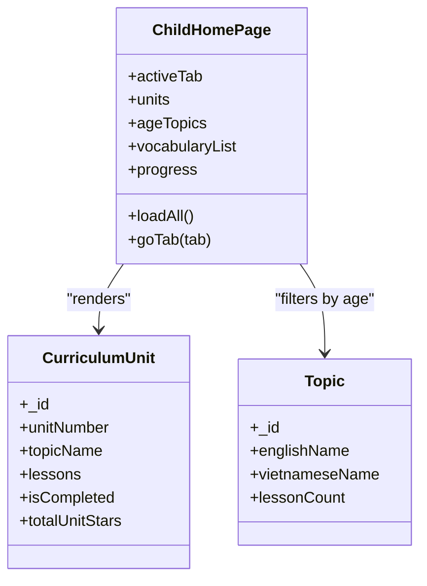
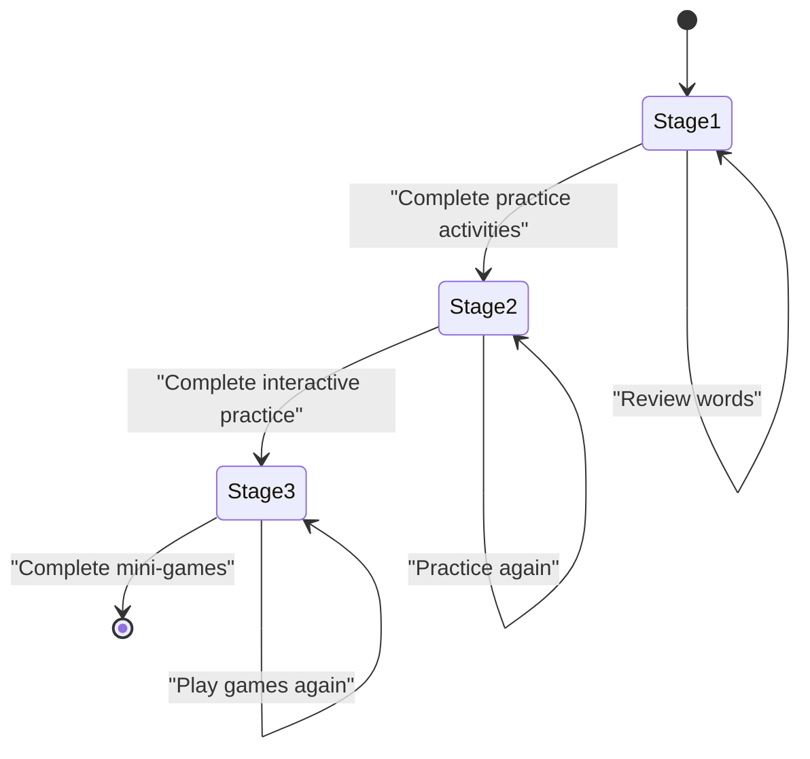
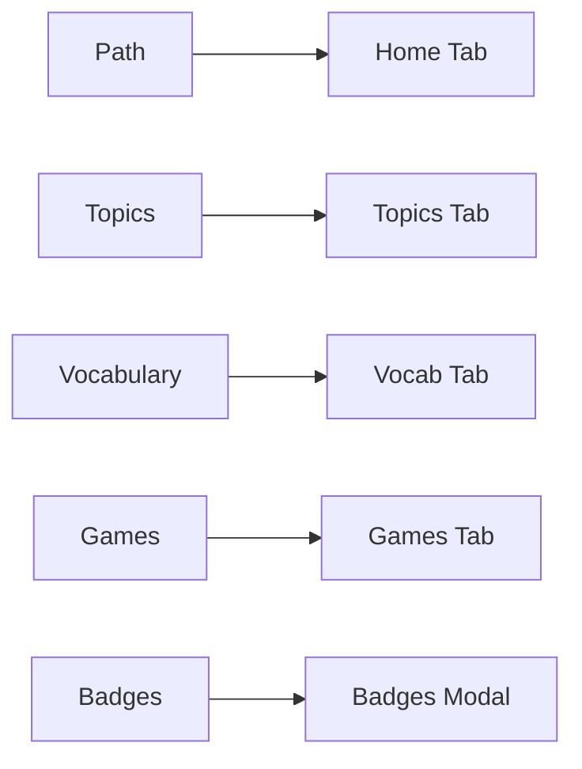
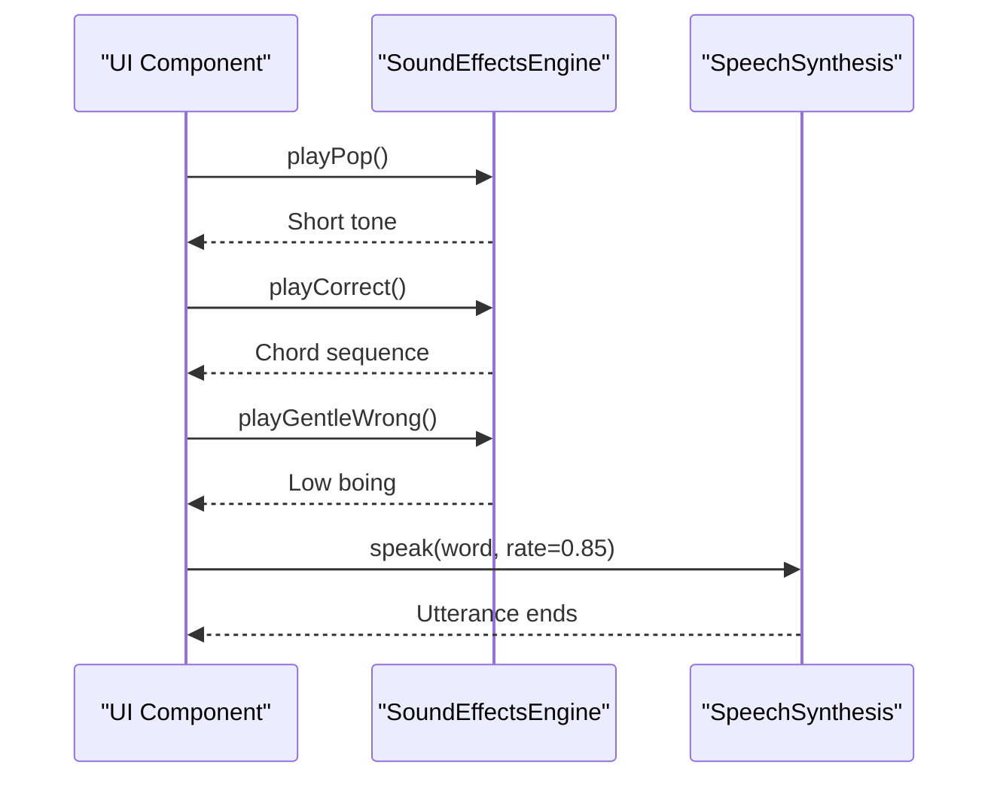
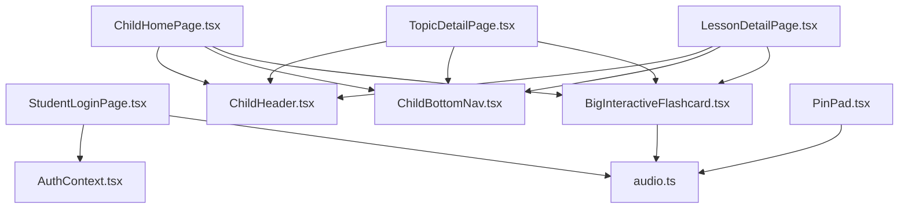

# Child Learning Interface

<cite>
**Referenced Files in This Document**
- [StudentLoginPage.tsx](file://client/src/pages/child/StudentLoginPage.tsx)
- [PinPad.tsx](file://client/src/components/child/PinPad.tsx)
- [ChildHomePage.tsx](file://client/src/pages/child/ChildHomePage.tsx)
- [LessonDetailPage.tsx](file://client/src/pages/child/LessonDetailPage.tsx)
- [TopicDetailPage.tsx](file://client/src/pages/child/TopicDetailPage.tsx)
- [BigInteractiveFlashcard.tsx](file://client/src/components/child/BigInteractiveFlashcard.tsx)
- [ChildHeader.tsx](file://client/src/components/child/ChildHeader.tsx)
- [ChildBottomNav.tsx](file://client/src/components/child/ChildBottomNav.tsx)
- [audio.ts](file://client/src/utils/audio.ts)
- [AuthContext.tsx](file://client/src/context/AuthContext.tsx)
</cite>

## Table of Contents
1. [Introduction](#introduction)
2. [Project Structure](#project-structure)
3. [Core Components](#core-components)
4. [Architecture Overview](#architecture-overview)
5. [Detailed Component Analysis](#detailed-component-analysis)
6. [Dependency Analysis](#dependency-analysis)
7. [Performance Considerations](#performance-considerations)
8. [Troubleshooting Guide](#troubleshooting-guide)
9. [Conclusion](#conclusion)

## Introduction
This document explains the child learning interface designed for children aged 3–6. It covers the PIN-based authentication flow, home screen navigation, topic selection, lesson progression, responsive design patterns optimized for young learners, bottom navigation and header components, accessibility considerations, audio feedback integration, visual reward systems, and performance strategies for smooth animations and transitions.

The system emphasizes large touch targets, bright colors, clear icons, encouraging feedback, and age-appropriate difficulty gating so that preschoolers can explore English vocabulary and activities independently while staying safe and engaged.

## Project Structure
The child-facing UI is implemented as React components under the client application:

- Pages:
  - Student login page with email/phone lookup and password entry.
  - Child home page showing curriculum path, topics, vocabulary notebook, games, and rewards.
  - Topic detail page with interactive flashcards.
  - Lesson detail page with a three-stage learning flow: learn, practice, play.

- Shared child components:
  - Header and bottom navigation for consistent navigation across pages.
  - Big interactive flashcard component for swipeable, flipable vocabulary cards.
  - PIN pad for simple numeric input.
  - Audio utilities for sound effects and word pronunciation.

**Diagram sources**
- [StudentLoginPage.tsx:1-461](file://client/src/pages/child/StudentLoginPage.tsx#L1-L461)
- [ChildHomePage.tsx:1-800](file://client/src/pages/child/ChildHomePage.tsx#L1-L800)
- [TopicDetailPage.tsx:1-247](file://client/src/pages/child/TopicDetailPage.tsx#L1-L247)
- [LessonDetailPage.tsx:1-590](file://client/src/pages/child/LessonDetailPage.tsx#L1-L590)
- [ChildHeader.tsx:1-263](file://client/src/components/child/ChildHeader.tsx#L1-L263)
- [ChildBottomNav.tsx:1-121](file://client/src/components/child/ChildBottomNav.tsx#L1-L121)
- [BigInteractiveFlashcard.tsx:1-628](file://client/src/components/child/BigInteractiveFlashcard.tsx#L1-L628)
- [PinPad.tsx:1-101](file://client/src/components/child/PinPad.tsx#L1-L101)
- [audio.ts:1-360](file://client/src/utils/audio.ts#L1-L360)
- [AuthContext.tsx:1-161](file://client/src/context/AuthContext.tsx#L1-L161)

**Section sources**
- [StudentLoginPage.tsx:1-461](file://client/src/pages/child/StudentLoginPage.tsx#L1-L461)
- [ChildHomePage.tsx:1-800](file://client/src/pages/child/ChildHomePage.tsx#L1-L800)
- [TopicDetailPage.tsx:1-247](file://client/src/pages/child/TopicDetailPage.tsx#L1-L247)
- [LessonDetailPage.tsx:1-590](file://client/src/pages/child/LessonDetailPage.tsx#L1-L590)
- [ChildHeader.tsx:1-263](file://client/src/components/child/ChildHeader.tsx#L1-L263)
- [ChildBottomNav.tsx:1-121](file://client/src/components/child/ChildBottomNav.tsx#L1-L121)
- [BigInteractiveFlashcard.tsx:1-628](file://client/src/components/child/BigInteractiveFlashcard.tsx#L1-L628)
- [PinPad.tsx:1-101](file://client/src/components/child/PinPad.tsx#L1-L101)
- [audio.ts:1-360](file://client/src/utils/audio.ts#L1-L360)
- [AuthContext.tsx:1-161](file://client/src/context/AuthContext.tsx#L1-L161)

## Core Components
- Student login page: Provides email or phone identifier input, password field, quick demo accounts for different age groups, and a parent phone lookup modal to find student accounts. It integrates audio feedback and guides users with friendly error messages.
- PIN pad: A four-digit numeric keypad with large buttons, bubble indicators, gentle error feedback, and automatic clearing on errors. Designed for small hands and early numeracy skills.
- Child home page: Displays curriculum units, age-scoped topics, vocabulary notebook, arcade-style games, and reward sections (badges and stickers). It loads data scoped by the child’s age group and shows progress metrics like stars and completed lessons.
- Lesson detail page: Implements a three-stage learning flow:
  - Stage 1: Learn new words via big interactive flashcards.
  - Stage 2: Interactive practice studio for reinforcement.
  - Stage 3: Age-appropriate mini-games that award stars and stickers.
- Topic detail page: Presents curated vocabulary for a topic with swipeable flashcards, mastery tracking, and quick actions to play games or explore other topics.
- Big interactive flashcard: Supports flipping, swiping left/right, audio playback, speaking-along prompts, mastery/review tracking, and completion summaries.
- Child header and bottom navigation: Provide consistent top-level navigation, star jar counter, profile access, logout, and mobile-friendly tab switching.
- Audio utilities: Centralized sound effects engine and word pronunciation helpers with speech synthesis fallbacks and safety controls.
- Auth context: Manages user session, token persistence, role handling, and vocabulary mastery synchronization for child users.

**Section sources**
- [StudentLoginPage.tsx:1-461](file://client/src/pages/child/StudentLoginPage.tsx#L1-L461)
- [PinPad.tsx:1-101](file://client/src/components/child/PinPad.tsx#L1-L101)
- [ChildHomePage.tsx:1-800](file://client/src/pages/child/ChildHomePage.tsx#L1-L800)
- [LessonDetailPage.tsx:1-590](file://client/src/pages/child/LessonDetailPage.tsx#L1-L590)
- [TopicDetailPage.tsx:1-247](file://client/src/pages/child/TopicDetailPage.tsx#L1-L247)
- [BigInteractiveFlashcard.tsx:1-628](file://client/src/components/child/BigInteractiveFlashcard.tsx#L1-L628)
- [ChildHeader.tsx:1-263](file://client/src/components/child/ChildHeader.tsx#L1-L263)
- [ChildBottomNav.tsx:1-121](file://client/src/components/child/ChildBottomNav.tsx#L1-L121)
- [audio.ts:1-360](file://client/src/utils/audio.ts#L1-L360)
- [AuthContext.tsx:1-161](file://client/src/context/AuthContext.tsx#L1-L161)

## Architecture Overview
The child learning interface follows a layered architecture:

- Presentation layer:
  - Pages render content based on route parameters and active tabs.
  - Shared components provide reusable UI patterns (header, bottom nav, flashcards, PIN pad).
- State and session layer:
  - AuthContext manages user state, tokens, and vocabulary mastery sync.
  - Local storage persists tokens and user profiles; lesson stage progress is stored locally per child and lesson.
- Data layer:
  - API services fetch curriculum paths, topics, vocabulary, and progress scoped by age group.
- Audio layer:
  - Sound effects and word pronunciation are centralized to ensure consistent feedback and accessibility.

**Diagram sources**
- [StudentLoginPage.tsx:51-63](file://client/src/pages/child/StudentLoginPage.tsx#L51-L63)
- [AuthContext.tsx:75-85](file://client/src/context/AuthContext.tsx#L75-L85)
- [ChildHomePage.tsx:117-169](file://client/src/pages/child/ChildHomePage.tsx#L117-L169)
- [LessonDetailPage.tsx:46-89](file://client/src/pages/child/LessonDetailPage.tsx#L46-L89)
- [BigInteractiveFlashcard.tsx:164-170](file://client/src/components/child/BigInteractiveFlashcard.tsx#L164-L170)
- [audio.ts:217-284](file://client/src/utils/audio.ts#L217-L284)

## Detailed Component Analysis

### PIN-Based Authentication System
The child authentication supports two flows:

- Email/Phone + Password:
  - The login page accepts an identifier (email or phone) and a PIN/password.
  - On success, it stores tokens and navigates to the child home page.
  - Friendly error messages and audio feedback guide the child and parents.

- Parent Phone Lookup:
  - Parents can enter their registered phone number to find linked student accounts.
  - Results display child name, email, class, and avatar, allowing quick selection.

Security considerations:
- Credentials are sent through the backend authentication API.
- Tokens are stored securely in local storage and used to verify sessions.
- The PIN pad enforces a four-digit numeric input with immediate feedback and auto-clearing on errors.

Age-appropriate UI patterns:
- Large, colorful buttons with clear labels.
- Encouraging mascot interactions and positive sound effects.
- Simple error messaging without shaming language.

**Diagram sources**
- [StudentLoginPage.tsx:51-63](file://client/src/pages/child/StudentLoginPage.tsx#L51-L63)
- [AuthContext.tsx:75-85](file://client/src/context/AuthContext.tsx#L75-L85)
- [PinPad.tsx:14-41](file://client/src/components/child/PinPad.tsx#L14-L41)

**Section sources**
- [StudentLoginPage.tsx:51-63](file://client/src/pages/child/StudentLoginPage.tsx#L51-L63)
- [StudentLoginPage.tsx:67-78](file://client/src/pages/child/StudentLoginPage.tsx#L67-L78)
- [StudentLoginPage.tsx:335-457](file://client/src/pages/child/StudentLoginPage.tsx#L335-L457)
- [PinPad.tsx:11-41](file://client/src/components/child/PinPad.tsx#L11-L41)
- [AuthContext.tsx:75-85](file://client/src/context/AuthContext.tsx#L75-L85)

### Home Screen Navigation and Topic Selection
The child home page organizes content into tabs:

- Path (Curriculum): Shows nine units with unlock conditions, progress, and theme badges. Clicking an unlocked unit opens a detailed modal with stepping stones and lesson lists.
- Topics: Displays age-scoped topic cards with icons, lesson counts, and navigation to topic detail pages.
- Vocabulary Notebook: Tracks learned and review words using mastery service.
- Games/Arcade: Standalone vocabulary games aligned with the child’s age group.
- Badges/Stickers: Reward showcase with filters and rarity categories.

Responsive design principles:
- Large cards with bold borders and gradients.
- Clear status badges (unlocked, completed, exploring).
- Touch-friendly buttons with hover and active states.
- Compact banner with mascot, stars, and completed lessons count.

**Diagram sources**
- [ChildHomePage.tsx:62-169](file://client/src/pages/child/ChildHomePage.tsx#L62-L169)
- [ChildHomePage.tsx:228-410](file://client/src/pages/child/ChildHomePage.tsx#L228-L410)
- [ChildHomePage.tsx:414-500](file://client/src/pages/child/ChildHomePage.tsx#L414-L500)

**Section sources**
- [ChildHomePage.tsx:62-169](file://client/src/pages/child/ChildHomePage.tsx#L62-L169)
- [ChildHomePage.tsx:228-410](file://client/src/pages/child/ChildHomePage.tsx#L228-L410)
- [ChildHomePage.tsx:414-500](file://client/src/pages/child/ChildHomePage.tsx#L414-L500)
- [ChildHomePage.tsx:503-748](file://client/src/pages/child/ChildHomePage.tsx#L503-L748)

### Lesson Progression System
The lesson detail page implements a sequential three-stage flow:

- Stage 1: Learn new words via flashcards. Completion unlocks Stage 2.
- Stage 2: Interactive practice studio. Completion unlocks Stage 3.
- Stage 3: Mini-games tailored to the child’s age group. Completing all games awards stars and stickers.

Progress persistence:
- Stage flags and active stage are stored in local storage keyed by child ID and lesson ID.
- Activities track completion and stars; game types are filtered by age group.

Accessibility and engagement:
- Large stepper buttons with clear icons and color coding.
- Encouraging mascot speech bubbles and celebratory sounds.
- Visual lock notices when attempting to skip stages.

**Diagram sources**
- [LessonDetailPage.tsx:119-159](file://client/src/pages/child/LessonDetailPage.tsx#L119-L159)
- [LessonDetailPage.tsx:209-321](file://client/src/pages/child/LessonDetailPage.tsx#L209-L321)
- [LessonDetailPage.tsx:323-562](file://client/src/pages/child/LessonDetailPage.tsx#L323-L562)

**Section sources**
- [LessonDetailPage.tsx:46-89](file://client/src/pages/child/LessonDetailPage.tsx#L46-L89)
- [LessonDetailPage.tsx:95-134](file://client/src/pages/child/LessonDetailPage.tsx#L95-L134)
- [LessonDetailPage.tsx:135-159](file://client/src/pages/child/LessonDetailPage.tsx#L135-L159)
- [LessonDetailPage.tsx:209-321](file://client/src/pages/child/LessonDetailPage.tsx#L209-L321)
- [LessonDetailPage.tsx:323-562](file://client/src/pages/child/LessonDetailPage.tsx#L323-L562)

### Responsive Design Principles for Young Children
Key patterns observed across components:

- Large touch targets:
  - Buttons use generous padding, rounded corners, and clear labels.
  - Keypad digits and action buttons are oversized for small fingers.

- Bright colors and high contrast:
  - Gradients and pastel backgrounds create a playful environment.
  - Status badges use distinct colors for clarity (amber, emerald, purple, sky).

- Intuitive navigation:
  - Bottom navigation uses icons and short labels.
  - Header provides persistent navigation and star jar counter.

- Encouraging feedback:
  - Mascot animations and speech bubbles.
  - Positive sound effects for correct actions and gentle tones for mistakes.

- Accessibility features:
  - Aria labels on toggle buttons and navigation elements.
  - Clear instructions and hints for interactions (flip, swipe, listen).

**Section sources**
- [PinPad.tsx:45-97](file://client/src/components/child/PinPad.tsx#L45-L97)
- [ChildHeader.tsx:62-154](file://client/src/components/child/ChildHeader.tsx#L62-L154)
- [ChildBottomNav.tsx:46-108](file://client/src/components/child/ChildBottomNav.tsx#L46-L108)
- [BigInteractiveFlashcard.tsx:302-323](file://client/src/components/child/BigInteractiveFlashcard.tsx#L302-L323)

### Bottom Navigation Pattern
The bottom navigation provides five primary destinations:

- Path (curriculum journey)
- Topics
- Vocabulary
- Games
- Badges

Behavior:
- Active tab highlighting with color-coded backgrounds and rings.
- Plays pop sound on navigation.
- On desktop, navigation is also available in the header; bottom nav is hidden.

**Diagram sources**
- [ChildBottomNav.tsx:26-42](file://client/src/components/child/ChildBottomNav.tsx#L26-L42)
- [ChildBottomNav.tsx:46-108](file://client/src/components/child/ChildBottomNav.tsx#L46-L108)

**Section sources**
- [ChildBottomNav.tsx:1-121](file://client/src/components/child/ChildBottomNav.tsx#L1-L121)

### Header Components
The header includes:

- Brand logo and mascot.
- Desktop navigation links for Path, Topics, Vocabulary, Games, Badges.
- Assigned class badge showing book and age label.
- Star jar counter opening badges modal.
- Profile pill linking to badges modal.
- Change PIN button navigating to change pin page.
- Logout button for switching accounts.

It ensures sticky positioning, overflow scrolling on small screens, and consistent styling across devices.

**Section sources**
- [ChildHeader.tsx:1-263](file://client/src/components/child/ChildHeader.tsx#L1-L263)

### Page-Specific Layouts
- Student login page: Two-column layout with mascot/tagline panel and login form card. Includes quick demo accounts and parent lookup modal.
- Child home page: Banner with mascot and stats, followed by tabbed content sections.
- Topic detail page: Hero banner with mascot and instructions, flashcard section, and quick action buttons.
- Lesson detail page: Back button, lesson header, three-stage stepper, and stage-specific content areas.

**Section sources**
- [StudentLoginPage.tsx:83-330](file://client/src/pages/child/StudentLoginPage.tsx#L83-L330)
- [ChildHomePage.tsx:187-225](file://client/src/pages/child/ChildHomePage.tsx#L187-L225)
- [TopicDetailPage.tsx:89-169](file://client/src/pages/child/TopicDetailPage.tsx#L89-L169)
- [LessonDetailPage.tsx:169-207](file://client/src/pages/child/LessonDetailPage.tsx#L169-L207)

### Accessibility Features
- Aria labels on interactive elements such as show/hide password, logout, and back buttons.
- Clear instructional text for gestures (flip, swipe directions).
- High-contrast badges and readable fonts.
- Audio feedback integrated throughout to support non-readers and early learners.

**Section sources**
- [StudentLoginPage.tsx:244-251](file://client/src/pages/child/StudentLoginPage.tsx#L244-L251)
- [ChildHeader.tsx:225-246](file://client/src/components/child/ChildHeader.tsx#L225-L246)
- [BigInteractiveFlashcard.tsx:541-556](file://client/src/components/child/BigInteractiveFlashcard.tsx#L541-L556)

### Audio Feedback Integration
The audio utility provides:

- Sound effects engine with pop, correct, gentle wrong, star fanfare, and badge chime.
- Word pronunciation with HTML5 audio and speech synthesis fallback.
- Safety controls to stop overlapping audio and handle browser autoplay restrictions.
- Slow pronunciation mode for phonics practice.

Integration points:
- Pin pad plays pop on digit entry and gentle wrong on error.
- Flashcards play word audio on flip and speak-along prompts.
- Navigation and interactions trigger pop sounds for tactile feedback.

**Diagram sources**
- [audio.ts:40-179](file://client/src/utils/audio.ts#L40-L179)
- [audio.ts:217-318](file://client/src/utils/audio.ts#L217-L318)
- [PinPad.tsx:14-41](file://client/src/components/child/PinPad.tsx#L14-L41)
- [BigInteractiveFlashcard.tsx:164-170](file://client/src/components/child/BigInteractiveFlashcard.tsx#L164-L170)

**Section sources**
- [audio.ts:1-360](file://client/src/utils/audio.ts#L1-L360)
- [PinPad.tsx:14-41](file://client/src/components/child/PinPad.tsx#L14-L41)
- [BigInteractiveFlashcard.tsx:50-61](file://client/src/components/child/BigInteractiveFlashcard.tsx#L50-L61)

### Visual Reward Systems
Rewards include:

- Stars: Accumulated from lesson completion and game performance.
- Badges: Categorized by journey, stars, and skills; progress bars indicate requirements.
- Stickers: Rarity-filtered collection with common, rare, epic, and legendary tiers.

Engagement patterns:
- Animated mascot and sparkles.
- Celebration sounds on achievements.
- Modals showcasing earned rewards and encouraging continued learning.

**Section sources**
- [ChildHomePage.tsx:521-748](file://client/src/pages/child/ChildHomePage.tsx#L521-L748)
- [LessonDetailPage.tsx:434-562](file://client/src/pages/child/LessonDetailPage.tsx#L434-L562)

## Dependency Analysis
Component dependencies and relationships:

- StudentLoginPage depends on AuthContext for login flow and audio for feedback.
- ChildHomePage depends on API services for curriculum, topics, vocabulary, and progress; integrates header, bottom nav, flashcards, and reward modals.
- TopicDetailPage depends on API services and flashcard component for vocabulary exploration.
- LessonDetailPage depends on API services, header, bottom nav, flashcards, and practice studio; manages stage progression and local storage.
- BigInteractiveFlashcard depends on audio utilities and vocabulary mastery service.
- ChildHeader and ChildBottomNav depend on routing, auth context, and audio.

**Diagram sources**
- [StudentLoginPage.tsx:18-21](file://client/src/pages/child/StudentLoginPage.tsx#L18-L21)
- [ChildHomePage.tsx:15-31](file://client/src/pages/child/ChildHomePage.tsx#L15-L31)
- [TopicDetailPage.tsx:4-12](file://client/src/pages/child/TopicDetailPage.tsx#L4-L12)
- [LessonDetailPage.tsx:14-22](file://client/src/pages/child/LessonDetailPage.tsx#L14-L22)
- [BigInteractiveFlashcard.tsx:11-14](file://client/src/components/child/BigInteractiveFlashcard.tsx#L11-L14)
- [PinPad.tsx:1-3](file://client/src/components/child/PinPad.tsx#L1-L3)

**Section sources**
- [StudentLoginPage.tsx:18-21](file://client/src/pages/child/StudentLoginPage.tsx#L18-L21)
- [ChildHomePage.tsx:15-31](file://client/src/pages/child/ChildHomePage.tsx#L15-L31)
- [TopicDetailPage.tsx:4-12](file://client/src/pages/child/TopicDetailPage.tsx#L4-L12)
- [LessonDetailPage.tsx:14-22](file://client/src/pages/child/LessonDetailPage.tsx#L14-L22)
- [BigInteractiveFlashcard.tsx:11-14](file://client/src/components/child/BigInteractiveFlashcard.tsx#L11-L14)
- [PinPad.tsx:1-3](file://client/src/components/child/PinPad.tsx#L1-L3)

## Performance Considerations
Optimization strategies observed and recommended:

- Audio safety:
  - Stop overlapping word audio and cancel speech synthesis to prevent conflicts.
  - Use timeouts to handle network stalls and fallback gracefully to speech synthesis.

- Animation efficiency:
  - Use CSS transforms and transitions for smooth drag/swipe animations.
  - Avoid heavy reflows; keep transform-only updates during pointer events.

- Data loading:
  - Fetch curriculum, topics, vocabulary, and progress concurrently using Promise.all.
  - Scope data by age group to reduce unnecessary processing.

- Local storage usage:
  - Persist lesson stage flags and active stage to allow resume without server round-trips.
  - Keep keys scoped by child ID and lesson ID to avoid collisions.

- Touch interaction:
  - Use pointer events for unified mouse/touch handling.
  - Debounce or throttle frequent updates if needed for very low-end devices.

[No sources needed since this section provides general guidance]

## Troubleshooting Guide
Common issues and resolutions:

- Audio not playing:
  - Ensure user interaction has occurred to unlock AudioContext.
  - Check for browser autoplay restrictions; rely on speech synthesis fallback.

- Incorrect PIN or password:
  - Display friendly error messages and play gentle wrong sound.
  - Auto-clear PIN pad after error to encourage retry.

- Locked content:
  - Show lock notices and explain prerequisites (e.g., complete previous unit or stage).
  - Provide encouragement and clear next steps.

- Missing vocabulary or topic data:
  - Fallback to search by topic name if direct association fails.
  - Limit results to age-appropriate sets and cap at reasonable counts.

**Section sources**
- [audio.ts:217-318](file://client/src/utils/audio.ts#L217-L318)
- [PinPad.tsx:32-41](file://client/src/components/child/PinPad.tsx#L32-L41)
- [LessonDetailPage.tsx:314-321](file://client/src/pages/child/LessonDetailPage.tsx#L314-L321)
- [TopicDetailPage.tsx:46-58](file://client/src/pages/child/TopicDetailPage.tsx#L46-L58)

## Conclusion
The child learning interface delivers a safe, engaging, and age-appropriate experience for preschoolers. It combines intuitive navigation, large touch targets, bright visuals, encouraging audio feedback, and structured lesson progression. The PIN-based authentication and parent lookup features balance security with ease of use. Responsive design patterns ensure consistency across devices, while performance optimizations maintain smooth interactions. Rewards like stars, badges, and stickers motivate continued learning, and accessibility features support diverse learners.