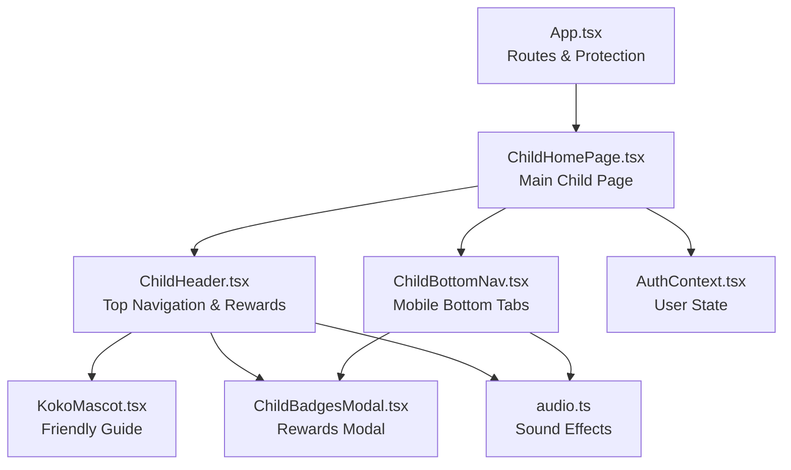
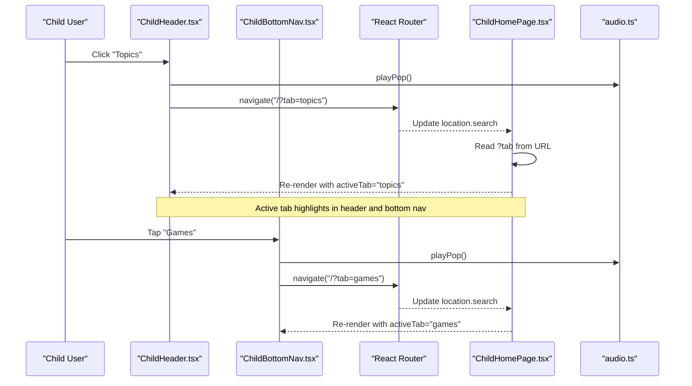
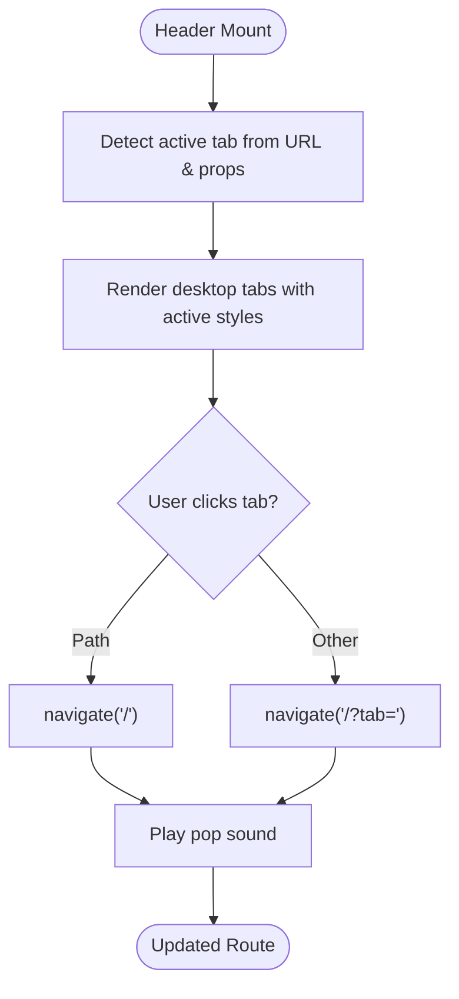
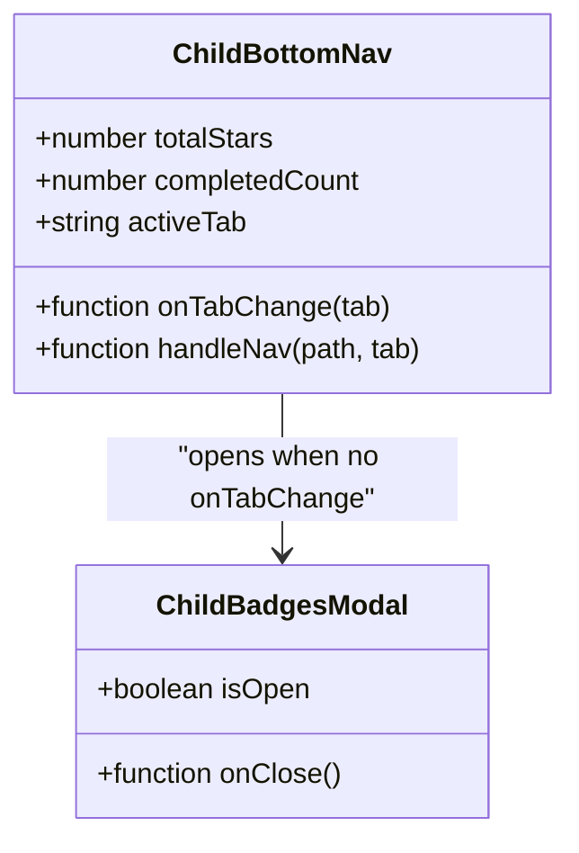
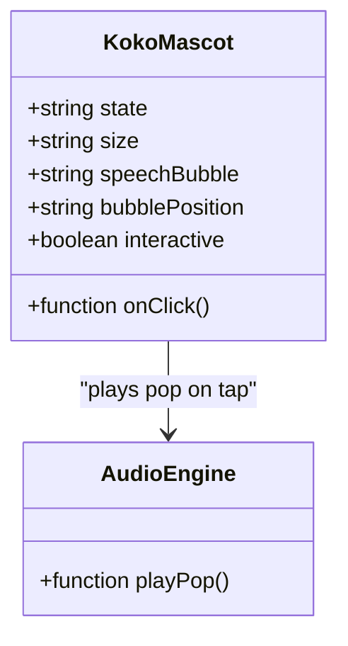
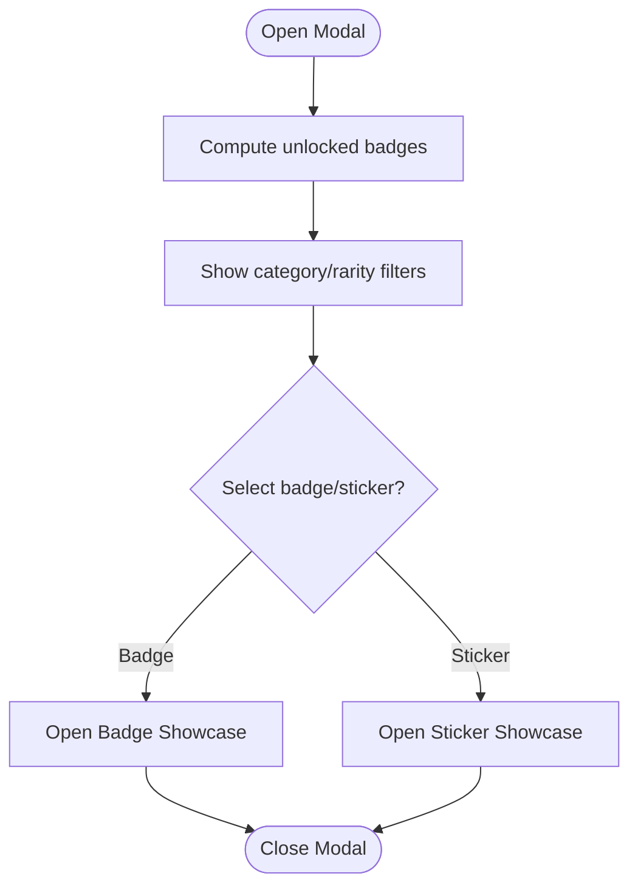
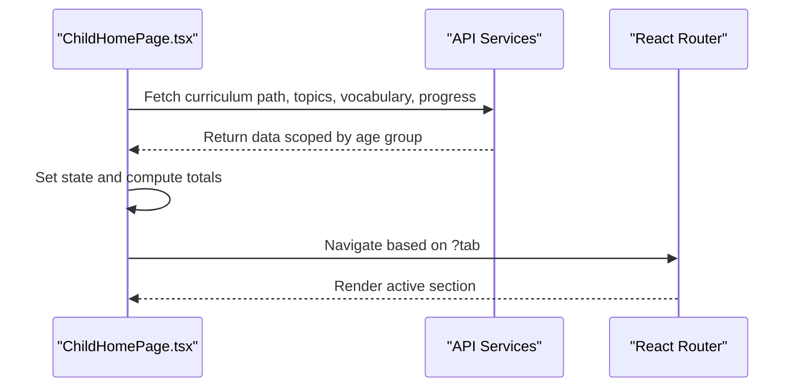
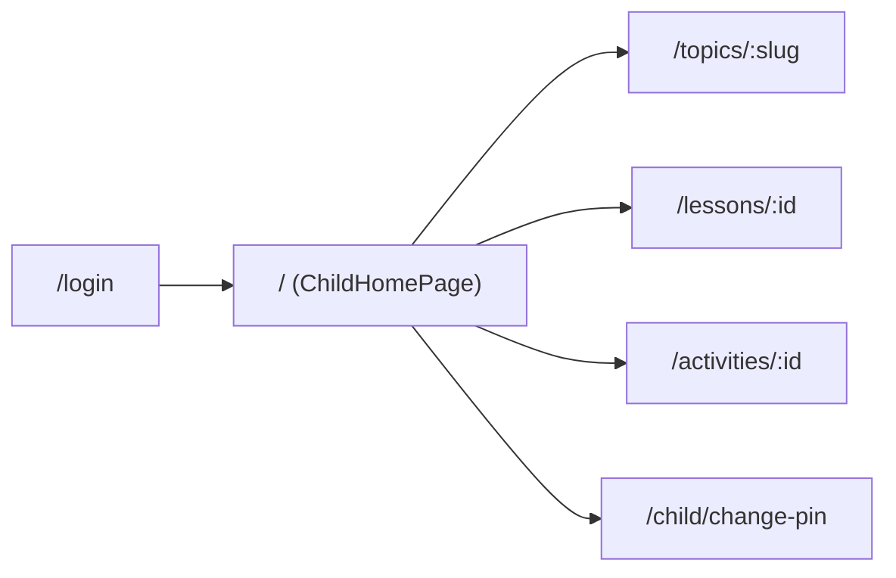
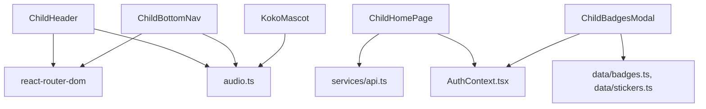

# Child Navigation Components

<cite>
**Referenced Files in This Document**
- [App.tsx](file://client/src/App.tsx)
- [ChildHomePage.tsx](file://client/src/pages/child/ChildHomePage.tsx)
- [ChildHeader.tsx](file://client/src/components/child/ChildHeader.tsx)
- [ChildBottomNav.tsx](file://client/src/components/child/ChildBottomNav.tsx)
- [KokoMascot.tsx](file://client/src/components/child/KokoMascot.tsx)
- [ChildBadgesModal.tsx](file://client/src/components/child/ChildBadgesModal.tsx)
- [AuthContext.tsx](file://client/src/context/AuthContext.tsx)
- [audio.ts](file://client/src/utils/audio.ts)
</cite>

## Table of Contents
1. [Introduction](#introduction)
2. [Project Structure](#project-structure)
3. [Core Components](#core-components)
4. [Architecture Overview](#architecture-overview)
5. [Detailed Component Analysis](#detailed-component-analysis)
6. [Dependency Analysis](#dependency-analysis)
7. [Performance Considerations](#performance-considerations)
8. [Troubleshooting Guide](#troubleshooting-guide)
9. [Conclusion](#conclusion)

## Introduction
This document explains the child-friendly navigation system built for KCEnglishKids. It focuses on:
- The bottom navigation bar optimized for young children with large icons, bright colors, and clear visual hierarchy.
- The header system that shows progress, rewards, profile actions, and route navigation.
- The Koko mascot as a friendly guide element.
- Responsive design principles for touch interaction across mobile, tablet, and desktop.
- Navigation state management using URL query parameters and React Router.
- Accessibility considerations embedded in buttons, labels, and focus behavior.
- Performance optimization strategies for smooth animations and transitions.

The goal is to make navigation intuitive, engaging, and safe for preschool learners while keeping implementation details traceable to the source code.

## Project Structure
The child navigation components live under the client application:
- App-level routing defines protected child routes and mounts the main child home page.
- ChildHomePage composes the header, content sections, and bottom navigation.
- ChildHeader provides top navigation, user info, star counter, and badge modal trigger.
- ChildBottomNav provides mobile-only bottom navigation tabs.
- KokoMascot renders an interactive mascot used throughout the UI.
- ChildBadgesModal displays badges and stickers earned by the child.
- AuthContext manages authentication state and user data.
- Audio utilities provide sound effects and word pronunciation helpers.

**Diagram sources**
- [App.tsx:40-94](file://client/src/App.tsx#L40-L94)
- [ChildHomePage.tsx:18-28](file://client/src/pages/child/ChildHomePage.tsx#L18-L28)
- [ChildHeader.tsx:1-13](file://client/src/components/child/ChildHeader.tsx#L1-L13)
- [ChildBottomNav.tsx:1-13](file://client/src/components/child/ChildBottomNav.tsx#L1-L13)
- [KokoMascot.tsx:1-21](file://client/src/components/child/KokoMascot.tsx#L1-L21)
- [ChildBadgesModal.tsx:1-11](file://client/src/components/child/ChildBadgesModal.tsx#L1-L11)
- [AuthContext.tsx:1-26](file://client/src/context/AuthContext.tsx#L1-L26)
- [audio.ts:1-22](file://client/src/utils/audio.ts#L1-L22)

**Section sources**
- [App.tsx:40-94](file://client/src/App.tsx#L40-L94)
- [ChildHomePage.tsx:18-28](file://client/src/pages/child/ChildHomePage.tsx#L18-L28)

## Core Components
- ChildHeader: Top navigation bar showing brand, age group book, star jar, profile pill, change PIN, logout, and desktop navigation tabs. It also opens the badges modal.
- ChildBottomNav: Mobile-only bottom navigation with five tabs: Journey (path), Topics, Vocabulary, Games, and Badges. Each tab plays a pop sound and navigates or updates local tab state.
- KokoMascot: Interactive mascot with multiple states (waving, happy, thinking, encouraging, celebrating, listening, reading). It can display speech bubbles and responds to taps with gentle animation and sound.
- ChildBadgesModal: Reward showcase for badges and stickers, including category filters, progress bars, and spotlight modals for individual items.
- ChildHomePage: Main page composing header, content sections per active tab, and bottom navigation. It loads curriculum path, topics, vocabulary, and progress scoped by age group.
- AuthContext: Provides user session, login/logout, and role checks. Protected routes ensure only child users access child pages.
- audio.ts: Sound effects engine for playful feedback and word pronunciation helpers with fallbacks.

Key design patterns:
- Large iconography and bold typography for readability.
- Bright color-coded tabs with active states and subtle shadows.
- Touch-friendly spacing and scale interactions.
- URL-based navigation state via `?tab=` query parameter.
- Consistent sound feedback for engagement.

**Section sources**
- [ChildHeader.tsx:15-50](file://client/src/components/child/ChildHeader.tsx#L15-L50)
- [ChildBottomNav.tsx:15-43](file://client/src/components/child/ChildBottomNav.tsx#L15-L43)
- [KokoMascot.tsx:23-48](file://client/src/components/child/KokoMascot.tsx#L23-L48)
- [ChildBadgesModal.tsx:22-44](file://client/src/components/child/ChildBadgesModal.tsx#L22-L44)
- [ChildHomePage.tsx:62-79](file://client/src/pages/child/ChildHomePage.tsx#L62-L79)
- [AuthContext.tsx:30-61](file://client/src/context/AuthContext.tsx#L30-L61)
- [audio.ts:40-63](file://client/src/utils/audio.ts#L40-L63)

## Architecture Overview
The navigation architecture combines React Router for URL-based navigation and component-local state for UI feedback. The header and bottom nav both derive the active tab from the URL search params and props, ensuring consistent state across devices.

**Diagram sources**
- [ChildHeader.tsx:32-49](file://client/src/components/child/ChildHeader.tsx#L32-L49)
- [ChildBottomNav.tsx:26-42](file://client/src/components/child/ChildBottomNav.tsx#L26-L42)
- [ChildHomePage.tsx:67-69](file://client/src/pages/child/ChildHomePage.tsx#L67-L69)
- [audio.ts:40-63](file://client/src/utils/audio.ts#L40-L63)

## Detailed Component Analysis

### ChildHeader Analysis
Responsibilities:
- Display brand logo and mini Koko mascot.
- Show assigned age group book badge.
- Provide clickable star jar counter opening badges modal.
- Provide profile pill, change PIN button, and logout button.
- Render desktop navigation tabs for Path, Topics, Vocabulary, Games, and Badges.
- Manage active tab state based on URL and props.

Implementation highlights:
- Uses `useNavigate` and `useLocation` for routing and current tab detection.
- Plays pop sound on navigation and logout.
- Opens `ChildBadgesModal` when star jar or profile pill is clicked.
- Highlights active tab with distinct colors and 3D-like shadow effects.

Accessibility notes:
- Logout and change PIN buttons include `aria-label`.
- Star jar and profile pill are interactive elements with clear affordances.

**Diagram sources**
- [ChildHeader.tsx:32-49](file://client/src/components/child/ChildHeader.tsx#L32-L49)

**Section sources**
- [ChildHeader.tsx:15-50](file://client/src/components/child/ChildHeader.tsx#L15-L50)
- [ChildHeader.tsx:62-154](file://client/src/components/child/ChildHeader.tsx#L62-L154)
- [ChildHeader.tsx:172-247](file://client/src/components/child/ChildHeader.tsx#L172-L247)

### ChildBottomNav Analysis
Responsibilities:
- Provide mobile-only bottom navigation with five tabs.
- Play pop sound on each tap.
- Navigate to root path or update local tab state via callback.
- Open badges modal if no parent tab handler is provided.

Implementation highlights:
- Derives active tab from URL search params and prop override.
- Uses lucide-react icons for clear visual cues.
- Applies active/inactive styles with color and scale transitions.

Responsive design:
- Fixed at bottom on small screens (`md:hidden`).
- Hidden on larger screens where header tabs suffice.

**Diagram sources**
- [ChildBottomNav.tsx:8-13](file://client/src/components/child/ChildBottomNav.tsx#L8-L13)
- [ChildBottomNav.tsx:95-117](file://client/src/components/child/ChildBottomNav.tsx#L95-L117)

**Section sources**
- [ChildBottomNav.tsx:15-43](file://client/src/components/child/ChildBottomNav.tsx#L15-L43)
- [ChildBottomNav.tsx:44-118](file://client/src/components/child/ChildBottomNav.tsx#L44-L118)

### KokoMascot Analysis
Responsibilities:
- Render SVG mascot illustration with multiple emotional states.
- Support size variants and optional speech bubble positioning.
- Provide interactive tapping with gentle wobble animation and pop sound.

Design for children:
- Friendly expressions and soft colors.
- Optional speech bubble for guidance text.
- Size scaling for different contexts (header, banner, modals).

**Diagram sources**
- [KokoMascot.tsx:13-21](file://client/src/components/child/KokoMascot.tsx#L13-L21)
- [KokoMascot.tsx:34-41](file://client/src/components/child/KokoMascot.tsx#L34-L41)
- [audio.ts:40-63](file://client/src/utils/audio.ts#L40-L63)

**Section sources**
- [KokoMascot.tsx:23-48](file://client/src/components/child/KokoMascot.tsx#L23-L48)
- [KokoMascot.tsx:50-178](file://client/src/components/child/KokoMascot.tsx#L50-L178)

### ChildBadgesModal Analysis
Responsibilities:
- Showcase badges and stickers with category/rarity filters.
- Compute unlock status based on stars, completed lessons, and completed units.
- Provide spotlight modals for individual badges and stickers.
- Integrate with auth context for child ID and sticker service.

Implementation highlights:
- Tab switcher between badges and stickers.
- Progress bars indicating requirement fulfillment.
- Pop sound on open and interactions.

**Diagram sources**
- [ChildBadgesModal.tsx:46-61](file://client/src/components/child/ChildBadgesModal.tsx#L46-L61)
- [ChildBadgesModal.tsx:107-136](file://client/src/components/child/ChildBadgesModal.tsx#L107-L136)
- [ChildBadgesModal.tsx:289-311](file://client/src/components/child/ChildBadgesModal.tsx#L289-L311)

**Section sources**
- [ChildBadgesModal.tsx:22-44](file://client/src/components/child/ChildBadgesModal.tsx#L22-L44)
- [ChildBadgesModal.tsx:66-158](file://client/src/components/child/ChildBadgesModal.tsx#L66-L158)
- [ChildBadgesModal.tsx:160-273](file://client/src/components/child/ChildBadgesModal.tsx#L160-L273)

### ChildHomePage Integration
Responsibilities:
- Compose header, content sections, and bottom navigation.
- Load curriculum path, topics, vocabulary, and progress scoped by age group.
- Manage secret gift modal and unit journey stepping stones modal.
- Handle locked unit clicks with friendly toast messages.

Navigation state:
- Reads `?tab` from URL to render the correct section.
- Calls `goTab` helper to navigate to root or specific tab.

**Diagram sources**
- [ChildHomePage.tsx:116-169](file://client/src/pages/child/ChildHomePage.tsx#L116-L169)
- [ChildHomePage.tsx:177-179](file://client/src/pages/child/ChildHomePage.tsx#L177-L179)

**Section sources**
- [ChildHomePage.tsx:62-79](file://client/src/pages/child/ChildHomePage.tsx#L62-L79)
- [ChildHomePage.tsx:116-169](file://client/src/pages/child/ChildHomePage.tsx#L116-L169)
- [ChildHomePage.tsx:187-218](file://client/src/pages/child/ChildHomePage.tsx#L187-L218)

### Routing and Protection
- App.tsx defines protected child routes and redirects non-child users to login.
- ChildHomePage is mounted at `/` and `/home`.
- Topic, lesson, and activity detail routes are protected.

**Diagram sources**
- [App.tsx:40-94](file://client/src/App.tsx#L40-L94)

**Section sources**
- [App.tsx:17-31](file://client/src/App.tsx#L17-L31)
- [App.tsx:40-94](file://client/src/App.tsx#L40-L94)

## Dependency Analysis
Components interact through props, context, and services:
- ChildHeader and ChildBottomNav depend on React Router for navigation and on audio.ts for sound effects.
- ChildHomePage depends on API services for data and on AuthContext for user state.
- ChildBadgesModal depends on badges/stickers data and auth context.
- KokoMascot depends on audio.ts for interactive feedback.

**Diagram sources**
- [ChildHeader.tsx:1-7](file://client/src/components/child/ChildHeader.tsx#L1-L7)
- [ChildBottomNav.tsx:1-6](file://client/src/components/child/ChildBottomNav.tsx#L1-L6)
- [ChildHomePage.tsx:15-27](file://client/src/pages/child/ChildHomePage.tsx#L15-L27)
- [ChildBadgesModal.tsx:1-11](file://client/src/components/child/ChildBadgesModal.tsx#L1-L11)
- [KokoMascot.tsx:1-2](file://client/src/components/child/KokoMascot.tsx#L1-L2)

**Section sources**
- [ChildHeader.tsx:1-7](file://client/src/components/child/ChildHeader.tsx#L1-L7)
- [ChildBottomNav.tsx:1-6](file://client/src/components/child/ChildBottomNav.tsx#L1-L6)
- [ChildHomePage.tsx:15-27](file://client/src/pages/child/ChildHomePage.tsx#L15-L27)
- [ChildBadgesModal.tsx:1-11](file://client/src/components/child/ChildBadgesModal.tsx#L1-L11)
- [KokoMascot.tsx:1-2](file://client/src/components/child/KokoMascot.tsx#L1-L2)

## Performance Considerations
- Lightweight SVG mascot avoids heavy image assets; animations use CSS transforms and short durations for smoothness.
- Sound effects are generated programmatically with Web Audio API, avoiding large audio files and reducing network overhead.
- Navigation uses React Router’s programmatic navigation to avoid full-page reloads.
- Modal rendering is conditional based on state, minimizing unnecessary DOM.
- Audio playback includes safety timeouts and fallbacks to prevent hanging resources.

Recommendations:
- Keep animations short and GPU-accelerated (transforms, opacity).
- Avoid re-computing expensive lists inside frequently rendered components; memoize derived data where possible.
- Use lazy loading for heavy modals if they grow significantly.
- Ensure audio context is resumed after user gestures to comply with browser policies.

[No sources needed since this section provides general guidance]

## Troubleshooting Guide
Common issues and resolutions:
- Sound not playing:
  - Ensure user has interacted with the page to unlock the audio context.
  - Check browser autoplay policies and confirm `playPop()` is called within a user gesture.
- Navigation not updating active tab:
  - Verify `?tab` query parameter is present and matches expected values.
  - Confirm header and bottom nav derive active tab consistently from URL and props.
- Badges modal not opening:
  - Check modal `isOpen` state and click handlers for star jar/profile pill.
  - Ensure `ChildBadgesModal` receives required props like `totalStars`, `completedCount`, and `childName`.
- Locked unit interactions:
  - Confirm locked unit logic triggers friendly toast and prevents navigation until prerequisites are met.

**Section sources**
- [audio.ts:40-63](file://client/src/utils/audio.ts#L40-L63)
- [ChildHeader.tsx:32-49](file://client/src/components/child/ChildHeader.tsx#L32-L49)
- [ChildBottomNav.tsx:26-42](file://client/src/components/child/ChildBottomNav.tsx#L26-L42)
- [ChildBadgesModal.tsx:38-44](file://client/src/components/child/ChildBadgesModal.tsx#L38-L44)
- [ChildHomePage.tsx:107-114](file://client/src/pages/child/ChildHomePage.tsx#L107-L114)

## Conclusion
The child navigation system in KCEnglishKids emphasizes clarity, engagement, and accessibility for young learners. The header and bottom navigation provide consistent, colorful, and large-tappable destinations. The Koko mascot adds personality and guidance. Navigation state is managed through URL parameters and React Router, ensuring predictable transitions. Sound effects and animations enhance engagement without compromising performance. The modular component structure supports responsive design and easy maintenance.

[No sources needed since this section summarizes without analyzing specific files]