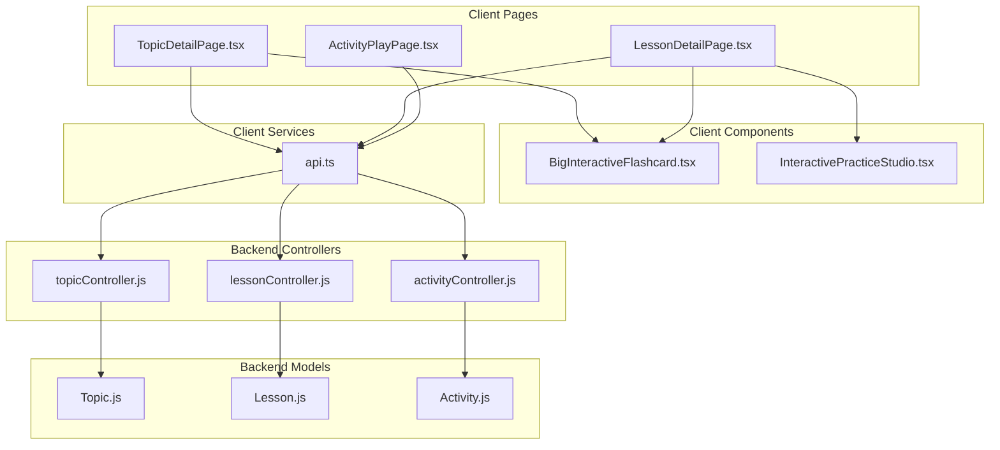
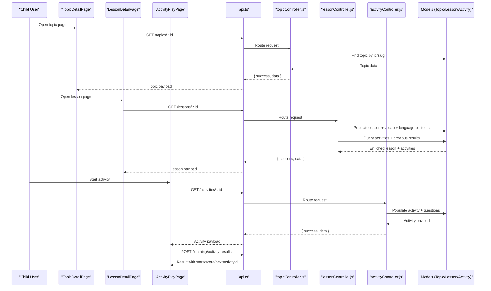
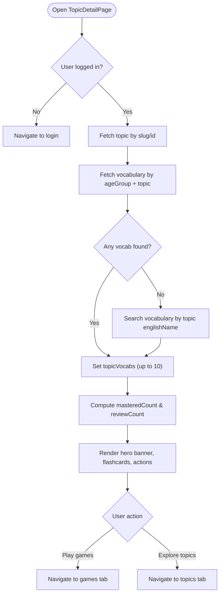
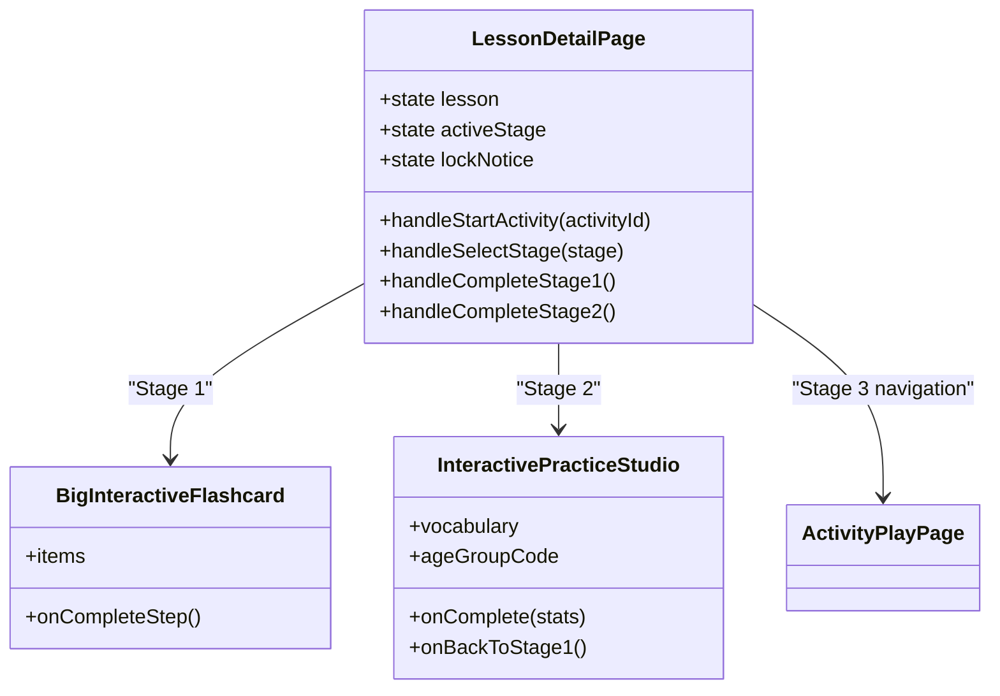
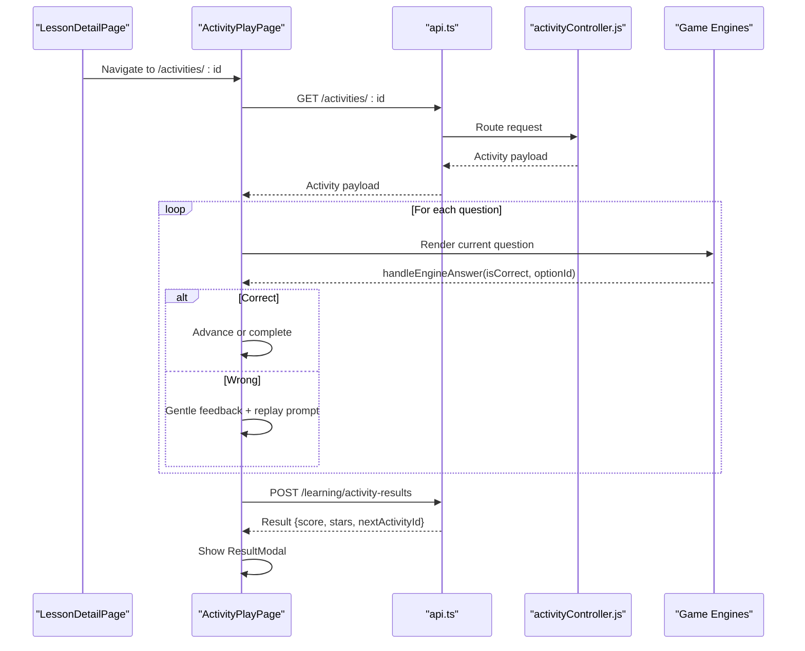
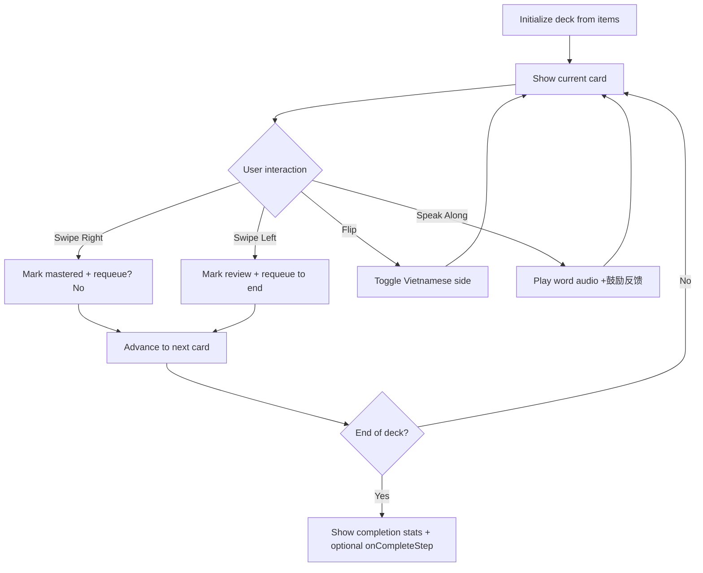
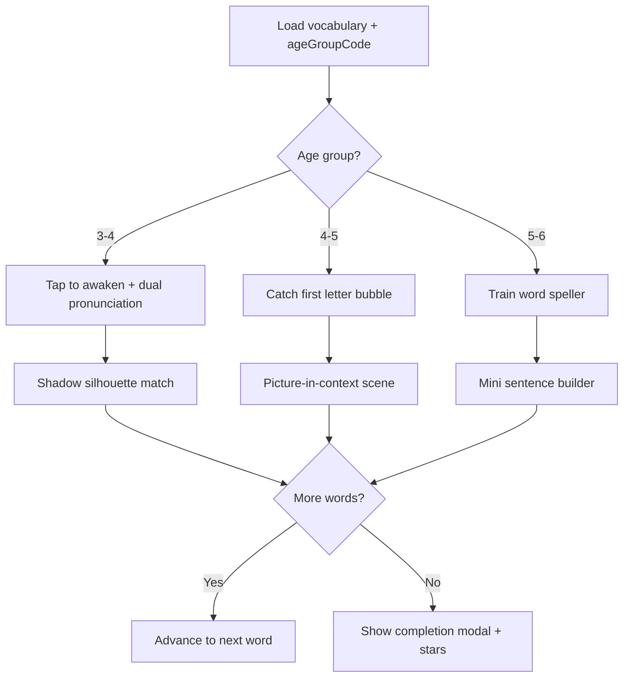
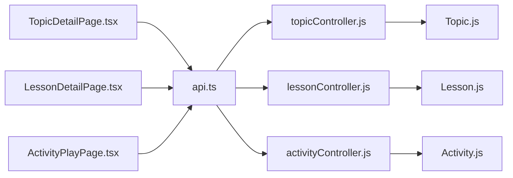

# Child Topic Pages

<cite>
**Referenced Files in This Document**
- [TopicDetailPage.tsx](file://client/src/pages/child/TopicDetailPage.tsx)
- [LessonDetailPage.tsx](file://client/src/pages/child/LessonDetailPage.tsx)
- [ActivityPlayPage.tsx](file://client/src/pages/child/ActivityPlayPage.tsx)
- [BigInteractiveFlashcard.tsx](file://client/src/components/child/BigInteractiveFlashcard.tsx)
- [InteractivePracticeStudio.tsx](file://client/src/components/child/InteractivePracticeStudio.tsx)
- [api.ts](file://client/src/services/api.ts)
- [Topic.js](file://KCEnglishKids_BE/src/models/Topic.js)
- [Lesson.js](file://KCEnglishKids_BE/src/models/Lesson.js)
- [Activity.js](file://KCEnglishKids_BE/src/models/Activity.js)
- [topicController.js](file://KCEnglishKids_BE/src/controllers/topicController.js)
- [lessonController.js](file://KCEnglishKids_BE/src/controllers/lessonController.js)
- [activityController.js](file://KCEnglishKids_BE/src/controllers/activityController.js)
</cite>

## Table of Contents
1. [Introduction](#introduction)
2. [Project Structure](#project-structure)
3. [Core Components](#core-components)
4. [Architecture Overview](#architecture-overview)
5. [Detailed Component Analysis](#detailed-component-analysis)
6. [Dependency Analysis](#dependency-analysis)
7. [Performance Considerations](#performance-considerations)
8. [Troubleshooting Guide](#troubleshooting-guide)
9. [Conclusion](#conclusion)

## Introduction
This document explains the child-facing topic and lesson detail pages that guide children through structured English learning. It covers:
- The topic overview interface showing curated vocabulary, progress indicators, and interactive flashcards.
- The lesson detail page structure with vocabulary preview, practice studio, and age-appropriate mini-games.
- The activity play page hosting interactive games and exercises.
- Content rendering patterns, progress tracking integration, navigation flow, adaptive difficulty, and age-appropriate content delivery.

## Project Structure
The child learning experience is implemented as React pages and reusable components on the client, backed by a Node.js backend that exposes curriculum, lessons, activities, and progress APIs.

**Diagram sources**
- [TopicDetailPage.tsx:1-247](file://client/src/pages/child/TopicDetailPage.tsx#L1-L247)
- [LessonDetailPage.tsx:1-590](file://client/src/pages/child/LessonDetailPage.tsx#L1-L590)
- [ActivityPlayPage.tsx:1-386](file://client/src/pages/child/ActivityPlayPage.tsx#L1-L386)
- [BigInteractiveFlashcard.tsx:1-628](file://client/src/components/child/BigInteractiveFlashcard.tsx#L1-L628)
- [InteractivePracticeStudio.tsx:1-800](file://client/src/components/child/InteractivePracticeStudio.tsx#L1-L800)
- [api.ts:96-158](file://client/src/services/api.ts#L96-L158)
- [Topic.js:1-78](file://KCEnglishKids_BE/src/models/Topic.js#L1-L78)
- [Lesson.js:1-101](file://KCEnglishKids_BE/src/models/Lesson.js#L1-L101)
- [Activity.js:1-176](file://KCEnglishKids_BE/src/models/Activity.js#L1-L176)
- [topicController.js:1-138](file://KCEnglishKids_BE/src/controllers/topicController.js#L1-L138)
- [lessonController.js:1-198](file://KCEnglishKids_BE/src/controllers/lessonController.js#L1-L198)
- [activityController.js:1-30](file://KCEnglishKids_BE/src/controllers/activityController.js#L1-L30)

**Section sources**
- [TopicDetailPage.tsx:1-247](file://client/src/pages/child/TopicDetailPage.tsx#L1-L247)
- [LessonDetailPage.tsx:1-590](file://client/src/pages/child/LessonDetailPage.tsx#L1-L590)
- [ActivityPlayPage.tsx:1-386](file://client/src/pages/child/ActivityPlayPage.tsx#L1-L386)
- [api.ts:96-158](file://client/src/services/api.ts#L96-L158)

## Core Components
- TopicDetailPage: Loads a topic by slug or ID, fetches curated vocabulary for the child’s age group, shows mastery stats, and provides quick actions to play games or explore other topics.
- LessonDetailPage: Presents a three-stage learning path (vocabulary preview, interactive practice, mini-games), enforces age-based game availability, tracks stage completion locally, and navigates to activities.
- ActivityPlayPage: Hosts multiple game engines, auto-plays prompts, records answers, computes scores, submits results, and shows a result modal with next-step navigation.
- BigInteractiveFlashcard: Provides swipe-to-master/review, flip-to-meaning, audio playback, and mastery state visualization.
- InteractivePracticeStudio: Age-adaptive practice flows (shadow matching, phonics catching, train spelling, sentence building) with encouragement and star scoring.

**Section sources**
- [TopicDetailPage.tsx:14-88](file://client/src/pages/child/TopicDetailPage.tsx#L14-L88)
- [LessonDetailPage.tsx:34-167](file://client/src/pages/child/LessonDetailPage.tsx#L34-L167)
- [ActivityPlayPage.tsx:23-100](file://client/src/pages/child/ActivityPlayPage.tsx#L23-L100)
- [BigInteractiveFlashcard.tsx:16-61](file://client/src/components/child/BigInteractiveFlashcard.tsx#L16-L61)
- [InteractivePracticeStudio.tsx:16-50](file://client/src/components/child/InteractivePracticeStudio.tsx#L16-L50)

## Architecture Overview
The child learning flow connects UI pages to backend data models via typed API services.

**Diagram sources**
- [TopicDetailPage.tsx:33-67](file://client/src/pages/child/TopicDetailPage.tsx#L33-L67)
- [LessonDetailPage.tsx:52-89](file://client/src/pages/child/LessonDetailPage.tsx#L52-L89)
- [ActivityPlayPage.tsx:47-76](file://client/src/pages/child/ActivityPlayPage.tsx#L47-L76)
- [api.ts:96-158](file://client/src/services/api.ts#L96-L158)
- [topicController.js:48-70](file://KCEnglishKids_BE/src/controllers/topicController.js#L48-L70)
- [lessonController.js:112-171](file://KCEnglishKids_BE/src/controllers/lessonController.js#L112-L171)
- [activityController.js:6-25](file://KCEnglishKids_BE/src/controllers/activityController.js#L6-L25)

## Detailed Component Analysis

### Topic Detail Page
Purpose:
- Display topic metadata (icon, names, book mapping).
- Load curated vocabulary for the child’s age group.
- Show mastery statistics and provide interactive flashcards.
- Provide quick navigation to games and other topics.

Key behaviors:
- Fetch topic by slug or ID; fallback search vocabulary by topic name if needed.
- Compute mastered and review counts using local mastery service.
- Render BigInteractiveFlashcard with topic vocabulary.
- Navigate to games tab or back to topics list.

**Diagram sources**
- [TopicDetailPage.tsx:27-77](file://client/src/pages/child/TopicDetailPage.tsx#L27-L77)
- [TopicDetailPage.tsx:85-88](file://client/src/pages/child/TopicDetailPage.tsx#L85-L88)
- [TopicDetailPage.tsx:186-238](file://client/src/pages/child/TopicDetailPage.tsx#L186-L238)

**Section sources**
- [TopicDetailPage.tsx:14-88](file://client/src/pages/child/TopicDetailPage.tsx#L14-L88)
- [TopicDetailPage.tsx:89-247](file://client/src/pages/child/TopicDetailPage.tsx#L89-L247)

### Lesson Detail Page
Purpose:
- Present a structured three-stage learning path: vocabulary preview, interactive practice, and mini-games.
- Enforce age-appropriate game types and unlock stages based on completion.
- Persist stage progress locally and compute resume activity.

Key behaviors:
- Load lesson with populated topic, vocabulary items, language contents, and activities.
- Split activities into practice vs games based on age group allowed types.
- Track stage completion flags in localStorage and set active stage accordingly.
- Navigate to activity play page when starting an activity.

**Diagram sources**
- [LessonDetailPage.tsx:34-167](file://client/src/pages/child/LessonDetailPage.tsx#L34-L167)
- [LessonDetailPage.tsx:323-432](file://client/src/pages/child/LessonDetailPage.tsx#L323-L432)
- [LessonDetailPage.tsx:434-562](file://client/src/pages/child/LessonDetailPage.tsx#L434-L562)

Adaptive difficulty and age-appropriate content:
- For age group 3–4, only LISTEN_CHOOSE and COLOR_RECOGNITION are allowed as games; others fall back to practice.
- For older groups, IMAGE_WORD_MATCH, COUNT_OBJECTS, MISSING_OBJECT, MEMORY_CARD are allowed.
- If no explicit games exist, the page selects appropriate fallback activities per age group.

**Section sources**
- [LessonDetailPage.tsx:91-134](file://client/src/pages/child/LessonDetailPage.tsx#L91-L134)
- [LessonDetailPage.tsx:135-167](file://client/src/pages/child/LessonDetailPage.tsx#L135-L167)
- [LessonDetailPage.tsx:169-590](file://client/src/pages/child/LessonDetailPage.tsx#L169-L590)

### Activity Play Page
Purpose:
- Host various interactive games and exercises.
- Auto-play prompt audio, track answer correctness, record response time, and submit results.
- Show progress bar, mascot feedback, and result modal with stars and next activity navigation.

Key behaviors:
- Load activity by ID and populate question index, selected option, feedback state, and recorded answers.
- Determine game engine based on activityType and render corresponding component.
- On correct answer, advance to next question or complete; on wrong answer, gentle retry with audio replay.
- Submit activity result with duration and answers; display result modal with score, stars, and next activity link.

**Diagram sources**
- [ActivityPlayPage.tsx:47-100](file://client/src/pages/child/ActivityPlayPage.tsx#L47-L100)
- [ActivityPlayPage.tsx:108-192](file://client/src/pages/child/ActivityPlayPage.tsx#L108-L192)
- [ActivityPlayPage.tsx:272-351](file://client/src/pages/child/ActivityPlayPage.tsx#L272-L351)
- [ActivityPlayPage.tsx:364-382](file://client/src/pages/child/ActivityPlayPage.tsx#L364-L382)

**Section sources**
- [ActivityPlayPage.tsx:23-100](file://client/src/pages/child/ActivityPlayPage.tsx#L23-L100)
- [ActivityPlayPage.tsx:108-192](file://client/src/pages/child/ActivityPlayPage.tsx#L108-L192)
- [ActivityPlayPage.tsx:209-386](file://client/src/pages/child/ActivityPlayPage.tsx#L209-L386)

### BigInteractiveFlashcard Component
Purpose:
- Provide large, kid-friendly flashcards with swipe gestures to mark “mastered” or “review”.
- Flip cards to reveal Vietnamese meaning and pronunciation.
- Integrate audio playback and encourage speaking along.
- Track session mastery and review counts; re-queue review words at the end of the deck.

Key behaviors:
- Pointer drag detection for swipe thresholds; visual overlays for right/left swipe cues.
- Mastery service integration to persist “mastered” and “review” states per child.
- Completion screen with stats and option to proceed to practice step.

**Diagram sources**
- [BigInteractiveFlashcard.tsx:67-82](file://client/src/components/child/BigInteractiveFlashcard.tsx#L67-L82)
- [BigInteractiveFlashcard.tsx:162-219](file://client/src/components/child/BigInteractiveFlashcard.tsx#L162-L219)
- [BigInteractiveFlashcard.tsx:221-257](file://client/src/components/child/BigInteractiveFlashcard.tsx#L221-L257)
- [BigInteractiveFlashcard.tsx:285-323](file://client/src/components/child/BigInteractiveFlashcard.tsx#L285-L323)
- [BigInteractiveFlashcard.tsx:92-160](file://client/src/components/child/BigInteractiveFlashcard.tsx#L92-L160)

**Section sources**
- [BigInteractiveFlashcard.tsx:16-61](file://client/src/components/child/BigInteractiveFlashcard.tsx#L16-L61)
- [BigInteractiveFlashcard.tsx:67-82](file://client/src/components/child/BigInteractiveFlashcard.tsx#L67-L82)
- [BigInteractiveFlashcard.tsx:92-160](file://client/src/components/child/BigInteractiveFlashcard.tsx#L92-L160)
- [BigInteractiveFlashcard.tsx:162-219](file://client/src/components/child/BigInteractiveFlashcard.tsx#L162-L219)
- [BigInteractiveFlashcard.tsx:221-257](file://client/src/components/child/BigInteractiveFlashcard.tsx#L221-L257)
- [BigInteractiveFlashcard.tsx:285-323](file://client/src/components/child/BigInteractiveFlashcard.tsx#L285-L323)
- [BigInteractiveFlashcard.tsx:558-624](file://client/src/components/child/BigInteractiveFlashcard.tsx#L558-L624)

### InteractivePracticeStudio Component
Purpose:
- Deliver age-adaptive practice activities for vocabulary reinforcement.
- For ages 3–4: shadow silhouette matching after awakening magic egg.
- For ages 4–5: phonics letter catching then picture-in-context scene.
- For ages 5–6: train word speller then mini sentence builder.
- Track stars earned and allow progression to Stage 3 mini-games upon completion.

Key behaviors:
- Age detection determines rendered substeps.
- Encouragement banners and gentle wrong feedback loops.
- Completion modal with star celebration and transition button to games.

**Diagram sources**
- [InteractivePracticeStudio.tsx:63-85](file://client/src/components/child/InteractivePracticeStudio.tsx#L63-L85)
- [InteractivePracticeStudio.tsx:118-204](file://client/src/components/child/InteractivePracticeStudio.tsx#L118-L204)
- [InteractivePracticeStudio.tsx:206-304](file://client/src/components/child/InteractivePracticeStudio.tsx#L206-L304)
- [InteractivePracticeStudio.tsx:306-411](file://client/src/components/child/InteractivePracticeStudio.tsx#L306-L411)
- [InteractivePracticeStudio.tsx:413-511](file://client/src/components/child/InteractivePracticeStudio.tsx#L413-L511)
- [InteractivePracticeStudio.tsx:513-608](file://client/src/components/child/InteractivePracticeStudio.tsx#L513-L608)
- [InteractivePracticeStudio.tsx:610-693](file://client/src/components/child/InteractivePracticeStudio.tsx#L610-L693)

**Section sources**
- [InteractivePracticeStudio.tsx:16-50](file://client/src/components/child/InteractivePracticeStudio.tsx#L16-L50)
- [InteractivePracticeStudio.tsx:63-85](file://client/src/components/child/InteractivePracticeStudio.tsx#L63-L85)
- [InteractivePracticeStudio.tsx:118-204](file://client/src/components/child/InteractivePracticeStudio.tsx#L118-L204)
- [InteractivePracticeStudio.tsx:206-304](file://client/src/components/child/InteractivePracticeStudio.tsx#L206-L304)
- [InteractivePracticeStudio.tsx:306-411](file://client/src/components/child/InteractivePracticeStudio.tsx#L306-L411)
- [InteractivePracticeStudio.tsx:413-511](file://client/src/components/child/InteractivePracticeStudio.tsx#L413-L511)
- [InteractivePracticeStudio.tsx:513-608](file://client/src/components/child/InteractivePracticeStudio.tsx#L513-L608)
- [InteractivePracticeStudio.tsx:610-693](file://client/src/components/child/InteractivePracticeStudio.tsx#L610-L693)

## Dependency Analysis
Frontend dependencies:
- TopicDetailPage depends on api.ts for topics and vocabulary endpoints, and uses BigInteractiveFlashcard for vocabulary exploration.
- LessonDetailPage depends on api.ts for lessons and activities, integrates BigInteractiveFlashcard and InteractivePracticeStudio, and navigates to ActivityPlayPage.
- ActivityPlayPage depends on api.ts for activities and learning submission, and renders specific game engines based on activityType.

Backend dependencies:
- topicController.js queries Topic model and enriches with lesson counts and progress when childId is provided.
- lessonController.js populates Lesson with topic, vocabularyItems, languageContents, and aggregates Activity results to compute completed flags and resume activity.
- activityController.js returns Activity with populated lesson and questions.

**Diagram sources**
- [TopicDetailPage.tsx:1-247](file://client/src/pages/child/TopicDetailPage.tsx#L1-L247)
- [LessonDetailPage.tsx:1-590](file://client/src/pages/child/LessonDetailPage.tsx#L1-L590)
- [ActivityPlayPage.tsx:1-386](file://client/src/pages/child/ActivityPlayPage.tsx#L1-L386)
- [api.ts:96-158](file://client/src/services/api.ts#L96-L158)
- [topicController.js:1-138](file://KCEnglishKids_BE/src/controllers/topicController.js#L1-L138)
- [lessonController.js:1-198](file://KCEnglishKids_BE/src/controllers/lessonController.js#L1-L198)
- [activityController.js:1-30](file://KCEnglishKids_BE/src/controllers/activityController.js#L1-L30)
- [Topic.js:1-78](file://KCEnglishKids_BE/src/models/Topic.js#L1-L78)
- [Lesson.js:1-101](file://KCEnglishKids_BE/src/models/Lesson.js#L1-L101)
- [Activity.js:1-176](file://KCEnglishKids_BE/src/models/Activity.js#L1-L176)

**Section sources**
- [api.ts:96-158](file://client/src/services/api.ts#L96-L158)
- [topicController.js:1-138](file://KCEnglishKids_BE/src/controllers/topicController.js#L1-L138)
- [lessonController.js:1-198](file://KCEnglishKids_BE/src/controllers/lessonController.js#L1-L198)
- [activityController.js:1-30](file://KCEnglishKids_BE/src/controllers/activityController.js#L1-L30)

## Performance Considerations
- Vocabulary capping: TopicDetailPage limits displayed vocabulary to 10 items to keep the flashcard deck manageable.
- Localized progress: LessonDetailPage persists stage completion flags in localStorage to avoid unnecessary server calls and enable fast resume.
- Audio management: ActivityPlayPage stops and replays prompt audio on question transitions to prevent overlapping sounds.
- Image optimization: Flashcards use lazy loading and object-fit to ensure responsive rendering without layout shifts.
- Backend population: lessonController.js populates only necessary fields (e.g., vocabularyItems, languageContents) to reduce payload size.

[No sources needed since this section provides general guidance]

## Troubleshooting Guide
Common issues and resolutions:
- Topic vocabulary not loading:
  - Ensure the topic has associated vocabulary for the child’s age group; otherwise, the page falls back to searching by topic englishName.
  - Check network requests to `/topics/:id` and `/vocabulary?ageGroup=...&topic=...`.
- Lesson stages locked unexpectedly:
  - Verify localStorage keys `kc_stage1_{childId}_{lessonId}`, `kc_stage2_{childId}_{lessonId}`, and `kc_stage_active_{childId}_{lessonId}` are set correctly after completing steps.
  - Confirm activities have correct `completed` flags returned by the backend.
- Activity audio not playing:
  - Confirm promptAudioUrl exists and audio utilities are initialized; check browser autoplay policies.
- Game engine mismatch:
  - Validate activityType matches one of the supported engines in ActivityPlayPage; otherwise, it defaults to ListenChooseEngine.

**Section sources**
- [TopicDetailPage.tsx:46-58](file://client/src/pages/child/TopicDetailPage.tsx#L46-L58)
- [LessonDetailPage.tsx:59-89](file://client/src/pages/child/LessonDetailPage.tsx#L59-L89)
- [ActivityPlayPage.tsx:80-100](file://client/src/pages/child/ActivityPlayPage.tsx#L80-L100)
- [ActivityPlayPage.tsx:272-351](file://client/src/pages/child/ActivityPlayPage.tsx#L272-L351)

## Conclusion
The child topic and lesson pages deliver a structured, engaging learning journey tailored to different age groups. Topics provide curated vocabulary and mastery insights, lessons guide children through progressive stages of vocabulary preview, interactive practice, and age-appropriate mini-games, and activities host diverse interactive exercises with robust progress tracking. The system balances child-friendly UX with adaptive difficulty and clear navigation flows, ensuring children can explore, learn, and play effectively.

[No sources needed since this section summarizes without analyzing specific files]