# Core Application Structure

<cite>
**Referenced Files in This Document**
- [main.tsx](file://client/src/main.tsx)
- [App.tsx](file://client/src/App.tsx)
- [AuthContext.tsx](file://client/src/context/AuthContext.tsx)
- [api.ts](file://client/src/services/api.ts)
- [vocabMasteryService.ts](file://client/src/services/vocabMasteryService.ts)
- [StudentLoginPage.tsx](file://client/src/pages/child/StudentLoginPage.tsx)
- [TeacherLoginPage.tsx](file://client/src/dashboards/teacher/TeacherLoginPage.tsx)
- [TeacherWorkspace.tsx](file://client/src/dashboards/teacher/TeacherWorkspace.tsx)
- [ChildHomePage.tsx](file://client/src/pages/child/ChildHomePage.tsx)
- [PinPad.tsx](file://client/src/components/child/PinPad.tsx)
- [vite.config.ts](file://client/vite.config.ts)
- [admin App.tsx](file://admin/src/App.tsx)
- [admin main.tsx](file://admin/src/main.tsx)
- [admin vite.config.ts](file://admin/vite.config.ts)
- [admin AuthContext.tsx](file://admin/src/context/AuthContext.tsx)
- [admin api.ts](file://admin/src/services/api.ts)
</cite>

## Table of Contents
1. Introduction
2. Project Structure
3. Core Components
4. Architecture Overview
5. Detailed Component Analysis
6. Dependency Analysis
7. Performance Considerations
8. Troubleshooting Guide
9. Conclusion

## Introduction
This document explains the core application structure of KCEnglishKids, focusing on:
- React bootstrap and routing
- Global state via Context API
- Authentication flows for children (PIN-based) and teachers (role-based access control)
- Service layer architecture for API communication and error handling
- Build configuration with Vite and environment setup
- Component hierarchy, composition patterns, and how child learning and teacher dashboards coexist

## Project Structure
The client is a single-page React application bootstrapped by Vite. The entry point renders the root component, which configures routing and wraps the app with an authentication provider. Routes are split into two user journeys:
- Child portal: PIN or identifier/password login, curriculum path, topics, vocabulary notebook, games, badges/stickers
- Teacher dashboard: role-gated routes for classes, sessions, content, assignments, students

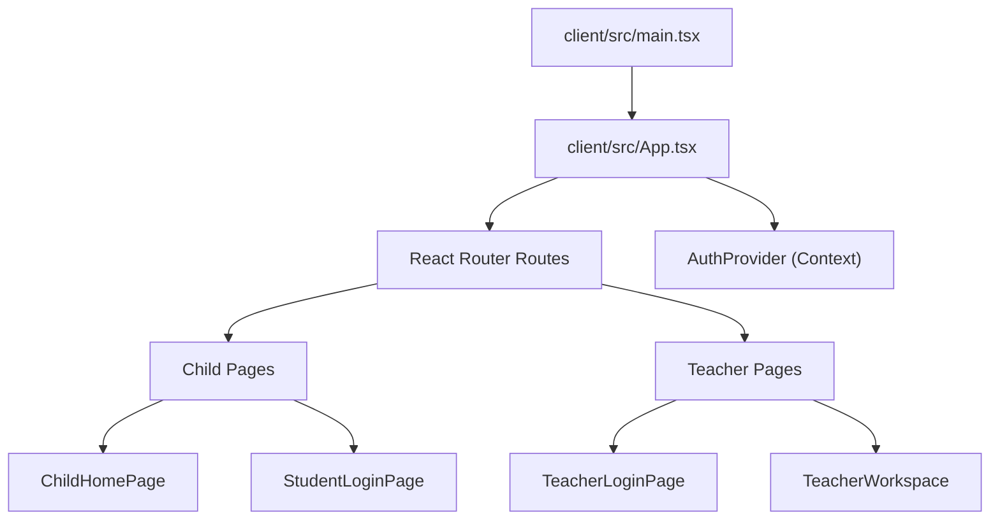

**Diagram sources**
- [main.tsx:1-11](file://client/src/main.tsx#L1-L11)
- [App.tsx:1-134](file://client/src/App.tsx#L1-L134)

**Section sources**
- [main.tsx:1-11](file://client/src/main.tsx#L1-L11)
- [App.tsx:1-134](file://client/src/App.tsx#L1-L134)

## Core Components
- Bootstrap: React 18 createRoot with StrictMode; imports global CSS and the root App component.
- Routing: React Router v6 defines protected child and teacher routes. Role checks redirect unauthorized users.
- Global State: AuthContext provides user session, loading state, and auth methods (login/logout). It persists tokens and user data to localStorage and validates sessions on startup.
- Services: A centralized API module exposes typed endpoints for auth, topics, lessons, activities, learning progress, admin, teacher, classroom sessions, vocabulary mastery, and parent notifications.
- Vocabulary Mastery: A local-first service that tracks word mastery per child, debounced syncs to backend, and integrates with journey/topic vocabularies.

Key responsibilities:
- App.tsx: Route definitions and route guards
- AuthContext.tsx: Session lifecycle, token persistence, role-aware initialization
- services/api.ts: HTTP clients and endpoint grouping
- services/vocabMasteryService.ts: Local storage + background sync for vocabulary mastery

**Section sources**
- [main.tsx:1-11](file://client/src/main.tsx#L1-L11)
- [App.tsx:1-134](file://client/src/App.tsx#L1-L134)
- [AuthContext.tsx:1-161](file://client/src/context/AuthContext.tsx#L1-L161)
- [api.ts:1-354](file://client/src/services/api.ts#L1-L354)
- [vocabMasteryService.ts:1-372](file://client/src/services/vocabMasteryService.ts#L1-L372)

## Architecture Overview
The application uses a layered architecture:
- UI Layer: Pages and components render child and teacher experiences
- State Layer: Context API holds authenticated user and UI state
- Service Layer: Typed API modules encapsulate network calls and error propagation
- Persistence: localStorage stores tokens and user profiles; vocab mastery is persisted locally and synced to backend

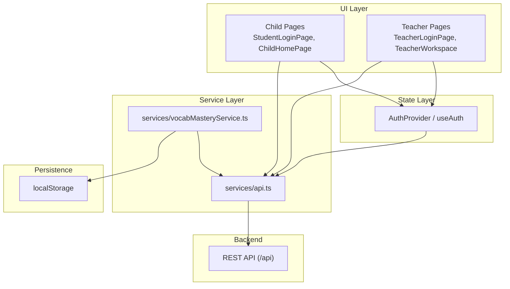

**Diagram sources**
- [App.tsx:1-134](file://client/src/App.tsx#L1-L134)
- [AuthContext.tsx:1-161](file://client/src/context/AuthContext.tsx#L1-L161)
- [api.ts:1-354](file://client/src/services/api.ts#L1-L354)
- [vocabMasteryService.ts:1-372](file://client/src/services/vocabMasteryService.ts#L1-L372)

## Detailed Component Analysis

### React Bootstrap and Routing
- Bootstrap: main.tsx creates the root and mounts App under StrictMode.
- Routing: App.tsx sets up:
  - Child routes: login, home, topics, lessons, activities, change-pin
  - Teacher routes: login, nested workspace routes, full-screen session routes
  - Protected routes using role checks from AuthContext
  - Fallback route redirects to home

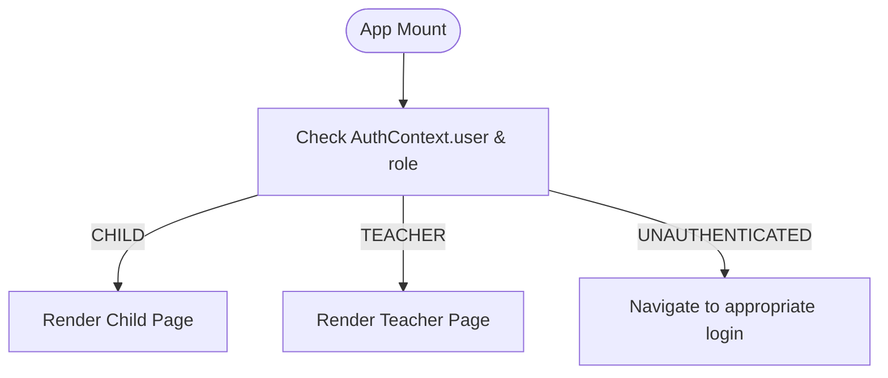

**Diagram sources**
- [App.tsx:17-38](file://client/src/App.tsx#L17-L38)
- [App.tsx:40-134](file://client/src/App.tsx#L40-L134)

**Section sources**
- [main.tsx:1-11](file://client/src/main.tsx#L1-L11)
- [App.tsx:1-134](file://client/src/App.tsx#L1-L134)

### Global State Management with Context API
- AuthProvider initializes user from localStorage and validates token via getMe.
- For CHILD users, it triggers vocabulary mastery synchronization with backend.
- Provides login methods for child (PIN or identifier/password), admin, and teacher, plus logout and age group updates.
- Consumers access user, loading, and auth actions via useAuth.

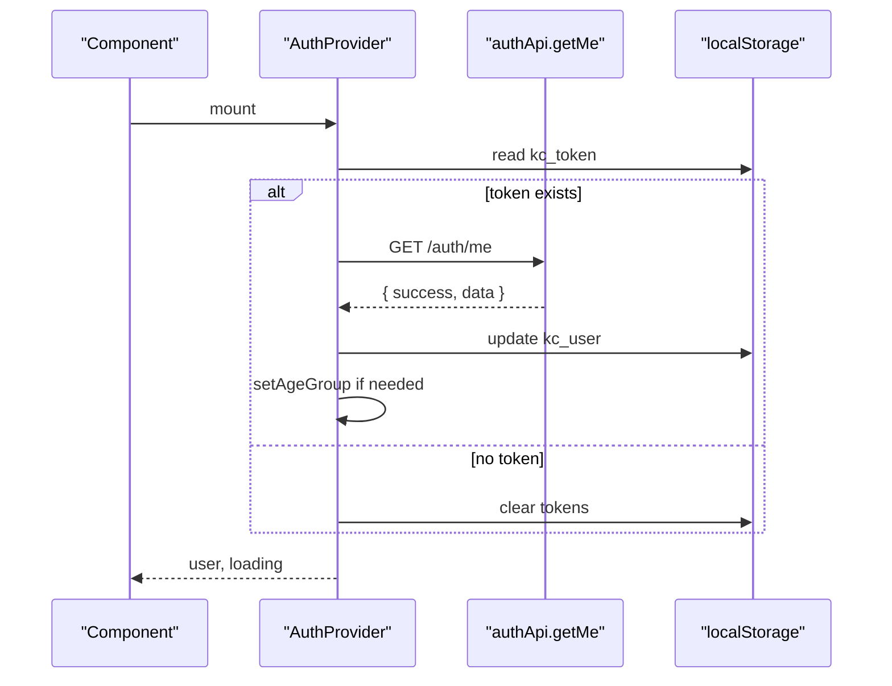

**Diagram sources**
- [AuthContext.tsx:30-61](file://client/src/context/AuthContext.tsx#L30-L61)
- [AuthContext.tsx:63-134](file://client/src/context/AuthContext.tsx#L63-L134)

**Section sources**
- [AuthContext.tsx:1-161](file://client/src/context/AuthContext.tsx#L1-L161)

### Authentication Flow: PIN-Based Child Login and Role-Based Access Control
- Child login supports:
  - Identifier/password flow via StudentLoginPage calling loginStudentHome
  - PIN pad interaction via PinPad used by child login flows
- Teacher login via TeacherLoginPage calls loginTeacher
- Role-based protection:
  - ProtectedChildRoute ensures user.role === 'CHILD'
  - ProtectedTeacherRoute ensures user.role === 'TEACHER'

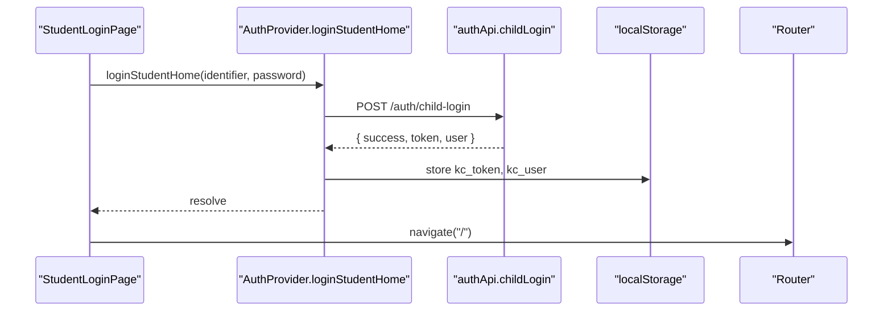

**Diagram sources**
- [StudentLoginPage.tsx:51-63](file://client/src/pages/child/StudentLoginPage.tsx#L51-L63)
- [AuthContext.tsx:75-85](file://client/src/context/AuthContext.tsx#L75-L85)
- [api.ts:64-94](file://client/src/services/api.ts#L64-L94)

**Section sources**
- [StudentLoginPage.tsx:1-461](file://client/src/pages/child/StudentLoginPage.tsx#L1-L461)
- [TeacherLoginPage.tsx:1-134](file://client/src/dashboards/teacher/TeacherLoginPage.tsx#L1-L134)
- [App.tsx:17-38](file://client/src/App.tsx#L17-L38)
- [PinPad.tsx:1-101](file://client/src/components/child/PinPad.tsx#L1-L101)

### Service Layer Architecture and Error Handling
- Base API client:
  - Centralized fetch wrapper with consistent headers including Authorization Bearer token
  - Methods: get, post, patch, put, delete
  - Throws errors when response.ok is false, propagating message from server payload
- Endpoint groups:
  - authApi, topicsApi, lessonsApi, vocabularyApi, activitiesApi, learningApi, adminApi, teacherApi, classroomSessionApi, vocabMasteryApi, parentNotificationApi
- Error strategy:
  - Thin client throws errors; pages handle try/catch and display user-friendly messages
  - No global interceptor; token injection occurs in getHeaders()

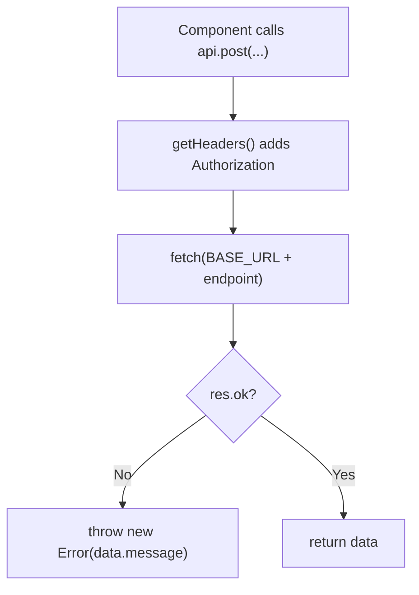

**Diagram sources**
- [api.ts:1-61](file://client/src/services/api.ts#L1-L61)

**Section sources**
- [api.ts:1-354](file://client/src/services/api.ts#L1-L354)

### Vocabulary Mastery Service
- Local-first design:
  - Stores mastery records per childId in localStorage
  - Debounced background sync to backend via vocabMasteryApi.syncMastery
- Features:
  - Sync on login for CHILD users
  - Register journey words automatically
  - Track study actions, game results, toggle status, compute mastery score
  - Provide lists of mastered/reviewed words

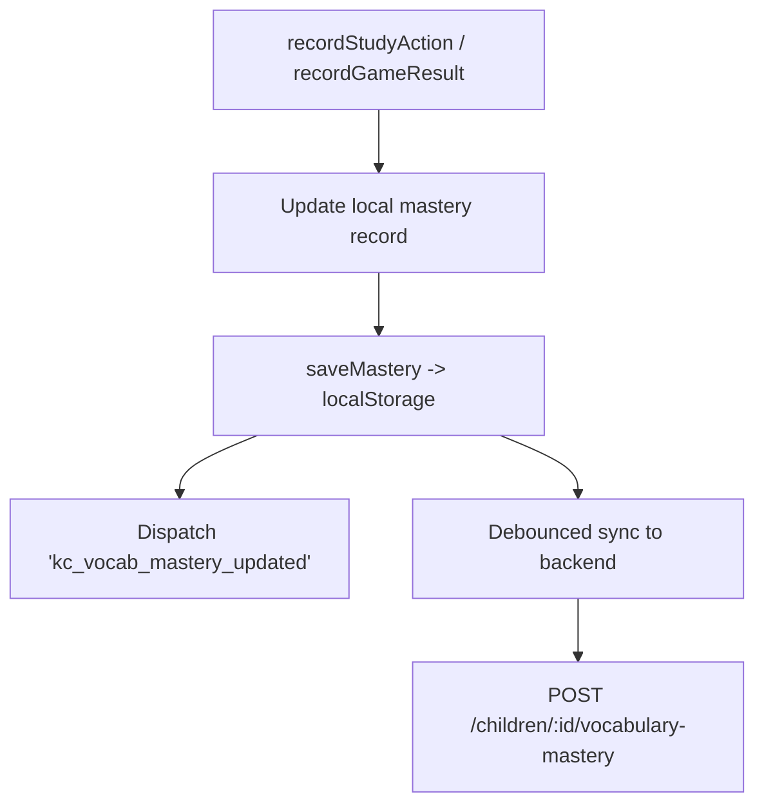

**Diagram sources**
- [vocabMasteryService.ts:76-105](file://client/src/services/vocabMasteryService.ts#L76-L105)
- [vocabMasteryService.ts:162-223](file://client/src/services/vocabMasteryService.ts#L162-L223)
- [vocabMasteryService.ts:265-285](file://client/src/services/vocabMasteryService.ts#L265-L285)

**Section sources**
- [vocabMasteryService.ts:1-372](file://client/src/services/vocabMasteryService.ts#L1-L372)

### Child Learning Interface
- ChildHomePage orchestrates:
  - Curriculum path, topics, vocabulary notebook, arcade games, badges/stickers
  - Age-group scoping for all data requests
  - Integration with vocab mastery service for journey words
- Composition patterns:
  - Header and bottom nav provide navigation and stats
  - Sections are conditionally rendered based on active tab
  - Modals for unit details, secret gifts, badges, stickers

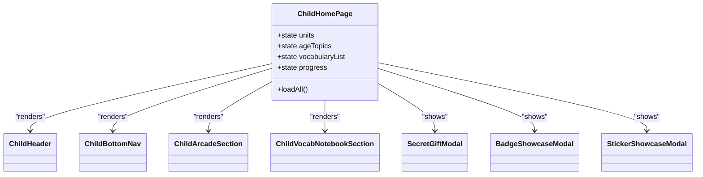

**Diagram sources**
- [ChildHomePage.tsx:62-169](file://client/src/pages/child/ChildHomePage.tsx#L62-L169)
- [ChildHomePage.tsx:187-800](file://client/src/pages/child/ChildHomePage.tsx#L187-L800)

**Section sources**
- [ChildHomePage.tsx:1-800](file://client/src/pages/child/ChildHomePage.tsx#L1-L800)

### Teacher Dashboard
- TeacherWorkspace provides:
  - Sidebar navigation and layout
  - Dashboard metrics, classes management, content browsing, assignments, student overview
- Data fetching via teacherApi with simple try/catch and empty/loading states

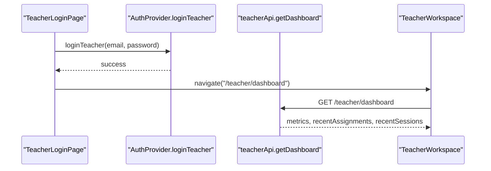

**Diagram sources**
- [TeacherLoginPage.tsx:17-31](file://client/src/dashboards/teacher/TeacherLoginPage.tsx#L17-L31)
- [TeacherWorkspace.tsx:13-19](file://client/src/dashboards/teacher/TeacherWorkspace.tsx#L13-L19)

**Section sources**
- [TeacherLoginPage.tsx:1-134](file://client/src/dashboards/teacher/TeacherLoginPage.tsx#L1-L134)
- [TeacherWorkspace.tsx:1-39](file://client/src/dashboards/teacher/TeacherWorkspace.tsx#L1-L39)

### Admin Panel (Separate App)
- Separate React app with its own bootstrap, routing, auth context, and API client
- Protects admin routes with ADMIN role check
- Uses admin-specific localStorage keys

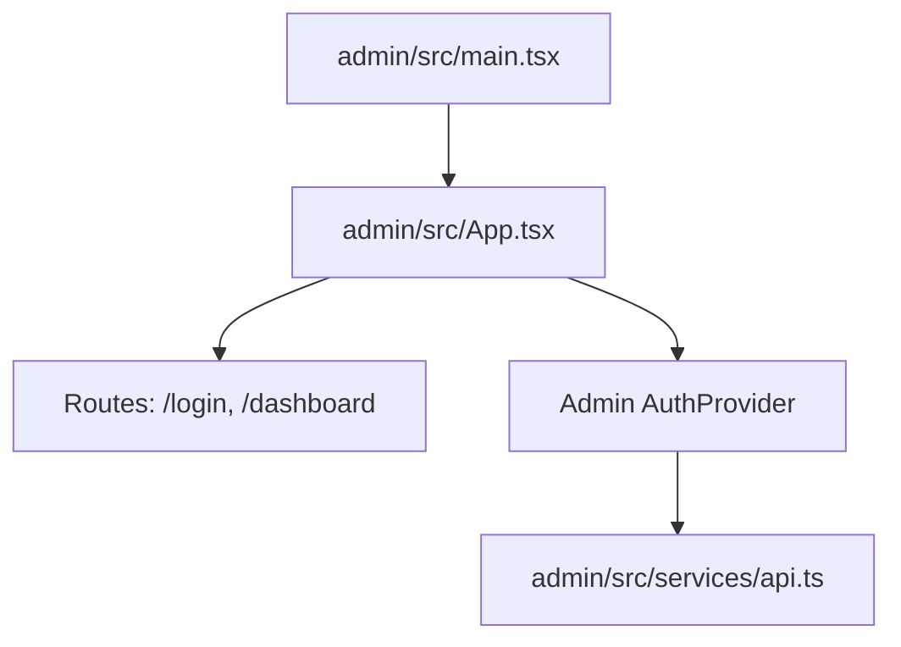

**Diagram sources**
- [admin main.tsx:1-11](file://admin/src/main.tsx#L1-L11)
- [admin App.tsx:1-45](file://admin/src/App.tsx#L1-L45)
- [admin AuthContext.tsx:1-82](file://admin/src/context/AuthContext.tsx#L1-L82)
- [admin api.ts:1-90](file://admin/src/services/api.ts#L1-L90)

**Section sources**
- [admin App.tsx:1-45](file://admin/src/App.tsx#L1-L45)
- [admin main.tsx:1-11](file://admin/src/main.tsx#L1-L11)
- [admin AuthContext.tsx:1-82](file://admin/src/context/AuthContext.tsx#L1-L82)
- [admin api.ts:1-90](file://admin/src/services/api.ts#L1-L90)

## Dependency Analysis
- Client app dependencies:
  - React Router for routing
  - Tailwind CSS via Vite plugin
  - lucide-react icons used across pages
- Internal module relationships:
  - App depends on AuthProvider and page components
  - Pages depend on services/api.ts for data
  - AuthContext depends on services/api.ts and vocabMasteryService.ts
  - ChildHomePage composes multiple child components and services

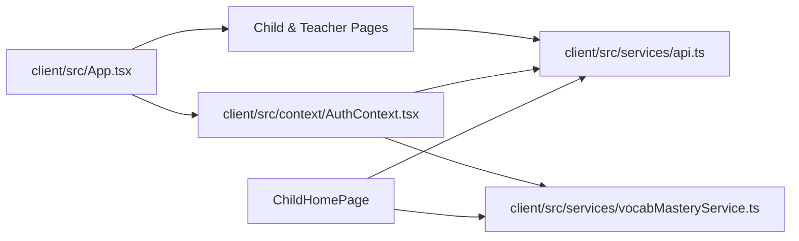

**Diagram sources**
- [App.tsx:1-134](file://client/src/App.tsx#L1-L134)
- [AuthContext.tsx:1-161](file://client/src/context/AuthContext.tsx#L1-L161)
- [api.ts:1-354](file://client/src/services/api.ts#L1-L354)
- [vocabMasteryService.ts:1-372](file://client/src/services/vocabMasteryService.ts#L1-L372)
- [ChildHomePage.tsx:62-169](file://client/src/pages/child/ChildHomePage.tsx#L62-L169)

**Section sources**
- [App.tsx:1-134](file://client/src/App.tsx#L1-L134)
- [AuthContext.tsx:1-161](file://client/src/context/AuthContext.tsx#L1-L161)
- [api.ts:1-354](file://client/src/services/api.ts#L1-L354)
- [vocabMasteryService.ts:1-372](file://client/src/services/vocabMasteryService.ts#L1-L372)
- [ChildHomePage.tsx:1-800](file://client/src/pages/child/ChildHomePage.tsx#L1-L800)

## Performance Considerations
- Network efficiency:
  - Batched data loading in ChildHomePage using Promise.all for curriculum path, topics, vocabulary, and progress
  - Debounced background sync for vocabulary mastery reduces API churn
- Rendering optimization:
  - Conditional rendering based on active tabs reduces unnecessary DOM
  - Memoization in teacher pages for filtered lists
- Local storage usage:
  - Token and user profile stored in localStorage; avoid heavy payloads
  - Vocabulary mastery records are compact and keyed per childId

[No sources needed since this section provides general guidance]

## Troubleshooting Guide
- Authentication issues:
  - If getMe fails, AuthContext clears tokens and resets user state
  - Ensure correct roles for protected routes; mismatched roles redirect to login
- API errors:
  - All service methods throw errors on non-ok responses; wrap calls in try/catch and show user-friendly messages
- Vocabulary mastery sync:
  - Background sync may fail silently; check console warnings and verify childId is valid
- Development proxy:
  - Ensure Vite dev server proxies /api to backend; confirm port and target settings

**Section sources**
- [AuthContext.tsx:37-61](file://client/src/context/AuthContext.tsx#L37-L61)
- [api.ts:11-61](file://client/src/services/api.ts#L11-L61)
- [vocabMasteryService.ts:82-105](file://client/src/services/vocabMasteryService.ts#L82-L105)

## Conclusion
KCEnglishKids combines a child-focused learning interface with a comprehensive teacher dashboard within a single React application. The architecture leverages:
- Clear separation of concerns between UI, state, and services
- Role-based routing and protected routes
- A robust service layer with consistent error handling
- Local-first vocabulary mastery with background sync
- Vite-based build configuration with development proxying

This structure enables scalable feature growth while maintaining clarity and usability for both children and educators.