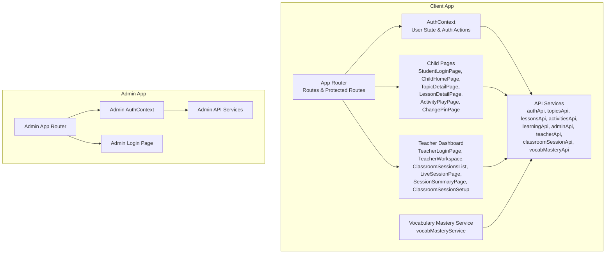
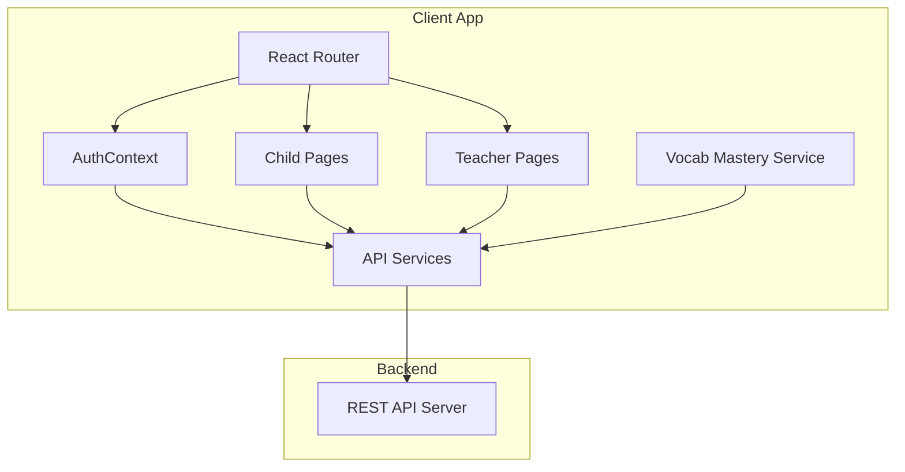
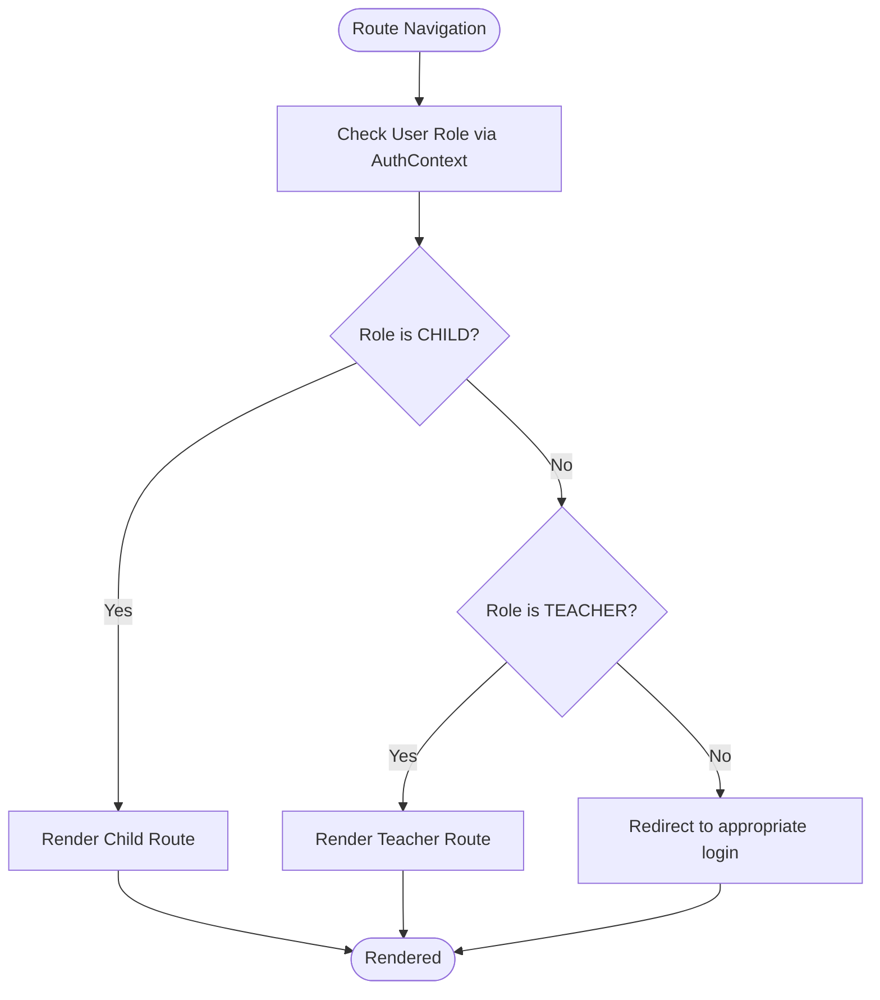
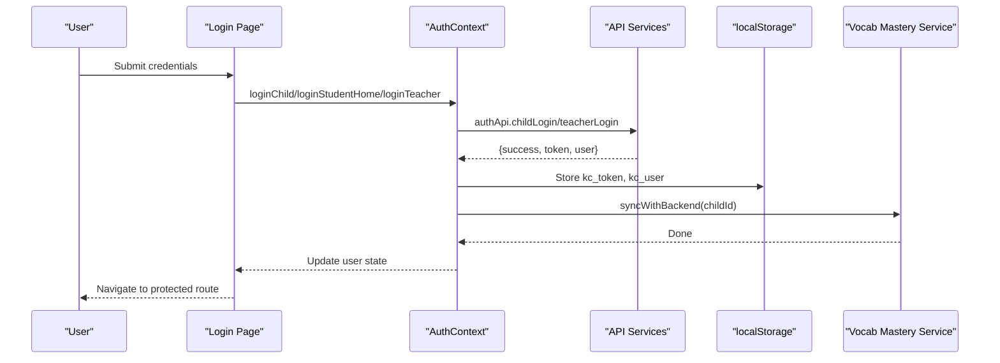
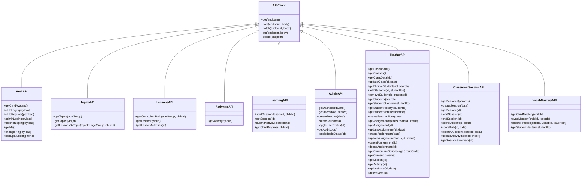
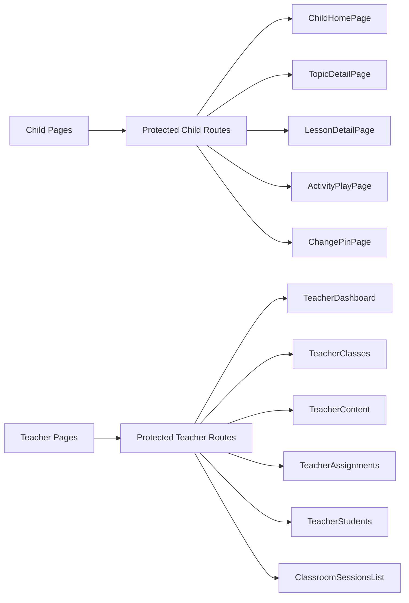
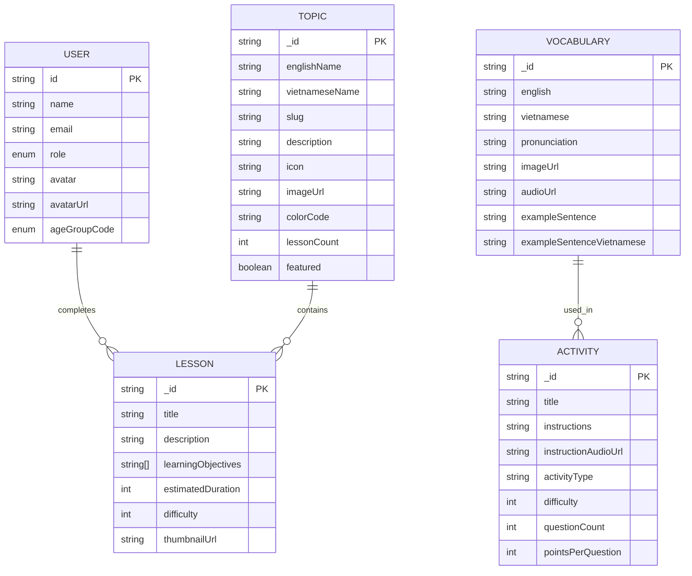
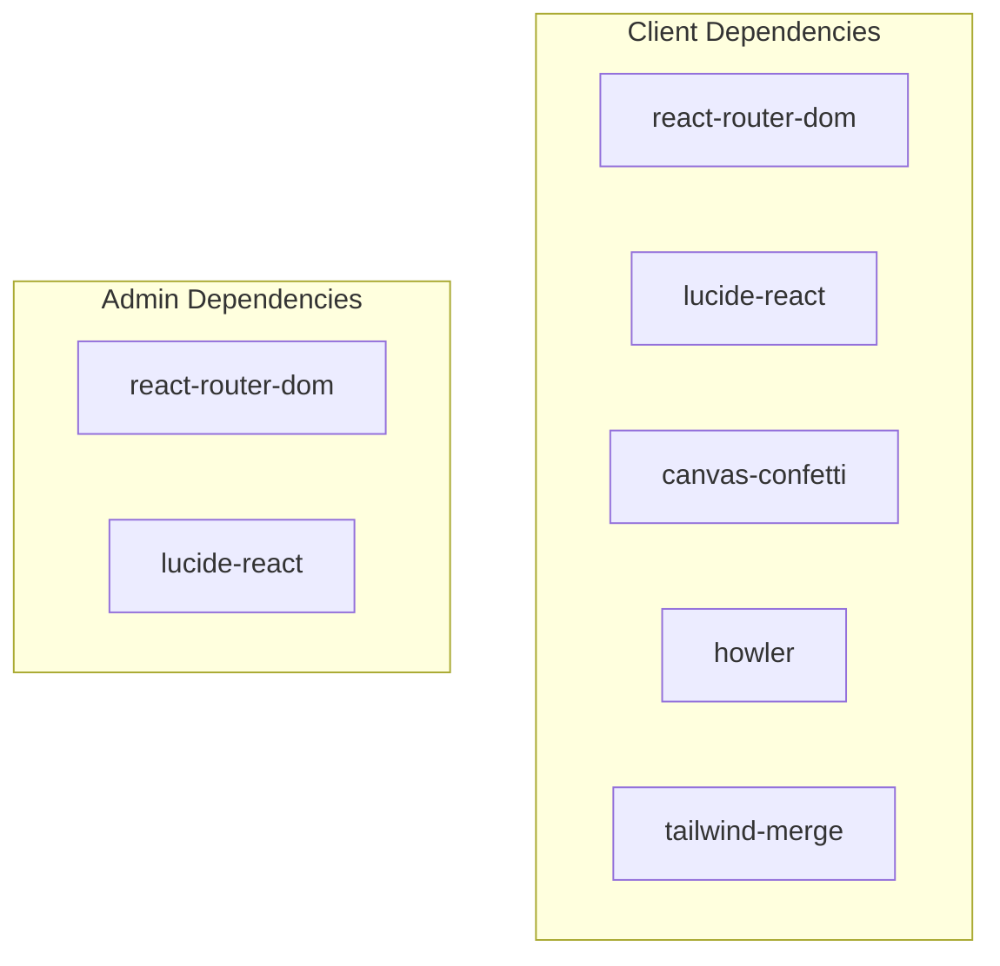

# Frontend Architecture

<cite>
**Referenced Files in This Document**
- [client/src/App.tsx](file://client/src/App.tsx)
- [client/vite.config.ts](file://client/vite.config.ts)
- [client/package.json](file://client/package.json)
- [client/src/context/AuthContext.tsx](file://client/src/context/AuthContext.tsx)
- [client/src/services/api.ts](file://client/src/services/api.ts)
- [client/src/types/index.ts](file://client/src/types/index.ts)
- [client/src/pages/child/StudentLoginPage.tsx](file://client/src/pages/child/StudentLoginPage.tsx)
- [client/src/dashboards/teacher/TeacherLoginPage.tsx](file://client/src/dashboards/teacher/TeacherLoginPage.tsx)
- [client/src/services/vocabMasteryService.ts](file://client/src/services/vocabMasteryService.ts)
- [admin/src/App.tsx](file://admin/src/App.tsx)
- [admin/vite.config.ts](file://admin/vite.config.ts)
- [admin/package.json](file://admin/package.json)
- [admin/src/context/AuthContext.tsx](file://admin/src/context/AuthContext.tsx)
- [admin/src/services/api.ts](file://admin/src/services/api.ts)
- [admin/src/types/index.ts](file://admin/src/types/index.ts)
- [admin/src/pages/AdminLoginPage.tsx](file://admin/src/pages/AdminLoginPage.tsx)
</cite>

## Table of Contents
1. Introduction
2. Project Structure
3. Core Components
4. Architecture Overview
5. Detailed Component Analysis
6. Dependency Analysis
7. Performance Considerations
8. Troubleshooting Guide
9. Conclusion

## Introduction
This document describes the frontend architecture for KCEnglishKids, focusing on the React and TypeScript application structure, component hierarchy, state management with Context API, routing, authentication flow, API service layer integration, and build configuration using Vite and Tailwind CSS. It also explains how the child learning interface and teacher dashboard are separated within the same application, and outlines responsive design principles optimized for children aged 3–6.

## Project Structure
The project is organized into two primary frontends:
- Client (child portal and teacher dashboard): React + TypeScript + Vite + Tailwind CSS
- Admin: Separate React + TypeScript + Vite + Tailwind CSS application for system administration

Key directories and responsibilities:
- client/src/components/child: Child-facing UI components (games, badges, interactive cards, mascot, audio helpers)
- client/src/pages/child: Child pages (login, home, topic detail, lesson detail, activity play, change PIN)
- client/src/dashboards/teacher: Teacher dashboard pages and workspace layout
- client/src/context: Global auth context for child/teacher/admin flows
- client/src/services: API clients and domain services (e.g., vocabulary mastery)
- client/src/types: Shared TypeScript interfaces for models and domain data
- admin/src: Admin-specific pages, context, services, types

**Diagram sources**
- [client/src/App.tsx:17-38](file://client/src/App.tsx#L17-L38)
- [client/src/context/AuthContext.tsx:30-153](file://client/src/context/AuthContext.tsx#L30-L153)
- [client/src/services/api.ts:63-352](file://client/src/services/api.ts#L63-L352)
- [client/src/services/vocabMasteryService.ts:53-371](file://client/src/services/vocabMasteryService.ts#L53-L371)
- [admin/src/App.tsx:7-40](file://admin/src/App.tsx#L7-L40)
- [admin/src/context/AuthContext.tsx:15-75](file://admin/src/context/AuthContext.tsx#L15-L75)
- [admin/src/services/api.ts:54-89](file://admin/src/services/api.ts#L54-L89)

**Section sources**
- [client/src/App.tsx:40-131](file://client/src/App.tsx#L40-L131)
- [client/vite.config.ts:1-21](file://client/vite.config.ts#L1-L21)
- [client/package.json:1-36](file://client/package.json#L1-L36)
- [admin/src/App.tsx:22-40](file://admin/src/App.tsx#L22-L40)
- [admin/vite.config.ts:1-21](file://admin/vite.config.ts#L1-L21)
- [admin/package.json:1-30](file://admin/package.json#L1-L30)

## Core Components
- Application Router and Route Guards
  - Centralized routing defines child routes under protected paths and teacher routes under a nested /teacher namespace.
  - Role-based route guards enforce access control by checking user role from AuthContext.
- Authentication Context
  - Provides user session state, login/logout methods for child, student-home, admin, and teacher roles.
  - Persists tokens and user profiles in localStorage and verifies sessions on app start.
- API Service Layer
  - Unified fetch wrapper with typed endpoints for auth, curriculum, lessons, activities, learning progress, admin, teacher, classroom sessions, and vocabulary mastery.
  - Adds Authorization headers automatically based on stored tokens.
- Vocabulary Mastery Service
  - Local-first persistence with debounced background sync to backend.
  - Tracks word mastery states, scores, and integrates with games and flashcards.

**Section sources**
- [client/src/App.tsx:17-38](file://client/src/App.tsx#L17-L38)
- [client/src/context/AuthContext.tsx:30-153](file://client/src/context/AuthContext.tsx#L30-L153)
- [client/src/services/api.ts:1-352](file://client/src/services/api.ts#L1-L352)
- [client/src/services/vocabMasteryService.ts:53-371](file://client/src/services/vocabMasteryService.ts#L53-L371)

## Architecture Overview
The client app uses React Router v7 for routing, React Context for global auth state, and a layered API service module for all HTTP interactions. The admin app mirrors this pattern but focuses on administrative operations. Both apps use Vite as the build tool and Tailwind CSS for styling.

**Diagram sources**
- [client/src/App.tsx:40-131](file://client/src/App.tsx#L40-L131)
- [client/src/context/AuthContext.tsx:30-153](file://client/src/context/AuthContext.tsx#L30-L153)
- [client/src/services/api.ts:1-352](file://client/src/services/api.ts#L1-L352)
- [client/src/services/vocabMasteryService.ts:53-371](file://client/src/services/vocabMasteryService.ts#L53-L371)

## Detailed Component Analysis

### Routing and Route Guards
- Child routes are protected by a guard that checks for a logged-in child user; otherwise, it redirects to the child login page.
- Teacher routes are protected by a guard that checks for a logged-in teacher user; otherwise, it redirects to the teacher login page.
- Nested teacher routes organize dashboard, classes, content, assignments, students, and classroom sessions.

**Diagram sources**
- [client/src/App.tsx:17-38](file://client/src/App.tsx#L17-L38)
- [client/src/App.tsx:40-131](file://client/src/App.tsx#L40-L131)

**Section sources**
- [client/src/App.tsx:17-38](file://client/src/App.tsx#L17-L38)
- [client/src/App.tsx:40-131](file://client/src/App.tsx#L40-L131)

### Authentication Flow
- Child login supports multiple entry points: avatar+PIN or identifier+password. On success, tokens and user profile are persisted, and vocabulary mastery is synced.
- Student home login uses identifier/password and triggers the same token persistence and mastery sync.
- Teacher login persists admin-style tokens and navigates to the teacher dashboard.
- Session verification on startup validates the token and refreshes user state.

**Diagram sources**
- [client/src/context/AuthContext.tsx:30-153](file://client/src/context/AuthContext.tsx#L30-L153)
- [client/src/services/api.ts:63-94](file://client/src/services/api.ts#L63-L94)
- [client/src/services/vocabMasteryService.ts:107-157](file://client/src/services/vocabMasteryService.ts#L107-L157)

**Section sources**
- [client/src/context/AuthContext.tsx:30-153](file://client/src/context/AuthContext.tsx#L30-L153)
- [client/src/pages/child/StudentLoginPage.tsx:51-63](file://client/src/pages/child/StudentLoginPage.tsx#L51-L63)
- [client/src/dashboards/teacher/TeacherLoginPage.tsx:17-31](file://client/src/dashboards/teacher/TeacherLoginPage.tsx#L17-L31)

### API Service Layer Integration
- Base API wrapper handles GET/POST/PATCH/PUT/DELETE with automatic Authorization header injection.
- Domain-specific modules encapsulate endpoints for:
  - Auth: child login/register, admin/teacher login, getMe, changePin, lookupStudent
  - Curriculum: topics, lessons, activities
  - Learning: sessions, results, progress
  - Admin: dashboard stats, users, audit logs
  - Teacher: classes, students, assignments, content, notes
  - Classroom Sessions: create/start/end, scoring, question results, summary
  - Vocabulary Mastery: child mastery, sync, record practice, student mastery

**Diagram sources**
- [client/src/services/api.ts:1-352](file://client/src/services/api.ts#L1-L352)

**Section sources**
- [client/src/services/api.ts:1-352](file://client/src/services/api.ts#L1-L352)

### Separation Between Child Interface and Teacher Dashboard
- Child interface:
  - Pages include login, home, topic detail, lesson detail, activity play, and change PIN.
  - Uses playful UI patterns, large touch targets, and friendly feedback.
- Teacher dashboard:
  - Pages include login, dashboard overview, classes, content, assignments, students, and classroom sessions setup/live/summary.
  - Organized under /teacher routes with nested layouts.

**Diagram sources**
- [client/src/App.tsx:40-131](file://client/src/App.tsx#L40-L131)

**Section sources**
- [client/src/App.tsx:40-131](file://client/src/App.tsx#L40-L131)

### Build Configuration and Styling
- Vite:
  - React plugin enabled.
  - Tailwind CSS plugin integrated.
  - Dev server proxies /api to backend at localhost:5000.
- Tailwind CSS:
  - Utility-first styling across child and teacher interfaces.
  - Responsive design with mobile-first breakpoints and large touch-friendly elements.

**Section sources**
- [client/vite.config.ts:1-21](file://client/vite.config.ts#L1-L21)
- [client/package.json:1-36](file://client/package.json#L1-L36)
- [admin/vite.config.ts:1-21](file://admin/vite.config.ts#L1-L21)
- [admin/package.json:1-30](file://admin/package.json#L1-L30)

### Data Models and Type Safety
- Shared types define core entities such as User, Topic, Vocabulary, Activity, Lesson, ProgressSummary, ClassroomSession, and related enums.
- Admin types mirror essential structures for admin operations.

**Diagram sources**
- [client/src/types/index.ts:1-233](file://client/src/types/index.ts#L1-L233)
- [admin/src/types/index.ts:1-40](file://admin/src/types/index.ts#L1-L40)

**Section sources**
- [client/src/types/index.ts:1-233](file://client/src/types/index.ts#L1-L233)
- [admin/src/types/index.ts:1-40](file://admin/src/types/index.ts#L1-L40)

### Component Composition Patterns, Props, and Events
- Child pages compose reusable UI primitives (buttons, modals, mascot, audio effects).
- Event handling strategies:
  - Form submissions trigger validation, optimistic UI updates, and API calls.
  - Error states are surfaced with accessible messages and visual cues.
  - Audio feedback enhances engagement for young learners.

**Section sources**
- [client/src/pages/child/StudentLoginPage.tsx:51-63](file://client/src/pages/child/StudentLoginPage.tsx#L51-L63)
- [client/src/dashboards/teacher/TeacherLoginPage.tsx:17-31](file://client/src/dashboards/teacher/TeacherLoginPage.tsx#L17-L31)

### Accessibility and Cross-Browser Compatibility
- Accessible labels and aria attributes are used in forms and toggles.
- Large touch targets and high contrast colors improve usability for children.
- Vite dev server and modern browser features are leveraged; polyfills can be added if targeting older browsers.

**Section sources**
- [client/src/pages/child/StudentLoginPage.tsx:244-251](file://client/src/pages/child/StudentLoginPage.tsx#L244-L251)

## Dependency Analysis
- Client dependencies:
  - react-router-dom for routing
  - lucide-react for icons
  - canvas-confetti for celebrations
  - howler for audio playback
  - tailwind-merge for utility merging
- Admin dependencies:
  - Similar stack without audio/confetti libraries

**Diagram sources**
- [client/package.json:12-34](file://client/package.json#L12-L34)
- [admin/package.json:11-28](file://admin/package.json#L11-L28)

**Section sources**
- [client/package.json:1-36](file://client/package.json#L1-L36)
- [admin/package.json:1-30](file://admin/package.json#L1-L30)

## Performance Considerations
- Debounced background sync for vocabulary mastery reduces network overhead while maintaining local responsiveness.
- Local-first storage ensures fast reads and offline resilience for mastery data.
- Lazy loading of routes and components can further reduce initial bundle size.
- Audio assets should be preloaded selectively to avoid blocking critical rendering.

**Section sources**
- [client/src/services/vocabMasteryService.ts:76-105](file://client/src/services/vocabMasteryService.ts#L76-L105)

## Troubleshooting Guide
- Authentication issues:
  - Verify token presence and validity; session verification clears invalid tokens.
  - Ensure correct role-based navigation after login.
- API errors:
  - Check proxy configuration in Vite dev server for /api requests.
  - Validate payload shapes against typed interfaces.
- Vocabulary mastery sync:
  - Confirm childId is set and not default/guest.
  - Inspect debounced sync logs for failures.

**Section sources**
- [client/src/context/AuthContext.tsx:37-61](file://client/src/context/AuthContext.tsx#L37-L61)
- [client/vite.config.ts:11-19](file://client/vite.config.ts#L11-L19)
- [client/src/services/vocabMasteryService.ts:107-157](file://client/src/services/vocabMasteryService.ts#L107-L157)

## Conclusion
KCEnglishKids’ frontend architecture separates child and teacher experiences through clear routing and role-based guards, while sharing a consistent state management approach via Context API and a robust API service layer. Vite and Tailwind CSS provide a fast, flexible development experience, and the vocabulary mastery service introduces a resilient, local-first data strategy with background synchronization. The design emphasizes accessibility and child-friendly interaction patterns, ensuring an engaging and safe learning environment for ages 3–6.