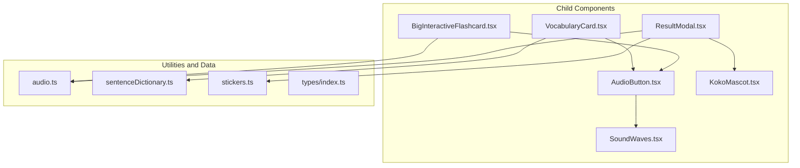
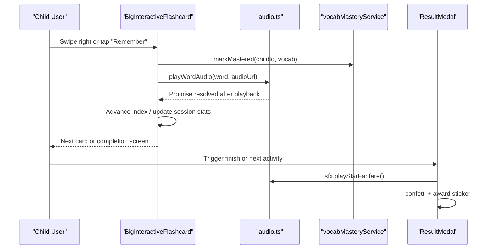
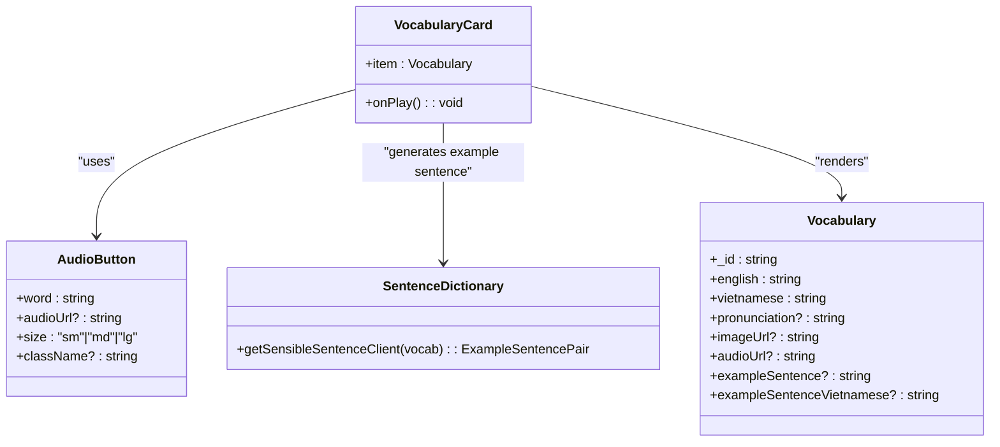
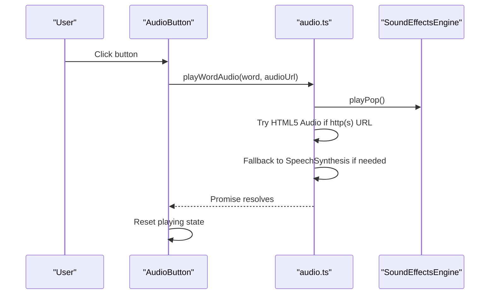
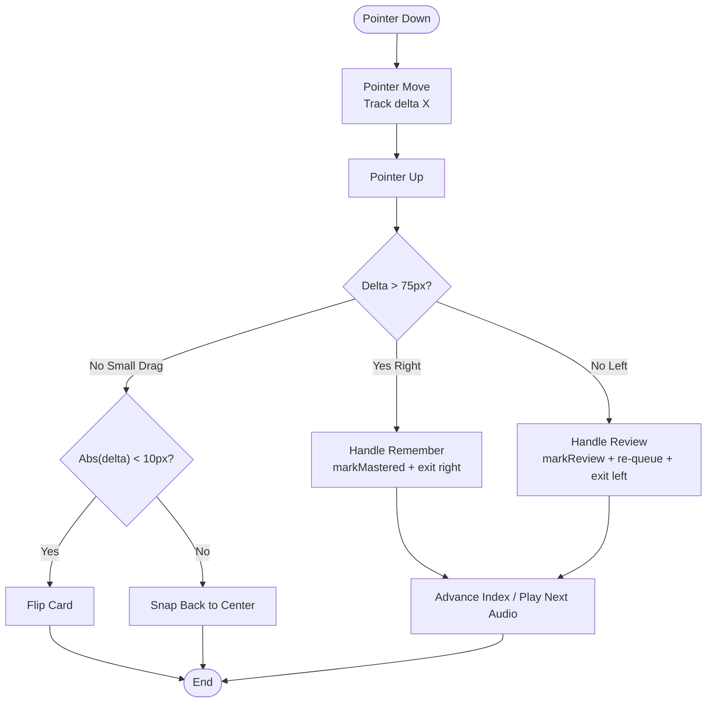
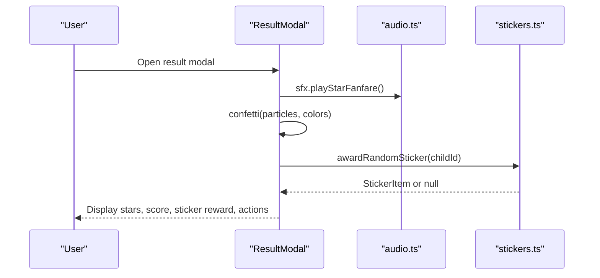
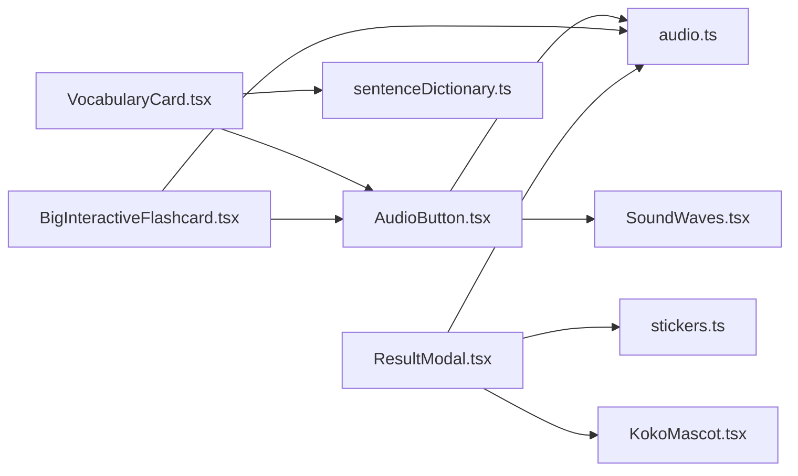

# Shared Components Library

<cite>
**Referenced Files in This Document**
- [VocabularyCard.tsx](file://client/src/components/child/VocabularyCard.tsx)
- [AudioButton.tsx](file://client/src/components/child/AudioButton.tsx)
- [BigInteractiveFlashcard.tsx](file://client/src/components/child/BigInteractiveFlashcard.tsx)
- [ResultModal.tsx](file://client/src/components/child/ResultModal.tsx)
- [SoundWaves.tsx](file://client/src/components/child/SoundWaves.tsx)
- [KokoMascot.tsx](file://client/src/components/child/KokoMascot.tsx)
- [audio.ts](file://client/src/utils/audio.ts)
- [sentenceDictionary.ts](file://client/src/utils/sentenceDictionary.ts)
- [stickers.ts](file://client/src/data/stickers.ts)
- [index.ts](file://client/src/types/index.ts)
- [package.json](file://client/package.json)
</cite>

## Table of Contents
1. [Introduction](#introduction)
2. [Project Structure](#project-structure)
3. [Core Components](#core-components)
4. [Architecture Overview](#architecture-overview)
5. [Detailed Component Analysis](#detailed-component-analysis)
6. [Dependency Analysis](#dependency-analysis)
7. [Performance Considerations](#performance-considerations)
8. [Accessibility and Cross-Browser Compatibility](#accessibility-and-cross-browser-compatibility)
9. [Styling and Animation Guidelines](#styling-and-animation-guidelines)
10. [Extending the Component Library](#extending-the-component-library)
11. [Troubleshooting Guide](#troubleshooting-guide)
12. [Conclusion](#conclusion)

## Introduction
This document describes the reusable child learning interface component library. It focuses on:
- Vocabulary card system for presenting words, images, meanings, and example sentences.
- Audio button functionality with pronunciation playback and visual feedback.
- Interactive flashcards with swipe gestures, flip animations, mastery tracking, and spaced repetition re-queuing.
- Result modal for scoring, encouragement, confetti effects, and sticker rewards.

It also explains component interfaces, prop definitions, customization options, audio integration patterns, animation libraries usage, Tailwind CSS styling approaches, accessibility compliance, cross-browser compatibility, performance optimization techniques, and guidelines for extending existing components.

## Project Structure
The shared components live under the child learning UI folder and rely on shared utilities for audio, sentence generation, stickers, and type definitions.

**Diagram sources**
- [VocabularyCard.tsx:1-72](file://client/src/components/child/VocabularyCard.tsx#L1-L72)
- [AudioButton.tsx:1-74](file://client/src/components/child/AudioButton.tsx#L1-L74)
- [BigInteractiveFlashcard.tsx:1-628](file://client/src/components/child/BigInteractiveFlashcard.tsx#L1-L628)
- [ResultModal.tsx:1-226](file://client/src/components/child/ResultModal.tsx#L1-L226)
- [SoundWaves.tsx:1-43](file://client/src/components/child/SoundWaves.tsx#L1-L43)
- [KokoMascot.tsx:1-178](file://client/src/components/child/KokoMascot.tsx#L1-L178)
- [audio.ts:1-360](file://client/src/utils/audio.ts#L1-L360)
- [sentenceDictionary.ts:1-281](file://client/src/utils/sentenceDictionary.ts#L1-L281)
- [stickers.ts:1-162](file://client/src/data/stickers.ts#L1-L162)
- [index.ts:30-39](file://client/src/types/index.ts#L30-L39)

**Section sources**
- [VocabularyCard.tsx:1-72](file://client/src/components/child/VocabularyCard.tsx#L1-L72)
- [AudioButton.tsx:1-74](file://client/src/components/child/AudioButton.tsx#L1-L74)
- [BigInteractiveFlashcard.tsx:1-628](file://client/src/components/child/BigInteractiveFlashcard.tsx#L1-L628)
- [ResultModal.tsx:1-226](file://client/src/components/child/ResultModal.tsx#L1-L226)
- [soundWaves.tsx:1-43](file://client/src/components/child/SoundWaves.tsx#L1-L43)
- [kokoMascot.tsx:1-178](file://client/src/components/child/KokoMascot.tsx#L1-L178)
- [audio.ts:1-360](file://client/src/utils/audio.ts#L1-L360)
- [sentenceDictionary.ts:1-281](file://client/src/utils/sentenceDictionary.ts#L1-L281)
- [stickers.ts:1-162](file://client/src/data/stickers.ts#L1-L162)
- [index.ts:30-39](file://client/src/types/index.ts#L30-L39)

## Core Components
This section summarizes the main reusable components and their responsibilities.

- VocabularyCard: Displays a vocabulary item with image, English word, optional pronunciation, Vietnamese meaning, and an example sentence generated by the sentence dictionary utility. Integrates AudioButton for pronunciation.
- AudioButton: Provides a size-configurable pronunciation button with ripple animation and SoundWaves visualization during playback. Delegates audio playback to the audio utility.
- BigInteractiveFlashcard: Full-screen interactive flashcard deck with flip, swipe gestures, speak-along mode, mastery tracking, review re-queuing, and completion flow. Uses audio utility and mastery service integration.
- ResultModal: Presents score, stars, encouragement messages, confetti celebration, sticker reward, and action buttons (retry, finish, next activity). Integrates mascot and audio effects.

**Section sources**
- [VocabularyCard.tsx:6-69](file://client/src/components/child/VocabularyCard.tsx#L6-L69)
- [AudioButton.tsx:6-72](file://client/src/components/child/AudioButton.tsx#L6-L72)
- [BigInteractiveFlashcard.tsx:16-30](file://client/src/components/child/BigInteractiveFlashcard.tsx#L16-L30)
- [ResultModal.tsx:9-33](file://client/src/components/child/ResultModal.tsx#L9-L33)

## Architecture Overview
The component architecture emphasizes separation of concerns:
- Presentation components (VocabularyCard, AudioButton, BigInteractiveFlashcard, ResultModal) handle UI and user interactions.
- Utilities (audio.ts, sentenceDictionary.ts) encapsulate behavior like sound effects, pronunciation fallbacks, and example sentence generation.
- Data modules (stickers.ts) provide reward logic and persistence via localStorage.
- Types (index.ts) define shared data models such as Vocabulary.

**Diagram sources**
- [BigInteractiveFlashcard.tsx:172-218](file://client/src/components/child/BigInteractiveFlashcard.tsx#L172-L218)
- [audio.ts:217-284](file://client/src/utils/audio.ts#L217-L284)
- [ResultModal.tsx:38-57](file://client/src/components/child/ResultModal.tsx#L38-L57)

## Detailed Component Analysis

### VocabularyCard
Purpose:
- Render a friendly, accessible vocabulary card with illustration, English word, optional IPA pronunciation, Vietnamese meaning pill, and contextual example sentence.
- Integrate AudioButton for pronunciation.

Key props:
- item: Vocabulary object containing english, vietnamese, pronunciation, imageUrl, audioUrl, exampleSentence, exampleSentenceVietnamese.
- onPlay: Optional callback invoked when the child interacts with audio controls.

Behavior:
- Uses getSensibleSentenceClient to generate age-appropriate example sentences if not provided.
- Renders lazy-loaded images and decorative background blobs using Tailwind classes.
- Embeds AudioButton with size="sm".

Customization options:
- Styling is primarily Tailwind-based; extendable via wrapper containers or theme tokens.
- Example sentence rendering can be customized by modifying the sentence dictionary or overriding presentation logic.

Accessibility considerations:
- Images include alt text from the English word.
- The card structure uses semantic headings and labels appropriate for children’s content.

**Section sources**
- [VocabularyCard.tsx:6-69](file://client/src/components/child/VocabularyCard.tsx#L6-L69)
- [sentenceDictionary.ts:169-281](file://client/src/utils/sentenceDictionary.ts#L169-L281)
- [index.ts:30-39](file://client/src/types/index.ts#L30-L39)

#### Class Diagram: VocabularyCard Dependencies

**Diagram sources**
- [VocabularyCard.tsx:1-72](file://client/src/components/child/VocabularyCard.tsx#L1-L72)
- [AudioButton.tsx:6-72](file://client/src/components/child/AudioButton.tsx#L6-L72)
- [sentenceDictionary.ts:169-281](file://client/src/utils/sentenceDictionary.ts#L169-L281)
- [index.ts:30-39](file://client/src/types/index.ts#L30-L39)

### AudioButton
Purpose:
- Provide a pronounceable audio trigger with visual feedback and size variants.

Key props:
- word: The word to pronounce.
- audioUrl: Optional HTTP URL for native audio playback.
- size: "sm", "md", or "lg" controlling button dimensions and icon sizes.
- className: Additional Tailwind classes for customization.

Behavior:
- Prevents event propagation to avoid parent interactions.
- Plays audio via playWordAudio from audio.ts.
- Shows SoundWaves while playing and applies ring and scale animations.

Customization options:
- Size variants allow consistent sizing across contexts.
- className enables external styling overrides.

Accessibility considerations:
- Button includes aria-label describing the action.
- Focus management relies on default browser behavior; ensure focus styles are visible.

**Section sources**
- [AudioButton.tsx:6-72](file://client/src/components/child/AudioButton.tsx#L6-L72)
- [audio.ts:217-284](file://client/src/utils/audio.ts#L217-L284)
- [SoundWaves.tsx:3-41](file://client/src/components/child/SoundWaves.tsx#L3-L41)

#### Sequence Diagram: Audio Playback Flow

**Diagram sources**
- [AudioButton.tsx:21-32](file://client/src/components/child/AudioButton.tsx#L21-L32)
- [audio.ts:217-284](file://client/src/utils/audio.ts#L217-L284)

### BigInteractiveFlashcard
Purpose:
- Deliver an engaging, tactile flashcard experience with flip, swipe, speak-along, mastery tracking, and spaced repetition.

Key props:
- items: Array of Vocabulary objects.
- initialIndex: Starting card index.
- childId: Optional child identifier; falls back to AuthContext user id.
- onStudyComplete: Callback returning mastered and review counts.
- onCompleteStep: Callback to advance to practice or next step.

State and features:
- Deck management: syncs with items, supports re-queueing reviewed words at the end.
- Flip and speak-along modes with audio cues.
- Pointer-based drag/swipe detection with thresholds for remember/review actions.
- Visual overlays for swipe direction and status badges.
- Mini thumbnail carousel showing mastery indicators.

Integration points:
- Uses sfx and playWordAudio for sound effects and pronunciation.
- Uses vocabMasteryService to track mastery and review states.
- Uses useAuth to resolve effective childId.

Customization options:
- Completion callbacks allow embedding into larger lesson flows.
- Styling is Tailwind-based; layout adapts responsively.

Accessibility considerations:
- Buttons are keyboard-accessible and labeled.
- Touch interactions are complemented by explicit buttons for left/right/flip actions.

**Section sources**
- [BigInteractiveFlashcard.tsx:16-30](file://client/src/components/child/BigInteractiveFlashcard.tsx#L16-L30)
- [BigInteractiveFlashcard.tsx:50-61](file://client/src/components/child/BigInteractiveFlashcard.tsx#L50-L61)
- [BigInteractiveFlashcard.tsx:172-218](file://client/src/components/child/BigInteractiveFlashcard.tsx#L172-L218)
- [BigInteractiveFlashcard.tsx:221-263](file://client/src/components/child/BigInteractiveFlashcard.tsx#L221-L263)
- [BigInteractiveFlashcard.tsx:274-287](file://client/src/components/child/BigInteractiveFlashcard.tsx#L274-L287)
- [BigInteractiveFlashcard.tsx:289-290](file://client/src/components/child/BigInteractiveFlashcard.tsx#L289-L290)
- [BigInteractiveFlashcard.tsx:292-625](file://client/src/components/child/BigInteractiveFlashcard.tsx#L292-L625)
- [audio.ts:1-360](file://client/src/utils/audio.ts#L1-L360)

#### Flowchart: Swipe Gesture Logic

**Diagram sources**
- [BigInteractiveFlashcard.tsx:221-263](file://client/src/components/child/BigInteractiveFlashcard.tsx#L221-L263)
- [BigInteractiveFlashcard.tsx:172-218](file://client/src/components/child/BigInteractiveFlashcard.tsx#L172-L218)

### ResultModal
Purpose:
- Present results with stars, score, correct count, encouragement messages, confetti, sticker rewards, and action buttons.

Key props:
- score, maxScore: Numeric scores.
- stars: Number of earned stars.
- correctCount, totalQuestions: Performance metrics.
- onRetry: Retry current activity.
- onFinish: Finish activity flow.
- nextActivityId, nextActivityTitle, onPlayNext: Optional next activity navigation.

Behavior:
- Triggers star fanfare and confetti when stars > 0.
- Awards random sticker if stars >= 2 using stickerService.
- Displays mascot with encouraging speech bubble.
- Provides action buttons styled with Tailwind and 3D effect classes.

Customization options:
- Encouragement messages adapt based on star rating.
- Optional next activity button allows seamless progression.

Accessibility considerations:
- Modal is fixed overlay with clear focus context.
- Buttons have descriptive labels and icons.

**Section sources**
- [ResultModal.tsx:9-33](file://client/src/components/child/ResultModal.tsx#L9-L33)
- [ResultModal.tsx:38-57](file://client/src/components/child/ResultModal.tsx#L38-L57)
- [ResultModal.tsx:59-88](file://client/src/components/child/ResultModal.tsx#L59-L88)
- [ResultModal.tsx:90-225](file://client/src/components/child/ResultModal.tsx#L90-L225)
- [stickers.ts:133-161](file://client/src/data/stickers.ts#L133-L161)

#### Sequence Diagram: Result Modal Celebration

**Diagram sources**
- [ResultModal.tsx:38-57](file://client/src/components/child/ResultModal.tsx#L38-L57)
- [audio.ts:117-148](file://client/src/utils/audio.ts#L117-L148)
- [stickers.ts:144-161](file://client/src/data/stickers.ts#L144-L161)

## Dependency Analysis
Components depend on shared utilities and data modules:
- AudioButton depends on audio.ts and SoundWaves.
- VocabularyCard depends on AudioButton and sentenceDictionary.ts.
- BigInteractiveFlashcard depends on AudioButton, audio.ts, and mastery service integration.
- ResultModal depends on audio.ts, stickers.ts, and KokoMascot.

**Diagram sources**
- [AudioButton.tsx:1-74](file://client/src/components/child/AudioButton.tsx#L1-L74)
- [VocabularyCard.tsx:1-72](file://client/src/components/child/VocabularyCard.tsx#L1-L72)
- [BigInteractiveFlashcard.tsx:1-628](file://client/src/components/child/BigInteractiveFlashcard.tsx#L1-L628)
- [ResultModal.tsx:1-226](file://client/src/components/child/ResultModal.tsx#L1-L226)
- [audio.ts:1-360](file://client/src/utils/audio.ts#L1-L360)
- [sentenceDictionary.ts:1-281](file://client/src/utils/sentenceDictionary.ts#L1-L281)
- [stickers.ts:1-162](file://client/src/data/stickers.ts#L1-L162)
- [SoundWaves.tsx:1-43](file://client/src/components/child/SoundWaves.tsx#L1-L43)
- [KokoMascot.tsx:1-178](file://client/src/components/child/KokoMascot.tsx#L1-L178)

**Section sources**
- [AudioButton.tsx:1-74](file://client/src/components/child/AudioButton.tsx#L1-L74)
- [VocabularyCard.tsx:1-72](file://client/src/components/child/VocabularyCard.tsx#L1-L72)
- [BigInteractiveFlashcard.tsx:1-628](file://client/src/components/child/BigInteractiveFlashcard.tsx#L1-L628)
- [ResultModal.tsx:1-226](file://client/src/components/child/ResultModal.tsx#L1-L226)
- [audio.ts:1-360](file://client/src/utils/audio.ts#L1-L360)
- [sentenceDictionary.ts:1-281](file://client/src/utils/sentenceDictionary.ts#L1-L281)
- [stickers.ts:1-162](file://client/src/data/stickers.ts#L1-L162)
- [SoundWaves.tsx:1-43](file://client/src/components/child/SoundWaves.tsx#L1-L43)
- [KokoMascot.tsx:1-178](file://client/src/components/child/KokoMascot.tsx#L1-L178)

## Performance Considerations
- Audio playback:
  - Immediate stop of previous audio and speech synthesis before starting new playback to prevent overlapping sounds.
  - Safety timeout prevents hanging remote audio; fallback to speech synthesis ensures responsiveness.
  - Autoplay restrictions handled gracefully without loops or errors.
- Image loading:
  - Lazy loading for images reduces initial bundle and memory pressure.
- Animations:
  - CSS animations and transforms used for ripples, pulses, and wobble effects; minimal JS-driven animation loops.
- State updates:
  - Debounced pointer events and threshold checks reduce unnecessary re-renders during swipes.
- External libraries:
  - canvas-confetti used sparingly for celebratory effects; Howler is listed but not directly used in these components.

[No sources needed since this section provides general guidance]

## Accessibility and Cross-Browser Compatibility
- Accessibility:
  - Buttons include aria-labels and are keyboard-focusable.
  - Images include alt text derived from vocabulary content.
  - Modal overlays provide clear focus context and actionable controls.
- Cross-browser compatibility:
  - AudioContext and SpeechSynthesis APIs are guarded with feature checks and error handling.
  - Autoplay policies respected; no forced playback without user gesture.
  - Pointer events used for touch/mouse interactions; fallbacks included for cancel events.
- Recommendations:
  - Ensure focus-visible styles are defined globally for keyboard navigation.
  - Test Safari and Chrome autoplay behaviors; confirm speech synthesis voices are available.
  - Validate SVG mascot rendering across browsers; ensure drop-shadow filters work as expected.

**Section sources**
- [AudioButton.tsx:56-69](file://client/src/components/child/AudioButton.tsx#L56-L69)
- [audio.ts:24-38](file://client/src/utils/audio.ts#L24-L38)
- [audio.ts:217-284](file://client/src/utils/audio.ts#L217-L284)
- [ResultModal.tsx:90-225](file://client/src/components/child/ResultModal.tsx#L90-L225)

## Styling and Animation Guidelines
- Tailwind CSS:
  - Consistent use of rounded corners, shadows, gradients, and color palettes tailored for children’s content.
  - Responsive design via sm/md breakpoints and flexible layouts.
  - Custom 3D button classes (e.g., btn-3d-amber, btn-3d-emerald) for tactile feel.
- Animations:
  - animate-ping, animate-pulse, animate-pop-in, animate-star-celebrate, animate-gentle-wobble, and custom keyframes for mascot waving.
  - Transform-based transitions for flip and swipe effects.
- Extensibility:
  - Prefer Tailwind utility composition over inline styles.
  - Centralize animation classes and color tokens for consistency.

**Section sources**
- [VocabularyCard.tsx:14-67](file://client/src/components/child/VocabularyCard.tsx#L14-L67)
- [AudioButton.tsx:46-70](file://client/src/components/child/AudioButton.tsx#L46-L70)
- [BigInteractiveFlashcard.tsx:325-503](file://client/src/components/child/BigInteractiveFlashcard.tsx#L325-L503)
- [ResultModal.tsx:90-225](file://client/src/components/child/ResultModal.tsx#L90-L225)
- [KokoMascot.tsx:50-174](file://client/src/components/child/KokoMascot.tsx#L50-L174)

## Extending the Component Library
Guidelines for adding new components or extending existing ones:
- Follow TypeScript-first approach:
  - Define clear interfaces for props and data models.
  - Use shared types from index.ts where applicable.
- Maintain audio integration patterns:
  - Use playWordAudio for pronunciation; leverage sfx for sound effects.
  - Handle errors and fallbacks gracefully.
- Keep animations lightweight:
  - Prefer CSS animations and transforms; avoid heavy JS loops.
- Ensure accessibility:
  - Add aria attributes, labels, and keyboard support.
  - Test with screen readers and keyboard-only navigation.
- Style consistently:
  - Use Tailwind utilities and established 3D button classes.
  - Maintain responsive layouts and child-friendly color schemes.
- Compose components:
  - Reuse AudioButton, KokoMascot, and SoundWaves where appropriate.
  - Leverage sentenceDictionary for contextual example sentences.

**Section sources**
- [audio.ts:217-284](file://client/src/utils/audio.ts#L217-L284)
- [sentenceDictionary.ts:169-281](file://client/src/utils/sentenceDictionary.ts#L169-L281)
- [AudioButton.tsx:6-72](file://client/src/components/child/AudioButton.tsx#L6-L72)
- [KokoMascot.tsx:13-41](file://client/src/components/child/KokoMascot.tsx#L13-L41)

## Troubleshooting Guide
Common issues and resolutions:
- Audio does not play:
  - Check browser autoplay policy; ensure user interaction triggers playback.
  - Verify audioUrl is a valid HTTP(S) link; otherwise speech synthesis will be used.
  - Inspect console for NotAllowedError or AbortError; these are handled gracefully.
- Speech synthesis fallback fails:
  - Confirm SpeechSynthesis API availability and voice settings.
  - Ensure language is set correctly (en-US) and rate/pitch values are supported.
- Confetti or mascot animations not visible:
  - Verify canvas-confetti is installed and not blocked by CSP.
  - Check that SVG filters (drop-shadow) are supported in target browsers.
- Swipe gestures not triggering:
  - Ensure pointer events are enabled and not intercepted by parent elements.
  - Validate threshold logic and drag offset calculations.

**Section sources**
- [audio.ts:244-284](file://client/src/utils/audio.ts#L244-L284)
- [audio.ts:286-318](file://client/src/utils/audio.ts#L286-L318)
- [ResultModal.tsx:38-57](file://client/src/components/child/ResultModal.tsx#L38-L57)
- [BigInteractiveFlashcard.tsx:221-263](file://client/src/components/child/BigInteractiveFlashcard.tsx#L221-L263)

## Conclusion
The shared component library provides a cohesive, child-friendly learning experience through well-structured components, robust audio integration, and thoughtful animations. By following the documented interfaces, styling conventions, and accessibility guidelines, developers can extend the library confidently while maintaining performance and cross-browser compatibility.

[No sources needed since this section summarizes without analyzing specific files]