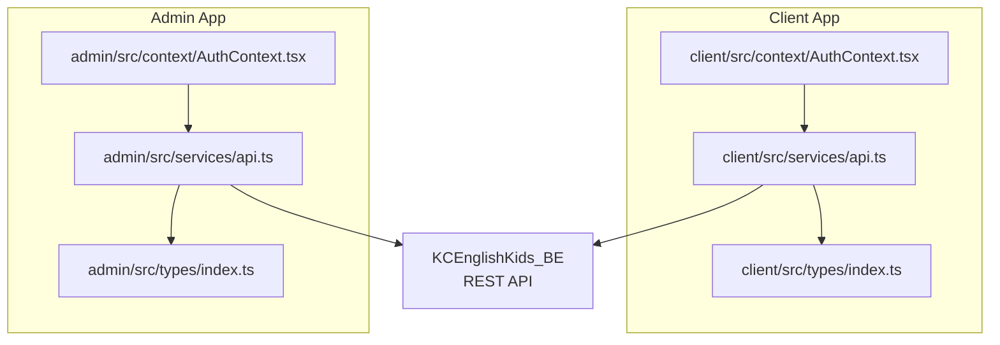
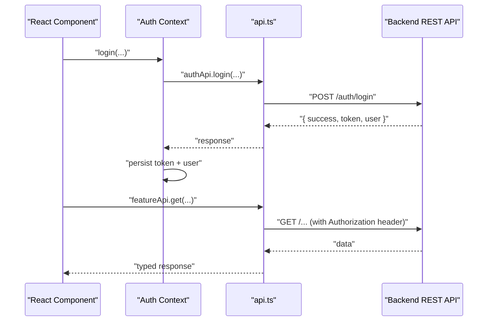
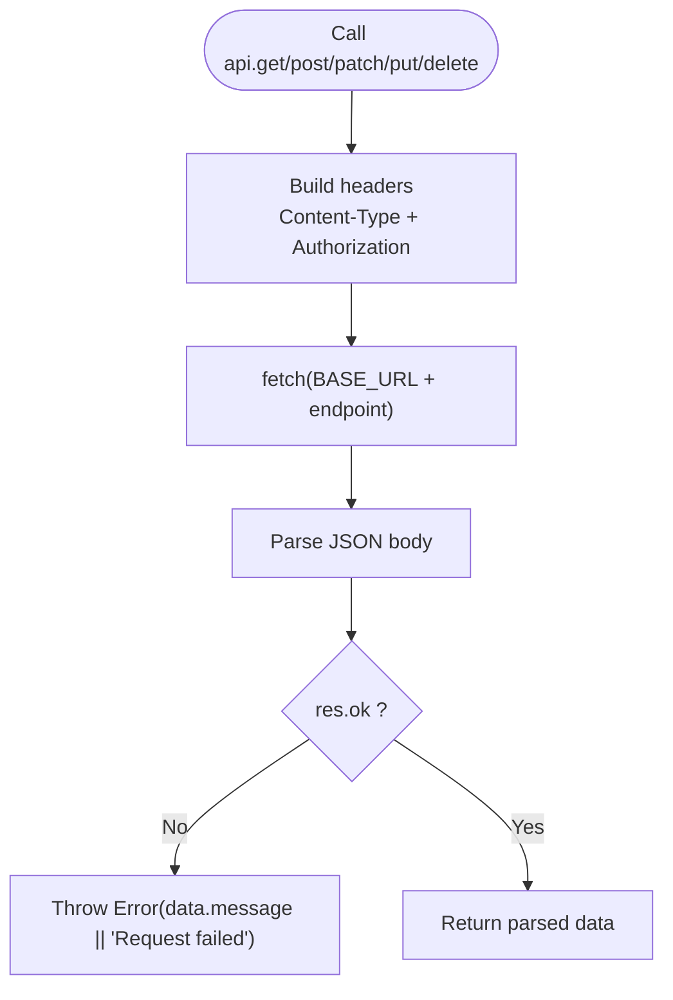
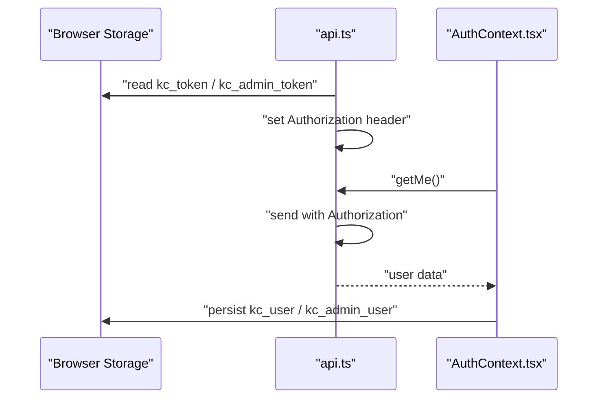
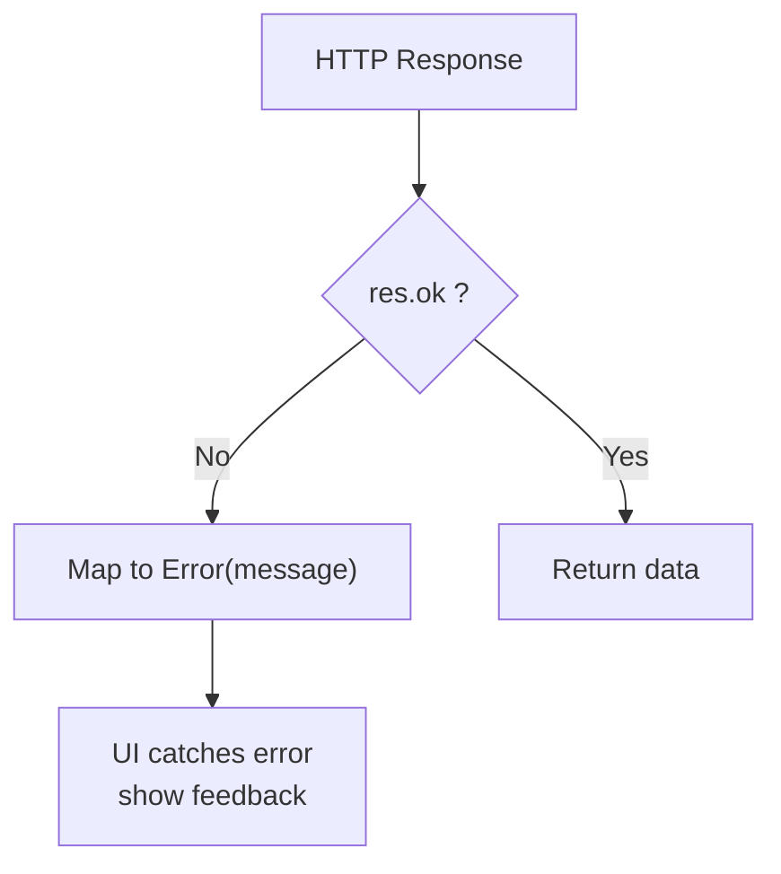
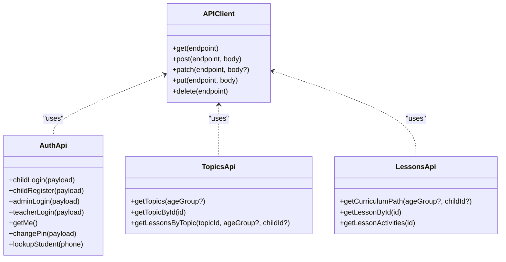
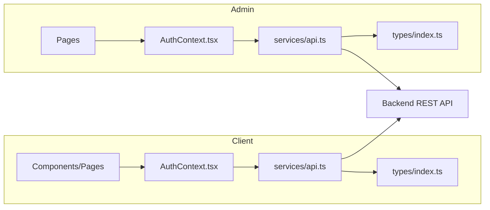

# API Service Layer & HTTP Client Architecture

<cite>
**Referenced Files in This Document**
- [client/src/services/api.ts](file://client/src/services/api.ts)
- [admin/src/services/api.ts](file://admin/src/services/api.ts)
- [client/src/context/AuthContext.tsx](file://client/src/context/AuthContext.tsx)
- [admin/src/context/AuthContext.tsx](file://admin/src/context/AuthContext.tsx)
- [client/src/types/index.ts](file://client/src/types/index.ts)
- [admin/src/types/index.ts](file://admin/src/types/index.ts)
- [KCEnglishKids_BE/src/middlewares/errorMiddleware.js](file://KCEnglishKids_BE/src/middlewares/errorMiddleware.js)
</cite>

## Table of Contents
1. [Introduction](#introduction)
2. [Project Structure](#project-structure)
3. [Core Components](#core-components)
4. [Architecture Overview](#architecture-overview)
5. [Detailed Component Analysis](#detailed-component-analysis)
6. [Dependency Analysis](#dependency-analysis)
7. [Performance Considerations](#performance-considerations)
8. [Troubleshooting Guide](#troubleshooting-guide)
9. [Conclusion](#conclusion)

## Introduction
This document explains the API service layer and HTTP client architecture across the client and admin applications. It covers centralized API client configuration, request/response handling, authentication token injection, error handling patterns, endpoint abstraction, type-safe calls, and integration points with authentication contexts. It also addresses current limitations (such as missing retry logic, caching, file upload support, and real-time data fetching) and provides recommendations for future enhancements.

## Project Structure
The frontend is split into two applications:
- Client app: child/teacher-facing features
- Admin app: administrative features

Both apps implement a small HTTP client using the Fetch API and expose domain-scoped API modules that wrap endpoints with typed parameters. Authentication state is managed via React contexts that persist tokens and user profiles to localStorage.

**Diagram sources**
- [client/src/services/api.ts:1-61](file://client/src/services/api.ts#L1-L61)
- [admin/src/services/api.ts:1-52](file://admin/src/services/api.ts#L1-L52)
- [client/src/context/AuthContext.tsx:1-161](file://client/src/context/AuthContext.tsx#L1-L161)
- [admin/src/context/AuthContext.tsx:1-82](file://admin/src/context/AuthContext.tsx#L1-L82)
- [client/src/types/index.ts:1-233](file://client/src/types/index.ts#L1-L233)
- [admin/src/types/index.ts:1-40](file://admin/src/types/index.ts#L1-L40)

**Section sources**
- [client/src/services/api.ts:1-61](file://client/src/services/api.ts#L1-L61)
- [admin/src/services/api.ts:1-52](file://admin/src/services/api.ts#L1-L52)
- [client/src/context/AuthContext.tsx:1-161](file://client/src/context/AuthContext.tsx#L1-L161)
- [admin/src/context/AuthContext.tsx:1-82](file://admin/src/context/AuthContext.tsx#L1-L82)
- [client/src/types/index.ts:1-233](file://client/src/types/index.ts#L1-L233)
- [admin/src/types/index.ts:1-40](file://admin/src/types/index.ts#L1-L40)

## Core Components
- Centralized HTTP client per application:
  - Base URL configuration
  - Header builder for Content-Type and Authorization
  - Typed HTTP methods: GET, POST, PATCH, PUT, DELETE
  - Error handling by throwing on non-OK responses
- Domain-scoped API modules:
  - Auth, Topics, Lessons, Vocabulary, Activities, Learning, Admin, Teacher, Classroom Session, Vocabulary Mastery, Parent Notification
- Authentication context:
  - Stores tokens and user profile in localStorage
  - Verifies session on app start
  - Triggers side effects (e.g., vocabulary mastery sync) after login

Key responsibilities:
- client/src/services/api.ts: base fetch wrapper and all domain APIs for the client app
- admin/src/services/api.ts: base fetch wrapper and admin-specific APIs
- client/src/context/AuthContext.tsx: auth flow and token persistence for client app
- admin/src/context/AuthContext.tsx: auth flow and token persistence for admin app
- Types files: shared TypeScript interfaces used by components and services

**Section sources**
- [client/src/services/api.ts:1-354](file://client/src/services/api.ts#L1-L354)
- [admin/src/services/api.ts:1-90](file://admin/src/services/api.ts#L1-L90)
- [client/src/context/AuthContext.tsx:1-161](file://client/src/context/AuthContext.tsx#L1-L161)
- [admin/src/context/AuthContext.tsx:1-82](file://admin/src/context/AuthContext.tsx#L1-L82)
- [client/src/types/index.ts:1-233](file://client/src/types/index.ts#L1-L233)
- [admin/src/types/index.ts:1-40](file://admin/src/types/index.ts#L1-L40)

## Architecture Overview
The API layer follows a simple, layered approach:
- HTTP client layer: thin wrappers around fetch with consistent headers and error behavior
- Service layer: domain-scoped modules exposing typed functions for each feature area
- UI layer: React components consume service methods; authentication is handled by contexts

**Diagram sources**
- [client/src/context/AuthContext.tsx:63-85](file://client/src/context/AuthContext.tsx#L63-L85)
- [client/src/services/api.ts:63-94](file://client/src/services/api.ts#L63-L94)
- [client/src/services/api.ts:11-61](file://client/src/services/api.ts#L11-L61)

## Detailed Component Analysis

### Centralized HTTP Client Configuration
- Base URL: Both apps define a constant BASE_URL set to '/api'.
- Headers:
  - Content-Type: application/json
  - Authorization: Bearer <token> when present in localStorage
- Methods:
  - get(endpoint), post(endpoint, body), patch(endpoint, body?), put(endpoint, body), delete(endpoint)
- Response handling:
  - Parse JSON
  - Throw Error if response.ok is false, using server-provided message or a default message

**Diagram sources**
- [client/src/services/api.ts:1-61](file://client/src/services/api.ts#L1-L61)
- [admin/src/services/api.ts:1-52](file://admin/src/services/api.ts#L1-L52)

**Section sources**
- [client/src/services/api.ts:1-61](file://client/src/services/api.ts#L1-L61)
- [admin/src/services/api.ts:1-52](file://admin/src/services/api.ts#L1-L52)

### Authentication Token Injection
- Client app:
  - Reads token from localStorage key kc_token
  - Injects Authorization header automatically
- Admin app:
  - Reads token from kc_admin_token first, then falls back to kc_token
  - Injects Authorization header automatically
- Auth contexts:
  - On successful login, store token and user object in localStorage
  - On app start, verify token by calling /auth/me and update local state

**Diagram sources**
- [client/src/services/api.ts:3-9](file://client/src/services/api.ts#L3-L9)
- [admin/src/services/api.ts:3-9](file://admin/src/services/api.ts#L3-L9)
- [client/src/context/AuthContext.tsx:37-61](file://client/src/context/AuthContext.tsx#L37-L61)
- [admin/src/context/AuthContext.tsx:22-45](file://admin/src/context/AuthContext.tsx#L22-L45)

**Section sources**
- [client/src/services/api.ts:3-9](file://client/src/services/api.ts#L3-L9)
- [admin/src/services/api.ts:3-9](file://admin/src/services/api.ts#L3-L9)
- [client/src/context/AuthContext.tsx:37-61](file://client/src/context/AuthContext.tsx#L37-L61)
- [admin/src/context/AuthContext.tsx:22-45](file://admin/src/context/AuthContext.tsx#L22-L45)

### Request/Response Interceptors and Error Handling
- Current implementation:
  - No interceptor library is used; error handling is inline within each method
  - Non-OK responses throw an Error with a message from the server payload or a fallback string
- Backend error middleware:
  - Returns a standardized JSON envelope with success: false, message, and optional stack
- Recommendations:
  - Introduce a single error boundary component at the UI layer to catch network errors and display user-friendly messages
  - Add global retry logic for transient failures (network timeouts, 5xx)
  - Normalize responses to a consistent shape (e.g., { success, data, message }) at the client layer

**Diagram sources**
- [client/src/services/api.ts:11-61](file://client/src/services/api.ts#L11-L61)
- [admin/src/services/api.ts:11-52](file://admin/src/services/api.ts#L11-L52)
- [KCEnglishKids_BE/src/middlewares/errorMiddleware.js:1-16](file://KCEnglishKids_BE/src/middlewares/errorMiddleware.js#L1-L16)

**Section sources**
- [client/src/services/api.ts:11-61](file://client/src/services/api.ts#L11-L61)
- [admin/src/services/api.ts:11-52](file://admin/src/services/api.ts#L11-L52)
- [KCEnglishKids_BE/src/middlewares/errorMiddleware.js:1-16](file://KCEnglishKids_BE/src/middlewares/errorMiddleware.js#L1-L16)

### Endpoint Abstraction Patterns and Type-Safe Calls
- Domain-scoped modules encapsulate related endpoints:
  - authApi, topicsApi, lessonsApi, vocabularyApi, activitiesApi, learningApi, adminApi, teacherApi, classroomSessionApi, vocabMasteryApi, parentNotificationApi
- Query parameter construction:
  - Use URLSearchParams to build query strings conditionally
- Type safety:
  - Function parameters are strongly typed
  - Shared types live in types/index.ts for both apps

Examples of operations:
- GET: topicsApi.getTopics(ageGroup?)
- POST: authApi.childLogin(payload)
- PUT: teacherApi.updateClass(id, data)
- DELETE: teacherApi.removeStudent(classId, studentId)

**Diagram sources**
- [client/src/services/api.ts:11-61](file://client/src/services/api.ts#L11-L61)
- [client/src/services/api.ts:63-158](file://client/src/services/api.ts#L63-L158)
- [client/src/services/api.ts:96-122](file://client/src/services/api.ts#L96-L122)

**Section sources**
- [client/src/services/api.ts:63-354](file://client/src/services/api.ts#L63-L354)
- [client/src/types/index.ts:1-233](file://client/src/types/index.ts#L1-L233)

### File Upload Handling
- Current status:
  - The HTTP client only serializes JSON bodies and sets Content-Type to application/json
  - There is no dedicated file upload method or multipart/form-data support
- Recommendation:
  - Add a fileUpload method that constructs FormData and sends it without setting Content-Type manually so the browser can set the correct multipart boundary
  - Provide progress tracking and cancellation where possible

[No sources needed since this section provides general guidance]

### Real-Time Data Fetching
- Current status:
  - No WebSocket or Server-Sent Events implementation is present in the client or admin apps
- Recommendation:
  - Implement a lightweight real-time client (WebSocket or SSE) for live classroom sessions and activity results
  - Integrate with the existing auth context to attach tokens to connections

[No sources needed since this section provides general guidance]

### Caching Strategies and Request Deduplication
- Current status:
  - No in-memory cache or request deduplication is implemented
- Recommendation:
  - Introduce a small cache keyed by normalized request URLs and parameters
  - Debounce repeated identical requests and return the same promise until completion
  - Consider time-based invalidation for frequently changing resources

[No sources needed since this section provides general guidance]

### Performance Optimization Techniques
- Current status:
  - Requests are made directly with fetch; no retries, caching, or batching
- Recommendations:
  - Add exponential backoff retry for transient errors
  - Cache GET requests with appropriate TTL
  - Batch small writes where supported by the backend
  - Use AbortController for cancellable requests during navigation

[No sources needed since this section provides general guidance]

## Dependency Analysis
The following diagram shows how the client and admin apps depend on their respective API clients and authentication contexts.

**Diagram sources**
- [client/src/context/AuthContext.tsx:1-161](file://client/src/context/AuthContext.tsx#L1-L161)
- [client/src/services/api.ts:1-354](file://client/src/services/api.ts#L1-L354)
- [client/src/types/index.ts:1-233](file://client/src/types/index.ts#L1-L233)
- [admin/src/context/AuthContext.tsx:1-82](file://admin/src/context/AuthContext.tsx#L1-L82)
- [admin/src/services/api.ts:1-90](file://admin/src/services/api.ts#L1-L90)
- [admin/src/types/index.ts:1-40](file://admin/src/types/index.ts#L1-L40)

**Section sources**
- [client/src/context/AuthContext.tsx:1-161](file://client/src/context/AuthContext.tsx#L1-L161)
- [client/src/services/api.ts:1-354](file://client/src/services/api.ts#L1-L354)
- [client/src/types/index.ts:1-233](file://client/src/types/index.ts#L1-L233)
- [admin/src/context/AuthContext.tsx:1-82](file://admin/src/context/AuthContext.tsx#L1-L82)
- [admin/src/services/api.ts:1-90](file://admin/src/services/api.ts#L1-L90)
- [admin/src/types/index.ts:1-40](file://admin/src/types/index.ts#L1-L40)

## Performance Considerations
- Network overhead:
  - All requests use JSON serialization; ensure payloads are minimal
- Latency:
  - Add retries with backoff for transient failures
  - Cache stable GET responses to reduce redundant network calls
- Concurrency:
  - Avoid duplicate concurrent requests by deduplicating based on normalized request keys
- Memory:
  - Limit cache size and implement eviction policies
- UX:
  - Show loading states and cancel in-flight requests on route changes

[No sources needed since this section provides general guidance]

## Troubleshooting Guide
Common issues and resolutions:
- Unauthorized or expired sessions:
  - Ensure tokens are stored correctly in localStorage and included in headers
  - Verify /auth/me returns valid user data; clear stale tokens on failure
- Network errors:
  - Wrap API calls in try/catch and display user-friendly messages
  - Implement retry logic for transient errors
- Inconsistent responses:
  - Normalize response shapes at the client layer
  - Validate expected fields before rendering UI

Operational checks:
- Confirm BASE_URL resolves to the correct backend path
- Verify Authorization header presence for protected routes
- Inspect backend error middleware output for meaningful messages

**Section sources**
- [client/src/services/api.ts:11-61](file://client/src/services/api.ts#L11-L61)
- [admin/src/services/api.ts:11-52](file://admin/src/services/api.ts#L11-L52)
- [client/src/context/AuthContext.tsx:37-61](file://client/src/context/AuthContext.tsx#L37-L61)
- [admin/src/context/AuthContext.tsx:22-45](file://admin/src/context/AuthContext.tsx#L22-L45)
- [KCEnglishKids_BE/src/middlewares/errorMiddleware.js:1-16](file://KCEnglishKids_BE/src/middlewares/errorMiddleware.js#L1-L16)

## Conclusion
The API service layer is intentionally simple and focused on clarity:
- A thin HTTP client wraps fetch with consistent headers and error handling
- Domain-scoped API modules provide typed, easy-to-use endpoints
- Authentication contexts manage tokens and user state

To improve resilience and performance, consider adding:
- Global retry and backoff
- Caching and request deduplication
- File upload support
- Real-time communication for live features
- Centralized error boundaries and user feedback

These enhancements will make the system more robust while preserving its straightforward design.