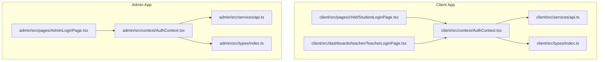
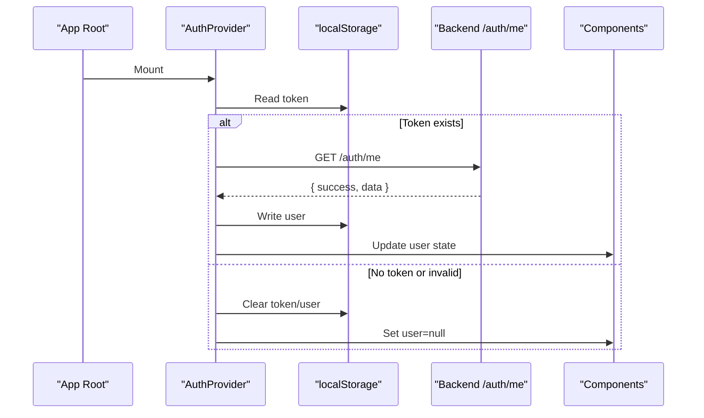
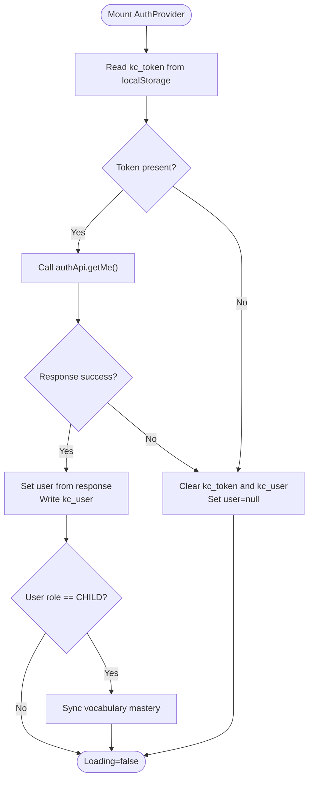
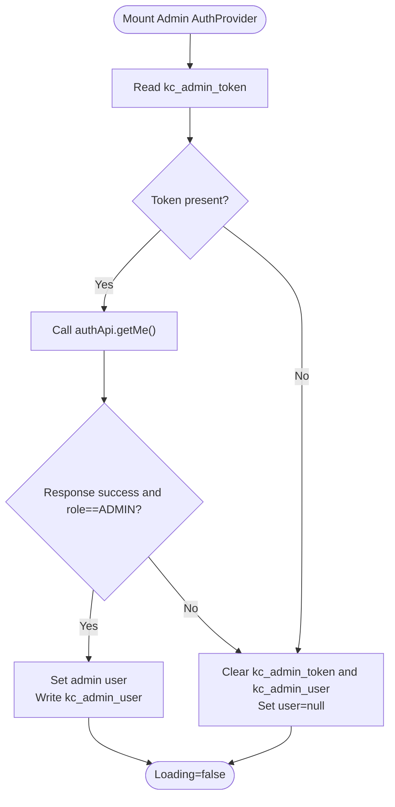
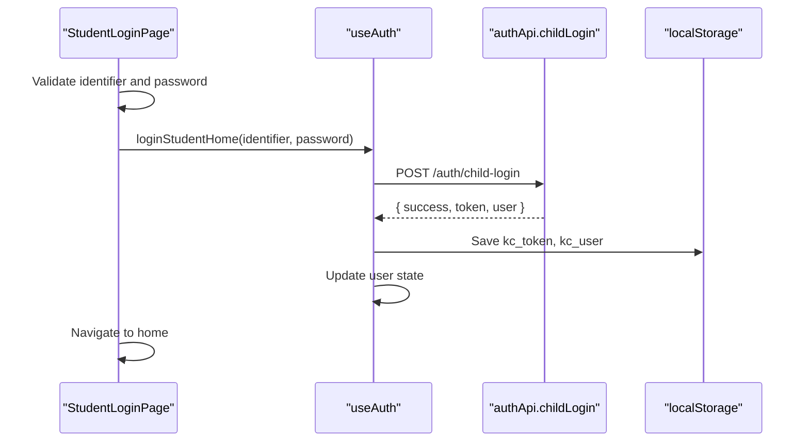
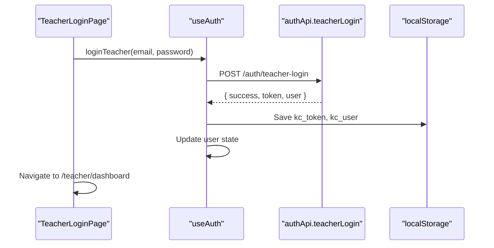
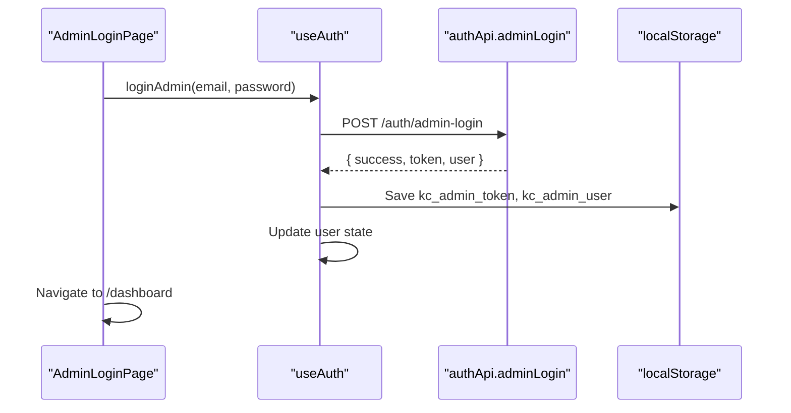
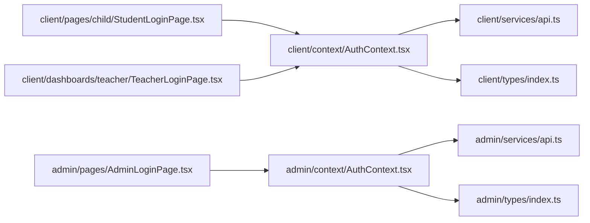

# Authentication Context & User Session Management

<cite>
**Referenced Files in This Document**
- [client/src/context/AuthContext.tsx](file://client/src/context/AuthContext.tsx)
- [admin/src/context/AuthContext.tsx](file://admin/src/context/AuthContext.tsx)
- [client/src/services/api.ts](file://client/src/services/api.ts)
- [admin/src/services/api.ts](file://admin/src/services/api.ts)
- [client/src/types/index.ts](file://client/src/types/index.ts)
- [admin/src/types/index.ts](file://admin/src/types/index.ts)
- [client/src/pages/child/StudentLoginPage.tsx](file://client/src/pages/child/StudentLoginPage.tsx)
- [client/src/dashboards/teacher/TeacherLoginPage.tsx](file://client/src/dashboards/teacher/TeacherLoginPage.tsx)
- [admin/src/pages/AdminLoginPage.tsx](file://admin/src/pages/AdminLoginPage.tsx)
</cite>

## Table of Contents
1. [Introduction](#introduction)
2. [Project Structure](#project-structure)
3. [Core Components](#core-components)
4. [Architecture Overview](#architecture-overview)
5. [Detailed Component Analysis](#detailed-component-analysis)
6. [Dependency Analysis](#dependency-analysis)
7. [Performance Considerations](#performance-considerations)
8. [Troubleshooting Guide](#troubleshooting-guide)
9. [Conclusion](#conclusion)

## Introduction
This document explains the authentication context implementation using React Context API across two applications: the client app for children, parents, and teachers, and the admin application for system administrators. It covers the AuthProvider architecture, user session management, role-based access control, PIN-based child authentication, email/password authentication for teachers and admins, automatic token validation on startup, localStorage persistence, session expiration handling, cross-component state synchronization, error handling patterns, security considerations, and performance optimizations.

## Project Structure
The authentication logic is split between two React applications:
- Client application: child login via PIN or identifier/password, teacher login, and vocabulary mastery sync for children.
- Admin application: admin-only login with strict role checks.

**Diagram sources**
- [client/src/context/AuthContext.tsx:1-161](file://client/src/context/AuthContext.tsx#L1-L161)
- [client/src/services/api.ts:1-94](file://client/src/services/api.ts#L1-L94)
- [client/src/pages/child/StudentLoginPage.tsx:1-461](file://client/src/pages/child/StudentLoginPage.tsx#L1-L461)
- [client/src/dashboards/teacher/TeacherLoginPage.tsx:1-134](file://client/src/dashboards/teacher/TeacherLoginPage.tsx#L1-L134)
- [client/src/types/index.ts:1-233](file://client/src/types/index.ts#L1-L233)
- [admin/src/context/AuthContext.tsx:1-82](file://admin/src/context/AuthContext.tsx#L1-L82)
- [admin/src/services/api.ts:1-90](file://admin/src/services/api.ts#L1-L90)
- [admin/src/pages/AdminLoginPage.tsx:1-140](file://admin/src/pages/AdminLoginPage.tsx#L1-L140)
- [admin/src/types/index.ts:1-40](file://admin/src/types/index.ts#L1-L40)

**Section sources**
- [client/src/context/AuthContext.tsx:1-161](file://client/src/context/AuthContext.tsx#L1-L161)
- [admin/src/context/AuthContext.tsx:1-82](file://admin/src/context/AuthContext.tsx#L1-L82)

## Core Components
- AuthProvider (client): Provides user state, loading state, child login methods (PIN and identifier/password), registration, teacher/admin login, logout, and age group updates. It persists tokens and user data to localStorage and validates sessions on startup.
- AuthProvider (admin): Provides admin-only user state, loading state, admin login, logout, and strict role verification on startup.
- useAuth hook: Consumes the AuthContext and throws if used outside a provider.
- API clients: Centralized fetch wrappers that attach Authorization headers from localStorage tokens.

Key responsibilities:
- Session initialization and validation on app start.
- Token and user persistence in localStorage.
- Role-aware flows (CHILD, TEACHER, ADMIN).
- Error handling and UI feedback through components.

**Section sources**
- [client/src/context/AuthContext.tsx:6-161](file://client/src/context/AuthContext.tsx#L6-L161)
- [admin/src/context/AuthContext.tsx:5-82](file://admin/src/context/AuthContext.tsx#L5-L82)
- [client/src/services/api.ts:1-94](file://client/src/services/api.ts#L1-L94)
- [admin/src/services/api.ts:1-58](file://admin/src/services/api.ts#L1-L58)

## Architecture Overview
The authentication flow integrates React Context, local storage, and backend APIs. On startup, each AuthProvider attempts to validate an existing token by calling /auth/me. If valid, it restores the user; otherwise, it clears stale tokens and marks the user as null. Login flows store tokens and user objects in localStorage and update React state.

**Diagram sources**
- [client/src/context/AuthContext.tsx:30-61](file://client/src/context/AuthContext.tsx#L30-L61)
- [admin/src/context/AuthContext.tsx:15-45](file://admin/src/context/AuthContext.tsx#L15-L45)
- [client/src/services/api.ts:1-19](file://client/src/services/api.ts#L1-L19)
- [admin/src/services/api.ts:1-19](file://admin/src/services/api.ts#L1-L19)

## Detailed Component Analysis

### Client AuthProvider
Responsibilities:
- Initialize user from localStorage and set loading state.
- Validate token on mount by calling authApi.getMe().
- Persist token and user after successful login/register.
- Provide loginChild, loginStudentHome, registerChild, loginTeacher, loginAdmin, logout, setUser, setAgeGroup.
- Sync vocabulary mastery for CHILD users after login and session restore.

Session validation and expiration:
- On startup, if token exists, call /auth/me. On failure, clear kc_token and kc_user, set user to null.

Token and user persistence:
- Stores kc_token and kc_user in localStorage on successful operations.
- Updates kc_user when age group changes.

Role-based behavior:
- For CHILD users, triggers vocabulary mastery sync with backend.

Error handling:
- Catches errors during session validation and logs a warning while clearing stale state.

**Diagram sources**
- [client/src/context/AuthContext.tsx:30-61](file://client/src/context/AuthContext.tsx#L30-L61)
- [client/src/context/AuthContext.tsx:63-85](file://client/src/context/AuthContext.tsx#L63-L85)
- [client/src/context/AuthContext.tsx:105-121](file://client/src/context/AuthContext.tsx#L105-L121)
- [client/src/context/AuthContext.tsx:123-134](file://client/src/context/AuthContext.tsx#L123-L134)

**Section sources**
- [client/src/context/AuthContext.tsx:6-161](file://client/src/context/AuthContext.tsx#L6-L161)
- [client/src/services/api.ts:64-94](file://client/src/services/api.ts#L64-L94)

### Admin AuthProvider
Responsibilities:
- Initialize admin user from localStorage keys kc_admin_user and kc_admin_token.
- Validate token on mount by calling /auth/me and enforcing role === 'ADMIN'.
- Provide loginAdmin and logout.
- Clear admin-specific tokens and user on expiration or unauthorized responses.

Security note:
- Strictly enforces ADMIN role during session restoration.

**Diagram sources**
- [admin/src/context/AuthContext.tsx:15-45](file://admin/src/context/AuthContext.tsx#L15-L45)

**Section sources**
- [admin/src/context/AuthContext.tsx:5-82](file://admin/src/context/AuthContext.tsx#L5-L82)
- [admin/src/services/api.ts:54-58](file://admin/src/services/api.ts#L54-L58)

### Student Login Flow (PIN and Identifier/Password)
The student login page supports:
- Email or phone identifier plus password/PIN.
- Quick demo accounts for different age groups.
- Parent phone lookup to find child accounts.
- Integration with useAuth.loginStudentHome.

Flow highlights:
- Validates inputs and shows friendly errors.
- Calls loginStudentHome which uses authApi.childLogin with identifier/password.
- On success, navigates to the home route.

**Diagram sources**
- [client/src/pages/child/StudentLoginPage.tsx:51-63](file://client/src/pages/child/StudentLoginPage.tsx#L51-L63)
- [client/src/context/AuthContext.tsx:75-85](file://client/src/context/AuthContext.tsx#L75-L85)
- [client/src/services/api.ts:64-94](file://client/src/services/api.ts#L64-L94)

**Section sources**
- [client/src/pages/child/StudentLoginPage.tsx:1-461](file://client/src/pages/child/StudentLoginPage.tsx#L1-L461)
- [client/src/context/AuthContext.tsx:75-85](file://client/src/context/AuthContext.tsx#L75-L85)

### Teacher Login Flow
The teacher login page:
- Accepts email and password.
- Uses useAuth.loginTeacher.
- Navigates to /teacher/dashboard on success.

**Diagram sources**
- [client/src/dashboards/teacher/TeacherLoginPage.tsx:17-31](file://client/src/dashboards/teacher/TeacherLoginPage.tsx#L17-L31)
- [client/src/context/AuthContext.tsx:114-121](file://client/src/context/AuthContext.tsx#L114-L121)
- [client/src/services/api.ts:85-88](file://client/src/services/api.ts#L85-L88)

**Section sources**
- [client/src/dashboards/teacher/TeacherLoginPage.tsx:1-134](file://client/src/dashboards/teacher/TeacherLoginPage.tsx#L1-L134)
- [client/src/context/AuthContext.tsx:114-121](file://client/src/context/AuthContext.tsx#L114-L121)

### Admin Login Flow
The admin login page:
- Accepts email and password.
- Uses useAuth.loginAdmin.
- Navigates to /dashboard on success.

**Diagram sources**
- [admin/src/pages/AdminLoginPage.tsx:16-29](file://admin/src/pages/AdminLoginPage.tsx#L16-L29)
- [admin/src/context/AuthContext.tsx:47-54](file://admin/src/context/AuthContext.tsx#L47-L54)
- [admin/src/services/api.ts:54-58](file://admin/src/services/api.ts#L54-L58)

**Section sources**
- [admin/src/pages/AdminLoginPage.tsx:1-140](file://admin/src/pages/AdminLoginPage.tsx#L1-L140)
- [admin/src/context/AuthContext.tsx:47-54](file://admin/src/context/AuthContext.tsx#L47-L54)

### useAuth Custom Hook Usage
- The hook provides access to user, loading, and authentication methods.
- Throws an error if used outside AuthProvider, ensuring safe usage within the context tree.

Usage examples:
- StudentLoginPage calls loginStudentHome and handles errors.
- TeacherLoginPage calls loginTeacher and navigates on success.
- AdminLoginPage calls loginAdmin and navigates on success.

**Section sources**
- [client/src/context/AuthContext.tsx:156-161](file://client/src/context/AuthContext.tsx#L156-L161)
- [client/src/pages/child/StudentLoginPage.tsx:47-63](file://client/src/pages/child/StudentLoginPage.tsx#L47-L63)
- [client/src/dashboards/teacher/TeacherLoginPage.tsx:14-31](file://client/src/dashboards/teacher/TeacherLoginPage.tsx#L14-L31)
- [admin/src/pages/AdminLoginPage.tsx:13-29](file://admin/src/pages/AdminLoginPage.tsx#L13-L29)

### Data Models
- User type includes id, name, role, avatar fields, and optional fields like email, ageGroupCode, assignedClass, parentContact.
- Role enum includes ADMIN, TEACHER, CHILD, PARENT.

These types are used by both client and admin contexts to ensure consistent shape of authenticated users.

**Section sources**
- [client/src/types/index.ts:1-15](file://client/src/types/index.ts#L1-L15)
- [admin/src/types/index.ts:1-14](file://admin/src/types/index.ts#L1-L14)

## Dependency Analysis
The authentication layer depends on:
- React Context API for global state.
- localStorage for token and user persistence.
- API clients for network requests with Authorization headers.
- Types for consistent user modeling.

**Diagram sources**
- [client/src/context/AuthContext.tsx:1-161](file://client/src/context/AuthContext.tsx#L1-L161)
- [client/src/services/api.ts:1-94](file://client/src/services/api.ts#L1-L94)
- [client/src/types/index.ts:1-233](file://client/src/types/index.ts#L1-L233)
- [admin/src/context/AuthContext.tsx:1-82](file://admin/src/context/AuthContext.tsx#L1-L82)
- [admin/src/services/api.ts:1-90](file://admin/src/services/api.ts#L1-L90)
- [admin/src/types/index.ts:1-40](file://admin/src/types/index.ts#L1-L40)
- [client/src/pages/child/StudentLoginPage.tsx:1-461](file://client/src/pages/child/StudentLoginPage.tsx#L1-L461)
- [client/src/dashboards/teacher/TeacherLoginPage.tsx:1-134](file://client/src/dashboards/teacher/TeacherLoginPage.tsx#L1-L134)
- [admin/src/pages/AdminLoginPage.tsx:1-140](file://admin/src/pages/AdminLoginPage.tsx#L1-L140)

**Section sources**
- [client/src/context/AuthContext.tsx:1-161](file://client/src/context/AuthContext.tsx#L1-L161)
- [admin/src/context/AuthContext.tsx:1-82](file://admin/src/context/AuthContext.tsx#L1-L82)

## Performance Considerations
- Memoization opportunities:
  - Wrap AuthProvider value object with useMemo to prevent unnecessary re-renders of consumers.
  - Use useCallback for handlers like loginChild, loginStudentHome, registerChild, loginAdmin, loginTeacher, logout, setUser, setAgeGroup to stabilize references.
- Re-render prevention:
  - Split context into smaller contexts (e.g., AuthState and AuthActions) to reduce subscriber updates.
  - Avoid storing large objects in context; keep minimal user shape and load heavy data lazily.
- LocalStorage reads/writes:
  - Batch writes where possible (e.g., combine token and user updates).
  - Debounce frequent updates if needed (e.g., during rapid interactions).
- Network efficiency:
  - Cache /auth/me responses briefly to avoid redundant validations on fast navigation.
  - Implement retry/backoff for transient failures during session validation.

[No sources needed since this section provides general guidance]

## Troubleshooting Guide
Common issues and resolutions:
- Session expired on startup:
  - Symptom: User becomes null after refresh.
  - Cause: /auth/me fails due to invalid/expired token.
  - Resolution: Clear stale tokens; prompt user to log in again.
- Unauthorized admin access:
  - Symptom: Admin session cleared even if token exists.
  - Cause: Response indicates role !== 'ADMIN'.
  - Resolution: Ensure correct admin credentials and server-side role assignment.
- Token not attached to requests:
  - Symptom: API returns 401 or request failed.
  - Cause: Missing or incorrect Authorization header.
  - Resolution: Verify localStorage contains kc_token or kc_admin_token and API getHeaders function reads them correctly.
- Vocabulary mastery not syncing:
  - Symptom: Child progress not updated after login.
  - Cause: Not triggered for non-CHILD roles or missing user id.
  - Resolution: Confirm user.role === 'CHILD' and user.id/_id is present before sync.

**Section sources**
- [client/src/context/AuthContext.tsx:37-61](file://client/src/context/AuthContext.tsx#L37-L61)
- [admin/src/context/AuthContext.tsx:22-45](file://admin/src/context/AuthContext.tsx#L22-L45)
- [client/src/services/api.ts:3-9](file://client/src/services/api.ts#L3-L9)
- [admin/src/services/api.ts:3-9](file://admin/src/services/api.ts#L3-L9)

## Conclusion
The authentication system leverages React Context to manage user sessions across components, persisting tokens and user data in localStorage and validating sessions on startup. The client AuthProvider supports multiple login flows including PIN-based child authentication and email/password for teachers and admins, with role-aware behaviors such as vocabulary mastery sync for children. The admin AuthProvider enforces strict ADMIN role checks. Error handling is integrated at both context and UI levels, and performance can be improved through memoization and context splitting. Security considerations include careful token storage and validation, and future enhancements could introduce token refresh strategies and more granular authorization guards.

[No sources needed since this section summarizes without analyzing specific files]