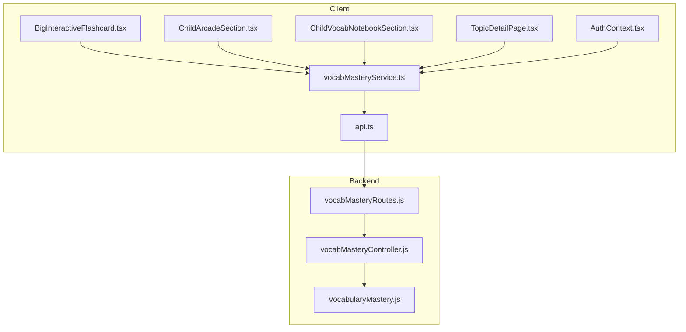
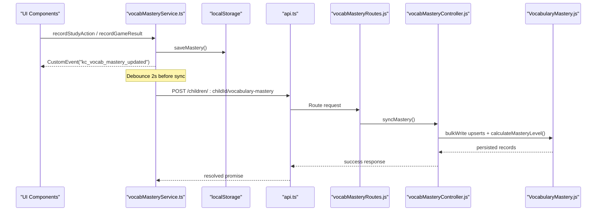
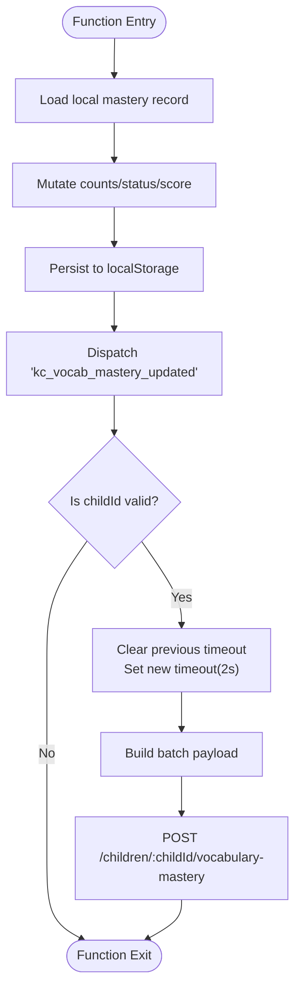
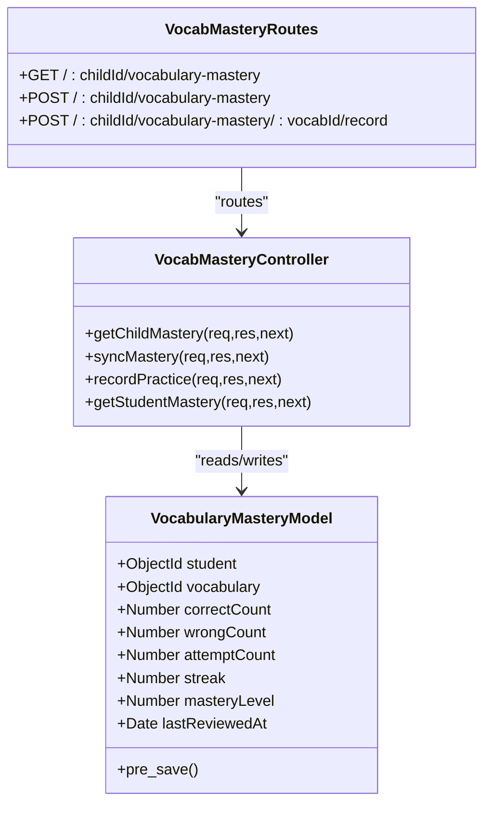
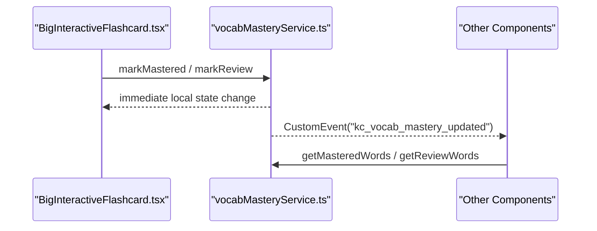
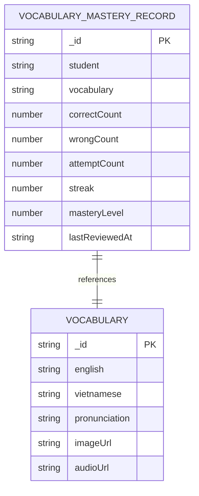
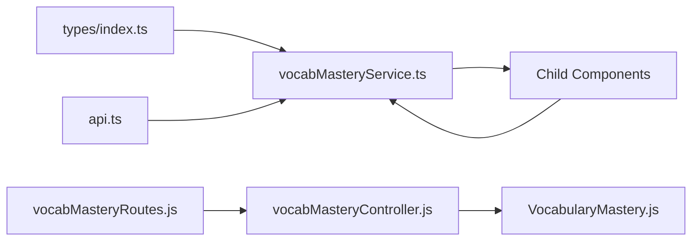

# Domain State Services & Business Logic

<cite>
**Referenced Files in This Document**
- [vocabMasteryService.ts](file://client/src/services/vocabMasteryService.ts)
- [api.ts](file://client/src/services/api.ts)
- [vocabMasteryController.js](file://KCEnglishKids_BE/src/controllers/vocabMasteryController.js)
- [VocabularyMastery.js](file://KCEnglishKids_BE/src/models/VocabularyMastery.js)
- [vocabMasteryRoutes.js](file://KCEnglishKids_BE/src/routes/vocabMasteryRoutes.js)
- [index.ts](file://client/src/types/index.ts)
- [BigInteractiveFlashcard.tsx](file://client/src/components/child/BigInteractiveFlashcard.tsx)
- [ChildArcadeSection.tsx](file://client/src/components/child/ChildArcadeSection.tsx)
- [ChildVocabNotebookSection.tsx](file://client/src/components/child/ChildVocabNotebookSection.tsx)
- [TopicDetailPage.tsx](file://client/src/pages/child/TopicDetailPage.tsx)
- [AuthContext.tsx](file://client/src/context/AuthContext.tsx)
</cite>

## Table of Contents
1. [Introduction](#introduction)
2. [Project Structure](#project-structure)
3. [Core Components](#core-components)
4. [Architecture Overview](#architecture-overview)
5. [Detailed Component Analysis](#detailed-component-analysis)
6. [Dependency Analysis](#dependency-analysis)
7. [Performance Considerations](#performance-considerations)
8. [Troubleshooting Guide](#troubleshooting-guide)
9. [Conclusion](#conclusion)

## Introduction
This document explains the domain-specific state services that manage vocabulary mastery for children, including local state persistence, backend synchronization, and progress calculation algorithms. It covers optimistic updates, conflict resolution strategies, data consistency mechanisms, service composition patterns, dependency injection approaches, testability considerations, batch operations, real-time UI updates, memory management, cleanup procedures, and performance monitoring for long-running operations.

The system is split between:
- A client-side service that owns per-child vocabulary mastery state in localStorage, computes a 0–100 mastery score, and debounced-syncs to the backend.
- A backend controller and model that store canonical mastery records, compute server-side mastery levels, and enforce access control.

## Project Structure
The vocabulary mastery feature spans both frontend and backend layers:

- Client service layer:
  - `client/src/services/vocabMasteryService.ts`: Local state manager, scoring algorithm, sync orchestration, and event-driven UI updates.
  - `client/src/services/api.ts`: HTTP client wrappers, including vocabulary mastery endpoints.
  - `client/src/types/index.ts`: Shared TypeScript types for mastery records and summaries.
  - Child-facing components consume the service for flashcards, arcade games, notebook views, and topic pages.

- Backend layer:
  - `KCEnglishKids_BE/src/controllers/vocabMasteryController.js`: REST endpoints for reading, syncing, and recording practice attempts.
  - `KCEnglishKids_BE/src/models/VocabularyMastery.js`: Mongoose schema, unique constraints, pre-save hooks, and server-side mastery level calculation.
  - `KCEnglishKids_BE/src/routes/vocabMasteryRoutes.js`: Express routes wired with authentication middleware.

**Diagram sources**
- [vocabMasteryService.ts:1-371](file://client/src/services/vocabMasteryService.ts#L1-L371)
- [api.ts:298-318](file://client/src/services/api.ts#L298-L318)
- [vocabMasteryRoutes.js:1-15](file://KCEnglishKids_BE/src/routes/vocabMasteryRoutes.js#L1-L15)
- [vocabMasteryController.js:1-184](file://KCEnglishKids_BE/src/controllers/vocabMasteryController.js#L1-L184)
- [VocabularyMastery.js:1-98](file://KCEnglishKids_BE/src/models/VocabularyMastery.js#L1-L98)

**Section sources**
- [vocabMasteryService.ts:1-371](file://client/src/services/vocabMasteryService.ts#L1-L371)
- [api.ts:298-318](file://client/src/services/api.ts#L298-L318)
- [vocabMasteryRoutes.js:1-15](file://KCEnglishKids_BE/src/routes/vocabMasteryRoutes.js#L1-L15)
- [vocabMasteryController.js:1-184](file://KCEnglishKids_BE/src/controllers/vocabMasteryController.js#L1-L184)
- [VocabularyMastery.js:1-98](file://KCEnglishKids_BE/src/models/VocabularyMastery.js#L1-L98)

## Core Components
- Vocabulary Mastery Service (client):
  - Owns per-child mastery state in localStorage under a namespaced key.
  - Computes a blended mastery score from flashcard and game outcomes.
  - Provides methods for study actions, game results, status toggling, journey word registration, and query helpers.
  - Emits a custom DOM event on state changes so UI components can react without prop drilling.
  - Debounces background synchronization to the backend.

- API Layer (client):
  - Exposes typed functions for vocabulary mastery endpoints: get child mastery, bulk sync, record single practice, teacher view.

- Backend Controller:
  - Validates IDs and roles.
  - Returns populated mastery records with summary counts.
  - Accepts bulk upserts and recalculates server-side mastery levels.
  - Records individual practice attempts with streak logic.

- Backend Model:
  - Defines schema, indexes, and pre-save hook to auto-calculate mastery level.
  - Enforces one record per student-vocabulary pair.

**Section sources**
- [vocabMasteryService.ts:6-33](file://client/src/services/vocabMasteryService.ts#L6-L33)
- [vocabMasteryService.ts:37-51](file://client/src/services/vocabMasteryService.ts#L37-L51)
- [vocabMasteryService.ts:53-105](file://client/src/services/vocabMasteryService.ts#L53-L105)
- [vocabMasteryService.ts:107-157](file://client/src/services/vocabMasteryService.ts#L107-L157)
- [vocabMasteryService.ts:159-371](file://client/src/services/vocabMasteryService.ts#L159-L371)
- [api.ts:298-318](file://client/src/services/api.ts#L298-L318)
- [vocabMasteryController.js:11-41](file://KCEnglishKids_BE/src/controllers/vocabMasteryController.js#L11-L41)
- [vocabMasteryController.js:48-112](file://KCEnglishKids_BE/src/controllers/vocabMasteryController.js#L48-L112)
- [vocabMasteryController.js:119-155](file://KCEnglishKids_BE/src/controllers/vocabMasteryController.js#L119-L155)
- [VocabularyMastery.js:5-46](file://KCEnglishKids_BE/src/models/VocabularyMastery.js#L5-L46)
- [VocabularyMastery.js:49-98](file://KCEnglishKids_BE/src/models/VocabularyMastery.js#L49-L98)

## Architecture Overview
The architecture follows an optimistic update pattern:
- UI calls the service to mutate local state immediately.
- The service persists to localStorage and emits a custom event for UI refresh.
- A debounced background task batches changed words and sends them to the backend.
- On app login or session start, the service fetches server mastery and merges it into local state.

**Diagram sources**
- [vocabMasteryService.ts:76-105](file://client/src/services/vocabMasteryService.ts#L76-L105)
- [vocabMasteryService.ts:159-223](file://client/src/services/vocabMasteryService.ts#L159-L223)
- [vocabMasteryService.ts:265-285](file://client/src/services/vocabMasteryService.ts#L265-L285)
- [api.ts:302-311](file://client/src/services/api.ts#L302-L311)
- [vocabMasteryRoutes.js:9-13](file://KCEnglishKids_BE/src/routes/vocabMasteryRoutes.js#L9-L13)
- [vocabMasteryController.js:48-112](file://KCEnglishKids_BE/src/controllers/vocabMasteryController.js#L48-L112)
- [VocabularyMastery.js:89-93](file://KCEnglishKids_BE/src/models/VocabularyMastery.js#L89-L93)

## Detailed Component Analysis

### Vocabulary Mastery Service (Client)
Responsibilities:
- Local state read/write with integrity checks.
- Score computation blending flashcard and game performance.
- Optimistic updates via immediate localStorage writes and DOM events.
- Background batch sync with debouncing.
- Server merge strategy when fetching existing mastery.
- Query helpers for learned, mastered, review lists and membership checks.

Key implementation highlights:
- Storage key prefixing by child ID ensures isolation.
- `saveMastery` dispatches a custom event and schedules a debounced sync.
- `syncWithBackend` maps server records to local detail objects and updates lists.
- Study action and game result handlers update counts, statuses, and scores.
- Journey word registration seeds new entries with initial mastery metadata.

**Diagram sources**
- [vocabMasteryService.ts:76-105](file://client/src/services/vocabMasteryService.ts#L76-L105)
- [vocabMasteryService.ts:159-223](file://client/src/services/vocabMasteryService.ts#L159-L223)
- [vocabMasteryService.ts:265-285](file://client/src/services/vocabMasteryService.ts#L265-L285)

Complexity notes:
- Reading/writing local state is O(1) per word; list queries are O(n) where n is number of tracked words.
- Sorting returned lists adds O(n log n).
- Batch building is O(n) over vocabDetails.

Error handling:
- Parsing errors fall back to empty state.
- Network failures during sync are logged and do not break local state.

**Section sources**
- [vocabMasteryService.ts:58-74](file://client/src/services/vocabMasteryService.ts#L58-L74)
- [vocabMasteryService.ts:76-105](file://client/src/services/vocabMasteryService.ts#L76-L105)
- [vocabMasteryService.ts:107-157](file://client/src/services/vocabMasteryService.ts#L107-L157)
- [vocabMasteryService.ts:159-223](file://client/src/services/vocabMasteryService.ts#L159-L223)
- [vocabMasteryService.ts:239-285](file://client/src/services/vocabMasteryService.ts#L239-L285)
- [vocabMasteryService.ts:290-332](file://client/src/services/vocabMasteryService.ts#L290-L332)
- [vocabMasteryService.ts:337-371](file://client/src/services/vocabMasteryService.ts#L337-L371)

### Backend Controller and Model
Responsibilities:
- Validate parameters and enforce role-based access.
- Provide summary statistics for mastery categories.
- Bulk upsert mastery records and compute server-side mastery levels.
- Record single practice attempts with streak tracking.
- Ensure uniqueness per student-vocabulary pair.

Server-side mastery calculation:
- Uses configurable thresholds for streak, accuracy, and minimum attempts.
- Auto-calculated on save via a pre-save hook.

**Diagram sources**
- [VocabularyMastery.js:49-98](file://KCEnglishKids_BE/src/models/VocabularyMastery.js#L49-L98)
- [vocabMasteryController.js:11-41](file://KCEnglishKids_BE/src/controllers/vocabMasteryController.js#L11-L41)
- [vocabMasteryController.js:48-112](file://KCEnglishKids_BE/src/controllers/vocabMasteryController.js#L48-L112)
- [vocabMasteryController.js:119-155](file://KCEnglishKids_BE/src/controllers/vocabMasteryController.js#L119-L155)
- [vocabMasteryRoutes.js:1-15](file://KCEnglishKids_BE/src/routes/vocabMasteryRoutes.js#L1-L15)

**Section sources**
- [vocabMasteryController.js:11-41](file://KCEnglishKids_BE/src/controllers/vocabMasteryController.js#L11-L41)
- [vocabMasteryController.js:48-112](file://KCEnglishKids_BE/src/controllers/vocabMasteryController.js#L48-L112)
- [vocabMasteryController.js:119-155](file://KCEnglishKids_BE/src/controllers/vocabMasteryController.js#L119-L155)
- [VocabularyMastery.js:5-46](file://KCEnglishKids_BE/src/models/VocabularyMastery.js#L5-L46)
- [VocabularyMastery.js:49-98](file://KCEnglishKids_BE/src/models/VocabularyMastery.js#L49-L98)
- [vocabMasteryRoutes.js:1-15](file://KCEnglishKids_BE/src/routes/vocabMasteryRoutes.js#L1-L15)

### Client-Side Usage Patterns
Components integrate the service to:
- Track flashcard interactions and update mastery state optimistically.
- Feed arcade games with mastered/reviewed words.
- Render notebook views filtered by status and search.
- Compute topic-level mastery stats.

Examples:
- Flashcard component calls mastery service to mark words as mastered or review.
- Arcade section selects word pools based on mastery state.
- Notebook section listens to the custom event to refresh lists.
- Topic page computes mastered/review counts for displayed vocabulary.

**Diagram sources**
- [BigInteractiveFlashcard.tsx:178-202](file://client/src/components/child/BigInteractiveFlashcard.tsx#L178-L202)
- [ChildArcadeSection.tsx:172-185](file://client/src/components/child/ChildArcadeSection.tsx#L172-L185)
- [ChildVocabNotebookSection.tsx:41-73](file://client/src/components/child/ChildVocabNotebookSection.tsx#L41-L73)
- [TopicDetailPage.tsx:67-87](file://client/src/pages/child/TopicDetailPage.tsx#L67-L87)

**Section sources**
- [BigInteractiveFlashcard.tsx:178-202](file://client/src/components/child/BigInteractiveFlashcard.tsx#L178-L202)
- [ChildArcadeSection.tsx:172-185](file://client/src/components/child/ChildArcadeSection.tsx#L172-L185)
- [ChildVocabNotebookSection.tsx:41-73](file://client/src/components/child/ChildVocabNotebookSection.tsx#L41-L73)
- [TopicDetailPage.tsx:67-87](file://client/src/pages/child/TopicDetailPage.tsx#L67-L87)

### Data Models and Types
Shared types define mastery records and summaries used across client and backend integration points.

**Diagram sources**
- [index.ts:181-202](file://client/src/types/index.ts#L181-L202)
- [index.ts:30-39](file://client/src/types/index.ts#L30-L39)
- [VocabularyMastery.js:49-87](file://KCEnglishKids_BE/src/models/VocabularyMastery.js#L49-L87)

**Section sources**
- [index.ts:181-202](file://client/src/types/index.ts#L181-L202)
- [index.ts:30-39](file://client/src/types/index.ts#L30-L39)
- [VocabularyMastery.js:49-87](file://KCEnglishKids_BE/src/models/VocabularyMastery.js#L49-L87)

## Dependency Analysis
Coupling and cohesion:
- The client service depends on the API layer for network operations and on shared types for contracts.
- Components depend only on the service interface, keeping UI code decoupled from persistence details.
- Backend routes delegate to controllers, which use models for persistence and business rules.

External dependencies:
- Browser APIs: localStorage, CustomEvent, SpeechSynthesis (used by UI components).
- Node/MongoDB: Mongoose models and database operations.

Potential circular dependencies:
- None observed; the service imports types and API, while components import the service.

Integration points:
- Authentication context triggers initial sync after login.
- Routes protect endpoints and validate roles.

**Diagram sources**
- [index.ts:181-202](file://client/src/types/index.ts#L181-L202)
- [vocabMasteryService.ts:1-3](file://client/src/services/vocabMasteryService.ts#L1-L3)
- [api.ts:298-318](file://client/src/services/api.ts#L298-L318)
- [vocabMasteryRoutes.js:1-15](file://KCEnglishKids_BE/src/routes/vocabMasteryRoutes.js#L1-L15)
- [vocabMasteryController.js:1-3](file://KCEnglishKids_BE/src/controllers/vocabMasteryController.js#L1-L3)
- [VocabularyMastery.js:1-3](file://KCEnglishKids_BE/src/models/VocabularyMastery.js#L1-L3)

**Section sources**
- [vocabMasteryService.ts:1-3](file://client/src/services/vocabMasteryService.ts#L1-L3)
- [api.ts:298-318](file://client/src/services/api.ts#L298-L318)
- [vocabMasteryRoutes.js:1-15](file://KCEnglishKids_BE/src/routes/vocabMasteryRoutes.js#L1-L15)
- [vocabMasteryController.js:1-3](file://KCEnglishKids_BE/src/controllers/vocabMasteryController.js#L1-L3)
- [VocabularyMastery.js:1-3](file://KCEnglishKids_BE/src/models/VocabularyMastery.js#L1-L3)

## Performance Considerations
- Local state operations are fast and avoid blocking UI; heavy computations like sorting occur on small arrays typical for a child’s vocabulary set.
- Debounced background sync reduces network overhead by batching multiple changes into a single request.
- Server-side bulk upsert minimizes database round-trips.
- Memory management:
  - Avoid storing large media payloads in localStorage; rely on URLs and keep only lightweight metadata.
  - Clear or prune stale entries if storage quotas are approached.
- Cleanup procedures:
  - Ensure event listeners added by components are removed on unmount to prevent leaks.
  - Cancel pending debounce timers on logout or user switch to avoid unnecessary requests.
- Monitoring:
  - Log sync failures and durations to detect slow networks or large payloads.
  - Monitor localStorage size and warn users if nearing limits.

[No sources needed since this section provides general guidance]

## Troubleshooting Guide
Common issues and resolutions:
- Local storage parse errors:
  - Symptom: Empty mastery state after load.
  - Cause: Corrupted or incompatible stored JSON.
  - Resolution: The service falls back to a safe default structure; clear browser storage if persistent corruption occurs.

- Sync failures:
  - Symptom: Local changes not reflected on server.
  - Cause: Network error or invalid vocabulary IDs.
  - Resolution: Check logs for sync errors; ensure vocabulary IDs are valid MongoDB ObjectIds.

- Access denied:
  - Symptom: Backend returns forbidden when accessing another child’s data.
  - Cause: Role mismatch or incorrect childId.
  - Resolution: Verify authenticated user role and childId match policy.

- Streak and mastery inconsistencies:
  - Symptom: Mastery level does not match expectations.
  - Cause: Frontend score vs server mastery calculation differences.
  - Resolution: Align understanding that frontend uses a blended score while server uses configured thresholds; rely on server for canonical mastery level.

**Section sources**
- [vocabMasteryService.ts:58-74](file://client/src/services/vocabMasteryService.ts#L58-L74)
- [vocabMasteryService.ts:76-105](file://client/src/services/vocabMasteryService.ts#L76-L105)
- [vocabMasteryController.js:11-41](file://KCEnglishKids_BE/src/controllers/vocabMasteryController.js#L11-L41)
- [vocabMasteryController.js:48-112](file://KCEnglishKids_BE/src/controllers/vocabMasteryController.js#L48-L112)

## Conclusion
The vocabulary mastery system combines an optimistic, event-driven client service with a robust backend that enforces canonical mastery calculations and access controls. The design supports scalable batch operations, real-time UI updates, and consistent data across devices. By following the documented patterns—local-first updates, debounced sync, server reconciliation, and careful memory management—the application delivers responsive learning experiences while maintaining data integrity.

[No sources needed since this section summarizes without analyzing specific files]