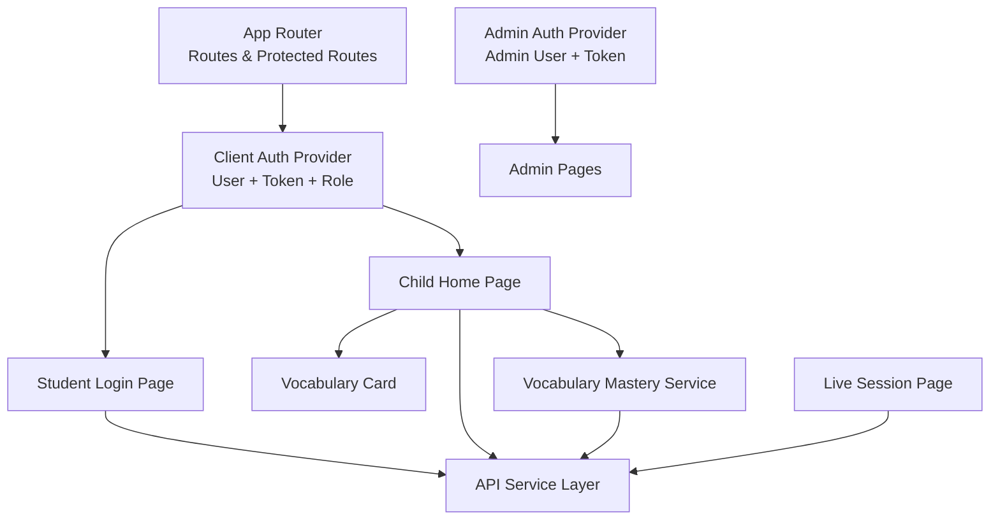
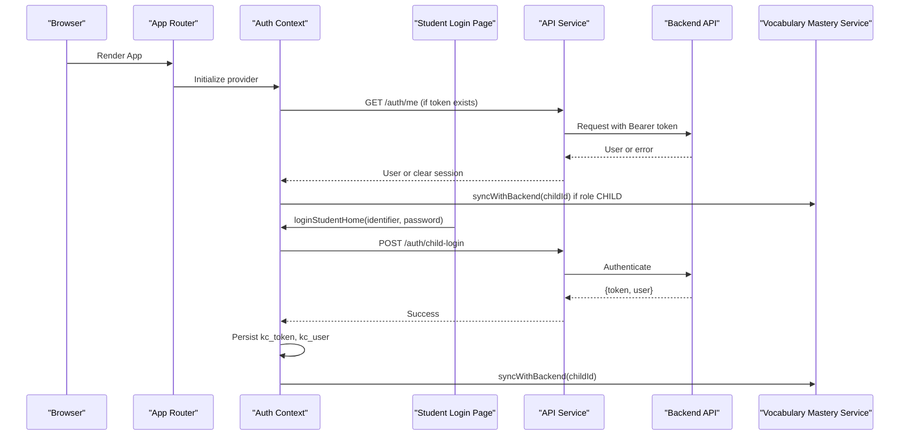
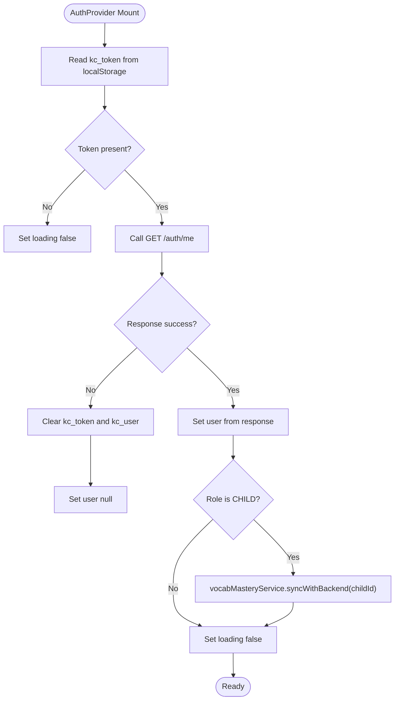
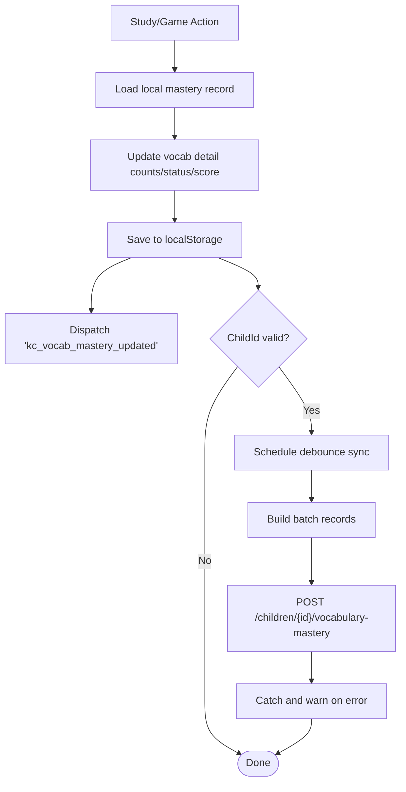
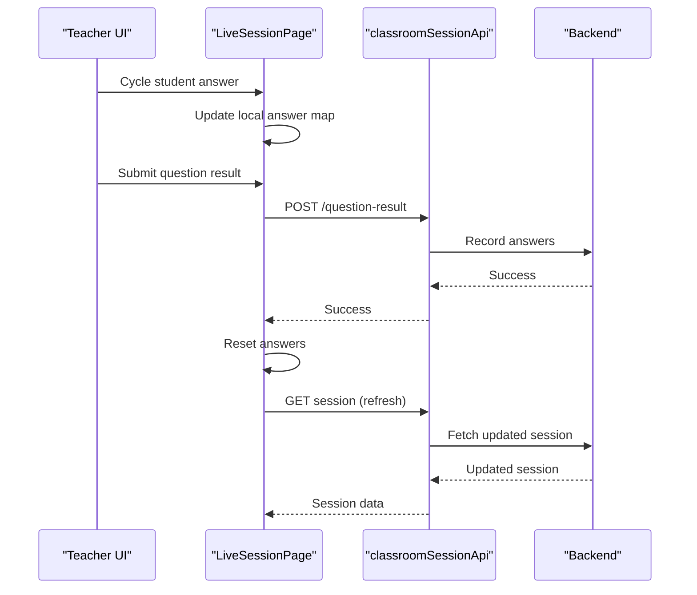
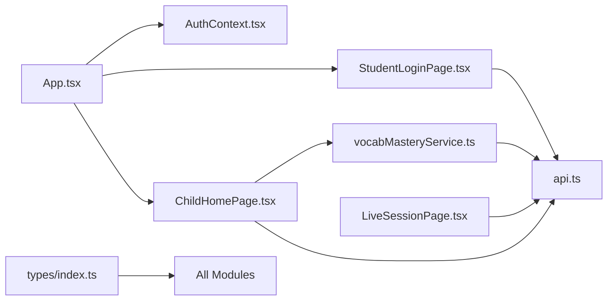

# State Management Patterns

<cite>
**Referenced Files in This Document**
- [client/src/context/AuthContext.tsx](file://client/src/context/AuthContext.tsx)
- [admin/src/context/AuthContext.tsx](file://admin/src/context/AuthContext.tsx)
- [client/src/services/api.ts](file://client/src/services/api.ts)
- [client/src/services/vocabMasteryService.ts](file://client/src/services/vocabMasteryService.ts)
- [client/src/App.tsx](file://client/src/App.tsx)
- [client/src/main.tsx](file://client/src/main.tsx)
- [client/src/pages/child/StudentLoginPage.tsx](file://client/src/pages/child/StudentLoginPage.tsx)
- [client/src/pages/child/ChildHomePage.tsx](file://client/src/pages/child/ChildHomePage.tsx)
- [client/src/components/child/VocabularyCard.tsx](file://client/src/components/child/VocabularyCard.tsx)
- [client/src/dashboards/teacher/LiveSessionPage.tsx](file://client/src/dashboards/teacher/LiveSessionPage.tsx)
- [client/src/types/index.ts](file://client/src/types/index.ts)
</cite>

## Table of Contents
1. [Introduction](#introduction)
2. [Project Structure](#project-structure)
3. [Core Components](#core-components)
4. [Architecture Overview](#architecture-overview)
5. [Detailed Component Analysis](#detailed-component-analysis)
6. [Dependency Analysis](#dependency-analysis)
7. [Performance Considerations](#performance-considerations)
8. [Troubleshooting Guide](#troubleshooting-guide)
9. [Conclusion](#conclusion)

## Introduction
This document explains the state management architecture for the KCEnglishKids application, focusing on React Context-based authentication, user session persistence, role-aware routing, vocabulary mastery tracking, progress state synchronization, and classroom session state patterns. It also documents service-layer API communication, local storage caching, optimistic updates, error handling, performance considerations, and debugging techniques for complex state interactions.

The client application uses:
- A child-facing authentication context with token and user persistence.
- An admin authentication context with separate token and user keys.
- A shared service layer for HTTP requests and domain-specific APIs.
- A vocabulary mastery service that maintains a local cache, computes mastery scores, and performs debounced backend synchronization.
- Teacher live session state for real-time classroom scoring, question result recording, and bulk operations.

## Project Structure
At a high level, the relevant frontend code is organized into:
- Context providers for authentication.
- Service modules for API calls and domain logic.
- Pages and components that consume contexts and services.
- Shared TypeScript types describing users, lessons, activities, sessions, and mastery data.

**Diagram sources**
- [client/src/App.tsx:17-38](file://client/src/App.tsx#L17-L38)
- [client/src/context/AuthContext.tsx:30-153](file://client/src/context/AuthContext.tsx#L30-L153)
- [client/src/pages/child/StudentLoginPage.tsx:47-63](file://client/src/pages/child/StudentLoginPage.tsx#L47-L63)
- [client/src/pages/child/ChildHomePage.tsx:117-169](file://client/src/pages/child/ChildHomePage.tsx#L117-L169)
- [client/src/components/child/VocabularyCard.tsx:11-69](file://client/src/components/child/VocabularyCard.tsx#L11-L69)
- [client/src/services/vocabMasteryService.ts:53-105](file://client/src/services/vocabMasteryService.ts#L53-L105)
- [client/src/services/api.ts:11-94](file://client/src/services/api.ts#L11-L94)
- [client/src/dashboards/teacher/LiveSessionPage.tsx:109-188](file://client/src/dashboards/teacher/LiveSessionPage.tsx#L109-L188)

**Section sources**
- [client/src/main.tsx:1-11](file://client/src/main.tsx#L1-L11)
- [client/src/App.tsx:40-130](file://client/src/App.tsx#L40-L130)

## Core Components
This section summarizes the main stateful building blocks:

- Client Authentication Context
  - Holds current user, loading state, login methods for child, student home, admin, and teacher, logout, and age group update.
  - Persists `kc_token` and `kc_user` to localStorage.
  - On mount, verifies token via `/auth/me`, restores user, and syncs vocabulary mastery for child roles.

- Admin Authentication Context
  - Separate from the client context; stores `kc_admin_token` and `kc_admin_user`.
  - Verifies admin role and clears invalid sessions.

- API Service Layer
  - Centralized fetch wrapper with automatic Authorization header injection.
  - Domain-scoped API modules: auth, topics, lessons, vocabulary, activities, learning, admin, teacher, classroom sessions, vocabulary mastery, parent notifications.

- Vocabulary Mastery Service
  - Local cache keyed by child ID.
  - Computes mastery score from flashcard and game metrics.
  - Debounced background sync to backend.
  - Exposes helpers for study actions, game results, journey word registration, and query utilities.

- Live Classroom Session State
  - Loads session data, tracks per-student answers, supports single and bulk scoring, records question results, and refreshes after mutations.

**Section sources**
- [client/src/context/AuthContext.tsx:6-26](file://client/src/context/AuthContext.tsx#L6-L26)
- [client/src/context/AuthContext.tsx:30-153](file://client/src/context/AuthContext.tsx#L30-L153)
- [admin/src/context/AuthContext.tsx:5-11](file://admin/src/context/AuthContext.tsx#L5-L11)
- [admin/src/context/AuthContext.tsx:15-75](file://admin/src/context/AuthContext.tsx#L15-L75)
- [client/src/services/api.ts:11-94](file://client/src/services/api.ts#L11-L94)
- [client/src/services/vocabMasteryService.ts:35-105](file://client/src/services/vocabMasteryService.ts#L35-L105)
- [client/src/dashboards/teacher/LiveSessionPage.tsx:59-188](file://client/src/dashboards/teacher/LiveSessionPage.tsx#L59-L188)

## Architecture Overview
The application follows a layered pattern:
- UI layers (pages and components) consume React Context for authentication and use service modules for data operations.
- The service layer encapsulates HTTP requests and domain-specific behavior.
- Vocabulary mastery introduces a hybrid model: local-first state with periodic backend synchronization.
- Classroom sessions maintain interactive state locally and push changes to the server when needed.

**Diagram sources**
- [client/src/App.tsx:40-130](file://client/src/App.tsx#L40-L130)
- [client/src/context/AuthContext.tsx:30-85](file://client/src/context/AuthContext.tsx#L30-L85)
- [client/src/pages/child/StudentLoginPage.tsx:47-63](file://client/src/pages/child/StudentLoginPage.tsx#L47-L63)
- [client/src/services/api.ts:64-94](file://client/src/services/api.ts#L64-L94)
- [client/src/services/vocabMasteryService.ts:107-157](file://client/src/services/vocabMasteryService.ts#L107-L157)

## Detailed Component Analysis

### Authentication Context Implementation
The client authentication context manages:
- User object and loading flag.
- Login flows for child, student home, admin, and teacher.
- Registration flow for child accounts.
- Age group update helper.
- Logout that clears persisted tokens and user.

Key behaviors:
- On initialization, it reads `kc_user` from localStorage and validates the token using `/auth/me`.
- If the user has role `CHILD`, it triggers vocabulary mastery synchronization.
- Successful logins persist both token and user, then set the React state.
- `setAgeGroup` updates the user object and persists it.

**Diagram sources**
- [client/src/context/AuthContext.tsx:30-61](file://client/src/context/AuthContext.tsx#L30-L61)

**Section sources**
- [client/src/context/AuthContext.tsx:6-26](file://client/src/context/AuthContext.tsx#L6-L26)
- [client/src/context/AuthContext.tsx:30-153](file://client/src/context/AuthContext.tsx#L30-L153)

### Admin Authentication Context
The admin context mirrors the client context but uses separate storage keys:
- `kc_admin_token`
- `kc_admin_user`
- Role validation ensures only ADMIN can proceed.

Behavior:
- On mount, verify token via `/auth/me`.
- On success, store admin user and mark loading false.
- On failure, clear admin token and user.

**Section sources**
- [admin/src/context/AuthContext.tsx:5-11](file://admin/src/context/AuthContext.tsx#L5-L11)
- [admin/src/context/AuthContext.tsx:15-75](file://admin/src/context/AuthContext.tsx#L15-L75)

### Service Layer Patterns for API Communication
The API service provides:
- Generic HTTP methods (`get`, `post`, `patch`, `put`, `delete`).
- Automatic Authorization header injection based on `kc_token`.
- Error throwing for non-OK responses.
- Domain-scoped API modules for auth, topics, lessons, vocabulary, activities, learning, admin, teacher, classroom sessions, vocabulary mastery, and parent notifications.

Patterns:
- Query parameters are built using URLSearchParams where needed.
- Responses are expected to follow a `{success, data}` shape for many endpoints.
- Errors bubble up to callers for handling.

**Section sources**
- [client/src/services/api.ts:1-61](file://client/src/services/api.ts#L1-L61)
- [client/src/services/api.ts:64-354](file://client/src/services/api.ts#L64-L354)

### Vocabulary Mastery Tracking System
The vocabulary mastery service implements:
- Local storage persistence per child ID.
- Mastery record structure including counts for remembering, reviewing, games played/correct, last practiced timestamp, mastery score, and source.
- Score calculation blending flashcard and game performance.
- Debounced background sync to backend using `syncMastery`.
- Helpers for study actions, game results, toggling status, registering journey words, and querying mastered/reviewed lists.

Data flow:
- Local read/write via `getMastery` and `saveMastery`.
- Custom event dispatch on save to notify listeners.
- Background sync triggered after saving, batching changed vocabulary details.

**Diagram sources**
- [client/src/services/vocabMasteryService.ts:37-51](file://client/src/services/vocabMasteryService.ts#L37-L51)
- [client/src/services/vocabMasteryService.ts:58-105](file://client/src/services/vocabMasteryService.ts#L58-L105)
- [client/src/services/vocabMasteryService.ts:162-223](file://client/src/services/vocabMasteryService.ts#L162-L223)
- [client/src/services/vocabMasteryService.ts:265-285](file://client/src/services/vocabMasteryService.ts#L265-L285)
- [client/src/services/vocabMasteryService.ts:290-332](file://client/src/services/vocabMasteryService.ts#L290-L332)

**Section sources**
- [client/src/services/vocabMasteryService.ts:6-33](file://client/src/services/vocabMasteryService.ts#L6-L33)
- [client/src/services/vocabMasteryService.ts:53-105](file://client/src/services/vocabMasteryService.ts#L53-L105)
- [client/src/services/vocabMasteryService.ts:107-157](file://client/src/services/vocabMasteryService.ts#L107-L157)
- [client/src/services/vocabMasteryService.ts:162-371](file://client/src/services/vocabMasteryService.ts#L162-L371)

### Progress State Management and Curriculum Integration
The child home page coordinates:
- Fetching curriculum path, topics, vocabulary, and progress scoped by age group.
- Registering journey vocabulary into the mastery service.
- Rendering tabs for curriculum path, topics, vocabulary notebook, arcade games, and rewards.

State synchronization:
- Uses parallel API calls to reduce load time.
- Updates local component state upon successful responses.
- Integrates with vocabulary mastery to ensure learned words appear in the notebook.

**Section sources**
- [client/src/pages/child/ChildHomePage.tsx:62-169](file://client/src/pages/child/ChildHomePage.tsx#L62-L169)
- [client/src/pages/child/ChildHomePage.tsx:171-179](file://client/src/pages/child/ChildHomePage.tsx#L171-L179)

### Real-Time Updates for Classroom Sessions
The live session page manages:
- Loading session data and initializing per-student answer states.
- Tracking elapsed time and showing warnings after planned duration.
- Recording question results and refreshing session state.
- Single and bulk scoring with fallback strategies.
- Multi-select mode for awarding points/stars to selected students.

Optimistic patterns:
- Local answer map updates immediately before submission.
- After submission, the view resets answers and reloads session data to reflect server state.

**Diagram sources**
- [client/src/dashboards/teacher/LiveSessionPage.tsx:109-188](file://client/src/dashboards/teacher/LiveSessionPage.tsx#L109-L188)
- [client/src/dashboards/teacher/LiveSessionPage.tsx:201-264](file://client/src/dashboards/teacher/LiveSessionPage.tsx#L201-L264)

**Section sources**
- [client/src/dashboards/teacher/LiveSessionPage.tsx:59-188](file://client/src/dashboards/teacher/LiveSessionPage.tsx#L59-L188)
- [client/src/dashboards/teacher/LiveSessionPage.tsx:201-295](file://client/src/dashboards/teacher/LiveSessionPage.tsx#L201-L295)

### Local Storage Persistence and Optimistic Updates
Persistence patterns:
- Authentication tokens and user profiles stored under distinct keys per app surface (client vs admin).
- Vocabulary mastery records stored per child ID with structured integrity checks.

Optimistic updates:
- Vocabulary mastery updates local state immediately and schedules backend sync.
- Live session updates local answer maps and refreshes after server confirmation.

**Section sources**
- [client/src/context/AuthContext.tsx:30-153](file://client/src/context/AuthContext.tsx#L30-L153)
- [admin/src/context/AuthContext.tsx:15-75](file://admin/src/context/AuthContext.tsx#L15-L75)
- [client/src/services/vocabMasteryService.ts:58-105](file://client/src/services/vocabMasteryService.ts#L58-L105)
- [client/src/dashboards/teacher/LiveSessionPage.tsx:165-188](file://client/src/dashboards/teacher/LiveSessionPage.tsx#L165-L188)

### Role-Based State Synchronization
Role handling:
- Client context differentiates child login flows and triggers vocabulary mastery sync.
- Admin context enforces admin role verification.
- Route guards protect child and teacher routes based on user role.

Synchronization:
- Child role triggers vocabulary mastery synchronization after authentication.
- Teacher routes rely on teacher login and protected route wrappers.

**Section sources**
- [client/src/context/AuthContext.tsx:46-71](file://client/src/context/AuthContext.tsx#L46-L71)
- [admin/src/context/AuthContext.tsx:22-44](file://admin/src/context/AuthContext.tsx#L22-L44)
- [client/src/App.tsx:17-38](file://client/src/App.tsx#L17-L38)

## Dependency Analysis
The following diagram shows how components and services depend on each other:

**Diagram sources**
- [client/src/App.tsx:40-130](file://client/src/App.tsx#L40-L130)
- [client/src/context/AuthContext.tsx:30-153](file://client/src/context/AuthContext.tsx#L30-L153)
- [client/src/pages/child/StudentLoginPage.tsx:47-63](file://client/src/pages/child/StudentLoginPage.tsx#L47-L63)
- [client/src/pages/child/ChildHomePage.tsx:117-169](file://client/src/pages/child/ChildHomePage.tsx#L117-L169)
- [client/src/services/vocabMasteryService.ts:53-105](file://client/src/services/vocabMasteryService.ts#L53-L105)
- [client/src/services/api.ts:11-354](file://client/src/services/api.ts#L11-L354)
- [client/src/dashboards/teacher/LiveSessionPage.tsx:109-188](file://client/src/dashboards/teacher/LiveSessionPage.tsx#L109-L188)
- [client/src/types/index.ts:1-233](file://client/src/types/index.ts#L1-L233)

**Section sources**
- [client/src/services/api.ts:11-354](file://client/src/services/api.ts#L11-L354)
- [client/src/types/index.ts:1-233](file://client/src/types/index.ts#L1-L233)

## Performance Considerations
- Minimize re-renders by keeping authentication state minimal and avoiding unnecessary context updates.
- Use parallel API calls for independent data fetching (e.g., curriculum path, topics, vocabulary, progress).
- Debounce expensive operations like backend synchronization for vocabulary mastery to avoid excessive network requests.
- Avoid heavy computations inside render paths; compute derived values lazily or memoize where appropriate.
- Be cautious with large local storage payloads; keep mastery records compact and prune unused entries if necessary.
- For live classroom sessions, limit frequent polling; prefer explicit refresh after mutations and consider WebSocket integration for true real-time updates.

[No sources needed since this section provides general guidance]

## Troubleshooting Guide
Common issues and resolutions:
- Session expired or invalid token:
  - The auth context clears tokens and user on failed `/auth/me` verification.
  - Ensure backend returns proper errors and that the client handles them gracefully.

- Vocabulary mastery sync failures:
  - Background sync catches errors and logs warnings; check console for `[vocabMastery] Background sync error`.
  - Validate child ID and vocabulary IDs before syncing.

- Classroom session state inconsistencies:
  - After submitting question results or scoring, always reload session data to reconcile local and server state.
  - Use bulk scoring fallback to per-student scoring if bulk endpoint fails.

- Local storage parsing errors:
  - The vocabulary mastery service wraps localStorage access in try/catch and falls back to empty records.
  - Inspect corrupted entries and reset local mastery data if needed.

**Section sources**
- [client/src/context/AuthContext.tsx:37-61](file://client/src/context/AuthContext.tsx#L37-L61)
- [client/src/services/vocabMasteryService.ts:58-105](file://client/src/services/vocabMasteryService.ts#L58-L105)
- [client/src/dashboards/teacher/LiveSessionPage.tsx:201-218](file://client/src/dashboards/teacher/LiveSessionPage.tsx#L201-L218)

## Conclusion
The KCEnglishKids application employs a pragmatic state management strategy:
- React Context for authentication and user session management across child and admin surfaces.
- A robust service layer for API communication with clear separation of concerns.
- A local-first vocabulary mastery system with debounced backend synchronization and rich scoring logic.
- Interactive classroom session state supporting optimistic updates and bulk operations.

These patterns provide a scalable foundation for adding more features while maintaining clarity, performance, and reliability. Future enhancements could include WebSocket-based real-time updates for classroom sessions, improved caching strategies for vocabulary and curriculum data, and centralized error handling with user-friendly feedback.

[No sources needed since this section summarizes without analyzing specific files]