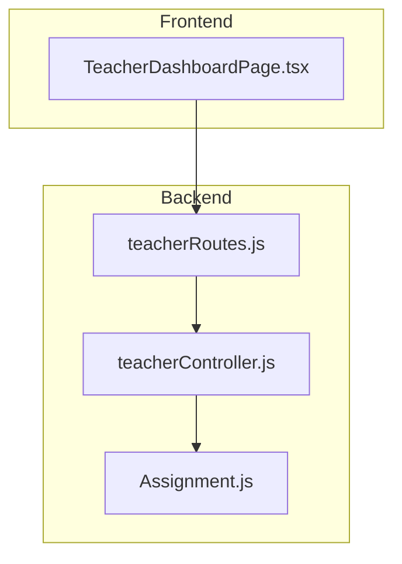
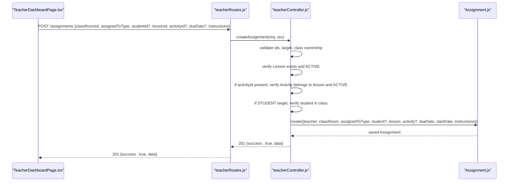
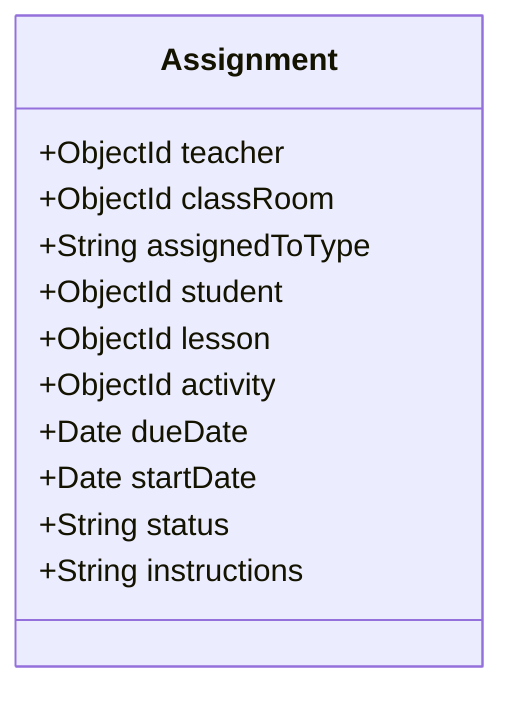
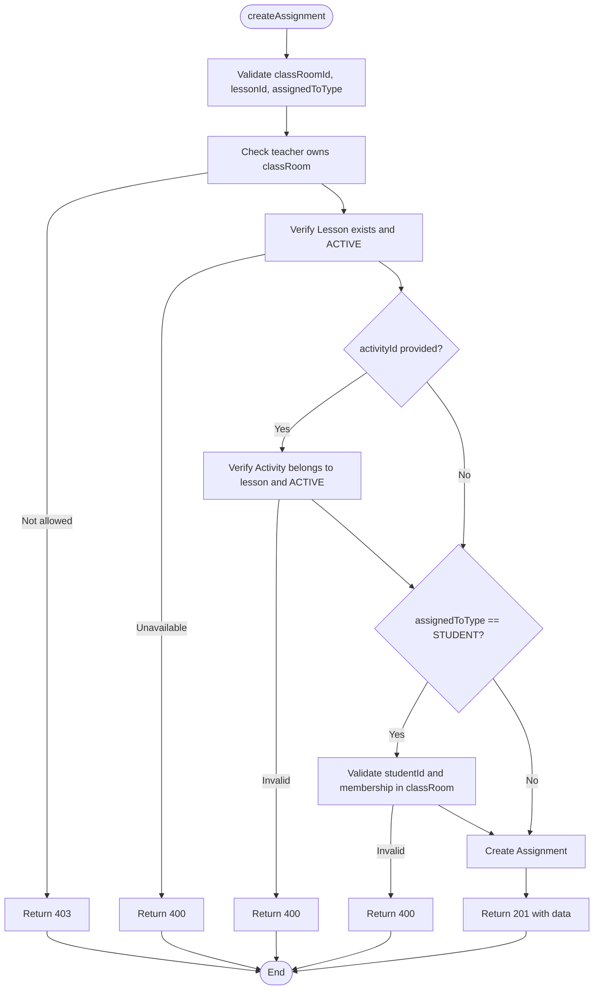
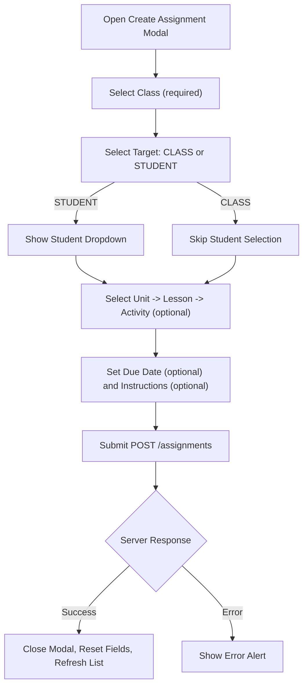
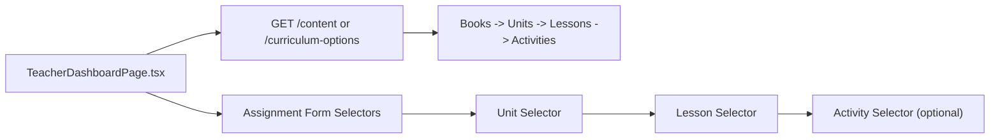
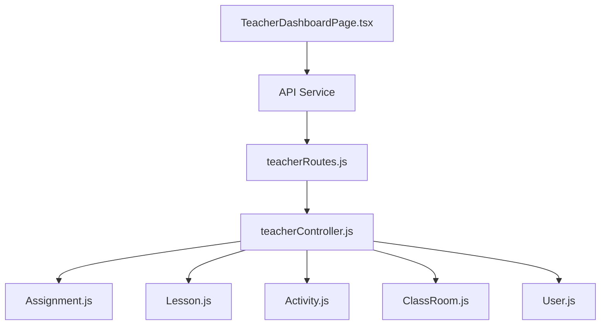

# Assignment Creation Workflow

<cite>
**Referenced Files in This Document**
- [Assignment.js](file://KCEnglishKids_BE/src/models/Assignment.js)
- [teacherController.js](file://KCEnglishKids_BE/src/controllers/teacherController.js)
- [teacherRoutes.js](file://KCEnglishKids_BE/src/routes/teacherRoutes.js)
- [TeacherDashboardPage.tsx](file://client/src/dashboards/teacher/TeacherDashboardPage.tsx)
</cite>

## Table of Contents
1. [Introduction](#introduction)
2. [Project Structure](#project-structure)
3. [Core Components](#core-components)
4. [Architecture Overview](#architecture-overview)
5. [Detailed Component Analysis](#detailed-component-analysis)
6. [Dependency Analysis](#dependency-analysis)
7. [Performance Considerations](#performance-considerations)
8. [Troubleshooting Guide](#troubleshooting-guide)
9. [Conclusion](#conclusion)

## Introduction
This document explains the end-to-end assignment creation workflow for teachers. It covers:
- Target selection (class-wide vs individual students)
- Curriculum integration through a lesson/activity selector
- Due date and instruction management
- Form validation, data submission flow, and error handling
- Integration with the curriculum tree to select appropriate lessons and activities
- Validation of assignment targets against classroom membership

The workflow spans the teacher dashboard UI, backend routes and controller logic, and the Assignment data model.

## Project Structure
The assignment creation feature is implemented across:
- Frontend: Teacher dashboard page containing the assignment form and curriculum selectors
- Backend: Routes exposing assignment endpoints and a controller implementing validation and persistence
- Data Model: Assignment schema defining fields such as target type, lesson/activity references, due date, status, and instructions

**Diagram sources**
- [TeacherDashboardPage.tsx:221-255](file://client/src/dashboards/teacher/TeacherDashboardPage.tsx#L221-L255)
- [teacherRoutes.js:23-27](file://KCEnglishKids_BE/src/routes/teacherRoutes.js#L23-L27)
- [teacherController.js:66-68](file://KCEnglishKids_BE/src/controllers/teacherController.js#L66-L68)
- [Assignment.js:3-50](file://KCEnglishKids_BE/src/models/Assignment.js#L3-L50)

**Section sources**
- [TeacherDashboardPage.tsx:62-77](file://client/src/dashboards/teacher/TeacherDashboardPage.tsx#L62-L77)
- [teacherRoutes.js:23-27](file://KCEnglishKids_BE/src/routes/teacherRoutes.js#L23-L27)
- [teacherController.js:66-68](file://KCEnglishKids_BE/src/controllers/teacherController.js#L66-L68)
- [Assignment.js:3-50](file://KCEnglishKids_BE/src/models/Assignment.js#L3-L50)

## Core Components
- Assignment model: Defines required and optional fields, including target scope, lesson/activity linkage, scheduling, status, and instructions.
- Teacher controller: Implements createAssignment with strict validation for class access, lesson/activity availability, and student membership.
- Teacher routes: Expose REST endpoints for creating, listing, retrieving, updating, and changing assignment status.
- Teacher dashboard: Provides the UI for selecting class, target, curriculum unit/lesson/activity, due date, and instructions; submits via API.

Key responsibilities:
- Model enforces enum constraints and default values.
- Controller validates inputs, checks permissions, and persists assignments.
- Routes protect endpoints and map HTTP methods to controller actions.
- Dashboard orchestrates user interactions and API calls.

**Section sources**
- [Assignment.js:3-50](file://KCEnglishKids_BE/src/models/Assignment.js#L3-L50)
- [teacherController.js:66-68](file://KCEnglishKids_BE/src/controllers/teacherController.js#L66-L68)
- [teacherRoutes.js:23-27](file://KCEnglishKids_BE/src/routes/teacherRoutes.js#L23-L27)
- [TeacherDashboardPage.tsx:221-255](file://client/src/dashboards/teacher/TeacherDashboardPage.tsx#L221-L255)

## Architecture Overview
The assignment creation follows a clear request-response flow:
1. The teacher fills out the assignment form in the dashboard.
2. The frontend validates required fields and sends a POST request to the backend.
3. The route delegates to the controller after authentication/authorization.
4. The controller validates parameters, checks permissions, verifies curriculum items, and saves the assignment.
5. The backend returns success or an error response.

**Diagram sources**
- [TeacherDashboardPage.tsx:221-255](file://client/src/dashboards/teacher/TeacherDashboardPage.tsx#L221-L255)
- [teacherRoutes.js:23-27](file://KCEnglishKids_BE/src/routes/teacherRoutes.js#L23-L27)
- [teacherController.js:66-68](file://KCEnglishKids_BE/src/controllers/teacherController.js#L66-L68)
- [Assignment.js:3-50](file://KCEnglishKids_BE/src/models/Assignment.js#L3-L50)

## Detailed Component Analysis

### Assignment Data Model
The Assignment model defines:
- Required: teacher, classRoom, lesson
- Optional: activity, dueDate, startDate, instructions
- Enumerated: assignedToType (CLASS, STUDENT), status (ASSIGNED, IN_PROGRESS, COMPLETED, CANCELLED)
- Defaults: assignedToType = CLASS, status = ASSIGNED, activity/null, dueDate/null, startDate/null, instructions empty string

Complexity:
- Storage is lightweight; queries typically populate related entities (classRoom, student, lesson, activity).
- Indexing on teacher/classRoom/status improves list/filter performance.

**Diagram sources**
- [Assignment.js:3-50](file://KCEnglishKids_BE/src/models/Assignment.js#L3-L50)

**Section sources**
- [Assignment.js:3-50](file://KCEnglishKids_BE/src/models/Assignment.js#L3-L50)

### Backend Controller: createAssignment
Validation and processing steps:
- Validate that classRoomId and lessonId are valid ObjectIds and assignedToType is one of CLASS or STUDENT.
- Ensure the teacher has access to the selected classRoom.
- Verify the selected lesson exists and is ACTIVE.
- If activityId is provided, ensure it belongs to the selected lesson and is ACTIVE.
- If assignedToType is STUDENT, ensure studentId is valid and present in the classRoom’s student list.
- Create the Assignment with teacher, classRoom, target type, optional student, lesson, optional activity, optional dates, and trimmed instructions.
- Return 201 with the created assignment.

Error handling:
- Returns 400 for invalid input or unavailable lesson/activity.
- Returns 403 when the teacher lacks access to the class or assignment.

**Diagram sources**
- [teacherController.js:66-68](file://KCEnglishKids_BE/src/controllers/teacherController.js#L66-L68)

**Section sources**
- [teacherController.js:66-68](file://KCEnglishKids_BE/src/controllers/teacherController.js#L66-L68)

### Backend Routes
- POST /assignments -> createAssignment
- GET /assignments -> getAssignments
- GET /assignments/:id -> getAssignment
- PUT /assignments/:id -> updateAssignment
- PATCH /assignments/:id/status -> updateAssignmentStatus

These routes are protected by authentication and authorization middleware allowing only TEACHER or ADMIN roles.

**Section sources**
- [teacherRoutes.js:23-27](file://KCEnglishKids_BE/src/routes/teacherRoutes.js#L23-L27)

### Frontend: Teacher Dashboard Assignment Form
Form fields and behavior:
- Class selector: required, pre-populated from teacher’s classes.
- Target selector: CLASS or STUDENT. When STUDENT is chosen, a student dropdown appears populated from the currently selected class.
- Curriculum selector:
  - Unit selector: loads units from the curriculum tree.
  - Lesson selector: dynamically shows lessons belonging to the selected unit.
  - Activity selector: optional; shows activities for the selected lesson.
- Due date: optional date picker.
- Instructions: optional text field.

Submission:
- On submit, the form ensures class and lesson are selected.
- Sends a POST request with classRoomId, assignedToType, studentId (if STUDENT), lessonId, activityId (optional), dueDate (optional), and instructions.
- On success, closes modal, resets fields, refreshes assignments list, and shows a success alert.
- On error, displays the error message returned by the backend.

**Diagram sources**
- [TeacherDashboardPage.tsx:1202-1376](file://client/src/dashboards/teacher/TeacherDashboardPage.tsx#L1202-L1376)
- [TeacherDashboardPage.tsx:221-255](file://client/src/dashboards/teacher/TeacherDashboardPage.tsx#L221-L255)

**Section sources**
- [TeacherDashboardPage.tsx:1202-1376](file://client/src/dashboards/teacher/TeacherDashboardPage.tsx#L1202-L1376)
- [TeacherDashboardPage.tsx:221-255](file://client/src/dashboards/teacher/TeacherDashboardPage.tsx#L221-L255)

### Curriculum Tree Integration
- The dashboard fetches curriculum options once and caches them locally.
- The curriculum tree structure includes books, units, lessons, and activities.
- In the assignment form:
  - Selecting a unit filters available lessons.
  - Selecting a lesson filters available activities.
- The backend provides curriculum data via content endpoints used by the dashboard to build this tree.

**Diagram sources**
- [TeacherDashboardPage.tsx:150-172](file://client/src/dashboards/teacher/TeacherDashboardPage.tsx#L150-L172)
- [TeacherDashboardPage.tsx:1261-1329](file://client/src/dashboards/teacher/TeacherDashboardPage.tsx#L1261-L1329)

**Section sources**
- [TeacherDashboardPage.tsx:150-172](file://client/src/dashboards/teacher/TeacherDashboardPage.tsx#L150-L172)
- [TeacherDashboardPage.tsx:1261-1329](file://client/src/dashboards/teacher/TeacherDashboardPage.tsx#L1261-L1329)

### Assignment Types and Requirements
- Class-wide assignment (assignedToType = CLASS):
  - Requires classRoomId and lessonId.
  - No studentId is needed.
  - Activity is optional; if omitted, the assignment applies to the whole lesson.
- Individual student assignment (assignedToType = STUDENT):
  - Requires classRoomId, lessonId, and studentId.
  - The student must be a member of the selected classRoom.
  - Activity is optional; if omitted, the assignment applies to the whole lesson for that student.

Due date and instructions:
- Due date is optional; stored as null if not provided.
- Instructions are optional and trimmed before saving.

**Section sources**
- [Assignment.js:14-33](file://KCEnglishKids_BE/src/models/Assignment.js#L14-L33)
- [teacherController.js:66-68](file://KCEnglishKids_BE/src/controllers/teacherController.js#L66-L68)
- [TeacherDashboardPage.tsx:1222-1358](file://client/src/dashboards/teacher/TeacherDashboardPage.tsx#L1222-L1358)

## Dependency Analysis
- Frontend depends on:
  - Authentication context for user role and session.
  - API service layer for calling teacher endpoints.
- Backend depends on:
  - Mongoose models for Classroom, User, Lesson, Activity, and Assignment.
  - Middleware for protecting routes and authorizing roles.
- Controller dependencies:
  - Uses helper functions to validate IDs, check class ownership, and aggregate stats elsewhere.

**Diagram sources**
- [teacherRoutes.js:1-8](file://KCEnglishKids_BE/src/routes/teacherRoutes.js#L1-L8)
- [teacherController.js:1-2](file://KCEnglishKids_BE/src/controllers/teacherController.js#L1-L2)
- [Assignment.js:1-55](file://KCEnglishKids_BE/src/models/Assignment.js#L1-L55)

**Section sources**
- [teacherRoutes.js:1-8](file://KCEnglishKids_BE/src/routes/teacherRoutes.js#L1-L8)
- [teacherController.js:1-2](file://KCEnglishKids_BE/src/controllers/teacherController.js#L1-L2)

## Performance Considerations
- Minimize unnecessary re-renders in the dashboard by caching the curriculum tree and resetting dependent selectors (lesson/activity) when parent selections change.
- Use server-side filtering for assignments (by classRoomId and status) to reduce payload size.
- Avoid repeated network calls for the same curriculum data; cache at the component level.
- Consider indexing frequently queried fields in Assignment (teacher, classRoom, status) to improve list performance.

[No sources needed since this section provides general guidance]

## Troubleshooting Guide
Common issues and resolutions:
- “Selected child is not in this classroom”:
  - Occurs when assignedToType is STUDENT but the studentId is not in the selected classRoom’s student list.
  - Resolution: Ensure the student is added to the class and the correct class is selected.
- “Selected lesson is unavailable” or “Selected activity is unavailable for this lesson”:
  - Occurs when the lesson or activity is not ACTIVE or does not belong to the selected lesson.
  - Resolution: Choose an ACTIVE lesson and, if applicable, an activity linked to that lesson.
- “You do not have access to this classroom”:
  - Occurs when the current teacher does not own the selected classRoom.
  - Resolution: Switch to a class you manage or contact admin for access.
- Form validation errors:
  - Missing class or lesson selection triggers client-side alerts.
  - Resolution: Fill required fields before submitting.

**Section sources**
- [teacherController.js:66-68](file://KCEnglishKids_BE/src/controllers/teacherController.js#L66-L68)
- [TeacherDashboardPage.tsx:221-255](file://client/src/dashboards/teacher/TeacherDashboardPage.tsx#L221-L255)

## Conclusion
The assignment creation workflow integrates a structured curriculum tree with flexible target selection and robust validation. Teachers can assign work to either the entire class or specific students, optionally tie assignments to specific activities, and set due dates and instructions. The backend enforces access control and curriculum integrity, while the frontend provides an intuitive form with dynamic selectors and clear error feedback.

[No sources needed since this section summarizes without analyzing specific files]