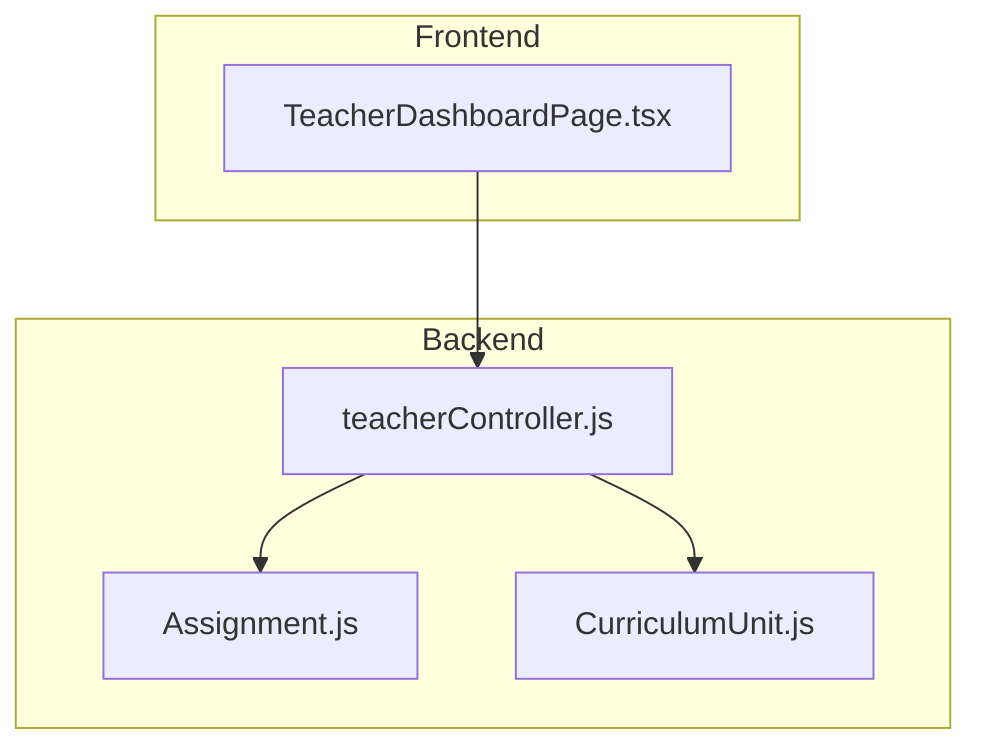
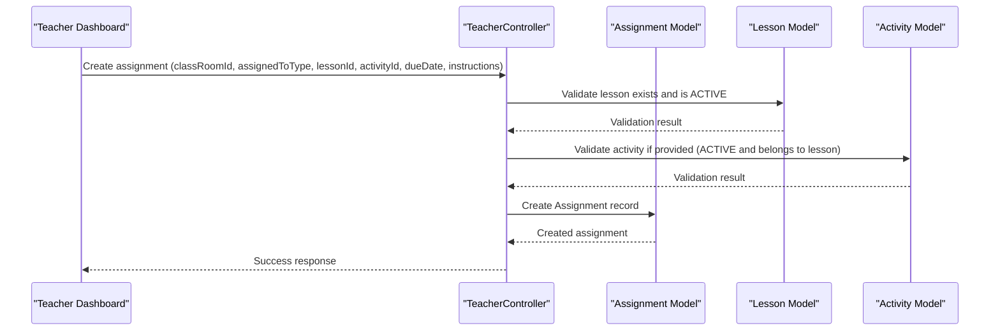
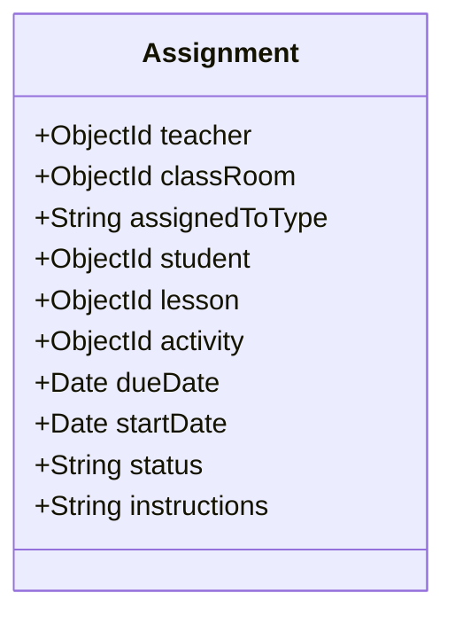
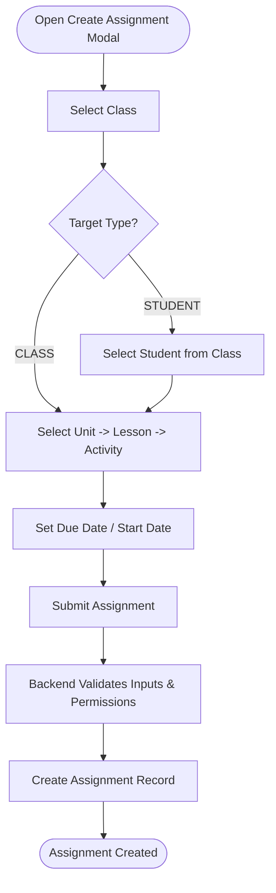
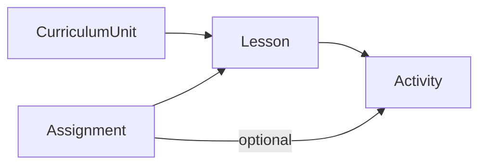
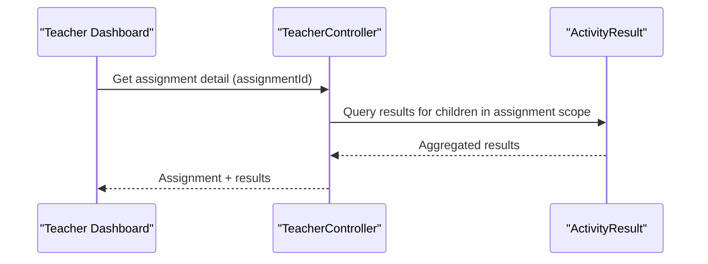
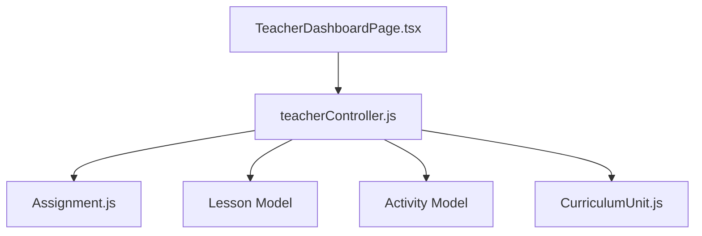

# Assignment Management System

<cite>
**Referenced Files in This Document**
- [Assignment.js](file://KCEnglishKids_BE/src/models/Assignment.js)
- [teacherController.js](file://KCEnglishKids_BE/src/controllers/teacherController.js)
- [CurriculumUnit.js](file://KCEnglishKids_BE/src/models/CurriculumUnit.js)
- [TeacherDashboardPage.tsx](file://client/src/dashboards/teacher/TeacherDashboardPage.tsx)
- [progressRoutes.js](file://KCEnglishKids_BE/src/routes/progressRoutes.js)
</cite>

## Table of Contents
1. [Introduction](#introduction)
2. [Project Structure](#project-structure)
3. [Core Components](#core-components)
4. [Architecture Overview](#architecture-overview)
5. [Detailed Component Analysis](#detailed-component-analysis)
6. [Dependency Analysis](#dependency-analysis)
7. [Performance Considerations](#performance-considerations)
8. [Troubleshooting Guide](#troubleshooting-guide)
9. [Conclusion](#conclusion)

## Introduction
This document explains the assignment management system used by teachers to create, distribute, and track assignments aligned with the curriculum. It covers:
- Assignment creation workflow
- Target selection (class-wide vs individual students)
- Curriculum integration for selecting lessons and activities
- Assignment types, due date management, and status tracking
- Filtering and sorting capabilities
- Progress monitoring and reporting
- Notification considerations for assignment distribution

## Project Structure
The assignment feature spans backend models, controllers, and a teacher dashboard UI:
- Backend model defines assignment data structure and lifecycle states
- Controller implements validation, filtering, and progress aggregation
- Teacher dashboard provides the user interface for creating assignments and managing their lifecycle
- Curriculum unit model supports curriculum-driven lesson selection

**Diagram sources**
- [TeacherDashboardPage.tsx:186-276](file://client/src/dashboards/teacher/TeacherDashboardPage.tsx#L186-L276)
- [teacherController.js:60-78](file://KCEnglishKids_BE/src/controllers/teacherController.js#L60-L78)
- [Assignment.js:1-55](file://KCEnglishKids_BE/src/models/Assignment.js#L1-L55)
- [CurriculumUnit.js:1-87](file://KCEnglishKids_BE/src/models/CurriculumUnit.js#L1-L87)

**Section sources**
- [Assignment.js:1-55](file://KCEnglishKids_BE/src/models/Assignment.js#L1-L55)
- [teacherController.js:60-78](file://KCEnglishKids_BE/src/controllers/teacherController.js#L60-L78)
- [TeacherDashboardPage.tsx:186-276](file://client/src/dashboards/teacher/TeacherDashboardPage.tsx#L186-L276)
- [CurriculumUnit.js:1-87](file://KCEnglishKids_BE/src/models/CurriculumUnit.js#L1-L87)

## Core Components
- Assignment model: stores assignment metadata, target scope, linked lesson/activity, scheduling fields, and status.
- Teacher controller: validates inputs, enforces permissions, creates/updates assignments, filters/sorts lists, and aggregates student results for progress.
- Teacher dashboard: provides UI for selecting class/target, curriculum tree navigation, assignment creation form, status updates, and deletion.

Key responsibilities:
- Data modeling and schema constraints
- Business logic for assignment lifecycle
- API endpoints for CRUD and filtering
- UI interactions for curriculum-based selection and assignment operations

**Section sources**
- [Assignment.js:1-55](file://KCEnglishKids_BE/src/models/Assignment.js#L1-L55)
- [teacherController.js:60-78](file://KCEnglishKids_BE/src/controllers/teacherController.js#L60-L78)
- [TeacherDashboardPage.tsx:186-276](file://client/src/dashboards/teacher/TeacherDashboardPage.tsx#L186-L276)

## Architecture Overview
The assignment flow connects the teacher UI to backend services and data models:

**Diagram sources**
- [teacherController.js:66-68](file://KCEnglishKids_BE/src/controllers/teacherController.js#L66-L68)
- [Assignment.js:1-55](file://KCEnglishKids_BE/src/models/Assignment.js#L1-L55)

## Detailed Component Analysis

### Assignment Model
The assignment model captures:
- Ownership and scope: teacher, classRoom, assignedToType (CLASS or STUDENT), optional student reference
- Curriculum linkage: required lesson, optional specific activity
- Scheduling: dueDate, startDate
- Lifecycle: status enum (ASSIGNED, IN_PROGRESS, COMPLETED, CANCELLED)
- Instructions: free-text guidance

Complexity:
- Schema validation ensures referential integrity and constrained enums
- Timestamps enable auditability and sorting

**Diagram sources**
- [Assignment.js:1-55](file://KCEnglishKids_BE/src/models/Assignment.js#L1-L55)

**Section sources**
- [Assignment.js:1-55](file://KCEnglishKids_BE/src/models/Assignment.js#L1-L55)

### Assignment Creation Workflow
The teacher dashboard collects:
- Class selection
- Target type (CLASS or STUDENT)
- Optional student when targeting an individual
- Curriculum Unit -> Lesson -> Activity selection
- Due date and instructions

On submit:
- Frontend sends payload to backend
- Backend validates IDs, checks permissions, verifies lesson/activity availability
- Creates assignment and returns success

**Diagram sources**
- [TeacherDashboardPage.tsx:221-255](file://client/src/dashboards/teacher/TeacherDashboardPage.tsx#L221-L255)
- [teacherController.js:66-68](file://KCEnglishKids_BE/src/controllers/teacherController.js#L66-L68)

**Section sources**
- [TeacherDashboardPage.tsx:221-255](file://client/src/dashboards/teacher/TeacherDashboardPage.tsx#L221-L255)
- [teacherController.js:66-68](file://KCEnglishKids_BE/src/controllers/teacherController.js#L66-L68)

### Target Selection: Class-wide vs Individual Students
- CLASS: Assignments apply to all students in the selected class
- STUDENT: Assignments apply to a single student within the class

Validation rules:
- When STUDENT is selected, the student must belong to the chosen class
- The backend enforces this constraint before persisting the assignment

UI behavior:
- Target selector toggles between CLASS and STUDENT
- Student dropdown appears only when STUDENT is selected

**Section sources**
- [TeacherDashboardPage.tsx:1222-1235](file://client/src/dashboards/teacher/TeacherDashboardPage.tsx#L1222-L1235)
- [teacherController.js:66-68](file://KCEnglishKids_BE/src/controllers/teacherController.js#L66-L68)

### Curriculum Integration
Teachers select content via a hierarchical curriculum tree:
- Choose a Unit
- Choose a Lesson within that Unit
- Optionally choose a specific Activity within the Lesson

Backend support:
- Content endpoint returns books, units, lessons, and activities filtered by age group and status
- Lessons are linked to curriculum units; activities are linked to lessons

**Diagram sources**
- [CurriculumUnit.js:1-87](file://KCEnglishKids_BE/src/models/CurriculumUnit.js#L1-L87)
- [teacherController.js:60-64](file://KCEnglishKids_BE/src/controllers/teacherController.js#L60-L64)
- [Assignment.js:1-55](file://KCEnglishKids_BE/src/models/Assignment.js#L1-L55)

**Section sources**
- [teacherController.js:60-64](file://KCEnglishKids_BE/src/controllers/teacherController.js#L60-L64)
- [CurriculumUnit.js:1-87](file://KCEnglishKids_BE/src/models/CurriculumUnit.js#L1-L87)
- [TeacherDashboardPage.tsx:1261-1329](file://client/src/dashboards/teacher/TeacherDashboardPage.tsx#L1261-L1329)

### Assignment Types and Activity Integration
- Lesson-level assignment: links to a lesson; results are aggregated across all activities in that lesson
- Activity-level assignment: links to a specific activity; results are aggregated for that activity only

Behavior:
- If activity is not provided, progress queries use the lesson ID
- If activity is provided, progress queries filter by activity ID

**Section sources**
- [teacherController.js:70](file://KCEnglishKids_BE/src/controllers/teacherController.js#L70)
- [Assignment.js:24-33](file://KCEnglishKids_BE/src/models/Assignment.js#L24-L33)

### Due Date Management
- dueDate and startDate are optional fields on the assignment
- Teachers can set these during creation or update them later (subject to status restrictions)

Constraints:
- Updates allowed only when status is not COMPLETED or CANCELLED

**Section sources**
- [Assignment.js:34-41](file://KCEnglishKids_BE/src/models/Assignment.js#L34-L41)
- [teacherController.js:71](file://KCEnglishKids_BE/src/controllers/teacherController.js#L71)

### Status Tracking
Statuses:
- ASSIGNED: newly created
- IN_PROGRESS: actively worked on
- COMPLETED: finished
- CANCELLED: no longer active

Operations:
- Update status via dedicated endpoint
- Editing other fields blocked for COMPLETED or CANCELLED

UI:
- Inline status dropdown per assignment row

**Section sources**
- [Assignment.js:42-46](file://KCEnglishKids_BE/src/models/Assignment.js#L42-L46)
- [teacherController.js:72](file://KCEnglishKids_BE/src/controllers/teacherController.js#L72)
- [TeacherDashboardPage.tsx:919-943](file://client/src/dashboards/teacher/TeacherDashboardPage.tsx#L919-L943)

### Filtering and Sorting Capabilities
Filtering:
- By classroom (classRoomId)
- By status

Sorting:
- Default sort by creation time descending

Implementation:
- Query builder adds filters based on request parameters
- Populates related entities for display

**Section sources**
- [teacherController.js:69](file://KCEnglishKids_BE/src/controllers/teacherController.js#L69)

### Bulk Operations
Current capabilities:
- Single assignment status updates
- Single assignment deletion

Bulk operations:
- Not implemented in the analyzed code

Recommendation:
- Add bulk endpoints for status updates and deletions to improve efficiency

[No sources needed since this section provides general guidance]

### Progress Monitoring and Reporting
Progress aggregation:
- For a given assignment, the backend retrieves ActivityResult records for relevant students
- If activity-specific, filters by activity; otherwise filters by lesson
- Results include child details and timestamps

Reporting:
- Dashboard metrics include counts of active and completed assignments
- Student overview includes total stars, average score, attempts, and learning time

**Diagram sources**
- [teacherController.js:70](file://KCEnglishKids_BE/src/controllers/teacherController.js#L70)

**Section sources**
- [teacherController.js:12-17](file://KCEnglishKids_BE/src/controllers/teacherController.js#L12-L17)
- [teacherController.js:54-56](file://KCEnglishKids_BE/src/controllers/teacherController.js#L54-L56)
- [teacherController.js:70](file://KCEnglishKids_BE/src/controllers/teacherController.js#L70)

### Notification System for Assignment Distribution
Observed functionality:
- No explicit notification creation or dispatch is present in the analyzed assignment-related code
- Parent notifications exist elsewhere in the system but are not tied to assignment creation in the current implementation

Implication:
- Assignment distribution relies on the platform’s existing notification mechanisms or requires future integration

**Section sources**
- [parentNotificationController.js:113-152](file://KCEnglishKids_BE/src/controllers/parentNotificationController.js#L113-L152)

## Dependency Analysis
Relationships among core components:
- TeacherDashboardPage.tsx depends on teacherController.js for assignment operations and curriculum options
- teacherController.js depends on Assignment.js for persistence and uses Lesson/Activity models for validation
- CurriculumUnit.js provides curriculum context for lesson selection

**Diagram sources**
- [TeacherDashboardPage.tsx:186-276](file://client/src/dashboards/teacher/TeacherDashboardPage.tsx#L186-L276)
- [teacherController.js:60-78](file://KCEnglishKids_BE/src/controllers/teacherController.js#L60-L78)
- [Assignment.js:1-55](file://KCEnglishKids_BE/src/models/Assignment.js#L1-L55)
- [CurriculumUnit.js:1-87](file://KCEnglishKids_BE/src/models/CurriculumUnit.js#L1-L87)

**Section sources**
- [teacherController.js:60-78](file://KCEnglishKids_BE/src/controllers/teacherController.js#L60-L78)
- [TeacherDashboardPage.tsx:186-276](file://client/src/dashboards/teacher/TeacherDashboardPage.tsx#L186-L276)

## Performance Considerations
- Use server-side filtering and sorting to reduce payload size
- Populate only necessary fields for list views
- Aggregate progress using efficient queries and indexes on frequently filtered fields (e.g., child, lesson, activity)
- Avoid unnecessary re-fetching by caching curriculum tree and classes in the frontend state

[No sources needed since this section provides general guidance]

## Troubleshooting Guide
Common issues and resolutions:
- Invalid classroom or lesson IDs: ensure valid ObjectId format and correct references
- Access denied errors: verify teacher owns the classroom or has admin privileges
- Selected child not in class: confirm student belongs to the selected classroom
- Cannot edit assignment: editing is blocked for COMPLETED or CANCELLED statuses
- Activity not available: ensure activity is ACTIVE and belongs to the selected lesson

**Section sources**
- [teacherController.js:66-72](file://KCEnglishKids_BE/src/controllers/teacherController.js#L66-L72)

## Conclusion
The assignment management system enables teachers to create structured, curriculum-aligned assignments for either entire classes or individual students. It supports flexible scheduling, clear status tracking, and basic filtering/sorting. Progress monitoring is integrated through activity results, while notification distribution is not directly tied to assignment creation in the analyzed code. Future enhancements could include bulk operations, richer reporting dashboards, and explicit notification workflows for assignment distribution.