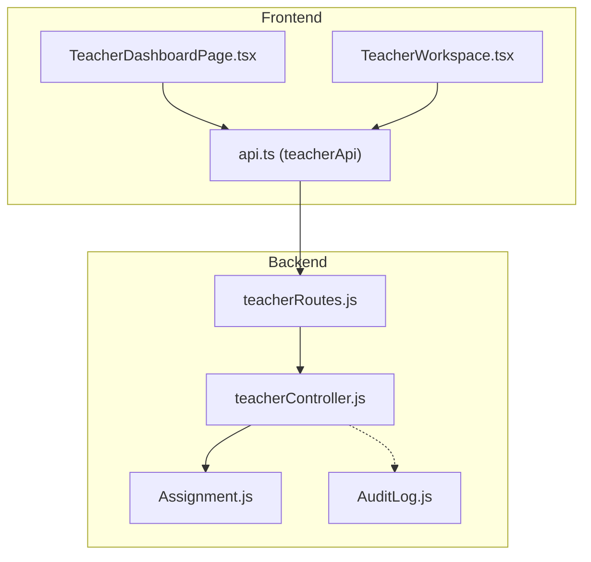
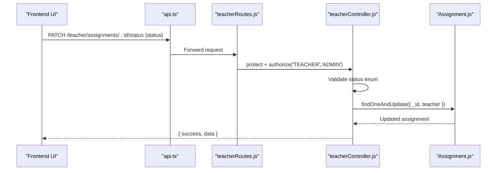
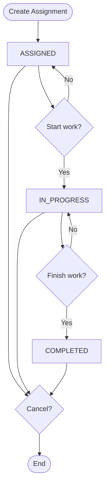
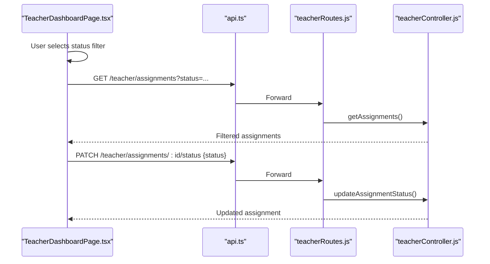
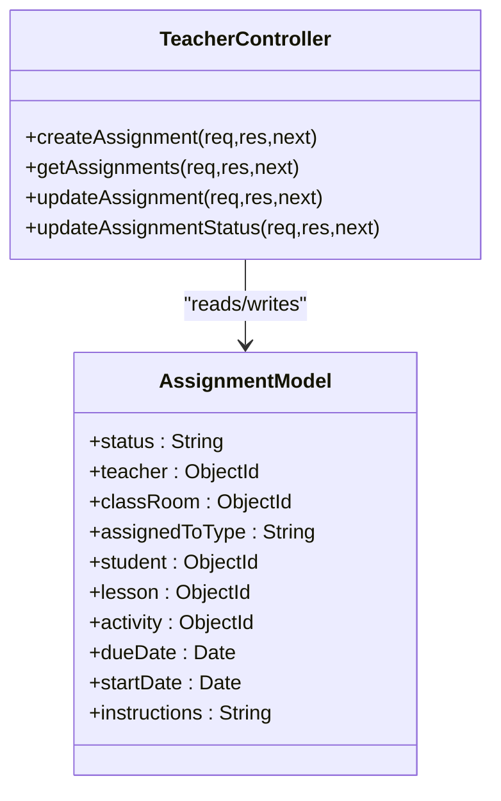
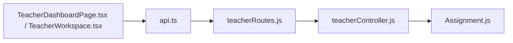

# Assignment Status Management

<cite>
**Referenced Files in This Document**
- [Assignment.js](file://KCEnglishKids_BE/src/models/Assignment.js)
- [AuditLog.js](file://KCEnglishKids_BE/src/models/AuditLog.js)
- [teacherController.js](file://KCEnglishKids_BE/src/controllers/teacherController.js)
- [teacherRoutes.js](file://KCEnglishKids_BE/src/routes/teacherRoutes.js)
- [api.ts](file://client/src/services/api.ts)
- [TeacherDashboardPage.tsx](file://client/src/dashboards/teacher/TeacherDashboardPage.tsx)
- [TeacherWorkspace.tsx](file://client/src/dashboards/teacher/TeacherWorkspace.tsx)
</cite>

## Table of Contents
1. [Introduction](#introduction)
2. [Project Structure](#project-structure)
3. [Core Components](#core-components)
4. [Architecture Overview](#architecture-overview)
5. [Detailed Component Analysis](#detailed-component-analysis)
6. [Dependency Analysis](#dependency-analysis)
7. [Performance Considerations](#performance-considerations)
8. [Troubleshooting Guide](#troubleshooting-guide)
9. [Conclusion](#conclusion)

## Introduction
This document explains assignment status management across the system. It covers the complete status lifecycle, business rules for transitions, UI components for status updates, bulk operations, automated changes based on completion criteria, permission model, audit trail, and examples of filtering and reporting.

## Project Structure
Assignment status is primarily implemented in the backend teacher controller and routes, with a corresponding data model. The frontend provides teacher dashboards and workspace views that create assignments, filter by status, update status, and cancel assignments.

**Diagram sources**
- [TeacherDashboardPage.tsx:257-264](file://client/src/dashboards/teacher/TeacherDashboardPage.tsx#L257-L264)
- [TeacherWorkspace.tsx:31-34](file://client/src/dashboards/teacher/TeacherWorkspace.tsx#L31-L34)
- [api.ts:207-228](file://client/src/services/api.ts#L207-L228)
- [teacherRoutes.js:23-27](file://KCEnglishKids_BE/src/routes/teacherRoutes.js#L23-L27)
- [teacherController.js:66-72](file://KCEnglishKids_BE/src/controllers/teacherController.js#L66-L72)
- [Assignment.js:42-46](file://KCEnglishKids_BE/src/models/Assignment.js#L42-L46)
- [AuditLog.js:1-34](file://KCEnglishKids_BE/src/models/AuditLog.js#L1-L34)

**Section sources**
- [Assignment.js:1-56](file://KCEnglishKids_BE/src/models/Assignment.js#L1-L56)
- [teacherController.js:66-72](file://KCEnglishKids_BE/src/controllers/teacherController.js#L66-L72)
- [teacherRoutes.js:23-27](file://KCEnglishKids_BE/src/routes/teacherRoutes.js#L23-L27)
- [api.ts:207-228](file://client/src/services/api.ts#L207-L228)
- [TeacherDashboardPage.tsx:257-264](file://client/src/dashboards/teacher/TeacherDashboardPage.tsx#L257-L264)
- [TeacherWorkspace.tsx:31-34](file://client/src/dashboards/teacher/TeacherWorkspace.tsx#L31-L34)

## Core Components
- Data model: Assignment schema defines the allowed statuses and default state.
- Backend endpoints: Teacher routes expose CRUD and status update endpoints protected by role-based middleware.
- Controller logic: Validates inputs, enforces ownership, filters by class or status, and updates status.
- Frontend services: A typed API client exposes methods to list, create, update, and cancel assignments.
- Frontend UI: Dashboard and workspace pages provide status filtering, inline status updates, and cancellation flows.

Key responsibilities:
- Model: Enforce enum values for status and defaults.
- Routes: Restrict access to teachers/admins and map HTTP verbs to controller actions.
- Controller: Validate and enforce business rules for editing and status changes; support filtering by status.
- Client: Provide convenient methods for status operations and cancellation.
- UI: Render status badges, allow status transitions, and show filtered lists.

**Section sources**
- [Assignment.js:42-46](file://KCEnglishKids_BE/src/models/Assignment.js#L42-L46)
- [teacherRoutes.js:8-8](file://KCEnglishKids_BE/src/routes/teacherRoutes.js#L8-L8)
- [teacherController.js:69-72](file://KCEnglishKids_BE/src/controllers/teacherController.js#L69-L72)
- [api.ts:207-228](file://client/src/services/api.ts#L207-L228)
- [TeacherDashboardPage.tsx:829-852](file://client/src/dashboards/teacher/TeacherDashboardPage.tsx#L829-L852)

## Architecture Overview
The assignment status flow involves the frontend calling the teacher API, which is secured by middleware and routed to the teacher controller. The controller validates the request, checks ownership, and updates the assignment status in the database.

**Diagram sources**
- [api.ts:32-40](file://client/src/services/api.ts#L32-L40)
- [api.ts:225-227](file://client/src/services/api.ts#L225-L227)
- [teacherRoutes.js:8-8](file://KCEnglishKids_BE/src/routes/teacherRoutes.js#L8-L8)
- [teacherRoutes.js:27-27](file://KCEnglishKids_BE/src/routes/teacherRoutes.js#L27-L27)
- [teacherController.js:72-72](file://KCEnglishKids_BE/src/controllers/teacherController.js#L72-L72)
- [Assignment.js:42-46](file://KCEnglishKids_BE/src/models/Assignment.js#L42-L46)

## Detailed Component Analysis

### Assignment Status Lifecycle and Business Rules
Allowed statuses:
- ASSIGNED: Default when an assignment is created.
- IN_PROGRESS: Work has started.
- COMPLETED: Work is finished.
- CANCELLED: Assignment is cancelled.

Business rules enforced by the backend:
- Status values are validated against the allowed enum.
- Only the assignment’s owner teacher can modify it.
- Editing non-status fields is blocked for COMPLETED or CANCELLED assignments.
- Status updates do not check previous state, so any valid status can be set by the owner.

Recommended transition rules (for implementation guidance):
- ASSIGNED → IN_PROGRESS
- IN_PROGRESS → COMPLETED
- Any → CANCELLED
- Avoid direct transitions like ASSIGNED → COMPLETED unless explicitly required by policy.

Current implementation notes:
- The controller accepts any of the four statuses without enforcing a specific transition graph.
- Ownership is enforced via the teacher field in the query.
- Non-status edits are restricted for COMPLETED and CANCELLED.

[No sources needed since this diagram shows conceptual workflow, not actual code structure]

**Section sources**
- [Assignment.js:42-46](file://KCEnglishKids_BE/src/models/Assignment.js#L42-L46)
- [teacherController.js:71-72](file://KCEnglishKids_BE/src/controllers/teacherController.js#L71-L72)

### UI Components for Status Updates
- Status filter dropdown: Allows filtering assignments by status.
- Status badge: Displays current status per assignment row.
- Inline status controls: Trigger status updates through the API.
- Detail view: Shows assignment status and allows cancellation.

Examples:
- Filtering by status uses the status query parameter.
- Updating status calls the patch endpoint with the new status.
- Cancelling an assignment sets status to CANCELLED.

**Diagram sources**
- [TeacherDashboardPage.tsx:829-852](file://client/src/dashboards/teacher/TeacherDashboardPage.tsx#L829-L852)
- [TeacherDashboardPage.tsx:257-264](file://client/src/dashboards/teacher/TeacherDashboardPage.tsx#L257-L264)
- [api.ts:207-228](file://client/src/services/api.ts#L207-L228)
- [teacherRoutes.js:23-27](file://KCEnglishKids_BE/src/routes/teacherRoutes.js#L23-L27)
- [teacherController.js:69-72](file://KCEnglishKids_BE/src/controllers/teacherController.js#L69-L72)

**Section sources**
- [TeacherDashboardPage.tsx:829-852](file://client/src/dashboards/teacher/TeacherDashboardPage.tsx#L829-L852)
- [TeacherDashboardPage.tsx:257-264](file://client/src/dashboards/teacher/TeacherDashboardPage.tsx#L257-L264)
- [TeacherWorkspace.tsx:31-34](file://client/src/dashboards/teacher/TeacherWorkspace.tsx#L31-L34)
- [api.ts:207-228](file://client/src/services/api.ts#L207-L228)

### Bulk Status Operations
- Current implementation supports single-assignment status updates.
- No dedicated bulk status endpoint exists for assignments.
- Recommended approach: Implement a server-side bulk endpoint that iterates over assignment IDs, applies validation and ownership checks, and updates statuses atomically where possible.

Operational considerations:
- Validate all requested IDs and ensure they belong to the requesting teacher.
- Apply consistent transition rules per item.
- Return per-item results indicating success/failure.

[No sources needed since this section provides general guidance]

### Automated Status Changes Based on Completion Criteria
- There is no automatic status change triggered by activity completion in the current codebase.
- Suggested automation:
  - When all children associated with an assignment have completed their related activities, set the assignment status to COMPLETED.
  - For student-specific assignments, mark COMPLETED when the child’s activity result indicates completion.
- Implementation options:
  - Event-driven: On activity result submission, compute completion and update assignment status.
  - Scheduled job: Periodically scan assignments and update status based on aggregated results.

[No sources needed since this section provides general guidance]

### Permission Model for Status Modifications
- Access control: All teacher routes are protected by middleware requiring TEACHER or ADMIN roles.
- Ownership: Status updates require the assignment to belong to the authenticated teacher.
- Edit restrictions: Non-status fields cannot be edited once an assignment is COMPLETED or CANCELLED.

**Diagram sources**
- [teacherController.js:66-72](file://KCEnglishKids_BE/src/controllers/teacherController.js#L66-L72)
- [Assignment.js:1-56](file://KCEnglishKids_BE/src/models/Assignment.js#L1-L56)

**Section sources**
- [teacherRoutes.js:8-8](file://KCEnglishKids_BE/src/routes/teacherRoutes.js#L8-L8)
- [teacherController.js:71-72](file://KCEnglishKids_BE/src/controllers/teacherController.js#L71-L72)

### Audit Trail for Status Changes
- The existing AuditLog model does not include an ASSIGNMENT_STATUS_CHANGE action type.
- To add auditability:
  - Extend the AuditLog action enum to include assignment-related actions such as ASSIGNMENT_CREATED, ASSIGNMENT_STATUS_CHANGED, ASSIGNMENT_CANCELLED.
  - Log each status change with user, target type, target id, and details including old/new status.
  - Expose admin endpoints to retrieve assignment-related audit logs.

Current audit log capabilities:
- Tracks user-related actions and content toggles but not assignment status changes.

**Section sources**
- [AuditLog.js:1-34](file://KCEnglishKids_BE/src/models/AuditLog.js#L1-L34)

### Examples of Status-Based Filtering and Reporting
- Filtering:
  - Use the status query parameter to filter assignments by ASSIGNED, IN_PROGRESS, COMPLETED, or CANCELLED.
- Reporting:
  - Dashboard metrics count active assignments (ASSIGNED or IN_PROGRESS) and completed assignments.
  - Class detail view includes assignments for a class, enabling per-class reporting.

Implementation references:
- Filtering by status in the controller query.
- Dashboard metrics calculation using status filters.

**Section sources**
- [teacherController.js:69-69](file://KCEnglishKids_BE/src/controllers/teacherController.js#L69-L69)
- [teacherController.js:12-17](file://KCEnglishKids_BE/src/controllers/teacherController.js#L12-L17)

## Dependency Analysis
Assignment status functionality depends on:
- Routes: Define endpoints and apply role-based protection.
- Controller: Implements validation, ownership checks, and queries.
- Model: Defines schema constraints including status enum.
- Frontend: Provides UI and API client methods for status operations.

**Diagram sources**
- [teacherRoutes.js:23-27](file://KCEnglishKids_BE/src/routes/teacherRoutes.js#L23-L27)
- [teacherController.js:66-72](file://KCEnglishKids_BE/src/controllers/teacherController.js#L66-L72)
- [Assignment.js:42-46](file://KCEnglishKids_BE/src/models/Assignment.js#L42-L46)
- [TeacherDashboardPage.tsx:257-264](file://client/src/dashboards/teacher/TeacherDashboardPage.tsx#L257-L264)
- [TeacherWorkspace.tsx:31-34](file://client/src/dashboards/teacher/TeacherWorkspace.tsx#L31-L34)
- [api.ts:207-228](file://client/src/services/api.ts#L207-L228)

**Section sources**
- [teacherRoutes.js:23-27](file://KCEnglishKids_BE/src/routes/teacherRoutes.js#L23-L27)
- [teacherController.js:66-72](file://KCEnglishKids_BE/src/controllers/teacherController.js#L66-L72)
- [Assignment.js:42-46](file://KCEnglishKids_BE/src/models/Assignment.js#L42-L46)
- [api.ts:207-228](file://client/src/services/api.ts#L207-L228)

## Performance Considerations
- Query optimization:
  - Use indexes on frequently filtered fields such as teacher, classRoom, and status.
  - Populate only necessary fields to reduce payload size.
- Bulk operations:
  - If adding bulk status updates, use batched writes to minimize round trips.
- Frontend rendering:
  - Paginate large assignment lists to improve UI responsiveness.
- Metrics computation:
  - Cache dashboard metrics if datasets grow significantly.

[No sources needed since this section provides general guidance]

## Troubleshooting Guide
Common issues and resolutions:
- Invalid status value:
  - Ensure the status is one of the allowed enum values.
- Unauthorized access:
  - Verify the request is made by the assignment’s teacher or an admin.
- Cannot edit non-status fields:
  - Assignments in COMPLETED or CANCELLED states cannot be edited except for status updates.
- Filtering returns empty results:
  - Confirm the status query parameter matches the intended value.

Relevant error handling:
- Controller returns 400 for invalid input and 403 for unauthorized access.
- Frontend throws errors from the API client when responses are not ok.

**Section sources**
- [teacherController.js:71-72](file://KCEnglishKids_BE/src/controllers/teacherController.js#L71-L72)
- [api.ts:12-18](file://client/src/services/api.ts#L12-L18)

## Conclusion
Assignment status management is implemented with clear enum constraints and straightforward controller logic. The frontend provides robust UI for filtering, updating, and cancelling assignments. While the current system lacks automated status transitions and comprehensive audit logging for assignment status changes, these can be added by extending the controller logic and audit model. For production readiness, consider implementing strict transition rules, bulk operations, event-driven automation, and expanded audit trails.