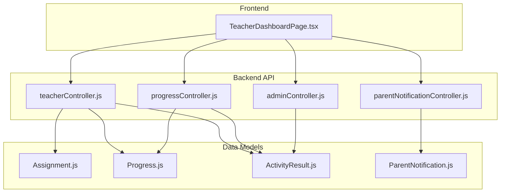
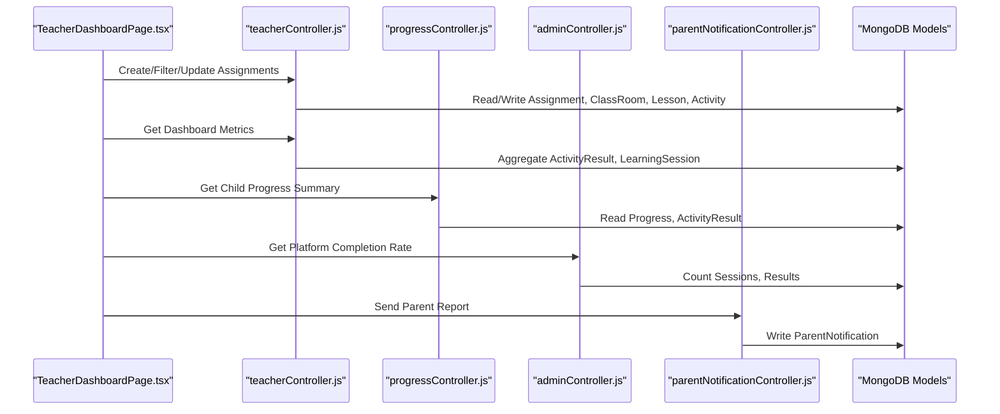
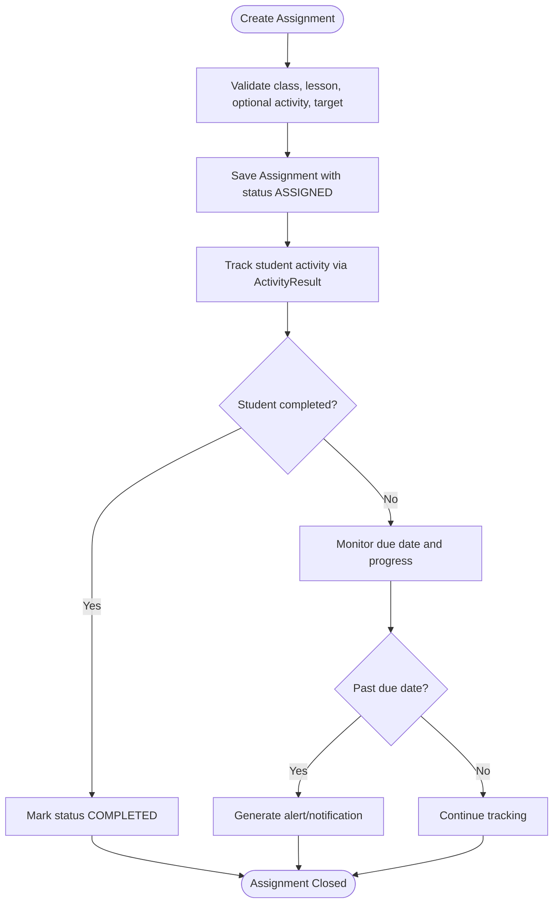
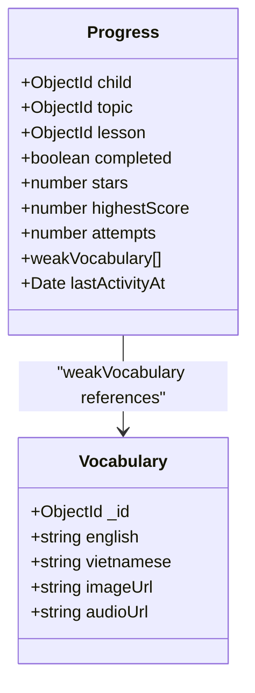
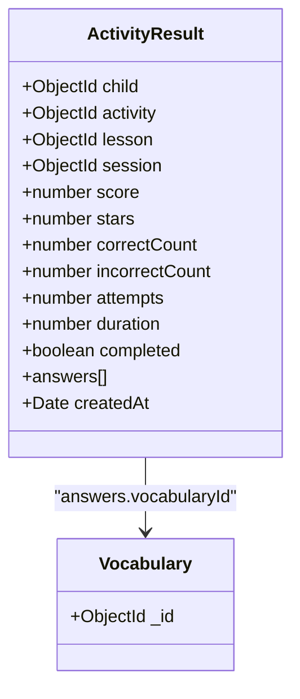
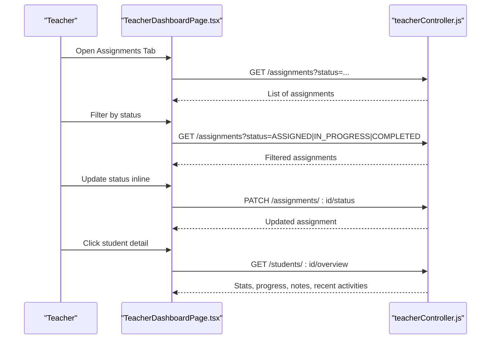
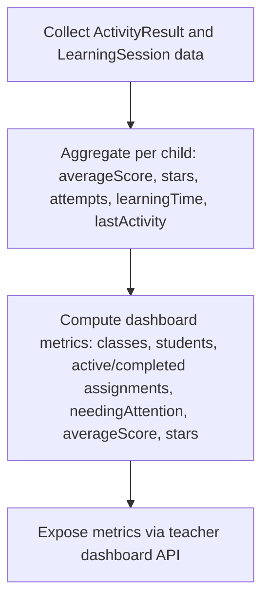
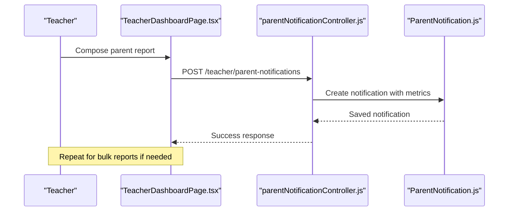
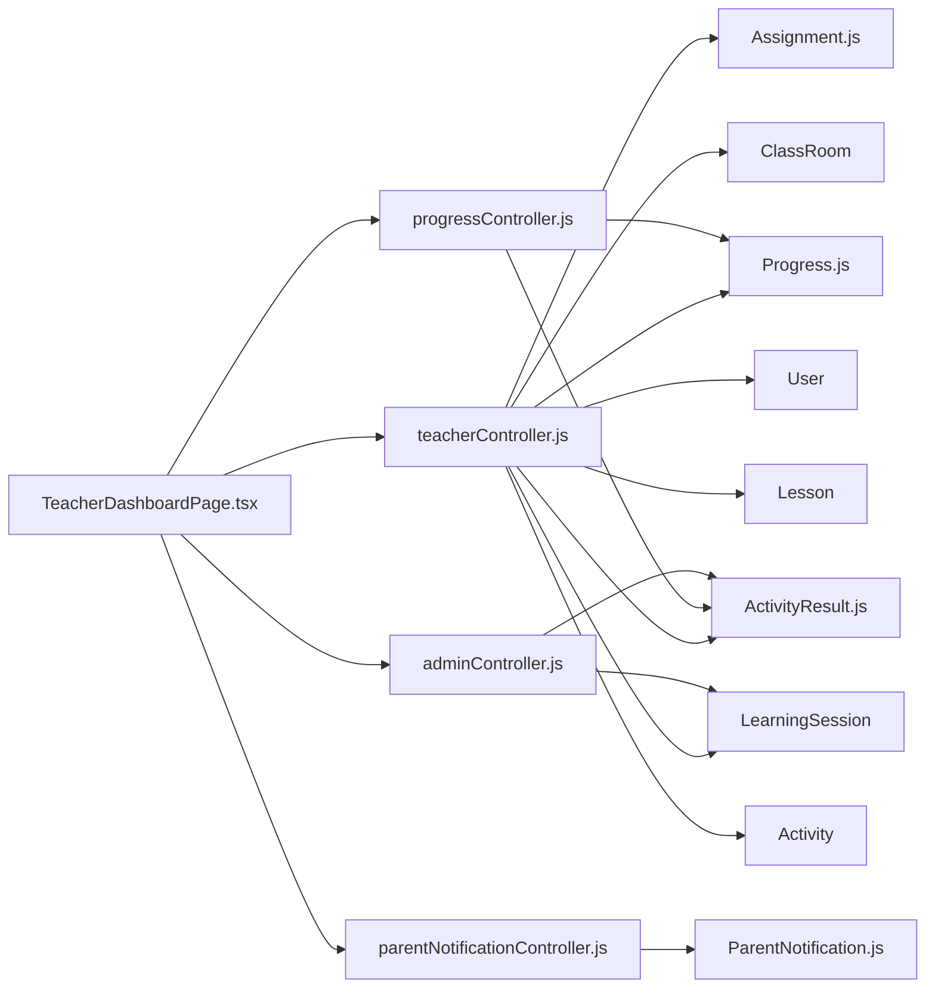

# Assignment Tracking & Monitoring

<cite>
**Referenced Files in This Document**
- [README.md](file://README.md)
- [Assignment.js](file://KCEnglishKids_BE/src/models/Assignment.js)
- [Progress.js](file://KCEnglishKids_BE/src/models/Progress.js)
- [ActivityResult.js](file://KCEnglishKids_BE/src/models/ActivityResult.js)
- [ParentNotification.js](file://KCEnglishKids_BE/src/models/ParentNotification.js)
- [progressController.js](file://KCEnglishKids_BE/src/controllers/progressController.js)
- [teacherController.js](file://KCEnglishKids_BE/src/controllers/teacherController.js)
- [adminController.js](file://KCEnglishKids_BE/src/controllers/adminController.js)
- [parentNotificationController.js](file://KCEnglishKids_BE/src/controllers/parentNotificationController.js)
- [TeacherDashboardPage.tsx](file://client/src/dashboards/teacher/TeacherDashboardPage.tsx)
</cite>

## Table of Contents
1. [Introduction](#introduction)
2. [Project Structure](#project-structure)
3. [Core Components](#core-components)
4. [Architecture Overview](#architecture-overview)
5. [Detailed Component Analysis](#detailed-component-analysis)
6. [Dependency Analysis](#dependency-analysis)
7. [Performance Considerations](#performance-considerations)
8. [Troubleshooting Guide](#troubleshooting-guide)
9. [Conclusion](#conclusion)

## Introduction
This document explains the assignment tracking and monitoring features for KCEnglishKids, focusing on:
- Real-time progress tracking interface for teachers
- Student completion status visualization
- Performance analytics such as completion rates, average scores, time spent, and stars
- Metrics collection from activity results and learning sessions
- Progress indicators including weak vocabulary and lesson completion
- Notification system for parent reports and potential overdue assignment alerts
- Reporting capabilities and integration with classroom management

The system is a two-layer platform combining curriculum foundation and interactive learning experiences, with backend REST APIs and React-based dashboards for teachers and administrators.

**Section sources**
- [README.md:1-48](file://README.md#L1-L48)

## Project Structure
The assignment tracking and monitoring functionality spans:
- Backend models for assignments, progress, activity results, and parent notifications
- Controllers that aggregate metrics, manage assignments, and expose teacher/admin endpoints
- Frontend teacher dashboard UI for assignment creation, filtering, status updates, and student drilldowns

**Diagram sources**
- [TeacherDashboardPage.tsx:186-276](file://client/src/dashboards/teacher/TeacherDashboardPage.tsx#L186-L276)
- [teacherController.js:12-72](file://KCEnglishKids_BE/src/controllers/teacherController.js#L12-L72)
- [progressController.js:6-66](file://KCEnglishKids_BE/src/controllers/progressController.js#L6-L66)
- [adminController.js:28-80](file://KCEnglishKids_BE/src/controllers/adminController.js#L28-L80)
- [parentNotificationController.js:15-99](file://KCEnglishKids_BE/src/controllers/parentNotificationController.js#L15-L99)
- [Assignment.js:3-55](file://KCEnglishKids_BE/src/models/Assignment.js#L3-L55)
- [Progress.js:3-64](file://KCEnglishKids_BE/src/models/Progress.js#L3-L64)
- [ActivityResult.js:3-77](file://KCEnglishKids_BE/src/models/ActivityResult.js#L3-L77)
- [ParentNotification.js:3-89](file://KCEnglishKids_BE/src/models/ParentNotification.js#L3-L89)

**Section sources**
- [README.md:95-138](file://README.md#L95-L138)

## Core Components
- Assignment model: tracks target audience (class or student), linked lesson/activity, due date, start date, status, and instructions
- Progress model: per-child per-lesson/topic records with completion flag, stars, highest score, attempts, weak vocabulary list, and last activity timestamp
- ActivityResult model: detailed performance record per activity with score, stars, correct/incorrect counts, attempts, duration, answers, and timestamps
- ParentNotification model: structured report to parents with child/class context, session linkage, metrics, template type, and delivery status

Key responsibilities:
- Teacher dashboard UI: create assignments, filter by status, update status, delete assignments, view class roster, drill into student overview, and pedagogical notes
- Teacher controller: compute dashboard metrics, manage assignments, aggregate student stats, and provide student overviews
- Progress controller: fetch child progress summary, aggregate weak vocabulary, and recent activity results
- Admin controller: compute platform-level completion rate and recent activity results
- Parent notification controller: send single or bulk learning reports to parents

**Section sources**
- [Assignment.js:3-55](file://KCEnglishKids_BE/src/models/Assignment.js#L3-L55)
- [Progress.js:3-64](file://KCEnglishKids_BE/src/models/Progress.js#L3-L64)
- [ActivityResult.js:3-77](file://KCEnglishKids_BE/src/models/ActivityResult.js#L3-L77)
- [ParentNotification.js:3-89](file://KCEnglishKids_BE/src/models/ParentNotification.js#L3-L89)
- [teacherController.js:12-72](file://KCEnglishKids_BE/src/controllers/teacherController.js#L12-L72)
- [progressController.js:6-66](file://KCEnglishKids_BE/src/controllers/progressController.js#L6-L66)
- [adminController.js:28-80](file://KCEnglishKids_BE/src/controllers/adminController.js#L28-L80)
- [parentNotificationController.js:15-111](file://KCEnglishKids_BE/src/controllers/parentNotificationController.js#L15-L111)
- [TeacherDashboardPage.tsx:186-276](file://client/src/dashboards/teacher/TeacherDashboardPage.tsx#L186-L276)

## Architecture Overview
The assignment tracking and monitoring architecture connects frontend teacher UI to backend controllers and data models. The flow includes:
- Teachers create assignments targeting classes or individual students
- Students complete activities; results are recorded in ActivityResult
- Progress records are updated per lesson/topic with stars, completion, and weak vocabulary
- Dashboards aggregate metrics from ActivityResult, LearningSession, and Assignment
- Parent notifications can be sent with session or progress metrics

**Diagram sources**
- [TeacherDashboardPage.tsx:186-276](file://client/src/dashboards/teacher/TeacherDashboardPage.tsx#L186-L276)
- [teacherController.js:12-72](file://KCEnglishKids_BE/src/controllers/teacherController.js#L12-L72)
- [progressController.js:6-66](file://KCEnglishKids_BE/src/controllers/progressController.js#L6-L66)
- [adminController.js:28-80](file://KCEnglishKids_BE/src/controllers/adminController.js#L28-L80)
- [parentNotificationController.js:15-111](file://KCEnglishKids_BE/src/controllers/parentNotificationController.js#L15-L111)

## Detailed Component Analysis

### Assignment Model and Lifecycle
The Assignment model supports:
- Targeting either an entire class or a specific student
- Linking to a lesson and optionally a specific activity
- Optional start and due dates
- Status lifecycle: ASSIGNED → IN_PROGRESS → COMPLETED or CANCELLED
- Instructions for students/parents

**Diagram sources**
- [Assignment.js:3-55](file://KCEnglishKids_BE/src/models/Assignment.js#L3-L55)
- [teacherController.js:66-72](file://KCEnglishKids_BE/src/controllers/teacherController.js#L66-L72)

**Section sources**
- [Assignment.js:3-55](file://KCEnglishKids_BE/src/models/Assignment.js#L3-L55)
- [teacherController.js:66-72](file://KCEnglishKids_BE/src/controllers/teacherController.js#L66-L72)

### Progress Model and Weak Vocabulary Tracking
The Progress model captures:
- Per-child per-lesson/topic completion state
- Stars awarded (0–3), highest score, attempts
- Weak vocabulary items with mistake counts
- Last activity timestamp for recency

**Diagram sources**
- [Progress.js:3-64](file://KCEnglishKids_BE/src/models/Progress.js#L3-L64)

**Section sources**
- [Progress.js:3-64](file://KCEnglishKids_BE/src/models/Progress.js#L3-L64)
- [progressController.js:6-66](file://KCEnglishKids_BE/src/controllers/progressController.js#L6-L66)

### ActivityResult Model and Performance Metrics
The ActivityResult model provides granular performance data:
- Score percentage, stars, correct/incorrect counts
- Attempts and duration in seconds
- Answer details including response time and vocabulary linkage
- Timestamps for chronological analysis

**Diagram sources**
- [ActivityResult.js:3-77](file://KCEnglishKids_BE/src/models/ActivityResult.js#L3-L77)

**Section sources**
- [ActivityResult.js:3-77](file://KCEnglishKids_BE/src/models/ActivityResult.js#L3-L77)

### Teacher Dashboard UI: Assignments and Student Drilldown
The teacher dashboard provides:
- Assignment creation modal with class, target, unit/lesson/activity selection, due date, and instructions
- Assignment list with status filters and inline status updates
- Student drilldown modal showing total stars, completed lessons, activity count, pedagogical notes, and recent activity history

**Diagram sources**
- [TeacherDashboardPage.tsx:186-276](file://client/src/dashboards/teacher/TeacherDashboardPage.tsx#L186-L276)
- [TeacherDashboardPage.tsx:818-943](file://client/src/dashboards/teacher/TeacherDashboardPage.tsx#L818-L943)
- [TeacherDashboardPage.tsx:1036-1184](file://client/src/dashboards/teacher/TeacherDashboardPage.tsx#L1036-L1184)
- [teacherController.js:54-56](file://KCEnglishKids_BE/src/controllers/teacherController.js#L54-L56)

**Section sources**
- [TeacherDashboardPage.tsx:186-276](file://client/src/dashboards/teacher/TeacherDashboardPage.tsx#L186-L276)
- [TeacherDashboardPage.tsx:818-943](file://client/src/dashboards/teacher/TeacherDashboardPage.tsx#L818-L943)
- [TeacherDashboardPage.tsx:1036-1184](file://client/src/dashboards/teacher/TeacherDashboardPage.tsx#L1036-L1184)
- [teacherController.js:54-56](file://KCEnglishKids_BE/src/controllers/teacherController.js#L54-L56)

### Metrics Collection and Analytics
Metrics collected include:
- Completion rates: computed from LearningSession counts
- Average scores: aggregated per child across ActivityResult
- Time spent: sum of durations from ActivityResult
- Stars: sum of stars awarded
- Needing attention: children with no results or average score below threshold

**Diagram sources**
- [teacherController.js:9-17](file://KCEnglishKids_BE/src/controllers/teacherController.js#L9-L17)
- [adminController.js:28-80](file://KCEnglishKids_BE/src/controllers/adminController.js#L28-L80)

**Section sources**
- [teacherController.js:9-17](file://KCEnglishKids_BE/src/controllers/teacherController.js#L9-L17)
- [adminController.js:28-80](file://KCEnglishKids_BE/src/controllers/adminController.js#L28-L80)

### Notification System for Parent Reports
The notification system enables:
- Single parent notification with child context, optional session linkage, metrics, and template type
- Bulk notifications after a session ends
- Structured fields for subject, content, teacher note, score, vocabulary mastery, stars, accuracy, and delivery status

**Diagram sources**
- [parentNotificationController.js:15-99](file://KCEnglishKids_BE/src/controllers/parentNotificationController.js#L15-L99)
- [ParentNotification.js:3-89](file://KCEnglishKids_BE/src/models/ParentNotification.js#L3-L89)

**Section sources**
- [parentNotificationController.js:15-111](file://KCEnglishKids_BE/src/controllers/parentNotificationController.js#L15-L111)
- [ParentNotification.js:3-89](file://KCEnglishKids_BE/src/models/ParentNotification.js#L3-L89)

### Overdue Assignment Alerts
While there is no explicit automated overdue alert endpoint, the system supports:
- Due date storage in Assignment model
- Status tracking (ASSIGNED, IN_PROGRESS, COMPLETED, CANCELLED)
- Frontend display of due dates and status badges
Potential enhancement:
- Add a scheduled job to check due dates and generate ParentNotification entries or teacher-facing alerts for overdue assignments

**Section sources**
- [Assignment.js:34-46](file://KCEnglishKids_BE/src/models/Assignment.js#L34-L46)
- [TeacherDashboardPage.tsx:911-916](file://client/src/dashboards/teacher/TeacherDashboardPage.tsx#L911-L916)

## Dependency Analysis
The assignment tracking and monitoring components have clear dependencies:
- TeacherDashboardPage depends on teacherController for assignments and student overviews
- teacherController depends on Assignment, Progress, ActivityResult, LearningSession, ClassRoom, User, Lesson, Activity
- progressController depends on Progress and ActivityResult
- adminController depends on ActivityResult and LearningSession for completion rate
- parentNotificationController depends on ParentNotification and related entities

**Diagram sources**
- [TeacherDashboardPage.tsx:186-276](file://client/src/dashboards/teacher/TeacherDashboardPage.tsx#L186-L276)
- [teacherController.js:1-72](file://KCEnglishKids_BE/src/controllers/teacherController.js#L1-L72)
- [progressController.js:1-66](file://KCEnglishKids_BE/src/controllers/progressController.js#L1-L66)
- [adminController.js:1-80](file://KCEnglishKids_BE/src/controllers/adminController.js#L1-L80)
- [parentNotificationController.js:1-111](file://KCEnglishKids_BE/src/controllers/parentNotificationController.js#L1-L111)

**Section sources**
- [teacherController.js:1-72](file://KCEnglishKids_BE/src/controllers/teacherController.js#L1-L72)
- [progressController.js:1-66](file://KCEnglishKids_BE/src/controllers/progressController.js#L1-L66)
- [adminController.js:1-80](file://KCEnglishKids_BE/src/controllers/adminController.js#L1-L80)
- [parentNotificationController.js:1-111](file://KCEnglishKids_BE/src/controllers/parentNotificationController.js#L1-L111)

## Performance Considerations
- Aggregation queries: Use MongoDB aggregation pipelines for efficient computation of average scores, stars, attempts, and learning time
- Indexing: Ensure indexes on frequently queried fields like child, lesson, activity, and timestamps
- Pagination and limits: Apply limits when fetching recent activities and sessions to reduce payload size
- Caching: Consider caching dashboard metrics for short intervals to reduce database load during peak usage
- Batch operations: Use bulk writes for parent notifications when sending multiple reports

[No sources needed since this section provides general guidance]

## Troubleshooting Guide
Common issues and resolutions:
- Assignment cannot be edited: Occurs when trying to edit assignments with status COMPLETED or CANCELLED
- Invalid assignment status: Ensure status values are one of ASSIGNED, IN_PROGRESS, COMPLETED, CANCELLED
- Access denied: Verify teacher ownership of classroom or assignment before performing updates
- Missing child data: Confirm child exists and is within the teacher’s accessible classes
- Parent notification validation: Ensure valid childId and required fields are provided

Recommended checks:
- Validate request payloads against model constraints
- Check role-based access control middleware
- Review error responses from controllers for precise messages

**Section sources**
- [teacherController.js:66-72](file://KCEnglishKids_BE/src/controllers/teacherController.js#L66-L72)
- [progressController.js:6-13](file://KCEnglishKids_BE/src/controllers/progressController.js#L6-L13)
- [parentNotificationController.js:15-27](file://KCEnglishKids_BE/src/controllers/parentNotificationController.js#L15-L27)

## Conclusion
The assignment tracking and monitoring system integrates robust backend models and controllers with a teacher-focused frontend dashboard. It supports comprehensive metrics collection, progress visualization, and parent reporting. While overdue alerts are not fully automated, the system provides the necessary data structures and UI elements to implement alerting workflows. Future enhancements could include scheduled overdue detection, advanced analytics dashboards, and exportable reports for administrative review.

[No sources needed since this section summarizes without analyzing specific files]